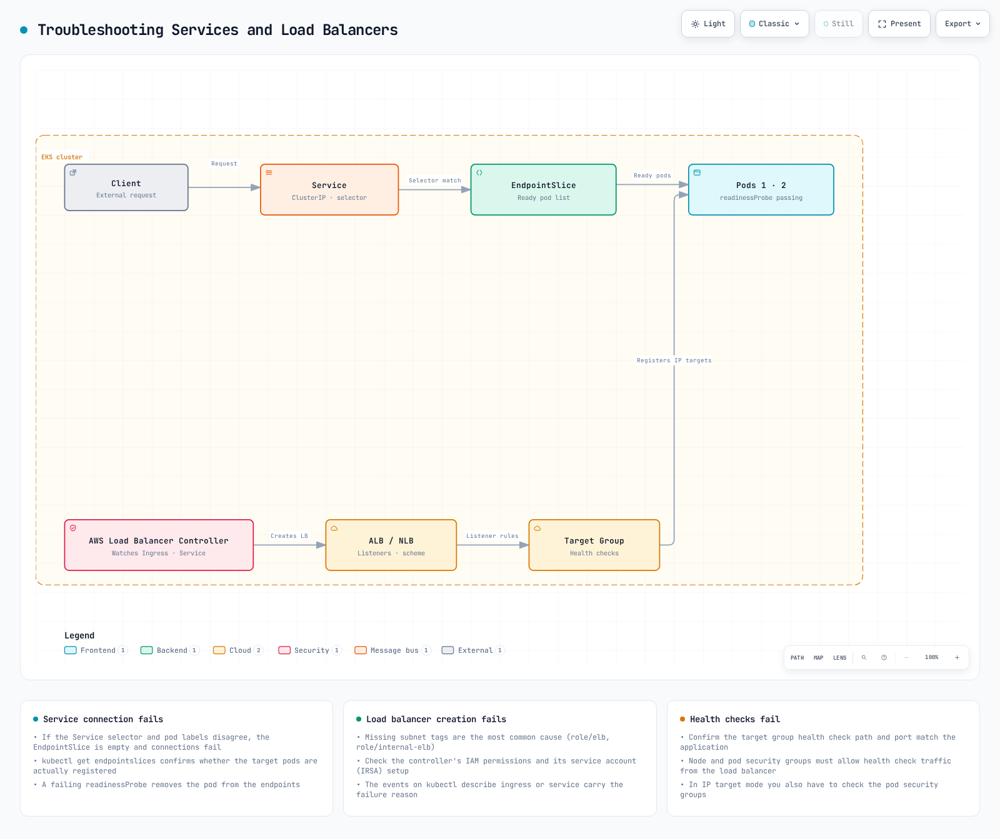

# Parte 3: Solución de problemas

> **Versiones del ejemplo verificadas**: EKS Kubernetes 1.36, Amazon VPC CNI 1.23.2
> **Última actualización**: October 16, 2026

## Descripción general

Este documento aborda la optimización del rendimiento, los métodos de solución de problemas y los casos de uso avanzados de redes de Amazon EKS. Analizaremos cómo optimizar el rendimiento de la red, resolver problemas de redes habituales y aprovechar las funciones avanzadas de redes.

## Optimización del rendimiento de la red

Hay varias estrategias para optimizar el rendimiento de la red en los clústeres de EKS.

<!-- Diagram repair pending: see batch report.


[🔍 View interactive diagram](https://www.atomai.click/kubernetes-docs/archmaps/en-eks-03-eks-networking-part3-0.html)
-->

### Selección del tipo de instancia

C5/M5/R5 son ejemplos de familias compatibles con ENA, no una recomendación para elegir una generación anterior. Compare el ancho de banda de referencia y en ráfagas, los paquetes por segundo, el seguimiento de conexiones, las colas de ENA, los límites de flujo único y la CPU de la carga de trabajo del tipo de instancia concreto. Los tamaños más grandes no mejoran la latencia en todos los casos, y 100 Gbps no es un límite universal de ENA.

Las [especificaciones oficiales de M5](https://docs.aws.amazon.com/ec2/latest/instancetypes/gp.html) indican **m5.large: 0.75 Gbps de referencia / hasta 10 Gbps en ráfagas** y **m5.24xlarge: 25 Gbps**. Estos son límites de la instancia, no el rendimiento medido de la aplicación. El tráfico sostenido, el destino y las restricciones de flujo único pueden ser determinantes. Consulte la región prevista en lugar de extrapolar a partir del nombre de una familia:
```bash
set -euo pipefail
: "${AWS_REGION:?Set the instance Region}"
aws ec2 describe-instance-types --region "$AWS_REGION" \
  --instance-types m5.large m5.24xlarge \
  --query 'InstanceTypes[].{Type:InstanceType,Network:NetworkInfo.NetworkPerformance,Cards:NetworkInfo.NetworkCards,ENIs:NetworkInfo.MaximumNetworkInterfaces,IPsPerENI:NetworkInfo.Ipv4AddressesPerInterface}'
```

### Modos de redes del clúster

EKS admite varios modos de redes, cada uno con distintas características de rendimiento.


[🔍 Ver el diagrama interactivo](https://www.atomai.click/kubernetes-docs/archmaps/en-eks-03-eks-networking-part3-1.html)

1. **Amazon VPC CNI (nodos EC2 normales)**:
   * Asigna direcciones IP de VPC directamente a los Pods.
   * Usa el direccionamiento nativo de VPC; el rendimiento y la latencia siguen dependiendo de los límites de la instancia y de la ruta. La delegación de prefijos cambia principalmente la asignación de IP y la densidad de Pods, no la latencia de la ruta de los paquetes.
   * Cada nodo tiene un límite en la cantidad de direcciones IP que puede asignar.
2. **Redes personalizadas**:
   * Permiten asignar a los Pods direcciones IP de subredes específicas.
   * Pueden usar CIDR secundarios de VPC enrutados correctamente mediante subredes ENIConfig de la misma VPC y zona de disponibilidad. No amplían una subred existente en el sitio.
   * Ofrecen un control más detallado de la topología de red.
3. **Complementos CNI alternativos**:
   * Se pueden usar complementos CNI alternativos, como Calico y Cilium.
   * Las diferencias de funciones y rendimiento dependen del modo de solo políticas, encadenamiento o superposición, del cifrado y de la carga de trabajo. VPC CNI nativo también admite NetworkPolicy en los recursos informáticos compatibles. Auto Mode y Hybrid Nodes tienen modelos de redes y operaciones distintos; no sustituya su CNI siguiendo instrucciones para EC2 normal.

### Optimización de MTU

La variable de entorno real de VPC CNI es **`AWS_VPC_ENI_MTU`**, no `ENI_MTU`. En la versión 1.23.2, su valor predeterminado es 9001; `POD_MTU` controla las interfaces virtuales de los Pods y, si no se establece, deriva su valor de la MTU de la ENI. Inspeccione tanto los contenedores init como los principales antes de cambiar la configuración:
```bash
kubectl -n kube-system get daemonset aws-node -o json > aws-node-current.json
python3 - <<'PY'
import json
with open("aws-node-current.json") as stream:
    spec = json.load(stream)["spec"]["template"]["spec"]
for field in ("initContainers", "containers"):
    for container in spec.get(field, []):
        settings = {e["name"]: e.get("value", "<valueFrom>")
                    for e in container.get("env", [])
                    if e["name"] in {"AWS_VPC_ENI_MTU", "POD_MTU",
                      "DISABLE_TCP_EARLY_DEMUX", "POD_SECURITY_GROUP_ENFORCING_MODE"}}
        print(field, container["name"], settings)
PY
```
Si las pruebas de ruta determinan que 1500 es lo adecuado, combine este **fragmento de valores de Helm** con la configuración del propietario actual. Para un complemento de EKS, inspeccione el esquema de configuración exacto y conserve los valores existentes en lugar de aplicar parches a un DaemonSet administrado por Helm. Los cambios en las interfaces ENI/Pod pueden requerir una sustitución planificada de nodos/Pods; verifique por separado las interfaces recién creadas y las cargas de trabajo existentes.
```yaml
env:
  AWS_VPC_ENI_MTU: "1500"
  POD_MTU: "1500"
```
Las tramas jumbo pueden reducir la sobrecarga de los paquetes, pero toda la **ruta real** debe admitir el tamaño del paquete. Los SG y las subredes no son dispositivos configurables de MTU. Las rutas de las puertas de enlace de Internet/VPN suelen limitar la MTU a 1500; las puertas de enlace, el emparejamiento, los túneles y los balanceadores de carga tienen sus propios límites. Permita los mensajes ICMP necesarios de «se necesita fragmentación»/«paquete demasiado grande» de IPv6 para el descubrimiento de la MTU de ruta. Que un ping pequeño tenga éxito no demuestra que funcionen los paquetes grandes de la aplicación. El rango de CNI para IPv4 es 576–9001 y el de IPv6 es 1280–9001; un valor válido no demuestra que sea adecuado de extremo a extremo.

### Optimización de TCP

**TCP early demux:** no es un interruptor general de rendimiento. En el caso documentado del modo **strict** de grupos de seguridad de Pod, desactivarlo permite que las sondas TCP de kubelet lleguen a los Pods con branch-ENI. El ajuste pertenece a `aws-vpc-cni-init`, no al contenedor principal `aws-node`. El modo estándar no requiere esta solución alternativa. Aplíquela solo después de confirmar el modo y la ruta del fallo; el fragmento de Helm es:
```yaml
init:
  env:
    DISABLE_TCP_EARLY_DEMUX: "true"
```
**Keepalive:** TCP keepalive detecta conexiones inactivas o interrumpidas de larga duración solo cuando la aplicación lo habilita en el socket. Es distinto del agrupamiento de conexiones HTTP y no acelera las conexiones de corta duración. Lea primero los valores en el espacio de nombres de host/red afectado; ejecutar `sysctl` en la computadora portátil de un administrador lee esa computadora, no los nodos de EKS:
```bash
sysctl net.ipv4.tcp_keepalive_time net.ipv4.tcp_keepalive_intvl \
  net.ipv4.tcp_keepalive_probes net.ipv4.tcp_rmem net.ipv4.tcp_wmem \
  net.core.rmem_max net.core.wmem_max
```
Los valores originales 60/15/6 son un **ejemplo de ajuste no medido**, no valores predeterminados universales para producción. Para un kernel Linux compatible y una carga de trabajo que no use hostNetwork, estos sysctl forman parte del conjunto seguro de Kubernetes desde la versión 1.29. Combine solo los sysctl con el securityContext existente del Pod y conserve sus demás ajustes:
```yaml
spec:
  template:
    spec:
      securityContext:
        sysctls:
        - name: net.ipv4.tcp_keepalive_time
          value: "60"
        - name: net.ipv4.tcp_keepalive_intvl
          value: "15"
        - name: net.ipv4.tcp_keepalive_probes
          value: "6"
```
**Buffers:** dimensione los experimentos usando el producto ancho de banda-retardo en bytes: `bandwidth_bits_per_second × RTT_seconds / 8`. Importan el autoajuste de TCP, los flujos paralelos, las sustituciones de socket y la presión total de memoria. Los máximos anteriores de 16,777,216 bytes (16 MiB) y las ternas `4096 87380 16777216` / `4096 65536 16777216` son ejemplos, no valores óptimos medidos. `tcp_rmem`/`tcp_wmem` son sysctl seguros de Pod desde Kubernetes 1.32 con kernel 4.15 o posterior; no se debe asumir que los ajustes `net.core.*` tienen el mismo soporte de admisión/aislamiento. Para los cambios a nivel de nodo, utilice la configuración controlada por el propietario del nodo y compare los errores, la latencia, el rendimiento y la memoria antes y después.

### Ubicación y proximidad de los nodos

Estos son ejemplos alternativos de programación del mismo Deployment. Primero, cree Pods `app=cache` coincidentes en el mismo espacio de nombres. Una preferencia no fuerza la ubicación ni mueve los Pods que ya están en ejecución. El servidor Python es una herramienta de práctica; fije un digest de imagen aprobado para que los resultados sean reproducibles. Equilibre la proximidad con la distribución de réplicas y la tolerancia a fallos de nodos y zonas de disponibilidad; la ubicación en el mismo nodo comparte un dominio de fallo.

El rendimiento de la red puede mejorar si se optimizan la ubicación y la proximidad de los nodos.


[🔍 Ver el diagrama interactivo](https://www.atomai.click/kubernetes-docs/archmaps/en-eks-03-eks-networking-part3-2.html)

1. **Proximidad de la zona de disponibilidad**:
   * Coloque los Pods que se comunican con frecuencia en la misma zona de disponibilidad para reducir la latencia.
   * Use afinidad y antiafinidad de Pods para controlar dónde se ubican.

```yaml
apiVersion: apps/v1
kind: Deployment
metadata:
  name: web-server
spec:
  replicas: 3
  selector:
    matchLabels:
      app: web
  template:
    metadata:
      labels:
        app: web
    spec:
      automountServiceAccountToken: false
      securityContext:
        runAsNonRoot: true
        runAsUser: 10001
        runAsGroup: 10001
        seccompProfile:
          type: RuntimeDefault
      containers:
      - name: http
        image: python:3.13-alpine
        command:
        - python
        - -u
        - -c
        args:
        - |
          import os
          from http.server import BaseHTTPRequestHandler, HTTPServer
          class Handler(BaseHTTPRequestHandler):
              def do_GET(self):
                  self.send_response(200)
                  self.end_headers()
                  self.wfile.write((os.environ["APP_NAME"] + "\n").encode())
          HTTPServer(("0.0.0.0", 8080), Handler).serve_forever()
        env:
        - name: APP_NAME
          value: web
        ports:
        - name: http
          containerPort: 8080
        readinessProbe:
          httpGet:
            path: /health
            port: http
        resources:
          requests:
            cpu: 50m
            memory: 32Mi
          limits:
            cpu: 200m
            memory: 64Mi
        securityContext:
          allowPrivilegeEscalation: false
          readOnlyRootFilesystem: true
          capabilities:
            drop:
            - ALL
      affinity:
        podAffinity:
          preferredDuringSchedulingIgnoredDuringExecution:
          - weight: 100
            podAffinityTerm:
              labelSelector:
                matchExpressions:
                - key: app
                  operator: In
                  values:
                  - cache
              topologyKey: topology.kubernetes.io/zone
```

2. **Proximidad de los nodos**:
   * Coloque los Pods que se comunican con frecuencia en el mismo nodo para reducir los saltos de red.
   * Esto resulta especialmente útil para aplicaciones sensibles a la latencia.

```yaml
apiVersion: apps/v1
kind: Deployment
metadata:
  name: web-server
spec:
  replicas: 3
  selector:
    matchLabels:
      app: web
  template:
    metadata:
      labels:
        app: web
    spec:
      automountServiceAccountToken: false
      securityContext:
        runAsNonRoot: true
        runAsUser: 10001
        runAsGroup: 10001
        seccompProfile:
          type: RuntimeDefault
      containers:
      - name: http
        image: python:3.13-alpine
        command:
        - python
        - -u
        - -c
        args:
        - |
          import os
          from http.server import BaseHTTPRequestHandler, HTTPServer
          class Handler(BaseHTTPRequestHandler):
              def do_GET(self):
                  self.send_response(200)
                  self.end_headers()
                  self.wfile.write((os.environ["APP_NAME"] + "\n").encode())
          HTTPServer(("0.0.0.0", 8080), Handler).serve_forever()
        env:
        - name: APP_NAME
          value: web
        ports:
        - name: http
          containerPort: 8080
        readinessProbe:
          httpGet:
            path: /health
            port: http
        resources:
          requests:
            cpu: 50m
            memory: 32Mi
          limits:
            cpu: 200m
            memory: 64Mi
        securityContext:
          allowPrivilegeEscalation: false
          readOnlyRootFilesystem: true
          capabilities:
            drop:
            - ALL
      affinity:
        podAffinity:
          preferredDuringSchedulingIgnoredDuringExecution:
          - weight: 100
            podAffinityTerm:
              labelSelector:
                matchExpressions:
                - key: app
                  operator: In
                  values:
                  - cache
              topologyKey: kubernetes.io/hostname
```

3. **Preferencia de tráfico del Service**:

Para el ejemplo actual, use `trafficDistribution: PreferSameZone` con un proxy de Service compatible. Da preferencia a los endpoints listos de la misma zona y recurre a otros cuando no hay ninguno; no garantiza aislamiento ni evita los costos entre zonas. Asegúrese de que haya suficiente capacidad local. Si va a cambiar de enfoque intencionalmente, elimine la anotación existente `service.kubernetes.io/topology-mode: Auto`, ya que tiene prioridad. `internalTrafficPolicy: Local`/`externalTrafficPolicy: Local` imponen un comportamiento local al nodo más estricto para el tráfico correspondiente y tienen prioridad; pueden descartar tráfico si no hay un endpoint local.
```yaml
apiVersion: v1
kind: Service
metadata:
  name: my-service
spec:
  selector:
    app: my-app
  ports:
  - port: 80
    targetPort: 8080
  type: ClusterIP
  trafficDistribution: PreferSameZone
```

### Optimización de NetworkPolicy

Las reglas de permiso de Kubernetes NetworkPolicy son aditivas; el orden de las reglas o los nombres de las políticas no determinan que «gane la primera coincidencia». Colocar primero las reglas de uso frecuente no es una optimización portable. Los niveles/órdenes de Calico y las políticas de otros proveedores son API diferentes. Mantenga el aislamiento de ingreso/salida necesario y elimine las reglas duplicadas u obsoletas confirmadas a través de su propietario. Mida el tiempo de programación de políticas del motor seleccionado, el uso de reglas/mapas, la CPU y los paquetes descartados con una carga representativa; la cantidad de políticas por sí sola no demuestra que haya un cuello de botella.

## Solución de problemas de redes

Exploremos los problemas de redes habituales que pueden surgir en los clústeres de EKS y cómo resolverlos.


[🔍 Ver el diagrama interactivo](https://www.atomai.click/kubernetes-docs/archmaps/en-eks-03-eks-networking-part3-3.html)

### Problemas de redes de Pods

<!-- Diagram repair pending: see batch report.


[🔍 View interactive diagram](https://www.atomai.click/kubernetes-docs/archmaps/en-eks-03-eks-networking-part3-4.html)
-->

Empiece por los eventos reales del Pod. `ContainerCreating` puede indicar un fallo de CNI/IPAM, imagen, volumen o runtime; no demuestra que se hayan agotado las IP. Correlacione el nodo afectado, las direcciones disponibles de la subred, los límites de ENI/IP, la fragmentación de prefijos, los errores o la limitación de solicitudes de API y los registros de CNI:
```bash
set -euo pipefail
: "${APP_NAMESPACE:?Set the affected namespace}"
: "${APP_POD:?Set the affected Pod}"
: "${APP_SERVICE:?Set the affected Service}"
kubectl -n "$APP_NAMESPACE" describe pod "$APP_POD"
kubectl -n "$APP_NAMESPACE" get events --field-selector "involvedObject.name=$APP_POD" --sort-by=.metadata.creationTimestamp
kubectl -n "$APP_NAMESPACE" get service "$APP_SERVICE" -o yaml
kubectl -n "$APP_NAMESPACE" get endpointslices \
  -l "kubernetes.io/service-name=$APP_SERVICE" -o yaml
kubectl -n "$APP_NAMESPACE" get networkpolicy
kubectl -n kube-system logs -l k8s-app=aws-node -c aws-node --tail=200 --prefix=true
```
**Asignación de IP:** aumentar `WARM_IP_TARGET` reserva más direcciones libres y puede empeorar el agotamiento de la subred. Ajuste los objetivos de direcciones libres solo en función de los requisitos observados de asignación/inicio y de la capacidad disponible. Una subred sin un bloque /28 contiguo no puede asignar un prefijo solo porque tenga muchas IP libres en total. Cambiar el tamaño del nodo no amplía la subred. Planifique las reservas de subredes/prefijos, una densidad de nodos compatible o una migración de redes gradual después de identificar el cuello de botella.

**Conectividad:** compare las rutas dentro del mismo nodo, entre nodos, entre zonas, por IP de Pod y por Service con el protocolo TCP/UDP real de la aplicación. Un fallo de DNS, la ausencia de una herramienta o el bloqueo de ICMP no demuestran que NetworkPolicy esté denegando el tráfico. Lo siguiente presupone que ya existe un Pod de diagnóstico aprobado con las herramientas indicadas; adapte el sufijo DNS del clúster y la URL de destino. No instale herramientas con privilegios en Pods de producción solo para ejecutar estos comandos:
```bash
set -euo pipefail
: "${APP_NAMESPACE:?Set the affected namespace}"
: "${DIAGNOSTIC_POD:?Set a running diagnostic Pod with curl and DNS tools}"
: "${TARGET_URL:?Set the real application URL and port}"
kubectl -n "$APP_NAMESPACE" exec "$DIAGNOSTIC_POD" -- cat /etc/resolv.conf
kubectl -n "$APP_NAMESPACE" exec "$DIAGNOSTIC_POD" -- nslookup kubernetes.default.svc.cluster.local
kubectl -n "$APP_NAMESPACE" exec "$DIAGNOSTIC_POD" -- curl \
  --fail --show-error --max-time 10 "$TARGET_URL"
```
**DNS:** inspeccione dnsPolicy/dnsConfig, resolv.conf, el Service/EndpointSlices de DNS, los eventos/registros de CoreDNS y la accesibilidad de servidores upstream. `nslookup` y `dig` son alternativas, pero no está garantizado que estén incluidos en la imagen de la aplicación. El DNS nativo de Auto Mode tiene una ruta de administración diferente; que no exista un Deployment tradicional de CoreDNS no indica automáticamente un fallo. Conserve la configuración del complemento administrado y las pruebas antes de considerar un reinicio.

### Problemas de Service y balanceo de carga



[🔍 Ver el diagrama interactivo](https://www.atomai.click/kubernetes-docs/archmaps/en-eks-03-eks-networking-part3-5.html)

**Ruta del Service:** verifique el espacio de nombres, las etiquetas del selector, el puerto real en el que escucha la aplicación, el puerto/targetPort del Service, la disponibilidad y las direcciones/condiciones de EndpointSlice. Use EndpointSlices en lugar de la API de Endpoints heredada, que puede truncar grandes conjuntos de backends. Luego inspeccione el modo real del proxy de Service/CNI y cualquier política de tráfico o preferencia de proximidad.

**Balanceador de carga/Ingress:** identifique primero el controlador propietario y la clase. Para LBC normal, inspeccione los eventos de Ingress, los registros del controlador y los códigos de motivo del estado de los destinos de AWS. Auto Mode usa un controlador administrado con una ruta de diagnóstico diferente. Compruebe el esquema/la accesibilidad del cliente, la detección/configuración de subredes, las reglas de SG del frontend y de los destinos, el tipo de destino real, el puerto/ruta de comprobación de estado, el certificado/SNI y el DNS. Una etiqueta de subred no crea una ruta, y que el controlador esté «Running» no demuestra que los destinos estén en buen estado.
```bash
set -euo pipefail
: "${APP_NAMESPACE:?Set the affected namespace}"
: "${INGRESS_NAME:?Set the affected Ingress}"
: "${AWS_REGION:?Set the load balancer Region}"
: "${TARGET_GROUP_ARN:?Set the target group identified from this Ingress}"
kubectl -n "$APP_NAMESPACE" describe ingress "$INGRESS_NAME"
kubectl -n kube-system logs -l app.kubernetes.io/name=aws-load-balancer-controller --tail=200 --prefix=true
aws elbv2 describe-target-health --region "$AWS_REGION" --target-group-arn "$TARGET_GROUP_ARN"
```
Cambie una causa confirmada a la vez, mantenga una ruta de reversión y repita las mismas comprobaciones positivas y negativas de la aplicación. Los comandos anteriores son ejemplos de diagnóstico; esta auditoría no se ejecutó en un clúster de EKS.

Referencias oficiales: [Ancho de banda de EC2](https://docs.aws.amazon.com/AWSEC2/latest/UserGuide/ec2-instance-network-bandwidth.html), [MTU](https://docs.aws.amazon.com/AWSEC2/latest/UserGuide/network_mtu.html), [Ajustes de VPC CNI 1.23.2](https://github.com/aws/amazon-vpc-cni-k8s/blob/v1.23.2/README.md), [sysctl de Kubernetes](https://kubernetes.io/docs/tasks/administer-cluster/sysctl-cluster/), [Distribución del tráfico de Service](https://kubernetes.io/docs/reference/networking/virtual-ips/).

## Cuestionario

Para comprobar lo que ha aprendido en este capítulo, pruebe el [cuestionario del tema](../quizzes/eks/03-eks-networking-part3-quiz.md).
