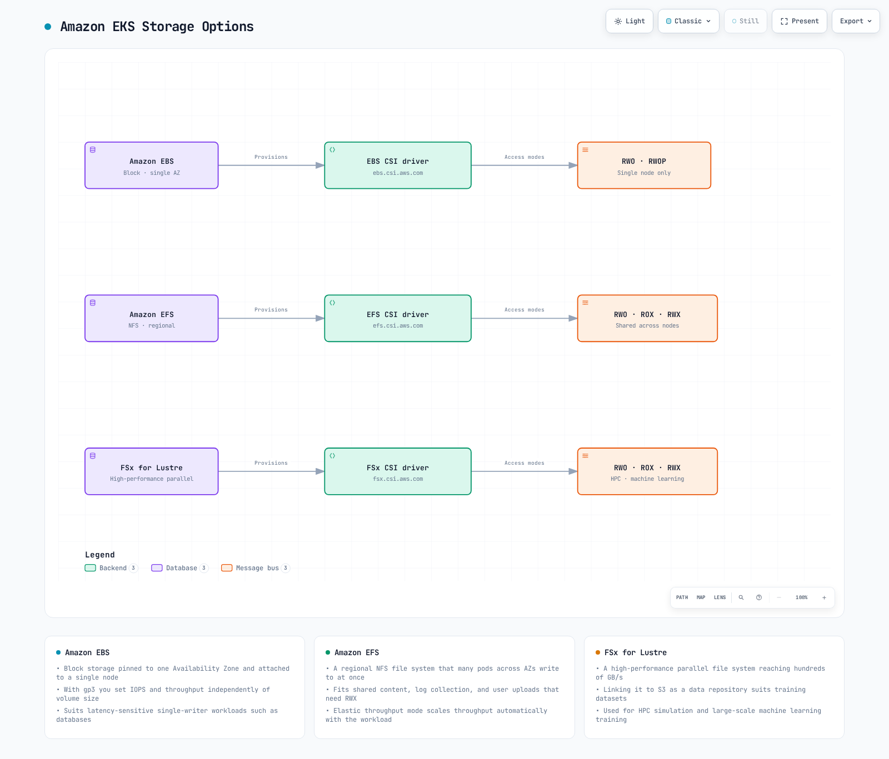
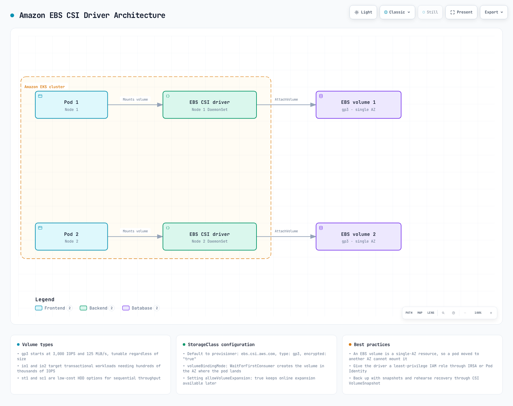

# Almacenamiento de EKS

> **Última actualización**: 28 de septiembre de 2026

Al ejecutar aplicaciones en Amazon EKS, hay diversas opciones de almacenamiento para guardar y administrar datos. Este documento cubre los conceptos básicos del almacenamiento de EKS y cómo usar Amazon EBS (Elastic Block Store) y Amazon EFS (Elastic File System).

## Tabla de contenido

1. [Conceptos básicos del almacenamiento de Kubernetes](04-eks-storage-part1.md#kubernetes-storage-basic-concepts)
2. [Descripción general de las opciones de almacenamiento de Amazon EKS](04-eks-storage-part1.md#amazon-eks-storage-options-overview)
3. [Almacenamiento con Amazon EBS](04-eks-storage-part1.md#storage-with-amazon-ebs)
4. [Almacenamiento con Amazon EFS](04-eks-storage-part1.md#storage-with-amazon-efs)
5. [Clases de almacenamiento y aprovisionamiento dinámico](04-eks-storage-part1.md#storage-classes-and-dynamic-provisioning)

## Conceptos básicos del almacenamiento de Kubernetes {#kubernetes-storage-basic-concepts}

Primero, comprendamos los conceptos clave para administrar el almacenamiento en Kubernetes.


[🔍 Ver diagrama interactivo](https://www.atomai.click/kubernetes-docs/archmaps/en-eks-04-eks-storage-part1-0.html)

### Volumen

Un volumen expone el almacenamiento a los contenedores como un montaje del sistema de archivos o, cuando es compatible, como un dispositivo de bloque sin formato. Su duración depende del tipo de volumen: `emptyDir` persiste tras los reinicios del contenedor, pero se elimina junto con su Pod; un volumen persistente respaldado por un PVC tiene un ciclo de vida administrado por separado. La eliminación de un Pod no elimina de forma universal los datos subyacentes.

### Volumen persistente (PV)

Un volumen persistente es una porción del almacenamiento del clúster que aprovisiona un administrador o que se aprovisiona dinámicamente mediante una clase de almacenamiento. Los objetos PV son independientes de los Pods, pero la propiedad del PVC y las políticas de recuperación controlan la retención. Por ejemplo, los PVC de volúmenes efímeros genéricos pueden ser recolectados como basura junto con el Pod que los posee.

### Solicitud de volumen persistente (PVC)

Una solicitud de volumen persistente es una solicitud de almacenamiento de un usuario. Un PVC solicita almacenamiento con un tamaño y un modo de acceso específicos, y esta solicitud se vincula a un PV apropiado.

Un PVC tiene ámbito de espacio de nombres y normalmente se vincula a un PV; varios Pods de ese espacio de nombres pueden usar la solicitud si el modo de acceso y el backend lo permiten. La vinculación no concede por sí sola permisos de archivos a nivel de aplicación ni garantiza que haya capacidad o rendimiento disponibles.

### StorageClass

Una clase de almacenamiento describe la «clase» de almacenamiento que ofrece el administrador. El uso de clases de almacenamiento permite aprovisionar PV de forma dinámica al crear PVC.

### Modos de acceso

Kubernetes admite los siguientes modos de acceso:

* **ReadWriteOnce (RWO)**: se puede montar con acceso de lectura y escritura desde un solo nodo
* **ReadOnlyMany (ROX)**: se puede montar como de solo lectura desde varios nodos
* **ReadWriteMany (RWX)**: se puede montar con acceso de lectura y escritura desde varios nodos
* **ReadWriteOncePod (RWOP)**: restringe el uso de lectura y escritura a un solo Pod en todo el clúster para pilas CSI compatibles; se introdujo en la versión 1.22 y es estable desde la 1.29

**RWO significa un nodo, no un Pod**: varios Pods de ese nodo pueden compartir el PVC. RWOP es una restricción aparte y requiere sidecars CSI compatibles. Los demás modos de acceso participan principalmente en la correspondencia y las capacidades de montaje; cuando sea necesario, usa indicadores de montaje de solo lectura, permisos del sistema de archivos y autorización del servicio. RWX no garantiza que la aplicación pueda realizar escrituras simultáneas de forma segura.

## Descripción general de las opciones de almacenamiento de Amazon EKS {#amazon-eks-storage-options-overview}

En Amazon EKS, puedes aprovechar diversos servicios de almacenamiento de AWS para proporcionar almacenamiento a aplicaciones en contenedores.



[🔍 Ver diagrama interactivo](https://www.atomai.click/kubernetes-docs/archmaps/en-eks-04-eks-storage-part1-1.html)

### Principales opciones de almacenamiento

1. **Amazon EBS (Elastic Block Store)**
   * Almacenamiento en bloques de red con ámbito de AZ; los volúmenes de sistema de archivos gp3 normales se conectan a un solo nodo (RWO o RWOP compatible)
   * Almacenamiento en bloques duradero y de alto rendimiento
   * Adecuado para bases de datos y aplicaciones con estado
2. **Amazon EFS (Elastic File System)**
   * Sistema de archivos NFS completamente administrado
   * Se puede montar simultáneamente desde varios nodos (RWX)
   * Adecuado para cargas de trabajo que requieren sistemas de archivos compartidos
3. **Amazon FSx for Lustre**
   * Sistema de archivos de alto rendimiento
   * Adecuado para aprendizaje automático, HPC y análisis de big data
   * Se puede montar simultáneamente desde varios nodos (RWX)
4. **Amazon S3 (Simple Storage Service)**
   * Almacenamiento de objetos
   * Accesible mediante la API de S3 o el controlador CSI oficial Mountpoint for Amazon S3 (buckets estáticos y una interfaz POSIX limitada); S3 Files es una opción de sistema de archivos compartido independiente que usa EFS CSI 3.0+
   * Adecuado para almacenar datos a gran escala
5. **EC2 Instance Store (NVMe local)**
   * Almacenamiento NVMe local efímero conectado físicamente a la instancia EC2, con latencia muy baja
   * El controlador CSI de EC2 Instance Store se convirtió en un complemento de EKS el 5 de mayo de 2026. Administra el almacenamiento NVMe local como PV de Kubernetes, pero un objeto PV no hace que los datos de Instance Store sean duraderos si se pierde o termina el nodo. Antes de la instalación, comprueba la compatibilidad de la instancia, el sistema operativo y el complemento
   * Adecuado para el procesamiento de datos efímeros de IA/ML, el almacenamiento en caché local de Spark/Hadoop, el procesamiento de registros de alto rendimiento y las capas de caché de bases de datos
   * Costo: planifica la instancia EC2 compatible y los recursos de AWS asociados; el almacenamiento local está ligado a la instancia elegida ([fuente](https://aws.amazon.com/about-aws/whats-new/2026/05/ec2-csi-eks/))

### Comparación de las opciones de almacenamiento

El rendimiento depende del tamaño, el modo de rendimiento/IOPS, los límites del cliente y de la red, y la carga de trabajo. La siguiente tabla compara capacidades, no presenta una clasificación basada en mediciones.

| Opción | Interfaz | Uso habitual | Restricción clave |
|---|---|---|---|
| EBS | Bloques/sistema de archivos | Bases de datos, estado por réplica | Los volúmenes normales permanecen en una AZ; se aplican reglas de conexión y coherencia |
| EFS | Sistema de archivos NFS compartido | Archivos compartidos | Regional/One Zone, rendimiento, identidad POSIX y rutas de los destinos de montaje varían |
| FSx for Lustre | Sistema de archivos paralelo | Conjuntos de datos de HPC/ML | Compatibilidad del cliente/núcleo, tipo de implementación, tamaño y rendimiento aprovisionado |
| S3 + Mountpoint CSI | Interfaz de objetos/archivos | Conjuntos de datos de objetos grandes | Aprovisionamiento de buckets estáticos; no admite todas las operaciones POSIX |
| S3 Files + EFS CSI | Sistema de archivos compartido respaldado por S3 | Acceso a datos de S3 mediante archivos | Configuración independiente del servicio/IAM; EFS CSI 3.0+ y restricciones de cómputo |
| EC2 Instance Store CSI | Bloques/sistema de archivos local | Caché/borrador que se puede reconstruir | Los datos están ligados a la duración del nodo/medio local |

Consulta [Mountpoint CSI](https://docs.aws.amazon.com/eks/latest/userguide/s3-csi.html) y [S3 Files](https://docs.aws.amazon.com/eks/latest/userguide/s3files-csi.html) para conocer sus semánticas diferentes y los requisitos de IAM del controlador/nodo. Ninguno de los dos sustituye automáticamente un sistema de archivos transaccional de base de datos.

## Almacenamiento con Amazon EBS {#storage-with-amazon-ebs}

Amazon EBS proporciona volúmenes de almacenamiento en bloques que se pueden conectar a instancias EC2. En EKS, puedes montar volúmenes EBS en Pods de Kubernetes mediante el controlador EBS CSI (Container Storage Interface).

<!-- Diagram repair pending: controller attach versus node mount path; see batch report.


[🔍 Ver diagrama interactivo](https://www.atomai.click/kubernetes-docs/archmaps/en-eks-04-eks-storage-part1-2.html)
-->

### Instalación del controlador EBS CSI

Para los nodos Linux EC2 normales, instala un complemento EBS CSI compatible a través del responsable de la infraestructura. Auto Mode administra el almacenamiento en bloques con `ebs.csi.eks.amazonaws.com`; los volúmenes estándar `ebs.csi.aws.com` usan un aprovisionador diferente. La migración no consiste en modificar directamente un PVC vinculado ni su controlador. Usa un plan probado de restauración desde una copia de seguridad o instantánea, o sigue el [procedimiento de migración actual de AWS para detener la carga de trabajo, establecer Retain y recrear el PV/PVC estático](https://docs.aws.amazon.com/eks/latest/userguide/migrate-auto.html) para reutilizar un volumen EBS existente. Antes de reanudar las escrituras, valida la recuperación de copias de seguridad, la propiedad del volumen/AZ/KMS, los permisos de IAM/etiquetas, la política de recuperación, los finalizers y las nuevas vinculaciones. EBS no se puede montar desde Pods de Fargate ni desde Hybrid Nodes. El controlador EBS puede ejecutarse en Fargate, pero su complemento de nodo no; se trata de otro diseño de implementación/identidad.

El siguiente flujo compartido es compatible con EBS o EFS. En esta sección, establece `CSI_ADDON_NAME=aws-ebs-csi-driver`, inspecciona el catálogo y elige una versión exacta y compatible del complemento. La API de AWS no usa la cadena literal `latest` como versión de un complemento. `eksctl --version latest` es una comodidad independiente de la herramienta, no un valor de la API de AWS.
```bash
set -euo pipefail
: "${CLUSTER_NAME:?Set the existing cluster name}"
: "${AWS_REGION:?Set the cluster Region}"
: "${CSI_ADDON_NAME:?Use aws-ebs-csi-driver or aws-efs-csi-driver}"
case "$CSI_ADDON_NAME" in
  aws-ebs-csi-driver|aws-efs-csi-driver) ;;
  *) echo "Unexpected add-on"; exit 1 ;;
esac
KUBERNETES_VERSION=$(aws eks describe-cluster --region "$AWS_REGION" --name "$CLUSTER_NAME" \
  --query cluster.version --output text)
CLUSTER_ENDPOINT=$(aws eks describe-cluster --region "$AWS_REGION" --name "$CLUSTER_NAME" \
  --query cluster.endpoint --output text)
CURRENT_ENDPOINT=$(kubectl config view --minify -o jsonpath='{.clusters[0].cluster.server}')
test "$CURRENT_ENDPOINT" = "$CLUSTER_ENDPOINT" || { echo "kubeconfig points to another cluster"; exit 1; }
aws eks describe-addon-versions --region "$AWS_REGION" --addon-name "$CSI_ADDON_NAME" \
  --kubernetes-version "$KUBERNETES_VERSION" --output json > csi-addon-versions.json
aws eks list-addons --region "$AWS_REGION" --cluster-name "$CLUSTER_NAME" --output json
```
Antes de la instalación, prepara el rol/trust de Pod Identity exacto `kube-system/ebs-csi-controller-sa` y el agente de Pod Identity en el entorno de cómputo compatible. Revisa `AmazonEBSCSIDriverPolicyV2` o una política de alcance limitado, así como los permisos KMS necesarios para claves del cliente. Una implementación de IRSA utiliza, en cambio, una relación de confianza OIDC con el alcance correcto y `--service-account-role-arn`; no combines opciones de identidad sin revisarlas detenidamente. El código se detiene si ya hay una instalación; usa el proceso de actualización/adopción de su responsable en lugar de sobrescribirla.
```bash
set -euo pipefail
: "${CSI_ADDON_VERSION:?Choose a reviewed compatible version from csi-addon-versions.json}"
: "${CSI_ROLE_ARN:?Set the prepared Pod Identity role ARN}"
: "${CLUSTER_NAME:?Run the inspection step first}"
: "${AWS_REGION:?Run the inspection step first}"
: "${CSI_ADDON_NAME:?Run the inspection step first}"
case "$CSI_ADDON_NAME" in
  aws-ebs-csi-driver) CSI_SA=ebs-csi-controller-sa; CSI_PREFIX=ebs-csi ;;
  aws-efs-csi-driver) CSI_SA=efs-csi-controller-sa; CSI_PREFIX=efs-csi ;;
  *) echo "Unexpected add-on"; exit 1 ;;
esac
python3 - "$CSI_ADDON_NAME" "$CSI_ADDON_VERSION" <<'PY'
import json, sys
with open("csi-addon-versions.json") as stream:
    catalog = json.load(stream)
versions = [v["addonVersion"] for a in catalog["addons"]
            if a["addonName"] == sys.argv[1] for v in a["addonVersions"]]
if sys.argv[2] not in versions:
    raise SystemExit("Version not present in the inspected compatible catalog")
PY
aws eks list-addons --region "$AWS_REGION" --cluster-name "$CLUSTER_NAME" \
  --output json > csi-existing-addons.json
python3 - "$CSI_ADDON_NAME" <<'PY'
import json, sys
with open("csi-existing-addons.json") as stream:
    names = json.load(stream)["addons"]
if sys.argv[1] in names:
    raise SystemExit("Existing add-on: use its owner's update procedure")
PY
EXISTING_CSI=$(kubectl -n kube-system get "deployment/$CSI_PREFIX-controller" \
  "daemonset/$CSI_PREFIX-node" --ignore-not-found -o name)
test -z "$EXISTING_CSI" || { echo "Existing CSI installation: review its owner"; exit 1; }
aws eks describe-addon-configuration --region "$AWS_REGION" \
  --addon-name "$CSI_ADDON_NAME" --addon-version "$CSI_ADDON_VERSION"
aws eks create-addon --region "$AWS_REGION" --cluster-name "$CLUSTER_NAME" \
  --addon-name "$CSI_ADDON_NAME" --addon-version "$CSI_ADDON_VERSION" \
  --pod-identity-associations "serviceAccount=$CSI_SA,roleArn=$CSI_ROLE_ARN" \
  --resolve-conflicts NONE
aws eks wait addon-active --region "$AWS_REGION" --cluster-name "$CLUSTER_NAME" \
  --addon-name "$CSI_ADDON_NAME"
```
Que el complemento esté Active no demuestra que una aplicación pueda conectar, montar, escribir y restaurar un volumen. Valida esas operaciones en un entorno dedicado. Los comandos de AWS de este capítulo crean recursos cuando se ejecutan; la auditoría solo realizó comprobaciones locales.

### Creación de una StorageClass de EBS

Crea una clase de almacenamiento para aprovisionar dinámicamente volúmenes EBS. Aquí usamos el tipo de volumen gp3.

Usa el mismo espacio de nombres `storage-demo` para los ejemplos con ámbito de espacio de nombres de este capítulo. Crea un espacio de nombres nuevo exclusivamente para el ejercicio; si ya existe, detente hasta revisar quién es su responsable. StorageClasses y las clases de instantáneas tienen ámbito de clúster y también requieren una revisión de propiedad. Las versiones mostradas son ejemplos, no valores recomendados para dimensionar entornos de producción.
```yaml
apiVersion: v1
kind: Namespace
metadata:
  name: storage-demo
  labels:
    pod-security.kubernetes.io/enforce: restricted
    pod-security.kubernetes.io/enforce-version: v1.36
```
Guarda el manifiesto del espacio de nombres como `storage-demo-namespace.yaml` **antes** de ejecutar el comando de creación. Conserva los datos de forma intencional: los ejemplos usan `Retain`, lo que puede dejar recursos de AWS sujetos a cargos después de eliminar el PVC.
```bash
kubectl create -f storage-demo-namespace.yaml
```


```yaml
apiVersion: storage.k8s.io/v1
kind: StorageClass
metadata:
  name: ebs-gp3
provisioner: ebs.csi.aws.com
volumeBindingMode: WaitForFirstConsumer
reclaimPolicy: Retain
allowVolumeExpansion: true
parameters:
  type: gp3
  encrypted: 'true'
  csi.storage.k8s.io/fstype: ext4
```

### Creación de una solicitud de volumen persistente (PVC)

Crea un PVC para que lo use tu aplicación.

```yaml
apiVersion: v1
kind: PersistentVolumeClaim
metadata:
  name: ebs-claim
  namespace: storage-demo
spec:
  accessModes:
  - ReadWriteOnce
  storageClassName: ebs-gp3
  resources:
    requests:
      storage: 10Gi
```

### Uso de un PVC en un Pod

Monta el PVC creado en un Pod.

```yaml
apiVersion: v1
kind: Pod
metadata:
  name: app-with-ebs
  namespace: storage-demo
spec:
  automountServiceAccountToken: false
  securityContext:
    runAsNonRoot: true
    runAsUser: 1000
    runAsGroup: 1000
    fsGroup: 1000
    seccompProfile:
      type: RuntimeDefault
  containers:
  - name: app
    image: busybox:1.38.0
    command:
    - sh
    - -c
    args:
    - test -w /data && touch /data/demo-marker && sync && sleep 3600
    securityContext:
      allowPrivilegeEscalation: false
      readOnlyRootFilesystem: true
      capabilities:
        drop:
        - ALL
    resources:
      requests:
        cpu: 10m
        memory: 16Mi
      limits:
        cpu: 100m
        memory: 64Mi
    volumeMounts:
    - name: data
      mountPath: /data
  volumes:
  - name: data
    persistentVolumeClaim:
      claimName: ebs-claim
```

### Instantáneas de volúmenes EBS

Antes de usar estos recursos, prepara las CRD de instantáneas, un controlador de instantáneas compatible y el componente snapshotter del controlador. Usa el responsable administrado o una versión fijada y revisada, no manifiestos de `master` que pueden cambiar. El controlador de la clase debe coincidir con el aprovisionador del volumen. Una instantánea es una copia de bloques en un momento dado; pausa o vacía la aplicación, o usa el protocolo de copia de seguridad que admite cuando la coherencia lo requiera.
```yaml
apiVersion: snapshot.storage.k8s.io/v1
kind: VolumeSnapshotClass
metadata:
  name: ebs-snapshot-retain
driver: ebs.csi.aws.com
deletionPolicy: Retain
```

```yaml
apiVersion: snapshot.storage.k8s.io/v1
kind: VolumeSnapshot
metadata:
  name: ebs-snapshot
  namespace: storage-demo
  labels:
    storage-demo: ebs
spec:
  volumeSnapshotClassName: ebs-snapshot-retain
  source:
    persistentVolumeClaimName: ebs-claim
```

```bash
set -euo pipefail
kubectl -n storage-demo wait --for=jsonpath='{.status.readyToUse}'=true \
  volumesnapshot/ebs-snapshot --timeout=300s
kubectl -n storage-demo get volumesnapshot ebs-snapshot -o yaml
```
Para restaurar, crea un PVC nuevo en el espacio de nombres de la instantánea con un tamaño igual o mayor que `status.restoreSize`, luego crea un consumidor y verifica los datos restaurados. Esta solicitud de 20 Gi supone que la instantánea no es más grande. `WaitForFirstConsumer` puede hacer que el PVC de restauración permanezca en estado Pending hasta que se programe. `deletionPolicy` de la instantánea es independiente de `reclaimPolicy` del PV; Retain deja la instantánea del backend para una limpieza controlada.
```yaml
apiVersion: v1
kind: PersistentVolumeClaim
metadata:
  name: ebs-restored
  namespace: storage-demo
spec:
  accessModes:
  - ReadWriteOnce
  storageClassName: ebs-gp3
  resources:
    requests:
      storage: 20Gi
  dataSource:
    name: ebs-snapshot
    kind: VolumeSnapshot
    apiGroup: snapshot.storage.k8s.io
```


### Ampliación de volúmenes EBS

La StorageClass debe permitir la ampliación, y el controlador y el sistema de archivos deben admitirla. En este ejemplo de 10 Gi, aumenta únicamente a 20 Gi la solicitud del PVC mediante su responsable. No la reduzcas ni edites manualmente la capacidad del PV para simular un redimensionamiento. Verifica las condiciones/capacidad del PVC y el sistema de archivos montado; `FileSystemResizePending` puede requerir la ruta documentada de remontaje/reinicio.
```bash
set -euo pipefail
kubectl -n storage-demo get pvc ebs-claim -o yaml
kubectl -n storage-demo patch pvc ebs-claim --type merge \
  -p '{"spec":{"resources":{"requests":{"storage":"20Gi"}}}}'
kubectl -n storage-demo describe pvc ebs-claim
```

### Tipos y rendimiento de volúmenes EBS

Amazon EBS ofrece varios tipos de volumen:

| Tipo de volumen | Descripción | Casos de uso |
|---|---|---|
| gp3 | SSD de uso general | Adecuado para la mayoría de las cargas de trabajo, rentable |
| io2 | SSD con IOPS aprovisionadas | Bases de datos de alto rendimiento |
| st1 | HDD optimizado para el rendimiento | Big data, procesamiento de registros |
| sc1 | HDD frío | Datos a los que se accede con poca frecuencia |

gp3 es un punto de partida habitual, pero elige el tamaño, las IOPS y el rendimiento según la carga de trabajo y los límites de EBS de la instancia. Los volúmenes de sistema de archivos gp3 normales no son sistemas de archivos compartidos entre varios nodos. EBS CSI 1.66.0 dispone de una ruta Multi-Attach de **bloques sin formato** para io2 con `ReadWriteMany`; requiere nodos compatibles y coordinación/fencing a nivel de aplicación, y no hace que ext4/XFS sea seguro para montajes simultáneos independientes. RWOP es distinto de RWO y la compatibilidad de los sidecars CSI es importante.

## Almacenamiento con Amazon EFS {#storage-with-amazon-efs}

Amazon EFS es un sistema de archivos NFS completamente administrado al que pueden acceder simultáneamente varias instancias EC2. En EKS, puedes montar sistemas de archivos EFS en varios Pods a la vez mediante el controlador EFS CSI.


[🔍 Ver diagrama interactivo](https://www.atomai.click/kubernetes-docs/archmaps/en-eks-04-eks-storage-part1-3.html)

### Instalación del controlador EFS CSI

En entornos de cómputo Linux EC2 compatibles, usa el flujo de complementos anterior con `CSI_ADDON_NAME=aws-efs-csi-driver`, una versión compatible del complemento EFS y un rol preparado para `kube-system/efs-csi-controller-sa`. Revisa `AmazonEFSCSIDriverPolicy` o un equivalente de alcance limitado. Fargate monta EFS mediante su integración administrada y admite el aprovisionamiento estático, no el dinámico. La matriz de compatibilidad de EFS CSI administrado excluye Windows/Hybrid Nodes. S3 Files utiliza EFS CSI 3.0+, pero tiene requisitos de IAM independientes para el controlador **y el nodo**, y no admite Fargate.

### Actualización de septiembre de 2026: inyección de opciones de montaje del controlador EFS CSI (CVE-2026-6437)

El 25 de septiembre de 2026, AWS publicó un boletín de seguridad sobre [CVE-2026-6437](https://aws.amazon.com/security/security-bulletins/2026-016-aws/), una vulnerabilidad de inyección de opciones de montaje en el controlador EFS CSI. Un actor con privilegios para crear PersistentVolume puede inyectar opciones de montaje arbitrarias a través de dos campos no saneados (el ID del punto de acceso en `volumeHandle` y el atributo de volumen `mounttargetip`), porque al añadir valores separados por comas, la utilidad de montaje los analiza como opciones de montaje independientes. Las versiones **v3.0.0 y anteriores** del controlador EFS CSI están afectadas; el problema se corrigió en **v3.0.1**. Actualiza el controlador (incluido el complemento administrado de EKS) a v3.0.1 o posterior y restringe la creación de PersistentVolume y StorageClass a los administradores del clúster mediante RBAC de Kubernetes para impedir que los usuarios no confiables proporcionen valores de campo arbitrarios.

### Creación de un sistema de archivos EFS

El aprovisionamiento dinámico `efs-ap` crea puntos de acceso en un sistema de archivos **existente**. El responsable de redes/almacenamiento debe crear ese sistema de archivos y sus destinos de montaje. Este ejemplo opcional de CLI crea un sistema de archivos Regional nuevo y cifrado, y un destino de montaje en cada una de **dos AZ distintas**. Elige las subredes que usan realmente los clientes; para otras AZ, amplía el diseño con un destino por AZ, no con uno por cada subred. Si el sistema de archivos ya está administrado por IaC, usa en su lugar el flujo de trabajo de su responsable actual.

Primero, prepara los permisos del operador, la Región/cuenta correcta, los SG de cliente accesibles y las rutas DNS/NFS. El script captura los ID devueltos en vez de buscar etiquetas Name ambiguas, valida las opciones de VPC/AZ antes de realizar cambios y conserva los registros de creación si hay un fallo parcial. Un token de creación único y estable corresponde a esta solicitud; una respuesta que indique que ya existe el token no concede permiso para adoptar/modificar otro sistema de archivos. Revisa y concilia los recursos parciales en lugar de volver a ejecutar la creación a ciegas.
```bash
set -euo pipefail
umask 077
: "${CLUSTER_NAME:?Set the cluster name}"
: "${AWS_REGION:?Set the Region}"
: "${EFS_CREATION_TOKEN:?Set a unique, stable token for this new filesystem}"
: "${EFS_SUBNET_A:?Set the first approved subnet}"
: "${EFS_SUBNET_B:?Set a subnet in a different AZ}"
: "${NFS_CLIENT_SG_ID:?Set the SG of the actual NFS clients}"
EFS_SETUP_DIR=$(mktemp -d -t eks-efs-setup.XXXXXX)
printf 'Creation records: %s\n' "$EFS_SETUP_DIR"
VPC_ID=$(aws eks describe-cluster --region "$AWS_REGION" --name "$CLUSTER_NAME" \
  --query cluster.resourcesVpcConfig.vpcId --output text)
aws ec2 describe-subnets --region "$AWS_REGION" \
  --subnet-ids "$EFS_SUBNET_A" "$EFS_SUBNET_B" --output json > "$EFS_SETUP_DIR/subnets.json"
aws ec2 describe-security-groups --region "$AWS_REGION" \
  --group-ids "$NFS_CLIENT_SG_ID" --output json > "$EFS_SETUP_DIR/client-sg.json"
python3 - "$EFS_SETUP_DIR" "$VPC_ID" "$EFS_CREATION_TOKEN" <<'PY'
import json, pathlib, sys
root, vpc, token = pathlib.Path(sys.argv[1]), sys.argv[2], sys.argv[3]
subnets = json.loads((root / "subnets.json").read_text())["Subnets"]
groups = json.loads((root / "client-sg.json").read_text())["SecurityGroups"]
if not 1 <= len(token) <= 64 or not token.isascii():
    raise SystemExit("Creation token must contain 1–64 ASCII characters")
if len(subnets) != 2 or len({s["SubnetId"] for s in subnets}) != 2:
    raise SystemExit("Exactly two distinct subnets are required")
if any(s["VpcId"] != vpc for s in subnets) or len({s["AvailabilityZoneId"] for s in subnets}) != 2:
    raise SystemExit("Subnets must be in the cluster VPC and different AZs")
if len(groups) != 1 or groups[0]["VpcId"] != vpc:
    raise SystemExit("The NFS client SG must belong to the cluster VPC")
PY
aws efs create-file-system --region "$AWS_REGION" --creation-token "$EFS_CREATION_TOKEN" \
  --performance-mode generalPurpose --throughput-mode elastic --encrypted \
  --tags Key=Name,Value=eks-storage-demo --output json > "$EFS_SETUP_DIR/filesystem-created.json"
EFS_FS_ID=$(python3 - "$EFS_SETUP_DIR/filesystem-created.json" <<'PY'
import json, sys
with open(sys.argv[1]) as stream:
    print(json.load(stream)["FileSystemId"])
PY
)
test -n "$EFS_FS_ID"
FS_READY=false
for ((attempt=0; attempt<60; attempt++)); do
  STATE=$(aws efs describe-file-systems --region "$AWS_REGION" --file-system-id "$EFS_FS_ID" \
    --query 'FileSystems[0].LifeCycleState' --output text)
  case "$STATE" in
    available) FS_READY=true; break ;;
    creating) sleep 5 ;;
    *) echo "Unexpected filesystem state: $STATE"; exit 1 ;;
  esac
done
test "$FS_READY" = true || { echo "Filesystem readiness timed out"; exit 1; }
aws ec2 create-security-group --region "$AWS_REGION" --group-name "efs-nfs-$EFS_FS_ID" \
  --description "NFS clients for $EFS_FS_ID" --vpc-id "$VPC_ID" \
  --output json > "$EFS_SETUP_DIR/sg-created.json"
EFS_SG_ID=$(python3 - "$EFS_SETUP_DIR/sg-created.json" <<'PY'
import json, sys
with open(sys.argv[1]) as stream:
    print(json.load(stream)["GroupId"])
PY
)
test -n "$EFS_SG_ID"
aws ec2 authorize-security-group-ingress --region "$AWS_REGION" --group-id "$EFS_SG_ID" \
  --protocol tcp --port 2049 --source-group "$NFS_CLIENT_SG_ID"
for SUBNET_ID in "$EFS_SUBNET_A" "$EFS_SUBNET_B"; do
  aws efs create-mount-target --region "$AWS_REGION" --file-system-id "$EFS_FS_ID" \
    --subnet-id "$SUBNET_ID" --security-groups "$EFS_SG_ID" --output json \
    > "$EFS_SETUP_DIR/mount-target-$SUBNET_ID.json"
done
TARGETS_READY=false
for ((attempt=0; attempt<60; attempt++)); do
  aws efs describe-mount-targets --region "$AWS_REGION" --file-system-id "$EFS_FS_ID" \
    --output json > "$EFS_SETUP_DIR/mount-targets.json"
  STATE=$(python3 - "$EFS_SETUP_DIR/mount-targets.json" <<'PY'
import json, sys
with open(sys.argv[1]) as stream:
    targets = json.load(stream)["MountTargets"]
states = [t["LifeCycleState"] for t in targets]
if any(s not in ("creating", "available") for s in states):
    raise SystemExit("Unexpected mount-target state")
print("available" if len(states) == 2 and all(s == "available" for s in states) else "creating")
PY
)
  if test "$STATE" = available; then TARGETS_READY=true; break; fi
  sleep 5
done
test "$TARGETS_READY" = true || { echo "Mount-target readiness timed out"; exit 1; }
printf 'Filesystem: %s\nMount-target SG: %s\nCreation records: %s\n' "$EFS_FS_ID" "$EFS_SG_ID" "$EFS_SETUP_DIR"
```
El ejemplo usa sondeos Describe con límite de tiempo para comprobar que los recursos estén listos durante su ciclo de vida. El rol de IAM CSI del controlador no es un rol de aprovisionamiento de sistemas de archivos de uso general. El tráfico NFS entrante usa el SG de cliente real; confirma si el tráfico de montaje procede de las ENI del nodo o del Pod en el diseño elegido.

### Creación de una StorageClass de EFS

Crea una clase de almacenamiento para usar EFS. Sustituye el ID del sistema de archivos por el ID capturado. Este ejemplo aplica deliberadamente UID/GID1000 en el punto de acceso y mantiene directorios únicos; elige identidades adecuadas para tu límite de confianza. TLS está habilitado. Una opción de montaje `iam` usa la **identidad del Pod del nodo CSI**, no automáticamente la ServiceAccount de la aplicación. Los permisos de aprovisionamiento del controlador y los permisos de montaje del cliente son independientes.

```yaml
apiVersion: storage.k8s.io/v1
kind: StorageClass
metadata:
  name: efs-sc
provisioner: efs.csi.aws.com
reclaimPolicy: Retain
mountOptions:
- tls
parameters:
  provisioningMode: efs-ap
  fileSystemId: fs-0123456789abcdef0
  directoryPerms: '750'
  uid: '1000'
  gid: '1000'
  basePath: /storage-demo
  ensureUniqueDirectory: 'true'
```

### Creación de una solicitud de volumen persistente (PVC)

Crea un PVC para usar EFS. La solicitud `5Gi` es metadato de vinculación de Kubernetes, no una cuota de directorio EFS ni capacidad asignada. El crecimiento sigue requiriendo planificar el rendimiento/las IOPS, la cuota de puntos de acceso y el costo.

```yaml
apiVersion: v1
kind: PersistentVolumeClaim
metadata:
  name: efs-claim
  namespace: storage-demo
spec:
  accessModes:
  - ReadWriteMany
  storageClassName: efs-sc
  resources:
    requests:
      storage: 5Gi
```

### Uso de un PVC de EFS en un Pod

Monta el PVC creado en un Pod.

```yaml
apiVersion: v1
kind: Pod
metadata:
  name: app-with-efs
  namespace: storage-demo
spec:
  automountServiceAccountToken: false
  securityContext:
    runAsNonRoot: true
    runAsUser: 1000
    runAsGroup: 1000
    fsGroup: 1000
    seccompProfile:
      type: RuntimeDefault
  containers:
  - name: app
    image: busybox:1.38.0
    command:
    - sh
    - -c
    args:
    - test -w /shared-data && touch /shared-data/demo-marker && sync && sleep 3600
    securityContext:
      allowPrivilegeEscalation: false
      readOnlyRootFilesystem: true
      capabilities:
        drop:
        - ALL
    resources:
      requests:
        cpu: 10m
        memory: 16Mi
      limits:
        cpu: 100m
        memory: 64Mi
    volumeMounts:
    - name: data
      mountPath: /shared-data
  volumes:
  - name: data
    persistentVolumeClaim:
      claimName: efs-claim
```

### Puntos de acceso de EFS

Un punto de acceso establece el directorio raíz presentado y la identidad POSIX aplicada. Por sí solo, no constituye un límite completo de aislamiento de espacios de nombres: aplica los permisos previstos de punto de acceso/TLS/cliente mediante la política IAM del sistema de archivos y los controles de red. No habilites `reuseAccessPoint` en una clase compartida por tenants que no confían entre sí; en el controlador revisado, el token de reutilización usa el nombre del PVC, no el espacio de nombres, y puede dirigir dos solicitudes a los mismos datos.

Este ejemplo estático vincula explícitamente un PVC a un punto de acceso preexistente, con `storageClassName: ""` para excluir el aprovisionamiento dinámico/predeterminado. Es una alternativa a la solicitud dinámica anterior. El directorio raíz y los permisos POSIX del punto de acceso deben ser adecuados de antemano. Un consumidor debe hacer referencia a `efs-static-claim` en `storage-demo`:
```yaml
apiVersion: v1
kind: PersistentVolume
metadata:
  name: efs-static-pv
spec:
  capacity:
    storage: 5Gi
  volumeMode: Filesystem
  accessModes:
  - ReadWriteMany
  persistentVolumeReclaimPolicy: Retain
  storageClassName: ''
  mountOptions:
  - tls
  csi:
    driver: efs.csi.aws.com
    volumeHandle: fs-0123456789abcdef0::fsap-0123456789abcdef0
---
apiVersion: v1
kind: PersistentVolumeClaim
metadata:
  name: efs-static-claim
  namespace: storage-demo
spec:
  accessModes:
  - ReadWriteMany
  storageClassName: ''
  volumeName: efs-static-pv
  resources:
    requests:
      storage: 5Gi
```


### Modos de rendimiento y rendimiento de EFS

- **General Purpose** es el modo de rendimiento que AWS recomienda para todos los sistemas de archivos. **Max I/O** es un modo de generación anterior, con más latencia por operación, que no se puede combinar con el rendimiento Elastic ni con sistemas de archivos One Zone.
- **Elastic** ajusta el rendimiento según la demanda, **Provisioned** reserva el rendimiento seleccionado y **Bursting** depende de los datos almacenados/créditos. Elige explícitamente; los valores predeterminados de la consola/API no deben considerarse un único valor predeterminado universal.
- Regional y One Zone tienen distintas propiedades de disponibilidad y ante fallos. Actualmente, el rendimiento Elastic también es compatible con One Zone; esto no elimina las consideraciones de durabilidad de una sola AZ.
- Mide el patrón de acceso real y los límites del cliente. Estas descripciones no establecen un benchmark de latencia/rendimiento para el ejemplo.

## Clases de almacenamiento y aprovisionamiento dinámico {#storage-classes-and-dynamic-provisioning}

El uso de clases de almacenamiento de Kubernetes permite aprovisionar volúmenes persistentes de forma dinámica. En EKS, puedes configurar clases de almacenamiento para diversos servicios de almacenamiento de AWS.


[🔍 Ver diagrama interactivo](https://www.atomai.click/kubernetes-docs/archmaps/en-eks-04-eks-storage-part1-4.html)

### Modos de vinculación de volúmenes

El campo `volumeBindingMode` de una clase de almacenamiento determina cómo se vinculan los PV al crear los PVC:

* **Immediate**: aprovisiona y vincula el PV inmediatamente al crear el PVC.
* **WaitForFirstConsumer**: aplaza el aprovisionamiento del PV hasta que un Pod intenta usar el PVC.

Para los volúmenes EBS normales con ámbito de AZ, prefiere `WaitForFirstConsumer` para que las restricciones del scheduler participen en el aprovisionamiento/vinculación. EBS es almacenamiento en bloques conectado a la red, no medio físico de Instance Store; el modo independiente de caché local preconectada del nodo del controlador es otra función. No establezcas `spec.nodeName` para omitir el scheduler en un PVC pendiente de vinculación diferida; usa restricciones del scheduler, como nodeSelector.

### Configuración de una StorageClass predeterminada

Se aplica una clase predeterminada cuando un PVC omite storageClassName; `storageClassName: ""` la excluye explícitamente. Revisa las clases predeterminadas existentes con su responsable. Se permiten varias clases predeterminadas durante las transiciones; se selecciona la creada más recientemente, pero después deja solo la clase prevista como predeterminada. Esto no migra los volúmenes ya vinculados. Los ejemplos de clases que se repiten a continuación son alternativas, no una secuencia de cambios en los parámetros.

```yaml
apiVersion: storage.k8s.io/v1
kind: StorageClass
metadata:
  name: ebs-gp3
  annotations:
    storageclass.kubernetes.io/is-default-class: 'true'
provisioner: ebs.csi.aws.com
volumeBindingMode: WaitForFirstConsumer
reclaimPolicy: Retain
allowVolumeExpansion: true
parameters:
  type: gp3
  encrypted: 'true'
  csi.storage.k8s.io/fstype: ext4
```

### Ejemplos de clases de almacenamiento

**1. StorageClass EBS gp3**

```yaml
apiVersion: storage.k8s.io/v1
kind: StorageClass
metadata:
  name: ebs-gp3
provisioner: ebs.csi.aws.com
volumeBindingMode: WaitForFirstConsumer
reclaimPolicy: Retain
allowVolumeExpansion: true
parameters:
  type: gp3
  encrypted: 'true'
  csi.storage.k8s.io/fstype: ext4
  iops: '3000'
  throughput: '125'
```

**2. StorageClass EFS**

```yaml
apiVersion: storage.k8s.io/v1
kind: StorageClass
metadata:
  name: efs-sc
provisioner: efs.csi.aws.com
reclaimPolicy: Retain
mountOptions:
- tls
parameters:
  provisioningMode: efs-ap
  fileSystemId: fs-0123456789abcdef0
  directoryPerms: '750'
  uid: '1000'
  gid: '1000'
  basePath: /storage-demo
  ensureUniqueDirectory: 'true'
```

**3. StorageClass FSx for Lustre**

Primero, prepara el rol de IAM del controlador/CSI de FSx compatible, el cliente/núcleo de Lustre y la ruta de red. Esta clase SCRATCH_2 mínima omite deliberadamente la configuración de rendimiento y copias de seguridad exclusiva para almacenamiento persistente. Usa datos desechables/recuperables; Retain no convierte el almacenamiento temporal en una copia de seguridad duradera. En CSI 1.10.0, `s3ImportPath` es un parámetro opcional válido cuando la implementación de FSx elegida admite esa integración.

```yaml
apiVersion: storage.k8s.io/v1
kind: StorageClass
metadata:
  name: fsx-lustre
provisioner: fsx.csi.aws.com
reclaimPolicy: Retain
parameters:
  subnetId: subnet-0123456789abcdef0
  securityGroupIds: sg-0123456789abcdef0
  deploymentType: SCRATCH_2
  dataCompressionType: NONE
```

### Políticas de recuperación

La política de recuperación de un volumen persistente determina cómo se administran el PV y sus datos al eliminar el PVC:

* **Delete**: Una vez liberada/protegida la solicitud, el aprovisionador intenta limpiar el backend según el controlador. En EBS, elimina el volumen; el aprovisionamiento dinámico de EFS suele eliminar el punto de acceso, no el sistema de archivos ni los archivos de forma predeterminada. La configuración `deleteAccessPointRootDir` del controlador EFS cambia ese comportamiento.
* **Retain**: Al eliminar el PVC, se conservan el PV y los datos. El administrador debe limpiarlos manualmente.
* **Recycle**: Política obsoleta; usa aprovisionamiento dinámico y clases de almacenamiento.

El campo de StorageClass es **`reclaimPolicy`**; **`persistentVolumeReclaimPolicy`** pertenece a la especificación de un PV. Una clase establece la política inicial para los PV aprovisionados recientemente; cambiarla no actualiza automáticamente las políticas de PV existentes. Revisa cada PV y copia de seguridad reales antes de eliminar solicitudes:

```yaml
apiVersion: storage.k8s.io/v1
kind: StorageClass
metadata:
  name: ebs-gp3-retain
provisioner: ebs.csi.aws.com
volumeBindingMode: WaitForFirstConsumer
reclaimPolicy: Retain
allowVolumeExpansion: true
parameters:
  type: gp3
  encrypted: 'true'
  csi.storage.k8s.io/fstype: ext4
```

Referencias oficiales: [EBS CSI](https://docs.aws.amazon.com/eks/latest/userguide/ebs-csi.html), [EFS CSI](https://docs.aws.amazon.com/eks/latest/userguide/efs-csi.html), [controlador de instantáneas](https://docs.aws.amazon.com/eks/latest/userguide/csi-snapshot-controller.html), [rendimiento de EFS](https://docs.aws.amazon.com/efs/latest/ug/performance.html), [PV de Kubernetes](https://kubernetes.io/docs/concepts/storage/persistent-volumes/).

## Conclusión

En Amazon EKS, puedes configurar soluciones de almacenamiento que satisfagan los requisitos de tu aplicación mediante diversas opciones. Este documento cubrió los conceptos básicos y los métodos de configuración, con énfasis en EBS y EFS. El siguiente documento tratará las configuraciones avanzadas de almacenamiento con FSx for Lustre y S3.

## Cuestionario

Para comprobar lo que has aprendido en este capítulo, prueba el [cuestionario sobre el tema](../quizzes/eks/04-eks-storage-part1-quiz.md).
