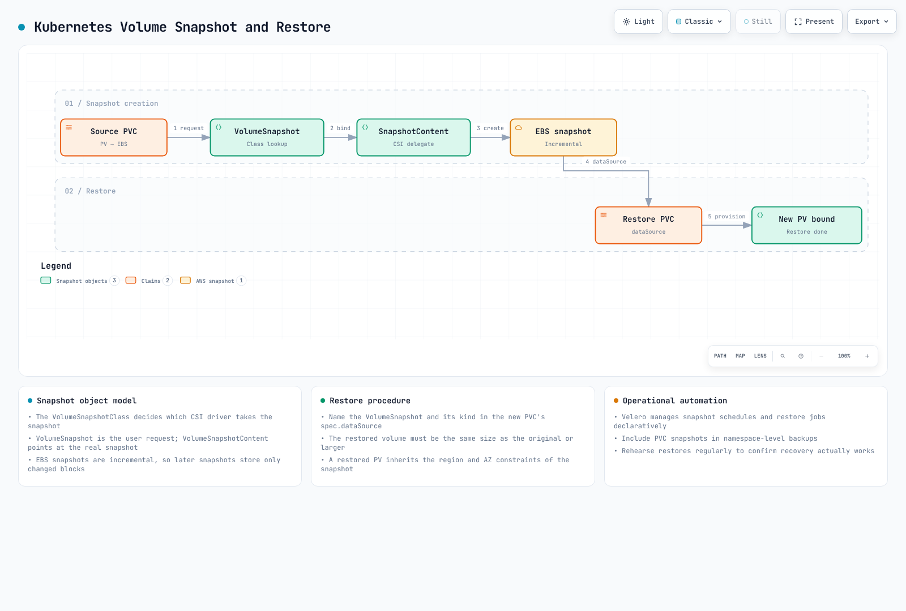
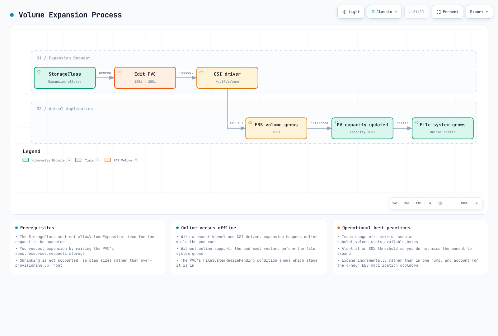

# Parte 2: Clases de almacenamiento

> **Última actualización**: 16 de octubre de 2026

Este documento es la segunda parte de la serie sobre almacenamiento de Amazon EKS. Trata FSx for Lustre, Amazon S3, las instantáneas, la expansión de volúmenes y la optimización del rendimiento.

## Índice

1. [Amazon FSx for Lustre](04-eks-storage-part2.md#amazon-fsx-for-lustre)
2. [Integración de almacenamiento de Amazon S3](04-eks-storage-part2.md#amazon-s3-storage-integration)
3. [Instantáneas y copias de seguridad](04-eks-storage-part2.md#snapshots-and-backups)
4. [Expansión y cambio de tamaño de volúmenes](04-eks-storage-part2.md#volume-expansion-and-resizing)
5. [Clonación de volúmenes](04-eks-storage-part2.md#volume-cloning)
6. [Multi-Attach de EBS](04-eks-storage-part2.md#multi-attach-ebs)
7. [Análisis detallado de Mountpoint for S3 CSI](04-eks-storage-part2.md#mountpoint-for-s3-csi-deep-dive)
8. [Optimización del rendimiento del almacenamiento](04-eks-storage-part2.md#storage-performance-optimization)

## Amazon FSx for Lustre

FSx for Lustre es un sistema de archivos paralelo para cargas de trabajo compatibles de HPC/ML/análisis. El rendimiento depende del tipo de implementación y almacenamiento, la capacidad, el rendimiento aprovisionado, los clientes y la red; un sistema de archivos de ejemplo pequeño no ofrece todos los máximos agregados anunciados.

El diagrama ilustra la integración opcional con un repositorio de datos de S3. Hay que configurar las políticas, tareas y permisos de importación/exportación; crear un volumen CSI por sí solo no establece una sincronización bidireccional automática.


[🔍 Ver el diagrama interactivo](https://www.atomai.click/kubernetes-docs/archmaps/en-eks-04-eks-storage-part2-0.html)

### Instalación del controlador CSI de FSx for Lustre

Usa el complemento de EKS compatible del responsable de la infraestructura o una versión de Helm publicada. En el ejemplo del complemento administrado que aparece a continuación, establece `CSI_ADDON_NAME=aws-fsx-csi-driver`. Prepara un rol para `kube-system/fsx-csi-controller-sa` con permisos del controlador de FSx revisados y confianza/agente de Pod Identity. También se admite IRSA con una relación de confianza de OIDC y la opción correspondiente de rol del complemento. El agente de Pod Identity es necesario para ese método de identidad, pero no para IRSA. Fargate no es un entorno de nodos compatible con FSx CSI; verifica el kernel de Linux/cliente de Lustre y la compatibilidad real del cómputo.

Un rol creado con `eksctl --role-only` no es una ServiceAccount de Kubernetes. El complemento administrado crea su cuenta; una instalación de Helm debe crear la cuenta real o hacer referencia a ella y asociarle la identidad prevista. No uses la creación de solo el rol junto con `serviceAccount.create=false` sin preparar esa cuenta.
```bash
set -euo pipefail
: "${CLUSTER_NAME:?Set the existing cluster name}"
: "${AWS_REGION:?Set the cluster Region}"
: "${CSI_ADDON_NAME:?Use aws-fsx-csi-driver}"
case "$CSI_ADDON_NAME" in
  aws-fsx-csi-driver) ;;
  *) echo "Unexpected add-on"; exit 1 ;;
esac
KUBERNETES_VERSION=$(aws eks describe-cluster --region "$AWS_REGION" --name "$CLUSTER_NAME" \
  --query cluster.version --output text)
CLUSTER_ENDPOINT=$(aws eks describe-cluster --region "$AWS_REGION" --name "$CLUSTER_NAME" \
  --query cluster.endpoint --output text)
CURRENT_ENDPOINT=$(kubectl config view --minify -o jsonpath='{.clusters[0].cluster.server}')
test "$CURRENT_ENDPOINT" = "$CLUSTER_ENDPOINT" || { echo "kubeconfig points to another cluster"; exit 1; }
aws eks describe-addon-versions --region "$AWS_REGION" --addon-name "$CSI_ADDON_NAME" \
  --kubernetes-version "$KUBERNETES_VERSION" --output json > csi-addon-versions.json
aws eks list-addons --region "$AWS_REGION" --cluster-name "$CLUSTER_NAME" --output json
```

```bash
set -euo pipefail
: "${CSI_ADDON_VERSION:?Choose a reviewed compatible version from csi-addon-versions.json}"
: "${CSI_ROLE_ARN:?Set the prepared Pod Identity role ARN}"
: "${CLUSTER_NAME:?Run the inspection step first}"
: "${AWS_REGION:?Run the inspection step first}"
: "${CSI_ADDON_NAME:?Run the inspection step first}"
case "$CSI_ADDON_NAME" in
  aws-fsx-csi-driver) CSI_SA=fsx-csi-controller-sa; CSI_PREFIX=fsx-csi ;;
  *) echo "Unexpected add-on"; exit 1 ;;
esac
python3 - "$CSI_ADDON_NAME" "$CSI_ADDON_VERSION" <<'PY'
import json, sys
with open("csi-addon-versions.json") as stream:
    catalog = json.load(stream)
versions = [v["addonVersion"] for a in catalog["addons"]
            if a["addonName"] == sys.argv[1] for v in a["addonVersions"]]
if sys.argv[2] not in versions:
    raise SystemExit("Version not present in the inspected compatible catalog")
PY
aws eks list-addons --region "$AWS_REGION" --cluster-name "$CLUSTER_NAME" \
  --output json > csi-existing-addons.json
python3 - "$CSI_ADDON_NAME" <<'PY'
import json, sys
with open("csi-existing-addons.json") as stream:
    names = json.load(stream)["addons"]
if sys.argv[1] in names:
    raise SystemExit("Existing add-on: use its owner's update procedure")
PY
EXISTING_CSI=$(kubectl -n kube-system get "deployment/$CSI_PREFIX-controller" \
  "daemonset/$CSI_PREFIX-node" --ignore-not-found -o name)
test -z "$EXISTING_CSI" || { echo "Existing CSI installation: review its owner"; exit 1; }
aws eks describe-addon-configuration --region "$AWS_REGION" \
  --addon-name "$CSI_ADDON_NAME" --addon-version "$CSI_ADDON_VERSION"
aws eks create-addon --region "$AWS_REGION" --cluster-name "$CLUSTER_NAME" \
  --addon-name "$CSI_ADDON_NAME" --addon-version "$CSI_ADDON_VERSION" \
  --pod-identity-associations "serviceAccount=$CSI_SA,roleArn=$CSI_ROLE_ARN" \
  --resolve-conflicts NONE
aws eks wait addon-active --region "$AWS_REGION" --cluster-name "$CLUSTER_NAME" \
  --addon-name "$CSI_ADDON_NAME"
```
Este flujo se detiene si ya hay instalaciones; migra o actualiza mediante su responsable. Que el complemento esté Active no demuestra que el montaje del sistema de archivos haya funcionado. Los ejemplos siguientes reutilizan el espacio de nombres dedicado `storage-demo` de la Parte 1 y requieren nombres revisados para los recursos de ámbito de clúster.

### Creación de un sistema de archivos FSx for Lustre

**Elige el aprovisionamiento dinámico o estático.** El aprovisionamiento dinámico crea un sistema de archivos a partir del PVC; no crees primero otro sistema de archivos esperando que la clase dinámica lo adopte. El siguiente flujo manual opcional es para la opción estática. Selecciona una subred aprobada en una AZ compatible y un grupo de seguridad (SG) de Lustre preconfigurado con las reglas necesarias para el tráfico del cliente y del sistema de archivos. No elijas `Subnets[0]` ni des por sentado que TCP 988 basta para completar cualquier diseño compatible. Este ejemplo acotado requiere la VPC del clúster; los diseños con VPC conectadas necesitan una revisión independiente del enrutamiento y la seguridad. Al ejecutarlo, se crean recursos facturables; si falla, conserva los ID devueltos.
```bash
set -euo pipefail
: "${CLUSTER_NAME:?Set the existing cluster}"
: "${AWS_REGION:?Set the filesystem Region}"
: "${FSX_SUBNET_ID:?Select an approved subnet in a supported AZ}"
: "${FSX_SECURITY_GROUP_ID:?Set the reviewed Lustre filesystem SG}"
: "${FSX_CREATION_TOKEN:?Set a unique stable token for this new filesystem}"
FSX_SETUP_DIR=$(mktemp -d -t eks-fsx-setup.XXXXXX)
printf 'Creation records: %s\n' "$FSX_SETUP_DIR"
VPC_ID=$(aws eks describe-cluster --region "$AWS_REGION" --name "$CLUSTER_NAME" \
  --query cluster.resourcesVpcConfig.vpcId --output text)
aws ec2 describe-subnets --region "$AWS_REGION" --subnet-ids "$FSX_SUBNET_ID" \
  --output json > "$FSX_SETUP_DIR/subnet.json"
aws ec2 describe-security-groups --region "$AWS_REGION" --group-ids "$FSX_SECURITY_GROUP_ID" \
  --output json > "$FSX_SETUP_DIR/sg.json"
python3 - "$FSX_SETUP_DIR" "$VPC_ID" <<'PY'
import pathlib, json, sys
root, vpc = pathlib.Path(sys.argv[1]), sys.argv[2]
subnets = json.loads((root / "subnet.json").read_text())["Subnets"]
groups = json.loads((root / "sg.json").read_text())["SecurityGroups"]
if len(subnets) != 1 or len(groups) != 1 or subnets[0]["VpcId"] != vpc or groups[0]["VpcId"] != vpc:
    raise SystemExit("This example requires one subnet and SG in the cluster VPC")
PY
aws fsx create-file-system --region "$AWS_REGION" --file-system-type LUSTRE \
  --client-request-token "$FSX_CREATION_TOKEN" --storage-capacity 1200 --storage-type SSD \
  --subnet-ids "$FSX_SUBNET_ID" --security-group-ids "$FSX_SECURITY_GROUP_ID" \
  --lustre-configuration DeploymentType=SCRATCH_2,DataCompressionType=NONE \
  --tags Key=Name,Value=eks-lustre-demo --output json > "$FSX_SETUP_DIR/created.json"
FSX_FILE_SYSTEM_ID=$(python3 - "$FSX_SETUP_DIR/created.json" <<'PY'
import json, sys
with open(sys.argv[1]) as stream:
    print(json.load(stream)["FileSystem"]["FileSystemId"])
PY
)
FSX_READY=false
for ((attempt=0; attempt<60; attempt++)); do
  STATE=$(aws fsx describe-file-systems --region "$AWS_REGION" --file-system-ids "$FSX_FILE_SYSTEM_ID" \
    --query 'FileSystems[0].Lifecycle' --output text)
  case "$STATE" in
    AVAILABLE) FSX_READY=true; break ;;
    CREATING) sleep 10 ;;
    *) echo "Unexpected filesystem state: $STATE"; exit 1 ;;
  esac
done
test "$FSX_READY" = true || { echo "Filesystem creation still pending; inspect recorded ID"; exit 1; }
aws fsx describe-file-systems --region "$AWS_REGION" --file-system-ids "$FSX_FILE_SYSTEM_ID" \
  --query 'FileSystems[0].{Id:FileSystemId,State:Lifecycle,DNS:DNSName,MountName:LustreConfiguration.MountName,CapacityGiB:StorageCapacity}' \
  --output json > "$FSX_SETUP_DIR/available.json"
cat "$FSX_SETUP_DIR/available.json"
```


### Creación de una StorageClass para FSx for Lustre

Para la opción **dinámica**, proporciona la subred y el grupo de seguridad reales en la clase. La capacidad proviene de la solicitud del PVC, no de un parámetro `storageCapacity` de la clase que se ignoraría. SCRATCH_2 no debe combinarse con ajustes de rendimiento por unidad o de copia de seguridad exclusivos de los tipos persistentes. El nombre de montaje devuelto corresponde a `volumeAttributes` de un PV estático, no a un parámetro `mountName` de la clase.
```yaml
apiVersion: storage.k8s.io/v1
kind: StorageClass
metadata:
  name: fsx-lustre-sc
provisioner: fsx.csi.aws.com
reclaimPolicy: Retain
parameters:
  subnetId: subnet-0123456789abcdef0
  securityGroupIds: sg-0123456789abcdef0
  deploymentType: SCRATCH_2
  dataCompressionType: NONE
```


### Creación de un PVC y montaje en un Pod

Este consumidor de solo lectura solo verifica que se pueda acceder al montaje. No es una carga de trabajo con GPU ni una prueba de rendimiento; para esta comprobación no hace falta una imagen de CUDA. Prepara los permisos del sistema de archivos para UID/GID 1000 y la ruta de red real del cliente.
```yaml
apiVersion: v1
kind: PersistentVolumeClaim
metadata:
  name: fsx-claim
  namespace: storage-demo
spec:
  accessModes:
  - ReadWriteMany
  storageClassName: fsx-lustre-sc
  resources:
    requests:
      storage: 1200Gi
```

```yaml
apiVersion: v1
kind: Pod
metadata:
  name: app-with-fsx
  namespace: storage-demo
spec:
  automountServiceAccountToken: false
  securityContext:
    runAsNonRoot: true
    runAsUser: 1000
    runAsGroup: 1000
    fsGroup: 1000
    seccompProfile:
      type: RuntimeDefault
  containers:
  - name: app
    image: busybox:1.38.0
    command:
    - sh
    - -c
    args:
    - test -r /data && sleep 3600
    securityContext:
      allowPrivilegeEscalation: false
      readOnlyRootFilesystem: true
      capabilities:
        drop:
        - ALL
    resources:
      requests:
        cpu: 10m
        memory: 16Mi
      limits:
        cpu: 100m
        memory: 64Mi
    volumeMounts:
    - name: data
      mountPath: /data
      readOnly: true
  volumes:
  - name: data
    persistentVolumeClaim:
      claimName: fsx-claim
```


### Aprovisionamiento estático para montar FSx for Lustre

Usa el ID, DNSName, MountName y la capacidad reales del sistema de archivos existente. Esta opción sustituye al PVC dinámico. Reemplaza los marcadores de posición siguientes con los valores de la consulta y luego vincula el PV/PVC estático reservado; `storageClassName: ""` evita el aprovisionamiento dinámico predeterminado. El consumidor debe usar `fsx-static-claim`.
```bash
set -euo pipefail
: "${AWS_REGION:?Set the filesystem Region}"
: "${FSX_FILE_SYSTEM_ID:?Set the owned existing filesystem ID}"
aws fsx describe-file-systems --region "$AWS_REGION" --file-system-ids "$FSX_FILE_SYSTEM_ID" \
  --query 'FileSystems[0].{Id:FileSystemId,State:Lifecycle,DNS:DNSName,MountName:LustreConfiguration.MountName,CapacityGiB:StorageCapacity}' \
  --output json
```

```yaml
apiVersion: v1
kind: PersistentVolume
metadata:
  name: fsx-lustre-static
spec:
  capacity:
    storage: 1200Gi
  volumeMode: Filesystem
  accessModes:
  - ReadWriteMany
  persistentVolumeReclaimPolicy: Retain
  storageClassName: ''
  claimRef:
    namespace: storage-demo
    name: fsx-static-claim
  csi:
    driver: fsx.csi.aws.com
    volumeHandle: fs-0123456789abcdef0
    volumeAttributes:
      dnsname: replace-with-filesystem-dns.example.internal
      mountname: replace-with-mountname
---
apiVersion: v1
kind: PersistentVolumeClaim
metadata:
  name: fsx-static-claim
  namespace: storage-demo
spec:
  accessModes:
  - ReadWriteMany
  storageClassName: ''
  volumeName: fsx-lustre-static
  resources:
    requests:
      storage: 1200Gi
```


### Tipos de implementación de FSx for Lustre

- **SCRATCH_1/SCRATCH_2** son para datos temporales y reproducibles. Scratch no ofrece replicación/recuperación de una implementación persistente por el mero hecho de montarse como PV; SCRATCH_2 añade características distintas de ráfaga/rendimiento y cifrado.
- **PERSISTENT_1/PERSISTENT_2** ofrecen opciones de implementación persistentes con distintas capacidades de almacenamiento/rendimiento/latencia. PERSISTENT_2 no está disponible en todas las configuraciones de Región/AZ.
- Ajusta los campos de rendimiento al tipo de implementación/almacenamiento seleccionado. SSD de PERSISTENT_2 admite opciones de 125/250/500/1000 MB/s/TiB; las demás combinaciones de implementación/almacenamiento son distintas. Retain es una política del ciclo de vida de Kubernetes, no una mejora de la durabilidad de los datos para el almacenamiento scratch.

### Configuración de FSx for Lustre para vLLM

vLLM es un proyecto de inferencia y servicio de LLM, no «Vector Language Model». Lo siguiente es una asignación ilustrativa de almacenamiento para archivos de modelos, no una implementación de vLLM optimizada ni medida. La carga de modelos también depende del formato de archivo, la deserialización de CPU, el estado de la caché y la inicialización de GPU. La compresión puede añadir sobrecarga a datos que ya están comprimidos; mídela.
```yaml
apiVersion: storage.k8s.io/v1
kind: StorageClass
metadata:
  name: fsx-lustre-vllm
provisioner: fsx.csi.aws.com
reclaimPolicy: Retain
parameters:
  subnetId: subnet-0123456789abcdef0
  securityGroupIds: sg-0123456789abcdef0
  deploymentType: PERSISTENT_2
  dataCompressionType: LZ4
  perUnitStorageThroughput: '1000'
---
apiVersion: v1
kind: PersistentVolumeClaim
metadata:
  name: vllm-models
  namespace: storage-demo
spec:
  accessModes:
  - ReadWriteMany
  storageClassName: fsx-lustre-vllm
  resources:
    requests:
      storage: 4800Gi
```

## Integración de almacenamiento de Amazon S3

S3 es almacenamiento de objetos. Las aplicaciones pueden usar su API directamente, Hadoop puede usar S3A y Mountpoint CSI puede exponer un bucket existente mediante una interfaz de sistema de archivos con límites documentados. Estas opciones no son sistemas de archivos POSIX intercambiables. S3 Files, descrito en la Parte 1, es otra integración con requisitos propios de EFS CSI.


[🔍 Ver el diagrama interactivo](https://www.atomai.click/kubernetes-docs/archmaps/en-eks-04-eks-storage-part2-1.html)

### Pod Identity o IRSA para acceder a S3

Reutiliza el espacio de nombres dedicado `storage-demo` de la Parte 1. Prepara un bucket existente, la Región y un rol de IAM restringido al bucket/prefijo previsto. Esta política de ejemplo permite enumerar un bucket y leer solo `training/`; no concede permisos de escritura. Para objetos SSE-KMS también se necesitan la política de clave adecuada y permisos de descifrado de KMS con el alcance adecuado. Las políticas del bucket, los endpoints y la confianza entre cuentas pueden imponer restricciones adicionales.

```json
{
  "Version": "2012-10-17",
  "Statement": [
    {
      "Sid": "ListOneBucket",
      "Effect": "Allow",
      "Action": [
        "s3:ListBucket"
      ],
      "Resource": "arn:aws:s3:::replace-with-owned-data-bucket"
    },
    {
      "Sid": "ReadTrainingPrefix",
      "Effect": "Allow",
      "Action": [
        "s3:GetObject"
      ],
      "Resource": "arn:aws:s3:::replace-with-owned-data-bucket/training/*"
    }
  ]
}
```

La ServiceAccount siguiente ilustra **IRSA**: reemplaza el ARN de ejemplo por el del rol preparado cuya relación de confianza de OIDC permite únicamente este clúster, `system:serviceaccount:storage-demo:s3-access-sa` y el público de STS. La anotación por sí sola no crea ese rol ni esa relación de confianza. Para **EKS Pod Identity**, omite la anotación de IRSA y crea la asociación revisada para esta misma cuenta de aplicación con un agente compatible; no configures ambos métodos como alternativa accidental. No incluyas claves estáticas de AWS en el manifiesto.

```yaml
apiVersion: v1
kind: ServiceAccount
metadata:
  name: s3-access-sa
  namespace: storage-demo
  annotations:
    eks.amazonaws.com/role-arn: arn:aws:iam::111122223333:role/storage-demo-s3-reader
```

### Configuración de un Pod para acceder a S3

Este Job acotado de enumeración de solo lectura usa la imagen oficial de AWS CLI y la cuenta preparada. Reemplaza el bucket/la Región antes de usarlo. Sus directorios privados con permisos de escritura permiten ejecutar el proceso de CLI sin privilegios; el código de salida por sí solo no demuestra que la aplicación pueda leer todos los objetos previstos. Comprueba por separado el Job y sus registros, así como un objeto representativo al que se tenga autorización para acceder.

```yaml
apiVersion: batch/v1
kind: Job
metadata:
  name: s3-read-check
  namespace: storage-demo
spec:
  backoffLimit: 0
  activeDeadlineSeconds: 120
  template:
    spec:
      serviceAccountName: s3-access-sa
      restartPolicy: Never
      securityContext:
        runAsNonRoot: true
        runAsUser: 1000
        runAsGroup: 1000
        fsGroup: 1000
        seccompProfile:
          type: RuntimeDefault
      containers:
      - name: reader
        image: public.ecr.aws/aws-cli/aws-cli:2.36.43
        command:
        - aws
        args:
        - s3api
        - list-objects-v2
        - --bucket
        - replace-with-owned-data-bucket
        - --prefix
        - training/
        - --max-items
        - '5'
        env:
        - name: AWS_REGION
          value: us-west-2
        - name: AWS_EC2_METADATA_DISABLED
          value: 'true'
        securityContext:
          allowPrivilegeEscalation: false
          readOnlyRootFilesystem: true
          capabilities:
            drop:
            - ALL
        resources:
          requests:
            cpu: 100m
            memory: 128Mi
          limits:
            cpu: 500m
            memory: 256Mi
        volumeMounts:
        - name: private-home
          mountPath: /root
        - name: tmp
          mountPath: /tmp
      volumes:
      - name: private-home
        emptyDir: {}
      - name: tmp
        emptyDir: {}
```

### Acceso a S3A desde Hadoop

S3A es la implementación de sistema de archivos `s3a://` de Hadoop, no un montaje de volumen de Kubernetes. Hadoop 3.5.0 usa AWS SDK for Java v2. Crea y revisa una imagen que incluya versiones coincidentes de `hadoop-common`/`hadoop-aws` y su paquete sombreado del SDK compatible; el marcador de posición siguiente no es una imagen publicada lista para ejecutar. Su contrato incluye `hadoop` en PATH, `/opt/hadoop/etc/hadoop` y compatibilidad con UID 1000. Combina `hadoop-aws` con cualquier otra herramienta opcional que se necesite. El proveedor de credenciales predeterminado de v2 admite la identidad de carga de trabajo seleccionada si el SDK incluido la admite; no reutilices una clase de proveedor v1 `com.amazonaws`.

```yaml
apiVersion: v1
kind: ConfigMap
metadata:
  name: hadoop-s3a-config
  namespace: storage-demo
data:
  core-site.xml: |
    <?xml version="1.0" encoding="UTF-8"?>
    <configuration>
      <property>
        <name>fs.s3a.aws.credentials.provider</name>
        <value>software.amazon.awssdk.auth.credentials.DefaultCredentialsProvider</value>
      </property>
      <property>
        <name>fs.s3a.endpoint.region</name>
        <value>us-west-2</value>
      </property>
    </configuration>
---
apiVersion: batch/v1
kind: Job
metadata:
  name: hadoop-s3a-read-check
  namespace: storage-demo
spec:
  backoffLimit: 0
  activeDeadlineSeconds: 120
  template:
    spec:
      serviceAccountName: s3-access-sa
      restartPolicy: Never
      securityContext:
        runAsNonRoot: true
        runAsUser: 1000
        runAsGroup: 1000
        fsGroup: 1000
        seccompProfile:
          type: RuntimeDefault
      containers:
      - name: hadoop
        image: registry.example.com/reviewed-hadoop-s3a:3.5.0
        command:
        - hadoop
        args:
        - fs
        - -ls
        - s3a://replace-with-owned-data-bucket/training/
        env:
        - name: AWS_REGION
          value: us-west-2
        - name: AWS_EC2_METADATA_DISABLED
          value: 'true'
        - name: HADOOP_CONF_DIR
          value: /opt/hadoop/etc/hadoop
        - name: HADOOP_OPTIONAL_TOOLS
          value: hadoop-aws
        securityContext:
          allowPrivilegeEscalation: false
          readOnlyRootFilesystem: true
          capabilities:
            drop:
            - ALL
        resources:
          requests:
            cpu: 100m
            memory: 128Mi
          limits:
            cpu: 500m
            memory: 256Mi
        volumeMounts:
        - name: tmp
          mountPath: /tmp
        - name: hadoop-config
          mountPath: /opt/hadoop/etc/hadoop/core-site.xml
          subPath: core-site.xml
          readOnly: true
      volumes:
      - name: tmp
        emptyDir: {}
      - name: hadoop-config
        configMap:
          name: hadoop-s3a-config
```

Montar una clave de ConfigMap con subPath conserva los demás archivos de configuración de Hadoop de la imagen. Un montaje subPath no recibe las actualizaciones de ConfigMap en tiempo real; vuelve a crear el Job después de cambiar la configuración.

### Montaje de un bucket existente con Mountpoint CSI

La combinación upstream revisada es CSI 2.8.0 con Mountpoint 1.23.0 incluido. Mountpoint independiente 1.24.0 no cambia automáticamente la imagen de CSI. Comprueba la versión real del complemento de EKS y la compatibilidad del cómputo: esta versión de CSI upstream requiere Kubernetes 1.31 o posterior y ya no admite AL2/Ubuntu 22.04. Da preferencia al responsable de infraestructura existente; no instales Helm sobre un complemento administrado ni sobre un controlador existente.

Para una instalación de Helm con un responsable distinto, primero genera para revisión el **chart publicado**; usa la versión real del clúster en `--kube-version`. El chart de un checkout de Git no es la distribución compatible y no se debe eludir su protección de publicación. Revisa los componentes de nodo con privilegios, la titularidad de los CRD y el espacio de nombres `mount-s3` antes de implementar mediante el responsable elegido:

```bash
set -euo pipefail
helm repo add aws-mountpoint-s3-csi-driver https://awslabs.github.io/mountpoint-s3-csi-driver
helm repo update aws-mountpoint-s3-csi-driver
helm template aws-mountpoint-s3-csi-driver \
  aws-mountpoint-s3-csi-driver/aws-mountpoint-s3-csi-driver \
  --version 2.8.0 --namespace kube-system --kube-version 1.36.0 --include-crds \
  > s3-driver-review.yaml
```

El chart publicado crea `s3-csi-driver-sa` y `s3-csi-driver-controller-sa` de forma predeterminada. El siguiente PV selecciona explícitamente **credenciales a nivel de Pod** de `s3-access-sa`; las credenciales a nivel de controlador se ignoran para este volumen. Aquí se admiten tanto IRSA como EKS Pod Identity. La disponibilidad requiere la instalación real del controlador y la identidad, no solo que la generación de Helm se complete correctamente.

Mountpoint CSI utiliza **aprovisionamiento estático** de un bucket existente, no la StorageClass dinámica que aparece en ejemplos antiguos. Deja vacíos ambos campos `storageClassName` y usa el preenlace explícito de PV/PVC junto con un volumeHandle único en el clúster. Los campos de capacidad satisfacen los metadatos de vinculación de Kubernetes; no crean ni limitan la capacidad del bucket de S3. Reemplaza el bucket, el prefijo y la Región a la vez. El montaje de solo lectura y los permisos de IAM son controles independientes:

```yaml
apiVersion: v1
kind: PersistentVolume
metadata:
  name: s3-training-pv
spec:
  capacity:
    storage: 1Ti
  volumeMode: Filesystem
  accessModes:
  - ReadOnlyMany
  persistentVolumeReclaimPolicy: Retain
  storageClassName: ''
  claimRef:
    namespace: storage-demo
    name: training-data
  mountOptions:
  - read-only
  - region us-west-2
  - prefix training/
  - allow-other
  - uid 1000
  - gid 1000
  - dir-mode 0750
  - file-mode 0440
  csi:
    driver: s3.csi.aws.com
    volumeHandle: storage-demo-s3-training-v1
    volumeAttributes:
      bucketName: replace-with-owned-data-bucket
      authenticationSource: pod
      stsRegion: us-west-2
---
apiVersion: v1
kind: PersistentVolumeClaim
metadata:
  name: training-data
  namespace: storage-demo
spec:
  accessModes:
  - ReadOnlyMany
  storageClassName: ''
  volumeName: s3-training-pv
  resources:
    requests:
      storage: 1Ti
```


```yaml
apiVersion: v1
kind: Pod
metadata:
  name: app-with-s3
  namespace: storage-demo
spec:
  serviceAccountName: s3-access-sa
  securityContext:
    runAsNonRoot: true
    runAsUser: 1000
    runAsGroup: 1000
    seccompProfile:
      type: RuntimeDefault
  containers:
  - name: reader
    image: busybox:1.38.0
    command:
    - sh
    - -c
    args:
    - ls -la /data && sleep 3600
    securityContext:
      allowPrivilegeEscalation: false
      readOnlyRootFilesystem: true
      capabilities:
        drop:
        - ALL
    resources:
      requests:
        cpu: 10m
        memory: 16Mi
      limits:
        cpu: 100m
        memory: 64Mi
    volumeMounts:
    - name: data
      mountPath: /data
      readOnly: true
  volumes:
  - name: data
    persistentVolumeClaim:
      claimName: training-data
      readOnly: true
```

Las opciones de montaje asignan la propiedad del sistema de archivos a UID/GID 1000; no cambian la propiedad de los objetos de S3. `allow-other` permite que ese UID de aplicación acceda a un montaje creado por el controlador. Los contenedores de aplicaciones no necesitan AWS CLI ni privilegios de FUSE para esta ruta de lectura mediante montaje.

### Casos de uso de S3

Los lagos de datos, los repositorios de modelos, los archivos, los recursos estáticos y los objetos de auditoría pueden usar S3. Elige el acceso por API cuando la aplicación necesite versiones de objetos, solicitudes condicionales o capacidades fuera del contrato de sistema de archivos de Mountpoint. Un directorio de base de datos con escritura que requiera actualizaciones aleatorias y bloqueos POSIX necesita otro diseño de almacenamiento.

## Instantáneas y copias de seguridad

Las instantáneas CSI requieren compatibilidad con el controlador/backend específico; un PVC por sí solo no implica que se admitan instantáneas. El siguiente ejemplo de EBS captura un punto en el tiempo de un volumen de bloques. Si es necesario, detén o vacía las aplicaciones, o usa copias de seguridad compatibles con la base de datos o el archivado de WAL. Una instantánea creada correctamente no demuestra la coherencia de la aplicación ni la recuperación de la base de datos a un punto en el tiempo.



[🔍 Ver el diagrama interactivo](https://www.atomai.click/kubernetes-docs/archmaps/en-eks-04-eks-storage-part2-2.html)

### Preparación del controlador de instantáneas

Primero inspecciona los CRD de instantáneas existentes, quién es responsable del controlador y el snapshotter CSI. Usa el complemento de EKS compatible o una versión externa revisada y fijada de external-snapshotter; no apliques CRD flotantes de master sobre una instalación existente. External-snapshotter 8.6.0 es una referencia upstream revisada, no un destino de actualización automática para todos los complementos. También se aplican los requisitos previos del controlador y el espacio de nombres de la Parte 1.

```bash
set -euo pipefail
kubectl get crd volumesnapshots.snapshot.storage.k8s.io \
  volumesnapshotcontents.snapshot.storage.k8s.io volumesnapshotclasses.snapshot.storage.k8s.io
kubectl -n storage-demo get pvc ebs-claim -o yaml
```

### Creación de la clase y de la instantánea

El controlador de la clase debe coincidir con el controlador del PV. Esta clase administrada manualmente usa Retain; eliminar su instantánea de Kubernetes no elimina automáticamente la instantánea de EBS retenida. Lleva un registro de la titularidad y el costo, y no confundas esta política con el ciclo de vida de Velero que se describe a continuación. Los parámetros vacíos de secretos de snapshotter no son necesarios en este ejemplo de EBS.

```yaml
apiVersion: snapshot.storage.k8s.io/v1
kind: VolumeSnapshotClass
metadata:
  name: ebs-snapshot-class
driver: ebs.csi.aws.com
deletionPolicy: Retain
```


```yaml
apiVersion: snapshot.storage.k8s.io/v1
kind: VolumeSnapshot
metadata:
  name: ebs-part2-snapshot
  namespace: storage-demo
  labels:
    storage-demo: ebs
spec:
  volumeSnapshotClassName: ebs-snapshot-class
  source:
    persistentVolumeClaimName: ebs-claim
```


```bash
set -euo pipefail
kubectl -n storage-demo wait --for=jsonpath='{.status.readyToUse}'=true \
  volumesnapshot/ebs-part2-snapshot --timeout=300s
kubectl -n storage-demo get volumesnapshot ebs-part2-snapshot -o yaml
```

### Restauración en un PVC nuevo

Cuando `readyToUse=true`, inspecciona restoreSize y el contenido/controlador vinculados. Usa un nombre distinto en el mismo espacio de nombres y una capacidad como mínimo igual a restoreSize. Este ejemplo de 20Gi supone que la instantánea no es mayor. Deja intacta la reclamación activa; WaitForFirstConsumer puede mantener el candidato en Pending hasta que se programe un consumidor compatible. Valida los datos restaurados con una aplicación aislada y compatible antes de realizar un cambio controlado.

```yaml
apiVersion: v1
kind: PersistentVolumeClaim
metadata:
  name: ebs-part2-restored
  namespace: storage-demo
spec:
  accessModes:
  - ReadWriteOnce
  storageClassName: ebs-gp3
  resources:
    requests:
      storage: 20Gi
  dataSource:
    name: ebs-part2-snapshot
    kind: VolumeSnapshot
    apiGroup: snapshot.storage.k8s.io
```

### Programación de copias de seguridad con Velero

La combinación revisada es Velero 1.18.4 con el complemento de AWS 1.14.4. Verifica la suma de comprobación de la versión de CLI y la compatibilidad del complemento antes de instalarlo. La compatibilidad con CSI está integrada en Velero, pero para esta ruta se sigue necesitando `EnableCSI`; no añadas el antiguo complemento CSI independiente. Prepara un bucket/prefijo privado para las copias de seguridad, acceso de red, permisos acotados de IAM/KMS y un rol de IRSA para `velero/velero`. Lo siguiente genera un manifiesto para revisar una instalación nueva sin crear recursos:

```bash
set -euo pipefail
: "${BACKUP_BUCKET:?Set the existing private backup bucket}"
: "${VELERO_ROLE_ARN:?Set the reviewed IRSA role for system:serviceaccount:velero:velero}"
: "${AWS_REGION:?Set the bucket/snapshot Region for this example}"
velero install --provider aws \
  --plugins velero/velero-plugin-for-aws:v1.14.4 \
  --bucket "$BACKUP_BUCKET" --prefix eks-storage-demo \
  --backup-location-config "region=$AWS_REGION" \
  --snapshot-location-config "region=$AWS_REGION" \
  --features EnableCSI --no-secret \
  --sa-annotations "eks.amazonaws.com/role-arn=$VELERO_ROLE_ARN" \
  --dry-run -o yaml > velero-review.yaml
```

Usa un kubeconfig válido real incluso para esta ejecución de prueba de CLI; generar el manifiesto no es una prueba de autorización ni de copias de seguridad. No sobrescribas una instalación existente de Velero/CRD. La ServiceAccount predeterminada se crea con la anotación de IRSA; si se usa `--service-account-name`, en cambio, se selecciona una cuenta que ya existe y se ignora `--sa-annotations`. Pod Identity es una alternativa que requiere su propia configuración de asociación/agente. No se necesita ningún archivo de credenciales estáticas.

Para seleccionar una clase CSI, asigna la etiqueta de clase predeterminada a una sola clase por controlador o selecciona una clase con la anotación compatible de copia de seguridad/programación. Revisa la siguiente clase junto con las clases existentes:

```yaml
apiVersion: snapshot.storage.k8s.io/v1
kind: VolumeSnapshotClass
metadata:
  name: ebs-velero-snapshots
  labels:
    velero.io/csi-volumesnapshot-class: 'true'
driver: ebs.csi.aws.com
deletionPolicy: Retain
```

**Velero administra el ciclo de vida de las instantáneas de sus copias de seguridad CSI.** Cuando la copia de seguridad vence o se elimina, Velero cambia a Delete la política de eliminación de VolumeSnapshotContent y elimina la instantánea, aunque la clase original usara Retain. Establece deliberadamente el TTL de la copia de seguridad y cualquier procedimiento independiente de retención/archivado. Una copia de seguridad de Velero en S3 no necesariamente contiene todos los bytes del volumen: las instantáneas CSI, las copias de seguridad del sistema de archivos y los trasladadores de datos son rutas distintas. Por ejemplo, FSx CSI 1.10.0 no implementa instantáneas CSI; usa una estrategia compatible de copia de seguridad de FSx/aplicación.

```bash
set -euo pipefail
velero schedule create storage-demo-daily --schedule="0 1 * * *" \
  --include-namespaces=storage-demo --ttl=168h0m0s -o yaml > velero-schedule-review.yaml
```

El comando de programación también solo genera YAML. Implementa la programación revisada mediante su responsable y luego inspecciona la fase y los errores de la copia de seguridad real, la finalización de instantáneas/trasladadores de datos y las pruebas de restauración. Las instantáneas programadas no proporcionan por sí solas una recuperación arbitraria de bases de datos a un punto en el tiempo (PITR).

Para la recuperación, elige una copia de seguridad verificada real en vez de una marca de tiempo histórica codificada. Incluso con `-o yaml`, este comando realiza el descubrimiento de API y lee la copia de seguridad seleccionada, por lo que requiere acceso de lectura al clúster previsto. Esta vista previa del manifiesto limita los tipos de recursos solicitados y asigna el espacio de nombres; inspecciona las dependencias y las acciones de restauración del complemento antes de enviarla. Confirma que el espacio de nombres de destino esté aislado, que los nombres no entren en conflicto y que las asignaciones de StorageClass/controlador CSI/KMS/AZ sean válidas. No es un runbook completo de recuperación para producción:

```bash
set -euo pipefail
: "${VERIFIED_BACKUP:?Choose an actual completed backup after checking its contents/errors}"
velero restore create storage-demo-recovery-review --from-backup "$VERIFIED_BACKUP" \
  --namespace-mappings storage-demo:storage-recovery \
  --include-namespaces storage-demo \
  --include-resources persistentvolumes,persistentvolumeclaims,volumesnapshots.snapshot.storage.k8s.io,volumesnapshotcontents.snapshot.storage.k8s.io \
  --restore-volumes=true -o yaml > velero-restore-review.yaml
```

Inicia las cargas de trabajo restauradas solo después de que los datos candidatos superen las comprobaciones de la aplicación y mantén una ruta de reversión. La restauración CSI entre clústeres requiere un nombre de controlador coincidente e instantáneas/claves accesibles; la asignación de espacios de nombres por sí sola no hace portables los recursos de la nube.

## Expansión y cambio de tamaño de volúmenes



[🔍 Ver el diagrama interactivo](https://www.atomai.click/kubernetes-docs/archmaps/en-eks-04-eks-storage-part2-3.html)

Usa una clase con `allowVolumeExpansion: true` y un controlador CSI/sistema de archivos que lo admita. Mantén el `storageClassName` existente de la reclamación vinculada; no es un interruptor de cambio de tamaño. Este ejemplo reutiliza `ebs-gp3` de la Parte 1 y solo aumenta la solicitud de la reclamación. Comprueba primero la solicitud/capacidad actual para no reducir una reclamación que ya sea mayor.
```yaml
apiVersion: storage.k8s.io/v1
kind: StorageClass
metadata:
  name: ebs-gp3
provisioner: ebs.csi.aws.com
volumeBindingMode: WaitForFirstConsumer
reclaimPolicy: Retain
allowVolumeExpansion: true
parameters:
  type: gp3
  encrypted: 'true'
  csi.storage.k8s.io/fstype: ext4
```

```bash
set -euo pipefail
kubectl -n storage-demo get pvc ebs-claim -o yaml
kubectl -n storage-demo patch pvc ebs-claim --type merge \
  -p '{"spec":{"resources":{"requests":{"storage":"20Gi"}}}}'
kubectl -n storage-demo describe pvc ebs-claim
```
CSI administra la expansión del backend y del sistema de archivos cuando es compatible. Inspecciona las condiciones del PVC, los registros del controlador/nodo y la capacidad montada. Si es necesario, sigue la ruta documentada del controlador para volver a montar o reiniciar; no ejecutes `resize2fs` sobre un `/dev/xvdf` supuesto dentro de un contenedor de aplicación. Nunca edites la capacidad del PV para eludir el cambio de tamaño. Planifica límites de cuota/costo y evita que el crecimiento automatizado se repita mientras una expansión anterior esté pendiente.

## Clonación de volúmenes

EBS CSI actual admite la clonación de PVC mediante `dataSource` y la capacidad de clonación de CSI; EBS CSI 1.67.0 usa una copia nativa de volumen de EBS (`CopyVolumes`), no una instantánea oculta supuesta. Comprueba la compatibilidad del controlador/complemento implementado antes de usarla. El destino es independiente, pero la disponibilidad y el rendimiento con la inicialización completa son estados distintos.


Para el flujo habitual de `dataSource` de PVC, usa un origen vinculado en el mismo espacio de nombres, un modo de volumen/controlador compatible y una solicitud al menos tan grande como el origen. Define explícitamente `storageClassName`; si se omite, se aplican las reglas de la clase predeterminada en lugar de heredarse automáticamente la clase del origen. Las copias nativas de EBS permanecen en la AZ del origen. Son coherentes ante fallos, salvo que la aplicación se detenga o vacíe adecuadamente. Solo se puede inicializar una copia de un origen a la vez y se aplican las cuotas de la cuenta/Región.

Este origen de entrenamiento dedicado evita iniciar un clon de base de datos sin verificar en un espacio de nombres de producción. Reemplaza la AZ de ejemplo por una AZ compatible real en el escritor y el lector. El Job de preparación usa el PVC de origen, crea un marcador sin sobrescribir uno existente y luego finaliza:
```yaml
apiVersion: v1
kind: PersistentVolumeClaim
metadata:
  name: ebs-clone-source
  namespace: storage-demo
spec:
  accessModes:
  - ReadWriteOnce
  storageClassName: ebs-gp3
  resources:
    requests:
      storage: 10Gi
---
apiVersion: batch/v1
kind: Job
metadata:
  name: ebs-clone-seed
  namespace: storage-demo
spec:
  backoffLimit: 0
  template:
    metadata:
      labels:
        app: ebs-clone-seed
    spec:
      restartPolicy: Never
      automountServiceAccountToken: false
      nodeSelector:
        topology.kubernetes.io/zone: us-west-2a
      securityContext:
        runAsNonRoot: true
        runAsUser: 1000
        runAsGroup: 1000
        fsGroup: 1000
        seccompProfile:
          type: RuntimeDefault
      containers:
      - name: writer
        image: busybox:1.38.0
        command:
        - sh
        - -c
        args:
        - |
          set -eu
          (set -C; printf 'clone-demo\n' > /data/seed.txt)
          sync
        securityContext:
          allowPrivilegeEscalation: false
          readOnlyRootFilesystem: true
          capabilities:
            drop:
            - ALL
        resources:
          requests:
            cpu: 10m
            memory: 16Mi
          limits:
            cpu: 100m
            memory: 64Mi
        volumeMounts:
        - name: data
          mountPath: /data
      volumes:
      - name: data
        persistentVolumeClaim:
          claimName: ebs-clone-source
```

```bash
kubectl -n storage-demo wait --for=condition=complete job/ebs-clone-seed --timeout=300s
kubectl -n storage-demo get pvc ebs-clone-source -o yaml
```
Crea el clon independiente y su consumidor de solo lectura cuando finalice el Job de preparación. La comprobación del marcador muestra qué validar; esta revisión no ejecutó una copia en la nube. Copiar una base de datos no restablece las contraseñas existentes, y el destino debe usar una versión compatible de la base de datos si luego se inicia como tal.
```yaml
apiVersion: v1
kind: PersistentVolumeClaim
metadata:
  name: ebs-clone
  namespace: storage-demo
spec:
  accessModes:
  - ReadWriteOnce
  storageClassName: ebs-gp3
  resources:
    requests:
      storage: 10Gi
  dataSource:
    kind: PersistentVolumeClaim
    name: ebs-clone-source
---
apiVersion: v1
kind: Pod
metadata:
  name: app-with-clone
  namespace: storage-demo
spec:
  automountServiceAccountToken: false
  securityContext:
    runAsNonRoot: true
    runAsUser: 1000
    runAsGroup: 1000
    fsGroup: 1000
    seccompProfile:
      type: RuntimeDefault
  containers:
  - name: app
    image: busybox:1.38.0
    command:
    - sh
    - -c
    args:
    - test "$(cat /data/seed.txt)" = clone-demo && sleep 3600
    securityContext:
      allowPrivilegeEscalation: false
      readOnlyRootFilesystem: true
      capabilities:
        drop:
        - ALL
    resources:
      requests:
        cpu: 10m
        memory: 16Mi
      limits:
        cpu: 100m
        memory: 64Mi
    volumeMounts:
    - name: data
      mountPath: /data
      readOnly: true
  volumes:
  - name: data
    persistentVolumeClaim:
      claimName: ebs-clone
  nodeSelector:
    topology.kubernetes.io/zone: us-west-2a
```
| Propiedad | Copia de PVC/volumen nativa | Restauración de instantánea |
|---|---|---|
| Origen | Volumen/PVC existente | Instantánea retenida de un punto en el tiempo |
| Disponibilidad | Disponible antes de que finalice la inicialización en segundo plano | Depende del estado de la instantánea/restauración y la inicialización |
| Ubicación | La copia nativa de EBS permanece en la AZ de origen | Un volumen restaurado nuevo puede apuntar a otra AZ permitida |
| Coherencia | Puede ser necesario detener la aplicación | Puede ser necesaria una copia de seguridad compatible con la aplicación |
| Espacio de nombres | El `dataSource` habitual de PVC es del mismo espacio de nombres | Los objetos de instantánea tienen ámbito de espacio de nombres; la importación entre espacios de nombres/clústeres requiere un flujo compatible explícito |
| Costo/retención | Costos de la operación de copia y del volumen nuevo; ciclo de vida independiente | Costos del almacenamiento de instantáneas y del volumen restaurado; políticas de eliminación independientes |

No infieras velocidad, sobrecarga de almacenamiento ni RPO a partir de «un paso» frente a «dos pasos». Las copias nativas de volúmenes no admiten la restauración rápida de instantáneas ni tasas de inicialización aprovisionadas; sigue las instrucciones reales de inicialización de copias.

## Multi-Attach de EBS

El servicio EC2 admite Multi-Attach para volúmenes io1/io2 compatibles, hasta 16 instancias Nitro compatibles en una AZ, sujeto a restricciones de tipo de volumen/Región. La **ruta dinámica de EBS CSI 1.66.0 admite io2 + ReadWriteMany + volumeMode: Block** y habilita Multi-Attach mediante esa capacidad. `multiAttachEnabled` no es un interruptor compatible de StorageClass en esta ruta. RWOP es una restricción de un Pod y no es el modo de acceso de Multi-Attach.


Un dispositivo de bloques compartido no ofrece coordinación de escritura de aplicaciones. No se debe montar de forma independiente con acceso de lectura/escritura desde varios nodos un ext4/XFS normal; usa un sistema de archivos de clúster/coordinado adecuado y un diseño de fencing. io2 admite fencing con reservas NVMe, pero la aplicación debe usarlo correctamente. La siguiente demostración, que solo realiza la conexión, **no efectúa E/S en el dispositivo ni lo formatea**. Las etiquetas y la anti-afinidad coincidentes requieren dos nodos adecuados en la AZ del volumen. Las cargas de trabajo reales necesitan acceso al dispositivo y coordinación revisados, no este contenedor inactivo:
```yaml
apiVersion: storage.k8s.io/v1
kind: StorageClass
metadata:
  name: ebs-io2-multi-attach
provisioner: ebs.csi.aws.com
volumeBindingMode: WaitForFirstConsumer
reclaimPolicy: Retain
allowVolumeExpansion: true
parameters:
  type: io2
  iops: '10000'
  encrypted: 'true'
---
apiVersion: v1
kind: PersistentVolumeClaim
metadata:
  name: shared-block-pvc
  namespace: storage-demo
spec:
  accessModes:
  - ReadWriteMany
  volumeMode: Block
  storageClassName: ebs-io2-multi-attach
  resources:
    requests:
      storage: 100Gi
---
apiVersion: v1
kind: Pod
metadata:
  name: shared-block-a
  namespace: storage-demo
  labels:
    app: shared-block-demo
spec:
  automountServiceAccountToken: false
  securityContext:
    runAsNonRoot: true
    runAsUser: 1000
    runAsGroup: 1000
    seccompProfile:
      type: RuntimeDefault
  affinity:
    podAntiAffinity:
      requiredDuringSchedulingIgnoredDuringExecution:
      - labelSelector:
          matchLabels:
            app: shared-block-demo
        topologyKey: kubernetes.io/hostname
  containers:
  - name: attachment-only
    image: busybox:1.38.0
    command:
    - sleep
    - '3600'
    securityContext:
      allowPrivilegeEscalation: false
      readOnlyRootFilesystem: true
      capabilities:
        drop:
        - ALL
    resources:
      requests:
        cpu: 10m
        memory: 16Mi
      limits:
        cpu: 100m
        memory: 64Mi
    volumeDevices:
    - name: shared
      devicePath: /dev/ebs-shared
  volumes:
  - name: shared
    persistentVolumeClaim:
      claimName: shared-block-pvc
---
apiVersion: v1
kind: Pod
metadata:
  name: shared-block-b
  namespace: storage-demo
  labels:
    app: shared-block-demo
spec:
  automountServiceAccountToken: false
  securityContext:
    runAsNonRoot: true
    runAsUser: 1000
    runAsGroup: 1000
    seccompProfile:
      type: RuntimeDefault
  affinity:
    podAntiAffinity:
      requiredDuringSchedulingIgnoredDuringExecution:
      - labelSelector:
          matchLabels:
            app: shared-block-demo
        topologyKey: kubernetes.io/hostname
  containers:
  - name: attachment-only
    image: busybox:1.38.0
    command:
    - sleep
    - '3600'
    securityContext:
      allowPrivilegeEscalation: false
      readOnlyRootFilesystem: true
      capabilities:
        drop:
        - ALL
    resources:
      requests:
        cpu: 10m
        memory: 16Mi
      limits:
        cpu: 100m
        memory: 64Mi
    volumeDevices:
    - name: shared
      devicePath: /dev/ebs-shared
  volumes:
  - name: shared
    persistentVolumeClaim:
      claimName: shared-block-pvc
```
Los volúmenes io2 Multi-Attach admiten modificaciones de tamaño/IOPS en las condiciones del servicio; es incorrecto afirmar de forma general que «no se permite el cambio de tamaño en línea». La compatibilidad con las modificaciones de io1 es distinta. Para habilitar/deshabilitar Multi-Attach, el volumen debe estar desconectado, y la compatibilidad de CSI/sistema de archivos/aplicación sigue determinando un procedimiento seguro para cambiar el tamaño. Un fallo del volumen compartido puede afectar a todas las instancias conectadas. Retain y los ajustes de conexión no son una estrategia de copia de seguridad.

## Análisis detallado de Mountpoint for S3 CSI

El comportamiento siguiente se comprobó con Mountpoint 1.23.0, incluido en CSI 2.8.0. Verifica la versión realmente instalada antes de adoptar opciones independientes más recientes.


### Características de rendimiento

Las lecturas secuenciales de objetos grandes y las escrituras secuenciales de objetos nuevos son casos de uso habituales; Mountpoint realiza la precarga automáticamente. Se admiten lecturas de rangos aleatorios, pero los resultados dependen del tamaño de los objetos, la tasa de solicitudes, la red, el estado de la caché y la concurrencia de la aplicación. Las escrituras aleatorias arbitrarias en el lugar no son compatibles; no se trata simplemente de una optimización más lenta.

**Cifras históricas, sin verificar:** el texto anterior en inglés indicaba los siguientes números agregados sin una configuración reproducible ni una fuente rastreable. Se conservan como afirmaciones históricas, no como límites actuales del servicio, resultados medidos en esta revisión ni garantías para el dimensionamiento.

| Operación histórica | Afirmación original |
|---|---|
| Lectura secuencial de archivos grandes | Hasta100Gbps en agregado |
| Escritura secuencial de archivos nuevos | Hasta50Gbps en agregado |
| Lecturas aleatorias pequeñas | Mayor latencia/menor rendimiento; depende de la carga de trabajo |

La clasificación cualitativa anterior de «excelente/bueno/moderado» tampoco se basaba en una prueba comparativa controlada.

### Límites del sistema de archivos y de coherencia

- S3 ofrece coherencia sólida de lectura/listado. El almacenamiento en caché de Mountpoint puede conservar deliberadamente metadatos/contenido obsoletos o entradas negativas hasta que venza su TTL; no describas S3 como un servicio de coherencia eventual.
- Los archivos nuevos se escriben secuencialmente. Para reemplazar un objeto existente se requiere `allow-overwrite` y una apertura que lo trunque; las actualizaciones aleatorias arbitrarias siguen sin admitirse.
- Los buckets de directorio de S3 Express One Zone en Availability Zones admiten anexado con `incremental-upload` y el cambio de nombre atómico de archivos individuales. Los buckets de uso general no admiten cambiar el nombre de archivos mediante esta versión de Mountpoint; no se admite cambiar el nombre de directorios. Los buckets de directorio en Local Zones tienen compatibilidad con funciones distintas. El cambio de nombre para sustituir un objeto también requiere permisos/opciones de sobrescritura.
- La eliminación es optativa mediante `allow-delete` y permisos de IAM; los ejemplos de solo lectura no habilitan ninguno de los dos. Anexar no equivale siempre a «crear una nueva versión del objeto».
- No se admiten enlaces duros/simbólicos, chmod/chown, atributos extendidos, bloqueos POSIX, archivos de dispositivo ni la semántica habitual de archivos dispersos. No bases la corrección de una base de datos en estas operaciones no disponibles.

### Ajustes de caché

Coloca las opciones de CLI de Mountpoint en **PV.spec.mountOptions**, no en los parámetros de StorageClass. Los valores son cadenas de opción, como `metadata-ttl 300`. Mountpoint 1.23 usa segundos para el TTL de metadatos, **MiB** para `max-cache-size` independiente y **bytes** para read/write-part-size; 8 MiB son 8,388,608 bytes. Los ejemplos anteriores de prefetch-bytes/read-ahead/max-read-parallelism/max-cache-size-mb/cache-block-size no son indicadores válidos de la CLI 1.23.

CSI v2 crea almacenamiento de caché para su **Mountpoint Pod**, normalmente en `mount-s3`. Un emptyDir del Pod de aplicación no se convierte en esa caché. Este PV estático alternativo usa una caché emptyDir respaldada por disco de 10Gi, cuyo límite de tamaño aplica el controlador; Memory significa RAM tmpfs, no NVMe. Reemplaza el bucket/prefijo/Región reales y usa el PVC preenlazado independiente:

```yaml
apiVersion: v1
kind: PersistentVolume
metadata:
  name: s3-training-cached-pv
spec:
  capacity:
    storage: 1Ti
  volumeMode: Filesystem
  accessModes:
  - ReadOnlyMany
  persistentVolumeReclaimPolicy: Retain
  storageClassName: ''
  claimRef:
    namespace: storage-demo
    name: training-data-cached
  mountOptions:
  - read-only
  - region us-west-2
  - prefix training/
  - allow-other
  - uid 1000
  - gid 1000
  - dir-mode 0750
  - file-mode 0440
  - metadata-ttl 300
  - read-part-size 8388608
  csi:
    driver: s3.csi.aws.com
    volumeHandle: storage-demo-s3-training-cached-v1
    volumeAttributes:
      bucketName: replace-with-owned-data-bucket
      authenticationSource: pod
      stsRegion: us-west-2
      cache: emptyDir
      cacheEmptyDirSizeLimit: 10Gi
      cacheEmptyDirMedium: ''
---
apiVersion: v1
kind: PersistentVolumeClaim
metadata:
  name: training-data-cached
  namespace: storage-demo
spec:
  accessModes:
  - ReadOnlyMany
  storageClassName: ''
  volumeName: s3-training-cached-pv
  resources:
    requests:
      storage: 1Ti
```

Un TTL de 300 segundos puede ocultar durante ese periodo los cambios externos; usa prefijos de conjuntos de datos inmutables/versionados cuando eso importe. El contenido en caché se almacena en texto sin cifrar en el almacenamiento local, así que incluye el acceso al nodo/almacenamiento en el modelo de amenazas. Presupuesta por separado la capacidad de la caché, la expulsión y la memoria del Pod de Mountpoint, aparte de los contenedores de entrenamiento. También se admite una caché mediante PVC efímero con `cache: ephemeral`, su clase de almacenamiento y los campos de solicitud; evalúa su ciclo de vida y costo. No pases una ruta de caché heredada del host dando por hecho que CSI v2 la sigue usando.

### Ejemplo de entrenamiento con un conjunto de datos grande

Esta es una **plantilla de integración no ejecutada**, no una prueba comparativa optimizada de p4d. Prepara una imagen revisada compatible con GPU que contenga `/opt/training/train.py`, cuatro GPU/Device Plugins programables, la cuenta y el PVC de datos en caché anteriores, y un PVC RWX con escritura `reviewed-model-output-rwx` al que pueda acceder UID/GID 1000. El script debe implementar los argumentos mostrados y crear su propio directorio de salida diferenciado. Resuelve todos los marcadores de posición antes de la implementación.

```yaml
apiVersion: batch/v1
kind: Job
metadata:
  name: s3-sharded-training
  namespace: storage-demo
spec:
  completions: 4
  parallelism: 4
  completionMode: Indexed
  backoffLimit: 0
  activeDeadlineSeconds: 7200
  template:
    spec:
      serviceAccountName: s3-access-sa
      restartPolicy: Never
      securityContext:
        runAsNonRoot: true
        runAsUser: 1000
        runAsGroup: 1000
        fsGroup: 1000
        seccompProfile:
          type: RuntimeDefault
      containers:
      - name: trainer
        image: registry.example.com/reviewed-trainer:replace-me
        command:
        - sh
        - -c
        args:
        - exec python /opt/training/train.py --data-dir=/data --shard-index="$JOB_COMPLETION_INDEX"
          --shard-count=4 --output-dir="/models/$JOB_COMPLETION_INDEX"
        env:
        - name: JOB_COMPLETION_INDEX
          valueFrom:
            fieldRef:
              fieldPath: metadata.annotations['batch.kubernetes.io/job-completion-index']
        resources:
          requests:
            cpu: '4'
            memory: 16Gi
            nvidia.com/gpu: 1
          limits:
            cpu: '8'
            memory: 32Gi
            nvidia.com/gpu: 1
        securityContext:
          allowPrivilegeEscalation: false
          readOnlyRootFilesystem: true
          capabilities:
            drop:
            - ALL
        volumeMounts:
        - name: data
          mountPath: /data
          readOnly: true
        - name: output
          mountPath: /models
        - name: tmp
          mountPath: /tmp
      volumes:
      - name: data
        persistentVolumeClaim:
          claimName: training-data-cached
          readOnly: true
      - name: output
        persistentVolumeClaim:
          claimName: reviewed-model-output-rwx
      - name: tmp
        emptyDir: {}
```

Las cuatro finalizaciones indexadas son fragmentos de datos independientes, uno por GPU. No configuran el punto de encuentro del entrenamiento distribuido, la sincronización de gradientes ni efectos secundarios exactamente una vez. Diseña la gestión de las salidas para que tolere reintentos. Los ejemplos anteriores de 4 y 8 GPU eran diseños ilustrativos distintos, no mediciones comparativas; elige el hardware/los recursos reales a partir de requisitos medidos.

### Elección entre S3, EFS o FSx

| Aspecto | Mountpoint/S3 | EFS | FSx for Lustre |
|---|---|---|---|
| Interfaz | Subconjunto de sistema de archivos respaldado por objetos | Sistema de archivos NFS administrado | Sistema de archivos paralelo Lustre |
| Caso habitual | Grandes conjuntos de datos de entrada inmutables | Archivos compartidos de aplicaciones | E/S paralela de HPC/ML compatible |
| Escrituras | Límites documentados de escritura secuencial/sobrescritura y anexado específicos del bucket | Escrituras en el sistema de archivos con coordinación de la aplicación | Escrituras en el sistema de archivos con coordinación de la aplicación |
| Evidencia para dimensionar | Mezcla de solicitudes, caché, red y distribución de objetos | Modo de rendimiento/rendimiento, clientes y patrón de acceso | Implementación, capacidad, rendimiento, clientes y distribución en franjas |
| Costo/concurrencia | Medir solicitudes, transferencia, caché y límites de clientes | Medir límites de rendimiento/almacenamiento/clientes | Medir límites de asignación/rendimiento/clientes |

El nombre del servicio no permite deducir una clasificación universal de costo bajo/medio/alto ni de clientes ilimitados.

## Optimización del rendimiento del almacenamiento

Exploremos distintas estrategias para optimizar el rendimiento del almacenamiento en EKS.


[🔍 Ver el diagrama interactivo](https://www.atomai.click/kubernetes-docs/archmaps/en-eks-04-eks-storage-part2-4.html)

### Optimización del rendimiento de EBS

Elige el tipo de volumen y los IOPS/rendimiento aprovisionados en función de los requisitos medidos de la carga de trabajo y de los límites EBS de la instancia. Los valores anteriores de 16,000 IOPS/1,000 MiB/s siguen siendo ejemplos de configuración válidos, pero ya no representan los máximos universales de gp3: gp3 en las Regiones admite hasta 80,000 IOPS/2,000 MiB/s, sujeto a restricciones de tamaño/IOPS, con límites inferiores en Outposts. No des por sentado que aprovisionar el máximo sea necesario ni suficiente.

Los volúmenes vacíos no necesitan inicialización. Los volúmenes restaurados desde instantáneas y las copias nativas pueden experimentar latencia de inicialización; los procedimientos son distintos. **Escribir ceros destruye los datos existentes y no es un procedimiento de inicialización seguro.** Identifica primero el volumen exacto. Para restauraciones desde instantáneas, evalúa las tasas de inicialización aprovisionadas compatibles, la restauración rápida de instantáneas o el procedimiento documentado de lectura; esas funciones de aceleración no se aplican a copias nativas. Lo siguiente solo inspecciona metadatos en un entorno de nodo autorizado:
```bash
lsblk -o NAME,SERIAL,SIZE,TYPE,MOUNTPOINT
```

### Optimización del rendimiento de EFS

AWS recomienda el modo de rendimiento General Purpose, incluso para cargas de trabajo muy concurrentes; Max I/O es una opción de generación anterior con mayor latencia de operación. Ajusta el modo de rendimiento a la demanda observada. Configura las opciones de montaje en una StorageClass o un PV, no en `Pod.spec.volumes`.

Esta es una clase alternativa para reclamaciones nuevas. Los tamaños RPC de 1 MiB, el montaje hard, los tiempos de espera y noresvport recomendados por el auxiliar de EFS son un punto de partida, no una prueba comparativa. `retrans=2` inicia una recuperación adicional tras los reintentos; un montaje hard no abandona las solicitudes después de dos intentos. Prepara el ID del sistema de archivos y la identidad del punto de acceso como en la Parte 1:
```yaml
apiVersion: storage.k8s.io/v1
kind: StorageClass
metadata:
  name: efs-tuned
provisioner: efs.csi.aws.com
reclaimPolicy: Retain
mountOptions:
- tls
- rsize=1048576
- wsize=1048576
- hard
- timeo=600
- retrans=2
- noresvport
parameters:
  provisioningMode: efs-ap
  fileSystemId: fs-0123456789abcdef0
  directoryPerms: '750'
  uid: '1000'
  gid: '1000'
  basePath: /storage-demo
  ensureUniqueDirectory: 'true'
```

### Optimización del rendimiento de FSx for Lustre

Selecciona conjuntamente la implementación, el almacenamiento, el rendimiento y la capacidad del cliente. Planifica la distribución en franjas de Lustre según el tamaño de los archivos, la concurrencia y los cuellos de botella medidos; añadir más franjas no siempre mejora el rendimiento. Usa las opciones de montaje admitidas en el PV/StorageClass y elige una sola política de atime, sin combinar `noatime` y `relatime`, que entran en conflicto. El efecto de la compresión depende de los datos. `s3ImportPath` es un parámetro CSI compatible, pero la disponibilidad y automatización de la importación/exportación dependen de la integración de FSx seleccionada.

### Optimización del almacenamiento para cargas de trabajo de vLLM

Reutiliza la asignación explícita de clase/PVC anterior en lugar de un campo `storageCapacity` limitado a la clase. Compara el rendimiento de la carga de modelos en frío y en caliente, el acceso a metadatos, la inicialización de CPU/GPU y los consumidores concurrentes. La cuantización y la fragmentación modifican el comportamiento de memoria/cómputo del modelo, así como la distribución de archivos, y no son optimizaciones de almacenamiento automáticas. EFA solo ayuda a un sistema de archivos/cliente o una pila de comunicación compatibles; elegir una instancia de GPU compatible con EFA no acelera por sí solo todas las rutas de almacenamiento.

## Conclusión

Este documento trató FSx for Lustre, S3, las instantáneas, la expansión de volúmenes y la optimización del rendimiento en Amazon EKS. Cada opción de almacenamiento tiene características y casos de uso distintos, así que es importante elegir y optimizar la solución de almacenamiento adecuada para los requisitos de la aplicación.

La próxima parte tratará la supervisión, la resolución de problemas, la optimización de costos y la seguridad del almacenamiento de EKS.

## Referencias

* [Controlador CSI de Amazon FSx for Lustre](https://github.com/kubernetes-sigs/aws-fsx-csi-driver)
* [Controlador CSI de Amazon S3](https://github.com/awslabs/mountpoint-s3-csi-driver)
* [Instantáneas de volumen de Kubernetes](https://kubernetes.io/docs/concepts/storage/volume-snapshots/)
* [Copia de seguridad y restauración de Velero](https://velero.io/docs/)
* [Prácticas recomendadas de almacenamiento de Amazon EKS](https://docs.aws.amazon.com/eks/latest/best-practices/storage.html)

* [Configuración de Mountpoint CSI 2.8](https://github.com/awslabs/mountpoint-s3-csi-driver/blob/v2.8.0/docs/CONFIGURATION.md)
* [Caché de Mountpoint CSI 2.8](https://github.com/awslabs/mountpoint-s3-csi-driver/blob/v2.8.0/docs/CACHING.md)
* [Semántica del sistema de archivos de Mountpoint 1.23](https://github.com/awslabs/mountpoint-s3/blob/mountpoint-s3-1.23.0/doc/SEMANTICS.md)
* [Autenticación de S3A de Hadoop 3.5](https://hadoop.apache.org/docs/r3.5.0/hadoop-aws/tools/hadoop-aws/index.html)
* [Ciclo de vida de instantáneas CSI de Velero 1.18](https://velero.io/docs/v1.18/csi/)
* [Compatibilidad del complemento de AWS de Velero](https://github.com/velero-io/velero-plugin-for-aws)
* [Copia nativa de EBS](https://docs.aws.amazon.com/ebs/latest/userguide/ebs-copying-volume.html)
* [Multi-Attach de EBS](https://docs.aws.amazon.com/ebs/latest/userguide/ebs-volumes-multi.html)
* [Identidades del complemento FSx CSI](https://docs.aws.amazon.com/eks/latest/userguide/fsx-csi-create.html)

## Cuestionario

Para poner a prueba lo que has aprendido en este capítulo, prueba el [cuestionario del tema](../quizzes/eks/04-eks-storage-part2-quiz.md).
