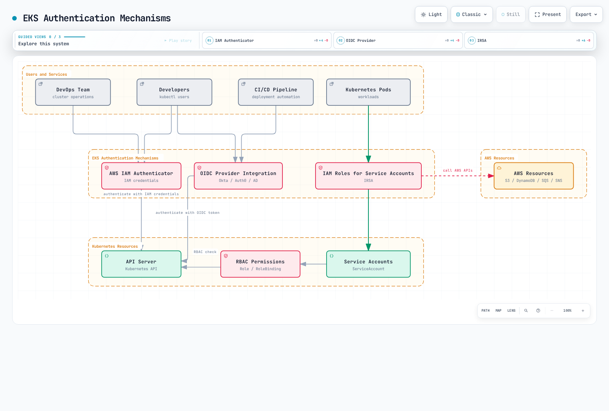

# Autenticación de acceso al clúster de EKS: IAM y entradas de acceso

> **Última actualización**: 21 de noviembre de 2026

Esta página desarrolla en detalle la sección «IAM y autenticación» de [Seguridad de Amazon EKS](./05-eks-security.md). Explica cómo las identidades principales de IAM de personas y sistemas de automatización se autentican en la API de Kubernetes y obtienen permisos, así como el rol del clúster de EKS, los permisos de quien realiza el aprovisionamiento y las entradas de acceso con RBAC limitado al espacio de nombres y políticas de acceso. La forma en que las cargas de trabajo (Pods) reciben credenciales de AWS se explica en [IRSA y el proveedor OIDC](./05-eks-security-irsa-oidc.md) y en [EKS Pod Identity](./05-eks-security-pod-identity.md); sus ejemplos reutilizan el espacio de nombres `security-demo` que se prepara aquí.

## Tabla de contenido

1. [Identidades y capas de autorización](#identities-and-authorization-layers)
2. [Rol del clúster y quien realiza el aprovisionamiento](#cluster-role-and-provisioning-caller)
3. [Entradas de acceso y autorización por espacio de nombres](#access-entries-and-namespace-authorization)

## Identidades y capas de autorización

| Identidad/control | Propósito |
|---|---|
| Identidad principal de IAM de una persona o de un sistema de automatización | Autenticar el acceso al clúster mediante la ruta configurada de asignación de IAM o de entradas de acceso |
| RBAC de Kubernetes y políticas de acceso de EKS | Autorizar las operaciones de Kubernetes; los permisos de autorización se suman |
| Proveedor de identidad OIDC externo | Inicio de sesión de usuarios de la API de Kubernetes, configurado por separado con ajustes de cliente y de claims |
| Rol de IAM del clúster de EKS | Permitir que el servicio de EKS llame a las API de AWS para el clúster |
| Rol de IAM del nodo EC2 | Admitir el arranque y las operaciones de AWS necesarias para los agentes del nodo |
| Rol de IRSA o de EKS Pod Identity | Proporcionar credenciales temporales de AWS a una aplicación |
| Token de Kubernetes ServiceAccount | Autenticar un Pod en las API de Kubernetes conforme a sus permisos RBAC |

El proveedor OIDC de IAM que se usa para IRSA es distinto de un proveedor OIDC externo asociado para el inicio de sesión de usuarios de Kubernetes. Los permisos de AWS de una aplicación no otorgan automáticamente permisos para la API de Kubernetes.

<!-- Diagram repair pending: IRSA/Pod Identity give workload AWS credentials; the ordinary Pod-to-Kubernetes API path uses its Kubernetes ServiceAccount token/RBAC.


[🔍 View interactive diagram](https://www.atomai.click/kubernetes-docs/archmaps/en-eks-05-eks-security-2.html)
-->

## Rol del clúster y quien realiza el aprovisionamiento

Un rol estándar del clúster de EKS confía en el servicio de EKS. Esta es su relación de confianza, no la política de permisos del desarrollador humano:

```json
{
  "Version": "2012-10-17",
  "Statement": [
    {
      "Effect": "Allow",
      "Principal": {
        "Service": "eks.amazonaws.com"
      },
      "Action": "sts:AssumeRole"
    }
  ]
}
```

El rol necesita AmazonEKSClusterPolicy o una política personalizada admitida para sus operaciones de servicio. Auto Mode tiene requisitos adicionales para el rol y las políticas. Por separado, quien realiza el aprovisionamiento necesita las acciones que requiere la configuración seleccionada y permiso para pasar el rol previsto. La referencia de autorización actual indica que CreateCluster no admite limitarse al ARN de un recurso, así que usa allí las condiciones de solicitud admitidas; limita las acciones y PassRole que sí admiten ARN de recursos. Asociar AmazonEKSClusterPolicy a un rol de desarrollador no otorga acceso a las aplicaciones de Kubernetes.

## Entradas de acceso y autorización por espacio de nombres

Para el acceso al clúster de IAM, prefiere la API admitida de entradas de acceso. Inspecciona el modo actual y conserva las asignaciones existentes de administradores y nodos antes de la migración. Cambiar de CONFIG_MAP a API_AND_CONFIG_MAP/API no es un cambio que pueda revertirse libremente. No sobrescribas aws-auth con un ejemplo breve que omita los roles de los nodos. Revisa todas las identidades, políticas, nodos y las opciones de recuperación antes de elegir el modo exclusivo de API.

```bash
set -euo pipefail
: "${CLUSTER_NAME:?Set the existing cluster name}"
: "${AWS_REGION:?Set its Region}"
aws eks describe-cluster --name "$CLUSTER_NAME" --region "$AWS_REGION" \
  --query 'cluster.{Name:name,Status:status,Endpoint:endpoint,Access:accessConfig}' --output json
```

El siguiente ejemplo supone que se cuenta con un rol de IAM de desarrollador aprobado y preparado, un clúster que ya admite entradas de acceso y los permisos de la persona que opera la plataforma. Prepara el espacio de nombres dedicado con su responsable. La versión de Pod Security Admission coincide con la del ejemplo revisado de EKS 1.36; selecciona la versión adecuada para el clúster de destino:

```yaml
apiVersion: v1
kind: Namespace
metadata:
  name: security-demo
  labels:
    pod-security.kubernetes.io/enforce: restricted
    pod-security.kubernetes.io/enforce-version: v1.36
```

```bash
set -euo pipefail
: "${CLUSTER_NAME:?Set the verified cluster name}"
: "${AWS_REGION:?Set its Region}"
: "${DEVELOPER_ROLE_ARN:?Set a prepared IAM role ARN, not an STS session ARN}"
MODE=$(aws eks describe-cluster --name "$CLUSTER_NAME" --region "$AWS_REGION" \
  --query cluster.accessConfig.authenticationMode --output text)
case "$MODE" in
  API|API_AND_CONFIG_MAP) ;;
  *) echo "Access entries are not enabled; review the migration first"; exit 1 ;;
esac
aws eks list-access-entries --cluster-name "$CLUSTER_NAME" --region "$AWS_REGION" \
  --output json > security-access-entries.json
python3 - "$DEVELOPER_ROLE_ARN" <<'PY'
import json, sys
with open("security-access-entries.json") as stream:
    existing = json.load(stream)["accessEntries"]
if sys.argv[1] in existing:
    raise SystemExit("Entry already exists; inspect its groups/policies instead of overwriting")
PY
aws eks create-access-entry --cluster-name "$CLUSTER_NAME" --region "$AWS_REGION" \
  --principal-arn "$DEVELOPER_ROLE_ARN" --type STANDARD \
  --kubernetes-groups security-demo-developers
```

```yaml
apiVersion: rbac.authorization.k8s.io/v1
kind: Role
metadata:
  name: developer
  namespace: security-demo
rules:
- apiGroups:
  - ''
  resources:
  - pods
  verbs:
  - get
  - list
  - watch
- apiGroups:
  - apps
  resources:
  - deployments
  verbs:
  - get
  - list
  - watch
  - create
  - update
  - patch
- apiGroups:
  - batch
  resources:
  - jobs
  verbs:
  - get
  - list
  - watch
  - create
  - update
  - patch
---
apiVersion: rbac.authorization.k8s.io/v1
kind: RoleBinding
metadata:
  name: developer
  namespace: security-demo
subjects:
- kind: Group
  name: security-demo-developers
  apiGroup: rbac.authorization.k8s.io
roleRef:
  kind: Role
  name: developer
  apiGroup: rbac.authorization.k8s.io
```

La entrada asigna la identidad principal de IAM a un grupo, y un RoleBinding otorga a ese grupo los permisos indicados en el espacio de nombres. Los nombres de grupo por sí solos no establecen límites entre espacios de nombres. El permiso para crear controladores de cargas de trabajo puede generar Pods que usen ServiceAccounts, Secrets y PVCs del espacio de nombres. Separa los tenants y restringe el uso de cargas de trabajo y ServiceAccounts mediante controles apropiados de admisión y propiedad.

Para una entrada de visualización revisada por separado, una política de acceso de EKS es una alternativa al RBAC personalizado. Inspecciona los grupos actuales de la entrada y las políticas asociadas antes de añadir este permiso de visualización del espacio de nombres:

```bash
set -euo pipefail
: "${CLUSTER_NAME:?Set the verified cluster name}"
: "${AWS_REGION:?Set its Region}"
: "${VIEWER_ROLE_ARN:?Set the IAM principal of a prepared, reviewed access entry}"
aws eks list-associated-access-policies --cluster-name "$CLUSTER_NAME" --region "$AWS_REGION" \
  --principal-arn "$VIEWER_ROLE_ARN"
aws eks associate-access-policy --cluster-name "$CLUSTER_NAME" --region "$AWS_REGION" \
  --principal-arn "$VIEWER_ROLE_ARN" \
  --policy-arn arn:aws:eks::aws:cluster-access-policy/AmazonEKSViewPolicy \
  --access-scope type=namespace,namespaces=security-demo
```

Añadir View no revoca permisos más amplios de RBAC o de políticas de acceso. Los cambios pueden tardar en propagarse. Haz pruebas con el inicio de sesión IAM previsto; kubectl --as prueba la suplantación de identidad y el RBAC de Kubernetes, pero no demuestra que funcione la ruta de la política de acceso de IAM. Un kubeconfig indica al cliente a qué clúster conectarse y qué mecanismo de credenciales usar; por sí solo no otorga permisos.

IAM eks:DescribeCluster/ListClusters admite las operaciones de administración y detección de AWS. eks:AccessKubernetesApi es un permiso para ver el clúster en la consola. La condición eks:namespaces filtra las solicitudes para asociar políticas de acceso; no es un filtro general por espacio de nombres para las llamadas a la API de kubectl.

## Referencias

- [Entradas de acceso de EKS](https://docs.aws.amazon.com/eks/latest/userguide/access-entries.html)
- [Políticas de acceso de EKS](https://docs.aws.amazon.com/eks/latest/userguide/access-policies.html)
- [RBAC de Kubernetes](https://kubernetes.io/docs/reference/access-authn-authz/rbac/)

## Pasos siguientes

- Siguiente: [IRSA y el proveedor OIDC](./05-eks-security-irsa-oidc.md)
- Relacionado: [EKS Pod Identity](./05-eks-security-pod-identity.md)
- Volver a la descripción general: [Seguridad de Amazon EKS](./05-eks-security.md)

## Cuestionario

Para comprobar lo aprendido en este capítulo, prueba el [cuestionario del tema](../quizzes/eks/05-eks-security-cluster-access-quiz.md).
