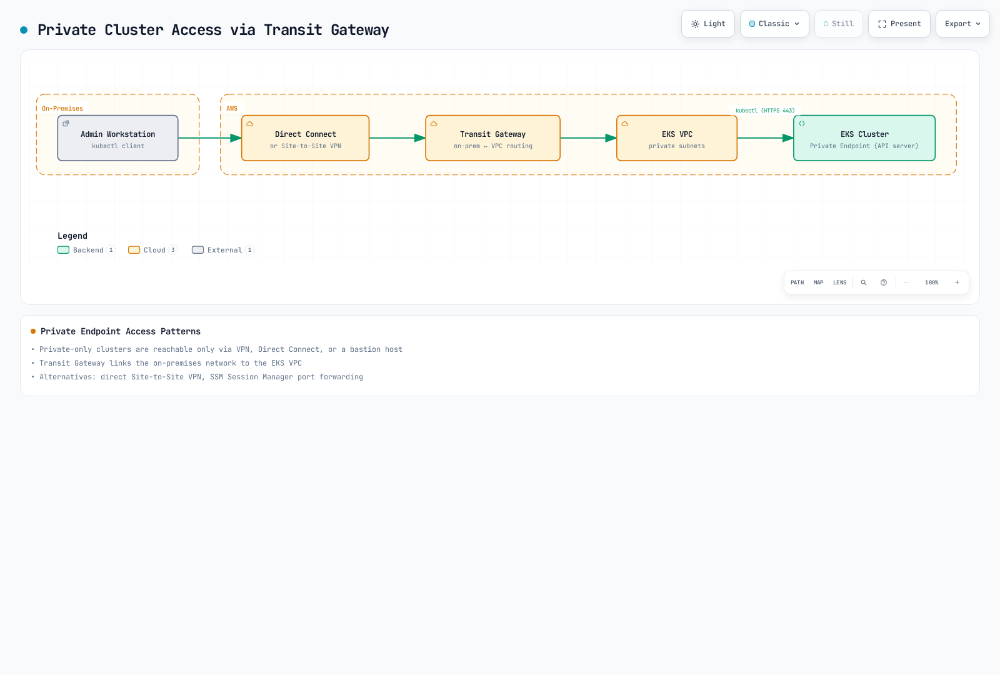

# Seguridad de Amazon EKS

> **Versiones compatibles**: soporte estándar de EKS 1.34–1.37; soporte extendido 1.31–1.33 (comprobado el 12 de octubre de 2026)
> **Última actualización**: 16 de octubre de 2026

Para ejecutar cargas de trabajo de forma segura en Amazon EKS (Elastic Kubernetes Service), debes comprender e implementar varias capas de seguridad y prácticas recomendadas. Este documento abarca conceptos clave, componentes y prácticas recomendadas para reforzar la seguridad de tu clúster de EKS.

## Tabla de contenido

1. [Descripción general de la seguridad de EKS](#eks-security-overview)
2. [Prácticas de seguridad](#security-practices)
3. [IAM y autenticación](#iam-and-authentication)
4. [Análisis detallado del proveedor OIDC](#oidc-provider-deep-dive)
5. [EKS Pod Identity](#eks-pod-identity)
6. [Control de acceso al endpoint del clúster](#cluster-endpoint-access-control)
7. [Seguridad de red](#network-security)
8. [Seguridad de Pod](#pod-security)
9. [Bottlerocket y SO de solo lectura](#bottlerocket-and-read-only-os)
10. [Límites de permisos de IAM](#iam-permission-boundaries)
11. [Cifrado y administración de secretos](#encryption-and-secrets-management)
12. [Cumplimiento y auditoría](#compliance-and-auditing)
13. [Supervisión y detección de seguridad](#security-monitoring-and-detection)
14. [Prácticas recomendadas de seguridad de EKS](#eks-security-best-practices)
15. [Consideraciones de seguridad de EKS para servicios financieros](#eks-security-considerations-for-financial-services)

## Descripción general de la seguridad de EKS {#eks-security-overview}

Separa los controles de infraestructura, acceso al clúster y cargas de trabajo. AWS administra el plano de control; la responsabilidad sobre los nodos y el SO depende de si se usan nodos autoadministrados o administrados de EC2, Fargate, Auto Mode o Hybrid Nodes. Los clientes siguen siendo responsables de las imágenes de aplicaciones, las identidades, el tratamiento de los datos y las políticas de las cargas de trabajo. Un diagrama estándar de nodos de EC2 no implica que los clientes deban aplicar parches a los sistemas operativos de host de Auto Mode/Fargate.


[🔍 Ver diagrama interactivo](https://www.atomai.click/kubernetes-docs/archmaps/en-eks-05-eks-security-0.html)

## Prácticas de seguridad {#security-practices}

Usa varios controles con un ámbito explícito; ninguna herramienta individual establece confianza cero ni certifica una carga de trabajo. Verifica la identidad de quien realiza la llamada o de la carga de trabajo, autoriza la operación prevista, restringe las rutas de red y recopila evidencias adecuadas al modelo de amenazas.

<!-- Diagram repair pending: network policies filter traffic; posture findings are not continuous request authentication or complete zero-trust enforcement.


[🔍 View interactive diagram](https://www.atomai.click/kubernetes-docs/archmaps/en-eks-05-eks-security-1.html)
-->

### Controles de identidad y red

IRSA y Pod Identity proporcionan credenciales de AWS a las cargas de trabajo; NetworkPolicy proporciona filtrado de red compatible; un motor de admisión comprueba las solicitudes de Kubernetes configuradas. Una service mesh compatible y mantenida puede añadir mTLS y políticas de tráfico de aplicaciones. AWS App Mesh dejó de recibir soporte el 30 de septiembre de 2026, por lo que un despliegue existente necesita un plan de migración, en lugar de recomendarla como nueva opción predeterminada.

### Seguridad de la cadena de suministro

Usa un proceso revisado de compilación y procedencia, como SLSA; inventaría los componentes con un SBOM, analiza las vulnerabilidades pertinentes y verifica las firmas de los artefactos respecto de la identidad del firmante previsto. Syft es una herramienta para SBOM; Grype es un analizador de vulnerabilidades. ECR/Inspector y otros analizadores tienen una cobertura y requisitos de actualización específicos. Una imagen firmada o analizada no demuestra que su código sea inocuo. Protege también la identidad de compilación, el repositorio y la configuración de admisión.

ECR actualmente admite la firma administrada de imágenes con AWS Signer, así como la firma manual mediante Notation. La firma y la verificación durante la admisión son pasos distintos; los filtros del registro, los permisos del perfil de firma y la confianza del verificador deben coincidir con la canalización prevista.

### Detección en tiempo de ejecución y políticas como código

GuardDuty EKS Protection analiza un flujo independiente de registros de auditoría de EKS. Runtime Monitoring es una capacidad independiente basada en agentes; actualmente admite EKS en EC2 y Auto Mode, con requisitos de plataforma y agente, y excluye EKS Fargate y Hybrid Nodes. La entrega de registros de auditoría a CloudWatch es una configuración independiente. Security Hub CSPM evalúa los controles configurados; Security Hub puede correlacionar hallazgos. Ninguno sustituye la autorización de aplicaciones ni una evaluación de todos los requisitos reglamentarios.

Usa herramientas de tiempo de ejecución y motores de políticas compatibles, como Falco, Gatekeeper o Kyverno, con la integración de kernel, controlador, API y metadatos necesaria. Los entornos de ejecución adicionales en sandbox, como gVisor/Kata, requieren un diseño compatible de nodos y entornos de ejecución, y no están disponibles en todas las rutas de cómputo de EKS. Las políticas, las imágenes o el refuerzo del SO reducen riesgos específicos; no garantizan que todo escape de contenedores o acción maliciosa sea imposible.

Las herramientas de políticas como código también operan en distintas etapas: Gatekeeper/Kyverno pueden evaluar la admisión de Kubernetes, CloudFormation Guard o Sentinel pueden evaluar cambios en la infraestructura y AWS Config evalúa la configuración de los recursos desplegados que admite. Las herramientas de investigación, como Detective, dependen de sus fuentes de datos configuradas. Mantén diferenciadas estas funciones de la prevención en tiempo de ejecución.

## IAM y autenticación {#iam-and-authentication}

| Identidad/control | Propósito |
|---|---|
| Principal de IAM humano o de automatización | Autenticar el acceso al clúster mediante la ruta configurada de asignación de IAM o de entradas de acceso |
| RBAC de Kubernetes y políticas de acceso de EKS | Autorizar operaciones de Kubernetes; los permisos se suman |
| Proveedor de identidad OIDC externo | Inicio de sesión de usuarios de la API de Kubernetes configurado por separado, con ajustes de cliente y claims |
| Rol de IAM del clúster de EKS | Permite que el servicio EKS llame a las API de AWS para el clúster |
| Rol de IAM del nodo EC2 | Admite el arranque y las operaciones necesarias de los agentes del nodo en AWS |
| Rol de IRSA o EKS Pod Identity | Proporciona credenciales temporales de AWS a una aplicación |
| Token de ServiceAccount de Kubernetes | Autentica un Pod ante las API de Kubernetes según sus permisos de RBAC |

El proveedor OIDC de IAM que se usa para IRSA es distinto del proveedor OIDC externo asociado al inicio de sesión de usuarios de Kubernetes. Los permisos de AWS de una aplicación no conceden automáticamente permisos para las API de Kubernetes.

<!-- Diagram repair pending: IRSA/Pod Identity give workload AWS credentials; the ordinary Pod-to-Kubernetes API path uses its Kubernetes ServiceAccount token/RBAC.


[🔍 View interactive diagram](https://www.atomai.click/kubernetes-docs/archmaps/en-eks-05-eks-security-2.html)
-->

### Rol del clúster y solicitante de aprovisionamiento

Un rol estándar de clúster de EKS confía en el servicio EKS. Esta es su relación de confianza, no la política de permisos del desarrollador humano:

```json
{
  "Version": "2012-10-17",
  "Statement": [
    {
      "Effect": "Allow",
      "Principal": {
        "Service": "eks.amazonaws.com"
      },
      "Action": "sts:AssumeRole"
    }
  ]
}
```

El rol necesita AmazonEKSClusterPolicy o una política personalizada compatible para sus operaciones de servicio. Auto Mode tiene requisitos adicionales de rol y política. Por separado, el solicitante de aprovisionamiento necesita las acciones que requiere la configuración seleccionada y permiso para pasar el rol previsto. La referencia de autorización actual indica que CreateCluster no admite el alcance por ARN de recurso, así que usa allí las condiciones de solicitud compatibles; limita el alcance de las acciones y de PassRole que admitan ARN de recursos. Asociar AmazonEKSClusterPolicy a un rol de desarrollador no concede acceso a las aplicaciones de Kubernetes.

### Entradas de acceso y autorización de espacios de nombres

Es preferible usar la API de entradas de acceso compatible para el acceso al clúster mediante IAM. Inspecciona el modo actual y conserva las asignaciones existentes de administradores y nodos antes de la migración. El cambio de CONFIG_MAP a API_AND_CONFIG_MAP/API no se puede revertir libremente. No sobrescribas aws-auth con un ejemplo breve que omita los roles de nodos. Revisa todas las identidades, políticas, nodos y una vía de recuperación antes de elegir el modo solo API.

```bash
set -euo pipefail
: "${CLUSTER_NAME:?Set the existing cluster name}"
: "${AWS_REGION:?Set its Region}"
aws eks describe-cluster --name "$CLUSTER_NAME" --region "$AWS_REGION" \
  --query 'cluster.{Name:name,Status:status,Endpoint:endpoint,Access:accessConfig}' --output json
```

El siguiente ejemplo presupone un rol de IAM de desarrollador aprobado y preparado, un clúster que ya admite entradas de acceso y los permisos del operador de la plataforma. Prepara el espacio de nombres dedicado a través de su responsable. Su versión de Pod Security Admission coincide con el ejemplo revisado de EKS 1.36; selecciona la versión apropiada para el clúster de destino:

```yaml
apiVersion: v1
kind: Namespace
metadata:
  name: security-demo
  labels:
    pod-security.kubernetes.io/enforce: restricted
    pod-security.kubernetes.io/enforce-version: v1.36
```


```bash
set -euo pipefail
: "${CLUSTER_NAME:?Set the verified cluster name}"
: "${AWS_REGION:?Set its Region}"
: "${DEVELOPER_ROLE_ARN:?Set a prepared IAM role ARN, not an STS session ARN}"
MODE=$(aws eks describe-cluster --name "$CLUSTER_NAME" --region "$AWS_REGION" \
  --query cluster.accessConfig.authenticationMode --output text)
case "$MODE" in
  API|API_AND_CONFIG_MAP) ;;
  *) echo "Access entries are not enabled; review the migration first"; exit 1 ;;
esac
aws eks list-access-entries --cluster-name "$CLUSTER_NAME" --region "$AWS_REGION" \
  --output json > security-access-entries.json
python3 - "$DEVELOPER_ROLE_ARN" <<'PY'
import json, sys
with open("security-access-entries.json") as stream:
    existing = json.load(stream)["accessEntries"]
if sys.argv[1] in existing:
    raise SystemExit("Entry already exists; inspect its groups/policies instead of overwriting")
PY
aws eks create-access-entry --cluster-name "$CLUSTER_NAME" --region "$AWS_REGION" \
  --principal-arn "$DEVELOPER_ROLE_ARN" --type STANDARD \
  --kubernetes-groups security-demo-developers
```


```yaml
apiVersion: rbac.authorization.k8s.io/v1
kind: Role
metadata:
  name: developer
  namespace: security-demo
rules:
- apiGroups:
  - ''
  resources:
  - pods
  verbs:
  - get
  - list
  - watch
- apiGroups:
  - apps
  resources:
  - deployments
  verbs:
  - get
  - list
  - watch
  - create
  - update
  - patch
- apiGroups:
  - batch
  resources:
  - jobs
  verbs:
  - get
  - list
  - watch
  - create
  - update
  - patch
---
apiVersion: rbac.authorization.k8s.io/v1
kind: RoleBinding
metadata:
  name: developer
  namespace: security-demo
subjects:
- kind: Group
  name: security-demo-developers
  apiGroup: rbac.authorization.k8s.io
roleRef:
  kind: Role
  name: developer
  apiGroup: rbac.authorization.k8s.io
```

La entrada asigna el principal de IAM a un grupo, y RoleBinding concede a ese grupo los permisos de espacio de nombres mostrados. Los nombres de grupo por sí solos no establecen límites entre espacios de nombres. El permiso para crear controladores de cargas de trabajo puede generar Pods que usen ServiceAccounts, Secrets y PVC del espacio de nombres. Separa los inquilinos y limita el uso de cargas de trabajo y cuentas de servicio mediante controles de admisión y propiedad apropiados.

Para una entrada de visualización revisada por separado, una política de acceso de EKS es una alternativa al RBAC personalizado. Inspecciona los grupos actuales de la entrada y las políticas asociadas antes de añadir este permiso de visualización para el espacio de nombres:

```bash
set -euo pipefail
: "${CLUSTER_NAME:?Set the verified cluster name}"
: "${AWS_REGION:?Set its Region}"
: "${VIEWER_ROLE_ARN:?Set the IAM principal of a prepared, reviewed access entry}"
aws eks list-associated-access-policies --cluster-name "$CLUSTER_NAME" --region "$AWS_REGION" \
  --principal-arn "$VIEWER_ROLE_ARN"
aws eks associate-access-policy --cluster-name "$CLUSTER_NAME" --region "$AWS_REGION" \
  --principal-arn "$VIEWER_ROLE_ARN" \
  --policy-arn arn:aws:eks::aws:cluster-access-policy/AmazonEKSViewPolicy \
  --access-scope type=namespace,namespaces=security-demo
```

Añadir View no revoca permisos más amplios concedidos por RBAC o políticas de acceso. Los cambios pueden tardar en propagarse. Haz pruebas con el inicio de sesión IAM previsto; kubectl --as prueba la suplantación de identidad/RBAC de Kubernetes, no demuestra la ruta de la política de acceso de IAM. Un kubeconfig dirige el cliente a un clúster y a un mecanismo de credenciales; por sí solo no concede permisos.

IAM eks:DescribeCluster/ListClusters admite operaciones de administración y descubrimiento de AWS. eks:AccessKubernetesApi es un permiso de visualización de la consola. La condición eks:namespaces filtra las solicitudes de asociación de políticas de acceso; no es un filtro general de espacios de nombres para llamadas a la API de kubectl.

## Análisis detallado del proveedor OIDC {#oidc-provider-deep-dive}

EKS publica un emisor OIDC del clúster y claves públicas de firma. Ese endpoint por sí solo no crea un proveedor OIDC de IAM ni autoriza la asunción de roles. Para IRSA, la cuenta del rol debe tener el proveedor OIDC de IAM previsto, el rol debe confiar en él con las condiciones correctas de emisor, sujeto y audiencia, y la carga de trabajo debe usar un SDK compatible.


[🔍 Ver diagrama interactivo](https://www.atomai.click/kubernetes-docs/archmaps/en-eks-05-eks-security-3.html)

### Token IRSA e intercambio de roles

El webhook de IRSA añade al Pod apto una configuración de token proyectado y rol. El SDK intercambia el token de identidad web con STS mediante AssumeRoleWithWebIdentity. STS valida el emisor, la firma y el token, así como la confianza del rol, y luego devuelve credenciales temporales de AWS. La aplicación utiliza esas credenciales para las operaciones de AWS permitidas. Kubernetes rota el token proyectado; el SDK actualiza las credenciales de AWS. Son períodos de validez distintos.

Esta es una **estructura ilustrativa de carga útil decodificada**, con marcas de tiempo deliberadamente antiguas o vencidas e identidades de ejemplo. No es un token firmado ni una prueba de autenticación. La audiencia de STS corresponde a la ruta de IRSA; Pod Identity usa otra audiencia:

```json
{
  "aud": [
    "sts.amazonaws.com"
  ],
  "exp": 1234567890,
  "iat": 1234567800,
  "iss": "https://oidc.eks.us-west-2.amazonaws.com/id/REPLACE_WITH_CLUSTER_ISSUER_ID",
  "kubernetes.io": {
    "namespace": "security-demo",
    "pod": {
      "name": "irsa-read-check-example",
      "uid": "example-pod-uid"
    },
    "serviceaccount": {
      "name": "irsa-reader",
      "uid": "example-serviceaccount-uid"
    }
  },
  "sub": "system:serviceaccount:security-demo:irsa-reader"
}
```

Valida el emisor, la audiencia, la caducidad y el sujeto esperado, no solo si el JSON se puede decodificar. No incluyas tokens sin procesar, claves de acceso secretas de AWS ni tokens de sesión en ejemplos o registros. Un rol puede confiar en varias cuentas de servicio o emisores permitidos explícitamente; IRSA no exige exactamente un rol por ServiceAccount.

### Descubrimiento e inspección de JWKS

Usa el emisor que devuelve el clúster real. Este diagnóstico obtiene los documentos públicos de descubrimiento/JWKS y comprueba el emisor de descubrimiento y el esquema HTTPS. No valida un token de carga de trabajo ni los permisos de IAM:

```bash
set -euo pipefail
: "${CLUSTER_NAME:?Set the verified cluster}"
: "${AWS_REGION:?Set its Region}"
OIDC_URL=$(aws eks describe-cluster --name "$CLUSTER_NAME" --region "$AWS_REGION" \
  --query cluster.identity.oidc.issuer --output text)
case "$OIDC_URL" in https://*) ;; *) echo "Unexpected issuer URL"; exit 1 ;; esac
curl --fail --silent --show-error --proto '=https' --connect-timeout 5 --max-time 20 \
  "${OIDC_URL%/}/.well-known/openid-configuration" > oidc-discovery.json
JWKS_URI=$(python3 - "$OIDC_URL" <<'PY'
import json, sys, urllib.parse
with open("oidc-discovery.json") as stream:
    doc = json.load(stream)
if doc["issuer"] != sys.argv[1]:
    raise SystemExit("Discovery issuer does not match the cluster issuer")
uri = doc["jwks_uri"]
parsed = urllib.parse.urlparse(uri)
if parsed.scheme != "https" or not parsed.hostname or parsed.username or parsed.password:
    raise SystemExit("JWKS must be an HTTPS URL without embedded credentials")
print(uri)
PY
)
curl --fail --silent --show-error --proto '=https' --connect-timeout 5 --max-time 20 \
  "$JWKS_URI" > oidc-jwks.json
python3 - <<'PY'
import json
with open("oidc-jwks.json") as stream:
    keys = json.load(stream).get("keys")
if not isinstance(keys, list) or not keys or not all(isinstance(k, dict) and "kty" in k for k in keys):
    raise SystemExit("Unexpected JWKS response")
print("Fetched", len(keys), "public keys; no token signature was validated")
PY
```

Los validadores automatizados deben almacenar las claves en caché según Cache-Control y gestionar la rotación de claves de firma y los kid desconocidos mediante una biblioteca JWT revisada. EKS rota su clave de firma OIDC cada siete días. EKS también admite actualmente un endpoint de interfaz de PrivateLink para el descubrimiento OIDC/JWKS del clúster, `com.amazonaws.region-code.oidc-eks`, para validadores sin salida a Internet. Verifica los requisitos de región y DNS de ese endpoint; un endpoint de API de administración de EKS es otro servicio.

### Un ejemplo acotado de IRSA

Prepara el proveedor OIDC de IAM, el rol y el bucket a través de sus responsables. Sustituye la cuenta, el nombre de host/ruta completos del emisor y el ARN del rol de forma coherente; los clústeres IPv6 pueden usar el nombre de host del emisor de doble pila. Este ejemplo vincula solo security-demo/irsa-reader y la audiencia de STS; es un ejemplo de confianza para un rol nuevo, no un reemplazo de otras declaraciones de confianza de un rol existente:

```json
{
  "Version": "2012-10-17",
  "Statement": [
    {
      "Effect": "Allow",
      "Principal": {
        "Federated": "arn:aws:iam::111122223333:oidc-provider/oidc.eks.us-west-2.amazonaws.com/id/REPLACE_WITH_CLUSTER_ISSUER_ID"
      },
      "Action": "sts:AssumeRoleWithWebIdentity",
      "Condition": {
        "StringEquals": {
          "oidc.eks.us-west-2.amazonaws.com/id/REPLACE_WITH_CLUSTER_ISSUER_ID:sub": "system:serviceaccount:security-demo:irsa-reader",
          "oidc.eks.us-west-2.amazonaws.com/id/REPLACE_WITH_CLUSTER_ISSUER_ID:aud": "sts.amazonaws.com"
        }
      }
    }
  ]
}
```

La política de lectura permite un prefijo específico del bucket. Añade solo los permisos de KMS necesarios cuando los objetos usen una clave de cifrado administrada por el cliente y revisa las políticas del bucket y del endpoint. Para este ejemplo de un solo prefijo no se necesita una política de AmazonS3ReadOnlyAccess para toda la cuenta:

```json
{
  "Version": "2012-10-17",
  "Statement": [
    {
      "Effect": "Allow",
      "Action": [
        "s3:ListBucket"
      ],
      "Resource": "arn:aws:s3:::replace-with-owned-security-bucket",
      "Condition": {
        "StringLike": {
          "s3:prefix": [
            "security-demo/",
            "security-demo/*"
          ]
        }
      }
    },
    {
      "Effect": "Allow",
      "Action": [
        "s3:GetObject"
      ],
      "Resource": "arn:aws:s3:::replace-with-owned-security-bucket/security-demo/*"
    }
  ]
}
```

Después de preparar el espacio de nombres security-demo y el rol, crea el ServiceAccount y el Job de listado acotado que aparecen a continuación. La imagen oficial de AWS CLI incluye el cliente; una imagen arbitraria de amazonlinux:2 no lo garantiza. Sustituye los valores del bucket, la región y el rol. El Job lista un prefijo sin imprimir valores secretos; que esta operación tenga éxito no demuestra todos los permisos de GetObject/KMS de la aplicación.

```yaml
apiVersion: v1
kind: ServiceAccount
metadata:
  name: irsa-reader
  namespace: security-demo
  annotations:
    eks.amazonaws.com/role-arn: arn:aws:iam::111122223333:role/SecurityDemoIRSAReader
---
apiVersion: batch/v1
kind: Job
metadata:
  name: irsa-read-check
  namespace: security-demo
spec:
  backoffLimit: 0
  activeDeadlineSeconds: 120
  template:
    spec:
      serviceAccountName: irsa-reader
      restartPolicy: Never
      securityContext:
        runAsNonRoot: true
        runAsUser: 1000
        runAsGroup: 1000
        fsGroup: 1000
        seccompProfile:
          type: RuntimeDefault
      containers:
      - name: reader
        image: public.ecr.aws/aws-cli/aws-cli:2.36.43
        command:
        - aws
        args:
        - s3api
        - list-objects-v2
        - --bucket
        - replace-with-owned-security-bucket
        - --prefix
        - security-demo/
        - --max-items
        - '5'
        env:
        - name: AWS_REGION
          value: us-west-2
        - name: AWS_EC2_METADATA_DISABLED
          value: 'true'
        securityContext:
          allowPrivilegeEscalation: false
          readOnlyRootFilesystem: true
          capabilities:
            drop:
            - ALL
        resources:
          requests:
            cpu: 100m
            memory: 128Mi
          limits:
            cpu: 500m
            memory: 256Mi
        volumeMounts:
        - name: private-home
          mountPath: /root
        - name: tmp
          mountPath: /tmp
      volumes:
      - name: private-home
        emptyDir: {}
      - name: tmp
        emptyDir: {}
      nodeSelector:
        kubernetes.io/os: linux
```

## EKS Pod Identity

EKS Pod Identity proporciona credenciales temporales de AWS mediante el proveedor de credenciales de contenedor del SDK y EKS Auth. Una asociación de Pod Identity asigna clúster/espacio de nombres/ServiceAccount a un rol de IAM; no crea el ServiceAccount ni concede permisos de RBAC de Kubernetes.

### Comparación con IRSA

| Propiedad | IRSA | EKS Pod Identity |
|---|---|---|
| Confianza | Proveedor OIDC de IAM y confianza en emisor/sujeto/audiencia | Confianza de pods.eks.amazonaws.com y asociación |
| Reutilización del rol | Se permiten varios sujetos/emisores dentro de los límites de las políticas de IAM | Se puede reutilizar con las condiciones de confianza y asociación adecuadas |
| Etiquetas de sesión de Kubernetes integradas | La ruta estándar de IRSA de EKS no las proporciona automáticamente | Habilitadas de forma predeterminada; se pueden deshabilitar deliberadamente |
| Proveedor de credenciales | Intercambio de identidad web con STS | Endpoint de credenciales de contenedor respaldado por EKS Auth |
| Entre cuentas | Confianza OIDC directa en la cuenta del rol o encadenamiento de roles | Rol de asociación en la misma cuenta, con encadenamiento opcional a un rol de destino |
| Actualización | Kubernetes rota el token; el SDK actualiza las credenciales de AWS | Kubernetes rota el token proyectado; el agente, la caché del servicio y el SDK gestionan las credenciales de AWS |

Las etiquetas de sesión identifican la sesión del rol asumido; no etiquetan automáticamente todos los recursos de AWS que crea una aplicación. Una configuración más sencilla no elimina los requisitos de validación de IAM, red, SDK o aplicación.

### Agente y flujo de credenciales

<!-- Diagram repair pending: SDK calls container credential endpoint; agent calls EKS Auth AssumeRoleForPodIdentity, not STS directly or arbitrary request interception.


[🔍 View interactive diagram](https://www.atomai.click/kubernetes-docs/archmaps/en-eks-05-eks-security-4.html)
-->

Para un Pod asociado recién creado, EKS inyecta un token con audiencia pods.eks.amazonaws.com, una variable de entorno con la ruta del archivo del token y un URI de credenciales de contenedor. El SDK llama al endpoint del agente, habitualmente 169.254.170.23/v1/credentials. El agente llama a **AssumeRoleForPodIdentity en EKS Auth** y pone las credenciales devueltas a disposición del SDK. No es un interceptor transparente de todas las solicitudes de la aplicación; la aplicación sigue llamando directamente a los servicios de AWS con sus credenciales.

Los nodos EC2 compatibles estándar usan el complemento/DaemonSet Pod Identity Agent. Auto Mode proporciona la capacidad como parte de sus nodos administrados. Hybrid Nodes la admite con la configuración documentada de SO, agente y credenciales del nodo; no reutilices a ciegas una configuración estándar de agente de EC2. EKS Fargate no admite esta ruta del agente de Pod Identity. Verifica la compatibilidad real del cómputo y los permisos/acceso de red del nodo a EKS Auth.

### Rol y asociación preparados

Para una instalación estándar con agente administrado, inspecciona la versión real del clúster y el catálogo de complementos compatibles con el responsable de la instalación. No fijes la compilación obsoleta v1.0.0 ni instales un agente duplicado sobre Auto Mode ni sobre una instalación gestionada por otra herramienta:

```bash
set -euo pipefail
: "${CLUSTER_NAME:?Set the existing cluster}"
: "${AWS_REGION:?Set its Region}"
EKS_VERSION=$(aws eks describe-cluster --name "$CLUSTER_NAME" --region "$AWS_REGION" \
  --query cluster.version --output text)
aws eks describe-addon-versions --addon-name eks-pod-identity-agent \
  --kubernetes-version "$EKS_VERSION" --region "$AWS_REGION" --output json
```

Prepara un rol de IAM de la misma cuenta con la política de lectura de S3 acotada anterior y esta relación de confianza. Sustituye los valores de cuenta y clúster de forma coherente. Este ejemplo se basa en las etiquetas de sesión predeterminadas; si las deshabilitas, revisa estas condiciones. El solicitante necesita los permisos de asociación apropiados y iam:PassRole para el rol previsto:

```json
{
  "Version": "2012-10-17",
  "Statement": [
    {
      "Effect": "Allow",
      "Principal": {
        "Service": "pods.eks.amazonaws.com"
      },
      "Action": [
        "sts:AssumeRole",
        "sts:TagSession"
      ],
      "Condition": {
        "StringEquals": {
          "aws:RequestTag/eks-cluster-arn": "arn:aws:eks:us-west-2:111122223333:cluster/my-cluster",
          "aws:RequestTag/kubernetes-namespace": "security-demo",
          "aws:RequestTag/kubernetes-service-account": "podid-reader"
        }
      }
    }
  ]
}
```

El siguiente ejemplo de asociación nueva se niega a sobrescribir una asociación existente. No crea el rol de IAM, instala el agente ni crea una cuenta de Kubernetes:

```bash
set -euo pipefail
: "${CLUSTER_NAME:?Set the verified cluster}"
: "${AWS_REGION:?Set its Region}"
: "${POD_ID_ROLE_ARN:?Set the prepared same-account role matching the trust example}"
aws eks list-pod-identity-associations --cluster-name "$CLUSTER_NAME" --region "$AWS_REGION" \
  --namespace security-demo --service-account podid-reader --output json > podid-associations-before.json
python3 - <<'PY'
import json
with open("podid-associations-before.json") as stream:
    existing = json.load(stream)["associations"]
if existing:
    raise SystemExit("Association exists; review its owner/configuration before changing it")
PY
aws eks create-pod-identity-association --cluster-name "$CLUSTER_NAME" --region "$AWS_REGION" \
  --namespace security-demo --service-account podid-reader --role-arn "$POD_ID_ROLE_ARN"
```

Una vez propagada la asociación, crea el ServiceAccount y un nuevo Job de prueba acotado. La confianza del rol de IAM, el espacio de nombres, el nombre de la cuenta y el prefijo del bucket deben coincidir. Es posible que debas recrear un Pod creado antes de la asociación para que reciba la configuración inyectada. Comprueba el proveedor realmente seleccionado y los permisos representativos; no imprimas archivos de credenciales ni tokens.

```yaml
apiVersion: v1
kind: ServiceAccount
metadata:
  name: podid-reader
  namespace: security-demo
---
apiVersion: batch/v1
kind: Job
metadata:
  name: podid-read-check
  namespace: security-demo
spec:
  backoffLimit: 0
  activeDeadlineSeconds: 120
  template:
    spec:
      serviceAccountName: podid-reader
      restartPolicy: Never
      securityContext:
        runAsNonRoot: true
        runAsUser: 1000
        runAsGroup: 1000
        fsGroup: 1000
        seccompProfile:
          type: RuntimeDefault
      containers:
      - name: reader
        image: public.ecr.aws/aws-cli/aws-cli:2.36.43
        command:
        - aws
        args:
        - s3api
        - list-objects-v2
        - --bucket
        - replace-with-owned-security-bucket
        - --prefix
        - security-demo/
        - --max-items
        - '5'
        env:
        - name: AWS_REGION
          value: us-west-2
        - name: AWS_EC2_METADATA_DISABLED
          value: 'true'
        securityContext:
          allowPrivilegeEscalation: false
          readOnlyRootFilesystem: true
          capabilities:
            drop:
            - ALL
        resources:
          requests:
            cpu: 100m
            memory: 128Mi
          limits:
            cpu: 500m
            memory: 256Mi
        volumeMounts:
        - name: private-home
          mountPath: /root
        - name: tmp
          mountPath: /tmp
      volumes:
      - name: private-home
        emptyDir: {}
      - name: tmp
        emptyDir: {}
      nodeSelector:
        kubernetes.io/os: linux
```


[🔍 Ver diagrama interactivo](https://www.atomai.click/kubernetes-docs/archmaps/en-eks-05-eks-security-5.html)

### Consideraciones sobre varias cuentas y la caché

El rol de asociación debe estar en la cuenta del clúster de EKS. Un rol de IAM de destino opcional puede estar en otra cuenta; Pod Identity encadena el rol de la misma cuenta al rol de destino, con la confianza y los permisos para asumir el rol configurados en ambos. Esto no permite asociar directamente como rol de asociación cualquier rol externo.

La guía actual sobre roles de destino documenta credenciales almacenadas en caché durante 6 horas sin un rol de destino y 59 minutos con un rol de destino. Los cambios de asociación no restablecen esa caché; recrear los Pods puede hacer que reciban antes la nueva configuración. Comprueba el comportamiento real de actualización y revocación en la aplicación. La opción más reciente de política de sesión de la asociación requiere que las etiquetas de sesión estén deshabilitadas y restringe el rol de destino cuando se configura uno; no la combines sin revisión con condiciones de confianza que requieran esas etiquetas.

### Procedimiento de migración de IRSA a Pod Identity

Conserva la configuración de confianza IRSA y ServiceAccount existente antes de preparar una migración. Reemplazar la confianza del rol únicamente por el principal de servicio Pod Identity puede interrumpir consumidores existentes cuando se actualicen sus credenciales. Lo siguiente solo registra la configuración:

```bash
set -euo pipefail
: "${IRSA_ROLE_NAME:?Set the existing role whose trust must be preserved}"
: "${WORKLOAD_NAMESPACE:?Set the workload namespace}"
: "${SERVICE_ACCOUNT:?Set the existing application ServiceAccount}"
aws iam get-role --role-name "$IRSA_ROLE_NAME" \
  --query Role.AssumeRolePolicyDocument --output json > irsa-trust-before.json
kubectl -n "$WORKLOAD_NAMESPACE" get serviceaccount "$SERVICE_ACCOUNT" \
  -o yaml > irsa-serviceaccount-before.yaml
```

1. Verifica la compatibilidad del cómputo real, el SDK/proveedor de credenciales de contenedor compatible, el agente Pod Identity o la capacidad integrada y los permisos preparados del rol de IAM.
2. Combina la declaración de confianza de Pod Identity revisada con la política de confianza existente a través de su responsable; conserva las condiciones de emisor, sujeto y audiencia de IRSA y las declaraciones válidas no relacionadas hasta que se hayan migrado todos los consumidores.
3. Crea una asociación acotada y un canario que use un ServiceAccount independiente con solo la ruta de credenciales Pod Identity prevista. No elimines la anotación IRSA de producción ni reinicies el despliegue de producción antes de esta validación.
4. Verifica el proveedor de credenciales realmente utilizado y el acceso previsto a AWS sin imprimir tokens ni valores secretos. Es posible que las credenciales anteriores en la cadena del SDK sigan en uso después de crear una asociación. Un get-caller-identity satisfactorio que muestre el mismo rol de IAM, por sí solo, no distingue entre IRSA y Pod Identity.
5. Migra la carga de trabajo prevista mediante un despliegue controlado, recrea los Pods según sea necesario para recibir la configuración inyectada y verifica el comportamiento y la actualización de la aplicación. Los cambios de anotación de ServiceAccount no reescriben los entornos de los Pods existentes.
6. Conserva una ruta de reversión probada para la configuración de la carga de trabajo. Elimina la confianza IRSA antigua solo después de inventariar todos los consumidores restantes y verificar que la migración se ha completado.

Este es un procedimiento de migración que debe validarse en el entorno de destino, no una afirmación de que la migración se haya ejecutado durante esta revisión de la documentación.

## Control de acceso al endpoint del clúster {#cluster-endpoint-access-control}

La configuración del endpoint determina la accesibilidad de la red, mientras que la autenticación y la autorización siguen rigiendo las operaciones de la API. Elige la ruta de acceso según los requisitos operativos e inspecciona la configuración real en vez de suponer los valores predeterminados de una herramienta.

| Público | Privado | Comportamiento de red |
|---|---|---|
| Habilitado | Deshabilitado | Los clientes y nodos necesitan una ruta a la dirección pública; los CIDR restringidos deben incluir las fuentes reales de salida pública |
| Deshabilitado | Habilitado | El acceso requiere la ruta privada/VPC, DNS y reglas de grupos de seguridad, incluidas las redes conectadas aprobadas |
| Habilitado | Habilitado | Las solicitudes originadas en la VPC del clúster usan la ruta privada; los clientes externos permitidos pueden usar el acceso público |

El direccionamiento público no demuestra por sí solo que el tráfico de EC2 a EKS salga de la red de AWS. El acceso privado no autoriza automáticamente a los solicitantes, configura VPN/DNS ni proporciona una ruta de recuperación. EKS exige al menos un modo de acceso.

### Inspeccionar y conservar la configuración existente

Ejecuta los bloques relacionados en la misma shell y conserva el nuevo directorio de revisión. Usa una identidad de administración de AWS que pueda inspeccionar y recuperar la configuración del endpoint, por separado del inicio de sesión de Kubernetes. Esto registra únicamente los campos modificables de acceso al endpoint para recuperación; no intenta restaurar ajustes de VPC no relacionados ni el modo de salida irreversible que se describe más adelante.

```bash
set -euo pipefail
umask 077
: "${CLUSTER_NAME:?Set the existing cluster name}"
: "${AWS_REGION:?Set its Region}"
ENDPOINT_REVIEW_DIR=$(mktemp -d -t eks-endpoint-review.XXXXXX)
printf 'Review records: %s\n' "$ENDPOINT_REVIEW_DIR"
aws eks describe-cluster --name "$CLUSTER_NAME" --region "$AWS_REGION" \
  --query cluster --output json > "$ENDPOINT_REVIEW_DIR/cluster-before.json"
python3 - "$ENDPOINT_REVIEW_DIR" "$CLUSTER_NAME" <<'PY'
import json, pathlib, sys, urllib.parse
root = pathlib.Path(sys.argv[1])
cluster = json.loads((root / "cluster-before.json").read_text())
if cluster["name"] != sys.argv[2] or cluster["status"] != "ACTIVE":
    raise SystemExit("Unexpected cluster or cluster is not ACTIVE")
endpoint = urllib.parse.urlparse(cluster["endpoint"])
if endpoint.scheme != "https" or not endpoint.hostname or endpoint.username or endpoint.password:
    raise SystemExit("Unexpected Kubernetes endpoint")
(root / "endpoint-host.txt").write_text(endpoint.hostname + "\n")
config = cluster["resourcesVpcConfig"]
before = {k: config[k] for k in ["endpointPublicAccess", "endpointPrivateAccess", "publicAccessCidrs"] if k in config}
(root / "endpoint-before.json").write_text(json.dumps(before, indent=2) + "\n")
(root / "endpoint-private.json").write_text(json.dumps({"endpointPublicAccess": False, "endpointPrivateAccess": True}, indent=2) + "\n")
(root / "ssm-remote-host.json").write_text(json.dumps({"host": [endpoint.hostname], "portNumber": ["443"], "localPortNumber": ["6443"]}, indent=2) + "\n")
print(json.dumps(before, indent=2))
PY
```

### Restringir la ruta de dirección pública

Una lista de permitidos pública debe incluir las direcciones de salida públicas reales aprobadas de NAT/VPN/oficinas. Los rangos privados como 10.0.0.0/8 no describen una dirección de origen pública. Los rangos de documentación como 203.0.113.0/24 son marcadores de posición, no redes de oficina funcionales.

Asigna a PUBLIC_EGRESS_CIDRS un array JSON proporcionado por el responsable de la red. Este ejemplo acotado acepta CIDR IPv4 y rechaza rangos privados, predeterminados o de documentación evidentes; no demuestra la propiedad ni que el cliente actual esté incluido. Revisa el alcance, la cuota y la compatibilidad con la familia IP del clúster. La configuración de doble pila/IPv6 necesita una lista de permitidos verificada por separado.

```bash
set -euo pipefail
: "${ENDPOINT_REVIEW_DIR:?Run the inspection step in this shell first}"
: "${PUBLIC_EGRESS_CIDRS:?Set a JSON array of approved actual public IPv4 egress CIDRs}"
python3 - "$ENDPOINT_REVIEW_DIR" "$PUBLIC_EGRESS_CIDRS" <<'PY'
import ipaddress, json, pathlib, sys
values = json.loads(sys.argv[2])
if not isinstance(values, list) or not values:
    raise SystemExit("Provide a nonempty reviewed CIDR list")
cidrs = []
for value in values:
    network = ipaddress.ip_network(value, strict=True)
    if network.version != 4 or network.prefixlen == 0 or not network.is_global or network.is_multicast or network.is_reserved:
        raise SystemExit("This IPv4 example requires actual public egress CIDRs, not private/default/documentation ranges")
    cidrs.append(str(network))
if len(cidrs) != len(set(cidrs)):
    raise SystemExit("Remove duplicate CIDRs")
desired = {"endpointPublicAccess": True, "endpointPrivateAccess": True, "publicAccessCidrs": cidrs}
path = pathlib.Path(sys.argv[1]) / "endpoint-public-restricted.json"
path.write_text(json.dumps(desired, indent=2) + "\n")
print(json.dumps(desired, indent=2))
PY
```

La configuración pública restringida prevista también habilita el acceso privado. Sin acceso privado, las direcciones de salida públicas de los nodos/Fargate deben seguir permitidas o puede fallar la comunicación de los nodos con la API. Revisa el JSON generado antes de seleccionar ENDPOINT_CHANGE=public-restricted.

### Rutas de conexión privada


[🔍 Ver diagrama interactivo](https://www.atomai.click/kubernetes-docs/archmaps/en-eks-05-eks-security-6.html)



[🔍 Ver diagrama interactivo](https://www.atomai.click/kubernetes-docs/archmaps/en-eks-05-eks-security-7.html)

VPN, Direct Connect/TGW y un host de administración aprobado son posibles rutas, siempre que se configuren las rutas, DNS, grupos de seguridad y autorización. Un único comando create de Client VPN no configura asociaciones de subredes, reglas de autorización, rutas, certificados y registros de conexión. Un Deployment que ejecute una imagen de AWS CLI no crea un bastión administrado por SSM ni instala kubectl/SSM Agent.

Para el reenvío a un host remoto mediante SSM, prepara un host administrado con SSM Agent 3.1.1374.0 o posterior, acceso de IAM/red a Session Manager, el complemento local de Session Manager y DNS/enrutamiento hacia el endpoint privado de EKS. Verifica que el acceso al endpoint privado esté habilitado y que el host resuelva y alcance realmente su ruta privada. Mantén activa la sesión de reenvío en la primera terminal:

```bash
set -euo pipefail
: "${AWS_REGION:?Set the cluster/managed-instance Region for this example}"
: "${MANAGED_INSTANCE_ID:?Set the prepared SSM-managed instance with a private route to EKS}"
: "${ENDPOINT_REVIEW_DIR:?Use the endpoint inspection directory}"
aws ssm start-session --region "$AWS_REGION" --target "$MANAGED_INSTANCE_ID" \
  --document-name AWS-StartPortForwardingSessionToRemoteHost \
  --parameters "file://$ENDPOINT_REVIEW_DIR/ssm-remote-host.json"
```

Usa en una segunda terminal el kubeconfig del mismo clúster, conservando su CA y la autenticación exec de IAM prevista. Conéctate localmente y conserva el nombre real del servidor TLS. No desactives la validación de certificados para ocultar una discordancia de nombres de host:

```bash
set -euo pipefail
: "${ENDPOINT_REVIEW_DIR:?Set the same review directory in this second terminal}"
: "${CLUSTER_KUBECONFIG:?Set the kubeconfig for this same EKS cluster and intended IAM identity}"
EKS_ENDPOINT_HOST=$(cat "$ENDPOINT_REVIEW_DIR/endpoint-host.txt")
kubectl --kubeconfig "$CLUSTER_KUBECONFIG" \
  --server https://127.0.0.1:6443 --tls-server-name "$EKS_ENDPOINT_HOST" \
  --request-timeout=10s -n security-demo get pods
```

El documento remote-host reenvía al host de EKS proporcionado. El documento anterior AWS-StartPortForwardingSession reenvía un puerto del propio host administrado; reenviar su puerto 443 no convierte ese host en el servidor de API de EKS. Un túnel o una comprobación de estado satisfactorios no son por sí solos una prueba de autorización o de ruta privada. Verifica la operación de API prevista, las direcciones DNS/privadas y la ruta real antes de quitar el acceso público.

### Aplicar un cambio de endpoint revisado

Después de habilitar el acceso privado y verificar la ruta privada del cliente prevista, realiza una nueva captura de inspección antes de elegir ENDPOINT_CHANGE=private. Lo siguiente rechaza un clúster/cuenta diferente, los cambios en la configuración del endpoint o una transición a solo privado antes de habilitar el acceso privado. La lectura/comprobación no es una transacción atómica; coordina los cambios con el responsable.

```bash
set -euo pipefail
: "${CLUSTER_NAME:?Use the inspected cluster}"
: "${AWS_REGION:?Use its Region}"
: "${ENDPOINT_REVIEW_DIR:?Use the review directory}"
: "${ENDPOINT_CHANGE:?Choose public-restricted or private after validating the intended route}"
case "$ENDPOINT_CHANGE" in
  public-restricted|private) ;;
  *) echo "Unexpected endpoint change"; exit 1 ;;
esac
test -f "$ENDPOINT_REVIEW_DIR/endpoint-$ENDPOINT_CHANGE.json"
aws eks describe-cluster --name "$CLUSTER_NAME" --region "$AWS_REGION" \
  --query cluster --output json > "$ENDPOINT_REVIEW_DIR/cluster-current.json"
python3 - "$ENDPOINT_REVIEW_DIR" "$CLUSTER_NAME" "$ENDPOINT_CHANGE" <<'PY'
import json, pathlib, sys
root = pathlib.Path(sys.argv[1])
before = json.loads((root / "cluster-before.json").read_text())
current = json.loads((root / "cluster-current.json").read_text())
keys = ["endpointPublicAccess", "endpointPrivateAccess", "publicAccessCidrs"]
if current["name"] != sys.argv[2] or current["arn"] != before["arn"] or current["status"] != "ACTIVE":
    raise SystemExit("Cluster identity/state differs from the reviewed target")
if any(current["resourcesVpcConfig"].get(k) != before["resourcesVpcConfig"].get(k) for k in keys):
    raise SystemExit("Endpoint configuration changed; inspect and review again")
if sys.argv[3] == "private" and current["resourcesVpcConfig"].get("endpointPrivateAccess") is not True:
    raise SystemExit("Enable and verify private access before disabling public access")
PY
aws eks update-cluster-config --name "$CLUSTER_NAME" --region "$AWS_REGION" \
  --resources-vpc-config "file://$ENDPOINT_REVIEW_DIR/endpoint-$ENDPOINT_CHANGE.json" \
  --output json > "$ENDPOINT_REVIEW_DIR/update-response.json"
EKS_UPDATE_ID=$(python3 - "$ENDPOINT_REVIEW_DIR/update-response.json" <<'PY'
import json, sys
with open(sys.argv[1]) as stream:
    print(json.load(stream)["update"]["id"])
PY
)
UPDATE_DONE=false
for ((attempt=0; attempt<60; attempt++)); do
  STATE=$(aws eks describe-update --name "$CLUSTER_NAME" --region "$AWS_REGION" \
    --update-id "$EKS_UPDATE_ID" --query update.status --output text)
  case "$STATE" in
    Successful) UPDATE_DONE=true; break ;;
    InProgress) sleep 10 ;;
    *) echo "Update $EKS_UPDATE_ID status: $STATE; inspect before further changes"; exit 1 ;;
  esac
done
test "$UPDATE_DONE" = true || { echo "Update still pending; inspect $EKS_UPDATE_ID"; exit 1; }
aws eks describe-cluster --name "$CLUSTER_NAME" --region "$AWS_REGION" \
  --query cluster.resourcesVpcConfig --output json
```

Usa el ID de actualización devuelto y el estado Successful, no solo ACTIVE del clúster, para confirmar la actualización. Si se agota el tiempo de espera, inspecciona la operación existente; no envíes a ciegas otro cambio. Vuelve a comprobar la ruta real de la API después. Mantén disponibles los campos anteriores del endpoint y el acceso de recuperación de administración de AWS; esta revisión no realizó un cambio en un endpoint real.

### Dependencias de servicios de AWS privados

| Ruta | Endpoint/dependencia pertinente |
|---|---|
| API de Kubernetes | Acceso privado al endpoint del clúster y sus rutas/DNS/grupos de seguridad |
| API de administración de AWS EKS | Endpoint de interfaz de eks si se necesita acceso privado de administración |
| Agente Pod Identity | Endpoint de interfaz de eks-auth si el nodo no puede usar salida pública |
| Herramientas de descubrimiento OIDC/JWKS | Endpoint de interfaz oidc-eks; datos de claves públicas anónimos, solo política de endpoint predeterminada |
| Intercambio de credenciales de IRSA | Endpoint regional de STS, independiente de la obtención de claves OIDC |
| Descargas de imágenes de ECR | Interfaces ecr.api/ecr.dkr y una ruta de descarga de capas de S3 funcional |
| Otros controladores/aplicaciones | Solo sus dependencias reales de EC2, Logs, Secrets Manager, SSM u otros servicios |

Un endpoint de interfaz de EKS no es el endpoint de la API de Kubernetes. Los endpoints de gateway de S3 usan tablas de rutas; los endpoints de interfaz usan subredes/grupos de seguridad/DNS privado. No crees todos los servicios mediante un único bucle que omita el tipo de endpoint. OIDC PrivateLink no cambia la validación de tokens de STS ni autoriza roles IRSA. Prepara la configuración completa de red/identidad/cómputo bajo tu responsabilidad con los capítulos de creación; los fragmentos de endpoint de aquí no constituyen una implementación de clúster lista para producción.

### Salida del plano de control enrutada por el cliente (junio de 2026)

Anunciado el 18 de junio de 2026, CUSTOMER_ROUTED es un modo de salida compatible del plano de control de EKS. Usa las interfaces de red entre cuentas existentes del clúster en tus subredes, en lugar de crear una ENI de salida independiente. Se aplica a llamadas del servidor de API a servicios del cliente, como webhooks de admisión, descubrimiento OIDC y servidores de API agregada.

**El cambio es unidireccional: una vez habilitado CUSTOMER_ROUTED, el clúster no puede volver a AWS_MANAGED.** No presentes una configuración guardada ni una reversión de versión de Kubernetes como forma de deshacer este modo. Corrige el enrutamiento o la conectividad si falla la nueva ruta.

```bash
set -euo pipefail
: "${CLUSTER_NAME:?Set the existing cluster}"
: "${AWS_REGION:?Set its Region}"
aws eks describe-cluster --name "$CLUSTER_NAME" --region "$AWS_REGION" \
  --query 'cluster.{Status:status,Vpc:resourcesVpcConfig,IPFamily:kubernetesNetworkConfig.ipFamily}' --output json
```

Antes del cambio, inventaría los destinos y puertos de los webhooks/OIDC/API agregadas. Verifica las rutas desde las subredes ENI del clúster, las reglas de salida de SG, el tráfico de retorno de NACL y DNS. Las opciones DHCP de VPC deben incluir AmazonProvidedDNS; las zonas privadas de Route 53/los reenvíos de Resolver y la resolución de DNS externa deben funcionar para los destinos reales. La ruta de salida puede usar NAT, un firewall o enrutamiento centralizado, según los destinos. Los clústeres IPv6 requieren las rutas IPv4 e IPv6 documentadas; una dependencia solo IPv4 sigue necesitando una ruta IPv4 funcional.

Después de completar esa revisión, la siguiente es la opción de API real. Se comprobó su sintaxis sin conexión; no se ejecutó contra un clúster de AWS en esta auditoría:

```bash
set -euo pipefail
: "${CLUSTER_NAME:?Set the reviewed cluster}"
: "${AWS_REGION:?Set its Region}"
# One-way change: complete subnet route/SG/NACL/DNS and dependency checks first.
aws eks update-cluster-config --name "$CLUSTER_NAME" --region "$AWS_REGION" \
  --resources-vpc-config controlPlaneEgressMode=CUSTOMER_ROUTED --output json
```

Registra el ID de actualización devuelto e inspecciona DescribeUpdate hasta que indique Successful; ACTIVE por sí solo no es suficiente. Después, prueba las rutas reales configuradas para webhooks, OIDC de usuario y API agregada. No afirmes que una prueba local del analizador de CLI demuestra la conectividad de VPC.

| Tráfico | Efecto de este ajuste |
|---|---|
| Salida del servidor de API hacia servicios del cliente | Usa la ruta de VPC del cliente configurada |
| API de kubelet en el puerto 10250 | Usa la ruta de nodo/ENI del clúster; no el dispositivo de salida externo |
| etcd, registros de CloudWatch, tráfico interno de EKS | Continúa por rutas administradas por EKS |
| Controladores de EKS Capabilities, como ArgoCD/ACK/KRO administrados | Se ejecutan en infraestructura administrada independiente; esta función no los reencamina |
| Llamadas de aplicaciones a STS/EKS Auth/S3 | Siguen la red de cargas de trabajo/nodos; este modo del servidor de API no las controla |

La función está disponible sin cargo adicional en las regiones de EKS, pero los recursos de NAT/firewall/PrivateLink/registro tienen sus propios cargos. Si se necesitan pruebas del flujo de red, deben configurarse Flow Logs; no exponen automáticamente las cargas útiles cifradas ni demuestran la autorización de las aplicaciones.

#### Ejemplo de SCP con ámbito de solicitud

La clave eks:controlPlaneEgressMode evalúa el modo especificado en solicitudes CreateCluster/UpdateClusterConfig. Una denegación StringNotEquals sin condición de presencia también coincide cuando se omite la clave. El siguiente ejemplo exige el modo para clústeres nuevos y rechaza explícitamente otro modo durante las actualizaciones, al tiempo que permite solicitudes de actualización no relacionadas que omitan el modo:

```json
{
  "Version": "2012-10-17",
  "Statement": [
    {
      "Sid": "RequireCustomerRoutedForNewClusters",
      "Effect": "Deny",
      "Action": "eks:CreateCluster",
      "Resource": "*",
      "Condition": {
        "StringNotEquals": {
          "eks:controlPlaneEgressMode": "CUSTOMER_ROUTED"
        }
      }
    },
    {
      "Sid": "RejectExplicitOtherEgressMode",
      "Effect": "Deny",
      "Action": "eks:UpdateClusterConfig",
      "Resource": "*",
      "Condition": {
        "Null": {
          "eks:controlPlaneEgressMode": "false"
        },
        "StringNotEquals": {
          "eks:controlPlaneEgressMode": "CUSTOMER_ROUTED"
        }
      }
    }
  ]
}
```

Este es un control deliberado para las solicitudes, no una migración automática de los clústeres existentes. Los clústeres AWS_MANAGED existentes aún pueden recibir actualizaciones no relacionadas con este ejemplo. Las organizaciones que exijan otra política de despliegue deben modelarla por separado. Las SCP no conceden permisos de IAM ni configuran enrutamiento/DNS. Revisa la herencia de políticas y prueba solicitudes representativas permitidas/denegadas con el responsable de la organización antes de aplicarlas.

## Seguridad de red {#network-security}

Usa grupos de seguridad, enrutamiento, NetworkPolicy y autenticación de aplicaciones para las capas que les correspondan. El diagrama ilustra un diseño de red tradicional; un bastión público y endpoints privados de AWS son componentes opcionales que deben configurarse realmente y no son propiedades inherentes a todos los clústeres de EKS.


[🔍 Ver diagrama interactivo](https://www.atomai.click/kubernetes-docs/archmaps/en-eks-05-eks-security-8.html)

### Grupos de seguridad y rutas necesarias

Para la ruta de API/nodo, permite el tráfico TCP 443 necesario de nodo a API y el flujo TCP 10250 de plano de control a kubelet. DNS, webhooks y cargas de trabajo pueden necesitar otros puertos de destino reales. No existe un requisito universal de abrir TCP 1025–65535 para la «comunicación entre nodos». Los grupos de seguridad son con estado; las NACL y sus reglas de ruta de retorno son independientes.

Inspecciona los grupos de seguridad asociados a las ENI/nodos reales. Una configuración de SG personalizada en una plantilla de lanzamiento no hereda automáticamente todas las reglas predeterminadas de EKS. Security Groups for Pods y los selectores de pod-security-group de Auto Mode NodeClass son mecanismos distintos con su propio soporte/comportamiento; los SG no se limitan a una capa abstracta de instancia. Revisa el cómputo/CNI seleccionado y la interfaz de origen real.

### Semántica de NetworkPolicy

NetworkPolicy necesita una implementación de red compatible y configurada que aplique las políticas. Crear YAML por sí solo no filtra paquetes. Usa la capacidad compatible de políticas de EKS VPC CNI del responsable de red existente o la pila de red compatible que se haya seleccionado deliberadamente. No instales un manifiesto de Calico sin una versión fijada ni una configuración Cilium no relacionada sobre un clúster existente. Auto Mode administra la red por sí mismo; no es un destino para instalar cualquier CNI de reemplazo.

Las políticas son aditivas. Cuando se aplica aislamiento, tanto la salida del origen como la entrada del destino deben permitir la conexión. El orden de las reglas no es un sistema de prioridad de denegación/permiso. Un podSelector por sí solo selecciona pares del espacio de nombres de la política; namespaceSelector y podSelector en el mismo par constituyen una condición AND. Las entradas de pares independientes se combinan como alternativas.

### Ejercicio de políticas aisladas

Este ejemplo usa espacios de nombres nuevos de demostración, redes Linux de EC2 con un CNI que aplica las políticas y un Deployment tradicional de CoreDNS etiquetado como k8s-app=kube-dns en kube-system. Presupone Pods de frontend/API/base de datos preparados y etiquetados como app=frontend/api/database; la API escucha en 8080 y expone métricas de demostración en 9090, y la base de datos escucha en 5432. Estas políticas no despliegan esas aplicaciones.

La denegación predeterminada incluye ambas direcciones. DNS y cada flujo previsto entre origen y destino se especifican de forma explícita. No apliques estos supuestos a un espacio de nombres de producción existente sin inventariar todas las dependencias:

```yaml
apiVersion: v1
kind: Namespace
metadata:
  name: security-network-demo
  labels:
    pod-security.kubernetes.io/enforce: restricted
    pod-security.kubernetes.io/enforce-version: v1.36
---
apiVersion: v1
kind: Namespace
metadata:
  name: security-monitoring-demo
---
apiVersion: networking.k8s.io/v1
kind: NetworkPolicy
metadata:
  name: default-deny
  namespace: security-network-demo
spec:
  podSelector: {}
  policyTypes:
  - Ingress
  - Egress
---
apiVersion: networking.k8s.io/v1
kind: NetworkPolicy
metadata:
  name: allow-dns
  namespace: security-network-demo
spec:
  podSelector: {}
  policyTypes:
  - Egress
  egress:
  - to:
    - namespaceSelector:
        matchLabels:
          kubernetes.io/metadata.name: kube-system
      podSelector:
        matchLabels:
          k8s-app: kube-dns
    ports:
    - protocol: UDP
      port: 53
    - protocol: TCP
      port: 53
---
apiVersion: networking.k8s.io/v1
kind: NetworkPolicy
metadata:
  name: frontend-to-api
  namespace: security-network-demo
spec:
  podSelector:
    matchLabels:
      app: frontend
  policyTypes:
  - Egress
  egress:
  - to:
    - podSelector:
        matchLabels:
          app: api
    ports:
    - protocol: TCP
      port: 8080
---
apiVersion: networking.k8s.io/v1
kind: NetworkPolicy
metadata:
  name: api-ingress
  namespace: security-network-demo
spec:
  podSelector:
    matchLabels:
      app: api
  policyTypes:
  - Ingress
  ingress:
  - from:
    - podSelector:
        matchLabels:
          app: frontend
    ports:
    - protocol: TCP
      port: 8080
---
apiVersion: networking.k8s.io/v1
kind: NetworkPolicy
metadata:
  name: api-to-database
  namespace: security-network-demo
spec:
  podSelector:
    matchLabels:
      app: api
  policyTypes:
  - Egress
  egress:
  - to:
    - podSelector:
        matchLabels:
          app: database
    ports:
    - protocol: TCP
      port: 5432
---
apiVersion: networking.k8s.io/v1
kind: NetworkPolicy
metadata:
  name: database-ingress
  namespace: security-network-demo
spec:
  podSelector:
    matchLabels:
      app: database
  policyTypes:
  - Ingress
  ingress:
  - from:
    - podSelector:
        matchLabels:
          app: api
    ports:
    - protocol: TCP
      port: 5432
---
apiVersion: networking.k8s.io/v1
kind: NetworkPolicy
metadata:
  name: monitor-api
  namespace: security-network-demo
spec:
  podSelector:
    matchLabels:
      app: api
  policyTypes:
  - Ingress
  ingress:
  - from:
    - namespaceSelector:
        matchLabels:
          kubernetes.io/metadata.name: security-monitoring-demo
      podSelector:
        matchLabels:
          app: prometheus
    ports:
    - protocol: TCP
      port: 9090
```

El Pod de supervisión también necesita permiso de salida. Esta política de demostración independiente permite las métricas de API y las rutas DNS tradicionales; no es una política de red completa para Prometheus en producción:

```yaml
apiVersion: networking.k8s.io/v1
kind: NetworkPolicy
metadata:
  name: prometheus-to-demo-api
  namespace: security-monitoring-demo
spec:
  podSelector:
    matchLabels:
      app: prometheus
  policyTypes:
  - Egress
  egress:
  - to:
    - namespaceSelector:
        matchLabels:
          kubernetes.io/metadata.name: security-network-demo
      podSelector:
        matchLabels:
          app: api
    ports:
    - protocol: TCP
      port: 9090
  - to:
    - namespaceSelector:
        matchLabels:
          kubernetes.io/metadata.name: kube-system
      podSelector:
        matchLabels:
          k8s-app: kube-dns
    ports:
    - protocol: UDP
      port: 53
    - protocol: TCP
      port: 53
```

Auto Mode puro usa CoreDNS local al nodo en lugar del Deployment tradicional, y las rutas de NodeLocal DNS/resolutores personalizados también pueden diferir. Inspecciona la ruta real del resolutor antes de adaptar la regla DNS. Las etiquetas son selectores, no identidades criptográficas de cargas de trabajo; controla quién puede crear o volver a etiquetar cargas de trabajo y usa autorización de aplicaciones cuando sea necesario.

### Destinos externos y límites de validación

La siguiente dirección, solo para documentación, debe sustituirse por un destino real aprobado antes de realizar un ejercicio de conectividad. Ilustra un permiso para una IP/puerto, no una lista de permitidos de servicios/FQDN de AWS:

```yaml
apiVersion: networking.k8s.io/v1
kind: NetworkPolicy
metadata:
  name: approved-https-example
  namespace: security-network-demo
spec:
  podSelector:
    matchLabels:
      app: external-client
  policyTypes:
  - Egress
  egress:
  - to:
    - ipBlock:
        cidr: 203.0.113.10/32
    ports:
    - protocol: TCP
      port: 443
```

Permitir 0.0.0.0/0 en 443 permite un amplio conjunto de destinos públicos; excluir rangos privados o link-local no identifica un servicio de confianza. NetworkPolicy nativa no resuelve un dominio para crear una lista de permitidos duradera ni proporciona autorización de IAM. Las excepciones de nodo/hostNetwork, el orden de NAT y el comportamiento específico de la implementación también implican que no es el único mecanismo de aislamiento de IMDS.

Prueba conexiones nuevas positivas y negativas en el CNI real. Los cambios de políticas pueden propagarse de forma asíncrona, y el tratamiento de las conexiones existentes depende de la implementación. Los ejemplos de origen se comprobaron con casos sintéticos de selectores/puertos; durante esta revisión no se ejecutó filtrado de paquetes, resolución DNS ni tráfico activo.

## Seguridad de Pod {#pod-security}

Pod Security Standards define perfiles; Pod Security Admission (PSA) aplica la política de espacio de nombres seleccionada. PSA es estable desde Kubernetes 1.25. PodSecurityPolicy quedó obsoleto en 1.21 y **se eliminó en 1.25**; no es una API que se deba desplegar en un clúster actual de EKS. Una restricción de Gatekeeper que incluya PSP en su nombre es un recurso personalizado distinto, no la API eliminada.


[🔍 Ver diagrama interactivo](https://www.atomai.click/kubernetes-docs/archmaps/en-eks-05-eks-security-9.html)

### Perfiles versionados y aplicación

| Perfil | Significado |
|---|---|
| Privileged | Este perfil PSS no impone restricciones; siguen aplicándose otros controles de autorización/admisión |
| Baseline | Conjunto básico de restricciones sobre configuraciones conocidas que amplían los privilegios |
| Restricted | Añade restricciones más estrictas, incluidos los requisitos compatibles de usuario no root, capacidades y seccomp |

enforce en el espacio de nombres rechaza las solicitudes de Pod que infringen la política. Audit y warn registran o comunican infracciones; no convierten la aplicación correcta del manifiesto de un controlador en prueba de que sus Pods se puedan ejecutar. En las plantillas de Deployment/Job, audit/warn pueden comunicar problemas, mientras que la política se exige a los Pods resultantes. Comprueba el rollout y los eventos, no solo que kubectl apply haya tenido éxito. Cambiar la política del espacio de nombres no expulsa retroactivamente los Pods existentes.

### Ejemplo completo de contexto de seguridad de Linux

Lo siguiente es una demostración pequeña de identidad/contexto de seguridad de Linux que usa una imagen real y no necesita rutas de aplicación escribibles durante la ejecución. No es un despliegue de una aplicación nginx. Usa la versión PSS apropiada para el clúster real; este ejemplo está fijado a la política EKS 1.36 revisada.

```yaml
apiVersion: v1
kind: Namespace
metadata:
  name: security-demo
  labels:
    pod-security.kubernetes.io/enforce: restricted
    pod-security.kubernetes.io/enforce-version: v1.36
    pod-security.kubernetes.io/audit: restricted
    pod-security.kubernetes.io/audit-version: v1.36
    pod-security.kubernetes.io/warn: restricted
    pod-security.kubernetes.io/warn-version: v1.36
---
apiVersion: v1
kind: Pod
metadata:
  name: security-context-demo
  namespace: security-demo
spec:
  automountServiceAccountToken: false
  nodeSelector:
    kubernetes.io/os: linux
  securityContext:
    runAsNonRoot: true
    runAsUser: 1000
    runAsGroup: 1000
    seccompProfile:
      type: RuntimeDefault
  containers:
  - name: app
    image: busybox:1.38.0
    command:
    - sh
    - -c
    args:
    - id && sleep 3600
    securityContext:
      allowPrivilegeEscalation: false
      readOnlyRootFilesystem: true
      capabilities:
        drop:
        - ALL
    resources:
      requests:
        cpu: 10m
        memory: 16Mi
      limits:
        cpu: 100m
        memory: 64Mi
```

Los ajustes de runAsUser/runAsGroup/runAsNonRoot/seccomp del nivel del Pod son distintos de allowPrivilegeEscalation y capabilities del nivel del contenedor. fsGroup es un ajuste de propiedad de volúmenes del nivel del Pod cuyo comportamiento depende del controlador y del sistema de archivos; no es una capacidad del contenedor. readOnlyRootFilesystem es un refuerzo adicional compatible con la aplicación, no un requisito universal de PSS Restricted, y no hace que todos los PVC montados sean de solo lectura.

Para una aplicación real, prepara el UID/GID de la imagen, los volúmenes de escritura para tmp/caché/socket y los puertos de las sondas. No supongas que una imagen de nginx orientada a root se inicia con un UID arbitrario y raíz de solo lectura sin preparar esas rutas. Los controles estándar reducen los riesgos, pero no demuestran que toda evasión del kernel/tiempo de ejecución sea imposible.

### Ejemplo de política de admisión

Usa una instalación compatible del motor de políticas bajo tu responsabilidad y sus CRD reales. Kyverno 1.19.1 expone la API ValidatingPolicy de policies.kyverno.io/v1; el formato ClusterPolicy anterior quedó obsoleto en esa versión. El siguiente ejemplo acotado se aplica solo a security-demo y comprueba contenedores normales, init y efímeros. Se acepta que privileged esté omitido, pues su valor predeterminado es false; se rechaza privileged:true.

```yaml
apiVersion: policies.kyverno.io/v1
kind: ValidatingPolicy
metadata:
  name: demo-disallow-privileged
spec:
  validationActions:
  - Deny
  failurePolicy: Fail
  matchConstraints:
    resourceRules:
    - apiGroups:
      - ''
      apiVersions:
      - v1
      resources:
      - pods
      - pods/ephemeralcontainers
      operations:
      - CREATE
      - UPDATE
      scope: Namespaced
  matchConditions:
  - name: demo-namespace
    expression: has(object.metadata.namespace) && object.metadata.namespace == 'security-demo'
  validations:
  - expression: object.spec.containers.all(c, !has(c.securityContext) || !has(c.securityContext.privileged)
      || c.securityContext.privileged == false) && (!has(object.spec.initContainers)
      || object.spec.initContainers.all(c, !has(c.securityContext) || !has(c.securityContext.privileged)
      || c.securityContext.privileged == false)) && (!has(object.spec.ephemeralContainers)
      || object.spec.ephemeralContainers.all(c, !has(c.securityContext) || !has(c.securityContext.privileged)
      || c.securityContext.privileged == false))
    message: Privileged containers, including init and ephemeral containers, are not
      allowed in security-demo.
```

Esta regla no sustituye por completo un perfil PSS ni la verificación de firmas de imágenes. Mantén los agentes CSI/de supervisión de la plataforma y las excepciones deliberadas bajo una responsabilidad revisada por separado; no apliques una política de demostración general a kube-system. Una alternativa con Gatekeeper también requiere la ConstraintTemplate correspondiente, el esquema de la restricción y un comportamiento probado, no solo un tipo de restricción supuesto.

La política CEL se comprobó con la CRD publicada y la CLI real de Kyverno para casos omitidos/false, true en contenedores normales/init/efímeros y otros espacios de nombres. No se ejecutó un webhook de admisión activo, un despliegue de Pod ni la aplicación de la política. Revisa los recursos existentes y el rollout del controlador antes de aplicar la política en producción.

## Bottlerocket y SO de solo lectura {#bottlerocket-and-read-only-os}

Bottlerocket es un host de contenedores Linux con una pequeña superficie de software de host, ajustes administrados por API y actualizaciones basadas en imágenes. Su sistema de archivos raíz de solo lectura no hace inmutable todo el almacenamiento ni elimina las vulnerabilidades del kernel/tiempo de ejecución.

### Configuración basada en API

El host suele administrarse mediante su API, no con un servidor SSH o un administrador de paquetes instalado. Los contenedores de host control/admin tienen acceso y privilegios distintos. Protege las vías de acceso SSM/SSH, los permisos de IAM del nodo y el acceso al socket local de la API; el acceso a ese socket puede cambiar la configuración del host. Habilitar el contenedor control por sí solo no configura el registro de SSM, los permisos ni la conectividad de red.

```bash
# Run inside an authorized Bottlerocket control container.
apiclient get settings.host-containers.admin
apiclient get settings.updates
apiclient get settings.motd
```

Un cambio de configuración aprobado deliberadamente puede usar `apiclient set motd="EKS Bottlerocket node"`. El comando `set` **confirma y aplica automáticamente**, lo que puede reiniciar los servicios afectados. No existe un comando independiente `apiclient commit`. En cambio, las transacciones de bajo nivel por etapas usan la operación de confirmar y aplicar de la transacción de la API.

Los datos de usuario usan TOML, no Bash. Este es un fragmento de configuración que se debe combinar con la configuración de arranque generada para el clúster real; no proporciona el endpoint del clúster, la CA ni todos los requisitos de arranque:

```toml
[settings]
motd = "EKS Bottlerocket node"

[settings.host-containers.admin]
enabled = false
```

### SELinux e integridad del sistema de archivos

SELinux se ejecuta en modo enforcing y restringe el acceso según las etiquetas de procesos y archivos. Los servicios de host previstos siguen necesitando acceso privilegiado, y los usuarios con privilegios suficientes pueden cambiar algunas etiquetas. Estos controles reducen el riesgo; no demuestran que se impidan todas las evasiones de contenedores.

En EKS Kubernetes 1.37, los montajes de volúmenes SELinux son estables y están habilitados de forma predeterminada para las configuraciones compatibles. El comportamiento se aplica cuando el Pod establece `seLinuxOptions` y el controlador CSI declara `seLinuxMount: true`. Como un montaje lleva una sola etiqueta SELinux, un Pod puede quedar en `ContainerCreating` si otro Pod del mismo nodo ya utiliza el volumen con una etiqueta SELinux, `seLinuxChangePolicy` o nivel de privilegio diferente; los nodos sin SELinux habilitado no se ven afectados. Antes de actualizar, identifica los controladores con `seLinuxMount: true` y armoniza `seLinuxOptions.level` y `seLinuxChangePolicy` en los Pods que comparten un volumen (`Recursive` mantiene el comportamiento de reasignación de etiquetas anterior). Consulta la sección de Kubernetes 1.37 de las [notas de lanzamiento de soporte estándar de EKS](https://docs.aws.amazon.com/eks/latest/userguide/kubernetes-versions-standard.html).

El sistema de archivos raíz usa dm-verity: los bloques protegidos se verifican con el árbol hash cuando se leen. Esto no afirma que se hayan analizado todos los archivos al arrancar. Los registros, las imágenes de contenedor, los volúmenes de aplicaciones y la configuración incluyen almacenamiento modificable; algunas partes de `/etc` son efímeras y deben configurarse mediante mecanismos compatibles.


[🔍 Ver diagrama interactivo](https://www.atomai.click/kubernetes-docs/archmaps/en-eks-05-eks-security-11.html)

### Actualizaciones in situ o sustitución de nodos

Bottlerocket **admite actualizaciones de imagen in situ**. `apiclient update check` descubre una actualización apta; `apiclient update apply` escribe en la partición alternativa y la selecciona para el siguiente arranque. El reinicio es un paso disruptivo independiente, a menos que se combine explícitamente con la actualización. Los comandos de actualización sin procesar de apiclient/SSM no realizan el drenaje de las cargas de trabajo de Kubernetes.

Para Kubernetes, la documentación de Bottlerocket recomienda Brupop para orquestar actualizaciones in situ. Las actualizaciones de grupos de nodos administrados de EKS pueden reemplazar las instancias. Elige un solo responsable coordinado para toda la flota, revisa la compatibilidad de versión/variante, la capacidad, los PDB, los datos locales y el estado de las cargas de trabajo, y valida un rollout pequeño antes de continuar. Las particiones A/B admiten mecanismos de recuperación, pero no garantizan la recuperación automática de todos los errores de aplicación o de arranque.

`settings.updates.version-lock` acepta una versión completa, como `1.64.0`, o `latest`; `1.15.%` no es un bloqueo comodín compatible. Un bloqueo controla la selección de actualizaciones, no su programación ni que se completen correctamente. Conserva la configuración del repositorio de actualizaciones de la variante, a menos que operes deliberadamente un repositorio personalizado verificado. No sustituyas la URL de actualizaciones por una genérica.

### Ejemplo de grupo de nodos administrado de EKS

Guarda lo siguiente como `bottlerocket-nodegroup.yaml` después de sustituir el nombre del clúster, la región, la versión y el tamaño según un clúster existente bajo tu responsabilidad. Usa la configuración de grupo de nodos administrado de eksctl y los ajustes de arranque generados. Verifica que la variante AMI de Bottlerocket admita la versión y la arquitectura de instancia del clúster, la salida/endpoints de subred privada, el rol de nodo y las identidades independientes de carga de trabajo/CNI antes de crear recursos. El número de versión del SO utilizado arriba es un ejemplo de sintaxis, no una instrucción para actualizar todos los nodos a esa versión.

```yaml
apiVersion: eksctl.io/v1alpha5
kind: ClusterConfig
metadata:
  name: secure-cluster
  region: us-west-2
  version: "1.36"
managedNodeGroups:
  - name: bottlerocket-ng
    amiFamily: Bottlerocket
    instanceType: m5.large
    privateNetworking: true
    minSize: 2
    desiredCapacity: 3
    maxSize: 5
    volumeSize: 100
    volumeType: gp3
    volumeEncrypted: true
    updateConfig:
      maxUnavailable: 1
    bottlerocket:
      enableAdminContainer: false
      settings:
        motd: "EKS Bottlerocket node"
        host-containers:
          control:
            enabled: true
```

Para un despliegue revisado, el comando de creación es `eksctl create nodegroup --config-file bottlerocket-nodegroup.yaml`. No pongas los permisos de Secrets Manager de las aplicaciones ni los permisos de administración de volúmenes del controlador CSI en todos los nodos solo para que funcione un ejemplo de límite de permisos del nodo. Proporciona a esas cargas de trabajo su propia identidad compatible. Revisa los permisos necesarios del nodo para EKS Auth/registro/SSM según las funciones habilitadas.

Antes de cambiar una flota, inspecciona su grupo de nodos administrado y el SO que notifican realmente los nodos. Asegúrate de que el contexto de kubectl corresponde al mismo clúster bajo tu responsabilidad:

```bash
set -euo pipefail
: "${CLUSTER_NAME:?Set the owned cluster name}"
: "${NODEGROUP_NAME:?Set the owned managed node group name}"
: "${AWS_REGION:?Set the cluster Region}"
aws eks describe-nodegroup --region "$AWS_REGION" \
  --cluster-name "$CLUSTER_NAME" --nodegroup-name "$NODEGROUP_NAME" \
  --query 'nodegroup.{Name:nodegroupName,Status:status,AMIType:amiType,Release:releaseVersion,Kubernetes:version,Role:nodeRole,Update:updateConfig,Health:health.issues}'
kubectl get nodes -l "eks.amazonaws.com/nodegroup=$NODEGROUP_NAME" \
  -o custom-columns='NAME:.metadata.name,OS:.status.nodeInfo.osImage,KUBELET:.status.nodeInfo.kubeletVersion'
```

Una versión de AMI no es un registro de auditoría completo de los cambios posteriores de ajustes de API o actualizaciones de SO in situ. Conserva los ajustes deseados, los resultados de actualización y el inventario de nodos en ejecución. La sustitución de nodos necesita un plan explícito de comprobación de salud y reversión; no encadenes un drain sin verificar con la eliminación de emptyDir y la eliminación del grupo de nodos.

La validación aquí incluyó la sintaxis de TOML, el esquema publicado de configuración de eksctl y la sintaxis de shell. No se creó ni probó ningún nodo Bottlerocket, actualización, sesión SSM o grupo de nodos.

Referencias principales: [cliente de API de Bottlerocket](https://github.com/bottlerocket-os/bottlerocket-core-kit/tree/v15.0.0/sources/api/apiclient), [actualizaciones in situ](https://bottlerocket.dev/en/os/1.64.x/update/methods/in-place/), [sustitución de nodos](https://bottlerocket.dev/en/os/1.64.x/update/methods/node-replacement/), [bloqueos de versión](https://bottlerocket.dev/en/os/1.64.x/update/locking-to-a-specific-release/), [dm-verity](https://docs.kernel.org/admin-guide/device-mapper/verity.html).

## Límites de permisos de IAM {#iam-permission-boundaries}

Un límite de permisos restringe lo que las políticas basadas en identidad pueden conceder a un usuario o rol de IAM; no concede permisos por sí solo. Para la ruta de política de identidad, las acciones permitidas son la intersección de la política de identidad y el límite, sujetas a las políticas de sesión/Organizations aplicables y a las denegaciones explícitas.


[🔍 Ver diagrama interactivo](https://www.atomai.click/kubernetes-docs/archmaps/en-eks-05-eks-security-12.html)

El diagrama ilustra la ruta de la política de identidad, no todos los casos de autorización de IAM. Las políticas de recursos de la misma cuenta que conceden permisos directamente a un ARN de usuario o a un ARN de sesión de rol pueden comportarse de forma distinta respecto de las denegaciones implícitas. Una denegación explícita sigue siendo pertinente. Revisa el principal y la política de recursos exactos; no supongas que un límite es un techo incondicional para todas las concesiones posibles basadas en recursos. Evita `NotPrincipal` más `Deny` en una política de recursos para principales con límites; usa en su lugar el patrón documentado de condición de ARN de principal.

### Un límite acotado para cargas de trabajo

Este límite ilustrativo permite enumerar un solo bucket y leer sus objetos. Sustituye el bucket por un recurso que controles y proporciona una política de identidad independiente y la confianza correcta de IRSA/Pod Identity. Para objetos SSE-KMS, revisa también los permisos específicos de la clave KMS y su política; este límite exclusivo de S3 intencionadamente no concede ni permite acciones de KMS.

```json
{
  "Version": "2012-10-17",
  "Statement": [
    {
      "Sid": "ListOwnedBucket",
      "Effect": "Allow",
      "Action": "s3:ListBucket",
      "Resource": "arn:aws:s3:::amzn-s3-demo-app-bucket"
    },
    {
      "Sid": "ReadOwnedObjects",
      "Effect": "Allow",
      "Action": "s3:GetObject",
      "Resource": "arn:aws:s3:::amzn-s3-demo-app-bucket/*"
    }
  ]
}
```

Aplica un límite revisado mediante el proceso de IaC/propiedad existente del rol y verifica casos de uso permitidos y denegados. Un rol de Pod puede usar un límite, pero debe seguir satisfaciendo los requisitos de asociación, confianza y sesión. Impide que los administradores delegados sustituyan o eliminen el límite obligatorio o cambien su versión de política.

No asocies este límite a un rol de nodo de EKS. Los requisitos del nodo dependen de las funciones habilitadas y pueden incluir descubrimiento de nodos de EKS, descarga de imágenes del registro, `eks-auth:AssumeRoleForPodIdentity` y operaciones de SSM. Una lista incompleta de permisos permitidos y escrita a mano puede impedir que funcionen los nodos o las credenciales. Inventaría las políticas reales de nodos y las dependencias de funciones antes de probar un límite de nodo en un canario. Mantén los permisos de secretos de aplicaciones y los permisos de controladores CSI/CNI en las identidades de carga de trabajo compatibles, en lugar de añadirlos a cada nodo.

### Patrones de privilegios mínimos

**Acceso a espacios de nombres de Kubernetes:** usa la entrada de acceso con políticas de acceso de EKS delimitadas por espacio de nombres, o un Role/RoleBinding de RBAC, como se muestra en la sección de autenticación. `eks:AccessKubernetesApi` permite ver objetos de Kubernetes mediante la consola de EKS; no es un permiso general de RBAC de espacio de nombres para kubectl. `eks:namespaces` es una condición ArrayOfString en solicitudes `AssociateAccessPolicy`/`DisassociateAccessPolicy`, no en `AccessKubernetesApi`. Los permisos de IAM `DescribeCluster`/`ListClusters` por sí solos no autorizan operaciones de Kubernetes. Las concesiones múltiples son aditivas; una asociación acotada no elimina una concesión existente para todo el clúster.

**Descargas limitadas a repositorios:** las acciones de lectura de imágenes se pueden limitar a ARN de repositorios aprobados. `GetAuthorizationToken` requiere `Resource: "*"`; ese permiso de autenticación por sí solo no concede acceso a imágenes.

```json
{
  "Version": "2012-10-17",
  "Statement": [
    {
      "Sid": "PullApprovedRepository",
      "Effect": "Allow",
      "Action": [
        "ecr:GetDownloadUrlForLayer",
        "ecr:BatchGetImage",
        "ecr:BatchCheckLayerAvailability"
      ],
      "Resource": "arn:aws:ecr:us-west-2:123456789012:repository/approved-*"
    },
    {
      "Sid": "RegistryAuthentication",
      "Effect": "Allow",
      "Action": "ecr:GetAuthorizationToken",
      "Resource": "*"
    }
  ]
}
```

**ABAC de bucket de S3:** los buckets de uso general actuales de S3 admiten condiciones de etiquetas del bucket para operaciones que incluyen ListBucket/GetObject, pero primero se debe **habilitar ABAC en ese bucket**. Está deshabilitado de forma predeterminada. La siguiente política IAM usa la etiqueta Environment del bucket, no una etiqueta de objeto:

```json
{
  "Version": "2012-10-17",
  "Statement": [
    {
      "Sid": "ListMatchingEnvironment",
      "Effect": "Allow",
      "Action": "s3:ListBucket",
      "Resource": "arn:aws:s3:::amzn-s3-demo-app-bucket",
      "Condition": {
        "StringEquals": {
          "aws:ResourceTag/Environment": "${aws:PrincipalTag/Environment}"
        }
      }
    },
    {
      "Sid": "ReadMatchingEnvironment",
      "Effect": "Allow",
      "Action": "s3:GetObject",
      "Resource": "arn:aws:s3:::amzn-s3-demo-app-bucket/*",
      "Condition": {
        "StringEquals": {
          "aws:ResourceTag/Environment": "${aws:PrincipalTag/Environment}"
        }
      }
    }
  ]
}
```

La identidad del principal o de la sesión, gestionada por separado, debe incluir realmente la etiqueta Environment coincidente. Etiquetar un objeto de Kubernetes o un recurso de asociación de Pod Identity no proporciona automáticamente esa etiqueta de principal arbitraria. Audita las políticas existentes del bucket antes de habilitar ABAC y limita quién puede cambiar las etiquetas o el estado de ABAC. Después de habilitarlo, usa S3 `TagResource`/`UntagResource` para cambiar las etiquetas del bucket; `PutBucketTagging`/`DeleteBucketTagging` dejan de funcionar. Consulta el estado con `aws s3api get-bucket-abac --bucket YOUR_OWNED_BUCKET --region YOUR_REGION`. Este ejemplo no habilita ABAC ni modifica un bucket.

### Salvaguardas de SCP de Organizations

Las SCP restringen a los principales aplicables de las cuentas miembro; no conceden permisos ni se aplican a la cuenta de administración o a los roles vinculados a servicios. Una SCP no sustituye RBAC de Kubernetes ni los controles de red. Pruébala en una OU/cuenta limitada y conserva una ruta de recuperación bajo tu responsabilidad antes de asociarla de forma más amplia. El ejemplo de solo denegación presupone que la jerarquía de Organizations aún tiene las políticas Allow necesarias.

Por ejemplo, esta salvaguarda de eliminación excluye de esta denegación un rol de operador con nombre explícito. Sustituye su cuenta/rol por el principal de recuperación revisado; la excepción no concede por sí misma permiso de eliminación:

```json
{
  "Version": "2012-10-17",
  "Statement": [
    {
      "Sid": "RestrictClusterDeletion",
      "Effect": "Deny",
      "Action": "eks:DeleteCluster",
      "Resource": "*",
      "Condition": {
        "ArnNotEquals": {
          "aws:PrincipalArn": "arn:aws:iam::123456789012:role/EKSDeletionOperator"
        }
      }
    }
  ]
}
```

### Siete nuevas claves de condición de IAM de EKS (abril de 2026)

Estas claves se anunciaron el 20 de abril de 2026. Usa cada condición solo con las acciones que la exponen en la referencia de autorización de servicio actual:

| Clave | Tipo | Ámbito de acciones compatible |
|---|---|---|
| `eks:endpointPublicAccess`, `eks:endpointPrivateAccess` | Bool | CreateCluster, UpdateClusterConfig |
| `eks:encryptionConfigProviderKeyArns` | ArrayOfARN | CreateCluster, AssociateEncryptionConfig |
| `eks:kubernetesVersion` | String | CreateCluster, UpdateClusterVersion |
| `eks:controlPlaneScalingTier` | String | CreateCluster, UpdateClusterConfig |
| `eks:deletionProtection` | Bool | CreateCluster, UpdateClusterConfig |
| `eks:zonalShiftEnabled` | Bool | CreateCluster, UpdateClusterConfig |

Lo siguiente es un **ejemplo de salvaguarda de solicitudes**, no una política completa de la organización. Exige ajustes explícitos de endpoint solo privado y una clave administrada por el cliente al crear el clúster, rechaza el debilitamiento explícito del endpoint durante las actualizaciones y usa una lista ilustrativa de versiones aprobadas de esta revisión. Mantén esa lista actualizada a medida que cambien las políticas organizativas y los períodos de soporte; no es una instrucción para actualizar los clústeres existentes.

```json
{
  "Version": "2012-10-17",
  "Statement": [
    {
      "Sid": "RequireExplicitPrivateOnlyCreation",
      "Effect": "Deny",
      "Action": "eks:CreateCluster",
      "Resource": "*",
      "Condition": {
        "BoolIfExists": {
          "eks:endpointPublicAccess": "true"
        }
      }
    },
    {
      "Sid": "RequireExplicitPrivateEndpointCreation",
      "Effect": "Deny",
      "Action": "eks:CreateCluster",
      "Resource": "*",
      "Condition": {
        "BoolIfExists": {
          "eks:endpointPrivateAccess": "false"
        }
      }
    },
    {
      "Sid": "DenyEnablingPublicEndpoint",
      "Effect": "Deny",
      "Action": "eks:UpdateClusterConfig",
      "Resource": "*",
      "Condition": {
        "Bool": {
          "eks:endpointPublicAccess": "true"
        }
      }
    },
    {
      "Sid": "DenyDisablingPrivateEndpoint",
      "Effect": "Deny",
      "Action": "eks:UpdateClusterConfig",
      "Resource": "*",
      "Condition": {
        "Bool": {
          "eks:endpointPrivateAccess": "false"
        }
      }
    },
    {
      "Sid": "RequireCustomerKeyAtCreation",
      "Effect": "Deny",
      "Action": "eks:CreateCluster",
      "Resource": "*",
      "Condition": {
        "Null": {
          "eks:encryptionConfigProviderKeyArns": "true"
        }
      }
    },
    {
      "Sid": "RequireReviewedVersion",
      "Effect": "Deny",
      "Action": [
        "eks:CreateCluster",
        "eks:UpdateClusterVersion"
      ],
      "Resource": "*",
      "Condition": {
        "StringNotEquals": {
          "eks:kubernetesVersion": [
            "1.34",
            "1.35",
            "1.36"
          ]
        }
      }
    }
  ]
}
```

Las declaraciones de creación deniegan deliberadamente los campos de endpoint omitidos, aunque de otro modo pudiera aplicarse un valor predeterminado de API. Las declaraciones de actualización usan Bool sin IfExists, de modo que una actualización no relacionada que omita esos campos no quede denegada por ellas. Estas condiciones inspeccionan la solicitud, no el estado completo del clúster, y no corrigen clústeres existentes.

La condición de clave del cliente solo comprueba que haya un valor; una lista de permitidos de claves aprobadas requiere operadores apropiados de conjunto/ARN y tratamiento de valores ausentes para la clave ArrayOfARN. No es válida para UpdateClusterConfig. Exigir una clave del cliente es un requisito de propiedad/control: EKS 1.28+ ya cifra de forma predeterminada todos los datos de la API de Kubernetes mediante el mecanismo KMS v2 de propiedad de AWS. CreateCluster no admite el alcance por ARN de recurso del clúster, así que su declaración usa `Resource: "*"` con condiciones de solicitud.

Se comprobaron localmente el JSON y tablas de verdad de condiciones específicas. No se asociaron SCP, no se modificaron roles de IAM ni se ejecutaron simulaciones de autorización de políticas de AWS; valida el contexto completo de la organización/políticas de recursos antes del despliegue.

Referencias principales: [límites de IAM](https://docs.aws.amazon.com/IAM/latest/UserGuide/access_policies_boundaries.html), [efectos de las SCP](https://docs.aws.amazon.com/organizations/latest/userguide/orgs_manage_policies_scps.html), [referencia de autorización de EKS](https://docs.aws.amazon.com/service-authorization/latest/reference/list_eks.html), [anuncio de claves de condición de EKS](https://aws.amazon.com/about-aws/whats-new/2026/04/amazon-eks-iam-condition-keys/), [habilitación de ABAC en S3](https://docs.aws.amazon.com/AmazonS3/latest/userguide/buckets-tagging-enable-abac.html), [condiciones de etiquetas de bucket](https://docs.aws.amazon.com/AmazonS3/latest/userguide/buckets-tagging.html).

## Cifrado y administración de secretos {#encryption-and-secrets-management}

### Cifrado predeterminado y propiedad de las claves del cliente

Los clústeres de EKS que ejecutan Kubernetes 1.28+ cifran **todos los datos de la API de Kubernetes**, incluidos Secrets y ConfigMaps, con cifrado de envolvente KMS v2 predeterminado mediante una clave propiedad de AWS. Esto es distinto del cifrado existente del disco de etcd. Una clave KMS administrada por el cliente cambia la propiedad/control de la clave; no convierte en cifrado un clúster actual de EKS que de otro modo estaría en texto sin formato. Revisa las concesiones, disponibilidad de la clave, rotación y protección contra eliminación antes de elegir una clave del cliente. Este control no cifra los datos de aplicaciones en nodos, volúmenes EBS/EFS ni conexiones de red.

La codificación Base64 en un manifiesto Secret no es cifrado. La autorización de API, los permisos de admisión, las copias de seguridad, el acceso a nodos y el acceso de cargas de trabajo siguen siendo pertinentes: un principal autorizado a leer el Secret mediante la API recibe su contenido pese al cifrado en reposo.

<!-- Audit: parent diagram repair needed: KMS v2 AWS-owned default versus customer key; ESO sync versus ASCP file mount are distinct paths.


[🔍 View interactive diagram](https://www.atomai.click/kubernetes-docs/archmaps/en-eks-05-eks-security-13.html)
-->

### Elegir una ruta de entrega de secretos

| Integración | Resultado y límite operativo |
|---|---|
| External Secrets Operator (ESO) | Lee el backend configurado y escribe un Secret de Kubernetes; las aplicaciones usan después volúmenes Secret normales o referencias de entorno |
| ASCP con Secrets Store CSI Driver | Monta los valores del backend como archivos; la sincronización opcional con un Secret de Kubernetes es una función del controlador que se habilita por separado |
| SOPS | Cifra archivos para almacenarlos/revisarlos; un proceso de despliegue controlado debe descifrarlos antes de aplicar datos Secret utilizables de Kubernetes |

No permitas que ESO y la sincronización de CSI gestionen el mismo Secret de destino. Verifica la compatibilidad actual del proveedor/controlador seleccionado con los nodos y el mecanismo de identidad; los complementos CSI de nodo no están disponibles universalmente en Fargate ni en todas las configuraciones híbridas.

### ESO con una identidad IRSA delimitada por espacio de nombres

Para una **instalación nueva bajo tu responsabilidad**, este ejemplo fija la versión 2.10.0 del chart y de la aplicación y su API `external-secrets.io/v1`. Inspecciona primero las releases de Helm existentes y la propiedad de CRD; revisa el procedimiento de migración para una instalación existente en lugar de ejecutar un segundo controlador. El chart se renderizó localmente para Kubernetes 1.36; no se desplegó en EKS.

```bash
helm repo add external-secrets https://charts.external-secrets.io
helm repo update external-secrets
helm install external-secrets external-secrets/external-secrets \
  --version 2.10.0 --namespace external-secrets --create-namespace \
  --set installCRDs=true --wait --timeout 5m
```

Prepara un secreto JSON de Secrets Manager con las propiedades `username` y `password` mediante el proceso aprobado de ingreso de secretos. Sustituye el ARN exacto del secreto, la cuenta, la región y el rol en todos los ejemplos. La confianza IRSA del rol debe usar el proveedor OIDC de IAM real y el sujeto exacto de espacio de nombres/cuenta de servicio. Sustituye el **nombre de host/ruta completos del emisor**, incluida cualquier forma de emisor de doble pila:

```json
{
  "Version": "2012-10-17",
  "Statement": [
    {
      "Effect": "Allow",
      "Principal": {
        "Federated": "arn:aws:iam::123456789012:oidc-provider/oidc.eks.us-west-2.amazonaws.com/id/EXAMPLEOIDCID"
      },
      "Action": "sts:AssumeRoleWithWebIdentity",
      "Condition": {
        "StringEquals": {
          "oidc.eks.us-west-2.amazonaws.com/id/EXAMPLEOIDCID:aud": "sts.amazonaws.com",
          "oidc.eks.us-west-2.amazonaws.com/id/EXAMPLEOIDCID:sub": "system:serviceaccount:security-secrets-demo:eso-reader"
        }
      }
    }
  ]
}
```

La política de lectura de las claves remotas explícitas siguientes se puede delimitar a ese secreto. Si usa una clave KMS administrada por el cliente, añade el permiso `kms:Decrypt` apropiado para esa clave y satisface su política; el ejemplo siguiente no incluye permisos de KMS:

```json
{
  "Version": "2012-10-17",
  "Statement": [
    {
      "Effect": "Allow",
      "Action": [
        "secretsmanager:GetSecretValue",
        "secretsmanager:DescribeSecret"
      ],
      "Resource": "arn:aws:secretsmanager:us-west-2:123456789012:secret:training/db-credentials-ABC123"
    }
  ]
}
```

El ServiceAccount, SecretStore y ExternalSecret comparten un espacio de nombres. ESO solicita un token de corta duración para el ServiceAccount referenciado; deshabilitar el montaje automático de tokens en esa cuenta no impide la operación TokenRequest. El controlador necesita el RBAC de Kubernetes que exige el chart y acceso de red a la API de Kubernetes, STS regional y Secrets Manager.

```yaml
apiVersion: v1
kind: Namespace
metadata:
  name: security-secrets-demo
  labels:
    pod-security.kubernetes.io/enforce: restricted
    pod-security.kubernetes.io/enforce-version: v1.36
---
apiVersion: v1
kind: ServiceAccount
metadata:
  name: eso-reader
  namespace: security-secrets-demo
  annotations:
    eks.amazonaws.com/role-arn: arn:aws:iam::123456789012:role/EKSSecretReader
automountServiceAccountToken: false
---
apiVersion: external-secrets.io/v1
kind: SecretStore
metadata:
  name: aws-secretsmanager
  namespace: security-secrets-demo
spec:
  provider:
    aws:
      service: SecretsManager
      region: us-west-2
      auth:
        jwt:
          serviceAccountRef:
            name: eso-reader
---
apiVersion: external-secrets.io/v1
kind: ExternalSecret
metadata:
  name: db-credentials
  namespace: security-secrets-demo
spec:
  refreshPolicy: Periodic
  refreshInterval: 1h
  secretStoreRef:
    name: aws-secretsmanager
    kind: SecretStore
  target:
    name: eso-db-credentials
    creationPolicy: Owner
    deletionPolicy: Retain
  data:
    - secretKey: username
      remoteRef:
        key: arn:aws:secretsmanager:us-west-2:123456789012:secret:training/db-credentials-ABC123
        property: username
    - secretKey: password
      remoteRef:
        key: arn:aws:secretsmanager:us-west-2:123456789012:secret:training/db-credentials-ABC123
        property: password
```

Aquí `creationPolicy: Owner` hace que ExternalSecret sea propietario de `eso-db-credentials`; al eliminar ExternalSecret ese Secret también puede eliminarse mediante garbage collection. `deletionPolicy: Retain` se refiere a la ausencia del secreto en el backend, no a la protección frente a la eliminación asociada al propietario. Comprueba las condiciones Ready y los eventos de SecretStore/ExternalSecret sin imprimir los datos del Secret.

**Alternativa de Pod Identity:** asocia el ServiceAccount propio del controlador ESO a su rol y omite el bloque `auth` del almacén para que se use la cadena de credenciales del controlador. No mantengas `auth.jwt.serviceAccountRef` esperando que ESO suplante una cuenta arbitraria asociada a Pod Identity. IRSA por almacén y Pod Identity del controlador son rutas de autenticación distintas; revisa el límite de confianza resultante para todo el controlador.

### Rotación y recarga de aplicaciones

La rotación del backend, la sincronización y la recarga de la aplicación son pasos independientes. Secrets Manager admite rotación configurada para los secretos compatibles; Parameter Store no proporciona el mismo flujo integrado de rotación de credenciales. El intervalo de una hora de ESO que aparece aquí no garantiza una actualización inmediata. Un volumen Secret normalmente se actualiza con el tiempo, pero un montaje subPath no recibe esas actualizaciones y las variables de entorno existentes no cambian. La aplicación debe volver a abrir/recargar los archivos o usar un rollout controlado, con el período de solapamiento y la reversión adecuados a la credencial.

`aws secretsmanager rotate-secret` rota de forma inmediata por defecto. `--no-rotate-immediately` sigue probando la configuración de rotación de Lambda y puede crear/eliminar una versión AWSPENDING; una rotación programada previamente, basada en una frecuencia o fecha, aún puede producirse. No es un comando de validación de solo lectura. Revisa la función de rotación configurada, los permisos, la ruta de red y la programación antes de invocarlo. No se rotó ningún secreto durante esta revisión.

### SOPS para archivos cifrados

SOPS recibe mantenimiento del proyecto getsops; «Mozilla SOPS» es su origen histórico. Instala la herramienta desde una versión verificada. La sintaxis SOPS 3.13.3 siguiente cifra los campos data/stringData de un Secret de Kubernetes con una clave KMS de AWS revisada. Mantén el texto sin cifrar fuera de Git, no pases valores secretos como argumentos de comando y no habilites el trazado de shell:

```bash
set -euo pipefail
umask 077
: "${SOPS_KMS_ARN:?Set the reviewed KMS key ARN}"
: "${PLAINTEXT_FILE:?Set a protected YAML file outside the Git working tree}"
: "${ENCRYPTED_FILE:?Set a new output path for the encrypted YAML}"
test -f "$PLAINTEXT_FILE"
test ! -e "$ENCRYPTED_FILE"
sops encrypt --kms "$SOPS_KMS_ARN" \
  --input-type yaml --output-type yaml \
  --encrypted-regex '^(data|stringData)$' \
  --output "$ENCRYPTED_FILE" "$PLAINTEXT_FILE"
```

Esta expresión regular deja visibles los metadatos y otros campos; es específica para archivos Secret de Kubernetes, no para YAML arbitrario. Si se usan reglas de creación `.sops.yaml`, `path_regex` coincide con la ruta de entrada (o `--filename-override`), no con el destino de una redirección de shell. Inspecciona la salida cifrada antes de añadirla al área de preparación de Git. El acceso a KMS sigue necesitando los permisos reales del solicitante y la política de la clave.

Para una comprobación local autorizada, descifra en un archivo temporal privado y elimínalo al salir; no imprimas texto sin cifrar en los registros de CI:

```bash
set -euo pipefail
umask 077
: "${ENCRYPTED_FILE:?Set the reviewed encrypted YAML path}"
review_dir=$(mktemp -d "${TMPDIR:-/tmp}/eks-secret-review.XXXXXXXX")
trap 'rm -rf -- "$review_dir"' EXIT
sops decrypt --output "$review_dir/secret.yaml" "$ENCRYPTED_FILE"
# Use this private file only in an authorized local validation step.
# Do not print it, commit it, or enable shell tracing.
test -s "$review_dir/secret.yaml"
```

Eliminar un archivo temporal no garantiza un borrado seguro en todos los sistemas de archivos. Protege el entorno de ejecución y las copias de seguridad. Terraform `sensitive` oculta las salidas seleccionadas, pero no evita por sí solo que un valor secreto aparezca en el estado; evita incluir valores secretos reales en recursos Terraform de ejemplo o en artefactos de plan/estado no protegidos.

La validación usa las CRD y el chart publicados de ESO, el esquema nativo de Kubernetes y datos SOPS sintéticos locales cifrados con age. El cifrado/descifrado con AWS KMS, la recuperación de secretos, la reconciliación del controlador y la rotación de aplicaciones son comprobaciones específicas del entorno que no se ejecutaron.

Referencias principales: [cifrado de envolvente de EKS](https://docs.aws.amazon.com/eks/latest/userguide/envelope-encryption.html), [autenticación de AWS de ESO 2.10](https://github.com/external-secrets/external-secrets/blob/v2.10.0/docs/provider/aws-access.md), [versión de ESO](https://github.com/external-secrets/external-secrets/releases/tag/helm-chart-2.10.0), [Secrets de Kubernetes](https://kubernetes.io/docs/concepts/configuration/secret/), [CLI de rotación de Secrets Manager](https://docs.aws.amazon.com/cli/latest/reference/secretsmanager/rotate-secret.html), [SOPS](https://getsops.io/docs/).

## Cumplimiento y auditoría {#compliance-and-auditing}

### Registros de auditoría del plano de control de EKS

Los registros de auditoría de Kubernetes registran las solicitudes seleccionadas por la política y el nivel de auditoría; no son un registro incondicional del cuerpo de todas las solicitudes ni de todas las acciones de una carga de trabajo. CloudTrail registra la actividad de las API de AWS, mientras que el acceso a los datos de aplicaciones puede requerir registros específicos de la aplicación/servicio. Estas fuentes se complementan.

Inspecciona primero la configuración real de registros del clúster. La entrega de los registros del plano de control de EKS a CloudWatch se realiza con un compromiso de mejor esfuerzo, normalmente en cuestión de minutos, y tiene costos de ingesta/almacenamiento. Configura la retención, los controles de acceso, la entrega posterior y la detección de registros ausentes. Habilitar la exportación no crea un registro retrospectivo de eventos que no se exportaron.

```bash
set -euo pipefail
: "${CLUSTER_NAME:?Set the owned cluster name}"
: "${AWS_REGION:?Set the cluster Region}"
aws eks describe-cluster --name "$CLUSTER_NAME" --region "$AWS_REGION" \
  --query 'cluster.{ARN:arn,Status:status,Logging:logging}'
```

<!-- Audit: parent diagram repair needed: Security Hub receives findings, not all raw logs; Config/Inspector checks do not certify CIS Kubernetes or regulatory compliance.


[🔍 View interactive diagram](https://www.atomai.click/kubernetes-docs/archmaps/en-eks-05-eks-security-14.html)
-->

Para un cambio de registro aprobado, lo siguiente habilita los cinco tipos de registros e inspecciona la actualización devuelta. Primero se deben revisar los requisitos de IP de subred, la identidad de cuenta/clúster y el estado de las actualizaciones existentes:

```bash
set -euo pipefail
: "${CLUSTER_NAME:?Set the reviewed cluster name}"
: "${AWS_REGION:?Set the cluster Region}"
UPDATE_ID=$(aws eks update-cluster-config \
  --name "$CLUSTER_NAME" --region "$AWS_REGION" \
  --logging '{"clusterLogging":[{"types":["api","audit","authenticator","controllerManager","scheduler"],"enabled":true}]}' \
  --query 'update.id' --output text)
if [[ -z "$UPDATE_ID" || "$UPDATE_ID" == None ]]; then
  printf '%s\n' 'No update ID returned; inspect the request result.' >&2
  exit 1
fi
aws eks describe-update --name "$CLUSTER_NAME" --region "$AWS_REGION" \
  --update-id "$UPDATE_ID" \
  --query 'update.{ID:id,Status:status,Errors:errors}'
```

La llamada final a DescribeUpdate comprueba el estado; no es un waiter. Repítela hasta que indique Successful o un error terminal y luego confirma los tipos configurados y la llegada real de registros a `/aws/eks/CLUSTER_NAME/cluster`. No informes de un rollout satisfactorio solo porque UpdateClusterConfig haya devuelto un ID.

### AWS Config y Security Hub CSPM

Usa la regla administrada exacta y sus parámetros/disponibilidad regional. Las dos reglas de registro con nombres parecidos son válidas:

| Regla | Qué comprueba |
|---|---|
| `eks-cluster-logging-enabled` | Comprueba periódicamente que estén habilitados todos los tipos de registros del plano de control; no tiene parámetros |
| `eks-cluster-log-enabled` | Comprobación ante cambios de configuración; el parámetro opcional `logTypes`, en formato CSV, selecciona los tipos de registros |
| `eks-cluster-oldest-supported-version` | Compara con el valor proporcionado de `oldestVersionSupported`; mantén ese parámetro, no un catálogo de soporte que se actualice automáticamente |
| `eks-endpoint-no-public-access` | Comprueba si el endpoint es accesible públicamente |
| `eks-secrets-encrypted` | Comprueba encryptionConfig/secrets explícitos y `kmsKeyArns` opcional; un hallazgo no demuestra que los datos de la API actual de EKS estén almacenados en texto sin cifrar |

Security Hub CSPM evalúa los controles compatibles en estándares habilitados, como AWS Foundational Security Best Practices (FSBP) y los estándares CIS AWS Foundations compatibles. FSBP no es CIS Kubernetes Benchmark. Un control o una puntuación aprobados no certifican una aplicación ni una auditoría completa de refuerzo de Kubernetes, ni demuestran el cumplimiento de PCI DSS/HIPAA/leyes de privacidad. El registro de AWS Config, la cobertura de recursos/regiones admitidos, el estado de los controles y la configuración administrada centralmente influyen en los resultados.

Para una cuenta/región de CSPM propia ya habilitada, inspecciona `aws securityhub describe-hub --region YOUR_REGION` y `aws securityhub get-enabled-standards --region YOUR_REGION`. El ARN de suscripción a FSBP termina en `standards/aws-foundational-security-best-practices/v/1.0.0`; no denomines CIS a esa suscripción. Coordina la habilitación y los cambios de estándares con el administrador delegado cuando se use configuración central.

El flujo actual de hallazgos OCSF de Security Hub y los eventos ASFF de CSPM tienen esquemas diferentes. En EventBridge, CSPM usa `Security Hub Findings - Imported`; el evento V2 es `Findings Imported V2`. Adáptate al esquema real y prueba un evento representativo. Ninguna de las dos integraciones significa que todos los registros sin procesar de CloudWatch se ingieran automáticamente como hallazgos.

## Supervisión y detección de seguridad {#security-monitoring-and-detection}

Usa controles independientes para la detección de amenazas basada en auditoría, la telemetría durante la ejecución recopilada por agentes, la evaluación de postura y la respuesta ante incidentes. Que un servicio esté habilitado no demuestra la cobertura completa del clúster/nodo ni la entrega correcta de notificaciones.


[🔍 Ver diagrama interactivo](https://www.atomai.click/kubernetes-docs/archmaps/en-eks-05-eks-security-15.html)

### Cobertura de auditoría y tiempo de ejecución de GuardDuty

**EKS Protection** analiza los registros de auditoría de Kubernetes mediante el flujo independiente de GuardDuty. Habilitar la exportación de registros de auditoría de CloudWatch del cliente es útil para investigar, pero no es un requisito previo para que GuardDuty analice las auditorías de EKS.

**Runtime Monitoring** usa el agente de seguridad de GuardDuty y su endpoint de datos. La cobertura actual de EKS en tiempo de ejecución admite nodos basados en EC2 y EKS Auto Mode, pero no EKS Fargate ni Hybrid Nodes. Verifica la matriz publicada de agente/SO/Kubernetes y el estado de cobertura de los recursos reales. Que la matriz del agente incluya entradas técnicas para un SO anterior no amplía el ciclo de soporte de ese SO.

```bash
set -euo pipefail
: "${AWS_REGION:?Set the reviewed Region}"
: "${DETECTOR_ID:?Select the owned regional detector; do not pick an arbitrary first result}"
aws guardduty get-detector --region "$AWS_REGION" --detector-id "$DETECTOR_ID" \
  --query '{Status:Status,Features:Features}'
aws guardduty list-coverage --region "$AWS_REGION" --detector-id "$DETECTOR_ID"
```

Para la configuración revisada de funciones, los nombres actuales son distintos:

```json
[
  {
    "Name": "EKS_AUDIT_LOGS",
    "Status": "ENABLED"
  },
  {
    "Name": "RUNTIME_MONITORING",
    "Status": "ENABLED"
  }
]
```

Esta es una carga útil de ejemplo para funciones, no un despliegue completo en la cuenta. Inventaría primero el detector regional existente y la política de la organización. Si está habilitado el modo heredado `EKS_RUNTIME_MONITORING`, sigue la migración documentada a `RUNTIME_MONITORING`; no habilites simultáneamente modos antiguos/nuevos incompatibles.

Elige deliberadamente entre la administración manual y automática del agente. La administración automática puede desplegar agentes y crear endpoints de datos/grupos de seguridad de GuardDuty; las etiquetas de inclusión/exclusión y los permisos para editarlas afectan a la cobertura. La administración manual requiere el agente compatible y un endpoint de datos accesible. Prueba la cobertura y una ruta controlada de hallazgo/notificación; no deduzcas que la protección funciona porque una respuesta de API haya tenido éxito.

### Reglas de tiempo de ejecución de Falco

Falco evalúa eventos durante la ejecución según sus reglas. Los siguientes valores de configuración para formación usan el chart estable 9.2.0 / Falco 0.45.0, un nodo Linux EC2 compatible con eBPF moderno y el plugin de metadatos de contenedor del chart. Este despliegue no se ha validado para Fargate, Hybrid Nodes ni todas las configuraciones de Auto Mode. Antes de instalarlo, inspecciona los privilegios y accesos al host de los manifiestos renderizados, los sockets del entorno de ejecución, los requisitos de kernel/BTF, la asignación de Pods a nodos y las excepciones de admisión del espacio de nombres.

Guárdalo como `falco-demo-values.yaml`. Añade una regla de auditoría de shell con un nombre único en lugar de redefinir la regla incluida Terminal shell in container. Incluye eventos exec satisfactorios y una comprobación de terminal; las shells administrativas legítimas pueden coincidir. La salida evita los argumentos de la línea de comandos y no presupone que esté habilitado el enriquecimiento de metadatos de Kubernetes:

```yaml
driver:
  kind: modern_ebpf
  loader:
    enabled: false
falcoctl:
  artifact:
    follow:
      enabled: false
customRules:
  eks-shell-demo.yaml: |
    - rule: Interactive shell in container - EKS demo
      desc: Audit successful shell execution with a terminal; tune expected administrative use.
      condition: evt.type in (execve, execveat) and evt.rawres=0 and container.id != host and proc.name in (bash,
        sh, dash, ash, zsh, ksh) and proc.tty != 0
      output: Interactive container shell | container_id=%container.id user_uid=%user.uid process=%proc.name parent=%proc.pname
        terminal=%proc.tty
      priority: NOTICE
      source: syscall
      tags:
      - container
      - audit
```

Para una instalación nueva bajo tu responsabilidad después de estas comprobaciones, usa `helm install falco falcosecurity/falco --version 9.2.0 --namespace falco --create-namespace -f falco-demo-values.yaml --wait --timeout 5m`, con el repositorio `falcosecurity` configurado como `https://falcosecurity.github.io/charts`. Las releases existentes necesitan el procedimiento de actualización de su responsable.

Deshabilitar artifact follow detiene las actualizaciones periódicas de reglas; el chart sigue instalando sus artefactos de reglas/complementos configurados cuando arranca el Pod. Su referencia predeterminada `falco-rules:5` es una etiqueta de versión principal, por lo que fijar la versión del chart no basta para obtener un paquete de reglas inmutable. Revisa/fija los artefactos OCI reales antes de un rollout de producción. La salida de Pod/espacio de nombres necesita el recopilador/complemento de metadatos de Kubernetes compatible y RBAC; no se proporciona simplemente escribiendo `%k8s.pod.name` en una regla.

La regla personalizada y un control negativo de macro indefinida se comprobaron con Falco 0.45.0 y el complemento de contenedor 0.7.4 reales, en modo `--validate` con todos los recopiladores de tiempo de ejecución deshabilitados. Se eliminó la condición obsoleta `evt.dir` tras una advertencia del analizador. Se comprobó el renderizado de Helm; no se capturaron llamadas al sistema, no se cargó un controlador de kernel, no se conectó BPF, no se instaló nada en un clúster ni se generó una alerta real.

Referencias principales: [registros de EKS](https://docs.aws.amazon.com/eks/latest/userguide/control-plane-logs.html), [regla Config para todos los tipos](https://docs.aws.amazon.com/config/latest/developerguide/eks-cluster-logging-enabled.html), [regla Config para tipos seleccionados](https://docs.aws.amazon.com/config/latest/developerguide/eks-cluster-log-enabled.html), [estándares CSPM](https://docs.aws.amazon.com/securityhub/latest/userguide/standards-view-manage.html), [eventos ASFF](https://docs.aws.amazon.com/securityhub/latest/userguide/securityhub-cwe-event-formats.html), [eventos V2](https://docs.aws.amazon.com/securityhub/latest/userguide/securityhub-v2-cwe-event-formats.html), [EKS Protection de GuardDuty](https://docs.aws.amazon.com/guardduty/latest/ug/kubernetes-protection.html), [tiempo de ejecución de GuardDuty](https://docs.aws.amazon.com/guardduty/latest/ug/how-runtime-monitoring-works-eks.html), [chart de Falco 9.2.0](https://github.com/falcosecurity/charts/releases/tag/falco-9.2.0).

## Prácticas recomendadas de seguridad de EKS {#eks-security-best-practices}

### Refuerzo de la seguridad del clúster

1. **Mantén una versión compatible y admitida**: planifica las actualizaciones de EKS dentro de los períodos de soporte de AWS tras comprobar la compatibilidad de las cargas de trabajo, nodos, CNI/CSI y complementos; no selecciones automáticamente la versión más reciente de Kubernetes upstream
2. **Usa un endpoint de API privado**: restringe el acceso al servidor de API desde la Internet pública
3. **Aplica el principio de privilegio mínimo**: aplica el principio de privilegio mínimo a los roles de IAM y RBAC
4. **Restringe los grupos de seguridad**: configura los grupos de seguridad para permitir solo los puertos necesarios
5. **Implementa políticas de red**: aplica políticas de red para restringir la comunicación entre Pods

### Seguridad de nodos y contenedores

1. **Mantén las imágenes de nodo con parches**: selecciona un SO/AMI compatible con el clúster y la arquitectura, y valida luego la actualización en un nodo canario
2. **Analiza y verifica las imágenes**: usa el analizador configurado de ECR/Inspector u otro y verifica la procedencia/firmas de imágenes en los controles requeridos; ningún análisis demuestra la ausencia de todas las puertas traseras o vulnerabilidades
3. **Coordina las actualizaciones de nodos**: usa la sustitución controlada de instancias o la orquestación in situ compatible de Bottlerocket; verifica la capacidad, los PDB, los datos locales y el estado de las cargas de trabajo antes de retirar la capacidad antigua
4. **Ejecuta contenedores como usuario no root**: ejecuta los contenedores como usuario no root para limitar los privilegios
5. **Usa un sistema de archivos de solo lectura**: monta el sistema de archivos raíz del contenedor como solo lectura cuando sea posible

### Supervisión de seguridad continua

1. **Habilita los registros de auditoría**: habilita los registros de auditoría del plano de control de EKS
2. **Verifica la cobertura de GuardDuty**: distingue el análisis de auditoría de EKS Protection de Runtime Monitoring basado en agentes y verifica la cobertura real de los nodos
3. **Integración de Security Hub**: revisa los controles CSPM y la ingesta/esquema de hallazgos; luego prueba el enrutamiento de incidentes y la responsabilidad de respuesta
4. **Evaluaciones de seguridad periódicas**: usa el benchmark CIS/EKS y la versión aplicables, documentando las excepciones del servicio administrado y las comprobaciones manuales
5. **Establece un plan de respuesta a incidentes**: establece y prueba un plan de respuesta a incidentes de seguridad para el clúster de EKS

## Consideraciones de seguridad de EKS para servicios financieros {#eks-security-considerations-for-financial-services}

Las siguientes son consideraciones de diseño para una carga de trabajo financiera acotada. No constituyen una lista de comprobación para obtener una certificación ni una afirmación de que este ejemplo se haya probado para producción. Determina la jurisdicción, los tipos de datos, los requisitos contractuales y las pruebas de controles aplicables con los responsables de seguridad/cumplimiento correspondientes.

### Cumplimiento normativo

1. **PCI DSS**: cumplimiento de los requisitos de PCI DSS para cargas de trabajo que procesan datos de pagos con tarjeta
2. **GDPR/CCPA**: cumplimiento de las normas de protección de datos para la información de identificación personal (PII)
3. **Regulaciones financieras**: cumplimiento de los requisitos normativos financieros nacionales (por ejemplo, directrices del Financial Supervisory Service)

### Seguridad de los datos

1. **Cifrado en tránsito**: selecciona protocolos/cifrados TLS aprobados actualmente y verifica cada salto; TLS en un listener ALB no cifra por sí solo una conexión de texto sin cifrar de ALB a Pod
2. **Cifrado de datos en reposo**: configura y verifica el cifrado/la propiedad de las claves en cada ruta de almacenamiento de datos, volumen, copia de seguridad y datos de API
3. **Clasificación de datos**: clasifica los datos según su confidencialidad y aplica los controles de seguridad apropiados
4. **Registro de acceso a los datos**: define la cobertura y retención de auditoría necesarias, verifica la entrega y protege los registros para que no expongan credenciales ni cargas útiles sensibles

### Alta disponibilidad y recuperación ante desastres

1. **Despliegue multizona**: distribuye réplicas de cargas de trabajo y verifica el comportamiento ante fallos de almacenamiento/base de datos/AZ; un plano de control administrado y multizona por sí solo no hace que todas las aplicaciones sean altamente disponibles
2. **Plan de recuperación ante desastres**: establece un plan de recuperación ante desastres que incluya copias de seguridad periódicas y pruebas de recuperación
3. **Continuidad del negocio**: define RTO (objetivo de tiempo de recuperación) y RPO (objetivo de punto de recuperación) adecuados para los servicios financieros

### Ejemplo de arquitectura de seguridad de EKS para servicios financieros


[🔍 Ver diagrama interactivo](https://www.atomai.click/kubernetes-docs/archmaps/en-eks-05-eks-security-16.html)

Este es un diagrama lógico de ubicación de controles: WAF está asociado al recurso de entrada compatible, no constituye un salto independiente de red enrutada. Define la terminación/recifrado TLS real, las rutas de red, los permisos de servicios de datos, la cobertura de hallazgos y los procedimientos de respuesta. El diagrama no demuestra el cumplimiento normativo ni que esté listo para producción y probado.

## Conclusión

La seguridad de EKS combina autorización de IAM y Kubernetes, admisión de cargas de trabajo, controles de red, cifrado, imágenes de nodo mantenidas y respuesta ante incidentes observable. Cada control tiene su propio alcance y modos de fallo; verifica el comportamiento del sistema desplegado y las excepciones, en lugar de tratar una función habilitada o un manifiesto de ejemplo como prueba de protección.

En sectores con normativas estrictas, como los servicios financieros, deben tenerse en cuenta controles de seguridad y requisitos de cumplimiento adicionales. Es importante mantener la postura de seguridad del entorno de EKS mediante evaluaciones periódicas de seguridad, análisis de vulnerabilidades y supervisión continua.

## Referencias

- [Prácticas recomendadas de seguridad de Amazon EKS](https://docs.aws.amazon.com/eks/latest/best-practices/security.html)
- [Prácticas recomendadas de seguridad de Kubernetes](https://kubernetes.io/docs/concepts/security/overview/)
- [CIS Kubernetes Benchmark](https://www.cisecurity.org/benchmark/kubernetes)
- [AWS Security Hub](https://aws.amazon.com/security-hub/)
- [Amazon GuardDuty](https://aws.amazon.com/guardduty/)
- [Salida del plano de control de Amazon EKS enrutada por el cliente (2026-06-18)](https://aws.amazon.com/about-aws/whats-new/2026/06/amazon-eks-customer-routed-control-plane-egress/)
- [Nuevas claves de condición de IAM de Amazon EKS (2026-04-20)](https://aws.amazon.com/about-aws/whats-new/2026/04/amazon-eks-iam-condition-keys/)

## Cuestionario

Para comprobar lo que aprendiste en este capítulo, intenta responder el [cuestionario del tema](../quizzes/eks/05-eks-security-quiz.md).
