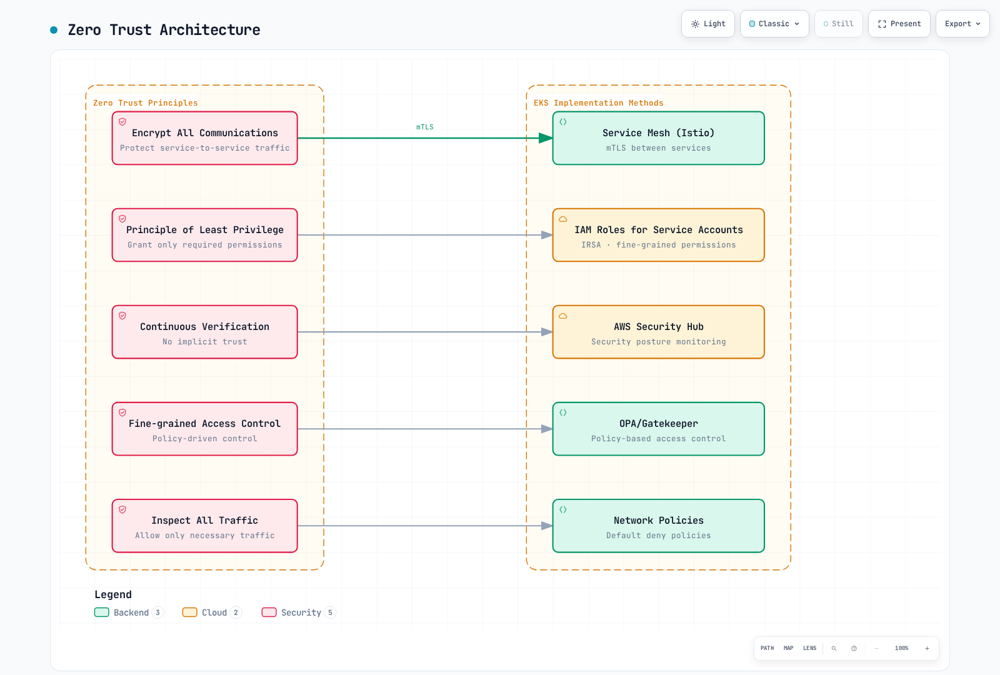
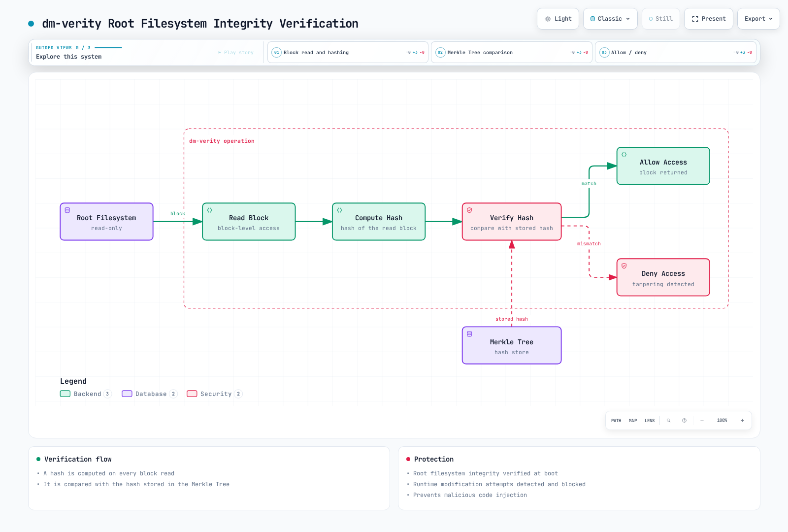

# Seguridad de Amazon EKS

> **Versiones compatibles**: soporte estándar de EKS para 1.34–1.37; soporte extendido para 1.31–1.33 (comprobado el 12 de octubre de 2026)
> **Última actualización**: 21 de noviembre de 2026

Para ejecutar cargas de trabajo de forma segura en Amazon EKS (Elastic Kubernetes Service), es necesario comprender e implementar varias capas de seguridad y prácticas recomendadas. Este documento abarca conceptos clave, componentes y prácticas recomendadas para reforzar la seguridad del clúster de EKS.

## Tabla de contenido

1. [Descripción general de la seguridad de EKS](#eks-security-overview)
2. [Prácticas de seguridad](#security-practices)
3. [IAM y autenticación](#iam-and-authentication)
4. [Análisis detallado del proveedor OIDC](#oidc-provider-deep-dive)
5. [EKS Pod Identity](#eks-pod-identity)
6. [Control de acceso al endpoint del clúster](#cluster-endpoint-access-control)
7. [Seguridad de red](#network-security)
8. [Seguridad de los Pod](#pod-security)
9. [Bottlerocket y el sistema operativo de solo lectura](#bottlerocket-and-read-only-os)
10. [Límites de permisos de IAM](#iam-permission-boundaries)
11. [Cifrado y administración de secretos](#encryption-and-secrets-management)
12. [Cumplimiento y auditoría](#compliance-and-auditing)
13. [Supervisión y detección de seguridad](#security-monitoring-and-detection)
14. [Prácticas recomendadas de seguridad de EKS](#eks-security-best-practices)
15. [Consideraciones de seguridad de EKS para los servicios financieros](#eks-security-considerations-for-financial-services)

## Descripción general de la seguridad de EKS

Separe los controles de infraestructura, acceso al clúster y cargas de trabajo. AWS administra el plano de control; la responsabilidad sobre los nodos y el sistema operativo depende de si se usan nodos autoadministrados o administrados de EC2, Fargate, Auto Mode o Hybrid Nodes. Los clientes siguen siendo responsables de las imágenes de las aplicaciones, las identidades, el manejo de datos y las políticas de las cargas de trabajo. Un diagrama estándar de nodos EC2 no implica que los clientes deban aplicar parches a los sistemas operativos del host de Auto Mode o Fargate.


[🔍 Ver el diagrama interactivo](https://www.atomai.click/kubernetes-docs/archmaps/en-eks-05-eks-security-0.html)

## Prácticas de seguridad

Use varios controles con ámbitos explícitos; ninguna herramienta por sí sola establece una arquitectura de confianza cero ni certifica una carga de trabajo. Verifique la identidad de quien realiza la llamada o de la carga de trabajo, autorice la operación prevista, restrinja las rutas de red y recopile evidencias adecuadas al modelo de amenazas.

<!-- Diagram repair pending: network policies filter traffic; posture findings are not continuous request authentication or complete zero-trust enforcement.


[🔍 View interactive diagram](https://www.atomai.click/kubernetes-docs/archmaps/en-eks-05-eks-security-1.html)
-->

### Controles de identidad y de red

IRSA y Pod Identity proporcionan credenciales de AWS a las cargas de trabajo; NetworkPolicy proporciona filtrado de red compatible; un motor de admisión comprueba las solicitudes de Kubernetes configuradas. Una malla de servicios compatible y mantenida puede añadir mTLS y políticas de tráfico de aplicaciones. AWS App Mesh dejará de tener soporte el 30 de septiembre de 2026, por lo que una implementación existente necesita un plan de migración en lugar de que se la recomiende por defecto para nuevas implementaciones.

### Seguridad de la cadena de suministro

Use un proceso de compilación y procedencia revisado, como SLSA; inventaríe los componentes con una SBOM; analice las vulnerabilidades pertinentes y verifique las firmas de los artefactos con respecto a la identidad del firmante prevista. Syft es una herramienta para SBOM; Grype es un analizador de vulnerabilidades. ECR/Inspector y otros analizadores tienen coberturas y requisitos de actualización específicos. Que una imagen esté firmada o analizada no demuestra que su código sea inocuo. Proteja también la identidad de compilación, el repositorio y la configuración de admisión.

Actualmente, ECR admite la firma de imágenes administrada con AWS Signer, así como la firma manual mediante Notation. La firma y la verificación de admisión son pasos distintos; los filtros del registro, los permisos del perfil de firma y la confianza del verificador deben coincidir con el flujo de trabajo previsto.

### Detección en tiempo de ejecución y políticas como código

GuardDuty EKS Protection analiza un flujo independiente de registros de auditoría de EKS. Runtime Monitoring es una capacidad separada basada en agentes; actualmente admite EKS en EC2 y Auto Mode, con requisitos de plataforma y agente, y excluye EKS Fargate y Hybrid Nodes. La entrega de registros de auditoría a CloudWatch es una configuración independiente. Security Hub CSPM evalúa los controles configurados; Security Hub puede correlacionar hallazgos. Ninguno sustituye la autorización de las aplicaciones ni una evaluación de todos los requisitos normativos.

Use herramientas de tiempo de ejecución y motores de políticas compatibles, como Falco, Gatekeeper o Kyverno, con la integración necesaria de kernel, controlador, API y metadatos. Los entornos de ejecución aislados adicionales, como gVisor/Kata, requieren un diseño compatible de nodos y entorno de ejecución, y no están disponibles en todas las opciones de cómputo de EKS. Las políticas y el refuerzo de imágenes o sistemas operativos reducen riesgos específicos; no garantizan que toda acción maliciosa o escape sea imposible.

Las herramientas de políticas como código también funcionan en distintas etapas: Gatekeeper/Kyverno pueden evaluar la admisión de Kubernetes, CloudFormation Guard o Sentinel pueden evaluar cambios de infraestructura y AWS Config evalúa la configuración de recursos implementados que admite. Las herramientas de investigación, como Detective, dependen de las fuentes de datos configuradas. Mantenga estas funciones diferenciadas de la prevención en tiempo de ejecución.

## IAM y autenticación

Las entidades de IAM humanas y de automatización se autentican mediante la ruta configurada de asignación de IAM o de entradas de acceso; RBAC de Kubernetes y las políticas de acceso de EKS autorizan las operaciones de Kubernetes, y los permisos permitidos se suman. El rol del clúster de EKS y el rol del nodo se utilizan para las llamadas de AWS que realizan el servicio y los nodos; no son los permisos de Kubernetes de un desarrollador. El proveedor OIDC de IAM usado para IRSA es distinto de un proveedor OIDC externo para el inicio de sesión de usuarios de Kubernetes, y los permisos de AWS de una aplicación no le conceden permisos para la API de Kubernetes. Antes de cambiar el modo de autenticación, conserve las asignaciones de administradores y nodos, y verifique los permisos con el inicio de sesión de IAM real, no con `kubectl --as`.

Detalles: [Autenticación del acceso al clúster de EKS: IAM y entradas de acceso](./05-eks-security-cluster-access.md)

## Análisis detallado del proveedor OIDC

El emisor OIDC del clúster y las claves de firma públicas que publica EKS no crean por sí solos un proveedor OIDC de IAM ni autorizan la asunción de roles. IRSA requiere un proveedor OIDC de IAM en la cuenta del rol, una relación de confianza del rol acotada por emisor, sujeto y audiencia, y un SDK compatible que intercambie el token proyectado mediante STS AssumeRoleWithWebIdentity. EKS rota su clave de firma OIDC cada siete días, por lo que los validadores personalizados deben respetar Cache-Control y gestionar los valores de `kid` desconocidos.

Detalles: [IRSA y el proveedor OIDC](./05-eks-security-irsa-oidc.md)

## EKS Pod Identity

EKS Pod Identity proporciona credenciales temporales de AWS a los Pod mediante una asociación de la API de EKS (clúster, espacio de nombres y ServiceAccount con un rol de IAM) y una relación de confianza del rol con `pods.eks.amazonaws.com`. El SDK llama al endpoint de credenciales de contenedor del agente del nodo, y el agente obtiene las credenciales mediante AssumeRoleForPodIdentity en EKS Auth. El rol de asociación debe estar en la cuenta del clúster; se accede a los recursos de otras cuentas mediante el encadenamiento de roles de destino. Para comparar con IRSA, consultar el orden de migración y ver la demostración en vivo, consulte [Migración de permisos de IAM de nodos de EKS a IRSA y Pod Identity](../security/17-eks-workload-identity-migration.md).

Detalles: [EKS Pod Identity](./05-eks-security-pod-identity.md)

## Control de acceso al endpoint del clúster

La configuración del endpoint determina la accesibilidad de red, mientras que la autenticación y la autorización siguen rigiendo las operaciones de la API. Elija la ruta de acceso según los requisitos operativos e inspeccione la configuración real en lugar de dar por sentados los valores predeterminados de una herramienta.

| Público | Privado | Comportamiento de red |
|---|---|---|
| Habilitado | Deshabilitado | Los clientes y los nodos necesitan una ruta a la dirección pública; los CIDR restringidos deben incluir las fuentes reales de salida pública |
| Deshabilitado | Habilitado | El acceso necesita la ruta de VPC/privada, DNS y reglas de grupos de seguridad, incluidas las redes conectadas aprobadas |
| Habilitado | Habilitado | Las solicitudes originadas en la VPC del clúster usan la ruta privada; los clientes externos permitidos pueden usar el acceso público |

El direccionamiento público no demuestra por sí solo que el tráfico de EC2 a EKS salga de la red de AWS. El acceso privado no autoriza automáticamente a quienes realizan las llamadas, no configura VPN/DNS ni proporciona una ruta de recuperación. EKS requiere al menos un modo de acceso.

### Inspeccionar y conservar la configuración existente

Ejecute los bloques relacionados en el mismo shell y conserve el nuevo directorio de revisión. Use una identidad de administración de AWS que pueda inspeccionar y recuperar la configuración del endpoint, independiente del inicio de sesión de Kubernetes. Esto registra únicamente los campos modificables de acceso al endpoint para su recuperación; no intenta restaurar configuraciones de VPC no relacionadas ni el modo de salida unidireccional que se describe más adelante.

```bash
set -euo pipefail
umask 077
: "${CLUSTER_NAME:?Set the existing cluster name}"
: "${AWS_REGION:?Set its Region}"
ENDPOINT_REVIEW_DIR=$(mktemp -d -t eks-endpoint-review.XXXXXX)
printf 'Review records: %s\n' "$ENDPOINT_REVIEW_DIR"
aws eks describe-cluster --name "$CLUSTER_NAME" --region "$AWS_REGION" \
  --query cluster --output json > "$ENDPOINT_REVIEW_DIR/cluster-before.json"
python3 - "$ENDPOINT_REVIEW_DIR" "$CLUSTER_NAME" <<'PY'
import json, pathlib, sys, urllib.parse
root = pathlib.Path(sys.argv[1])
cluster = json.loads((root / "cluster-before.json").read_text())
if cluster["name"] != sys.argv[2] or cluster["status"] != "ACTIVE":
    raise SystemExit("Unexpected cluster or cluster is not ACTIVE")
endpoint = urllib.parse.urlparse(cluster["endpoint"])
if endpoint.scheme != "https" or not endpoint.hostname or endpoint.username or endpoint.password:
    raise SystemExit("Unexpected Kubernetes endpoint")
(root / "endpoint-host.txt").write_text(endpoint.hostname + "\n")
config = cluster["resourcesVpcConfig"]
before = {k: config[k] for k in ["endpointPublicAccess", "endpointPrivateAccess", "publicAccessCidrs"] if k in config}
(root / "endpoint-before.json").write_text(json.dumps(before, indent=2) + "\n")
(root / "endpoint-private.json").write_text(json.dumps({"endpointPublicAccess": False, "endpointPrivateAccess": True}, indent=2) + "\n")
(root / "ssm-remote-host.json").write_text(json.dumps({"host": [endpoint.hostname], "portNumber": ["443"], "localPortNumber": ["6443"]}, indent=2) + "\n")
print(json.dumps(before, indent=2))
PY
```

### Restringir la ruta de la dirección pública

Una lista de permitidos pública debe contener las direcciones reales de salida pública aprobadas de NAT/VPN/oficina. Los rangos privados, como 10.0.0.0/8, no describen una dirección de origen pública. Los rangos de documentación, como 203.0.113.0/24, son marcadores de posición, no redes de oficina funcionales.

Defina PUBLIC_EGRESS_CIDRS como una matriz JSON proporcionada por el responsable de la red. Este ejemplo acotado acepta CIDR IPv4 y rechaza rangos privados, predeterminados o de documentación evidentes; no demuestra la titularidad ni que el cliente actual esté incluido. Revise el ámbito, la cuota y la compatibilidad del clúster con la familia de direcciones IP. La configuración de doble pila/IPv6 necesita su propia lista de permitidos verificada.

```bash
set -euo pipefail
: "${ENDPOINT_REVIEW_DIR:?Run the inspection step in this shell first}"
: "${PUBLIC_EGRESS_CIDRS:?Set a JSON array of approved actual public IPv4 egress CIDRs}"
python3 - "$ENDPOINT_REVIEW_DIR" "$PUBLIC_EGRESS_CIDRS" <<'PY'
import ipaddress, json, pathlib, sys
values = json.loads(sys.argv[2])
if not isinstance(values, list) or not values:
    raise SystemExit("Provide a nonempty reviewed CIDR list")
cidrs = []
for value in values:
    network = ipaddress.ip_network(value, strict=True)
    if network.version != 4 or network.prefixlen == 0 or not network.is_global or network.is_multicast or network.is_reserved:
        raise SystemExit("This IPv4 example requires actual public egress CIDRs, not private/default/documentation ranges")
    cidrs.append(str(network))
if len(cidrs) != len(set(cidrs)):
    raise SystemExit("Remove duplicate CIDRs")
desired = {"endpointPublicAccess": True, "endpointPrivateAccess": True, "publicAccessCidrs": cidrs}
path = pathlib.Path(sys.argv[1]) / "endpoint-public-restricted.json"
path.write_text(json.dumps(desired, indent=2) + "\n")
print(json.dumps(desired, indent=2))
PY
```

La configuración pública restringida prevista también habilita el acceso privado. Si no se habilita el acceso privado, las direcciones de salida pública de los nodos/Fargate deben seguir estando permitidas o podría fallar la comunicación entre los nodos y la API. Revise el JSON generado antes de seleccionar ENDPOINT_CHANGE=public-restricted.

### Rutas de conexión privada


[🔍 Ver el diagrama interactivo](https://www.atomai.click/kubernetes-docs/archmaps/en-eks-05-eks-security-6.html)


[🔍 Ver el diagrama interactivo](https://www.atomai.click/kubernetes-docs/archmaps/en-eks-05-eks-security-7.html)

VPN, Direct Connect/TGW y un host de administración aprobado son rutas posibles, siempre que se configuren las rutas, DNS, grupos de seguridad y autorización. Un único comando para crear Client VPN no configura asociaciones de subredes, reglas de autorización, rutas, certificados ni registros de conexión. Un Deployment que ejecuta una imagen de AWS CLI no crea un bastión administrado por SSM ni instala kubectl/SSM Agent.

Para el reenvío remoto de host con SSM, prepare un host administrado con SSM Agent 3.1.1374.0 o posterior, acceso de IAM/red a Session Manager, el complemento local de Session Manager y DNS/enrutamiento al endpoint privado de EKS. Verifique que el acceso al endpoint privado esté habilitado y que el host realmente resuelva y alcance su ruta privada. Mantenga la sesión de reenvío abierta en la primera terminal:

```bash
set -euo pipefail
: "${AWS_REGION:?Set the cluster/managed-instance Region for this example}"
: "${MANAGED_INSTANCE_ID:?Set the prepared SSM-managed instance with a private route to EKS}"
: "${ENDPOINT_REVIEW_DIR:?Use the endpoint inspection directory}"
aws ssm start-session --region "$AWS_REGION" --target "$MANAGED_INSTANCE_ID" \
  --document-name AWS-StartPortForwardingSessionToRemoteHost \
  --parameters "file://$ENDPOINT_REVIEW_DIR/ssm-remote-host.json"
```

En una segunda terminal, use el kubeconfig del mismo clúster y conserve su CA y la autenticación prevista de IAM exec. Conéctese localmente manteniendo el nombre real del servidor TLS. No deshabilite la validación de certificados para ocultar una discrepancia de nombre de host:

```bash
set -euo pipefail
: "${ENDPOINT_REVIEW_DIR:?Set the same review directory in this second terminal}"
: "${CLUSTER_KUBECONFIG:?Set the kubeconfig for this same EKS cluster and intended IAM identity}"
EKS_ENDPOINT_HOST=$(cat "$ENDPOINT_REVIEW_DIR/endpoint-host.txt")
kubectl --kubeconfig "$CLUSTER_KUBECONFIG" \
  --server https://127.0.0.1:6443 --tls-server-name "$EKS_ENDPOINT_HOST" \
  --request-timeout=10s -n security-demo get pods
```

El documento de host remoto reenvía al host EKS proporcionado. El documento anterior AWS-StartPortForwardingSession reenvía un puerto del propio host administrado; reenviar su puerto 443 no convierte ese host en el servidor de API de EKS. Que el túnel o la comprobación de estado tengan éxito no basta para probar la autorización ni la ruta privada. Verifique la operación prevista de la API, las direcciones DNS/privadas y la ruta real antes de eliminar el acceso público.

### Aplicar un cambio de endpoint revisado

Después de habilitar el acceso privado y verificar la ruta del cliente privado previsto, tome una nueva instantánea de inspección antes de elegir ENDPOINT_CHANGE=private. El siguiente bloque rechaza un clúster o una cuenta distintos, cambios en la configuración del endpoint o una transición a solo privado antes de que se haya habilitado el acceso privado. La lectura y comprobación no son una transacción atómica; coordine los cambios con el responsable.

```bash
set -euo pipefail
: "${CLUSTER_NAME:?Use the inspected cluster}"
: "${AWS_REGION:?Use its Region}"
: "${ENDPOINT_REVIEW_DIR:?Use the review directory}"
: "${ENDPOINT_CHANGE:?Choose public-restricted or private after validating the intended route}"
case "$ENDPOINT_CHANGE" in
  public-restricted|private) ;;
  *) echo "Unexpected endpoint change"; exit 1 ;;
esac
test -f "$ENDPOINT_REVIEW_DIR/endpoint-$ENDPOINT_CHANGE.json"
aws eks describe-cluster --name "$CLUSTER_NAME" --region "$AWS_REGION" \
  --query cluster --output json > "$ENDPOINT_REVIEW_DIR/cluster-current.json"
python3 - "$ENDPOINT_REVIEW_DIR" "$CLUSTER_NAME" "$ENDPOINT_CHANGE" <<'PY'
import json, pathlib, sys
root = pathlib.Path(sys.argv[1])
before = json.loads((root / "cluster-before.json").read_text())
current = json.loads((root / "cluster-current.json").read_text())
keys = ["endpointPublicAccess", "endpointPrivateAccess", "publicAccessCidrs"]
if current["name"] != sys.argv[2] or current["arn"] != before["arn"] or current["status"] != "ACTIVE":
    raise SystemExit("Cluster identity/state differs from the reviewed target")
if any(current["resourcesVpcConfig"].get(k) != before["resourcesVpcConfig"].get(k) for k in keys):
    raise SystemExit("Endpoint configuration changed; inspect and review again")
if sys.argv[3] == "private" and current["resourcesVpcConfig"].get("endpointPrivateAccess") is not True:
    raise SystemExit("Enable and verify private access before disabling public access")
PY
aws eks update-cluster-config --name "$CLUSTER_NAME" --region "$AWS_REGION" \
  --resources-vpc-config "file://$ENDPOINT_REVIEW_DIR/endpoint-$ENDPOINT_CHANGE.json" \
  --output json > "$ENDPOINT_REVIEW_DIR/update-response.json"
EKS_UPDATE_ID=$(python3 - "$ENDPOINT_REVIEW_DIR/update-response.json" <<'PY'
import json, sys
with open(sys.argv[1]) as stream:
    print(json.load(stream)["update"]["id"])
PY
)
UPDATE_DONE=false
for ((attempt=0; attempt<60; attempt++)); do
  STATE=$(aws eks describe-update --name "$CLUSTER_NAME" --region "$AWS_REGION" \
    --update-id "$EKS_UPDATE_ID" --query update.status --output text)
  case "$STATE" in
    Successful) UPDATE_DONE=true; break ;;
    InProgress) sleep 10 ;;
    *) echo "Update $EKS_UPDATE_ID status: $STATE; inspect before further changes"; exit 1 ;;
  esac
done
test "$UPDATE_DONE" = true || { echo "Update still pending; inspect $EKS_UPDATE_ID"; exit 1; }
aws eks describe-cluster --name "$CLUSTER_NAME" --region "$AWS_REGION" \
  --query cluster.resourcesVpcConfig --output json
```

Use el ID de actualización devuelto y el estado Successful, no solo ACTIVE del clúster, para confirmar la actualización. Si se agota el tiempo de espera, debe inspeccionar la operación existente; no envíe otro cambio a ciegas. Vuelva a comprobar la ruta real de la API. Mantenga disponibles los campos previos del endpoint y el acceso de recuperación de administración de AWS; esta revisión no realizó un cambio real del endpoint.

### Dependencias de servicios de AWS privados

| Ruta | Endpoint/dependencia pertinente |
|---|---|
| API de Kubernetes | Acceso privado al endpoint del clúster y sus rutas/DNS/grupos de seguridad |
| API de administración de AWS EKS | Endpoint de interfaz eks cuando se requiere acceso privado a la administración |
| Agente de Pod Identity | Endpoint de interfaz eks-auth cuando el nodo no puede usar salida pública |
| Herramientas de detección OIDC/JWKS | Endpoint de interfaz oidc-eks; datos de claves públicas anónimos, solo política predeterminada del endpoint |
| Intercambio de credenciales de IRSA | Endpoint regional de STS, separado de la recuperación de claves OIDC |
| Extracción de imágenes de ECR | Interfaces ecr.api/ecr.dkr y una ruta funcional de descarga de capas de S3 |
| Otros controladores/aplicaciones | Solo las dependencias reales de EC2, Logs, Secrets Manager, SSM u otros servicios |

Un endpoint de interfaz de EKS no es el endpoint de la API de Kubernetes. Los endpoints de gateway de S3 usan tablas de rutas; los endpoints de interfaz usan subredes/grupos de seguridad/DNS privado. No cree todos los servicios mediante un único bucle que omita el tipo de endpoint. OIDC PrivateLink no cambia la validación de tokens de STS ni autoriza roles de IRSA. Prepare la configuración completa de red/identidad/cómputo de la que sea responsable mediante los capítulos de creación; los fragmentos de endpoints aquí no constituyen una implementación de clúster lista para producción.

### Salida del plano de control enrutada por el cliente (junio de 2026)

Anunciado el 18 de junio de 2026, CUSTOMER_ROUTED es un modo de salida del plano de control de EKS compatible. Usa las interfaces de red entre cuentas del clúster existentes en las subredes, en lugar de crear una ENI de salida independiente. Se aplica a las llamadas del servidor de API dirigidas al cliente, como webhooks de admisión, detección OIDC y servidores de API agregados.

**El cambio es unidireccional: después de habilitar CUSTOMER_ROUTED, el clúster no puede volver a AWS_MANAGED.** No presente una configuración guardada ni una reversión de versión de Kubernetes como una forma de deshacer este modo. Corrija el enrutamiento o la conectividad si la nueva ruta falla.

```bash
set -euo pipefail
: "${CLUSTER_NAME:?Set the existing cluster}"
: "${AWS_REGION:?Set its Region}"
aws eks describe-cluster --name "$CLUSTER_NAME" --region "$AWS_REGION" \
  --query 'cluster.{Status:status,Vpc:resourcesVpcConfig,IPFamily:kubernetesNetworkConfig.ipFamily}' --output json
```

Antes de cambiar, inventaríe los destinos y puertos de los webhooks, OIDC y API agregadas. Verifique las rutas desde las subredes de las ENI del clúster, las reglas de salida de los grupos de seguridad, el tráfico de retorno de las NACL y DNS. Las opciones de DHCP de la VPC deben incluir AmazonProvidedDNS; las zonas privadas de Route53/Resolver y la resolución de DNS externa deben funcionar para los destinos reales. La ruta de salida puede usar NAT, un firewall o enrutamiento centralizado, según los destinos. Los clústeres IPv6 requieren las rutas IPv4 e IPv6 documentadas; una dependencia solo IPv4 sigue necesitando una ruta IPv4 funcional.

Después de completar esa revisión, la siguiente es la opción real de la API. Se comprobó su sintaxis sin conexión; no se ejecutó contra un clúster de AWS en esta auditoría:

```bash
set -euo pipefail
: "${CLUSTER_NAME:?Set the reviewed cluster}"
: "${AWS_REGION:?Set its Region}"
# One-way change: complete subnet route/SG/NACL/DNS and dependency checks first.
aws eks update-cluster-config --name "$CLUSTER_NAME" --region "$AWS_REGION" \
  --resources-vpc-config controlPlaneEgressMode=CUSTOMER_ROUTED --output json
```

Registre el ID de actualización devuelto e inspeccione DescribeUpdate hasta que el estado sea Successful; ACTIVE por sí solo no basta. A continuación, pruebe las rutas reales configuradas para webhooks, OIDC de usuario y API agregadas. No afirme que una prueba local del analizador de CLI demuestre la conectividad de VPC.

| Tráfico | Efecto de esta configuración |
|---|---|
| Salida del servidor de API dirigida al cliente | Usa la ruta configurada de la VPC del cliente |
| API de kubelet en 10250 | Usa la ruta de la ENI del clúster/nodo; no el dispositivo de salida externo |
| etcd, CloudWatch Logs, tráfico interno de EKS | Continúa usando rutas administradas por EKS |
| Controladores de EKS Capabilities, como ArgoCD/ACK/KRO administrados | Se ejecutan en una infraestructura administrada independiente; esta función no los redirige |
| Llamadas de aplicaciones a STS/EKS Auth/S3 | Siguen la red de cargas de trabajo/nodos; este modo del servidor de API no las controla |

La función está disponible sin cargo adicional por la función en las regiones de EKS, pero NAT/firewall/PrivateLink/registro tienen sus propios costos. Se deben configurar Flow Logs si se requiere evidencia del flujo de red; no exponen automáticamente las cargas útiles cifradas ni demuestran la autorización de las aplicaciones.

#### Ejemplo de SCP con ámbito de solicitud

La clave eks:controlPlaneEgressMode evalúa el modo especificado en las solicitudes CreateCluster/UpdateClusterConfig. Un bloqueo StringNotEquals sin condición de presencia también coincide con una clave omitida. El siguiente ejemplo exige el modo para clústeres nuevos y rechaza explícitamente un modo distinto durante las actualizaciones, a la vez que permite solicitudes de actualización no relacionadas que omiten el modo:

```json
{
  "Version": "2012-10-17",
  "Statement": [
    {
      "Sid": "RequireCustomerRoutedForNewClusters",
      "Effect": "Deny",
      "Action": "eks:CreateCluster",
      "Resource": "*",
      "Condition": {
        "StringNotEquals": {
          "eks:controlPlaneEgressMode": "CUSTOMER_ROUTED"
        }
      }
    },
    {
      "Sid": "RejectExplicitOtherEgressMode",
      "Effect": "Deny",
      "Action": "eks:UpdateClusterConfig",
      "Resource": "*",
      "Condition": {
        "Null": {
          "eks:controlPlaneEgressMode": "false"
        },
        "StringNotEquals": {
          "eks:controlPlaneEgressMode": "CUSTOMER_ROUTED"
        }
      }
    }
  ]
}
```

Este es un control deliberado de solicitudes, no una migración automática de clústeres existentes. En este ejemplo, los clústeres AWS_MANAGED existentes aún pueden recibir actualizaciones no relacionadas. Una organización que requiera una política de implementación distinta debe modelarla por separado. Las SCP no conceden permisos de IAM ni configuran el enrutamiento/DNS. Antes de implementarla, revise la herencia de políticas y pruebe solicitudes representativas permitidas y denegadas con el responsable de la organización.

## Seguridad de red

Use grupos de seguridad, enrutamiento, NetworkPolicy y autenticación de aplicaciones en sus respectivas capas. El diagrama muestra un diseño de red tradicional; un bastión público y endpoints privados de AWS son componentes opcionales que deben configurarse realmente, no propiedades inherentes a todos los clústeres de EKS.


[🔍 Ver el diagrama interactivo](https://www.atomai.click/kubernetes-docs/archmaps/en-eks-05-eks-security-8.html)

### Grupos de seguridad y rutas necesarias

Para la ruta de API/nodo, permita los flujos TCP443 necesarios desde los nodos a la API y TCP10250 desde el plano de control al kubelet. DNS, webhooks y cargas de trabajo pueden necesitar otros puertos de destino reales. No existe un requisito universal de abrir TCP1025–65535 como «comunicación entre nodos». Los grupos de seguridad son con estado; las NACL y sus reglas de ruta de retorno son independientes.

Inspeccione los grupos de seguridad asociados a las ENI/nodos reales. Una configuración de grupo de seguridad personalizada en una plantilla de lanzamiento no hereda automáticamente todas las reglas predeterminadas de EKS. Security Groups for Pods y los selectores de grupos de seguridad de Pod de Auto Mode NodeClass son mecanismos distintos, con su propia compatibilidad y comportamiento; los grupos de seguridad no se limitan a una capa abstracta exclusiva de las instancias. Revise el cómputo/CNI seleccionado y la interfaz de origen real.

### Semántica de NetworkPolicy

NetworkPolicy requiere una implementación de cumplimiento compatible y configurada. Crear solo YAML no filtra paquetes. Use la capacidad de políticas de EKS VPC CNI compatible con el responsable de red actual o la pila de red compatible seleccionada deliberadamente. No instale un manifiesto flotante de Calico ni una configuración de Cilium no relacionada sobre un clúster existente. Auto Mode administra la red por sí mismo; no es un destino para instalar arbitrariamente un CNI de reemplazo.

Las políticas son aditivas. Para permitir una conexión aislada, deben permitirla tanto la salida del origen como la entrada del destino. El orden de las reglas no establece un sistema de prioridad de denegación/permiso. Un podSelector por sí solo selecciona pares en el espacio de nombres de la política; namespaceSelector junto con podSelector en el mismo par es una condición AND. Las entradas de pares independientes se combinan como alternativas.

### Ejercicio con políticas aisladas

Este ejemplo usa espacios de nombres nuevos de demostración, redes Linux de EC2 con un CNI que aplica las políticas y un Deployment tradicional de CoreDNS con la etiqueta k8s-app=kube-dns en kube-system. Supone que hay Pod de frontend/API/base de datos preparados, etiquetados app=frontend/api/database; la API escucha en 8080 y expone métricas de demostración en 9090, y la base de datos escucha en 5432. Estas políticas no implementan esas aplicaciones.

La denegación predeterminada incluye ambas direcciones. DNS y cada flujo previsto de origen/destino se proporcionan explícitamente. No aplique estas suposiciones a un espacio de nombres de producción existente sin inventariar todas las dependencias:

```yaml
apiVersion: v1
kind: Namespace
metadata:
  name: security-network-demo
  labels:
    pod-security.kubernetes.io/enforce: restricted
    pod-security.kubernetes.io/enforce-version: v1.36
---
apiVersion: v1
kind: Namespace
metadata:
  name: security-monitoring-demo
---
apiVersion: networking.k8s.io/v1
kind: NetworkPolicy
metadata:
  name: default-deny
  namespace: security-network-demo
spec:
  podSelector: {}
  policyTypes:
  - Ingress
  - Egress
---
apiVersion: networking.k8s.io/v1
kind: NetworkPolicy
metadata:
  name: allow-dns
  namespace: security-network-demo
spec:
  podSelector: {}
  policyTypes:
  - Egress
  egress:
  - to:
    - namespaceSelector:
        matchLabels:
          kubernetes.io/metadata.name: kube-system
      podSelector:
        matchLabels:
          k8s-app: kube-dns
    ports:
    - protocol: UDP
      port: 53
    - protocol: TCP
      port: 53
---
apiVersion: networking.k8s.io/v1
kind: NetworkPolicy
metadata:
  name: frontend-to-api
  namespace: security-network-demo
spec:
  podSelector:
    matchLabels:
      app: frontend
  policyTypes:
  - Egress
  egress:
  - to:
    - podSelector:
        matchLabels:
          app: api
    ports:
    - protocol: TCP
      port: 8080
---
apiVersion: networking.k8s.io/v1
kind: NetworkPolicy
metadata:
  name: api-ingress
  namespace: security-network-demo
spec:
  podSelector:
    matchLabels:
      app: api
  policyTypes:
  - Ingress
  ingress:
  - from:
    - podSelector:
        matchLabels:
          app: frontend
    ports:
    - protocol: TCP
      port: 8080
---
apiVersion: networking.k8s.io/v1
kind: NetworkPolicy
metadata:
  name: api-to-database
  namespace: security-network-demo
spec:
  podSelector:
    matchLabels:
      app: api
  policyTypes:
  - Egress
  egress:
  - to:
    - podSelector:
        matchLabels:
          app: database
    ports:
    - protocol: TCP
      port: 5432
---
apiVersion: networking.k8s.io/v1
kind: NetworkPolicy
metadata:
  name: database-ingress
  namespace: security-network-demo
spec:
  podSelector:
    matchLabels:
      app: database
  policyTypes:
  - Ingress
  ingress:
  - from:
    - podSelector:
        matchLabels:
          app: api
    ports:
    - protocol: TCP
      port: 5432
---
apiVersion: networking.k8s.io/v1
kind: NetworkPolicy
metadata:
  name: monitor-api
  namespace: security-network-demo
spec:
  podSelector:
    matchLabels:
      app: api
  policyTypes:
  - Ingress
  ingress:
  - from:
    - namespaceSelector:
        matchLabels:
          kubernetes.io/metadata.name: security-monitoring-demo
      podSelector:
        matchLabels:
          app: prometheus
    ports:
    - protocol: TCP
      port: 9090
```

El Pod de supervisión también necesita permiso de salida. Esta política de demostración independiente permite el acceso a las métricas de la API y las rutas DNS tradicionales; no es una política de red de Prometheus completa para producción:

```yaml
apiVersion: networking.k8s.io/v1
kind: NetworkPolicy
metadata:
  name: prometheus-to-demo-api
  namespace: security-monitoring-demo
spec:
  podSelector:
    matchLabels:
      app: prometheus
  policyTypes:
  - Egress
  egress:
  - to:
    - namespaceSelector:
        matchLabels:
          kubernetes.io/metadata.name: security-network-demo
      podSelector:
        matchLabels:
          app: api
    ports:
    - protocol: TCP
      port: 9090
  - to:
    - namespaceSelector:
        matchLabels:
          kubernetes.io/metadata.name: kube-system
      podSelector:
        matchLabels:
          k8s-app: kube-dns
    ports:
    - protocol: UDP
      port: 53
    - protocol: TCP
      port: 53
```

Auto Mode puro usa CoreDNS local al nodo en lugar del Deployment tradicional, y las rutas de NodeLocal DNS/resolutores personalizados también pueden diferir. Inspeccione la ruta real del resolutor antes de adaptar la regla DNS. Las etiquetas son selectores, no identidades criptográficas de cargas de trabajo; controle quién puede crear o volver a etiquetar cargas de trabajo y use autorización de aplicaciones cuando sea necesario.

### Destinos externos y límites de validación

La siguiente dirección, destinada solo a la documentación, debe sustituirse por un destino real aprobado antes de realizar un ejercicio de conectividad. Ilustra un permiso para una IP/puerto, no una lista de permitidos de servicios/FQDN de AWS:

```yaml
apiVersion: networking.k8s.io/v1
kind: NetworkPolicy
metadata:
  name: approved-https-example
  namespace: security-network-demo
spec:
  podSelector:
    matchLabels:
      app: external-client
  policyTypes:
  - Egress
  egress:
  - to:
    - ipBlock:
        cidr: 203.0.113.10/32
    ports:
    - protocol: TCP
      port: 443
```

Permitir 0.0.0.0/0 en 443 da acceso a un amplio conjunto de destinos públicos; excluir rangos privados o de enlace local no identifica un servicio de confianza. Native NetworkPolicy no resuelve un dominio para crear una lista de permitidos duradera ni proporciona autorización de IAM. Las excepciones de nodo/hostNetwork, el orden de NAT y el comportamiento específico de la implementación también significan que no es el único mecanismo de aislamiento de IMDS.

Pruebe conexiones nuevas positivas y negativas en el CNI real. Los cambios de políticas pueden propagarse de forma asíncrona, y el manejo de conexiones existentes depende de la implementación. Los ejemplos de origen se comprobaron con casos sintéticos de selectores/puertos; en esta revisión no se ejecutaron filtrado de paquetes, resolución DNS ni tráfico en vivo.

## Seguridad de los Pod

Pod Security Standards define perfiles; Pod Security Admission (PSA) aplica la política seleccionada para el espacio de nombres. PSA es estable desde Kubernetes 1.25. PodSecurityPolicy quedó obsoleto en 1.21 y **se eliminó en 1.25**; no es una API que se pueda implementar en un clúster de EKS actual. Una restricción de Gatekeeper que incluya PSP en su nombre es un recurso personalizado independiente, no la API eliminada.


[🔍 Ver el diagrama interactivo](https://www.atomai.click/kubernetes-docs/archmaps/en-eks-05-eks-security-9.html)

### Perfiles versionados y aplicación

| Perfil | Significado |
|---|---|
| Privileged | Este perfil PSS no impone restricciones; siguen aplicándose otros controles de autorización/admisión |
| Baseline | Conjunto básico de restricciones sobre configuraciones conocidas por ampliar privilegios |
| Restricted | Añade restricciones más estrictas, incluidos requisitos compatibles de usuario no root, capacidades y seccomp |

La política enforce del espacio de nombres rechaza las solicitudes de Pod que incumplen los requisitos. Audit y warn registran o notifican infracciones; no convierten la aplicación correcta de un controlador en una prueba de que sus Pod puedan ejecutarse. En las plantillas de Deployment/Job, audit/warn pueden notificar problemas, mientras que enforce se aplica a los Pod resultantes. Compruebe los eventos y la implementación gradual, no solo que kubectl apply haya tenido éxito. Cambiar la política del espacio de nombres no expulsa retroactivamente los Pod existentes.

### Ejemplo completo de contexto de seguridad de Linux

El siguiente es un pequeño ejemplo de identidad/contexto de seguridad de Linux que usa una imagen real y no tiene rutas de ejecución de aplicaciones que se puedan escribir. No es una implementación de una aplicación nginx. Use la versión de PSS adecuada para el clúster real; este ejemplo está fijado a la política de EKS 1.36 revisada.

```yaml
apiVersion: v1
kind: Namespace
metadata:
  name: security-demo
  labels:
    pod-security.kubernetes.io/enforce: restricted
    pod-security.kubernetes.io/enforce-version: v1.36
    pod-security.kubernetes.io/audit: restricted
    pod-security.kubernetes.io/audit-version: v1.36
    pod-security.kubernetes.io/warn: restricted
    pod-security.kubernetes.io/warn-version: v1.36
---
apiVersion: v1
kind: Pod
metadata:
  name: security-context-demo
  namespace: security-demo
spec:
  automountServiceAccountToken: false
  nodeSelector:
    kubernetes.io/os: linux
  securityContext:
    runAsNonRoot: true
    runAsUser: 1000
    runAsGroup: 1000
    seccompProfile:
      type: RuntimeDefault
  containers:
  - name: app
    image: busybox:1.38.0
    command:
    - sh
    - -c
    args:
    - id && sleep 3600
    securityContext:
      allowPrivilegeEscalation: false
      readOnlyRootFilesystem: true
      capabilities:
        drop:
        - ALL
    resources:
      requests:
        cpu: 10m
        memory: 16Mi
      limits:
        cpu: 100m
        memory: 64Mi
```

Los ajustes runAsUser/runAsGroup/runAsNonRoot/seccomp a nivel de Pod son distintos de allowPrivilegeEscalation y capabilities a nivel de contenedor. fsGroup es un ajuste de propiedad de volúmenes a nivel de Pod, cuyo comportamiento depende del controlador y el sistema de archivos; no es una capacidad de contenedor. readOnlyRootFilesystem es un refuerzo adicional compatible con la aplicación, no un requisito universal de PSS Restricted, y no hace que todos los PVC montados sean de solo lectura.

Para una aplicación real, prepare el UID/GID de la imagen, los volúmenes escribibles de tmp/caché/socket y los puertos de las sondas. No suponga que una imagen nginx orientada a root se inicia con un UID arbitrario y un sistema de archivos raíz de solo lectura sin esas rutas. Los controles estándar reducen los riesgos, pero no demuestran que todos los escapes de kernel/entorno de ejecución sean imposibles.

### Ejemplo de política de admisión

Use una instalación compatible y administrada del motor de políticas y sus CRD reales. Kyverno 1.19.1 sirve la API ValidatingPolicy de policies.kyverno.io/v1; en esa versión, el formato ClusterPolicy anterior está obsoleto. El siguiente ejemplo acotado se aplica únicamente a security-demo y comprueba los contenedores normales, de inicialización y efímeros. Si privileged se omite, se considera false y se acepta; privileged:true se rechaza.

```yaml
apiVersion: policies.kyverno.io/v1
kind: ValidatingPolicy
metadata:
  name: demo-disallow-privileged
spec:
  validationActions:
  - Deny
  failurePolicy: Fail
  matchConstraints:
    resourceRules:
    - apiGroups:
      - ''
      apiVersions:
      - v1
      resources:
      - pods
      - pods/ephemeralcontainers
      operations:
      - CREATE
      - UPDATE
      scope: Namespaced
  matchConditions:
  - name: demo-namespace
    expression: has(object.metadata.namespace) && object.metadata.namespace == 'security-demo'
  validations:
  - expression: object.spec.containers.all(c, !has(c.securityContext) || !has(c.securityContext.privileged)
      || c.securityContext.privileged == false) && (!has(object.spec.initContainers)
      || object.spec.initContainers.all(c, !has(c.securityContext) || !has(c.securityContext.privileged)
      || c.securityContext.privileged == false)) && (!has(object.spec.ephemeralContainers)
      || object.spec.ephemeralContainers.all(c, !has(c.securityContext) || !has(c.securityContext.privileged)
      || c.securityContext.privileged == false))
    message: Privileged containers, including init and ephemeral containers, are not
      allowed in security-demo.
```

Esta única regla no sustituye completamente un perfil PSS ni la verificación de firmas de imágenes. Mantenga los agentes de CSI/plataforma/supervisión y las excepciones deliberadas bajo una titularidad revisada por separado; no aplique una política general de demostración a kube-system. Una alternativa con Gatekeeper también requiere la ConstraintTemplate correspondiente, el esquema de la restricción y un comportamiento probado, no solo un tipo de restricción supuesto.

La política CEL se comprobó con la CRD publicada y la CLI real de Kyverno usando casos de valor omitido/falso, true en contenedores normales/de inicialización/efímeros y otros espacios de nombres. No se ejecutaron un webhook de admisión en vivo, la implementación de un Pod ni la aplicación de la política. Antes de aplicar la política en producción, revise los recursos existentes y la implementación gradual del controlador.

## Bottlerocket y el sistema operativo de solo lectura

Bottlerocket es un host de contenedores Linux con una superficie reducida de software de host, ajustes administrados por API y actualizaciones basadas en imágenes. Su sistema de archivos raíz de solo lectura no hace que todo el almacenamiento sea inmutable ni elimina las vulnerabilidades de kernel o del entorno de ejecución.

### Configuración basada en API

Normalmente, el host se administra mediante su API, no con un servidor SSH o un administrador de paquetes instalado. Los contenedores de host de control y administración tienen accesos y privilegios distintos. Proteja las rutas de acceso SSM/SSH, el IAM de los nodos y el acceso al socket de la API local; el acceso a ese socket puede cambiar la configuración del host. Habilitar el contenedor de control por sí solo no configura el registro de SSM, los permisos ni la conectividad de red.

```bash
# Run inside an authorized Bottlerocket control container.
apiclient get settings.host-containers.admin
apiclient get settings.updates
apiclient get settings.motd
```

Un cambio de configuración aprobado deliberadamente puede usar `apiclient set motd="EKS Bottlerocket node"`. El comando `set` **confirma y aplica los cambios automáticamente**, y puede reiniciar los servicios afectados. No existe un comando independiente `apiclient commit`. Las transacciones de bajo nivel preparadas utilizan, en cambio, la operación de confirmación y aplicación de transacciones de la API.

Los datos de usuario usan TOML, no Bash. Este fragmento de configuración se debe combinar con la configuración de arranque generada para el clúster real; no proporciona el endpoint del clúster, la CA ni todos los requisitos de arranque:

```toml
[settings]
motd = "EKS Bottlerocket node"

[settings.host-containers.admin]
enabled = false
```

### SELinux e integridad del sistema de archivos

SELinux se ejecuta en modo enforcing y restringe el acceso según las etiquetas de procesos y archivos. Los servicios de host previstos siguen necesitando acceso privilegiado, y los usuarios con privilegios suficientes pueden cambiar algunas etiquetas. Estos controles reducen el riesgo; no demuestran que todos los escapes de contenedor sean imposibles.

En EKS Kubernetes 1.37, los montajes de volúmenes de SELinux son estables y están habilitados de forma predeterminada en las configuraciones compatibles. El comportamiento se aplica cuando el Pod establece `seLinuxOptions` y el controlador CSI declara `seLinuxMount: true`. Como un montaje solo tiene una etiqueta SELinux, un Pod puede quedarse en `ContainerCreating` cuando otro Pod del mismo nodo ya usa ese volumen con una etiqueta SELinux, `seLinuxChangePolicy` o nivel de privilegio diferente; los nodos que no tienen SELinux habilitado no se ven afectados. Antes de actualizar, busque controladores con `seLinuxMount: true` y armonice `seLinuxOptions.level` y `seLinuxChangePolicy` en los Pod que comparten un volumen (`Recursive` conserva el comportamiento de reetiquetado anterior). Consulte la sección de Kubernetes 1.37 de las [notas de versiones de soporte estándar de EKS](https://docs.aws.amazon.com/eks/latest/userguide/kubernetes-versions-standard.html).

El sistema de archivos raíz usa dm-verity: los bloques protegidos se verifican con el árbol de hash al leerse. Esto no significa que se hayan analizado todos los archivos durante el arranque. Los registros, las imágenes de contenedor, los volúmenes de aplicaciones y los ajustes incluyen almacenamiento modificable; partes de `/etc` son efímeras y deben configurarse mediante mecanismos compatibles.



[🔍 Ver el diagrama interactivo](https://www.atomai.click/kubernetes-docs/archmaps/en-eks-05-eks-security-11.html)

### Actualizaciones en el sitio o sustitución de nodos

Bottlerocket **admite actualizaciones de imágenes en el sitio**. `apiclient update check` busca una actualización apta; `apiclient update apply` escribe en la partición alternativa y la selecciona para el próximo arranque. El reinicio es un paso independiente que interrumpe el servicio, a menos que se combine explícitamente con la actualización. Los comandos de actualización sin procesar de apiclient/SSM no drenan las cargas de trabajo de Kubernetes.

Para Kubernetes, la documentación de Bottlerocket recomienda Brupop para coordinar las actualizaciones en el sitio. Las actualizaciones de los grupos de nodos administrados de EKS pueden, en cambio, sustituir instancias. Elija un único responsable coordinador para la flota, revise la compatibilidad de versiones/variantes, la capacidad, los PDB, los datos locales y el estado de las cargas de trabajo, y valide una implementación gradual pequeña antes de continuar. Las particiones A/B permiten mecanismos de recuperación, pero no garantizan la recuperación automática de todos los fallos de aplicaciones o de arranque.

`settings.updates.version-lock` acepta una versión completa, como `1.64.0`, o `latest`; `1.15.%` no es una regla de bloqueo con comodín compatible. Un bloqueo controla la selección de la actualización, no su programación ni la finalización correcta de una actualización automática. Mantenga la configuración del repositorio de actualizaciones de la variante, salvo que se opere intencionalmente con un repositorio personalizado verificado. No sustituya la URL de actualización por una genérica.

### Ejemplo de grupo de nodos administrado de EKS

Guarde lo siguiente como `bottlerocket-nodegroup.yaml` después de sustituir el nombre del clúster, la región y la versión, y de ajustar el tamaño para un clúster existente del que sea responsable. Usa la configuración de grupos de nodos administrados de eksctl y los ajustes de arranque generados. Antes de crear recursos, verifique que la variante de AMI de Bottlerocket admita la versión del clúster y la arquitectura de la instancia, así como la salida/endpoints de las subredes privadas, el rol del nodo y las identidades independientes de las cargas de trabajo/CNI. El número de versión del sistema operativo usado anteriormente es un ejemplo de sintaxis, no una instrucción para actualizar todos los nodos a esa versión.

```yaml
apiVersion: eksctl.io/v1alpha5
kind: ClusterConfig
metadata:
  name: secure-cluster
  region: us-west-2
  version: "1.36"
managedNodeGroups:
  - name: bottlerocket-ng
    amiFamily: Bottlerocket
    instanceType: m5.large
    privateNetworking: true
    minSize: 2
    desiredCapacity: 3
    maxSize: 5
    volumeSize: 100
    volumeType: gp3
    volumeEncrypted: true
    updateConfig:
      maxUnavailable: 1
    bottlerocket:
      enableAdminContainer: false
      settings:
        motd: "EKS Bottlerocket node"
        host-containers:
          control:
            enabled: true
```

Para una implementación revisada, el comando de creación es `eksctl create nodegroup --config-file bottlerocket-nodegroup.yaml`. No asigne permisos de Secrets Manager para aplicaciones ni permisos de administración de volúmenes de controladores CSI a todos los nodos solo para completar un ejemplo de límites entre nodos. Asigne a esas cargas de trabajo su propia identidad compatible. Revise los permisos requeridos por los nodos para EKS Auth/registro/SSM en función de las funciones habilitadas.

Antes de cambiar una flota, inspeccione el grupo de nodos administrado y el sistema operativo que realmente informan los nodos. Asegúrese de que el contexto de kubectl se refiera al mismo clúster del que es responsable:

```bash
set -euo pipefail
: "${CLUSTER_NAME:?Set the owned cluster name}"
: "${NODEGROUP_NAME:?Set the owned managed node group name}"
: "${AWS_REGION:?Set the cluster Region}"
aws eks describe-nodegroup --region "$AWS_REGION" \
  --cluster-name "$CLUSTER_NAME" --nodegroup-name "$NODEGROUP_NAME" \
  --query 'nodegroup.{Name:nodegroupName,Status:status,AMIType:amiType,Release:releaseVersion,Kubernetes:version,Role:nodeRole,Update:updateConfig,Health:health.issues}'
kubectl get nodes -l "eks.amazonaws.com/nodegroup=$NODEGROUP_NAME" \
  -o custom-columns='NAME:.metadata.name,OS:.status.nodeInfo.osImage,KUBELET:.status.nodeInfo.kubeletVersion'
```

Una versión de AMI no es un registro de auditoría completo de cambios posteriores en los ajustes de la API o de actualizaciones del sistema operativo en el sitio. Conserve los ajustes deseados, los resultados de actualización y el inventario de nodos en ejecución. La sustitución de nodos requiere un plan explícito de estado y reversión; no encadene un drenaje sin comprobar con la eliminación de emptyDir y del grupo de nodos.

La validación aquí abarcó la sintaxis TOML, el esquema publicado de configuración de eksctl y la sintaxis del shell. No se creó ni probó ningún nodo Bottlerocket, actualización, sesión de SSM o grupo de nodos.

Referencias principales: [cliente de API de Bottlerocket](https://github.com/bottlerocket-os/bottlerocket-core-kit/tree/v15.0.0/sources/api/apiclient), [actualizaciones en el sitio](https://bottlerocket.dev/en/os/1.64.x/update/methods/in-place/), [sustitución de nodos](https://bottlerocket.dev/en/os/1.64.x/update/methods/node-replacement/), [bloqueos de versión](https://bottlerocket.dev/en/os/1.64.x/update/locking-to-a-specific-release/), [dm-verity](https://docs.kernel.org/admin-guide/device-mapper/verity.html).

## Límites de permisos de IAM

Un límite de permisos restringe lo que las políticas basadas en identidad pueden conceder a un usuario o rol de IAM; no concede permisos por sí mismo. En la ruta de políticas de identidad, las acciones permitidas son la intersección de la política de identidad y el límite, sujetas a las políticas de sesión/Organizations aplicables y a las denegaciones explícitas.


[🔍 Ver el diagrama interactivo](https://www.atomai.click/kubernetes-docs/archmaps/en-eks-05-eks-security-12.html)

El diagrama ilustra esa ruta de políticas de identidad, no todos los casos de autorización de IAM. Las políticas de recursos de la misma cuenta que conceden acceso directamente a un ARN de usuario o de sesión de rol pueden comportarse de forma distinta en relación con las denegaciones implícitas. Una denegación explícita sigue siendo relevante. Revise la entidad principal y la política de recursos exactas; no dé por sentado que un límite es un techo incondicional para todas las concesiones posibles basadas en recursos. Evite combinar `NotPrincipal` y `Deny` en una política de recursos contra entidades principales con límites; use en su lugar el patrón documentado de condición de ARN de entidad principal.

### Límite de carga de trabajo acotado

Este límite ilustrativo permite enumerar un solo bucket y leer sus objetos. Sustituya el bucket por un recurso del que sea responsable y proporcione una política de identidad independiente y la relación de confianza correcta de IRSA/Pod Identity. Para objetos SSE-KMS, revise también los permisos específicos de la clave de KMS y su política; este límite exclusivo de S3 intencionalmente no concede ni permite acciones de KMS.

```json
{
  "Version": "2012-10-17",
  "Statement": [
    {
      "Sid": "ListOwnedBucket",
      "Effect": "Allow",
      "Action": "s3:ListBucket",
      "Resource": "arn:aws:s3:::amzn-s3-demo-app-bucket"
    },
    {
      "Sid": "ReadOwnedObjects",
      "Effect": "Allow",
      "Action": "s3:GetObject",
      "Resource": "arn:aws:s3:::amzn-s3-demo-app-bucket/*"
    }
  ]
}
```

Aplique un límite revisado a través del proceso de IaC/titularidad existente del rol y verifique los casos de uso permitidos y denegados. Un rol de Pod puede usar un límite, pero debe cumplir igualmente los requisitos de asociación, confianza y sesión. Impida que los administradores delegados sustituyan o eliminen el límite requerido o cambien la versión de su política.

No adjunte este límite a un rol de nodo de EKS. Los requisitos de los nodos dependen de las funciones habilitadas y pueden incluir la detección de nodos de EKS, la extracción del registro, `eks-auth:AssumeRoleForPodIdentity` y operaciones de SSM. Una lista de permitidos incompleta escrita manualmente puede impedir que los nodos o las credenciales funcionen. Antes de probar un límite para nodos en un canario, inventaríe las políticas reales de los nodos y las dependencias de las funciones. Mantenga los permisos de secretos de aplicaciones y los permisos de controladores CSI/CNI en sus identidades de carga de trabajo compatibles, en lugar de añadirlos a todos los nodos.

### Patrones de privilegio mínimo

**Acceso a espacios de nombres de Kubernetes:** use la entrada de acceso con políticas de acceso de EKS limitadas al espacio de nombres o un Role/RoleBinding de RBAC, como se muestra en [Autenticación del acceso al clúster de EKS](./05-eks-security-cluster-access.md#access-entries-and-namespace-authorization). `eks:AccessKubernetesApi` permite ver objetos de Kubernetes en la consola de EKS; no es un permiso general de RBAC de espacio de nombres para kubectl. `eks:namespaces` es una condición ArrayOfString en solicitudes `AssociateAccessPolicy`/`DisassociateAccessPolicy`, no en `AccessKubernetesApi`. `DescribeCluster`/`ListClusters` de IAM, por sí solos, no autorizan operaciones de Kubernetes. Las concesiones múltiples se suman; una asociación acotada no elimina una concesión existente para todo el clúster.

**Extracciones limitadas al repositorio:** las acciones de lectura de imágenes se pueden limitar a los ARN de repositorios aprobados. `GetAuthorizationToken` requiere `Resource: "*"`; ese permiso de autenticación por sí solo no concede acceso a imágenes.

```json
{
  "Version": "2012-10-17",
  "Statement": [
    {
      "Sid": "PullApprovedRepository",
      "Effect": "Allow",
      "Action": [
        "ecr:GetDownloadUrlForLayer",
        "ecr:BatchGetImage",
        "ecr:BatchCheckLayerAvailability"
      ],
      "Resource": "arn:aws:ecr:us-west-2:123456789012:repository/approved-*"
    },
    {
      "Sid": "RegistryAuthentication",
      "Effect": "Allow",
      "Action": "ecr:GetAuthorizationToken",
      "Resource": "*"
    }
  ]
}
```

**ABAC de bucket de S3:** actualmente, los buckets de uso general de S3 admiten condiciones de etiquetas del bucket para operaciones que incluyen ListBucket/GetObject, pero **primero se debe habilitar ABAC en ese bucket**. Está deshabilitado de forma predeterminada. La siguiente política de IAM usa la etiqueta Environment del bucket, no una etiqueta de objeto:

```json
{
  "Version": "2012-10-17",
  "Statement": [
    {
      "Sid": "ListMatchingEnvironment",
      "Effect": "Allow",
      "Action": "s3:ListBucket",
      "Resource": "arn:aws:s3:::amzn-s3-demo-app-bucket",
      "Condition": {
        "StringEquals": {
          "aws:ResourceTag/Environment": "${aws:PrincipalTag/Environment}"
        }
      }
    },
    {
      "Sid": "ReadMatchingEnvironment",
      "Effect": "Allow",
      "Action": "s3:GetObject",
      "Resource": "arn:aws:s3:::amzn-s3-demo-app-bucket/*",
      "Condition": {
        "StringEquals": {
          "aws:ResourceTag/Environment": "${aws:PrincipalTag/Environment}"
        }
      }
    }
  ]
}
```

Una entidad principal/sesión gobernada por separado debe tener realmente la etiqueta Environment correspondiente. Etiquetar un objeto de Kubernetes o un recurso de asociación de Pod Identity no proporciona automáticamente esa etiqueta arbitraria a la entidad principal. Audite las políticas de bucket existentes antes de habilitar ABAC y restrinja quién puede cambiar las etiquetas o el estado de ABAC. Después de habilitarlo, use `TagResource`/`UntagResource` de S3 para cambiar las etiquetas del bucket; `PutBucketTagging`/`DeleteBucketTagging` dejan de funcionar. Consulte el estado con `aws s3api get-bucket-abac --bucket YOUR_OWNED_BUCKET --region YOUR_REGION`. Este ejemplo no habilita ABAC ni modifica un bucket.

### Controles de protección de Organizations SCP

Las SCP limitan las entidades principales aplicables en las cuentas miembro; no conceden permisos y no se aplican a la cuenta de administración ni a los roles vinculados a servicios. Una SCP no sustituye RBAC de Kubernetes ni los controles de red. Pruebe en una OU/cuenta limitada y conserve una ruta de recuperación bajo su control antes de adjuntarla a un ámbito mayor. Un ejemplo que solo deniega supone que la jerarquía de Organizations sigue teniendo las políticas Allow necesarias.

Por ejemplo, este control contra eliminación excluye de esta denegación a un único rol de operador nombrado explícitamente. Sustituya la cuenta/el rol por la entidad principal de recuperación revisada; la excepción en sí no concede permisos de eliminación:

```json
{
  "Version": "2012-10-17",
  "Statement": [
    {
      "Sid": "RestrictClusterDeletion",
      "Effect": "Deny",
      "Action": "eks:DeleteCluster",
      "Resource": "*",
      "Condition": {
        "ArnNotEquals": {
          "aws:PrincipalArn": "arn:aws:iam::123456789012:role/EKSDeletionOperator"
        }
      }
    }
  ]
}
```

### Siete nuevas claves de condición de IAM de EKS (abril de 2026)

El anuncio del 20 de abril de 2026 es válido. Use cada condición únicamente con las acciones que la exponen en la referencia de autorización actual del servicio:

| Clave | Tipo | Ámbito de acciones compatible |
|---|---|---|
| `eks:endpointPublicAccess`, `eks:endpointPrivateAccess` | Bool | CreateCluster, UpdateClusterConfig |
| `eks:encryptionConfigProviderKeyArns` | ArrayOfARN | CreateCluster, AssociateEncryptionConfig |
| `eks:kubernetesVersion` | String | CreateCluster, UpdateClusterVersion |
| `eks:controlPlaneScalingTier` | String | CreateCluster, UpdateClusterConfig |
| `eks:deletionProtection` | Bool | CreateCluster, UpdateClusterConfig |
| `eks:zonalShiftEnabled` | Bool | CreateCluster, UpdateClusterConfig |

Lo siguiente es un **ejemplo de control de solicitudes**, no una política organizativa completa. Exige explícitamente una configuración de endpoint solo privado y una clave administrada por el cliente al crear clústeres, rechaza el debilitamiento explícito del endpoint durante las actualizaciones y usa una lista ilustrativa de versiones aprobadas en esta revisión. Mantenga esa lista actualizada a medida que cambien la política de la organización y los períodos de soporte; no es una orden para actualizar los clústeres existentes.

```json
{
  "Version": "2012-10-17",
  "Statement": [
    {
      "Sid": "RequireExplicitPrivateOnlyCreation",
      "Effect": "Deny",
      "Action": "eks:CreateCluster",
      "Resource": "*",
      "Condition": {
        "BoolIfExists": {
          "eks:endpointPublicAccess": "true"
        }
      }
    },
    {
      "Sid": "RequireExplicitPrivateEndpointCreation",
      "Effect": "Deny",
      "Action": "eks:CreateCluster",
      "Resource": "*",
      "Condition": {
        "BoolIfExists": {
          "eks:endpointPrivateAccess": "false"
        }
      }
    },
    {
      "Sid": "DenyEnablingPublicEndpoint",
      "Effect": "Deny",
      "Action": "eks:UpdateClusterConfig",
      "Resource": "*",
      "Condition": {
        "Bool": {
          "eks:endpointPublicAccess": "true"
        }
      }
    },
    {
      "Sid": "DenyDisablingPrivateEndpoint",
      "Effect": "Deny",
      "Action": "eks:UpdateClusterConfig",
      "Resource": "*",
      "Condition": {
        "Bool": {
          "eks:endpointPrivateAccess": "false"
        }
      }
    },
    {
      "Sid": "RequireCustomerKeyAtCreation",
      "Effect": "Deny",
      "Action": "eks:CreateCluster",
      "Resource": "*",
      "Condition": {
        "Null": {
          "eks:encryptionConfigProviderKeyArns": "true"
        }
      }
    },
    {
      "Sid": "RequireReviewedVersion",
      "Effect": "Deny",
      "Action": [
        "eks:CreateCluster",
        "eks:UpdateClusterVersion"
      ],
      "Resource": "*",
      "Condition": {
        "StringNotEquals": {
          "eks:kubernetesVersion": [
            "1.34",
            "1.35",
            "1.36"
          ]
        }
      }
    }
  ]
}
```

Las instrucciones de creación deniegan intencionadamente los campos de endpoint omitidos, aunque en otras circunstancias se aplicara un valor predeterminado de la API. Las instrucciones de actualización usan Bool sin IfExists, de modo que una actualización no relacionada que omita esos campos no se deniega mediante estas instrucciones. Estas condiciones inspeccionan la solicitud, no el estado completo actual del clúster, y no corrigen los clústeres existentes.

La condición de clave del cliente comprueba únicamente su presencia; una lista de permitidos de claves aprobadas requiere los operadores de conjunto/ARN apropiados y un manejo de valores ausentes para la clave ArrayOfARN. No es válida en UpdateClusterConfig. Exigir una clave del cliente es un requisito de titularidad/control: EKS 1.28+ ya cifra de forma predeterminada todos los datos de la API de Kubernetes mediante el mecanismo KMS v2 de clave propiedad de AWS. CreateCluster no admite la limitación por ARN de recurso de clúster, por lo que su instrucción usa `Resource: "*"` con condiciones de solicitud.

Se realizaron comprobaciones locales de JSON y de tablas de verdad de condiciones específicas. No se adjuntó ninguna SCP, no se cambió ningún rol de IAM ni se ejecutó ninguna simulación de autorización de políticas de AWS; antes de implementarla, valide el contexto completo de la organización y las políticas de recursos.

Referencias principales: [límites de IAM](https://docs.aws.amazon.com/IAM/latest/UserGuide/access_policies_boundaries.html), [efectos de SCP](https://docs.aws.amazon.com/organizations/latest/userguide/orgs_manage_policies_scps.html), [referencia de autorización de EKS](https://docs.aws.amazon.com/service-authorization/latest/reference/list_eks.html), [anuncio de claves de condición de EKS](https://aws.amazon.com/about-aws/whats-new/2026/04/amazon-eks-iam-condition-keys/), [habilitación de ABAC en S3](https://docs.aws.amazon.com/AmazonS3/latest/userguide/buckets-tagging-enable-abac.html), [condiciones de etiquetas de bucket](https://docs.aws.amazon.com/AmazonS3/latest/userguide/buckets-tagging.html).

## Cifrado y administración de secretos

### Cifrado predeterminado y titularidad de claves del cliente

Los clústeres de EKS que ejecutan Kubernetes 1.28+ cifran **todos los datos de la API de Kubernetes**, incluidos Secrets y ConfigMaps, con cifrado envolvente KMS v2 predeterminado mediante una clave propiedad de AWS. Esto es independiente del cifrado existente del disco de etcd. Una clave de KMS administrada por el cliente cambia la titularidad/control de la clave; no convierte en cifrado un clúster de EKS actual que, de otro modo, almacenaría datos en texto sin formato. Revise las concesiones, la disponibilidad de la clave, la rotación y la protección contra eliminación antes de elegir una clave del cliente. Este control no cifra los datos de las aplicaciones en los nodos, los volúmenes EBS/EFS ni las conexiones de red.

La codificación Base64 en un manifiesto Secret no es cifrado. La autorización de la API, los permisos de admisión, las copias de seguridad, el acceso a los nodos y el acceso de las cargas de trabajo siguen siendo pertinentes: una entidad principal autorizada a leer el Secret a través de la API recibe su contenido a pesar del cifrado en reposo.

<!-- Audit: parent diagram repair needed: KMS v2 AWS-owned default versus customer key; ESO sync versus ASCP file mount are distinct paths.


[🔍 View interactive diagram](https://www.atomai.click/kubernetes-docs/archmaps/en-eks-05-eks-security-13.html)
-->

### Elija una ruta de entrega de secretos

| Integración | Resultado y límite operativo |
|---|---|
| External Secrets Operator (ESO) | Lee el backend configurado y escribe un Secret de Kubernetes; las aplicaciones usan después volúmenes Secret o referencias de entorno normales |
| ASCP con Secrets Store CSI Driver | Monta los valores del backend como archivos; la sincronización opcional con un Secret de Kubernetes es una función del controlador que se habilita por separado |
| SOPS | Cifra archivos para su almacenamiento y revisión; un proceso de implementación controlado debe descifrarlos antes de aplicar datos utilizables de Secret de Kubernetes |

No permita que ESO y la sincronización de CSI administren el mismo Secret de destino. Verifique la compatibilidad actual con los nodos y el mecanismo de identidad del proveedor/controlador elegido; los complementos CSI de nodo no están disponibles universalmente en Fargate ni en todas las configuraciones híbridas.

### ESO con una identidad IRSA con ámbito de espacio de nombres

Para una **instalación nueva de la que se sea responsable**, este ejemplo fija la versión 2.10.0 del chart/aplicación y su API `external-secrets.io/v1`. Inspeccione primero las versiones instaladas de Helm y la titularidad de las CRD; revise el procedimiento de migración de una instalación existente en lugar de ejecutar un segundo controlador. El chart se generó localmente para Kubernetes 1.36, no se implementó en EKS.

```bash
helm repo add external-secrets https://charts.external-secrets.io
helm repo update external-secrets
helm install external-secrets external-secrets/external-secrets \
  --version 2.10.0 --namespace external-secrets --create-namespace \
  --set installCRDs=true --wait --timeout 5m
```

Prepare un secreto JSON de Secrets Manager con las propiedades `username` y `password` mediante el proceso aprobado para introducir secretos. Sustituya su ARN, cuenta, región y rol exactos en todos los ejemplos. La relación de confianza IRSA del rol debe usar el proveedor OIDC de IAM real y el sujeto exacto de espacio de nombres/cuenta de servicio. Sustituya **todo el nombre de host/ruta del emisor**, incluida cualquier forma de emisor de doble pila:

```json
{
  "Version": "2012-10-17",
  "Statement": [
    {
      "Effect": "Allow",
      "Principal": {
        "Federated": "arn:aws:iam::123456789012:oidc-provider/oidc.eks.us-west-2.amazonaws.com/id/EXAMPLEOIDCID"
      },
      "Action": "sts:AssumeRoleWithWebIdentity",
      "Condition": {
        "StringEquals": {
          "oidc.eks.us-west-2.amazonaws.com/id/EXAMPLEOIDCID:aud": "sts.amazonaws.com",
          "oidc.eks.us-west-2.amazonaws.com/id/EXAMPLEOIDCID:sub": "system:serviceaccount:security-secrets-demo:eso-reader"
        }
      }
    }
  ]
}
```

La política de lectura de las claves remotas explícitas siguientes se puede limitar a ese secreto. Si usa una clave de KMS administrada por el cliente, añada el permiso `kms:Decrypt` adecuado en esa clave y cumpla también su política; el siguiente ejemplo no contiene ninguna concesión de KMS:

```json
{
  "Version": "2012-10-17",
  "Statement": [
    {
      "Effect": "Allow",
      "Action": [
        "secretsmanager:GetSecretValue",
        "secretsmanager:DescribeSecret"
      ],
      "Resource": "arn:aws:secretsmanager:us-west-2:123456789012:secret:training/db-credentials-ABC123"
    }
  ]
}
```

ServiceAccount, SecretStore y ExternalSecret comparten un espacio de nombres. ESO solicita un token de corta duración para la ServiceAccount referenciada; deshabilitar el montaje automático de tokens en esa cuenta no impide la operación TokenRequest. El controlador necesita el RBAC de Kubernetes que requiere el chart y acceso de red a la API de Kubernetes, STS regional y Secrets Manager.

```yaml
apiVersion: v1
kind: Namespace
metadata:
  name: security-secrets-demo
  labels:
    pod-security.kubernetes.io/enforce: restricted
    pod-security.kubernetes.io/enforce-version: v1.36
---
apiVersion: v1
kind: ServiceAccount
metadata:
  name: eso-reader
  namespace: security-secrets-demo
  annotations:
    eks.amazonaws.com/role-arn: arn:aws:iam::123456789012:role/EKSSecretReader
automountServiceAccountToken: false
---
apiVersion: external-secrets.io/v1
kind: SecretStore
metadata:
  name: aws-secretsmanager
  namespace: security-secrets-demo
spec:
  provider:
    aws:
      service: SecretsManager
      region: us-west-2
      auth:
        jwt:
          serviceAccountRef:
            name: eso-reader
---
apiVersion: external-secrets.io/v1
kind: ExternalSecret
metadata:
  name: db-credentials
  namespace: security-secrets-demo
spec:
  refreshPolicy: Periodic
  refreshInterval: 1h
  secretStoreRef:
    name: aws-secretsmanager
    kind: SecretStore
  target:
    name: eso-db-credentials
    creationPolicy: Owner
    deletionPolicy: Retain
  data:
    - secretKey: username
      remoteRef:
        key: arn:aws:secretsmanager:us-west-2:123456789012:secret:training/db-credentials-ABC123
        property: username
    - secretKey: password
      remoteRef:
        key: arn:aws:secretsmanager:us-west-2:123456789012:secret:training/db-credentials-ABC123
        property: password
```

Aquí, `creationPolicy: Owner` otorga a ExternalSecret la titularidad de `eso-db-credentials`; al eliminar ExternalSecret, el recolector de basura puede eliminar ese Secret. `deletionPolicy: Retain` se refiere a que falte el secreto del backend, no lo protege de la recolección de basura del propietario. Compruebe las condiciones Ready y los eventos de SecretStore/ExternalSecret sin imprimir los datos del Secret.

**Alternativa con Pod Identity:** asocie la ServiceAccount del propio controlador de ESO a su rol y omita el bloque `auth` de la store para que se use la cadena de credenciales del controlador. No mantenga `auth.jwt.serviceAccountRef` esperando que ESO suplante una cuenta arbitraria asociada a Pod Identity. IRSA por store y Pod Identity del controlador son rutas de autenticación distintas; revise el límite de confianza resultante para todo el controlador.

### Rotación y recarga de aplicaciones

La rotación en el backend, la sincronización y la recarga de aplicaciones son pasos distintos. Secrets Manager admite la rotación configurada para los secretos compatibles; Parameter Store no ofrece el mismo flujo de trabajo integrado para rotar credenciales. El intervalo de una hora de ESO en este ejemplo no garantiza una actualización inmediata. Normalmente, un volumen Secret se actualiza con el tiempo, pero un montaje subPath no recibe esas actualizaciones y las variables de entorno existentes no cambian. La aplicación debe volver a abrir o recargar los archivos, o utilizar una implementación gradual controlada, con la superposición y la reversión adecuadas para las credenciales.

`aws secretsmanager rotate-secret` rota inmediatamente de forma predeterminada. `--no-rotate-immediately` sigue probando la configuración de rotación de Lambda y puede crear/eliminar una versión AWSPENDING; también puede producirse una rotación previamente programada por intervalo o día. No es un comando de validación de solo lectura. Antes de invocarlo, revise la función de rotación configurada, los permisos, la ruta de red y la programación. En esta revisión no se realizó ninguna rotación de secretos.

### SOPS para archivos cifrados

SOPS es mantenido por el proyecto getsops; «Mozilla SOPS» es su origen histórico. Use una herramienta/versión publicada verificada. La siguiente sintaxis de SOPS 3.13.3 cifra los campos data/stringData de un Secret de Kubernetes con una clave de AWS KMS revisada. Mantenga el texto sin formato fuera de Git, no pase valores secretos como argumentos de comandos y no habilite el trazado del shell:

```bash
set -euo pipefail
umask 077
: "${SOPS_KMS_ARN:?Set the reviewed KMS key ARN}"
: "${PLAINTEXT_FILE:?Set a protected YAML file outside the Git working tree}"
: "${ENCRYPTED_FILE:?Set a new output path for the encrypted YAML}"
test -f "$PLAINTEXT_FILE"
test ! -e "$ENCRYPTED_FILE"
sops encrypt --kms "$SOPS_KMS_ARN" \
  --input-type yaml --output-type yaml \
  --encrypted-regex '^(data|stringData)$' \
  --output "$ENCRYPTED_FILE" "$PLAINTEXT_FILE"
```

Esta expresión regular deja visibles los metadatos y otros campos; es específica de archivos Secret de Kubernetes, no de YAML arbitrario. Si se usan reglas de creación de `.sops.yaml`, `path_regex` coincide con la ruta de entrada (o `--filename-override`), no con el destino de una redirección del shell. Inspeccione la salida cifrada antes de prepararla para confirmación. El acceso a KMS sigue requiriendo los permisos reales de quien realiza la llamada y la política de la clave.

Para una comprobación local autorizada, descifre en un archivo temporal privado y elimínelo al salir; no imprima texto sin formato en los registros de CI:

```bash
set -euo pipefail
umask 077
: "${ENCRYPTED_FILE:?Set the reviewed encrypted YAML path}"
review_dir=$(mktemp -d "${TMPDIR:-/tmp}/eks-secret-review.XXXXXXXX")
trap 'rm -rf -- "$review_dir"' EXIT
sops decrypt --output "$review_dir/secret.yaml" "$ENCRYPTED_FILE"
# Use this private file only in an authorized local validation step.
# Do not print it, commit it, or enable shell tracing.
test -s "$review_dir/secret.yaml"
```

Eliminar un archivo temporal no garantiza su borrado seguro en todos los sistemas de archivos. Proteja el entorno de ejecución y las copias de seguridad. `sensitive` de Terraform oculta ciertos datos de salida, pero no impide por sí solo que un valor secreto aparezca en el estado; evite incluir valores secretos reales en recursos de Terraform de ejemplo o en archivos de plan/estado sin protección.

La validación utiliza las CRD/chart publicados de ESO, el esquema nativo de Kubernetes y datos sintéticos de SOPS basados en age local. No se ejecutaron el cifrado/descifrado de AWS KMS, la recuperación de secretos, la conciliación del controlador ni la rotación de aplicaciones; son comprobaciones específicas del entorno.

Referencias principales: [cifrado envolvente de EKS](https://docs.aws.amazon.com/eks/latest/userguide/envelope-encryption.html), [autenticación de AWS de ESO 2.10](https://github.com/external-secrets/external-secrets/blob/v2.10.0/docs/provider/aws-access.md), [versión de ESO](https://github.com/external-secrets/external-secrets/releases/tag/helm-chart-2.10.0), [Secrets de Kubernetes](https://kubernetes.io/docs/concepts/configuration/secret/), [CLI de rotación de Secrets Manager](https://docs.aws.amazon.com/cli/latest/reference/secretsmanager/rotate-secret.html), [SOPS](https://getsops.io/docs/).

## Cumplimiento y auditoría

### Registros del plano de control de EKS

Los registros de auditoría de Kubernetes registran las solicitudes seleccionadas por la política y el nivel de auditoría; no registran incondicionalmente el cuerpo de todas las solicitudes ni todas las acciones de una carga de trabajo. CloudTrail registra la actividad de la API de AWS, mientras que el acceso a los datos de las aplicaciones puede requerir registros específicos de la aplicación o del servicio. Estas fuentes se complementan.

Inspeccione primero la configuración real de registro del clúster. La entrega de registros del plano de control de EKS a CloudWatch es de mejor esfuerzo, suele tardar minutos y tiene costos de ingesta y almacenamiento. Configure la retención, los controles de acceso, la entrega posterior y la detección de registros ausentes. Habilitar la exportación no crea registros retrospectivos de eventos que no se exportaron.

```bash
set -euo pipefail
: "${CLUSTER_NAME:?Set the owned cluster name}"
: "${AWS_REGION:?Set the cluster Region}"
aws eks describe-cluster --name "$CLUSTER_NAME" --region "$AWS_REGION" \
  --query 'cluster.{ARN:arn,Status:status,Logging:logging}'
```

<!-- Audit: parent diagram repair needed: Security Hub receives findings, not all raw logs; Config/Inspector checks do not certify CIS Kubernetes or regulatory compliance.


[🔍 View interactive diagram](https://www.atomai.click/kubernetes-docs/archmaps/en-eks-05-eks-security-14.html)
-->

Para un cambio de registro aprobado, lo siguiente habilita los cinco tipos de registros e inspecciona la actualización devuelta. Primero se deben revisar los requisitos de IP de las subredes, la identidad de la cuenta/clúster y el estado de las actualizaciones existentes:

```bash
set -euo pipefail
: "${CLUSTER_NAME:?Set the reviewed cluster name}"
: "${AWS_REGION:?Set the cluster Region}"
UPDATE_ID=$(aws eks update-cluster-config \
  --name "$CLUSTER_NAME" --region "$AWS_REGION" \
  --logging '{"clusterLogging":[{"types":["api","audit","authenticator","controllerManager","scheduler"],"enabled":true}]}' \
  --query 'update.id' --output text)
if [[ -z "$UPDATE_ID" || "$UPDATE_ID" == None ]]; then
  printf '%s\n' 'No update ID returned; inspect the request result.' >&2
  exit 1
fi
aws eks describe-update --name "$CLUSTER_NAME" --region "$AWS_REGION" \
  --update-id "$UPDATE_ID" \
  --query 'update.{ID:id,Status:status,Errors:errors}'
```

La llamada final a DescribeUpdate es una comprobación de estado, no una espera automática. Repítala hasta que indique Successful o un error terminal; luego confirme los tipos configurados y la llegada real de registros a `/aws/eks/CLUSTER_NAME/cluster`. No informe que la implementación se completó correctamente solo porque UpdateClusterConfig devolvió un ID.

### AWS Config y Security Hub CSPM

Use la regla administrada exacta y sus parámetros/disponibilidad por región. Ambas reglas de registro con nombres similares son válidas:

| Regla | Qué comprueba |
|---|---|
| `eks-cluster-logging-enabled` | Comprueba periódicamente que todos los tipos de registros del plano de control estén habilitados; no tiene parámetros |
| `eks-cluster-log-enabled` | Comprobación ante cambios de configuración; el CSV opcional `logTypes` selecciona tipos de registros |
| `eks-cluster-oldest-supported-version` | Compara con el valor proporcionado de `oldestVersionSupported`; mantenga ese parámetro, no un catálogo de soporte que se actualice por sí solo |
| `eks-endpoint-no-public-access` | Comprueba si el endpoint es accesible públicamente |
| `eks-secrets-encrypted` | Comprueba encryptionConfig/secrets explícitos y `kmsKeyArns` opcional; un hallazgo no demuestra que los datos actuales de la API de EKS estén almacenados en texto sin formato |

Security Hub CSPM evalúa los controles compatibles de estándares habilitados, como AWS Foundational Security Best Practices (FSBP) y los estándares CIS AWS Foundations compatibles. FSBP no es CIS Kubernetes Benchmark. Aprobar un control o alcanzar una puntuación no certifica una aplicación, no constituye una auditoría completa de refuerzo de Kubernetes ni demuestra el cumplimiento de PCI DSS/HIPAA/leyes de privacidad. Los resultados dependen del registro de AWS Config, la cobertura de recursos/regiones compatibles, el estado del control y la configuración administrada centralmente.

Para una cuenta/región CSPM existente y habilitada de la que se sea responsable, inspeccione `aws securityhub describe-hub --region YOUR_REGION` y `aws securityhub get-enabled-standards --region YOUR_REGION`. El ARN de la suscripción FSBP termina en `standards/aws-foundational-security-best-practices/v/1.0.0`; no denomine CIS a esa suscripción. Si se usa una configuración central, coordine la habilitación y los cambios de estándares con el administrador delegado.

El flujo actual de hallazgos OCSF de Security Hub y los eventos CSPM ASFF tienen esquemas distintos. Para EventBridge, CSPM usa `Security Hub Findings - Imported`; el evento V2 es `Findings Imported V2`. Adapte la regla al esquema real y pruebe un evento representativo. Ninguna de estas integraciones implica que todos los registros sin procesar de CloudWatch se ingieran automáticamente como hallazgos.

## Supervisión y detección de seguridad

Use controles independientes para la detección de amenazas basada en auditoría, la telemetría de tiempo de ejecución basada en agentes, la evaluación de la postura y la respuesta a incidentes. Que un servicio esté habilitado no demuestra que haya cobertura completa del clúster/nodo ni que las notificaciones se entreguen correctamente.


[🔍 Ver el diagrama interactivo](https://www.atomai.click/kubernetes-docs/archmaps/en-eks-05-eks-security-15.html)

### Cobertura de auditoría y tiempo de ejecución de GuardDuty

**EKS Protection** analiza los registros de auditoría de Kubernetes mediante un flujo independiente de GuardDuty. Habilitar la exportación de registros de auditoría de clientes a CloudWatch es útil para las investigaciones, pero no es un requisito previo para el análisis de auditoría de EKS de GuardDuty.

**Runtime Monitoring** usa el agente de seguridad de GuardDuty y su endpoint de datos. La cobertura de tiempo de ejecución actual de EKS admite nodos respaldados por EC2 y EKS Auto Mode, pero no EKS Fargate ni Hybrid Nodes. Verifique la matriz publicada de agentes/sistemas operativos/Kubernetes y el estado de cobertura de los recursos reales. Que haya entradas técnicas para un sistema operativo antiguo en una matriz de agentes no prolonga el ciclo de soporte de ese sistema operativo.

```bash
set -euo pipefail
: "${AWS_REGION:?Set the reviewed Region}"
: "${DETECTOR_ID:?Select the owned regional detector; do not pick an arbitrary first result}"
aws guardduty get-detector --region "$AWS_REGION" --detector-id "$DETECTOR_ID" \
  --query '{Status:Status,Features:Features}'
aws guardduty list-coverage --region "$AWS_REGION" --detector-id "$DETECTOR_ID"
```

Para una configuración de funciones revisada, los nombres actuales son distintos:

```json
[
  {
    "Name": "EKS_AUDIT_LOGS",
    "Status": "ENABLED"
  },
  {
    "Name": "RUNTIME_MONITORING",
    "Status": "ENABLED"
  }
]
```

Este es un ejemplo de carga útil de funciones, no una implementación completa en la cuenta. Antes de empezar, inventaríe la política de organización y el detector regional existentes. Si EKS_RUNTIME_MONITORING heredado está habilitado, siga la migración documentada a RUNTIME_MONITORING; no habilite simultáneamente modos antiguos y nuevos incompatibles.

Elija deliberadamente entre la administración manual y automatizada del agente. La administración automatizada puede implementar agentes y crear endpoints de datos/grupos de seguridad de GuardDuty; las etiquetas de inclusión/exclusión y los permisos para editarlas afectan la cobertura. La administración manual requiere el agente compatible y un endpoint de datos accesible. Pruebe la cobertura y una ruta controlada de hallazgo/notificación; no deduzca que la protección funciona a partir de una respuesta correcta de la API.

### Reglas de tiempo de ejecución de Falco

Falco evalúa eventos de tiempo de ejecución con reglas. Los siguientes valores de formación usan la versión estable 9.2.0 del chart / Falco 0.45.0, un nodo Linux de EC2 compatible con eBPF moderno y el complemento de metadatos de contenedor del chart. No es una implementación validada para Fargate, Hybrid Nodes ni todas las configuraciones de Auto Mode. Antes de la instalación, inspeccione el acceso privilegiado/al host resultante, los sockets del entorno de ejecución, los requisitos de kernel/BTF, la programación y las excepciones de admisión de espacios de nombres.

Guárdelo como `falco-demo-values.yaml`. Esto añade una regla de auditoría de shell con nombre único, en lugar de redefinir la regla incluida Terminal shell in container. Incluye eventos exec exitosos y una comprobación de terminal; los shells administrativos legítimos pueden coincidir. La salida evita los argumentos de la línea de comandos y no supone que esté habilitado el enriquecimiento de metadatos de Kubernetes:

```yaml
driver:
  kind: modern_ebpf
  loader:
    enabled: false
falcoctl:
  artifact:
    follow:
      enabled: false
customRules:
  eks-shell-demo.yaml: |
    - rule: Interactive shell in container - EKS demo
      desc: Audit successful shell execution with a terminal; tune expected administrative use.
      condition: evt.type in (execve, execveat) and evt.rawres=0 and container.id != host and proc.name in (bash,
        sh, dash, ash, zsh, ksh) and proc.tty != 0
      output: Interactive container shell | container_id=%container.id user_uid=%user.uid process=%proc.name parent=%proc.pname
        terminal=%proc.tty
      priority: NOTICE
      source: syscall
      tags:
      - container
      - audit
```

Para una instalación nueva de la que se sea responsable, después de esas comprobaciones, use `helm install falco falcosecurity/falco --version 9.2.0 --namespace falco --create-namespace -f falco-demo-values.yaml --wait --timeout 5m`, con el repositorio `falcosecurity` configurado como `https://falcosecurity.github.io/charts`. Las versiones existentes requieren el procedimiento de actualización de su responsable.

Deshabilitar el seguimiento de artefactos detiene las actualizaciones periódicas de reglas; el chart sigue instalando los artefactos de reglas/complementos configurados al iniciar el Pod. Su referencia predeterminada `falco-rules:5` es una etiqueta de versión principal, por lo que fijar solo el chart no produce un conjunto inmutable de reglas. Revise y fije los artefactos OCI reales para una implementación en producción. La salida de Pod/espacios de nombres requiere el recopilador/complemento compatible de metadatos de Kubernetes y RBAC; no se proporciona simplemente escribiendo `%k8s.pod.name` en una regla.

La regla personalizada y un control negativo con macro indefinida se comprobaron con Falco 0.45.0 real y el complemento de contenedor 0.7.4 en modo `--validate`, con todos los recopiladores de tiempo de ejecución deshabilitados. Se eliminó la condición obsoleta `evt.dir` tras la advertencia del analizador. Se comprobó la generación del chart con Helm; no se ejecutaron captura de llamadas al sistema, controlador de kernel, conexión de BPF, instalación en clúster ni alerta real.

Referencias principales: [registros de EKS](https://docs.aws.amazon.com/eks/latest/userguide/control-plane-logs.html), [regla de Config para todos los tipos](https://docs.aws.amazon.com/config/latest/developerguide/eks-cluster-logging-enabled.html), [regla de Config para tipos seleccionados](https://docs.aws.amazon.com/config/latest/developerguide/eks-cluster-log-enabled.html), [estándares CSPM](https://docs.aws.amazon.com/securityhub/latest/userguide/standards-view-manage.html), [eventos ASFF](https://docs.aws.amazon.com/securityhub/latest/userguide/securityhub-cwe-event-formats.html), [eventos V2](https://docs.aws.amazon.com/securityhub/latest/userguide/securityhub-v2-cwe-event-formats.html), [EKS Protection de GuardDuty](https://docs.aws.amazon.com/guardduty/latest/ug/kubernetes-protection.html), [tiempo de ejecución de GuardDuty](https://docs.aws.amazon.com/guardduty/latest/ug/how-runtime-monitoring-works-eks.html), [chart 9.2.0 de Falco](https://github.com/falcosecurity/charts/releases/tag/falco-9.2.0).

## Prácticas recomendadas de seguridad de EKS

### Refuerzo de la seguridad del clúster

1. **Mantenga una versión compatible y adecuada**: planifique las actualizaciones de EKS dentro de los períodos de soporte de AWS después de comprobar la compatibilidad de las cargas de trabajo, los nodos, CNI/CSI y los complementos; no seleccione automáticamente la versión más reciente de Kubernetes upstream
2. **Use un endpoint privado de API**: restrinja el acceso al servidor de API desde Internet público
3. **Aplique el principio de privilegio mínimo**: aplique el principio de privilegio mínimo a los roles de IAM y RBAC
4. **Restrinja los grupos de seguridad**: configure los grupos de seguridad para permitir solo los puertos necesarios
5. **Implemente políticas de red**: aplique políticas de red para restringir la comunicación entre los Pod

### Seguridad de nodos y contenedores

1. **Mantenga imágenes de nodos con parches**: seleccione un sistema operativo/AMI compatible con el clúster y la arquitectura, y luego valide la actualización en un canario
2. **Analice y verifique las imágenes**: use el analizador configurado de ECR/Inspector u otro, y verifique la procedencia/las firmas de las imágenes en las etapas requeridas; ningún análisis demuestra la ausencia de todas las vulnerabilidades o puertas traseras
3. **Coordine las actualizaciones de nodos**: use una sustitución controlada de instancias o la coordinación compatible de actualizaciones en el sitio de Bottlerocket; antes de retirar la capacidad antigua, verifique la capacidad, los PDB, los datos locales y el estado de las cargas de trabajo
4. **Ejecute los contenedores como usuarios no root**: ejecute los contenedores como usuarios no root para limitar los privilegios
5. **Use un sistema de archivos de solo lectura**: monte como solo lectura el sistema de archivos raíz del contenedor cuando sea posible

### Supervisión continua de seguridad

1. **Habilite el registro de auditoría**: habilite los registros de auditoría del plano de control de EKS
2. **Verifique la cobertura de GuardDuty**: diferencie el análisis de auditoría de EKS Protection de Runtime Monitoring basado en agentes y verifique la cobertura real de los nodos
3. **Integración de Security Hub**: revise los controles CSPM y la ingesta/el esquema de hallazgos; luego pruebe el enrutamiento de incidentes y la responsabilidad de respuesta
4. **Evaluaciones de seguridad periódicas**: use el benchmark CIS/EKS y la versión aplicables, y registre las excepciones de servicios administrados y las comprobaciones manuales
5. **Establezca un plan de respuesta a incidentes**: establezca y pruebe un plan de respuesta a incidentes de seguridad para el clúster de EKS

## Consideraciones de seguridad de EKS para los servicios financieros

Las siguientes son consideraciones de diseño para una carga de trabajo financiera con ámbito definido, no una lista de verificación de certificación ni una afirmación de que este ejemplo se haya probado en producción. Determine la jurisdicción, los tipos de datos, los requisitos contractuales y las evidencias de control aplicables junto con los responsables de seguridad/cumplimiento.

### Cumplimiento normativo

1. **PCI DSS**: cumplimiento de los requisitos de PCI DSS para las cargas de trabajo que procesan datos de pagos con tarjeta
2. **GDPR/CCPA**: cumplimiento de las normas de protección de datos para información de identificación personal (PII)
3. **Normativa financiera**: cumplimiento de los requisitos normativos financieros nacionales (por ejemplo, las directrices del Financial Supervisory Service)

### Seguridad de los datos

1. **Cifrado en tránsito**: seleccione protocolos/cifrados TLS aprobados y actuales y verifique cada salto; TLS solo en un listener de ALB no cifra una conexión sin cifrar entre ALB y Pod
2. **Cifrado de datos en reposo**: configure y verifique el cifrado y la titularidad de claves de cada almacén de datos, volumen, copia de seguridad y ruta de datos de API
3. **Clasificación de datos**: clasifique los datos por sensibilidad y aplique los controles de seguridad adecuados
4. **Registro de acceso a los datos**: defina la cobertura de auditoría y la retención requeridas, verifique la entrega y proteja los registros para que no expongan credenciales ni cargas útiles sensibles

### Alta disponibilidad y recuperación ante desastres

1. **Implementación Multi-AZ**: distribuya las réplicas de las cargas de trabajo y verifique el comportamiento ante fallos de almacenamiento/base de datos/AZ; un plano de control administrado Multi-AZ por sí solo no hace que todas las aplicaciones sean de alta disponibilidad
2. **Plan de recuperación ante desastres**: establezca un plan de recuperación ante desastres que incluya copias de seguridad periódicas y pruebas de recuperación
3. **Continuidad del negocio**: defina RTO (objetivo de tiempo de recuperación) y RPO (objetivo de punto de recuperación) adecuados para los servicios financieros

### Ejemplo de arquitectura de seguridad de EKS para servicios financieros


[🔍 Ver el diagrama interactivo](https://www.atomai.click/kubernetes-docs/archmaps/en-eks-05-eks-security-16.html)

Este es un diagrama lógico de ubicación de controles: WAF está asociado al recurso de entrada compatible, no es un salto de red enrutado independiente. Defina la terminación/renovación de TLS, las rutas de red, los permisos de servicios de datos, la cobertura de hallazgos y los procedimientos de respuesta reales. El diagrama no demuestra el cumplimiento normativo ni la preparación comprobada para producción.

## Conclusión

La seguridad de EKS combina la autorización de IAM y Kubernetes, la admisión de cargas de trabajo, los controles de red, el cifrado, imágenes de nodos mantenidas y una respuesta a incidentes observable. Cada control tiene su propio ámbito y modos de fallo; verifique el comportamiento implementado y las excepciones, en lugar de tratar una función habilitada o un manifiesto de ejemplo como prueba de protección.

En sectores con regulaciones estrictas, como los servicios financieros, deben tenerse en cuenta controles de seguridad y requisitos de cumplimiento adicionales. Es importante mantener la postura de seguridad del entorno de EKS mediante evaluaciones de seguridad periódicas, análisis de vulnerabilidades y supervisión continua.

## Referencias

- [Prácticas recomendadas de seguridad de Amazon EKS](https://docs.aws.amazon.com/eks/latest/best-practices/security.html)
- [Prácticas recomendadas de seguridad de Kubernetes](https://kubernetes.io/docs/concepts/security/overview/)
- [CIS Kubernetes Benchmark](https://www.cisecurity.org/benchmark/kubernetes)
- [AWS Security Hub](https://aws.amazon.com/security-hub/)
- [Amazon GuardDuty](https://aws.amazon.com/guardduty/)
- [Salida del plano de control de Amazon EKS enrutada por el cliente (18-06-2026)](https://aws.amazon.com/about-aws/whats-new/2026/06/amazon-eks-customer-routed-control-plane-egress/)
- [Nuevas claves de condición de IAM de Amazon EKS (20-04-2026)](https://aws.amazon.com/about-aws/whats-new/2026/04/amazon-eks-iam-condition-keys/)

## Cuestionario

Para comprobar lo aprendido en este capítulo, pruebe el [cuestionario del tema](../quizzes/eks/05-eks-security-quiz.md).
