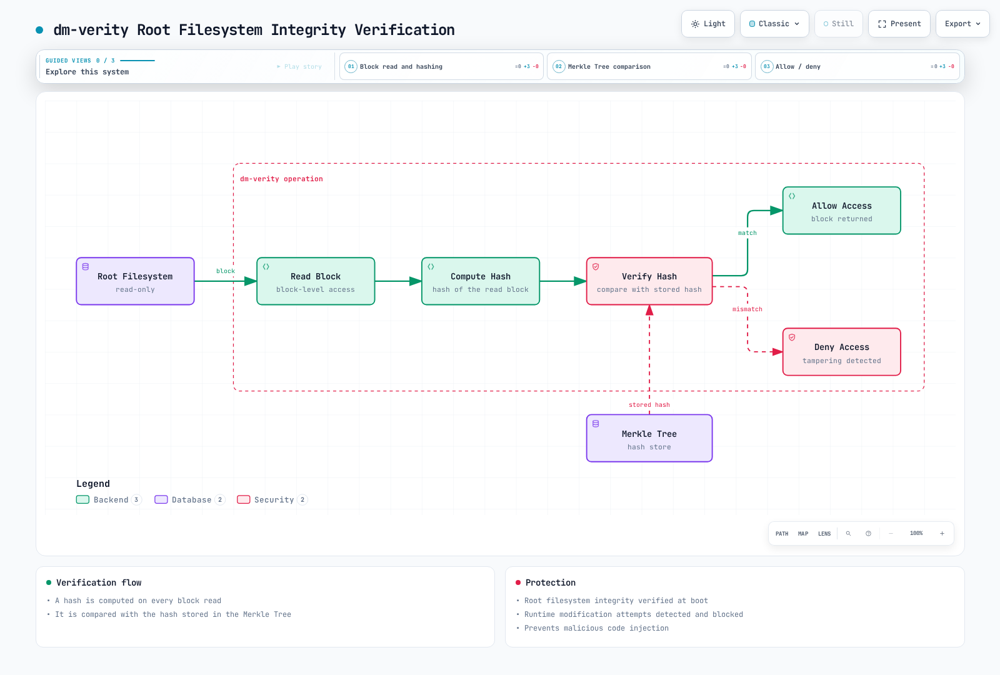

# Seguridad de Amazon EKS

> **Versiones compatibles**: soporte estándar de EKS 1.34–1.37; soporte extendido 1.31–1.33 (verificado el 12 de octubre de 2026)
> **Última actualización**: 16 de octubre de 2026

Para ejecutar cargas de trabajo de forma segura en Amazon EKS (Elastic Kubernetes Service), es necesario comprender e implementar varias capas de seguridad y prácticas recomendadas. Este documento abarca conceptos clave, componentes y prácticas recomendadas para reforzar la seguridad del clúster de EKS.

## Tabla de contenido

1. [Descripción general de la seguridad de EKS](#eks-security-overview)
2. [Prácticas de seguridad](#security-practices)
3. [IAM y autenticación](#iam-and-authentication)
4. [Análisis detallado del proveedor OIDC](#oidc-provider-deep-dive)
5. [EKS Pod Identity](#eks-pod-identity)
6. [Control de acceso al endpoint del clúster](#cluster-endpoint-access-control)
7. [Seguridad de red](#network-security)
8. [Seguridad de los Pod](#pod-security)
9. [Bottlerocket y sistema operativo de solo lectura](#bottlerocket-and-read-only-os)
10. [Límites de permisos de IAM](#iam-permission-boundaries)
11. [Cifrado y administración de secretos](#encryption-and-secrets-management)
12. [Cumplimiento y auditoría](#compliance-and-auditing)
13. [Supervisión y detección de seguridad](#security-monitoring-and-detection)
14. [Prácticas recomendadas de seguridad de EKS](#eks-security-best-practices)
15. [Consideraciones de seguridad de EKS para servicios financieros](#eks-security-considerations-for-financial-services)

## Descripción general de la seguridad de EKS {#eks-security-overview}

Separe los controles de infraestructura, acceso al clúster y cargas de trabajo. AWS administra el plano de control; la responsabilidad de los nodos y el sistema operativo depende de si se utilizan nodos autoadministrados o administrados de EC2, Fargate, Auto Mode o Hybrid Nodes. Los clientes siguen siendo responsables de las imágenes de las aplicaciones, las identidades, el manejo de datos y las políticas de las cargas de trabajo. Un diagrama estándar de nodos EC2 no implica que los clientes apliquen parches a los sistemas operativos host de Auto Mode/Fargate.


[🔍 Ver diagrama interactivo](https://www.atomai.click/kubernetes-docs/archmaps/en-eks-05-eks-security-0.html)

## Prácticas de seguridad {#security-practices}

Use varios controles con un alcance explícito; ninguna herramienta por sí sola establece una confianza cero ni certifica una carga de trabajo. Verifique la identidad del llamador o de la carga de trabajo, autorice la operación prevista, restrinja las rutas de red y recopile evidencia adecuada al modelo de amenazas.

<!-- Diagram repair pending: network policies filter traffic; posture findings are not continuous request authentication or complete zero-trust enforcement.


[🔍 View interactive diagram](https://www.atomai.click/kubernetes-docs/archmaps/en-eks-05-eks-security-1.html)
-->

### Controles de identidad y red

IRSA y Pod Identity proporcionan credenciales de AWS a las cargas de trabajo; NetworkPolicy ofrece filtrado de red compatible; un motor de admisión comprueba las solicitudes de Kubernetes configuradas. Una malla de servicios compatible y mantenida puede añadir mTLS y políticas de tráfico de aplicaciones. AWS App Mesh dejó de recibir soporte el 30 de septiembre de 2026, por lo que una implementación existente necesita un plan de migración, en lugar de recomendarla como nueva opción predeterminada.

### Seguridad de la cadena de suministro

Use un proceso revisado de compilación y procedencia, como SLSA; inventaríe los componentes con una SBOM, analice las vulnerabilidades pertinentes y verifique las firmas de los artefactos frente a la identidad del firmante previsto. Syft es una herramienta de SBOM; Grype es un analizador de vulnerabilidades. ECR/Inspector y otros analizadores tienen coberturas y requisitos de actualización específicos. Que una imagen esté firmada o analizada no demuestra que su código sea inofensivo. Proteja también la identidad de compilación, el repositorio y la configuración de admisión.

Actualmente, ECR admite la firma administrada de imágenes con AWS Signer, además de la firma manual mediante Notation. La firma y la verificación de admisión son pasos distintos; los filtros del registro, los permisos del perfil de firma y la confianza del verificador deben coincidir con el flujo de trabajo previsto.

### Detección en tiempo de ejecución y políticas como código

GuardDuty EKS Protection analiza un flujo independiente de registros de auditoría de EKS. Runtime Monitoring es una capacidad independiente basada en agentes; actualmente admite EKS en EC2 y Auto Mode, con requisitos de plataforma y agente, y excluye EKS Fargate y Hybrid Nodes. La entrega de registros de auditoría a CloudWatch es una configuración separada. Security Hub CSPM evalúa los controles configurados; Security Hub puede correlacionar hallazgos. Ninguno sustituye la autorización de aplicaciones ni una evaluación de todos los requisitos normativos.

Use herramientas de tiempo de ejecución y motores de políticas compatibles, como Falco, Gatekeeper o Kyverno, con la integración requerida de kernel, controlador, API y metadatos. Los entornos de ejecución aislados adicionales, como gVisor/Kata, requieren un diseño compatible de nodos y entorno de ejecución, y no están disponibles en todas las rutas de cómputo de EKS. Las políticas, las imágenes o el refuerzo del sistema operativo reducen riesgos específicos; no garantizan que cualquier escape o acción maliciosa sea imposible.

Las herramientas de políticas como código también operan en distintas etapas: Gatekeeper/Kyverno pueden evaluar la admisión de Kubernetes, CloudFormation Guard o Sentinel pueden evaluar cambios de infraestructura y AWS Config evalúa la configuración compatible de los recursos implementados. Las herramientas de investigación, como Detective, dependen de sus fuentes de datos configuradas. Distinga estas funciones de la prevención en tiempo de ejecución.

## IAM y autenticación {#iam-and-authentication}

| Identidad/control | Propósito |
|---|---|
| Principal de IAM humano/automatización | Autenticar el acceso al clúster mediante la ruta configurada de asignación de IAM o de entradas de acceso |
| RBAC de Kubernetes y políticas de acceso de EKS | Autorizar operaciones de Kubernetes; los permisos se acumulan |
| Proveedor de identidad OIDC externo | Inicio de sesión de usuarios de la API de Kubernetes configurado por separado, con ajustes de cliente y claims |
| Rol de IAM del clúster de EKS | Permitir que el servicio EKS llame a las API de AWS para el clúster |
| Rol de IAM del nodo EC2 | Facilitar el arranque y las operaciones necesarias de AWS de los agentes del nodo |
| Rol de IRSA o EKS Pod Identity | Proporcionar credenciales temporales de AWS a una aplicación |
| Token de Kubernetes ServiceAccount | Autenticar un Pod ante las API de Kubernetes conforme a sus permisos RBAC |

El proveedor OIDC de IAM que utiliza IRSA es distinto de un proveedor OIDC externo asociado para el inicio de sesión de usuarios de Kubernetes. Los permisos de AWS de una aplicación no conceden automáticamente permisos para la API de Kubernetes.

<!-- Diagram repair pending: IRSA/Pod Identity give workload AWS credentials; the ordinary Pod-to-Kubernetes API path uses its Kubernetes ServiceAccount token/RBAC.


[🔍 View interactive diagram](https://www.atomai.click/kubernetes-docs/archmaps/en-eks-05-eks-security-2.html)
-->

### Rol del clúster y llamador de aprovisionamiento

Un rol estándar de clúster de EKS confía en el servicio EKS. Esta es su relación de confianza, no la política de permisos del desarrollador humano:

```json
{
  "Version": "2012-10-17",
  "Statement": [
    {
      "Effect": "Allow",
      "Principal": {
        "Service": "eks.amazonaws.com"
      },
      "Action": "sts:AssumeRole"
    }
  ]
}
```

El rol necesita AmazonEKSClusterPolicy o una política personalizada compatible para las operaciones del servicio. Auto Mode tiene requisitos adicionales de rol y política. Por separado, el llamador de aprovisionamiento necesita las acciones requeridas por la configuración seleccionada y permiso para pasar el rol previsto. La referencia de autorización actual indica CreateCluster sin alcance por ARN de recurso, por lo que allí deben usarse las condiciones de solicitud compatibles; limite las acciones y PassRole que admitan ARN de recursos. Asociar AmazonEKSClusterPolicy al rol de un desarrollador no concede acceso a las aplicaciones de Kubernetes.

### Entradas de acceso y autorización por espacio de nombres

Prefiera la API compatible de entradas de acceso para el acceso de IAM al clúster. Inspeccione el modo actual y conserve las asignaciones existentes de administradores y nodos antes de la migración. El cambio de CONFIG_MAP a API_AND_CONFIG_MAP/API no se puede revertir libremente. No sobrescriba aws-auth con un ejemplo breve que omita los roles de nodo. Revise todas las identidades, políticas, nodos y una ruta de recuperación antes de elegir el modo API-only.

```bash
set -euo pipefail
: "${CLUSTER_NAME:?Set the existing cluster name}"
: "${AWS_REGION:?Set its Region}"
aws eks describe-cluster --name "$CLUSTER_NAME" --region "$AWS_REGION" \
  --query 'cluster.{Name:name,Status:status,Endpoint:endpoint,Access:accessConfig}' --output json
```

El siguiente ejemplo presupone un rol de IAM de desarrollador aprobado y preparado, un clúster que ya admite entradas de acceso y los permisos del operador de la plataforma. Prepare el espacio de nombres dedicado junto con su propietario. La versión de Pod Security Admission corresponde al ejemplo revisado de EKS 1.36; seleccione la versión adecuada para el clúster de destino:

```yaml
apiVersion: v1
kind: Namespace
metadata:
  name: security-demo
  labels:
    pod-security.kubernetes.io/enforce: restricted
    pod-security.kubernetes.io/enforce-version: v1.36
```


```bash
set -euo pipefail
: "${CLUSTER_NAME:?Set the verified cluster name}"
: "${AWS_REGION:?Set its Region}"
: "${DEVELOPER_ROLE_ARN:?Set a prepared IAM role ARN, not an STS session ARN}"
MODE=$(aws eks describe-cluster --name "$CLUSTER_NAME" --region "$AWS_REGION" \
  --query cluster.accessConfig.authenticationMode --output text)
case "$MODE" in
  API|API_AND_CONFIG_MAP) ;;
  *) echo "Access entries are not enabled; review the migration first"; exit 1 ;;
esac
aws eks list-access-entries --cluster-name "$CLUSTER_NAME" --region "$AWS_REGION" \
  --output json > security-access-entries.json
python3 - "$DEVELOPER_ROLE_ARN" <<'PY'
import json, sys
with open("security-access-entries.json") as stream:
    existing = json.load(stream)["accessEntries"]
if sys.argv[1] in existing:
    raise SystemExit("Entry already exists; inspect its groups/policies instead of overwriting")
PY
aws eks create-access-entry --cluster-name "$CLUSTER_NAME" --region "$AWS_REGION" \
  --principal-arn "$DEVELOPER_ROLE_ARN" --type STANDARD \
  --kubernetes-groups security-demo-developers
```


```yaml
apiVersion: rbac.authorization.k8s.io/v1
kind: Role
metadata:
  name: developer
  namespace: security-demo
rules:
- apiGroups:
  - ''
  resources:
  - pods
  verbs:
  - get
  - list
  - watch
- apiGroups:
  - apps
  resources:
  - deployments
  verbs:
  - get
  - list
  - watch
  - create
  - update
  - patch
- apiGroups:
  - batch
  resources:
  - jobs
  verbs:
  - get
  - list
  - watch
  - create
  - update
  - patch
---
apiVersion: rbac.authorization.k8s.io/v1
kind: RoleBinding
metadata:
  name: developer
  namespace: security-demo
subjects:
- kind: Group
  name: security-demo-developers
  apiGroup: rbac.authorization.k8s.io
roleRef:
  kind: Role
  name: developer
  apiGroup: rbac.authorization.k8s.io
```

La entrada asigna el principal de IAM a un grupo, y un RoleBinding concede a ese grupo los permisos mostrados en el espacio de nombres. Los nombres de grupo por sí solos no establecen límites entre espacios de nombres. El permiso para crear controladores de cargas de trabajo puede producir Pod que usen ServiceAccounts, Secrets y PVC del espacio de nombres. Separe los tenants y limite el uso de cargas de trabajo y cuentas de servicio mediante controles de admisión y propiedad adecuados.

Para una entrada de solo lectura revisada por separado, una política de acceso de EKS es una alternativa al RBAC personalizado. Inspeccione los grupos actuales y las políticas asociadas a la entrada antes de agregar este permiso de visualización del espacio de nombres:

```bash
set -euo pipefail
: "${CLUSTER_NAME:?Set the verified cluster name}"
: "${AWS_REGION:?Set its Region}"
: "${VIEWER_ROLE_ARN:?Set the IAM principal of a prepared, reviewed access entry}"
aws eks list-associated-access-policies --cluster-name "$CLUSTER_NAME" --region "$AWS_REGION" \
  --principal-arn "$VIEWER_ROLE_ARN"
aws eks associate-access-policy --cluster-name "$CLUSTER_NAME" --region "$AWS_REGION" \
  --principal-arn "$VIEWER_ROLE_ARN" \
  --policy-arn arn:aws:eks::aws:cluster-access-policy/AmazonEKSViewPolicy \
  --access-scope type=namespace,namespaces=security-demo
```

Agregar View no revoca concesiones más amplias de RBAC o políticas de acceso. Los cambios pueden tardar en propagarse. Pruebe con el inicio de sesión de IAM previsto; kubectl --as prueba la suplantación de identidad/RBAC de Kubernetes, no demuestra la ruta de la política de acceso de IAM. Un kubeconfig dirige el cliente a un clúster y a un mecanismo de credenciales; por sí mismo no concede permisos.

IAM eks:DescribeCluster/ListClusters admite operaciones de administración y descubrimiento de AWS. eks:AccessKubernetesApi es un permiso de visualización en la consola. La condición eks:namespaces filtra las solicitudes de asociación de políticas de acceso; no es un filtro general de espacios de nombres para las llamadas a la API kubectl.

## Análisis detallado del proveedor OIDC {#oidc-provider-deep-dive}

EKS publica un emisor OIDC del clúster y claves de firma públicas. Ese endpoint por sí solo no crea un proveedor OIDC de IAM ni autoriza la asunción de roles. Para IRSA, la cuenta del rol debe tener el proveedor OIDC de IAM previsto, el rol debe confiar en él con las condiciones correctas de emisor, subject y audience, y la carga de trabajo debe usar un SDK compatible.


[🔍 Ver diagrama interactivo](https://www.atomai.click/kubernetes-docs/archmaps/en-eks-05-eks-security-3.html)

### Token IRSA e intercambio de roles

El webhook de IRSA agrega una configuración proyectada de token/rol a un Pod apto. El SDK intercambia el token de identidad web con STS mediante AssumeRoleWithWebIdentity. STS valida el emisor, la firma, el token y la confianza del rol, y luego devuelve credenciales temporales de AWS. La aplicación usa esas credenciales para las operaciones de AWS que tiene permitidas. Kubernetes rota el token proyectado; el SDK actualiza las credenciales de AWS. Sus períodos de validez son distintos.

Esta es una **estructura ilustrativa de un payload decodificado**, con marcas de tiempo deliberadamente antiguas o vencidas e identidades de ejemplo. No es un token firmado ni una prueba de autenticación. El audience de STS corresponde a la ruta de IRSA; Pod Identity usa otro audience:

```json
{
  "aud": [
    "sts.amazonaws.com"
  ],
  "exp": 1234567890,
  "iat": 1234567800,
  "iss": "https://oidc.eks.us-west-2.amazonaws.com/id/REPLACE_WITH_CLUSTER_ISSUER_ID",
  "kubernetes.io": {
    "namespace": "security-demo",
    "pod": {
      "name": "irsa-read-check-example",
      "uid": "example-pod-uid"
    },
    "serviceaccount": {
      "name": "irsa-reader",
      "uid": "example-serviceaccount-uid"
    }
  },
  "sub": "system:serviceaccount:security-demo:irsa-reader"
}
```

Valide el emisor, el audience, la fecha de vencimiento y el subject esperado, no solo que se pueda decodificar el JSON. No incluya tokens sin procesar, claves de acceso secretas de AWS ni tokens de sesión en ejemplos o registros. Un rol puede confiar en varias cuentas de servicio o emisores permitidos explícitamente; IRSA no exige exactamente un rol por ServiceAccount.

### Inspección de descubrimiento y JWKS

Use el emisor devuelto para el clúster real. Este diagnóstico recupera documentos públicos de descubrimiento/JWKS y comprueba el emisor de descubrimiento y el esquema HTTPS. No valida un token de carga de trabajo ni los permisos de IAM:

```bash
set -euo pipefail
: "${CLUSTER_NAME:?Set the verified cluster}"
: "${AWS_REGION:?Set its Region}"
OIDC_URL=$(aws eks describe-cluster --name "$CLUSTER_NAME" --region "$AWS_REGION" \
  --query cluster.identity.oidc.issuer --output text)
case "$OIDC_URL" in https://*) ;; *) echo "Unexpected issuer URL"; exit 1 ;; esac
curl --fail --silent --show-error --proto '=https' --connect-timeout 5 --max-time 20 \
  "${OIDC_URL%/}/.well-known/openid-configuration" > oidc-discovery.json
JWKS_URI=$(python3 - "$OIDC_URL" <<'PY'
import json, sys, urllib.parse
with open("oidc-discovery.json") as stream:
    doc = json.load(stream)
if doc["issuer"] != sys.argv[1]:
    raise SystemExit("Discovery issuer does not match the cluster issuer")
uri = doc["jwks_uri"]
parsed = urllib.parse.urlparse(uri)
if parsed.scheme != "https" or not parsed.hostname or parsed.username or parsed.password:
    raise SystemExit("JWKS must be an HTTPS URL without embedded credentials")
print(uri)
PY
)
curl --fail --silent --show-error --proto '=https' --connect-timeout 5 --max-time 20 \
  "$JWKS_URI" > oidc-jwks.json
python3 - <<'PY'
import json
with open("oidc-jwks.json") as stream:
    keys = json.load(stream).get("keys")
if not isinstance(keys, list) or not keys or not all(isinstance(k, dict) and "kty" in k for k in keys):
    raise SystemExit("Unexpected JWKS response")
print("Fetched", len(keys), "public keys; no token signature was validated")
PY
```

Los validadores automatizados deben almacenar las claves en caché conforme a Cache-Control y gestionar la rotación de claves de firma y los valores kid desconocidos mediante una biblioteca JWT revisada. EKS rota su clave de firma OIDC cada siete días. EKS también admite actualmente un endpoint de interfaz PrivateLink para el descubrimiento OIDC/JWKS del clúster, `com.amazonaws.region-code.oidc-eks`, para validadores sin salida a Internet. Verifique los requisitos de región y DNS de ese endpoint; un endpoint de la API de administración de EKS es un servicio distinto.

### Ejemplo de IRSA con alcance limitado

Prepare el proveedor OIDC de IAM, el rol y el bucket con sus respectivos propietarios. Reemplace de forma coherente la cuenta, el nombre de host/ruta completos del emisor y el ARN del rol; los clústeres IPv6 pueden usar el nombre de host dual-stack del emisor. Este ejemplo vincula solo security-demo/irsa-reader y el audience de STS; es un ejemplo de confianza para un rol nuevo, no un reemplazo de otras declaraciones de confianza de un rol existente:

```json
{
  "Version": "2012-10-17",
  "Statement": [
    {
      "Effect": "Allow",
      "Principal": {
        "Federated": "arn:aws:iam::111122223333:oidc-provider/oidc.eks.us-west-2.amazonaws.com/id/REPLACE_WITH_CLUSTER_ISSUER_ID"
      },
      "Action": "sts:AssumeRoleWithWebIdentity",
      "Condition": {
        "StringEquals": {
          "oidc.eks.us-west-2.amazonaws.com/id/REPLACE_WITH_CLUSTER_ISSUER_ID:sub": "system:serviceaccount:security-demo:irsa-reader",
          "oidc.eks.us-west-2.amazonaws.com/id/REPLACE_WITH_CLUSTER_ISSUER_ID:aud": "sts.amazonaws.com"
        }
      }
    }
  ]
}
```

La política de lectura permite acceder a un prefijo específico del bucket. Agregue solo los permisos de KMS necesarios cuando los objetos usen una clave de cifrado administrada por el cliente y revise las políticas del bucket y del endpoint. Este ejemplo de un solo prefijo no requiere la política AmazonS3ReadOnlyAccess para toda la cuenta:

```json
{
  "Version": "2012-10-17",
  "Statement": [
    {
      "Effect": "Allow",
      "Action": [
        "s3:ListBucket"
      ],
      "Resource": "arn:aws:s3:::replace-with-owned-security-bucket",
      "Condition": {
        "StringLike": {
          "s3:prefix": [
            "security-demo/",
            "security-demo/*"
          ]
        }
      }
    },
    {
      "Effect": "Allow",
      "Action": [
        "s3:GetObject"
      ],
      "Resource": "arn:aws:s3:::replace-with-owned-security-bucket/security-demo/*"
    }
  ]
}
```

Después de preparar el espacio de nombres security-demo y el rol, cree la ServiceAccount y el Job de listado limitado de abajo. La imagen oficial de AWS CLI incluye el cliente; una imagen arbitraria amazonlinux:2 no lo garantiza. Reemplace los valores del bucket, la región y el rol. El Job enumera un prefijo sin imprimir valores secretos; el éxito de esta operación no demuestra que se tengan todos los permisos GetObject/KMS de la aplicación.

```yaml
apiVersion: v1
kind: ServiceAccount
metadata:
  name: irsa-reader
  namespace: security-demo
  annotations:
    eks.amazonaws.com/role-arn: arn:aws:iam::111122223333:role/SecurityDemoIRSAReader
---
apiVersion: batch/v1
kind: Job
metadata:
  name: irsa-read-check
  namespace: security-demo
spec:
  backoffLimit: 0
  activeDeadlineSeconds: 120
  template:
    spec:
      serviceAccountName: irsa-reader
      restartPolicy: Never
      securityContext:
        runAsNonRoot: true
        runAsUser: 1000
        runAsGroup: 1000
        fsGroup: 1000
        seccompProfile:
          type: RuntimeDefault
      containers:
      - name: reader
        image: public.ecr.aws/aws-cli/aws-cli:2.36.43
        command:
        - aws
        args:
        - s3api
        - list-objects-v2
        - --bucket
        - replace-with-owned-security-bucket
        - --prefix
        - security-demo/
        - --max-items
        - '5'
        env:
        - name: AWS_REGION
          value: us-west-2
        - name: AWS_EC2_METADATA_DISABLED
          value: 'true'
        securityContext:
          allowPrivilegeEscalation: false
          readOnlyRootFilesystem: true
          capabilities:
            drop:
            - ALL
        resources:
          requests:
            cpu: 100m
            memory: 128Mi
          limits:
            cpu: 500m
            memory: 256Mi
        volumeMounts:
        - name: private-home
          mountPath: /root
        - name: tmp
          mountPath: /tmp
      volumes:
      - name: private-home
        emptyDir: {}
      - name: tmp
        emptyDir: {}
      nodeSelector:
        kubernetes.io/os: linux
```

## EKS Pod Identity

EKS Pod Identity proporciona credenciales temporales de AWS mediante el proveedor de credenciales de contenedor del SDK y EKS Auth. Una asociación de Pod Identity es una asignación de clúster/espacio de nombres/ServiceAccount a un rol de IAM; no crea la ServiceAccount ni concede permisos RBAC de Kubernetes.

### Comparación con IRSA

| Propiedad | IRSA | EKS Pod Identity |
|---|---|---|
| Confianza | Proveedor OIDC de IAM y confianza de emisor/subject/audience | Confianza en pods.eks.amazonaws.com y asociación |
| Reutilización de roles | Se permiten varios subjects/emisores, dentro de los límites de la política de IAM | Se puede reutilizar con las condiciones de asociación/confianza adecuadas |
| Etiquetas de sesión de Kubernetes integradas | No se proporcionan automáticamente en la ruta estándar de IRSA de EKS | Habilitadas de forma predeterminada; se pueden deshabilitar deliberadamente |
| Proveedor de credenciales | Intercambio de identidad web con STS | Endpoint de credenciales de contenedor respaldado por EKS Auth |
| Entre cuentas | Confianza OIDC directa en la cuenta del rol o encadenamiento de roles | Rol de asociación en la misma cuenta, con encadenamiento opcional al rol de destino |
| Actualización | Kubernetes rota el token; el SDK actualiza las credenciales de AWS | Kubernetes rota el token proyectado; el agente/servicio almacena en caché y el SDK gestiona las credenciales de AWS |

Las etiquetas de sesión identifican la sesión del rol asumido; no etiquetan automáticamente todos los recursos de AWS que crea una aplicación. Una configuración más sencilla no elimina los requisitos de validación de IAM, red, SDK o aplicación.

### Agente y flujo de credenciales

<!-- Diagram repair pending: SDK calls container credential endpoint; agent calls EKS Auth AssumeRoleForPodIdentity, not STS directly or arbitrary request interception.


[🔍 View interactive diagram](https://www.atomai.click/kubernetes-docs/archmaps/en-eks-05-eks-security-4.html)
-->

Para un Pod nuevo con una asociación, EKS inyecta un token con el audience pods.eks.amazonaws.com, una variable de entorno con la ruta al archivo del token y un URI de credenciales de contenedor. El SDK llama al endpoint del agente, normalmente 169.254.170.23/v1/credentials. El agente llama a **AssumeRoleForPodIdentity en EKS Auth** y pone las credenciales devueltas a disposición del SDK. No es un interceptor transparente de todas las solicitudes de la aplicación; esta sigue llamando directamente a los servicios de AWS con sus credenciales.

Los nodos EC2 estándar compatibles usan el complemento/DaemonSet Pod Identity Agent. Auto Mode proporciona la capacidad como parte de sus nodos administrados. Hybrid Nodes lo admiten con la configuración documentada del sistema operativo, el agente y las credenciales del nodo; no reutilice a ciegas una configuración de agente EC2 estándar. EKS Fargate no admite esta ruta del agente Pod Identity. Verifique la compatibilidad de cómputo real, así como los permisos y el acceso de red del nodo a EKS Auth.

### Rol y asociación preparados

Para una instalación estándar con agente administrado, inspeccione la versión real del clúster y el catálogo de complementos compatibles con su propietario. No codifique de forma rígida la compilación antigua v1.0.0 ni instale un agente duplicado sobre Auto Mode u otra instalación administrada por un propietario distinto:

```bash
set -euo pipefail
: "${CLUSTER_NAME:?Set the existing cluster}"
: "${AWS_REGION:?Set its Region}"
EKS_VERSION=$(aws eks describe-cluster --name "$CLUSTER_NAME" --region "$AWS_REGION" \
  --query cluster.version --output text)
aws eks describe-addon-versions --addon-name eks-pod-identity-agent \
  --kubernetes-version "$EKS_VERSION" --region "$AWS_REGION" --output json
```

Prepare un rol de IAM en la misma cuenta con la política de lectura limitada de S3 anterior y esta relación de confianza. Reemplace conjuntamente los valores de cuenta y clúster. Este ejemplo se basa en las etiquetas de sesión predeterminadas; si se deshabilitan, revise estas condiciones. El llamador necesita los permisos adecuados para la asociación y iam:PassRole para el rol previsto:

```json
{
  "Version": "2012-10-17",
  "Statement": [
    {
      "Effect": "Allow",
      "Principal": {
        "Service": "pods.eks.amazonaws.com"
      },
      "Action": [
        "sts:AssumeRole",
        "sts:TagSession"
      ],
      "Condition": {
        "StringEquals": {
          "aws:RequestTag/eks-cluster-arn": "arn:aws:eks:us-west-2:111122223333:cluster/my-cluster",
          "aws:RequestTag/kubernetes-namespace": "security-demo",
          "aws:RequestTag/kubernetes-service-account": "podid-reader"
        }
      }
    }
  ]
}
```

El siguiente ejemplo de asociación nueva se niega a sobrescribir una asociación existente. No crea el rol de IAM, no instala el agente ni crea una cuenta de Kubernetes:

```bash
set -euo pipefail
: "${CLUSTER_NAME:?Set the verified cluster}"
: "${AWS_REGION:?Set its Region}"
: "${POD_ID_ROLE_ARN:?Set the prepared same-account role matching the trust example}"
aws eks list-pod-identity-associations --cluster-name "$CLUSTER_NAME" --region "$AWS_REGION" \
  --namespace security-demo --service-account podid-reader --output json > podid-associations-before.json
python3 - <<'PY'
import json
with open("podid-associations-before.json") as stream:
    existing = json.load(stream)["associations"]
if existing:
    raise SystemExit("Association exists; review its owner/configuration before changing it")
PY
aws eks create-pod-identity-association --cluster-name "$CLUSTER_NAME" --region "$AWS_REGION" \
  --namespace security-demo --service-account podid-reader --role-arn "$POD_ID_ROLE_ARN"
```

Una vez propagada la asociación, cree la ServiceAccount y un Job de prueba nuevo y limitado. La confianza del rol de IAM, el espacio de nombres, el nombre de la cuenta y el prefijo del bucket deben coincidir. Es posible que haya que recrear un Pod creado antes de la asociación para que reciba la configuración inyectada. Compruebe el proveedor seleccionado y permisos representativos; no imprima archivos de credenciales o tokens.

```yaml
apiVersion: v1
kind: ServiceAccount
metadata:
  name: podid-reader
  namespace: security-demo
---
apiVersion: batch/v1
kind: Job
metadata:
  name: podid-read-check
  namespace: security-demo
spec:
  backoffLimit: 0
  activeDeadlineSeconds: 120
  template:
    spec:
      serviceAccountName: podid-reader
      restartPolicy: Never
      securityContext:
        runAsNonRoot: true
        runAsUser: 1000
        runAsGroup: 1000
        fsGroup: 1000
        seccompProfile:
          type: RuntimeDefault
      containers:
      - name: reader
        image: public.ecr.aws/aws-cli/aws-cli:2.36.43
        command:
        - aws
        args:
        - s3api
        - list-objects-v2
        - --bucket
        - replace-with-owned-security-bucket
        - --prefix
        - security-demo/
        - --max-items
        - '5'
        env:
        - name: AWS_REGION
          value: us-west-2
        - name: AWS_EC2_METADATA_DISABLED
          value: 'true'
        securityContext:
          allowPrivilegeEscalation: false
          readOnlyRootFilesystem: true
          capabilities:
            drop:
            - ALL
        resources:
          requests:
            cpu: 100m
            memory: 128Mi
          limits:
            cpu: 500m
            memory: 256Mi
        volumeMounts:
        - name: private-home
          mountPath: /root
        - name: tmp
          mountPath: /tmp
      volumes:
      - name: private-home
        emptyDir: {}
      - name: tmp
        emptyDir: {}
      nodeSelector:
        kubernetes.io/os: linux
```


[🔍 Ver diagrama interactivo](https://www.atomai.click/kubernetes-docs/archmaps/en-eks-05-eks-security-5.html)

### Consideraciones sobre el almacenamiento en caché y entre cuentas

El rol de asociación debe estar en la cuenta del clúster de EKS. Un rol de IAM de destino opcional puede estar en otra cuenta; Pod Identity encadena desde el rol de la misma cuenta hasta ese destino, con la confianza y los permisos para asumir roles configurados en ambos. Esto no permite asociar directamente como rol de asociación cualquier rol de otra cuenta.

La guía actual de roles de destino documenta credenciales en caché durante 6 horas sin un rol de destino y durante 59 minutos con uno. Los cambios en la asociación no restablecen esa caché; recrear los Pod puede permitir obtener antes la nueva configuración. Compruebe en la aplicación el comportamiento real de actualización y revocación. La opción más reciente de política de sesión de asociación requiere que se deshabiliten las etiquetas de sesión y limita el rol de destino cuando se configura uno; no la combine sin revisión con condiciones de confianza que exijan esas etiquetas.

### Procedimiento de migración de IRSA a Pod Identity

Conserve la configuración existente de confianza IRSA y ServiceAccount antes de preparar la migración. Reemplazar la confianza del rol por solo el principal de servicio Pod Identity puede interrumpir los consumidores existentes cuando actualicen sus credenciales. Lo siguiente solo registra la configuración:

```bash
set -euo pipefail
: "${IRSA_ROLE_NAME:?Set the existing role whose trust must be preserved}"
: "${WORKLOAD_NAMESPACE:?Set the workload namespace}"
: "${SERVICE_ACCOUNT:?Set the existing application ServiceAccount}"
aws iam get-role --role-name "$IRSA_ROLE_NAME" \
  --query Role.AssumeRolePolicyDocument --output json > irsa-trust-before.json
kubectl -n "$WORKLOAD_NAMESPACE" get serviceaccount "$SERVICE_ACCOUNT" \
  -o yaml > irsa-serviceaccount-before.yaml
```

1. Verifique la compatibilidad del cómputo real, el proveedor de credenciales de contenedor y SDK compatible, el agente Pod Identity o la capacidad integrada, y los permisos del rol de IAM preparado.
2. Combine la declaración de confianza de Pod Identity revisada con la política de confianza existente, junto con su propietario; mantenga las condiciones de emisor, subject y audience de IRSA, así como las demás declaraciones válidas, hasta migrar a todos los consumidores.
3. Cree una asociación limitada y un canario con una ServiceAccount separada que use únicamente la ruta prevista de credenciales Pod Identity. No elimine la anotación IRSA de producción ni reinicie el Deployment de producción antes de validar esto.
4. Compruebe el proveedor de credenciales realmente utilizado y el acceso previsto a AWS sin imprimir tokens ni valores secretos. Es posible que sigan usándose credenciales que aparecen antes en la cadena del SDK después de crear una asociación. Que get-caller-identity indique correctamente el mismo rol de IAM no permite distinguir IRSA de Pod Identity.
5. Migre la carga de trabajo prevista mediante un despliegue controlado, recree los Pod según sea necesario para recibir la configuración inyectada y verifique el comportamiento y la actualización de la aplicación. Los cambios en las anotaciones de ServiceAccount no reescriben los entornos de Pod existentes.
6. Mantenga una ruta de reversión probada para la configuración de la carga de trabajo. Elimine la confianza IRSA antigua solo después de inventariar a todos los consumidores restantes y verificar que la migración se completó.

Este es un procedimiento de migración que debe validarse en el entorno de destino; no afirma que la migración se haya ejecutado durante esta revisión de la documentación.

## Control de acceso al endpoint del clúster {#cluster-endpoint-access-control}

La configuración del endpoint determina la accesibilidad de red, mientras que la autenticación y la autorización siguen rigiendo las operaciones de la API. Elija la ruta de acceso según los requisitos operativos e inspeccione la configuración real en lugar de suponer los valores predeterminados de una herramienta.

| Público | Privado | Comportamiento de red |
|---|---|---|
| Habilitado | Deshabilitado | Los clientes y nodos necesitan una ruta a la dirección pública; los CIDR restringidos deben incluir las fuentes reales de salida pública |
| Deshabilitado | Habilitado | El acceso requiere la ruta, el DNS y las reglas de grupo de seguridad de VPC/privadas, incluidas las redes conectadas aprobadas |
| Habilitado | Habilitado | Las solicitudes que se originan en la VPC del clúster utilizan la ruta privada; los clientes externos permitidos pueden utilizar el acceso público |

El direccionamiento público por sí solo no demuestra que el tráfico de EC2 a EKS salga de la red de AWS. El acceso privado no autoriza automáticamente a los llamadores, no configura VPN/DNS ni proporciona una ruta de recuperación. EKS requiere al menos un modo de acceso.

### Inspeccionar y conservar la configuración existente

Ejecute los bloques relacionados en el mismo shell y conserve el nuevo directorio de revisión. Use una identidad de administración de AWS con capacidad para inspeccionar o recuperar la configuración del endpoint, separada del inicio de sesión de Kubernetes. Esto registra solo los campos modificables de acceso al endpoint para la recuperación; no intenta restaurar otras configuraciones de VPC ni el modo de salida unidireccional descrito más adelante.

```bash
set -euo pipefail
umask 077
: "${CLUSTER_NAME:?Set the existing cluster name}"
: "${AWS_REGION:?Set its Region}"
ENDPOINT_REVIEW_DIR=$(mktemp -d -t eks-endpoint-review.XXXXXX)
printf 'Review records: %s\n' "$ENDPOINT_REVIEW_DIR"
aws eks describe-cluster --name "$CLUSTER_NAME" --region "$AWS_REGION" \
  --query cluster --output json > "$ENDPOINT_REVIEW_DIR/cluster-before.json"
python3 - "$ENDPOINT_REVIEW_DIR" "$CLUSTER_NAME" <<'PY'
import json, pathlib, sys, urllib.parse
root = pathlib.Path(sys.argv[1])
cluster = json.loads((root / "cluster-before.json").read_text())
if cluster["name"] != sys.argv[2] or cluster["status"] != "ACTIVE":
    raise SystemExit("Unexpected cluster or cluster is not ACTIVE")
endpoint = urllib.parse.urlparse(cluster["endpoint"])
if endpoint.scheme != "https" or not endpoint.hostname or endpoint.username or endpoint.password:
    raise SystemExit("Unexpected Kubernetes endpoint")
(root / "endpoint-host.txt").write_text(endpoint.hostname + "\n")
config = cluster["resourcesVpcConfig"]
before = {k: config[k] for k in ["endpointPublicAccess", "endpointPrivateAccess", "publicAccessCidrs"] if k in config}
(root / "endpoint-before.json").write_text(json.dumps(before, indent=2) + "\n")
(root / "endpoint-private.json").write_text(json.dumps({"endpointPublicAccess": False, "endpointPrivateAccess": True}, indent=2) + "\n")
(root / "ssm-remote-host.json").write_text(json.dumps({"host": [endpoint.hostname], "portNumber": ["443"], "localPortNumber": ["6443"]}, indent=2) + "\n")
print(json.dumps(before, indent=2))
PY
```

### Restringir la ruta de dirección pública

La lista de permitidos pública debe contener las direcciones reales aprobadas de salida pública de NAT/VPN/oficina. Los rangos privados, como 10.0.0.0/8, no representan una dirección de origen pública. Los rangos de documentación, como 203.0.113.0/24, son marcadores de posición, no redes de oficina operativas.

Defina PUBLIC_EGRESS_CIDRS como una matriz JSON proporcionada por el propietario de la red. Este ejemplo limitado acepta CIDR IPv4 y rechaza rangos privados, predeterminados o de documentación evidentes; no demuestra la titularidad ni que incluya al cliente actual. Revise el alcance, la cuota y la compatibilidad de la familia IP del clúster. La configuración dual-stack/IPv6 necesita su propia lista de permitidos verificada.

```bash
set -euo pipefail
: "${ENDPOINT_REVIEW_DIR:?Run the inspection step in this shell first}"
: "${PUBLIC_EGRESS_CIDRS:?Set a JSON array of approved actual public IPv4 egress CIDRs}"
python3 - "$ENDPOINT_REVIEW_DIR" "$PUBLIC_EGRESS_CIDRS" <<'PY'
import ipaddress, json, pathlib, sys
values = json.loads(sys.argv[2])
if not isinstance(values, list) or not values:
    raise SystemExit("Provide a nonempty reviewed CIDR list")
cidrs = []
for value in values:
    network = ipaddress.ip_network(value, strict=True)
    if network.version != 4 or network.prefixlen == 0 or not network.is_global or network.is_multicast or network.is_reserved:
        raise SystemExit("This IPv4 example requires actual public egress CIDRs, not private/default/documentation ranges")
    cidrs.append(str(network))
if len(cidrs) != len(set(cidrs)):
    raise SystemExit("Remove duplicate CIDRs")
desired = {"endpointPublicAccess": True, "endpointPrivateAccess": True, "publicAccessCidrs": cidrs}
path = pathlib.Path(sys.argv[1]) / "endpoint-public-restricted.json"
path.write_text(json.dumps(desired, indent=2) + "\n")
print(json.dumps(desired, indent=2))
PY
```

La configuración pública restringida prevista también habilita el acceso privado. Sin acceso privado, las direcciones públicas de salida de los nodos/Fargate deben seguir permitidas o puede fallar la comunicación entre nodos y la API. Revise el JSON generado antes de seleccionar ENDPOINT_CHANGE=public-restricted.

### Rutas de conexión privada


[🔍 Ver diagrama interactivo](https://www.atomai.click/kubernetes-docs/archmaps/en-eks-05-eks-security-6.html)


[🔍 Ver diagrama interactivo](https://www.atomai.click/kubernetes-docs/archmaps/en-eks-05-eks-security-7.html)

VPN, Direct Connect/TGW y un host de administración aprobado son rutas posibles, siempre que se configuren las rutas, el DNS, los grupos de seguridad y la autorización. Un solo comando de creación de Client VPN no configura asociaciones de subredes, reglas de autorización, rutas, certificados ni registros de conexión. Un Deployment que ejecuta una imagen de AWS CLI no crea un bastión administrado por SSM ni instala kubectl/SSM Agent.

Para el reenvío remoto a través de SSM, prepare un host administrado con SSM Agent 3.1.1374.0 o posterior, acceso de IAM/red a Session Manager, el complemento local de Session Manager y DNS/enrutamiento hacia el endpoint privado de EKS. Verifique que esté habilitado el acceso al endpoint privado y que el host realmente resuelva y alcance su ruta privada. Mantenga activa la sesión de reenvío en la primera terminal:

```bash
set -euo pipefail
: "${AWS_REGION:?Set the cluster/managed-instance Region for this example}"
: "${MANAGED_INSTANCE_ID:?Set the prepared SSM-managed instance with a private route to EKS}"
: "${ENDPOINT_REVIEW_DIR:?Use the endpoint inspection directory}"
aws ssm start-session --region "$AWS_REGION" --target "$MANAGED_INSTANCE_ID" \
  --document-name AWS-StartPortForwardingSessionToRemoteHost \
  --parameters "file://$ENDPOINT_REVIEW_DIR/ssm-remote-host.json"
```

Use el kubeconfig del mismo clúster en una segunda terminal, conservando su CA y la autenticación exec de IAM prevista. Conéctese en el equipo local manteniendo el nombre de servidor TLS real. No deshabilite la validación del certificado para ocultar una discrepancia de nombre de host:

```bash
set -euo pipefail
: "${ENDPOINT_REVIEW_DIR:?Set the same review directory in this second terminal}"
: "${CLUSTER_KUBECONFIG:?Set the kubeconfig for this same EKS cluster and intended IAM identity}"
EKS_ENDPOINT_HOST=$(cat "$ENDPOINT_REVIEW_DIR/endpoint-host.txt")
kubectl --kubeconfig "$CLUSTER_KUBECONFIG" \
  --server https://127.0.0.1:6443 --tls-server-name "$EKS_ENDPOINT_HOST" \
  --request-timeout=10s -n security-demo get pods
```

El documento de host remoto reenvía al host de EKS proporcionado. El documento anterior AWS-StartPortForwardingSession reenvía un puerto del propio equipo administrado; reenviar su puerto 443 no convierte ese equipo en el servidor de la API de EKS. Un túnel o comprobación de estado exitosos por sí solos no prueban la autorización ni la ruta privada. Verifique la operación de API prevista, las direcciones DNS/privadas y la ruta real antes de quitar el acceso público.

### Aplicar un cambio de endpoint revisado

Después de habilitar el acceso privado y verificar la ruta del cliente privado prevista, realice una nueva instantánea de inspección antes de elegir ENDPOINT_CHANGE=private. Lo siguiente rechaza un clúster/cuenta distinto, cambios en la configuración del endpoint o una transición a solo privado antes de haber habilitado el acceso privado. La lectura y comprobación no son una transacción atómica; coordine los cambios con el propietario.

```bash
set -euo pipefail
: "${CLUSTER_NAME:?Use the inspected cluster}"
: "${AWS_REGION:?Use its Region}"
: "${ENDPOINT_REVIEW_DIR:?Use the review directory}"
: "${ENDPOINT_CHANGE:?Choose public-restricted or private after validating the intended route}"
case "$ENDPOINT_CHANGE" in
  public-restricted|private) ;;
  *) echo "Unexpected endpoint change"; exit 1 ;;
esac
test -f "$ENDPOINT_REVIEW_DIR/endpoint-$ENDPOINT_CHANGE.json"
aws eks describe-cluster --name "$CLUSTER_NAME" --region "$AWS_REGION" \
  --query cluster --output json > "$ENDPOINT_REVIEW_DIR/cluster-current.json"
python3 - "$ENDPOINT_REVIEW_DIR" "$CLUSTER_NAME" "$ENDPOINT_CHANGE" <<'PY'
import json, pathlib, sys
root = pathlib.Path(sys.argv[1])
before = json.loads((root / "cluster-before.json").read_text())
current = json.loads((root / "cluster-current.json").read_text())
keys = ["endpointPublicAccess", "endpointPrivateAccess", "publicAccessCidrs"]
if current["name"] != sys.argv[2] or current["arn"] != before["arn"] or current["status"] != "ACTIVE":
    raise SystemExit("Cluster identity/state differs from the reviewed target")
if any(current["resourcesVpcConfig"].get(k) != before["resourcesVpcConfig"].get(k) for k in keys):
    raise SystemExit("Endpoint configuration changed; inspect and review again")
if sys.argv[3] == "private" and current["resourcesVpcConfig"].get("endpointPrivateAccess") is not True:
    raise SystemExit("Enable and verify private access before disabling public access")
PY
aws eks update-cluster-config --name "$CLUSTER_NAME" --region "$AWS_REGION" \
  --resources-vpc-config "file://$ENDPOINT_REVIEW_DIR/endpoint-$ENDPOINT_CHANGE.json" \
  --output json > "$ENDPOINT_REVIEW_DIR/update-response.json"
EKS_UPDATE_ID=$(python3 - "$ENDPOINT_REVIEW_DIR/update-response.json" <<'PY'
import json, sys
with open(sys.argv[1]) as stream:
    print(json.load(stream)["update"]["id"])
PY
)
UPDATE_DONE=false
for ((attempt=0; attempt<60; attempt++)); do
  STATE=$(aws eks describe-update --name "$CLUSTER_NAME" --region "$AWS_REGION" \
    --update-id "$EKS_UPDATE_ID" --query update.status --output text)
  case "$STATE" in
    Successful) UPDATE_DONE=true; break ;;
    InProgress) sleep 10 ;;
    *) echo "Update $EKS_UPDATE_ID status: $STATE; inspect before further changes"; exit 1 ;;
  esac
done
test "$UPDATE_DONE" = true || { echo "Update still pending; inspect $EKS_UPDATE_ID"; exit 1; }
aws eks describe-cluster --name "$CLUSTER_NAME" --region "$AWS_REGION" \
  --query cluster.resourcesVpcConfig --output json
```

Use el ID de actualización devuelto y el estado Successful para confirmar la actualización, no solo ACTIVE del clúster. Si se agota el tiempo de espera, debe inspeccionar la operación existente; no envíe otra modificación a ciegas. Vuelva a comprobar la ruta real a la API después del cambio. Mantenga disponibles los campos de endpoint anteriores y el acceso de recuperación de administración de AWS; esta revisión no realizó un cambio de endpoint en vivo.

### Dependencias de servicios privados de AWS

| Ruta | Endpoint/dependencia pertinente |
|---|---|
| API de Kubernetes | Acceso privado al endpoint del clúster y sus rutas/DNS/grupos de seguridad |
| API de administración de AWS EKS | Endpoint de interfaz eks cuando se requiera acceso de administración privado |
| Agente Pod Identity | Endpoint de interfaz eks-auth cuando el nodo no pueda usar salida pública |
| Herramientas de descubrimiento OIDC/JWKS | Endpoint de interfaz oidc-eks; datos de claves públicas anónimos, solo política de endpoint predeterminada |
| Intercambio de credenciales IRSA | Endpoint regional de STS, separado de la recuperación de claves OIDC |
| Descargas de imágenes ECR | Interfaces ecr.api/ecr.dkr y una ruta de descarga de capas de S3 operativa |
| Otros controladores/aplicaciones | Solo sus dependencias reales de EC2, Logs, Secrets Manager, SSM u otros servicios |

Un endpoint de interfaz de EKS no es el endpoint de la API de Kubernetes. Los endpoints de gateway de S3 usan tablas de enrutamiento; los endpoints de interfaz usan subredes/grupos de seguridad/DNS privado. No cree todos los servicios mediante un bucle único que omita el tipo de endpoint. OIDC PrivateLink no cambia la validación del token STS ni autoriza roles IRSA. Prepare la configuración completa de red, identidad y cómputo que corresponda a sus propietarios mediante los capítulos de creación; los extractos de endpoints de aquí no constituyen una implementación de clúster lista para producción.

### Salida del plano de control enrutada por el cliente (junio de 2026)

Anunciado el 18 de junio de 2026, CUSTOMER_ROUTED es un modo compatible de salida del plano de control de EKS. Usa las interfaces de red entre cuentas del clúster ya existentes en las subredes, en lugar de crear una ENI de salida independiente. Se aplica a las llamadas del servidor de API dirigidas al cliente, como webhooks de admisión, descubrimiento OIDC y servidores de API agregados.

**El cambio es unidireccional: tras habilitar CUSTOMER_ROUTED, el clúster no puede volver a AWS_MANAGED.** No presente una configuración guardada ni una reversión de versión de Kubernetes como forma de deshacer este modo. Si falla la nueva ruta, corrija el enrutamiento/la conectividad.

```bash
set -euo pipefail
: "${CLUSTER_NAME:?Set the existing cluster}"
: "${AWS_REGION:?Set its Region}"
aws eks describe-cluster --name "$CLUSTER_NAME" --region "$AWS_REGION" \
  --query 'cluster.{Status:status,Vpc:resourcesVpcConfig,IPFamily:kubernetesNetworkConfig.ipFamily}' --output json
```

Antes de cambiar, inventaríe los destinos y puertos de webhooks, OIDC y API agregadas. Verifique las rutas desde las subredes de ENI del clúster, las reglas de salida de los grupos de seguridad, el tráfico de retorno de NACL y el DNS. Las opciones DHCP de la VPC deben incluir AmazonProvidedDNS; las zonas privadas de Route53, el reenvío de Resolver y la resolución de DNS externo deben funcionar para los destinos reales. La ruta de salida puede usar NAT, un firewall o enrutamiento centralizado, según los destinos. Los clústeres IPv6 requieren las rutas IPv4 e IPv6 documentadas; una dependencia solo IPv4 sigue necesitando una ruta IPv4 operativa.

Una vez completada esa revisión, esta es la opción real de la API. Se comprobó su sintaxis sin conexión; no se ejecutó en un clúster de AWS durante esta auditoría:

```bash
set -euo pipefail
: "${CLUSTER_NAME:?Set the reviewed cluster}"
: "${AWS_REGION:?Set its Region}"
# One-way change: complete subnet route/SG/NACL/DNS and dependency checks first.
aws eks update-cluster-config --name "$CLUSTER_NAME" --region "$AWS_REGION" \
  --resources-vpc-config controlPlaneEgressMode=CUSTOMER_ROUTED --output json
```

Registre el ID de actualización devuelto e inspeccione DescribeUpdate hasta que el estado sea Successful; ACTIVE no es suficiente. Después, pruebe las rutas configuradas reales de los webhooks, OIDC de usuario y API agregadas. No afirme que una prueba local del analizador de CLI demuestre conectividad de VPC.

| Tráfico | Efecto de esta configuración |
|---|---|
| Salida del servidor de API dirigida al cliente | Utiliza la ruta configurada de la VPC del cliente |
| API del kubelet en10250 | Utiliza la ruta entre la ENI del clúster y el nodo; no el dispositivo de salida externo |
| etcd, CloudWatch Logs, tráfico interno de EKS | Continúa por las rutas administradas por EKS |
| Controladores de EKS Capabilities, como ArgoCD/ACK/KRO administrados | Se ejecutan en infraestructura administrada independiente; esta función no los reenvía |
| Llamadas de aplicaciones a STS/EKS Auth/S3 | Siguen la red de las cargas de trabajo/nodos; este modo del servidor de API no las controla |

La función está disponible sin cargo adicional por la función en las regiones de EKS, pero los recursos de NAT/firewall/PrivateLink/registro tienen sus propios cargos. Debe configurarse Flow Logs si se necesitan pruebas del flujo de red; no expone automáticamente los payloads cifrados ni demuestra la autorización de la aplicación.

#### Ejemplo de SCP con alcance a las solicitudes

La clave eks:controlPlaneEgressMode evalúa el modo especificado en las solicitudes CreateCluster/UpdateClusterConfig. Una denegación StringNotEquals sin una condición de presencia también coincide si se omite la clave. El siguiente ejemplo exige el modo para los clústeres nuevos y rechaza un modo explícitamente distinto durante las actualizaciones, a la vez que permite las solicitudes de actualización no relacionadas que omitan el modo:

```json
{
  "Version": "2012-10-17",
  "Statement": [
    {
      "Sid": "RequireCustomerRoutedForNewClusters",
      "Effect": "Deny",
      "Action": "eks:CreateCluster",
      "Resource": "*",
      "Condition": {
        "StringNotEquals": {
          "eks:controlPlaneEgressMode": "CUSTOMER_ROUTED"
        }
      }
    },
    {
      "Sid": "RejectExplicitOtherEgressMode",
      "Effect": "Deny",
      "Action": "eks:UpdateClusterConfig",
      "Resource": "*",
      "Condition": {
        "Null": {
          "eks:controlPlaneEgressMode": "false"
        },
        "StringNotEquals": {
          "eks:controlPlaneEgressMode": "CUSTOMER_ROUTED"
        }
      }
    }
  ]
}
```

Esta es una protección deliberada de solicitudes, no una migración automática de los clústeres existentes. En este ejemplo, los clústeres AWS_MANAGED existentes todavía pueden recibir actualizaciones no relacionadas. Las organizaciones que necesiten otra política de implementación deben modelarla por separado. Las SCP no conceden permisos de IAM ni configuran enrutamiento/DNS. Revise la herencia de políticas y pruebe solicitudes representativas permitidas y denegadas con el propietario de la organización antes de implementarla.

## Seguridad de red {#network-security}

Use grupos de seguridad, enrutamiento, NetworkPolicy y autenticación de aplicaciones en sus respectivas capas. El diagrama ilustra un diseño de red tradicional; un bastión público y los endpoints privados de AWS son componentes opcionales que deben configurarse realmente, no propiedades inherentes a todos los clústeres de EKS.


[🔍 Ver diagrama interactivo](https://www.atomai.click/kubernetes-docs/archmaps/en-eks-05-eks-security-8.html)

### Grupos de seguridad y rutas necesarias

Para la ruta de API/nodo, permita el TCP443 necesario desde los nodos hacia la API y el TCP10250 desde el plano de control hacia el kubelet. DNS, webhooks y cargas de trabajo pueden necesitar otros puertos de destino reales. No hay un requisito universal de abrir TCP1025–65535 como «comunicación entre nodos». Los grupos de seguridad tienen estado; las NACL y sus reglas de ruta de retorno son independientes.

Inspeccione los grupos de seguridad asociados a las ENI/nodos reales. Una configuración personalizada de grupos de seguridad en la plantilla de lanzamiento no hereda automáticamente todas las reglas predeterminadas de EKS. Security Groups for Pods y los selectores pod-security-group de Auto Mode NodeClass son mecanismos distintos, con su propia compatibilidad y comportamiento; los grupos de seguridad no se limitan a una capa abstracta exclusiva de las instancias. Revise el cómputo/CNI seleccionado y la interfaz de origen real.

### Semántica de NetworkPolicy

NetworkPolicy necesita una implementación de aplicación compatible y configurada. Crear solo YAML no filtra paquetes. Use la capacidad de políticas de la VPC CNI de EKS compatible con el propietario de red actual o la pila de red compatible seleccionada deliberadamente. No instale un manifiesto Calico sin versión fija ni una configuración Cilium no relacionada sobre un clúster existente. Auto Mode administra su propia red; no es un destino para instalar cualquier CNI de reemplazo.

Las políticas son acumulativas. Para permitir una conexión aislada, deben permitirla tanto el tráfico de salida del origen como el de entrada del destino. El orden de las reglas no establece prioridades de denegación/permiso. Un podSelector por sí solo selecciona pares del espacio de nombres de la política; namespaceSelector más podSelector en el mismo par constituye una condición AND. Las entradas de pares separadas se combinan como alternativas.

### Ejercicio con políticas aisladas

Este ejemplo usa espacios de nombres de demostración nuevos, redes Linux EC2 con un CNI que aplica las políticas y un Deployment tradicional de CoreDNS etiquetado como k8s-app=kube-dns en kube-system. Presupone que hay Pod preparados frontend/API/base de datos, etiquetados con app=frontend/api/database; la API escucha en 8080 y ofrece métricas de demostración en 9090, y la base de datos escucha en 5432. Estas políticas no implementan esas aplicaciones.

La denegación predeterminada incluye ambas direcciones. Se especifican DNS y cada flujo previsto de origen/destino. No aplique estas suposiciones a un espacio de nombres de producción existente sin inventariar todas las dependencias:

```yaml
apiVersion: v1
kind: Namespace
metadata:
  name: security-network-demo
  labels:
    pod-security.kubernetes.io/enforce: restricted
    pod-security.kubernetes.io/enforce-version: v1.36
---
apiVersion: v1
kind: Namespace
metadata:
  name: security-monitoring-demo
---
apiVersion: networking.k8s.io/v1
kind: NetworkPolicy
metadata:
  name: default-deny
  namespace: security-network-demo
spec:
  podSelector: {}
  policyTypes:
  - Ingress
  - Egress
---
apiVersion: networking.k8s.io/v1
kind: NetworkPolicy
metadata:
  name: allow-dns
  namespace: security-network-demo
spec:
  podSelector: {}
  policyTypes:
  - Egress
  egress:
  - to:
    - namespaceSelector:
        matchLabels:
          kubernetes.io/metadata.name: kube-system
      podSelector:
        matchLabels:
          k8s-app: kube-dns
    ports:
    - protocol: UDP
      port: 53
    - protocol: TCP
      port: 53
---
apiVersion: networking.k8s.io/v1
kind: NetworkPolicy
metadata:
  name: frontend-to-api
  namespace: security-network-demo
spec:
  podSelector:
    matchLabels:
      app: frontend
  policyTypes:
  - Egress
  egress:
  - to:
    - podSelector:
        matchLabels:
          app: api
    ports:
    - protocol: TCP
      port: 8080
---
apiVersion: networking.k8s.io/v1
kind: NetworkPolicy
metadata:
  name: api-ingress
  namespace: security-network-demo
spec:
  podSelector:
    matchLabels:
      app: api
  policyTypes:
  - Ingress
  ingress:
  - from:
    - podSelector:
        matchLabels:
          app: frontend
    ports:
    - protocol: TCP
      port: 8080
---
apiVersion: networking.k8s.io/v1
kind: NetworkPolicy
metadata:
  name: api-to-database
  namespace: security-network-demo
spec:
  podSelector:
    matchLabels:
      app: api
  policyTypes:
  - Egress
  egress:
  - to:
    - podSelector:
        matchLabels:
          app: database
    ports:
    - protocol: TCP
      port: 5432
---
apiVersion: networking.k8s.io/v1
kind: NetworkPolicy
metadata:
  name: database-ingress
  namespace: security-network-demo
spec:
  podSelector:
    matchLabels:
      app: database
  policyTypes:
  - Ingress
  ingress:
  - from:
    - podSelector:
        matchLabels:
          app: api
    ports:
    - protocol: TCP
      port: 5432
---
apiVersion: networking.k8s.io/v1
kind: NetworkPolicy
metadata:
  name: monitor-api
  namespace: security-network-demo
spec:
  podSelector:
    matchLabels:
      app: api
  policyTypes:
  - Ingress
  ingress:
  - from:
    - namespaceSelector:
        matchLabels:
          kubernetes.io/metadata.name: security-monitoring-demo
      podSelector:
        matchLabels:
          app: prometheus
    ports:
    - protocol: TCP
      port: 9090
```

El Pod de supervisión también necesita permiso de salida. Esta política de demostración separada permite las métricas de API y las rutas DNS tradicionales; no es una política de red de Prometheus completa para producción:

```yaml
apiVersion: networking.k8s.io/v1
kind: NetworkPolicy
metadata:
  name: prometheus-to-demo-api
  namespace: security-monitoring-demo
spec:
  podSelector:
    matchLabels:
      app: prometheus
  policyTypes:
  - Egress
  egress:
  - to:
    - namespaceSelector:
        matchLabels:
          kubernetes.io/metadata.name: security-network-demo
      podSelector:
        matchLabels:
          app: api
    ports:
    - protocol: TCP
      port: 9090
  - to:
    - namespaceSelector:
        matchLabels:
          kubernetes.io/metadata.name: kube-system
      podSelector:
        matchLabels:
          k8s-app: kube-dns
    ports:
    - protocol: UDP
      port: 53
    - protocol: TCP
      port: 53
```

Auto Mode puro usa CoreDNS local a los nodos en lugar del Deployment tradicional, y las rutas NodeLocal DNS/resolutor personalizado también pueden ser distintas. Inspeccione la ruta real del resolutor antes de adaptar la regla DNS. Las etiquetas son selectores, no identidades criptográficas de las cargas de trabajo; controle quién puede crear o volver a etiquetar cargas de trabajo y use autorización de aplicaciones cuando corresponda.

### Destinos externos y límites de validación

La siguiente dirección, reservada para documentación, debe reemplazarse por un destino real aprobado antes de realizar un ejercicio de conectividad. Ilustra un permiso para una IP/puerto, no una lista de permitidos de nombres de dominio completos/servicios de AWS:

```yaml
apiVersion: networking.k8s.io/v1
kind: NetworkPolicy
metadata:
  name: approved-https-example
  namespace: security-network-demo
spec:
  podSelector:
    matchLabels:
      app: external-client
  policyTypes:
  - Egress
  egress:
  - to:
    - ipBlock:
        cidr: 203.0.113.10/32
    ports:
    - protocol: TCP
      port: 443
```

Permitir 0.0.0.0/0 en 443 concede acceso a un amplio conjunto de destinos públicos; excluir rangos privados/de enlace local no identifica un servicio de confianza. NetworkPolicy nativo no resuelve un dominio en una lista de permitidos duradera ni proporciona autorización de IAM. Las excepciones de nodos/hostNetwork, el orden de NAT y el comportamiento específico de la implementación también significan que no es el único mecanismo de aislamiento de IMDS.

Pruebe conexiones nuevas permitidas y denegadas en el CNI real. Los cambios de política pueden propagarse de forma asíncrona y el tratamiento de las conexiones existentes depende de la implementación. Los ejemplos de origen se comprobaron con casos sintéticos de selectores y puertos; en esta revisión no se ejecutaron filtrado de paquetes, resolución DNS ni tráfico en vivo.

## Seguridad de los Pod {#pod-security}

Los Pod Security Standards definen perfiles; Pod Security Admission (PSA) aplica la política seleccionada para el espacio de nombres. PSA es estable desde Kubernetes 1.25. PodSecurityPolicy quedó obsoleto en 1.21 y **se eliminó en 1.25**; no es una API que deba implementarse en un clúster actual de EKS. Una restricción de Gatekeeper con PSP en el nombre es un recurso personalizado distinto, no la API eliminada.


[🔍 Ver diagrama interactivo](https://www.atomai.click/kubernetes-docs/archmaps/en-eks-05-eks-security-9.html)

### Perfiles versionados y aplicación

| Perfil | Significado |
|---|---|
| Privileged | Este perfil PSS no impone restricciones; siguen aplicándose otros controles de admisión/autorización |
| Baseline | Conjunto básico de restricciones para configuraciones conocidas que amplían privilegios |
| Restricted | Agrega restricciones más estrictas, incluidos requisitos compatibles de usuario no root, capacidades y seccomp |

La opción enforce del espacio de nombres rechaza las solicitudes de Pod que incumplen la política. Audit y warn registran o informan incumplimientos; no convierten la aplicación correcta de un controlador en prueba de que sus Pod puedan ejecutarse. Para las plantillas de Deployment/Job, audit/warn pueden informar de problemas, mientras que la aplicación de la política recae en los Pod resultantes. Compruebe el despliegue y los eventos, no solo que kubectl apply haya tenido éxito. Cambiar la política del espacio de nombres no expulsa retroactivamente los Pod existentes.

### Ejemplo completo de contexto de seguridad Linux

Lo siguiente es una demostración pequeña de identidad/contexto de seguridad Linux con una imagen real y sin rutas de ejecución de aplicación con permiso de escritura. No es un despliegue de una aplicación nginx. Use la versión PSS adecuada al clúster real; este ejemplo está fijado a la política revisada de EKS 1.36.

```yaml
apiVersion: v1
kind: Namespace
metadata:
  name: security-demo
  labels:
    pod-security.kubernetes.io/enforce: restricted
    pod-security.kubernetes.io/enforce-version: v1.36
    pod-security.kubernetes.io/audit: restricted
    pod-security.kubernetes.io/audit-version: v1.36
    pod-security.kubernetes.io/warn: restricted
    pod-security.kubernetes.io/warn-version: v1.36
---
apiVersion: v1
kind: Pod
metadata:
  name: security-context-demo
  namespace: security-demo
spec:
  automountServiceAccountToken: false
  nodeSelector:
    kubernetes.io/os: linux
  securityContext:
    runAsNonRoot: true
    runAsUser: 1000
    runAsGroup: 1000
    seccompProfile:
      type: RuntimeDefault
  containers:
  - name: app
    image: busybox:1.38.0
    command:
    - sh
    - -c
    args:
    - id && sleep 3600
    securityContext:
      allowPrivilegeEscalation: false
      readOnlyRootFilesystem: true
      capabilities:
        drop:
        - ALL
    resources:
      requests:
        cpu: 10m
        memory: 16Mi
      limits:
        cpu: 100m
        memory: 64Mi
```

Los ajustes runAsUser/runAsGroup/runAsNonRoot/seccomp del nivel del Pod son distintos de allowPrivilegeEscalation y capabilities del nivel del contenedor. fsGroup es un ajuste del nivel del Pod para la propiedad de volúmenes, cuyo comportamiento depende del controlador y del sistema de archivos; no es una capacidad del contenedor. readOnlyRootFilesystem es un refuerzo adicional compatible con la aplicación, no un requisito universal de PSS Restricted, y no convierte en solo lectura todos los PVC montados.

Para una aplicación real, prepare el UID/GID de la imagen, los volúmenes de escritura para temporales/caché/socket y los puertos de sondeo. No suponga que una imagen nginx orientada a root se inicia con un UID arbitrario y una raíz de solo lectura sin preparar esas rutas. Los controles estándar reducen los riesgos, pero no demuestran que sea imposible cualquier escape de kernel/entorno de ejecución.

### Ejemplo de política de admisión

Use una instalación compatible del motor de políticas, administrada por su propietario, y sus CRD reales. Kyverno 1.19.1 ofrece la API ValidatingPolicy policies.kyverno.io/v1; el formato ClusterPolicy anterior quedó obsoleto en esa versión. El siguiente ejemplo limitado se aplica solo a security-demo y comprueba contenedores normales, de inicialización y efímeros. Si se omite privileged, su valor predeterminado es false y se acepta; privileged:true se rechaza.

```yaml
apiVersion: policies.kyverno.io/v1
kind: ValidatingPolicy
metadata:
  name: demo-disallow-privileged
spec:
  validationActions:
  - Deny
  failurePolicy: Fail
  matchConstraints:
    resourceRules:
    - apiGroups:
      - ''
      apiVersions:
      - v1
      resources:
      - pods
      - pods/ephemeralcontainers
      operations:
      - CREATE
      - UPDATE
      scope: Namespaced
  matchConditions:
  - name: demo-namespace
    expression: has(object.metadata.namespace) && object.metadata.namespace == 'security-demo'
  validations:
  - expression: object.spec.containers.all(c, !has(c.securityContext) || !has(c.securityContext.privileged)
      || c.securityContext.privileged == false) && (!has(object.spec.initContainers)
      || object.spec.initContainers.all(c, !has(c.securityContext) || !has(c.securityContext.privileged)
      || c.securityContext.privileged == false)) && (!has(object.spec.ephemeralContainers)
      || object.spec.ephemeralContainers.all(c, !has(c.securityContext) || !has(c.securityContext.privileged)
      || c.securityContext.privileged == false))
    message: Privileged containers, including init and ephemeral containers, are not
      allowed in security-demo.
```

Esta única regla no sustituye por completo un perfil PSS ni la verificación de firmas de imágenes. Mantenga los agentes CSI/monitorización de la plataforma y las excepciones deliberadas bajo una administración revisada por separado; no aplique una política de demostración general a kube-system. Una alternativa con Gatekeeper también requiere la ConstraintTemplate correspondiente, el esquema de la restricción y un comportamiento probado, no solo un tipo de restricción supuesto.

La política CEL se comprobó con el CRD publicado y la CLI real de Kyverno, con casos de omisión/false, true para contenedores normales/de inicialización/efímeros y casos de otros espacios de nombres. No se ejecutó ningún webhook de admisión activo, despliegue de Pod ni aplicación de políticas. Antes de aplicar la política en producción, revise los recursos existentes y el despliegue del controlador.

## Bottlerocket y sistema operativo de solo lectura {#bottlerocket-and-read-only-os}

Bottlerocket es un host Linux de contenedores con una superficie reducida de software host, configuración administrada mediante API y actualizaciones basadas en imágenes. Su sistema de archivos raíz de solo lectura no vuelve inmutable todo el almacenamiento ni elimina las vulnerabilidades de kernel/entorno de ejecución.

### Configuración basada en API

Normalmente, el host se administra mediante su API en lugar de un servidor SSH o un administrador de paquetes instalado. Los contenedores host de control/administración tienen acceso y privilegios distintos. Proteja las rutas de entrada de SSM/SSH, IAM del nodo y el acceso al socket de la API local; el acceso a ese socket permite cambiar la configuración del host. Habilitar el contenedor de control por sí solo no configura el registro de SSM, los permisos ni la conectividad de red.

```bash
# Run inside an authorized Bottlerocket control container.
apiclient get settings.host-containers.admin
apiclient get settings.updates
apiclient get settings.motd
```

Un cambio de configuración aprobado deliberadamente puede usar `apiclient set motd="EKS Bottlerocket node"`. El comando `set` **confirma y aplica automáticamente** el cambio, lo que puede reiniciar los servicios afectados. No existe un comando independiente `apiclient commit`. Las transacciones de bajo nivel por etapas usan, en cambio, la operación de confirmación y aplicación de la transacción de API.

Los datos de usuario usan TOML, no Bash. Este es un fragmento de configuración que se debe combinar con la configuración de arranque generada para el clúster real; no proporciona el endpoint del clúster, la CA ni todos los requisitos de arranque:

```toml
[settings]
motd = "EKS Bottlerocket node"

[settings.host-containers.admin]
enabled = false
```

### SELinux e integridad del sistema de archivos

SELinux se ejecuta en modo enforcing y restringe el acceso según las etiquetas de procesos y archivos. Los servicios host previstos siguen necesitando acceso privilegiado, y los usuarios con privilegios suficientes pueden cambiar algunas etiquetas. Estos controles reducen el riesgo; no constituyen una protección demostrada contra todos los escapes de contenedores.

En EKS Kubernetes 1.37, los montajes de volúmenes SELinux son estables y están habilitados de manera predeterminada en las configuraciones compatibles. El comportamiento se aplica cuando el Pod define `seLinuxOptions` y el controlador CSI declara `seLinuxMount: true`. Como un montaje lleva una sola etiqueta SELinux, un Pod puede quedarse en `ContainerCreating` cuando otro Pod del mismo nodo ya utiliza ese volumen con una etiqueta SELinux, `seLinuxChangePolicy` o nivel de privilegio distinto; los nodos sin SELinux habilitado no se ven afectados. Antes de actualizar, busque los controladores con `seLinuxMount: true` y alinee `seLinuxOptions.level` y `seLinuxChangePolicy` en los Pod que comparten un volumen (`Recursive` mantiene el comportamiento de reetiquetado anterior). Consulte la sección de Kubernetes 1.37 de las [notas de lanzamiento de soporte estándar de EKS](https://docs.aws.amazon.com/eks/latest/userguide/kubernetes-versions-standard.html).

El sistema de archivos raíz usa dm-verity: los bloques protegidos se verifican frente al árbol hash cuando se leen. Esto no afirma que todos los archivos se hayan analizado durante el arranque. Los registros, las imágenes de contenedores, los volúmenes de aplicaciones y la configuración incluyen almacenamiento modificable; partes de `/etc` son efímeras y deben configurarse mediante mecanismos compatibles.



[🔍 Ver diagrama interactivo](https://www.atomai.click/kubernetes-docs/archmaps/en-eks-05-eks-security-11.html)

### Actualizaciones en el mismo nodo o reemplazo de nodos

Bottlerocket **admite actualizaciones de imagen en el mismo nodo**. `apiclient update check` busca una actualización apta; `apiclient update apply` escribe la partición alternativa y la selecciona para el próximo arranque. El reinicio es un paso disruptivo independiente, salvo que se combine explícitamente con la actualización. Los comandos directos de actualización de apiclient/SSM no desalojan las cargas de trabajo de Kubernetes.

Para Kubernetes, la documentación de Bottlerocket recomienda Brupop para coordinar las actualizaciones en el mismo nodo. Las actualizaciones de EKS managed node group pueden reemplazar las instancias. Elija un único propietario coordinador para una flota, revise la compatibilidad de versión/variante, capacidad, PDB, datos locales y estado de las cargas de trabajo, y valide un despliegue pequeño antes de continuar. Las particiones A/B admiten mecanismos de recuperación, pero no garantizan la recuperación automática ante cualquier fallo de aplicación o arranque.

`settings.updates.version-lock` acepta una versión completa, como `1.64.0`, o `latest`; `1.15.%` no es un bloqueo comodín compatible. El bloqueo controla la selección de actualizaciones, no el calendario ni la finalización exitosa de una actualización automática. Mantenga la configuración del repositorio de actualización de la variante, salvo que opere deliberadamente con un repositorio personalizado verificado. No la sustituya por una URL de actualizaciones genérica.

### Ejemplo de EKS managed node group

Guarde lo siguiente como `bottlerocket-nodegroup.yaml` después de reemplazar el nombre/Región/versión del clúster y ajustar el tamaño para un clúster existente de su propiedad. Usa la configuración de managed node group de eksctl y los ajustes de arranque generados. Antes de crear recursos, compruebe que la variante de AMI Bottlerocket sea compatible con la versión del clúster y la arquitectura de la instancia, las rutas/endpoints de salida de la subred privada, el rol del nodo y las identidades separadas de las cargas de trabajo/CNI. El número de versión del sistema operativo mencionado anteriormente es un ejemplo de sintaxis, no una instrucción para actualizar todos los nodos a esa versión.

```yaml
apiVersion: eksctl.io/v1alpha5
kind: ClusterConfig
metadata:
  name: secure-cluster
  region: us-west-2
  version: "1.36"
managedNodeGroups:
  - name: bottlerocket-ng
    amiFamily: Bottlerocket
    instanceType: m5.large
    privateNetworking: true
    minSize: 2
    desiredCapacity: 3
    maxSize: 5
    volumeSize: 100
    volumeType: gp3
    volumeEncrypted: true
    updateConfig:
      maxUnavailable: 1
    bottlerocket:
      enableAdminContainer: false
      settings:
        motd: "EKS Bottlerocket node"
        host-containers:
          control:
            enabled: true
```

Para un despliegue revisado, el comando de creación es `eksctl create nodegroup --config-file bottlerocket-nodegroup.yaml`. No asigne permisos de Secrets Manager de las aplicaciones ni permisos de administración de volúmenes del controlador CSI a todos los nodos solo para completar un ejemplo de límite de permisos para un rol de nodo. Otorgue a esas cargas de trabajo su propia identidad compatible. Revise los permisos necesarios del nodo para EKS Auth/registro/SSM según las funciones habilitadas.

Antes de cambiar una flota, inspeccione su managed node group y el sistema operativo que informan realmente los nodos. Asegúrese de que el contexto de kubectl corresponda al mismo clúster de su propiedad:

```bash
set -euo pipefail
: "${CLUSTER_NAME:?Set the owned cluster name}"
: "${NODEGROUP_NAME:?Set the owned managed node group name}"
: "${AWS_REGION:?Set the cluster Region}"
aws eks describe-nodegroup --region "$AWS_REGION" \
  --cluster-name "$CLUSTER_NAME" --nodegroup-name "$NODEGROUP_NAME" \
  --query 'nodegroup.{Name:nodegroupName,Status:status,AMIType:amiType,Release:releaseVersion,Kubernetes:version,Role:nodeRole,Update:updateConfig,Health:health.issues}'
kubectl get nodes -l "eks.amazonaws.com/nodegroup=$NODEGROUP_NAME" \
  -o custom-columns='NAME:.metadata.name,OS:.status.nodeInfo.osImage,KUBELET:.status.nodeInfo.kubeletVersion'
```

Una versión de AMI no constituye un registro de auditoría completo de cambios posteriores a la configuración de API ni de actualizaciones del sistema operativo en el mismo nodo. Conserve la configuración prevista, los resultados de las actualizaciones y el inventario de nodos en ejecución. El reemplazo de nodos necesita un plan explícito de estado y reversión; no encadene un desalojo sin verificar con la eliminación de emptyDir y del grupo de nodos.

La validación abarcó la sintaxis TOML, el esquema de configuración publicado de eksctl y la sintaxis de shell. No se creó ni probó ningún nodo Bottlerocket, actualización, sesión SSM o node group.

Referencias principales: [cliente de API de Bottlerocket](https://github.com/bottlerocket-os/bottlerocket-core-kit/tree/v15.0.0/sources/api/apiclient), [actualizaciones en el mismo nodo](https://bottlerocket.dev/en/os/1.64.x/update/methods/in-place/), [reemplazo de nodos](https://bottlerocket.dev/en/os/1.64.x/update/methods/node-replacement/), [bloqueos de versión](https://bottlerocket.dev/en/os/1.64.x/update/locking-to-a-specific-release/), [dm-verity](https://docs.kernel.org/admin-guide/device-mapper/verity.html).

## Límites de permisos de IAM {#iam-permission-boundaries}

Un límite de permisos restringe lo que las políticas basadas en identidad pueden conceder a un usuario o rol de IAM; no concede permisos por sí mismo. En la ruta de políticas de identidad, las acciones permitidas son la intersección de la política de identidad y el límite, sujetas a las políticas de sesión/Organizations aplicables y a las denegaciones explícitas.


[🔍 Ver diagrama interactivo](https://www.atomai.click/kubernetes-docs/archmaps/en-eks-05-eks-security-12.html)

El diagrama ilustra esa ruta de política de identidad, no todos los casos de autorización de IAM. Las políticas de recursos de la misma cuenta que conceden acceso directamente a un ARN de usuario o de sesión de rol pueden comportarse de forma distinta respecto a las denegaciones implícitas. Las denegaciones explícitas siguen siendo importantes. Revise el principal y la política de recursos exactos; no suponga que un límite impone un techo incondicional a todas las concesiones posibles basadas en recursos. Evite una política de recursos con `NotPrincipal` y `Deny` contra principales que tengan límites; use en su lugar el patrón documentado de condición de ARN de principal.

### Límite de carga de trabajo con alcance limitado

Este límite ilustrativo solo permite enumerar un bucket y leer sus objetos. Reemplace el bucket por un recurso de su propiedad y proporcione una política de identidad aparte y la confianza IRSA/Pod Identity correcta. Para objetos SSE-KMS, revise también los permisos específicos de la clave KMS y su política; este límite exclusivo de S3 no concede ni permite acciones de KMS deliberadamente.

```json
{
  "Version": "2012-10-17",
  "Statement": [
    {
      "Sid": "ListOwnedBucket",
      "Effect": "Allow",
      "Action": "s3:ListBucket",
      "Resource": "arn:aws:s3:::amzn-s3-demo-app-bucket"
    },
    {
      "Sid": "ReadOwnedObjects",
      "Effect": "Allow",
      "Action": "s3:GetObject",
      "Resource": "arn:aws:s3:::amzn-s3-demo-app-bucket/*"
    }
  ]
}
```

Aplique un límite revisado mediante el proceso de IaC/propiedad existente del rol y verifique casos de uso permitidos y denegados. Un rol de Pod puede usar un límite, pero aun así debe cumplir los requisitos de asociación, confianza y sesión. Impida que los administradores delegados reemplacen o quiten el límite requerido o cambien su versión de política.

No asocie este límite a un rol de nodo de EKS. Los requisitos del nodo dependen de las funciones habilitadas y pueden incluir descubrimiento de nodos de EKS, descargas de registro, `eks-auth:AssumeRoleForPodIdentity` y operaciones de SSM. Una lista de permitidos incompleta escrita a mano puede impedir que los nodos o las credenciales funcionen. Antes de probar un límite de nodo en un canario, inventaríe las políticas reales del nodo y las dependencias de funciones. Mantenga los permisos de secretos de aplicaciones y los permisos de controladores CSI/CNI en sus identidades de carga de trabajo compatibles, en lugar de agregarlos a todos los nodos.

### Patrones de mínimo privilegio

**Acceso a espacios de nombres de Kubernetes:** use la entrada de acceso con políticas de acceso de EKS con alcance a espacios de nombres, o un Role/RoleBinding de RBAC, como se muestra en la sección de autenticación. `eks:AccessKubernetesApi` permite ver objetos de Kubernetes a través de la consola de EKS; no es un permiso RBAC general de espacios de nombres para kubectl. `eks:namespaces` es una condición ArrayOfString en solicitudes `AssociateAccessPolicy`/`DisassociateAccessPolicy`, no en `AccessKubernetesApi`. `DescribeCluster`/`ListClusters` de IAM por sí solos no autorizan operaciones de Kubernetes. Las concesiones múltiples son acumulativas; una asociación limitada no elimina una concesión existente para todo el clúster.

**Descargas limitadas a repositorios:** las acciones de lectura de imágenes pueden limitarse a los ARN de repositorios aprobados. `GetAuthorizationToken` requiere `Resource: "*"`; ese permiso de autenticación por sí solo no concede acceso a las imágenes.

```json
{
  "Version": "2012-10-17",
  "Statement": [
    {
      "Sid": "PullApprovedRepository",
      "Effect": "Allow",
      "Action": [
        "ecr:GetDownloadUrlForLayer",
        "ecr:BatchGetImage",
        "ecr:BatchCheckLayerAvailability"
      ],
      "Resource": "arn:aws:ecr:us-west-2:123456789012:repository/approved-*"
    },
    {
      "Sid": "RegistryAuthentication",
      "Effect": "Allow",
      "Action": "ecr:GetAuthorizationToken",
      "Resource": "*"
    }
  ]
}
```

**ABAC de bucket de S3:** actualmente, los buckets de uso general de S3 admiten condiciones de etiquetas de bucket para operaciones que incluyen ListBucket/GetObject, pero **primero debe habilitarse ABAC en el bucket**. Está deshabilitado de forma predeterminada. La siguiente política de IAM usa la etiqueta Environment del bucket, no una etiqueta del objeto:

```json
{
  "Version": "2012-10-17",
  "Statement": [
    {
      "Sid": "ListMatchingEnvironment",
      "Effect": "Allow",
      "Action": "s3:ListBucket",
      "Resource": "arn:aws:s3:::amzn-s3-demo-app-bucket",
      "Condition": {
        "StringEquals": {
          "aws:ResourceTag/Environment": "${aws:PrincipalTag/Environment}"
        }
      }
    },
    {
      "Sid": "ReadMatchingEnvironment",
      "Effect": "Allow",
      "Action": "s3:GetObject",
      "Resource": "arn:aws:s3:::amzn-s3-demo-app-bucket/*",
      "Condition": {
        "StringEquals": {
          "aws:ResourceTag/Environment": "${aws:PrincipalTag/Environment}"
        }
      }
    }
  ]
}
```

Un principal/sesión con gobierno independiente debe tener realmente la etiqueta Environment coincidente. Etiquetar un objeto de Kubernetes o un recurso de asociación Pod Identity no proporciona automáticamente esa etiqueta arbitraria de principal. Audite las políticas existentes del bucket antes de habilitar ABAC y restrinja quién puede cambiar las etiquetas o el estado de ABAC. Después de habilitarlo, use `TagResource`/`UntagResource` de S3 para cambiar las etiquetas del bucket; `PutBucketTagging`/`DeleteBucketTagging` dejarán de funcionar. Consulte el estado con `aws s3api get-bucket-abac --bucket YOUR_OWNED_BUCKET --region YOUR_REGION`. Este ejemplo no habilita ABAC ni modifica un bucket.

### Barreras de protección SCP de Organizations

Las SCP restringen los principales aplicables en las cuentas miembro; no conceden permisos y no se aplican a la cuenta de administración ni a los roles vinculados a servicios. Una SCP no sustituye el RBAC de Kubernetes ni los controles de red. Pruébela en una OU/cuenta limitada y mantenga una ruta de recuperación de su propiedad antes de asociarla de forma más amplia. Un ejemplo que solo deniega presupone que la jerarquía de Organizations todavía tiene las políticas Allow necesarias.

Por ejemplo, esta barrera de eliminación excluye de la denegación a un rol de operador nombrado explícitamente. Reemplace la cuenta/el rol por el principal de recuperación revisado; la excepción en sí no concede permisos de eliminación:

```json
{
  "Version": "2012-10-17",
  "Statement": [
    {
      "Sid": "RestrictClusterDeletion",
      "Effect": "Deny",
      "Action": "eks:DeleteCluster",
      "Resource": "*",
      "Condition": {
        "ArnNotEquals": {
          "aws:PrincipalArn": "arn:aws:iam::123456789012:role/EKSDeletionOperator"
        }
      }
    }
  ]
}
```

### Siete claves de condición nuevas de IAM para EKS (abril de 2026)

El anuncio del 20 de abril de 2026 es válido. Use cada condición solo con las acciones que la expongan en la referencia actual de autorización del servicio:

| Clave | Tipo | Alcance de las acciones compatibles |
|---|---|---|
| `eks:endpointPublicAccess`, `eks:endpointPrivateAccess` | Bool | CreateCluster, UpdateClusterConfig |
| `eks:encryptionConfigProviderKeyArns` | ArrayOfARN | CreateCluster, AssociateEncryptionConfig |
| `eks:kubernetesVersion` | String | CreateCluster, UpdateClusterVersion |
| `eks:controlPlaneScalingTier` | String | CreateCluster, UpdateClusterConfig |
| `eks:deletionProtection` | Bool | CreateCluster, UpdateClusterConfig |
| `eks:zonalShiftEnabled` | Bool | CreateCluster, UpdateClusterConfig |

Lo siguiente es un **ejemplo de barrera de protección para solicitudes**, no una política organizativa completa. Exige explícitamente un endpoint solo privado y una clave administrada por el cliente al crear el clúster, rechaza el debilitamiento explícito del endpoint durante las actualizaciones y usa una lista ilustrativa de versiones aprobadas en esta revisión. Mantenga esa lista conforme cambien las políticas de la organización y los períodos de soporte; no es una instrucción para actualizar los clústeres existentes.

```json
{
  "Version": "2012-10-17",
  "Statement": [
    {
      "Sid": "RequireExplicitPrivateOnlyCreation",
      "Effect": "Deny",
      "Action": "eks:CreateCluster",
      "Resource": "*",
      "Condition": {
        "BoolIfExists": {
          "eks:endpointPublicAccess": "true"
        }
      }
    },
    {
      "Sid": "RequireExplicitPrivateEndpointCreation",
      "Effect": "Deny",
      "Action": "eks:CreateCluster",
      "Resource": "*",
      "Condition": {
        "BoolIfExists": {
          "eks:endpointPrivateAccess": "false"
        }
      }
    },
    {
      "Sid": "DenyEnablingPublicEndpoint",
      "Effect": "Deny",
      "Action": "eks:UpdateClusterConfig",
      "Resource": "*",
      "Condition": {
        "Bool": {
          "eks:endpointPublicAccess": "true"
        }
      }
    },
    {
      "Sid": "DenyDisablingPrivateEndpoint",
      "Effect": "Deny",
      "Action": "eks:UpdateClusterConfig",
      "Resource": "*",
      "Condition": {
        "Bool": {
          "eks:endpointPrivateAccess": "false"
        }
      }
    },
    {
      "Sid": "RequireCustomerKeyAtCreation",
      "Effect": "Deny",
      "Action": "eks:CreateCluster",
      "Resource": "*",
      "Condition": {
        "Null": {
          "eks:encryptionConfigProviderKeyArns": "true"
        }
      }
    },
    {
      "Sid": "RequireReviewedVersion",
      "Effect": "Deny",
      "Action": [
        "eks:CreateCluster",
        "eks:UpdateClusterVersion"
      ],
      "Resource": "*",
      "Condition": {
        "StringNotEquals": {
          "eks:kubernetesVersion": [
            "1.34",
            "1.35",
            "1.36"
          ]
        }
      }
    }
  ]
}
```

Las declaraciones de creación deniegan deliberadamente que se omitan los campos del endpoint, incluso si en otras circunstancias se pudiera aplicar un valor predeterminado de API. Las declaraciones de actualización usan Bool sin IfExists para que una actualización no relacionada que omita esos campos no sea denegada por ellas. Estas condiciones inspeccionan la solicitud, no el estado completo del clúster, y no corrigen los clústeres existentes.

La condición de clave del cliente solo comprueba que esté presente; una lista de permitidos de claves aprobadas necesita los operadores de conjunto/ARN adecuados y el tratamiento de valores ausentes para la clave ArrayOfARN. No es válida en UpdateClusterConfig. Exigir una clave del cliente es un requisito de control y titularidad: EKS 1.28+ ya cifra todos los datos de la API de Kubernetes de forma predeterminada con el mecanismo KMS v2 que utiliza una clave propiedad de AWS. CreateCluster no admite el alcance por ARN de recurso del clúster, por lo que su declaración usa `Resource: "*"` con condiciones de solicitud.

Se realizaron comprobaciones locales de JSON y tablas de verdad de condiciones específicas. No se ejecutó ninguna asociación de SCP, cambio de rol de IAM ni simulación de autorización de políticas de AWS; valide el contexto completo de organización/políticas de recursos antes del despliegue.

Referencias principales: [límites de IAM](https://docs.aws.amazon.com/IAM/latest/UserGuide/access_policies_boundaries.html), [efectos de SCP](https://docs.aws.amazon.com/organizations/latest/userguide/orgs_manage_policies_scps.html), [referencia de autorización de EKS](https://docs.aws.amazon.com/service-authorization/latest/reference/list_eks.html), [anuncio de claves de condición de EKS](https://aws.amazon.com/about-aws/whats-new/2026/04/amazon-eks-iam-condition-keys/), [habilitación de ABAC en S3](https://docs.aws.amazon.com/AmazonS3/latest/userguide/buckets-tagging-enable-abac.html), [condiciones de etiquetas de bucket](https://docs.aws.amazon.com/AmazonS3/latest/userguide/buckets-tagging.html).

## Cifrado y administración de secretos {#encryption-and-secrets-management}

### Cifrado predeterminado y titularidad de claves del cliente

Los clústeres de EKS que ejecutan Kubernetes 1.28+ cifran **todos los datos de la API de Kubernetes**, incluidos Secrets y ConfigMaps, con cifrado de sobre KMS v2 predeterminado mediante una clave propiedad de AWS. Esto es distinto del cifrado existente del disco de etcd. Una clave de KMS administrada por el cliente cambia la titularidad/control de la clave; no convierte un clúster actual de EKS que de otro modo estaría en texto sin formato en uno cifrado. Revise las concesiones, disponibilidad de la clave, rotación y protección contra eliminación antes de elegir una clave de cliente. Este control no cifra los datos de aplicaciones en nodos, volúmenes EBS/EFS ni conexiones de red.

La codificación Base64 en un manifiesto Secret no es cifrado. La autorización de API, los permisos de admisión, las copias de seguridad, el acceso a nodos y el acceso de cargas de trabajo siguen siendo relevantes: un principal con permiso para leer el Secret mediante la API recibe su contenido a pesar del cifrado en reposo.

<!-- Audit: parent diagram repair needed: KMS v2 AWS-owned default versus customer key; ESO sync versus ASCP file mount are distinct paths.


[🔍 View interactive diagram](https://www.atomai.click/kubernetes-docs/archmaps/en-eks-05-eks-security-13.html)
-->

### Elija una sola ruta de entrega de secretos

| Integración | Resultado y límite operativo |
|---|---|
| External Secrets Operator (ESO) | Lee el backend configurado y escribe un Secret de Kubernetes; después, las aplicaciones usan volúmenes Secret normales o referencias de entorno |
| ASCP con Secrets Store CSI Driver | Monta los valores del backend como archivos; la sincronización opcional de Secret de Kubernetes es una función del controlador que debe habilitarse por separado |
| SOPS | Cifra archivos para almacenarlos y revisarlos; un proceso de despliegue controlado debe descifrarlos antes de aplicar datos utilizables de Secret de Kubernetes |

No permita que ESO y la sincronización CSI administren el mismo Secret de destino. Verifique la compatibilidad actual de nodos y el mecanismo de identidad del proveedor/controlador seleccionado; los complementos CSI de nodos no están disponibles universalmente en Fargate ni en todas las configuraciones híbridas.

### ESO con una identidad IRSA limitada a un espacio de nombres

Para una **instalación nueva y de su propiedad**, este ejemplo fija el chart/la aplicación a 2.10.0 y su API `external-secrets.io/v1`. Inspeccione primero los releases de Helm existentes y la propiedad de los CRD; para una instalación existente, revise el procedimiento de migración en lugar de ejecutar un segundo controlador. El chart se representó localmente para Kubernetes 1.36, no se desplegó en EKS.

```bash
helm repo add external-secrets https://charts.external-secrets.io
helm repo update external-secrets
helm install external-secrets external-secrets/external-secrets \
  --version 2.10.0 --namespace external-secrets --create-namespace \
  --set installCRDs=true --wait --timeout 5m
```

Prepare un secreto JSON de Secrets Manager con las propiedades `username` y `password` mediante el proceso aprobado de entrada de secretos. Sustituya su ARN exacto, cuenta, región y rol en todos los ejemplos. La confianza IRSA del rol debe usar el proveedor OIDC de IAM real y el subject exacto de espacio de nombres/cuenta de servicio. Reemplace el **nombre de host/ruta completo del emisor**, incluida cualquier forma de emisor dual-stack:

```json
{
  "Version": "2012-10-17",
  "Statement": [
    {
      "Effect": "Allow",
      "Principal": {
        "Federated": "arn:aws:iam::123456789012:oidc-provider/oidc.eks.us-west-2.amazonaws.com/id/EXAMPLEOIDCID"
      },
      "Action": "sts:AssumeRoleWithWebIdentity",
      "Condition": {
        "StringEquals": {
          "oidc.eks.us-west-2.amazonaws.com/id/EXAMPLEOIDCID:aud": "sts.amazonaws.com",
          "oidc.eks.us-west-2.amazonaws.com/id/EXAMPLEOIDCID:sub": "system:serviceaccount:security-secrets-demo:eso-reader"
        }
      }
    }
  ]
}
```

La política de lectura para las claves remotas explícitas que aparecen abajo puede limitarse a ese secreto. Si usa una clave KMS administrada por el cliente, agregue el permiso `kms:Decrypt` adecuado para esa clave y satisfaga su política; el siguiente ejemplo no incluye ninguna concesión KMS:

```json
{
  "Version": "2012-10-17",
  "Statement": [
    {
      "Effect": "Allow",
      "Action": [
        "secretsmanager:GetSecretValue",
        "secretsmanager:DescribeSecret"
      ],
      "Resource": "arn:aws:secretsmanager:us-west-2:123456789012:secret:training/db-credentials-ABC123"
    }
  ]
}
```

La ServiceAccount, SecretStore y ExternalSecret comparten un espacio de nombres. ESO solicita un token de corta duración para la ServiceAccount referenciada; deshabilitar el montaje automático de tokens en esa cuenta no impide la operación TokenRequest. El controlador necesita el RBAC requerido por el chart y acceso de red a la API de Kubernetes, STS regional y Secrets Manager.

```yaml
apiVersion: v1
kind: Namespace
metadata:
  name: security-secrets-demo
  labels:
    pod-security.kubernetes.io/enforce: restricted
    pod-security.kubernetes.io/enforce-version: v1.36
---
apiVersion: v1
kind: ServiceAccount
metadata:
  name: eso-reader
  namespace: security-secrets-demo
  annotations:
    eks.amazonaws.com/role-arn: arn:aws:iam::123456789012:role/EKSSecretReader
automountServiceAccountToken: false
---
apiVersion: external-secrets.io/v1
kind: SecretStore
metadata:
  name: aws-secretsmanager
  namespace: security-secrets-demo
spec:
  provider:
    aws:
      service: SecretsManager
      region: us-west-2
      auth:
        jwt:
          serviceAccountRef:
            name: eso-reader
---
apiVersion: external-secrets.io/v1
kind: ExternalSecret
metadata:
  name: db-credentials
  namespace: security-secrets-demo
spec:
  refreshPolicy: Periodic
  refreshInterval: 1h
  secretStoreRef:
    name: aws-secretsmanager
    kind: SecretStore
  target:
    name: eso-db-credentials
    creationPolicy: Owner
    deletionPolicy: Retain
  data:
    - secretKey: username
      remoteRef:
        key: arn:aws:secretsmanager:us-west-2:123456789012:secret:training/db-credentials-ABC123
        property: username
    - secretKey: password
      remoteRef:
        key: arn:aws:secretsmanager:us-west-2:123456789012:secret:training/db-credentials-ABC123
        property: password
```

En este ejemplo, `creationPolicy: Owner` otorga a ExternalSecret la propiedad de `eso-db-credentials`; al eliminar ExternalSecret, ese Secret puede recolectarse como basura. `deletionPolicy: Retain` se refiere a la falta del secreto en el backend, no a una inmunidad frente a la recolección de basura por propiedad. Compruebe las condiciones Ready y los eventos de SecretStore/ExternalSecret sin imprimir los datos del Secret.

**Alternativa con Pod Identity:** asocie la ServiceAccount propia del controlador ESO con su rol y omita el bloque `auth` del store para usar la cadena de credenciales del controlador. No mantenga `auth.jwt.serviceAccountRef` esperando que ESO suplante una cuenta arbitraria asociada a Pod Identity. IRSA por store y Pod Identity del controlador son rutas de autenticación distintas; revise el límite de confianza resultante para todo el controlador.

### Rotación y recarga de aplicaciones

La rotación del backend, la sincronización y la recarga de la aplicación son pasos independientes. Secrets Manager admite la rotación configurada para secretos compatibles; Parameter Store no ofrece el mismo flujo de trabajo integrado para rotar credenciales. En este caso, el intervalo de una hora de ESO no garantiza una actualización inmediata. Normalmente, un volumen Secret se actualiza con el tiempo, pero un montaje subPath no recibe esas actualizaciones y las variables de entorno existentes no cambian. La aplicación debe volver a abrir/recargar los archivos o utilizar un despliegue controlado, con el solapamiento y la reversión adecuados para la credencial.

`aws secretsmanager rotate-secret` rota de inmediato de forma predeterminada. `--no-rotate-immediately` sigue probando la configuración de rotación de Lambda y puede crear o quitar una versión AWSPENDING; una rotación programada anteriormente por frecuencia/día podría seguir ocurriendo. No es un comando de validación de solo lectura. Revise la función de rotación configurada, los permisos, la ruta de red y el calendario antes de ejecutarlo. En esta revisión no se rotó ningún secreto.

### SOPS para archivos cifrados

SOPS es mantenido por el proyecto getsops; «Mozilla SOPS» es su origen histórico. Use una herramienta/versión verificada. La siguiente sintaxis de SOPS 3.13.3 cifra los campos data/stringData de un Secret de Kubernetes con una clave de KMS de AWS revisada. Mantenga el texto sin cifrar fuera de Git, no pase valores secretos como argumentos de comandos y no habilite el rastreo del shell:

```bash
set -euo pipefail
umask 077
: "${SOPS_KMS_ARN:?Set the reviewed KMS key ARN}"
: "${PLAINTEXT_FILE:?Set a protected YAML file outside the Git working tree}"
: "${ENCRYPTED_FILE:?Set a new output path for the encrypted YAML}"
test -f "$PLAINTEXT_FILE"
test ! -e "$ENCRYPTED_FILE"
sops encrypt --kms "$SOPS_KMS_ARN" \
  --input-type yaml --output-type yaml \
  --encrypted-regex '^(data|stringData)$' \
  --output "$ENCRYPTED_FILE" "$PLAINTEXT_FILE"
```

Esta expresión regular deja visibles los metadatos y otros campos; es específica para archivos Secret de Kubernetes, no para YAML arbitrario. Si usa reglas de creación de `.sops.yaml`, `path_regex` coincide con la ruta de entrada —o con `--filename-override`—, no con el destino de una redirección del shell. Inspeccione la salida cifrada antes de prepararla para commit. El acceso a KMS sigue requiriendo los permisos del llamador real y la política de claves.

Para una comprobación local autorizada, descifre en un archivo temporal privado y elimínelo al salir; no imprima texto sin cifrar en los registros de CI:

```bash
set -euo pipefail
umask 077
: "${ENCRYPTED_FILE:?Set the reviewed encrypted YAML path}"
review_dir=$(mktemp -d "${TMPDIR:-/tmp}/eks-secret-review.XXXXXXXX")
trap 'rm -rf -- "$review_dir"' EXIT
sops decrypt --output "$review_dir/secret.yaml" "$ENCRYPTED_FILE"
# Use this private file only in an authorized local validation step.
# Do not print it, commit it, or enable shell tracing.
test -s "$review_dir/secret.yaml"
```

Eliminar un archivo temporal no garantiza su borrado seguro en todos los sistemas de archivos. Proteja el entorno de ejecución y las copias de seguridad. `sensitive` de Terraform oculta ciertas salidas de visualización, pero no evita por sí solo que un valor secreto se guarde en el estado; evite incluir valores secretos reales en recursos Terraform de ejemplo o artefactos de plan/estado sin protección.

La validación usa los CRD/chart publicados de ESO, el esquema nativo de Kubernetes y datos SOPS sintéticos cifrados localmente con age. El cifrado/descifrado de AWS KMS, la recuperación de secretos, la reconciliación del controlador y la rotación de aplicaciones siguen requiriendo comprobaciones específicas del entorno, que no se ejecutaron.

Referencias principales: [cifrado de sobre de EKS](https://docs.aws.amazon.com/eks/latest/userguide/envelope-encryption.html), [autenticación de AWS en ESO 2.10](https://github.com/external-secrets/external-secrets/blob/v2.10.0/docs/provider/aws-access.md), [versión de ESO](https://github.com/external-secrets/external-secrets/releases/tag/helm-chart-2.10.0), [Secrets de Kubernetes](https://kubernetes.io/docs/concepts/configuration/secret/), [CLI de rotación de Secrets Manager](https://docs.aws.amazon.com/cli/latest/reference/secretsmanager/rotate-secret.html), [SOPS](https://getsops.io/docs/).

## Cumplimiento y auditoría {#compliance-and-auditing}

### Registros de auditoría del plano de control de EKS

Los registros de auditoría de Kubernetes registran las solicitudes seleccionadas por la política y el nivel de auditoría; no constituyen un registro incondicional del cuerpo de todas las solicitudes ni de todas las acciones de una carga de trabajo. CloudTrail registra la actividad de la API de AWS, mientras que el acceso a datos de aplicaciones puede requerir registros específicos de la aplicación/servicio. Estas fuentes se complementan entre sí.

Inspeccione primero la configuración real de registros del clúster. La entrega de registros del plano de control de EKS a CloudWatch es de mejor esfuerzo, normalmente en cuestión de minutos, y tiene costos de ingesta/almacenamiento. Configure la retención, los controles de acceso, la entrega posterior y la detección de registros faltantes. Habilitar la exportación no genera un registro retrospectivo de eventos que no se exportaron.

```bash
set -euo pipefail
: "${CLUSTER_NAME:?Set the owned cluster name}"
: "${AWS_REGION:?Set the cluster Region}"
aws eks describe-cluster --name "$CLUSTER_NAME" --region "$AWS_REGION" \
  --query 'cluster.{ARN:arn,Status:status,Logging:logging}'
```

<!-- Audit: parent diagram repair needed: Security Hub receives findings, not all raw logs; Config/Inspector checks do not certify CIS Kubernetes or regulatory compliance.


[🔍 View interactive diagram](https://www.atomai.click/kubernetes-docs/archmaps/en-eks-05-eks-security-14.html)
-->

Para un cambio de registro aprobado, lo siguiente habilita los cinco tipos de registro e inspecciona la actualización devuelta. Antes, deben revisarse los requisitos de direcciones IP de las subredes, la identidad de cuenta/clúster y el estado de las actualizaciones existentes:

```bash
set -euo pipefail
: "${CLUSTER_NAME:?Set the reviewed cluster name}"
: "${AWS_REGION:?Set the cluster Region}"
UPDATE_ID=$(aws eks update-cluster-config \
  --name "$CLUSTER_NAME" --region "$AWS_REGION" \
  --logging '{"clusterLogging":[{"types":["api","audit","authenticator","controllerManager","scheduler"],"enabled":true}]}' \
  --query 'update.id' --output text)
if [[ -z "$UPDATE_ID" || "$UPDATE_ID" == None ]]; then
  printf '%s\n' 'No update ID returned; inspect the request result.' >&2
  exit 1
fi
aws eks describe-update --name "$CLUSTER_NAME" --region "$AWS_REGION" \
  --update-id "$UPDATE_ID" \
  --query 'update.{ID:id,Status:status,Errors:errors}'
```

La llamada final a DescribeUpdate comprueba el estado; no es un waiter. Repítala hasta que informe Successful o un error terminal; después confirme los tipos configurados y la llegada real de registros a `/aws/eks/CLUSTER_NAME/cluster`. No informe que la implementación concluyó correctamente solo porque UpdateClusterConfig haya devuelto un ID.

### AWS Config y Security Hub CSPM

Use la regla administrada exacta y sus parámetros/disponibilidad regional. Las dos reglas con nombres parecidos para registros son válidas:

| Regla | Qué comprueba |
|---|---|
| `eks-cluster-logging-enabled` | Comprueba periódicamente que estén habilitados todos los tipos de registro del plano de control; sin parámetros |
| `eks-cluster-log-enabled` | Comprueba cambios de configuración; el parámetro `logTypes` CSV es opcional y selecciona los tipos de registro |
| `eks-cluster-oldest-supported-version` | Compara con el parámetro `oldestVersionSupported` proporcionado; mantenga ese parámetro, no un catálogo de soporte que se actualice automáticamente |
| `eks-endpoint-no-public-access` | Comprueba si se puede acceder públicamente al endpoint |
| `eks-secrets-encrypted` | Comprueba la configuración explícita de cifrado/Secrets y el parámetro opcional `kmsKeyArns`; un hallazgo no demuestra que los datos actuales de la API de EKS se almacenen en texto sin cifrar |

Security Hub CSPM evalúa los controles compatibles en estándares habilitados, como AWS Foundational Security Best Practices (FSBP) y los estándares CIS AWS Foundations compatibles. FSBP no es el CIS Kubernetes Benchmark. Un control o puntuación aprobados no certifican una aplicación, una auditoría completa de refuerzo de Kubernetes ni el cumplimiento demostrado de PCI DSS/HIPAA/leyes de privacidad. La grabación de AWS Config, la cobertura de recursos/regiones compatibles, el estado de los controles y la configuración administrada centralmente afectan los resultados.

Para una cuenta/región CSPM de su propiedad ya habilitada, inspeccione `aws securityhub describe-hub --region YOUR_REGION` y `aws securityhub get-enabled-standards --region YOUR_REGION`. El ARN de suscripción FSBP termina en `standards/aws-foundational-security-best-practices/v/1.0.0`; no identifique esa suscripción como CIS. Si se utiliza la configuración centralizada, coordine la habilitación y los cambios de estándares con el administrador delegado.

El flujo actual de hallazgos OCSF de Security Hub y los eventos CSPM ASFF usan esquemas distintos. En EventBridge, CSPM usa `Security Hub Findings - Imported`; el evento V2 es `Findings Imported V2`. Haga coincidir el esquema real y pruebe un evento representativo. Ninguna de estas integraciones significa que todos los registros sin procesar de CloudWatch se ingieran automáticamente como hallazgos.

## Supervisión y detección de seguridad {#security-monitoring-and-detection}

Use controles separados para la detección de amenazas basada en auditoría, la telemetría de tiempo de ejecución basada en agentes, la evaluación de postura y la respuesta a incidentes. Que un servicio esté habilitado no demuestra una cobertura completa del clúster/nodo ni la entrega correcta de notificaciones.


[🔍 Ver diagrama interactivo](https://www.atomai.click/kubernetes-docs/archmaps/en-eks-05-eks-security-15.html)

### Cobertura de auditoría y tiempo de ejecución de GuardDuty

**EKS Protection** analiza los registros de auditoría de Kubernetes mediante el flujo independiente de GuardDuty. Habilitar la exportación de los registros de auditoría del cliente a CloudWatch es útil para su investigación, pero no es un requisito previo para que GuardDuty analice la auditoría de EKS.

**Runtime Monitoring** usa el agente de seguridad de GuardDuty y su endpoint de datos. La cobertura actual del tiempo de ejecución de EKS admite nodos con respaldo de EC2 y EKS Auto Mode, pero no EKS Fargate ni Hybrid Nodes. Verifique la matriz publicada de agentes/SO/Kubernetes y el estado de cobertura de los recursos reales. Las entradas técnicas para un sistema operativo antiguo en una matriz de agentes no prolongan el ciclo de soporte de ese sistema operativo.

```bash
set -euo pipefail
: "${AWS_REGION:?Set the reviewed Region}"
: "${DETECTOR_ID:?Select the owned regional detector; do not pick an arbitrary first result}"
aws guardduty get-detector --region "$AWS_REGION" --detector-id "$DETECTOR_ID" \
  --query '{Status:Status,Features:Features}'
aws guardduty list-coverage --region "$AWS_REGION" --detector-id "$DETECTOR_ID"
```

Para una configuración revisada de funciones, los nombres actuales son distintos:

```json
[
  {
    "Name": "EKS_AUDIT_LOGS",
    "Status": "ENABLED"
  },
  {
    "Name": "RUNTIME_MONITORING",
    "Status": "ENABLED"
  }
]
```

Este es un ejemplo de payload de funciones, no una implementación completa de la cuenta. Antes, inventaríe el detector regional existente y la política de la organización. Si está habilitado el modo heredado `EKS_RUNTIME_MONITORING`, siga la migración documentada a `RUNTIME_MONITORING`; no habilite juntos los modos antiguo y nuevo incompatibles.

Elija deliberadamente la administración manual o automática del agente. La administración automática puede desplegar agentes y crear endpoints de datos/grupos de seguridad de GuardDuty; las etiquetas de inclusión/exclusión y sus permisos de edición afectan la cobertura. La administración manual necesita el agente compatible y un endpoint de datos accesible. Pruebe la cobertura y una ruta controlada para hallazgos/notificaciones; no deduzca que la protección funciona solo por una respuesta correcta de la API.

### Reglas de tiempo de ejecución de Falco

Falco evalúa eventos de tiempo de ejecución frente a reglas. Los siguientes valores de entrenamiento utilizan el chart estable 9.2.0 / Falco 0.45.0, un nodo Linux EC2 compatible con eBPF moderno y el complemento de metadatos de contenedor del chart. No es un despliegue validado para Fargate, Hybrid Nodes ni todas las configuraciones de Auto Mode. Antes de instalar, inspeccione el acceso privilegiado/al host renderizado, los sockets de tiempo de ejecución, los requisitos de kernel/BTF, la programación y las excepciones de admisión de espacios de nombres.

Guárdelo como `falco-demo-values.yaml`. Esto agrega una regla de auditoría de shell con nombre único, en lugar de redefinir la regla incluida Terminal shell in container. Incluye eventos de ejecución correctos y una comprobación de terminal; los shells administrativos legítimos pueden coincidir. El resultado evita los argumentos de línea de comandos y no presupone que esté habilitado el enriquecimiento de metadatos de Kubernetes:

```yaml
driver:
  kind: modern_ebpf
  loader:
    enabled: false
falcoctl:
  artifact:
    follow:
      enabled: false
customRules:
  eks-shell-demo.yaml: |
    - rule: Interactive shell in container - EKS demo
      desc: Audit successful shell execution with a terminal; tune expected administrative use.
      condition: evt.type in (execve, execveat) and evt.rawres=0 and container.id != host and proc.name in (bash,
        sh, dash, ash, zsh, ksh) and proc.tty != 0
      output: Interactive container shell | container_id=%container.id user_uid=%user.uid process=%proc.name parent=%proc.pname
        terminal=%proc.tty
      priority: NOTICE
      source: syscall
      tags:
      - container
      - audit
```

Para una instalación nueva de su propiedad, tras las comprobaciones anteriores, use `helm install falco falcosecurity/falco --version 9.2.0 --namespace falco --create-namespace -f falco-demo-values.yaml --wait --timeout 5m`, con el repositorio `falcosecurity` configurado como `https://falcosecurity.github.io/charts`. Los releases existentes necesitan el procedimiento de actualización de su propietario.

Deshabilitar artifact follow detiene las actualizaciones periódicas de reglas; el chart sigue instalando los artefactos de regla/complemento configurados al iniciar el Pod. Su referencia predeterminada `falco-rules:5` es una etiqueta de versión principal, por lo que fijar el chart por sí solo no crea un paquete inmutable de reglas. Revise/fije los artefactos OCI reales para un despliegue de producción. El resultado de Pod/espacio de nombres requiere el recopilador/complemento de metadatos de Kubernetes compatible y RBAC; no se obtiene simplemente escribiendo `%k8s.pod.name` en una regla.

La regla personalizada y un control negativo con macro sin definir se comprobaron usando Falco 0.45.0 real con container plugin 0.7.4, en modo `--validate` con todos los recopiladores de tiempo de ejecución deshabilitados. Se eliminó la condición obsoleta `evt.dir` tras la advertencia del analizador. Se comprobó la representación de Helm; no se ejecutaron captura de llamadas al sistema, controlador de kernel, asociación BPF, instalación en clúster ni alertas reales.

Referencias principales: [registros de EKS](https://docs.aws.amazon.com/eks/latest/userguide/control-plane-logs.html), [regla de Config para todos los tipos](https://docs.aws.amazon.com/config/latest/developerguide/eks-cluster-logging-enabled.html), [regla de Config para tipos seleccionados](https://docs.aws.amazon.com/config/latest/developerguide/eks-cluster-log-enabled.html), [estándares de CSPM](https://docs.aws.amazon.com/securityhub/latest/userguide/standards-view-manage.html), [eventos ASFF](https://docs.aws.amazon.com/securityhub/latest/userguide/securityhub-cwe-event-formats.html), [eventos V2](https://docs.aws.amazon.com/securityhub/latest/userguide/securityhub-v2-cwe-event-formats.html), [EKS Protection de GuardDuty](https://docs.aws.amazon.com/guardduty/latest/ug/kubernetes-protection.html), [tiempo de ejecución de GuardDuty](https://docs.aws.amazon.com/guardduty/latest/ug/how-runtime-monitoring-works-eks.html), [chart Falco 9.2.0](https://github.com/falcosecurity/charts/releases/tag/falco-9.2.0).

## Prácticas recomendadas de seguridad de EKS {#eks-security-best-practices}

### Refuerzo de la seguridad del clúster

1. **Mantenga una versión con soporte y compatible**: planifique las actualizaciones de EKS dentro de los períodos de soporte de AWS después de comprobar la compatibilidad de las cargas de trabajo, los nodos, CNI/CSI y complementos; no seleccione automáticamente la versión más reciente de Kubernetes upstream
2. **Use un endpoint de API privado**: restrinja el acceso al servidor de API desde la Internet pública
3. **Aplique el principio de mínimo privilegio**: aplique el principio de mínimo privilegio a los roles de IAM y al RBAC
4. **Restrinja los grupos de seguridad**: configure los grupos de seguridad para permitir solo los puertos necesarios
5. **Implemente políticas de red**: aplique políticas de red para restringir la comunicación entre los Pod

### Seguridad de nodos y contenedores

1. **Mantenga imágenes de nodos con parches**: seleccione un SO/AMI compatible con el clúster y la arquitectura; luego valide la actualización en un canario
2. **Analice y verifique las imágenes**: use el analizador ECR/Inspector u otro configurado y verifique la procedencia/firmas de imágenes en las etapas requeridas; ningún análisis demuestra la ausencia de todas las puertas traseras o vulnerabilidades
3. **Coordine las actualizaciones de nodos**: use el reemplazo controlado de instancias o la coordinación compatible de actualizaciones Bottlerocket en el mismo nodo; verifique capacidad, PDB, datos locales y estado de las cargas de trabajo antes de retirar la capacidad antigua
4. **Ejecute los contenedores como usuario no root**: ejecute los contenedores como usuario no root para limitar los privilegios
5. **Use un sistema de archivos de solo lectura**: monte como solo lectura el sistema de archivos raíz del contenedor cuando sea posible

### Supervisión continua de la seguridad

1. **Habilite el registro de auditoría**: habilite los registros de auditoría del plano de control de EKS
2. **Verifique la cobertura de GuardDuty**: distinga el análisis de auditoría de EKS Protection de Runtime Monitoring basado en agentes y verifique la cobertura real de los nodos
3. **Integración de Security Hub**: revise los controles CSPM y la ingesta/esquema de hallazgos; luego pruebe el enrutamiento de incidentes y la responsabilidad de respuesta
4. **Evaluaciones de seguridad periódicas**: use el benchmark CIS/EKS y la versión aplicables, y registre las excepciones de servicios administrados y las comprobaciones manuales
5. **Establezca un plan de respuesta a incidentes**: establezca y pruebe un plan de respuesta a incidentes de seguridad para el clúster de EKS

## Consideraciones de seguridad de EKS para servicios financieros {#eks-security-considerations-for-financial-services}

Lo siguiente son consideraciones de diseño para una carga de trabajo financiera con alcance limitado, no una lista de verificación de certificación ni una afirmación de que este ejemplo se haya probado para producción. Determine la jurisdicción, los tipos de datos, los requisitos contractuales y la evidencia de controles aplicables con los responsables de seguridad/cumplimiento.

### Cumplimiento normativo

1. **PCI DSS**: cumplimiento de los requisitos de PCI DSS para cargas de trabajo que procesan datos de pagos con tarjeta
2. **GDPR/CCPA**: cumplimiento de la normativa de protección de datos personales para información de identificación personal (PII)
3. **Normativas financieras**: cumplimiento de los requisitos normativos financieros nacionales (por ejemplo, las directrices del Servicio de Supervisión Financiera)

### Seguridad de los datos

1. **Cifrado en tránsito**: seleccione protocolos/cifrados TLS aprobados y actuales, y verifique cada salto; TLS solo en el listener de un ALB no cifra una conexión sin cifrar entre el ALB y el Pod
2. **Cifrado de datos en reposo**: configure y verifique el cifrado y la titularidad de las claves para cada almacén de datos, volumen, copia de seguridad y ruta de datos de API
3. **Clasificación de datos**: clasifique los datos según su sensibilidad y aplique controles de seguridad adecuados
4. **Registro de acceso a datos**: defina la cobertura de auditoría y retención requeridas, verifique la entrega y proteja los registros para que no expongan credenciales ni payloads sensibles

### Alta disponibilidad y recuperación ante desastres

1. **Despliegue Multi-AZ**: distribuya las réplicas de la carga de trabajo y verifique el comportamiento ante fallos de almacenamiento/base de datos/AZ; un plano de control administrado Multi-AZ no hace que todas las aplicaciones sean altamente disponibles
2. **Plan de recuperación ante desastres**: establezca un plan de recuperación ante desastres que incluya copias de seguridad periódicas y pruebas de recuperación
3. **Continuidad del negocio**: defina RTO (objetivo de tiempo de recuperación) y RPO (objetivo de punto de recuperación) adecuados para los servicios financieros

### Ejemplo de arquitectura de seguridad de EKS para servicios financieros


[🔍 Ver diagrama interactivo](https://www.atomai.click/kubernetes-docs/archmaps/en-eks-05-eks-security-16.html)

Este es un diagrama lógico de ubicación de controles: WAF se asocia al recurso de entrada compatible, no es un salto independiente de red enrutado. Defina la terminación/re-encriptación TLS, las rutas de red, los permisos para los servicios de datos, la cobertura de hallazgos y los procedimientos de respuesta reales. El diagrama no demuestra el cumplimiento normativo ni que esté listo para producción y probado.

## Conclusión

La seguridad de EKS combina autorización de IAM y Kubernetes, admisión de cargas de trabajo, controles de red, cifrado, imágenes de nodos mantenidas y una respuesta a incidentes observable. Cada control tiene su propio alcance y modos de fallo; verifique el comportamiento implementado y las excepciones en lugar de tratar una función habilitada o un manifiesto de ejemplo como prueba de protección.

En sectores con normativas estrictas, como los servicios financieros, deben considerarse controles de seguridad y requisitos de cumplimiento adicionales. Es importante mantener la postura de seguridad del entorno de EKS mediante evaluaciones de seguridad periódicas, análisis de vulnerabilidades y supervisión continua.

## Referencias

- [Prácticas recomendadas de seguridad de Amazon EKS](https://docs.aws.amazon.com/eks/latest/best-practices/security.html)
- [Prácticas recomendadas de seguridad de Kubernetes](https://kubernetes.io/docs/concepts/security/overview/)
- [CIS Kubernetes Benchmark](https://www.cisecurity.org/benchmark/kubernetes)
- [AWS Security Hub](https://aws.amazon.com/security-hub/)
- [Amazon GuardDuty](https://aws.amazon.com/guardduty/)
- [Salida del plano de control de Amazon EKS enrutada por el cliente (2026-06-18)](https://aws.amazon.com/about-aws/whats-new/2026/06/amazon-eks-customer-routed-control-plane-egress/)
- [Nuevas claves de condición de IAM de Amazon EKS (2026-04-20)](https://aws.amazon.com/about-aws/whats-new/2026/04/amazon-eks-iam-condition-keys/)

## Cuestionario

Para comprobar lo aprendido en este capítulo, pruebe el [cuestionario del tema](../quizzes/eks/05-eks-security-quiz.md).
