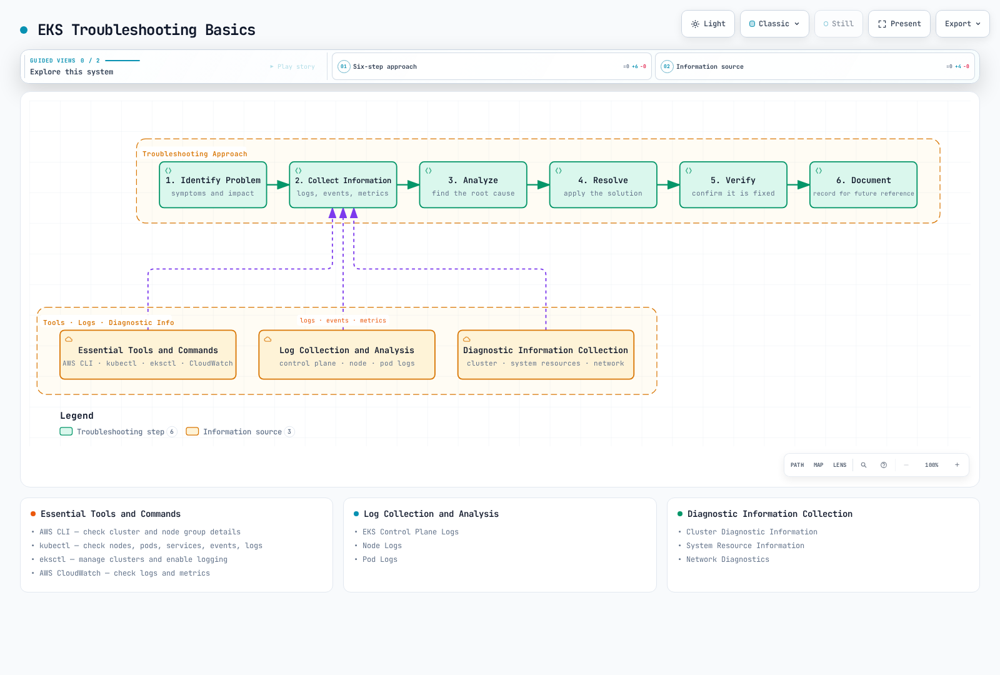
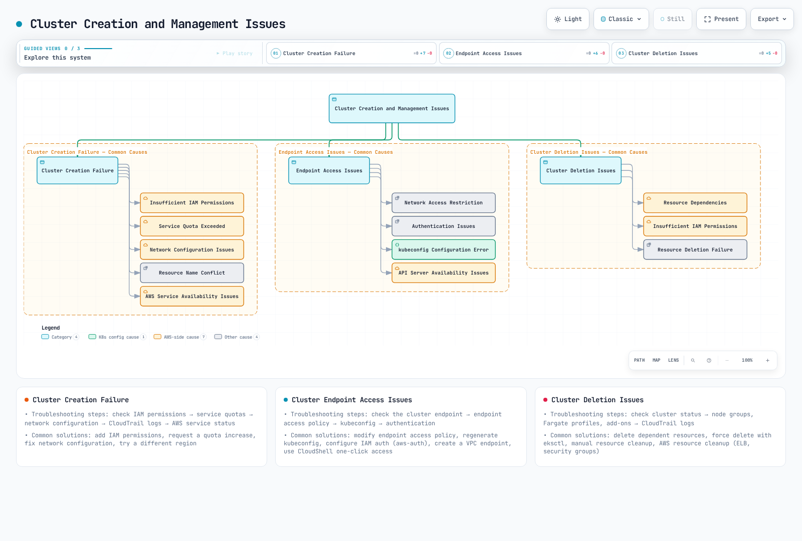
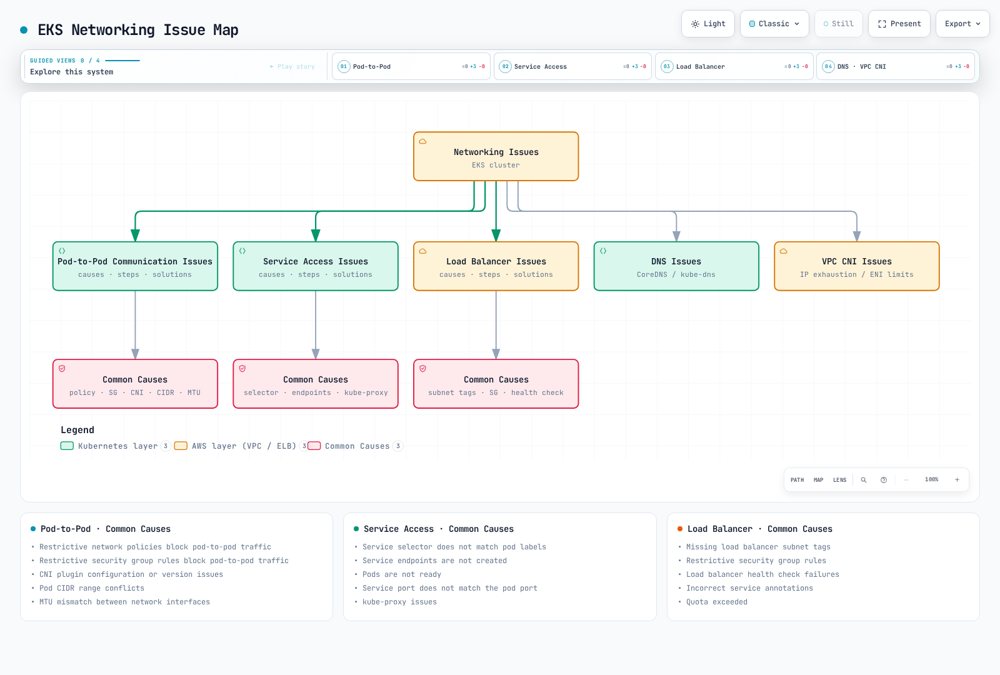
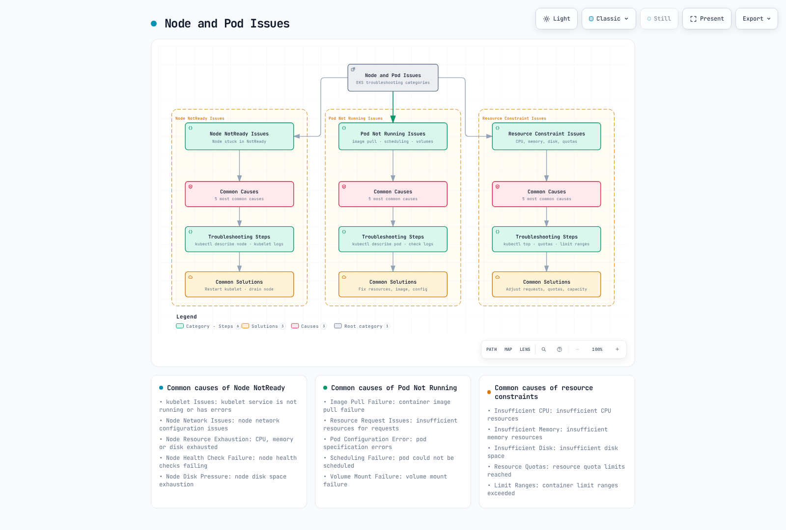
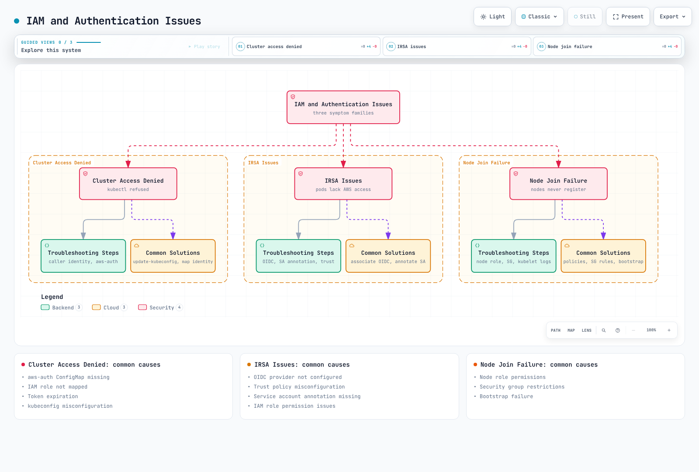

# Solución de problemas de Amazon EKS

> **Última actualización**: 12 de septiembre de 2026

Al operar clústeres de Amazon EKS, pueden surgir diversos problemas. Este documento describe problemas comunes que pueden ocurrir en clústeres de EKS y sus soluciones.

## Tabla de contenido

1. [Conceptos básicos de solución de problemas](#troubleshooting-basics)
2. [Problemas de creación y administración de clústeres](#cluster-creation-and-management-issues)
3. [Problemas de red](#networking-issues)
4. [Problemas de nodos y Pods](#node-and-pod-issues)
5. [Problemas de IAM y autenticación](#iam-and-authentication-issues)
6. [Problemas de almacenamiento](#storage-issues)
7. [Problemas de registros y supervisión](#logging-and-monitoring-issues)
8. [Problemas de rendimiento](#performance-issues)
9. [Problemas de actualización](#upgrade-issues)
10. [Mensajes de error comunes y soluciones](#common-error-messages-and-solutions)

## Conceptos básicos de solución de problemas



[🔍 Ver diagrama interactivo](https://www.atomai.click/kubernetes-docs/archmaps/en-eks-09-eks-troubleshooting-0.html)

### Enfoque para la solución de problemas

1. Identifique el síntoma, los usuarios/cargas de trabajo afectados y el período del incidente.
2. Recopile el estado, los registros, los eventos y las métricas pertinentes antes de cambiar recursos.
3. Compare las hipótesis alternativas con las pruebas; no considere que un error genérico demuestra una causa.
4. Aplique una corrección específica, con un responsable asignado y cuyos efectos sobre los datos y la disponibilidad sean conocidos.
5. Verifique la recuperación mediante el comportamiento de la aplicación y las métricas, no solo con el código de salida de un comando.
6. Registre la causa, los cambios, los resultados, la incertidumbre restante y las medidas preventivas.

Los comandos de este capítulo son plantillas para un entorno revisado, no un único script que se deba ejecutar de principio a fin. Consultar un recurso, crear una carga de trabajo de depuración, reiniciar un componente y eliminar infraestructura tienen efectos distintos. Para esta revisión no se realizaron operaciones activas de AWS/Kubernetes.

### Herramientas y comandos esenciales

Para un clúster **existente**, establezca la cuenta, la Región, el clúster y el contexto de kubectl previstos y, a continuación, compruebe que coincidan. No deduzca el nombre de un clúster a partir de un alias de contexto arbitrario. Si la creación falló antes de que existiera un clúster utilizable, use las pruebas de la cuenta/Región y de la solicitud o pila original que se indican en la sección sobre creación.

```bash
set -euo pipefail
: "${AWS_REGION:?Set the intended Region}"
: "${CLUSTER_NAME:?Set the existing cluster name}"
: "${EXPECTED_ACCOUNT_ID:?Set the intended 12-digit account ID}"
: "${KUBE_CONTEXT:?Set the explicit kubectl context}"
ACTUAL_ACCOUNT_ID=$(aws sts get-caller-identity --query Account --output text)
if [ "$ACTUAL_ACCOUNT_ID" != "$EXPECTED_ACCOUNT_ID" ]; then
  echo "Account mismatch" >&2; exit 1
fi
CLUSTER_ENDPOINT=$(aws eks describe-cluster --name "$CLUSTER_NAME" --region "$AWS_REGION" \
  --query cluster.endpoint --output text)
KUBE_ENDPOINT=$(kubectl config view --context "$KUBE_CONTEXT" --minify \
  -o jsonpath='{.clusters[0].cluster.server}')
if [ "$CLUSTER_ENDPOINT" != "$KUBE_ENDPOINT" ]; then
  echo "kubectl context does not match the selected EKS cluster" >&2; exit 1
fi
export AWS_REGION CLUSTER_NAME EXPECTED_ACCOUNT_ID KUBE_CONTEXT
```

#### AWS CLI y eksctl

```bash
aws eks describe-cluster --name "$CLUSTER_NAME" --region "$AWS_REGION" \
  --query 'cluster.{arn:arn,status:status,version:version,health:health,access:accessConfig}'
aws eks list-nodegroups --cluster-name "$CLUSTER_NAME" --region "$AWS_REGION"
aws eks list-addons --cluster-name "$CLUSTER_NAME" --region "$AWS_REGION"
eksctl get nodegroup --cluster "$CLUSTER_NAME" --region "$AWS_REGION"
```

Estos comandos enumeran los grupos de nodos administrados y los complementos de EKS instalados, no todos los controladores autoadministrados ni los recursos de cómputo. Registre quién es el responsable real y el tipo de cómputo antes de elegir un procedimiento.

#### kubectl

```bash
kubectl --context "$KUBE_CONTEXT" get nodes -o wide
kubectl --context "$KUBE_CONTEXT" get pods -A -o wide
kubectl --context "$KUBE_CONTEXT" get services -A
kubectl --context "$KUBE_CONTEXT" get events -A --sort-by='.metadata.creationTimestamp'
: "${NAMESPACE:?}"; : "${POD_NAME:?}"
kubectl --context "$KUBE_CONTEXT" -n "$NAMESPACE" describe pod "$POD_NAME"
```

Especifique explícitamente el espacio de nombres, el Pod, el contenedor y el nodo afectados. La salida de `describe` y los registros de la aplicación pueden incluir información operativa confidencial. `kubectl auth can-i` comprueba la autorización para una acción determinada; `aws sts get-caller-identity` identifica las credenciales de AWS, y ninguno de los dos demuestra por sí solo que haya acceso de red ni que estén disponibles todos los permisos de Kubernetes.

### Recopilación y análisis de registros

#### Registros del plano de control de EKS

Compruebe la configuración de registro existente y un período acotado del incidente:

```bash
set -euo pipefail
: "${CLUSTER_NAME:?}"; : "${AWS_REGION:?}"
: "${START_TIME_MS:?Set the incident-window start in epoch milliseconds}"
: "${END_TIME_MS:?Set the incident-window end in epoch milliseconds}"
aws eks describe-cluster --name "$CLUSTER_NAME" --region "$AWS_REGION" \
  --query cluster.logging --output json
aws logs filter-log-events --region "$AWS_REGION" \
  --log-group-name "/aws/eks/$CLUSTER_NAME/cluster" \
  --start-time "$START_TIME_MS" --end-time "$END_TIME_MS" \
  --max-items 200 --output json --no-cli-pager
```

Habilitar el registro del plano de control es un cambio independiente de `UpdateClusterConfig`, con su propio ID de actualización, permisos y cargos de CloudWatch. No recupera registros anteriores ni habilita la recopilación de registros de la aplicación o del host. Si el grupo no existe, la solicitud se deniega o el período no contiene resultados, se trata de una limitación de visibilidad. Para los registros de aplicaciones y hosts, use `/aws/containerinsights/<cluster>/...` o el destino real del recopilador.

#### Registros de nodos

En un nodo EC2 Linux estándar al que el operador tenga acceso, verifique `spec.providerID` del nodo, la cuenta/Región y los requisitos previos de SSM antes de abrir una sesión:

```bash
: "${INSTANCE_ID:?Verify the node EC2 ProviderID and account/Region first}"
aws ssm start-session --target "$INSTANCE_ID" --region "$AWS_REGION"
```

Ejecute lo siguiente **dentro de la sesión del nodo**, no en el terminal local. Estos ejemplos de systemd/containerd presuponen que la imagen del nodo incluye esas herramientas; Bottlerocket, Fargate y Auto Mode requieren sus rutas de diagnóstico compatibles.

```bash
sudo journalctl -u kubelet --since "15 minutes ago" --no-pager
sudo journalctl -u containerd --since "15 minutes ago" --no-pager
df -h
df -i
free -m
```

Los nodos Linux optimizados para EKS actuales usan containerd. El registro del daemon de Docker no es el registro del runtime de kubelet en esos nodos. Conserve los registros y las pruebas de espacio en disco e inodos antes de podar imágenes, depurar los diarios o reiniciar algo. La falta de métricas de `kubectl top` en un nodo en mal estado no demuestra por sí sola que se haya agotado la CPU o la memoria.

#### Registros de Pods

```bash
set -euo pipefail
: "${KUBE_CONTEXT:?}"; : "${NAMESPACE:?}"; : "${POD_NAME:?}"; : "${CONTAINER_NAME:?}"
kubectl --context "$KUBE_CONTEXT" -n "$NAMESPACE" logs "$POD_NAME" \
  -c "$CONTAINER_NAME" --since=15m --tail=200 --timestamps=true
# Run only when a previous container instance exists in this same Pod.
kubectl --context "$KUBE_CONTEXT" -n "$NAMESPACE" logs "$POD_NAME" \
  -c "$CONTAINER_NAME" --previous --tail=200 --timestamps=true
```

`--previous` se refiere a la instancia anterior finalizada del contenedor indicado en el **mismo Pod**. No recupera los registros de un Pod predecesor eliminado; para consultar el historial conservado, use el backend de registros. Inspeccione el estado de los contenedores normales y de inicialización, la preparación y los motivos de salida.

### Recopilación de información de diagnóstico

```bash
set -euo pipefail
: "${EVIDENCE_PARENT:?Set an existing private directory}"
: "${KUBE_CONTEXT:?}"; : "${NAMESPACE:?}"
umask 077
EVIDENCE_DIR=$(mktemp -d "$EVIDENCE_PARENT/eks-diagnosis.XXXXXXXX")
kubectl --context "$KUBE_CONTEXT" get nodes -o wide > "$EVIDENCE_DIR/nodes.txt"
kubectl --context "$KUBE_CONTEXT" -n "$NAMESPACE" get pods -o wide > "$EVIDENCE_DIR/pods.txt"
kubectl --context "$KUBE_CONTEXT" -n "$NAMESPACE" get services -o wide > "$EVIDENCE_DIR/services.txt"
kubectl --context "$KUBE_CONTEXT" -n "$NAMESPACE" get events \
  --sort-by='.metadata.creationTimestamp' > "$EVIDENCE_DIR/events.txt"
printf 'Evidence saved to %s; assess the findings before remediation.\n' "$EVIDENCE_DIR"
```

Si una consulta falla, este ejemplo se detiene; los archivos existentes constituyen pruebas parciales. Evite ejecutar un `cluster-info dump` general o describir todos los Pods si basta con un inventario acotado, y revise/enmascare las pruebas antes de compartirlas.

Para detectar presión de recursos, compare las solicitudes y los límites, los recursos asignables del nodo y `kubectl top` cuando Metrics Server esté disponible. En los nodos accesibles, compruebe tanto `df -h` como `df -i`; que haya bytes libres no descarta el agotamiento de inodos. Un Pod de depuración de nodo tiene su propio sistema de archivos raíz, mientras que la raíz del host está montada en `/host`; ejecutar `df -h` sin la ruta prevista puede consultar el sistema de archivos equivocado. Crear ese Pod requiere revisar el espacio de nombres, la imagen, el perfil de depuración, los permisos y la limpieza.

Para diagnosticar la red, identifique el Pod/espacio de nombres/nodo de origen, el destino, el protocolo y el puerto. Primero inspeccione las políticas aplicables y el resolver del origen. Un Pod de depuración recién creado puede tener etiquetas, identidad, DNS o enrutamiento distintos de los de la carga de trabajo afectada. Un ping ICMP no demuestra que la aplicación sea accesible por TCP/UDP. Use una prueba acotada en la ruta realmente permitida; coordine con el responsable la preparación de las herramientas y la limpieza, en lugar de crear repetidamente Pods `dnsutils`/`netshoot` sin fijar la imagen y con nombres comunes.

Fuentes: [Solución de problemas de EKS](https://docs.aws.amazon.com/eks/latest/userguide/troubleshooting.html), [Registros de Kubernetes](https://kubernetes.io/docs/reference/kubectl/generated/kubectl_logs/), [Depuración de nodos](https://kubernetes.io/docs/tasks/debug/debug-cluster/kubectl-node-debug/).

## Problemas de creación y administración de clústeres



[🔍 Ver diagrama interactivo](https://www.atomai.click/kubernetes-docs/archmaps/en-eks-09-eks-troubleshooting-1.html)

### Error al crear el clúster

#### Causas comunes

Revise la solicitud fallida exacta o el evento de CloudFormation para comprobar los permisos del solicitante, la confianza y las políticas del rol de servicio del clúster, las cuotas de servicio, la selección de subredes/AZ compatibles, la capacidad de direcciones IP, los conflictos de nombres o la disponibilidad del servicio. Son hipótesis; su probabilidad depende del error real.

#### Pasos para solucionar el problema

```bash
set -euo pipefail
: "${AWS_REGION:?}"; : "${CLUSTER_ROLE_NAME:?}"; : "${VPC_ID:?}"
aws sts get-caller-identity
aws iam get-role --role-name "$CLUSTER_ROLE_NAME" \
  --query 'Role.{Arn:Arn,Trust:AssumeRolePolicyDocument}'
aws iam list-attached-role-policies --role-name "$CLUSTER_ROLE_NAME"
aws iam list-role-policies --role-name "$CLUSTER_ROLE_NAME"
aws ec2 describe-subnets --region "$AWS_REGION" --filters "Name=vpc-id,Values=$VPC_ID" \
  --query 'Subnets[].{Id:SubnetId,AZ:AvailabilityZone,AZId:AvailabilityZoneId,AvailableIPs:AvailableIpAddressCount,CIDR:CidrBlock}'
aws service-quotas list-service-quotas --service-code eks --region "$AWS_REGION"
aws cloudtrail lookup-events --region "$AWS_REGION" \
  --lookup-attributes AttributeKey=EventName,AttributeValue=CreateCluster \
  --max-items 20 --output json
```

Las políticas adjuntas por sí solas no muestran los permisos efectivos del solicitante: incluya las políticas insertadas, los límites de permisos, las políticas de sesión y los controles de Organizations. `AmazonEKSClusterPolicy` corresponde al rol de servicio del clúster de EKS; adjuntarla a un usuario humano no concede los permisos necesarios `eks:CreateCluster`/`iam:PassRole` ni acceso a Kubernetes. La creación de un rol vinculado a un servicio tiene sus propios permisos y ciclo de vida.

Para comprobar la red, use las subredes seleccionadas para el clúster y la configuración exacta de rutas, grupos de seguridad y NACL. Los requisitos de subredes del clúster y la capacidad de direcciones IP para nodos/Pods/LB son aspectos de planificación distintos. Los clústeres privados pueden usar los endpoints de servicio necesarios sin una puerta de enlace NAT ni acceso general a Internet. Una etiqueta de subred `kubernetes.io/cluster/...` no es una solución universal para crear el plano de control.

Ante errores de cuota, identifique el servicio/la cuota a partir del error y consulte el valor aplicado actual antes de solicitar un aumento. Las cuotas de clústeres de EKS, las cuotas de vCPU/familia de instancias de EC2 y los límites de VPC son distintos. Mensajes históricos como “el límite es 5” son ejemplos, no los límites actuales de la cuenta.

#### Soluciones comunes

Corrija el problema específico de permisos, confianza del rol de servicio, selección de subredes, asignación de direcciones IP o cuota con el responsable de infraestructura y, después, revise si corresponde reintentar. `UnsupportedAvailabilityZoneException` significa que una subred del clúster especificada está en una AZ que no es compatible con EKS para la cuenta; use las AZ compatibles que indique la excepción. No se diagnostica únicamente con las ofertas de tipos de instancias de EC2.

Compruebe AWS Health para detectar un evento del servicio. Cambiar de Región supone diseñar otra ubicación y arquitectura de datos/red, y posiblemente otro clúster; no es la opción predeterminada para reintentar la solución de problemas. `eksctl create cluster --verbose ...` y las marcas de depuración de AWS CLI siguen ejecutando la creación. Consulte los eventos de la pila existente y el ID de solicitud antes de enviar otra solicitud de aprovisionamiento.

### Problemas de acceso al endpoint del clúster

#### Diagnostique DNS, transporte, TLS, autenticación y autorización por separado

Inspeccione el modo del endpoint, los CIDR públicos permitidos y el grupo de seguridad del clúster; después, realice una prueba con la CA del clúster y un tiempo de espera:

```bash
set -euo pipefail
: "${CLUSTER_NAME:?}"; : "${AWS_REGION:?}"; : "${EVIDENCE_PARENT:?}"
umask 077
ENDPOINT_DIR=$(mktemp -d "$EVIDENCE_PARENT/eks-endpoint.XXXXXXXX")
aws eks describe-cluster --name "$CLUSTER_NAME" --region "$AWS_REGION" \
  --output json > "$ENDPOINT_DIR/cluster.json"
jq -er '.cluster.certificateAuthority.data' "$ENDPOINT_DIR/cluster.json" \
  | base64 --decode > "$ENDPOINT_DIR/cluster-ca.crt"
ENDPOINT=$(jq -er '.cluster.endpoint' "$ENDPOINT_DIR/cluster.json")
jq '.cluster.resourcesVpcConfig | {endpointPublicAccess,endpointPrivateAccess,publicAccessCidrs,clusterSecurityGroupId,vpcId}' \
  "$ENDPOINT_DIR/cluster.json"
curl --silent --show-error --connect-timeout 5 --max-time 10 \
  --cacert "$ENDPOINT_DIR/cluster-ca.crt" --output /dev/null \
  --write-out 'HTTP status: %{http_code}\n' "$ENDPOINT"
```

Esto no envía ningún token de portador de Kubernetes. Una respuesta 401/403 puede demostrar que DNS/TCP/TLS son accesibles aunque se deniegue el acceso; una respuesta HTTP correcta no demuestra que la aplicación esté en buen estado. `curl -k` ocultaría los errores de validación del certificado. Si se necesita consultar DNS, use el nombre de host de la URL del endpoint, en vez de pasar una URL `https://` a `nslookup`.

En el caso de un endpoint público, compruebe que la dirección real de salida/NAT del cliente coincida con los CIDR permitidos. Para un endpoint privado, compruebe la ruta de la VPC/red conectada, la resolución DNS y el acceso al grupo de seguridad. El endpoint de interfaz `com.amazonaws.<region>.eks` presta servicio a las **API de administración de EKS**, no al servidor de API de Kubernetes. Habilitarlo por sí solo no resuelve el acceso de kubectl. El endpoint privado de Kubernetes del clúster es independiente.

#### kubeconfig y permisos

Inspeccione el nombre del contexto y el servidor sin imprimir credenciales sin procesar. Para crear un kubeconfig de diagnóstico independiente, use una ruta y un alias explícitos; establezca `NAMESPACE` con el ámbito de autorización previsto:

```bash
set -euo pipefail
: "${CLUSTER_NAME:?}"; : "${AWS_REGION:?}"
: "${NAMESPACE:?Set the namespace for the authorization check}"
: "${DIAGNOSTIC_KUBECONFIG:?Set a separate writable kubeconfig path}"
: "${KUBE_CONTEXT:?Choose an explicit alias for this cluster}"
umask 077
aws eks update-kubeconfig --name "$CLUSTER_NAME" --region "$AWS_REGION" \
  --kubeconfig "$DIAGNOSTIC_KUBECONFIG" --alias "$KUBE_CONTEXT"
export KUBECONFIG="$DIAGNOSTIC_KUBECONFIG"
kubectl --context "$KUBE_CONTEXT" auth can-i get pods --namespace "$NAMESPACE"
```

Crear el kubeconfig requiere `eks:DescribeCluster`; la autenticación/autorización de Kubernetes es un requisito distinto. Si va a asumir un rol, use el `--role-arn` revisado y los permisos de confianza/STS correspondientes. Renueve las credenciales mediante el proveedor de credenciales real (por ejemplo, la sesión SSO configurada), en lugar de imprimir los tokens de sesión.

```bash
set -euo pipefail
: "${CLUSTER_NAME:?}"; : "${AWS_REGION:?}"
aws eks describe-cluster --name "$CLUSTER_NAME" --region "$AWS_REGION" \
  --query 'cluster.accessConfig'
# Use the next command when API or API_AND_CONFIG_MAP authentication is enabled.
aws eks list-access-entries --cluster-name "$CLUSTER_NAME" --region "$AWS_REGION"
```

Si la autenticación mediante entradas de acceso está habilitada, inspeccione la entrada pertinente y el ámbito de la política asociada. Los clústeres heredados `CONFIG_MAP` o mixtos también pueden usar `aws-auth`; conserve las asignaciones de nodos existentes y planifique la migración. No conceda `system:masters` ni sobrescriba todo el ConfigMap como solución genérica de acceso. El proveedor OIDC de IAM de IRSA sirve para las credenciales de AWS de las cargas de trabajo, no para asignar una entidad principal de IAM humana a la autorización de Kubernetes.

#### Corrija la ruta de acceso

Use una ruta administrativa privada conectada o una lista de CIDR públicos permitidos, revisada y adecuada para el modo del endpoint. No abra `0.0.0.0/0` solo para que funcione un comando de diagnóstico. Pruebe la ruta privada antes de quitar el acceso público, conserve la configuración actual de VPC que no esté relacionada y registre el ID de actualización de configuración. Siga el [procedimiento de endpoints del capítulo de seguridad](./05-eks-security.md) para realizar un cambio planificado.

#### Acceso a CloudShell con un solo clic

La función de un solo clic, disponible desde el 30 de abril de 2026, es compatible. Seleccione **Conectar** en la página de detalles del clúster para abrir CloudShell con kubectl configurado. Se admiten los endpoints de API públicos y privados; con un endpoint privado, se inicia automáticamente un entorno VPC de CloudShell y se solicita su nombre. La función está disponible sin cargos adicionales por la función en las Regiones de EKS.

La ruta de la consola sigue necesitando los permisos pertinentes de IAM/CloudShell/entorno VPC, acceso a Kubernetes y una configuración de red funcional. Evita la configuración local, no los controles de autorización. Revise los cargos aplicables por recursos/transferencia de datos y la identidad de la sesión antes de ejecutar comandos.

Fuentes: [kubeconfig y CloudShell](https://docs.aws.amazon.com/eks/latest/userguide/create-kubeconfig.html), [Anuncio de acceso con un solo clic](https://aws.amazon.com/about-aws/whats-new/2026/04/amazon-eks-one-click-cluster-access/), [Distinción de EKS PrivateLink](https://docs.aws.amazon.com/eks/latest/userguide/vpc-interface-endpoints.html), [Solución de problemas de clústeres](https://docs.aws.amazon.com/eks/latest/userguide/troubleshooting.html).

### Problemas al eliminar un clúster

#### Identifique la dependencia que bloquea la eliminación

Eliminar un clúster es un desmantelamiento deliberado, no una solución general de problemas. Lea el error exacto de EKS/CloudFormation, el ARN/cuenta/Región del clúster, el estado de actualización y el ajuste de protección contra eliminación. Además de los grupos de nodos administrados y los perfiles de Fargate, la protección contra eliminación y las capacidades de EKS instaladas pueden bloquear la eliminación. Conserve los roles de IAM/servicio del clúster hasta que finalice la eliminación.

Haga un inventario del clúster seleccionado y compare su endpoint con el contexto explícito de kubectl. Los comandos siguientes son de solo lectura y no seleccionan recursos para eliminarlos automáticamente:

```bash
set -euo pipefail
: "${CLUSTER_NAME:?Set the cluster being deliberately retired}"
: "${AWS_REGION:?}"; : "${KUBE_CONTEXT:?}"; : "${EXPECTED_ACCOUNT_ID:?}"
ACTUAL_ACCOUNT_ID=$(aws sts get-caller-identity --query Account --output text)
if [ "$ACTUAL_ACCOUNT_ID" != "$EXPECTED_ACCOUNT_ID" ]; then
  echo "Account mismatch; stop" >&2
  exit 1
fi
aws eks describe-cluster --name "$CLUSTER_NAME" --region "$AWS_REGION" \
  --query 'cluster.{arn:arn,status:status,deletionProtection:deletionProtection,endpoint:endpoint}'
kubectl config view --context "$KUBE_CONTEXT" --minify \
  -o jsonpath='{.clusters[0].cluster.server}{"\n"}'
# Compare the endpoints before inspecting Kubernetes resources.
kubectl --context "$KUBE_CONTEXT" get services -A \
  -o custom-columns='NAMESPACE:.metadata.namespace,NAME:.metadata.name,TYPE:.spec.type,CLASS:.spec.loadBalancerClass,ADDRESS:.status.loadBalancer.ingress'
kubectl --context "$KUBE_CONTEXT" get ingress -A
kubectl --context "$KUBE_CONTEXT" get pvc -A
kubectl --context "$KUBE_CONTEXT" get pv \
  -o custom-columns='NAME:.metadata.name,CLAIM_NS:.spec.claimRef.namespace,CLAIM:.spec.claimRef.name,RECLAIM:.spec.persistentVolumeReclaimPolicy,DRIVER:.spec.csi.driver,HANDLE:.spec.csi.volumeHandle'
aws eks list-nodegroups --cluster-name "$CLUSTER_NAME" --region "$AWS_REGION"
aws eks list-fargate-profiles --cluster-name "$CLUSTER_NAME" --region "$AWS_REGION"
aws eks list-capabilities --cluster-name "$CLUSTER_NAME" --region "$AWS_REGION"
aws eks list-addons --cluster-name "$CLUSTER_NAME" --region "$AWS_REGION"
```

La salida `EXTERNAL-IP` de un Service por sí sola no demuestra quién es el propietario: distinga los Services `LoadBalancer` administrados por controladores, las IP externas configuradas manualmente y otros tipos de Service. Registre el espacio de nombres/nombre/UID, la propiedad del controlador, el ARN del recurso de AWS y las etiquetas pertinentes. Incluya los recursos Ingress, Gateway/TargetGroupBinding cuando haya controladores instalados, y determine si los destinos o balanceadores de carga son compartidos.

#### Retire los recursos siguiendo la secuencia del responsable

1. Migre el tráfico y las cargas de trabajo, y verifique que las copias de seguridad/restauraciones sean coherentes con la aplicación y que se cumplan los requisitos de retención de datos. Guardar el YAML de un PVC no constituye una copia de seguridad de los datos. Una política de recuperación `Delete` puede eliminar el almacenamiento subyacente cuando se borra su claim; `Retain` requiere decidir por separado qué hacer con los datos y el almacenamiento.
2. Mientras los controladores de balanceadores de carga necesarios sigan en ejecución, elimine solo los recursos de Kubernetes revisados que sean propietarios de los balanceadores de carga. Espere a los finalizadores y compruebe que se hayan liberado los recursos de AWS correspondientes. Resuelva los errores de IAM o de dependencias del controlador antes de eliminar sus nodos. No quite finalizadores solo para ocultar una limpieza fallida.
3. Retire las capacidades de EKS siguiendo sus reglas documentadas de propiedad/eliminación de recursos. Elimine los grupos de nodos administrados y los perfiles de Fargate en un orden revisado, y espere a que finalicen. Los nodos/pilas autoadministrados necesitan su propio desmantelamiento. La eliminación de complementos también puede quitar componentes de Kubernetes; conserve los controladores de red/almacenamiento hasta que termine la limpieza de sus dependencias.
4. Deshabilite la protección contra eliminación solo como decisión explícita de desmantelamiento y, a continuación, elimine el clúster mediante su responsable de infraestructura original. Al eliminar un clúster de Auto Mode también se eliminan sus nodos administrados y balanceadores de carga; tenga en cuenta ese ámbito y el ciclo de vida de los grupos de destino de TargetGroupBinding integrado.
5. Revise los recursos restantes según su propietario exacto: pilas/VPC dedicadas, volúmenes/instantáneas, balanceadores de carga, recursos de IAM, registros y recolectores de Prometheus. Los recursos compartidos y los datos conservados tienen ciclos de vida independientes y pueden seguir generando cargos.

Por ejemplo, lo siguiente es la eliminación de **un** Service seleccionado explícitamente tras revisar el tráfico y los datos. No es un bucle de detección y eliminación:

```bash
set -euo pipefail
: "${KUBE_CONTEXT:?}"; : "${SERVICE_NAMESPACE:?}"; : "${SERVICE_NAME:?}"
# Separate approved teardown step after traffic/data migration and owner review.
kubectl --context "$KUBE_CONTEXT" -n "$SERVICE_NAMESPACE" get service "$SERVICE_NAME" -o yaml
kubectl --context "$KUBE_CONTEXT" -n "$SERVICE_NAMESPACE" delete service "$SERVICE_NAME" \
  --wait=true --timeout=10m
```

Un tiempo de espera agotado no demuestra que el balanceador de carga de AWS se haya conservado o eliminado; inspeccione los finalizadores, los eventos del controlador y el ARN exacto de AWS. La limpieza de recursos de Kubernetes y de AWS puede concluir en momentos distintos.

#### Errores de eliminación y comportamiento forzado

Use los detalles de actualización de EKS y los eventos de la pila de CloudFormation para identificar errores de dependencias, autorización y operaciones en curso. En eksctl 0.229, `delete cluster --force` es una opción válida que permite continuar la eliminación cuando se producen errores. No demuestra que la limpieza haya sido completa ni identifica de forma segura la propiedad de los recursos huérfanos. `--disable-nodegroup-eviction` omite por separado las comprobaciones de PDB mediante la eliminación. Ninguna de las dos opciones es una respuesta predeterminada a un incidente.

No canalice una lista de ELB/ELBv2 de toda la cuenta/Región a comandos de eliminación, ni elimine todos los Services, PVC o espacios de nombres para despejar un error de dependencias. Si hay que quitar manualmente un recurso huérfano, primero establezca quién es exactamente el propietario del clúster/la pila y cuál es el impacto sobre los datos/el tráfico; después, siga el procedimiento de desmantelamiento revisado del servicio correspondiente.

Fuentes: [Eliminación de un clúster de EKS](https://docs.aws.amazon.com/eks/latest/userguide/delete-cluster.html), [Solución de problemas de eliminación](https://repost.aws/knowledge-center/eks-delete-cluster-issues), [Ciclo de vida de los volúmenes persistentes](https://kubernetes.io/docs/concepts/storage/persistent-volumes/).

## Problemas de red



[🔍 Ver diagrama interactivo](https://www.atomai.click/kubernetes-docs/archmaps/en-eks-09-eks-troubleshooting-2.html)

Primero identifique el plano de datos y de cómputo real. Los nodos EC2 estándar que usan VPC CNI de código abierto, Fargate y Auto Mode no tienen agentes ni configuración idénticos. Para Auto Mode, use los controles de red de `NodeClass`; cambiar un DaemonSet `aws-node` o `ENIConfig` no configura los nodos de Auto Mode.

### Problemas de comunicación entre Pods

#### Trace la ruta que falla

Registre el Pod de origen/destino, el espacio de nombres, el nodo/AZ, la familia de IP, el protocolo y el puerto de destino. Cuando una prueba aprobada permita aislar la diferencia, compare el comportamiento en el mismo nodo y entre nodos. Compruebe las políticas, los grupos de seguridad, las rutas/NACL, el estado de CNI, la asignación de IP y la MTU de la ruta correspondiente.

```bash
set -euo pipefail
: "${KUBE_CONTEXT:?}"; : "${NAMESPACE:?}"; : "${POD_NAME:?}"
kubectl --context "$KUBE_CONTEXT" -n "$NAMESPACE" get pod "$POD_NAME" -o wide
kubectl --context "$KUBE_CONTEXT" -n "$NAMESPACE" get pod "$POD_NAME" \
  -o jsonpath='{.metadata.labels}{"\n"}{.spec.nodeName}{"\n"}{.spec.hostNetwork}{"\n"}'
kubectl --context "$KUBE_CONTEXT" get namespace "$NAMESPACE" --show-labels
kubectl --context "$KUBE_CONTEXT" -n "$NAMESPACE" get networkpolicies
kubectl --context "$KUBE_CONTEXT" -n "$NAMESPACE" get events \
  --sort-by='.metadata.creationTimestamp'
```

Las NetworkPolicies estándar `networking.k8s.io/v1` combinan el tráfico permitido de manera aditiva; no tienen prioridad de reglas ni una política de «la última gana». Cuando ambos pares están aislados, deben permitir el flujo tanto el tráfico saliente del origen como el entrante del destino. Las API de políticas administrativas/de clúster y los motores de políticas específicos de proveedores tienen semánticas independientes. Compruebe las etiquetas del espacio de nombres y si `namespaceSelector` y `podSelector` pertenecen al mismo par (AND) o a pares distintos (OR).

VPC CNI admite la aplicación nativa de políticas de red; no instale Calico/Cilium solo porque no haya un Pod de políticas de terceros. Verifique que el CNI, la plataforma y el kernel sean compatibles y que la configuración del agente de políticas esté habilitada. En el modo de inicio estándar, un Pod nuevo permite inicialmente el tráfico hasta que se configuran sus políticas; el modo estricto empieza denegándolo y necesita las políticas necesarias para DNS y sus dependencias. El comportamiento de `hostNetwork` y otras limitaciones de cobertura dependen de la documentación de la implementación correspondiente.

En una instalación estándar de VPC CNI, inspeccione los registros del contenedor `aws-network-policy-agent` del Pod `aws-node` real, si está presente. Que `kubectl get pods -l ...` se ejecute correctamente y devuelva una lista vacía no demuestra que haya un complemento instalado. Auto Mode usa en su lugar los controles de políticas integrados.

#### Corrija únicamente el flujo previsto

Revise la matriz completa de flujos permitidos en vez de añadir una regla de entrada/salida que permita todo el tráfico en todo el espacio de nombres o eliminar políticas. Este ejemplo selecciona los Pods de API del backend y solo permite los Pods web del frontend por TCP 8080:

```yaml
# Example ingress policy only: review both peers and the complete allowed-flow matrix.
apiVersion: networking.k8s.io/v1
kind: NetworkPolicy
metadata:
  name: api-from-web
  namespace: backend
spec:
  podSelector:
    matchLabels:
      app: api
  policyTypes:
    - Ingress
  ingress:
    - from:
        - namespaceSelector:
            matchLabels:
              kubernetes.io/metadata.name: frontend
          podSelector:
            matchLabels:
              app: web
      ports:
        - protocol: TCP
          port: 8080
```

Al aplicarla, se puede aislar de las demás entradas a los Pods de backend seleccionados, salvo que otras políticas las permitan. No configura el tráfico saliente de clientes, DNS ni todas las dependencias. Verifique esos aspectos por separado con pruebas positivas y negativas. Use los espacios de nombres/etiquetas reales de la carga de trabajo en lugar de copiar los nombres del ejemplo.

Para los grupos de seguridad, inspeccione los grupos de las ENI de origen y destino, incluidos los grupos de Pods/subredes de Pods personalizados cuando corresponda. Permita el origen/puerto necesarios a través del responsable; no añada todos los protocolos ni CIDR amplios como solución genérica. Valores de MTU como 1500 o 9001 dependen de la ruta; mida el fallo y tenga en cuenta la encapsulación antes de cambiar la configuración de CNI o reemplazar Pods.

### Problemas de acceso a Services

Compruebe conjuntamente el selector del Service, el estado real de los Pods, las condiciones de los endpoints y la correspondencia de puertos:

```bash
set -euo pipefail
: "${KUBE_CONTEXT:?}"; : "${NAMESPACE:?}"; : "${SERVICE_NAME:?}"
SERVICE_JSON=$(kubectl --context "$KUBE_CONTEXT" -n "$NAMESPACE" get service "$SERVICE_NAME" -o json)
printf '%s\n' "$SERVICE_JSON" | jq '{metadata: {name: .metadata.name, namespace: .metadata.namespace}, spec: .spec, status: .status}'
SELECTOR=$(printf '%s\n' "$SERVICE_JSON" | jq -r '(.spec.selector // {}) | to_entries | map("\(.key)=\(.value)") | join(",")')
if [ -n "$SELECTOR" ]; then
  kubectl --context "$KUBE_CONTEXT" -n "$NAMESPACE" get pods -l "$SELECTOR" -o wide
  kubectl --context "$KUBE_CONTEXT" -n "$NAMESPACE" get pods -l "$SELECTOR" -o json \
    | jq '.items[] | {name:.metadata.name,phase:.status.phase,ready:[.status.conditions[]? | select(.type=="Ready")],containers:.status.containerStatuses}'
else
  printf 'No selector: inspect ExternalName or explicitly managed EndpointSlices as applicable.\n'
fi
kubectl --context "$KUBE_CONTEXT" -n "$NAMESPACE" get endpointslices \
  -l "kubernetes.io/service-name=$SERVICE_NAME" -o yaml
```

Use EndpointSlices en lugar de depender de la API Endpoints, que está obsoleta. Inspeccione las condiciones `ready`, `serving` y `terminating`, y opciones del Service como `publishNotReadyAddresses`, `externalTrafficPolicy` e `internalTrafficPolicy`. Un Pod en estado Running no tiene por qué estar Ready.

En un Service `ExternalName`, diagnostique el alias DNS en lugar de esperar Pods seleccionados. En un Service sin cabecera, `clusterIP: None` es intencionado. Los Services sin selector pueden usar EndpointSlices administrados por un responsable. El `port` de un Service puede diferir de `targetPort`; declarar un puerto de contenedor no hace que la aplicación escuche en él.

Si las etiquetas o los puertos son incorrectos, actualice la plantilla declarada del Service/Pod a través de la configuración de su versión. Cambiar la etiqueta de un Pod propiedad de un controlador no es una solución duradera. Revise toda la lista de puertos y los campos inmutables antes de aplicar un parche. Evite eliminar y volver a crear el Service, cambiar ClusterIP o reiniciar todos los Pods de kube-proxy sin diagnosticar la causa.

Compare la conectividad directa al Pod y al Service desde el mismo origen y con el mismo protocolo, solo cuando la política lo permita. Confirme si el plano de datos es kube-proxy, una implementación alternativa o Auto Mode antes de inspeccionar el comportamiento de iptables/nftables/eBPF. La ausencia de un Pod de kube-proxy no siempre es un fallo.

### Problemas con balanceadores de carga

Identifique el controlador a partir de la clase del Service/Ingress, las anotaciones y la propiedad. AWS Load Balancer Controller estándar y EKS Auto Mode usan clases/API y reglas de ciclo de vida distintas. Para el responsable correspondiente, compruebe los eventos del controlador, la selección de subredes, IAM, los grupos de seguridad, el registro de destinos y las comprobaciones de estado.

Use los ARN exactos del balanceador de carga y del grupo de destino asociados a la carga de trabajo:

```bash
set -euo pipefail
: "${AWS_REGION:?}"; : "${LOAD_BALANCER_ARN:?}"; : "${TARGET_GROUP_ARN:?}"
aws elbv2 describe-load-balancers --region "$AWS_REGION" \
  --load-balancer-arns "$LOAD_BALANCER_ARN"
aws elbv2 describe-tags --region "$AWS_REGION" \
  --resource-arns "$LOAD_BALANCER_ARN" "$TARGET_GROUP_ARN"
aws elbv2 describe-load-balancer-attributes --region "$AWS_REGION" \
  --load-balancer-arn "$LOAD_BALANCER_ARN"
aws elbv2 describe-target-groups --region "$AWS_REGION" \
  --target-group-arns "$TARGET_GROUP_ARN"
aws elbv2 describe-target-health --region "$AWS_REGION" \
  --target-group-arn "$TARGET_GROUP_ARN"
```

`describe-load-balancer-attributes` muestra atributos, no el estado operativo; `describe-load-balancers` incluye el estado. Compruebe los códigos del motivo del estado de los destinos, el protocolo/puerto/ruta de la comprobación de estado, el enrutamiento de listeners/reglas y la respuesta de la aplicación. Por lo general, los destinos de tipo instancia llegan a un nodo/NodePort; los destinos de tipo IP llegan al puerto de destino del Pod. Las reglas de los grupos de seguridad deben corresponder a la ruta real.

Las etiquetas de rol de las subredes afectan a la detección automática; compruebe el esquema público/interno, las tablas de rutas, las direcciones IP libres y la cobertura de AZ. Añadir etiquetas de rol público y privado a las mismas subredes no es una solución. La selección explícita de subredes y las versiones del controlador pueden cambiar los requisitos de etiquetas. No abra los grupos de seguridad del frontend/backend a `0.0.0.0/0` para eludir una comprobación de estado fallida.

Use la configuración actual de esquema/tipo del responsable. Los ejemplos heredados `aws-load-balancer-internal` o `aws-load-balancer-type: nlb` no son intercambiables con las clases actuales del controlador. Cambiar la propiedad del controlador o el esquema del LB puede requerir reemplazarlo de forma planificada y migrar el tráfico; editar una anotación no garantiza una conversión in situ. Auto Mode no adopta balanceadores de carga que ya administre el controlador autoadministrado.

Eliminar un Service puede eliminar su balanceador de carga, y exportar el YAML sin procesar de un Service no constituye un plan completo de reversión del tráfico/datos. Crear manualmente un ALB no lo conecta automáticamente a un Service de Kubernetes. Antes de hacer cambios, consulte las [guías de redes](./03-eks-networking-part2.md) correspondientes al responsable seleccionado.

### Problemas de DNS

#### Inspeccione el resolver que utiliza el Pod afectado

```bash
set -euo pipefail
: "${KUBE_CONTEXT:?}"; : "${NAMESPACE:?}"; : "${POD_NAME:?}"; : "${CONTAINER_NAME:?}"
kubectl --context "$KUBE_CONTEXT" -n "$NAMESPACE" get pod "$POD_NAME" \
  -o jsonpath='{.spec.dnsPolicy}{"\n"}{.spec.dnsConfig}{"\n"}{.spec.hostNetwork}{"\n"}'
kubectl --context "$KUBE_CONTEXT" -n "$NAMESPACE" exec "$POD_NAME" \
  -c "$CONTAINER_NAME" -- cat /etc/resolv.conf
# Where this container actually includes nslookup, test the intended name.
: "${DNS_TEST_NAME:?Set the intended Service FQDN or reviewed external hostname}"
kubectl --context "$KUBE_CONTEXT" -n "$NAMESPACE" exec "$POD_NAME" \
  -c "$CONTAINER_NAME" -- nslookup "$DNS_TEST_NAME"
```

Si la imagen no incluye un shell o una herramienta DNS, se trata de una limitación de herramientas, no de una consulta DNS fallida. Prepare un método de depuración revisado que conserve el contexto pertinente de red/identidad. Un Pod de depuración nuevo puede tener una configuración DNS o de políticas distinta.

En los nodos estándar que no sean de Auto Mode, inspeccione el Deployment/Service, la configuración y los EndpointSlices de CoreDNS instalados:

```bash
kubectl --context "$KUBE_CONTEXT" -n kube-system get deployment coredns
kubectl --context "$KUBE_CONTEXT" -n kube-system get pods -l k8s-app=kube-dns -o wide
kubectl --context "$KUBE_CONTEXT" -n kube-system get service kube-dns
kubectl --context "$KUBE_CONTEXT" -n kube-system get endpointslices \
  -l kubernetes.io/service-name=kube-dns
kubectl --context "$KUBE_CONTEXT" -n kube-system get configmap coredns -o yaml
kubectl --context "$KUBE_CONTEXT" -n kube-system logs -l k8s-app=kube-dns \
  --all-containers=true --prefix=true --since=15m --tail=100
```

En los **nodos de Auto Mode**, CoreDNS se ejecuta como servicio del sistema del nodo. Un clúster exclusivamente de Auto Mode puede funcionar sin el Deployment tradicional de CoreDNS. Un clúster mixto Auto/no Auto debe conservar el Deployment para los nodos que no son de Auto Mode. No instale NodeLocal DNSCache ni reinicie un Deployment inexistente como remedio para Auto Mode.

Distinga entre el servidor de nombres del Pod, el upstream de CoreDNS/NodeLocal y el resolver de VPC. `169.254.20.10` es una dirección de NodeLocal DNSCache elegida con frecuencia, no el servidor DNS universal de VPC. Un resolver público como `8.8.8.8` no es una alternativa para las zonas de Service de Kubernetes ni para el DNS privado de AWS.

```bash
set -euo pipefail
: "${AWS_REGION:?}"; : "${VPC_ID:?}"
aws ec2 describe-vpc-attribute --region "$AWS_REGION" --vpc-id "$VPC_ID" \
  --attribute enableDnsSupport
aws ec2 describe-vpc-attribute --region "$AWS_REGION" --vpc-id "$VPC_ID" \
  --attribute enableDnsHostnames
aws ec2 describe-vpcs --region "$AWS_REGION" --vpc-ids "$VPC_ID" \
  --query 'Vpcs[].{VpcId:VpcId,DhcpOptionsId:DhcpOptionsId}'
```

Use `describe-vpc-attribute` para los atributos de DNS; no son campos que devuelva `describe-vpcs`. Consulte las opciones DHCP que correspondan usando el ID devuelto. No reemplace la configuración DHCP de una VPC compartida sin revisar las demás cargas de trabajo.

#### Aplique una corrección de DNS específica

Compruebe UDP y TCP 53 cuando sea necesario, la preparación/configuración real de CoreDNS, la accesibilidad del upstream, la política DNS y los ajustes de búsqueda personalizados. Los Pods `hostNetwork` suelen necesitar `ClusterFirstWithHostNet` cuando se pretende usar el DNS del clúster; `dnsPolicy: None` requiere una configuración completa y deliberada del resolver. Una política de salida solo para DNS también aísla las demás salidas de los Pods seleccionados, salvo que otras políticas las permitan.

Conserve las personalizaciones de Corefile que tengan responsable y use el esquema de configuración compatible del complemento. Revise las réplicas, los recursos, el PDB, la programación y cualquier responsable de escalado automático antes de escalar o reiniciar CoreDNS. Guarde un ID de actualización y realice pruebas funcionales de DNS; no elimine todos los Pods DNS ni instale una imagen «latest» supuesta como primer paso.

### Problemas de VPC CNI

La inspección siguiente se aplica a **nodos EC2 estándar que usan VPC CNI de código abierto**. Seleccione explícitamente el Pod del nodo afectado; `kubectl exec` no acepta un selector de etiquetas.

```bash
set -euo pipefail
: "${KUBE_CONTEXT:?}"; : "${NODE_NAME:?}"
kubectl --context "$KUBE_CONTEXT" get node "$NODE_NAME" \
  -o jsonpath='{.spec.providerID}{"\n"}{.status.nodeInfo}{"\n"}{.status.allocatable.pods}{"\n"}'
kubectl --context "$KUBE_CONTEXT" -n kube-system get daemonset aws-node -o json \
  | jq '.spec.template.spec | {containers:[.containers[] | {name,image,args,env}],initContainers:[.initContainers[]? | {name,image,args,env}]}'
kubectl --context "$KUBE_CONTEXT" -n kube-system get pods \
  -l k8s-app=aws-node --field-selector "spec.nodeName=$NODE_NAME" -o wide
kubectl --context "$KUBE_CONTEXT" get pods -A \
  --field-selector "spec.nodeName=$NODE_NAME" -o wide
: "${AWS_NODE_POD:?Select the aws-node Pod on that exact node}"
kubectl --context "$KUBE_CONTEXT" -n kube-system logs "$AWS_NODE_POD" \
  -c aws-node --since=15m --tail=200
```

Inspeccione `configurationValues` del complemento, las variables del entorno del DaemonSet y los recursos personalizados pertinentes. No suponga que un ConfigMap `aws-node` contiene todos los ajustes. `.spec.podCIDR` del nodo no es un inventario fiable de las direcciones de Pods de VPC CNI; inspeccione las IP reales de los Pods, las ENI de EC2, los prefijos y las subredes.

```bash
set -euo pipefail
: "${AWS_REGION:?}"; : "${INSTANCE_ID:?Verify it from the selected node ProviderID}"
aws ec2 describe-instances --region "$AWS_REGION" --instance-ids "$INSTANCE_ID" \
  --query 'Reservations[].Instances[].{Id:InstanceId,Type:InstanceType,Subnet:SubnetId,SGs:SecurityGroups,ENIs:NetworkInterfaces}'
: "${SUBNET_ID:?Set the actual node or custom Pod subnet being investigated}"
aws ec2 describe-subnets --region "$AWS_REGION" --subnet-ids "$SUBNET_ID" \
  --query 'Subnets[].{Id:SubnetId,CIDR:CidrBlock,AvailableIPs:AvailableIpAddressCount}'
: "${INSTANCE_TYPE:?Set the selected instance type}"
aws ec2 describe-instance-types --region "$AWS_REGION" --instance-types "$INSTANCE_TYPE" \
  --query 'InstanceTypes[].{Type:InstanceType,Network:NetworkInfo}'
```

Cuando está habilitada, la introspección de IPAMD se encuentra en el endpoint de introspección configurado del nodo (normalmente el puerto de loopback 61679). Use un método de diagnóstico de nodo/agente permitido que tenga disponible la herramienta necesaria; que la imagen de CNI no incluya curl no es un fallo de IPAM.

#### Distinga las limitaciones de asignación

- **Agotamiento/fragmentación de subredes:** compare las direcciones y los prefijos libres. La delegación de prefijos necesita instancias/configuración compatibles y bloques de prefijos contiguos disponibles; el número de IP libres por sí solo no demuestra que se pueda asignar un /28.
- **Límites de ENI/IP de la instancia:** inspeccione `NetworkInfo` y las ENI existentes. Modificar el valor deseado/mínimo/máximo del grupo de nodos cambia la cantidad de nodos, no el tipo de instancia ni los límites por instancia. Use un grupo nuevo revisado o la ruta compatible de actualización de la plantilla de lanzamiento original para cambiar la configuración de instancia.
- **Redes personalizadas:** prepare `ENIConfig`, subredes de Pods, grupos de seguridad y selección de nodos que coincidan antes de habilitarlas. Cambian de dónde proceden las ENI secundarias/IP de Pods; no crean capacidad ilimitada.
- **Objetivos de reserva:** `WARM_IP_TARGET` controla el margen de IP libres; `MINIMUM_IP_TARGET` establece un mínimo para el total de IP asignadas. Como se documenta, estos ajustes anulan el comportamiento de reserva de ENI, y los objetivos de IP/mínimos afectan el comportamiento de reserva de prefijos en modo de prefijos. Un mínimo sin un margen positivo de IP libres puede impedir asignaciones posteriores. Calcule los valores a partir de los presupuestos de cargas de trabajo/IP, en vez de copiar valores arbitrarios de 1/2/5.
- **Identidad/propiedad:** inspeccione la identidad real de IRSA/Pod Identity de CNI o el rol de nodo aplicable, y la política IPv4/IPv6. Adjuntar una política de CNI IPv4 a todos los roles de nodo no es una solución universal.

Auto Mode usa los controles de subredes/grupos de seguridad/políticas de `NodeClass` y no admite estos ajustes de IP/ENI de reserva ni `ENIConfig`. Conserve su modelo de red administrado.

Aplique una versión/configuración de CNI revisada a través de su responsable, siguiendo las versiones intermedias y el esquema de configuración compatibles. Use la [guía de actualización](./08-eks-upgrades.md) para supervisar la actualización exacta del complemento y validar la red después. No reemplace solo la imagen de un contenedor, sobrescriba la configuración a ciegas ni reinicie todas las cargas de trabajo para ocultar fallos de asignación.

Fuentes: [Configuración de políticas de VPC CNI](https://docs.aws.amazon.com/eks/latest/userguide/cni-network-policy-configure.html), [Redes de Auto Mode](https://docs.aws.amazon.com/eks/latest/userguide/auto-networking.html), [Redes personalizadas](https://docs.aws.amazon.com/eks/latest/best-practices/custom-networking.html), [Configuración de CNI](https://github.com/aws/amazon-vpc-cni-k8s), [NetworkPolicy de Kubernetes](https://kubernetes.io/docs/concepts/services-networking/network-policies/), [EndpointSlices](https://kubernetes.io/docs/concepts/services-networking/endpoint-slices/).

## Problemas de nodos y Pods



[🔍 Ver diagrama interactivo](https://www.atomai.click/kubernetes-docs/archmaps/en-eks-09-eks-troubleshooting-3.html)

### Problemas con nodos NotReady

#### Inspeccione las condiciones y el nodo real

`Ready=False` y `Ready=Unknown` requieren pruebas distintas: un kubelet/runtime en mal estado puede informar de un fallo, mientras que la ausencia de latidos puede deberse a una pérdida de conectividad o a un nodo detenido. La presión de memoria, disco y PID son condiciones independientes y no siempre significan que el nodo esté `NotReady`. Inspeccione los motivos y horarios de las condiciones, y las concesiones/eventos, en vez de inferir la causa a partir de una sola etiqueta.

```bash
set -euo pipefail
: "${KUBE_CONTEXT:?}"; : "${NODE_NAME:?}"
NODE_JSON=$(kubectl --context "$KUBE_CONTEXT" get node "$NODE_NAME" -o json)
printf '%s\n' "$NODE_JSON" | jq '{name:.metadata.name,uid:.metadata.uid,labels:.metadata.labels,providerID:.spec.providerID,taints:.spec.taints,unschedulable:.spec.unschedulable,nodeInfo:.status.nodeInfo,conditions:.status.conditions,capacity:.status.capacity,allocatable:.status.allocatable}'
NODE_UID=$(printf '%s\n' "$NODE_JSON" | jq -er '.metadata.uid')
kubectl --context "$KUBE_CONTEXT" get events -A --field-selector "involvedObject.uid=$NODE_UID" \
  --sort-by='.metadata.creationTimestamp'
kubectl --context "$KUBE_CONTEXT" get pods -A --field-selector "spec.nodeName=$NODE_NAME" -o wide
```

Use el ProviderID exacto para las comprobaciones de EC2; buscar una IP de nodo con `grep` puede seleccionar el recurso equivocado. Para los grupos de nodos administrados, inspeccione el estado, la imagen/versión y la configuración de reparación:

```bash
set -euo pipefail
: "${CLUSTER_NAME:?}"; : "${AWS_REGION:?}"; : "${NODEGROUP_NAME:?}"
aws eks describe-nodegroup --cluster-name "$CLUSTER_NAME" --nodegroup-name "$NODEGROUP_NAME" \
  --region "$AWS_REGION" \
  --query 'nodegroup.{status:status,health:health,version:version,releaseVersion:releaseVersion,amiType:amiType,nodeRepairConfig:nodeRepairConfig,updateConfig:updateConfig,scalingConfig:scalingConfig}'
```

Cuando se admita el acceso al nodo, use el procedimiento de sesión remota de la sección básica para inspeccionar los diarios de kubelet/containerd, la red, los bytes/inodos del disco y la memoria. Inspeccione las rutas reales de certificados/kubeconfig configuradas sin imprimir claves privadas. `kubeadm certs renew` no repara un plano de control administrado de EKS y `eksctl replace nodegroup` no es un comando compatible de eksctl. AL2023 usa configuración de nodeadm; no vuelva a ejecutar en todas las imágenes la receta de AL2 `/etc/eks/bootstrap.sh`.

#### Recuperación y reparación automática

Elija una acción de recuperación con un responsable asignado después de preservar las pruebas. Reiniciar kubelet/containerd, reiniciar la máquina o reemplazar un nodo afecta las cargas de trabajo y puede no resolver un problema persistente de IAM/red/arranque. Una respuesta de la API de reinicio no significa que la instancia o kubelet estén listos; verifique el mismo nodo/instancia y las cargas de trabajo antes de quitarle la marca de no programable.

Para un reemplazo planificado, compruebe la capacidad, los datos con estado, los PDB y quién es responsable del reemplazo; después, drene un nodo seleccionado con un tiempo de espera:

```bash
set -euo pipefail
: "${KUBE_CONTEXT:?Set the reviewed cluster context}"
: "${NODE_NAME:?Set one reviewed old node}"
kubectl --context "$KUBE_CONTEXT" get node "$NODE_NAME" -o wide
kubectl --context "$KUBE_CONTEXT" get node "$NODE_NAME" \
  -o jsonpath='{.spec.providerID}{"\n"}'
kubectl --context "$KUBE_CONTEXT" get pods --all-namespaces \
  --field-selector "spec.nodeName=$NODE_NAME" -o wide
# Stop on failure. Do not terminate the instance or delete the node group here.
kubectl --context "$KUBE_CONTEXT" drain "$NODE_NAME" --ignore-daemonsets --timeout=10m
```

No continúe con la terminación de EC2 si el drenaje falla ni descarte los datos de `emptyDir` por defecto. Un nodo drenado parcialmente puede quedar marcado como no programable. Los PDB protegen la ruta de desalojo, no todos los fallos de infraestructura, terminaciones o reducciones de escala de controladores. Siga el [procedimiento de actualización de nodos](./08-eks-upgrades.md) para un reemplazo administrado, en lugar de cambiar paquetes in situ.

La reparación automática de nodos de EKS es un mecanismo real e independiente. Auto Mode la habilita de forma predeterminada; los grupos de nodos administrados pueden habilitar `nodeRepairConfig`, y Karpenter tiene requisitos propios de función/configuración. La supervisión de nodos informa condiciones adicionales, pero detectarlas no habilita la reparación. La tabla predeterminada actual incluye el reemplazo ante fallos persistentes de `Ready`, runtime, kernel, red y almacenamiento; `MemoryPressure` y `DiskPressure` **no tienen una acción de reparación predeterminada**. Los umbrales/paralelismo de reparación y los controles de flota en mal estado/ARC pueden detener acciones nuevas mientras continúan las que ya están en curso. No prometa que una Lambda personalizada, una etiqueta de ASG o `maxUnavailable` proporcionen automáticamente este comportamiento.

### Problemas con Pods que no se ejecutan

#### Consulte el estado, los eventos y el controlador responsable

```bash
set -euo pipefail
: "${KUBE_CONTEXT:?}"; : "${NAMESPACE:?}"; : "${POD_NAME:?}"
POD_JSON=$(kubectl --context "$KUBE_CONTEXT" -n "$NAMESPACE" get pod "$POD_NAME" -o json)
printf '%s\n' "$POD_JSON" | jq '{
  name:.metadata.name,uid:.metadata.uid,owners:.metadata.ownerReferences,
  node:.spec.nodeName,serviceAccount:.spec.serviceAccountName,
  imagePullSecrets:.spec.imagePullSecrets,
  containers:[.spec.containers[] | {name,image,imagePullPolicy,resources}],
  initContainers:[.spec.initContainers[]? | {name,image,resources}],
  phase:.status.phase,reason:.status.reason,message:.status.message,
  conditions:.status.conditions,containerStatuses:.status.containerStatuses,
  initContainerStatuses:.status.initContainerStatuses
}'
POD_UID=$(printf '%s\n' "$POD_JSON" | jq -er '.metadata.uid')
kubectl --context "$KUBE_CONTEXT" -n "$NAMESPACE" get events \
  --field-selector "involvedObject.uid=$POD_UID" --sort-by='.metadata.creationTimestamp'
```

Use el procedimiento de registros por contenedor de la sección básica. `Pending`, `ContainerCreating`, espera de descarga de imagen, fallo de contenedor de inicialización, fallo de preparación, `OOMKilled` y retroceso de reinicio describen problemas distintos. `CrashLoopBackOff` es un retroceso tras fallos repetidos del contenedor, no una causa raíz.

| Pruebas | Comprobaciones siguientes |
| --- | --- |
| Error al descargar la imagen | Registro/nombre/etiqueta/digest/arquitectura, DNS/TLS/rutas desde el nodo, límites de solicitudes y la identidad real usada para descargar |
| FailedScheduling | Solicitudes frente a capacidad asignable, cantidad de Pods, taints/afinidad/topología, cuota y restricciones del consumidor del PVC |
| FailedMount / attach | PVC/PV/StorageClass, CSI/identidad, AZ y asociación actual; consulte la sección de almacenamiento |
| OOMKilled / Evicted | Estado de terminación del contenedor, límites, presión del nodo e historial de uso; no presuponga una fuga de memoria |
| Forbidden / fallo de admisión | Actor exacto de la API, RBAC o política de admisión; añadir permisos para enumerar Pods no soluciona accesos ajenos al registro/sistema de archivos |

Cambiar `imagePullPolicy` a `Always` no soluciona la ausencia de una imagen ni las credenciales no válidas. Descargar una imagen con Docker en una laptop no verifica la ruta/identidad del nodo, y cargarla en Docker no la incorpora automáticamente a un runtime de containerd.

#### Credenciales del registro y cambios de cargas de trabajo

Para ECR privado, revise la identidad real de ejecución del nodo/Fargate y la política del repositorio. IRSA/Pod Identity de la aplicación no es la identidad que descarga su imagen antes del inicio. Las redes de ECR privado pueden necesitar acceso a ECR API/DKR y S3; un endpoint de ECR no proporciona acceso privado a registros arbitrarios.

Para un registro que requiera un Secret de descarga de imagen, use un archivo JSON de autenticación Docker protegido e independiente, con las credenciales correctas del registro. No imprima `.dockerconfigjson` ni contraseñas en registros/argumentos de comandos; las referencias a ayudantes de credenciales de escritorio no son credenciales que kubelet pueda utilizar.

```bash
set -euo pipefail
: "${KUBE_CONTEXT:?}"; : "${NAMESPACE:?}"; : "${DEPLOYMENT_NAME:?}"
: "${PULL_SECRET_NAME:?Choose an application-specific secret name}"
: "${DOCKER_CONFIG_JSON:?Provide a protected registry auth JSON file}"
# Separate reviewed change; an existing Secret causes create to fail rather than replacing it.
kubectl --context "$KUBE_CONTEXT" -n "$NAMESPACE" create secret generic "$PULL_SECRET_NAME" \
  --type=kubernetes.io/dockerconfigjson \
  --from-file=".dockerconfigjson=$DOCKER_CONFIG_JSON"
PATCH=$(jq -n --arg name "$PULL_SECRET_NAME" \
  '{spec:{template:{spec:{imagePullSecrets:[{name:$name}]}}}}')
kubectl --context "$KUBE_CONTEXT" -n "$NAMESPACE" patch deployment "$DEPLOYMENT_NAME" \
  --type=strategic --patch "$PATCH"
kubectl --context "$KUBE_CONTEXT" -n "$NAMESPACE" rollout status \
  "deployment/$DEPLOYMENT_NAME" --timeout=5m
```

El Secret debe estar en el espacio de nombres del Pod. El parche estratégico de la plantilla del Pod combina las entradas de secretos de descarga por nombre e inicia un rollout controlado del Deployment; conserve la propiedad de la versión y los demás ajustes. Por lo general, `imagePullSecrets` de un Pod existente no es un campo editable. Los valores predeterminados de ServiceAccount afectan a los Pods admitidos posteriormente; cambiar la ServiceAccount predeterminada de todo un espacio de nombres puede afectar a cargas de trabajo no relacionadas. Renueve las credenciales que caduquen a través de su responsable, en vez de eliminar y volver a crear periódicamente un Secret compartido.

Para otros cambios de configuración, corrija la plantilla declarada del controlador y observe el rollout y la preparación. Eliminar un Pod solo lo vuelve a crear si hay un controlador apropiado, y puede borrar pruebas útiles. Un Pod de depuración `--copy-to` puede duplicar los efectos secundarios de la aplicación; en vez de instalar paquetes en una aplicación activa, use un método e imagen de diagnóstico revisados, con permisos explícitos y limpieza.

### Problemas de limitación de recursos

```bash
kubectl --context "$KUBE_CONTEXT" -n "$NAMESPACE" get resourcequotas,limitranges
kubectl --context "$KUBE_CONTEXT" -n "$NAMESPACE" get pods -o wide
kubectl --context "$KUBE_CONTEXT" -n "$NAMESPACE" top pods --containers
kubectl --context "$KUBE_CONTEXT" top nodes
```

Los comandos de métricas requieren Metrics Server y acceso funcional a kubelet. El programador utiliza las solicitudes de recursos y la capacidad asignable del nodo, no el uso actual de `kubectl top`. Incluya los contenedores de inicialización, la sobrecarga de Pods, el almacenamiento efímero, los recursos extendidos y los límites de cantidad de Pods, cuando corresponda. Las cuotas del espacio de nombres y los LimitRanges son restricciones distintas.

Reduzca las solicitudes solo si las necesidades medidas de la carga de trabajo lo justifican; reducir una solicitud de memoria no resuelve `Insufficient pods` ni garantiza que un contenedor quepa dentro de su límite. Límites mayores pueden trasladar la presión al nodo. Resuelva el uso de disco/inodos y de imágenes/sistemas de archivos antes de eliminar registros o cachés, y conserve las pruebas del incidente.

Aumentar la cantidad de nodos no cambia la capacidad por instancia. Para los grupos administrados, coordine los valores deseados/mínimos/máximos con el escalador automático; reducir la configuración de escalado no respeta los PDB. Para cambiar el tipo de instancia, use un grupo nuevo adecuado o una ruta compatible de plantilla/versión de lanzamiento original. No quite taints, afinidad ni restricciones de topología simplemente para que se programe un Pod.

### Problemas de escalado automático

Distinga entre el escalado de réplicas (HPA), las recomendaciones/actualizaciones de recursos (VPA), el aprovisionamiento de nodos (CA, Karpenter o Auto Mode) y los cuellos de botella de la aplicación. La ausencia de un Pod de CA es normal cuando otro aprovisionador de nodos administra la capacidad.

```bash
set -euo pipefail
: "${KUBE_CONTEXT:?}"; : "${NAMESPACE:?}"
kubectl --context "$KUBE_CONTEXT" -n "$NAMESPACE" get hpa -o json \
  | jq '.items[] | {name:.metadata.name,target:.spec.scaleTargetRef,min:.spec.minReplicas,max:.spec.maxReplicas,current:.status.currentReplicas,desired:.status.desiredReplicas,metrics:.status.currentMetrics,conditions:.status.conditions}'
kubectl --context "$KUBE_CONTEXT" get apiservice v1beta1.metrics.k8s.io
kubectl --context "$KUBE_CONTEXT" get --raw "/apis/metrics.k8s.io/v1beta1/namespaces/$NAMESPACE/pods"
kubectl --context "$KUBE_CONTEXT" -n "$NAMESPACE" get events \
  --sort-by='.metadata.creationTimestamp'
```

Inspeccione condiciones del HPA como `AbleToScale`, `ScalingActive` y `ScalingLimited`, las métricas actuales y el comportamiento. Una diferencia temporal entre réplicas deseadas y actuales no es automáticamente un fallo. Los objetivos de utilización de CPU/memoria requieren solicitudes de recursos; las métricas personalizadas/externas usan su propio adaptador de API o integración con KEDA. Los errores de métricas pueden impedir la reducción de escala.

Para CA, inspeccione la versión instalada, la versión menor de Kubernetes compatible, la identidad, las etiquetas de detección, las restricciones de Pods no programables y los máximos/cuotas de los grupos de nodos. CA no añade nodos solo porque el promedio de CPU de los nodos sea alto. Para Karpenter/Auto Mode, inspeccione los límites y eventos correspondientes de NodePool/NodeClaim/proveedor; no instale CA como solución general.

Para VPA, distinga el modo de solo recomendación `Off`, el modo de creación `Initial` y los modos de actualización deliberados. `Auto` está obsoleto en favor de `Recreate`; cambiar de modo puede interrumpir cargas de trabajo y entrar en conflicto con HPA si ambos usan las mismas señales de CPU/memoria. Una consulta de API fallida no demuestra que falte el CRD de VPA.

Este es un ejemplo de HPA con **métricas de recursos**, no una configuración de métricas personalizadas:

```yaml
# Resource metrics example, not a custom/external-metrics adapter configuration.
apiVersion: autoscaling/v2
kind: HorizontalPodAutoscaler
metadata:
  name: app-hpa
  namespace: applications
spec:
  scaleTargetRef:
    apiVersion: apps/v1
    kind: Deployment
    name: app
  minReplicas: 2
  maxReplicas: 10
  metrics:
    - type: Resource
      resource:
        name: cpu
        target:
          type: Utilization
          averageUtilization: 70
    - type: Resource
      resource:
        name: memory
        target:
          type: Utilization
          averageUtilization: 80
  behavior:
    scaleDown:
      stabilizationWindowSeconds: 300
```

El 70 %/80 %, los límites de réplicas y el período de estabilización son valores ilustrativos, no recomendaciones basadas en mediciones. El Deployment de destino debe existir y tener solicitudes y capacidad adecuadas. HPA elige la recomendación de réplicas más alta entre las métricas; el comportamiento de memoria y los fallos de adaptadores requieren pruebas específicas para la carga de trabajo. Mantenga un único responsable del escalado de réplicas y evite que Terraform/GitOps restablezcan continuamente `.spec.replicas`.

Consulte los [conceptos de escalado automático](../core/09-cluster-administration.md) y la configuración documentada del controlador instalado. Verifique los valores/identidad reales de Helm y una versión firmada/fijada, en lugar de aplicar un manifiesto `master` sin revisar o conceder al rol de nodo `AutoScalingFullAccess`.

Fuentes: [Reparación de nodos de EKS](https://docs.aws.amazon.com/eks/latest/userguide/node-repair.html), [Ciclo de vida de los Pods](https://kubernetes.io/docs/concepts/workloads/pods/pod-lifecycle/), [Descargas de imágenes privadas](https://kubernetes.io/docs/tasks/configure-pod-container/pull-image-private-registry/), [HPA](https://kubernetes.io/docs/tasks/run-application/horizontal-pod-autoscale/), [VPA](https://github.com/kubernetes/autoscaler/tree/master/vertical-pod-autoscaler).

## Problemas de IAM y autenticación

<!-- Audit 2026-09-11: parent diagram repair pending; see core-audit/eks-troubleshooting/diagram-review.json.


[🔍 View interactive diagram](https://www.atomai.click/kubernetes-docs/archmaps/en-eks-09-eks-troubleshooting-4.html)
-->

### Acceso al clúster denegado

Distinga entre el solicitante de AWS, los permisos de la API de EKS, la autenticación kubeconfig/STS, la asignación de identidad del clúster y la autorización de Kubernetes. El rol de IAM que usa el plano de control de EKS no es el rol del operador humano. Que `DescribeCluster` de AWS se ejecute correctamente no concede acceso a Kubernetes.

```bash
set -euo pipefail
: "${CLUSTER_NAME:?}"; : "${AWS_REGION:?}"; : "${KUBE_CONTEXT:?}"; : "${NAMESPACE:?}"
aws sts get-caller-identity
aws eks describe-cluster --name "$CLUSTER_NAME" --region "$AWS_REGION" \
  --query 'cluster.{arn:arn,endpoint:endpoint,access:accessConfig}'
kubectl config view --context "$KUBE_CONTEXT" --minify \
  -o jsonpath='{.contexts[0].name}{"\n"}{.clusters[0].cluster.server}{"\n"}'
kubectl --context "$KUBE_CONTEXT" auth can-i get pods -n "$NAMESPACE"
```

Si hay errores de transporte, use las comprobaciones de endpoint/CA de la sección de acceso. Si las credenciales caducaron, renueve la sesión SSO/federada/de rol asumido configurada y confirme el perfil/rol seleccionado. `sts get-session-token` no es un comando universal de renovación, y su salida puede exponer credenciales.

Inspeccione el modo de autenticación del clúster antes de decidir cómo funciona la asignación de identidades:

```bash
set -euo pipefail
: "${CLUSTER_NAME:?}"; : "${AWS_REGION:?}"; : "${PRINCIPAL_ARN:?Set the exact IAM principal}"
# These APIs apply to clusters with API or API_AND_CONFIG_MAP authentication.
aws eks list-access-entries --cluster-name "$CLUSTER_NAME" --region "$AWS_REGION"
aws eks describe-access-entry --cluster-name "$CLUSTER_NAME" --region "$AWS_REGION" \
  --principal-arn "$PRINCIPAL_ARN"
aws eks list-associated-access-policies --cluster-name "$CLUSTER_NAME" --region "$AWS_REGION" \
  --principal-arn "$PRINCIPAL_ARN"
```

Para el acceso basado en API, inspeccione la entidad principal exacta, el tipo de entrada, los grupos de Kubernetes y el ámbito de espacio de nombres/clúster de la política asociada. `aws-auth` es pertinente para `CONFIG_MAP` y para el componente heredado del modo mixto; no suponga que su ausencia significa que todo el acceso está roto. Conserve las asignaciones de nodos y siga la dirección de migración documentada antes de cambiar el modo de autenticación.

No reemplace `aws-auth` con un ejemplo breve ni conceda `system:masters` como solución genérica. Las concesiones con ámbito de espacio de nombres no revocan concesiones más amplias que ya existan mediante otro binding o política de acceso. Corrija la ruta de acceso prevista a través de su responsable.

### Problemas de RBAC

Un fallo de autenticación, una respuesta `Forbidden` de Kubernetes y una solicitud de suplantación fallida son pruebas de distinta naturaleza. Compruebe el verbo de API, el recurso/subrecurso, el espacio de nombres y el tipo de sujeto exactos.

```bash
set -euo pipefail
: "${KUBE_CONTEXT:?}"; : "${NAMESPACE:?}"
kubectl --context "$KUBE_CONTEXT" -n "$NAMESPACE" get roles,rolebindings
kubectl --context "$KUBE_CONTEXT" get clusterroles,clusterrolebindings
: "${SUBJECT_NAME:?Set the exact subject name}"
kubectl --context "$KUBE_CONTEXT" get rolebindings -A -o json \
  | jq --arg name "$SUBJECT_NAME" '.items[] | select(any(.subjects[]?; .name == $name)) | {namespace:.metadata.namespace,name:.metadata.name,roleRef,subjects}'
kubectl --context "$KUBE_CONTEXT" get clusterrolebindings -o json \
  | jq --arg name "$SUBJECT_NAME" '.items[] | select(any(.subjects[]?; .name == $name)) | {name:.metadata.name,roleRef,subjects}'
```

Las consultas encuentran posibles nombres de sujetos; revise `kind`, el espacio de nombres de la ServiceAccount y `roleRef`, porque la misma cadena puede identificar sujetos distintos. `kubectl auth can-i --as=...` requiere permiso de suplantación. Las comprobaciones RBAC con suplantación y la salida de `--list` no reproducen todas las concesiones de las políticas de acceso de EKS; pruebe también con la entidad principal autenticada prevista.

Por ejemplo, después de asignar deliberadamente una entrada de acceso IAM estándar a `eks-troubleshoot-readers`, el siguiente Role concede únicamente permisos de lectura de Pods/Services/eventos/EndpointSlices del espacio de nombres y registros de Pods:

```yaml
# Example for a deliberately mapped Kubernetes group in an existing namespace.
apiVersion: rbac.authorization.k8s.io/v1
kind: Role
metadata:
  name: troubleshooting-reader
  namespace: applications
rules:
  - apiGroups: [""]
    resources: [pods, services, events]
    verbs: [get, list, watch]
  - apiGroups: [""]
    resources: [pods/log]
    verbs: [get]
  - apiGroups: [discovery.k8s.io]
    resources: [endpointslices]
    verbs: [get, list, watch]
---
apiVersion: rbac.authorization.k8s.io/v1
kind: RoleBinding
metadata:
  name: troubleshooting-readers
  namespace: applications
subjects:
  - kind: Group
    name: eks-troubleshoot-readers
    apiGroup: rbac.authorization.k8s.io
roleRef:
  kind: Role
  name: troubleshooting-reader
  apiGroup: rbac.authorization.k8s.io
```

El espacio de nombres debe existir y la asignación del grupo debe revisarse por separado. Para una ServiceAccount de aplicación, use un binding distinto con `kind: ServiceAccount`, su nombre exacto y su espacio de nombres. La lectura de nodos/espacios de nombres tiene ámbito de clúster y necesita un ClusterRole revisado explícitamente; no conceda acceso de administrador del clúster a todos los usuarios de diagnóstico. El acceso a registros puede revelar datos de la aplicación aunque este Role no permita leer Secrets.

### Problemas de IRSA y Pod Identity

IRSA proporciona **credenciales de AWS a las cargas de trabajo**; el proveedor OIDC de IAM del clúster no es el mecanismo por el que una entidad principal de IAM humana obtiene acceso RBAC a Kubernetes. Inspeccione la ServiceAccount real del Pod, las políticas de confianza y permisos, la cadena de credenciales del SDK y la accesibilidad de los endpoints de servicio:

```bash
set -euo pipefail
: "${CLUSTER_NAME:?}"; : "${AWS_REGION:?}"; : "${KUBE_CONTEXT:?}"
: "${NAMESPACE:?}"; : "${SERVICE_ACCOUNT:?}"; : "${POD_NAME:?}"; : "${ROLE_NAME:?}"
aws eks describe-cluster --name "$CLUSTER_NAME" --region "$AWS_REGION" \
  --query cluster.identity.oidc.issuer --output text
aws iam get-role --role-name "$ROLE_NAME" --query 'Role.{Arn:Arn,Trust:AssumeRolePolicyDocument}'
aws iam list-attached-role-policies --role-name "$ROLE_NAME"
aws iam list-role-policies --role-name "$ROLE_NAME"
kubectl --context "$KUBE_CONTEXT" -n "$NAMESPACE" get serviceaccount "$SERVICE_ACCOUNT" -o json \
  | jq '{name:.metadata.name,namespace:.metadata.namespace,annotations:.metadata.annotations}'
kubectl --context "$KUBE_CONTEXT" -n "$NAMESPACE" get pod "$POD_NAME" -o json \
  | jq '{serviceAccount:.spec.serviceAccountName,containers:[.spec.containers[] | {name,awsEnvironmentNames:[.env[]? | select(.name | startswith("AWS_")) | .name]}]}'
```

Aquí solo se muestran los nombres de las variables de entorno de AWS. No vuelque todos los valores del entorno del Pod ni los tokens proyectados para diagnosticar la identidad. En IRSA, confirme que se usan el token de identidad web proyectado y el rol configurado mediante un SDK compatible; una fuente anterior de credenciales estáticas/predeterminadas puede tener prioridad.

Esta declaración de confianza ilustrativa vincula un único sujeto de ServiceAccount y la audiencia STS. Reemplace la cuenta, la partición, la Región, el ID del emisor y el sujeto por valores verificados; no es una política con la que se deba sobrescribir un rol compartido:

```json
{
  "Version": "2012-10-17",
  "Statement": [
    {
      "Effect": "Allow",
      "Principal": {
        "Federated": "arn:aws:iam::123456789012:oidc-provider/oidc.eks.us-west-2.amazonaws.com/id/EXAMPLE"
      },
      "Action": "sts:AssumeRoleWithWebIdentity",
      "Condition": {
        "StringEquals": {
          "oidc.eks.us-west-2.amazonaws.com/id/EXAMPLE:aud": "sts.amazonaws.com",
          "oidc.eks.us-west-2.amazonaws.com/id/EXAMPLE:sub": "system:serviceaccount:applications:app"
        }
      }
    }
  ]
}
```

Conserve otras declaraciones de confianza legítimas al cambiar el rol del que es responsable. Las políticas de permisos de IAM, las políticas de recursos, las concesiones de KMS y los controles de la organización pueden seguir denegando la acción de AWS aunque la asunción del rol se complete correctamente. Actualizar una anotación de ServiceAccount no inyecta retroactivamente la configuración de entorno/volúmenes en un Pod existente; coordine el rollout con el responsable de la carga de trabajo.

La guía actual de EKS admite un endpoint PrivateLink `com.amazonaws.<region>.oidc-eks` independiente para la detección de OIDC/JWKS. Es distinto del endpoint de administración de EKS, de `eks-auth` para Pod Identity y de STS. El acceso privado a OIDC no crea por sí mismo el proveedor de IAM, concede confianza al rol ni hace que STS sea accesible.

Para EKS Pod Identity, inspeccione la asociación del espacio de nombres/ServiceAccount exactos:

```bash
set -euo pipefail
: "${CLUSTER_NAME:?}"; : "${AWS_REGION:?}"; : "${NAMESPACE:?}"; : "${SERVICE_ACCOUNT:?}"
aws eks list-pod-identity-associations --cluster-name "$CLUSTER_NAME" --region "$AWS_REGION" \
  --namespace "$NAMESPACE" --service-account "$SERVICE_ACCOUNT"
```

A continuación, inspeccione el ID de asociación devuelto, la confianza/permisos del rol y los requisitos compatibles del agente/SDK/cómputo. La falta de una anotación IRSA no constituye un fallo de Pod Identity. Importan las actualizaciones de asociaciones, el almacenamiento en caché de credenciales y los proveedores de credenciales anteriores del SDK; no cambie de mecanismo de identidad ni quite la confianza IRSA existente antes de validar a todos los consumidores. Consulte [EKS Pod Identity](./05-eks-security-pod-identity.md) para ver la configuración actual y el [cuaderno de migración de IRSA y Pod Identity](../security/17-eks-workload-identity-migration.md) para la migración.

### Fallo al unir un nodo

```bash
set -euo pipefail
: "${CLUSTER_NAME:?}"; : "${AWS_REGION:?}"; : "${NODEGROUP_NAME:?}"
aws eks describe-nodegroup --cluster-name "$CLUSTER_NAME" --nodegroup-name "$NODEGROUP_NAME" \
  --region "$AWS_REGION" \
  --query 'nodegroup.{name:nodegroupName,status:status,health:health,nodeRole:nodeRole,subnets:subnets,amiType:amiType,release:releaseVersion,launchTemplate:launchTemplate}'
aws eks describe-cluster --name "$CLUSTER_NAME" --region "$AWS_REGION" \
  --query 'cluster.{endpoint:endpoint,access:accessConfig,vpc:resourcesVpcConfig}'
```

En un grupo administrado, use `health.issues`, los detalles de la plantilla de lanzamiento/AMI/arranque y el estado real de las instancias de EC2. En el caso de nodos autoadministrados/híbridos, inspeccione su propio mecanismo de arranque y registro, en lugar de suponer que una API de nodos administrados los describe.

Confirme el **ARN del rol** de IAM, no un ARN de perfil de instancia, y la asignación de autenticación de nodos o entrada de acceso adecuada. Los grupos de nodos administrados y Fargate tienen comportamientos de identidad administrados por el servicio; no sobrescriba sus asignaciones. Las entradas de acceso de nodos tienen tipos/semánticas distintos de las entradas estándar de usuarios. Las rutas de rol y las limitaciones heredadas de `aws-auth` también requieren consultar la guía del modo de autenticación correspondiente.

Inspeccione las políticas necesarias del nodo y los permisos para descargar desde ECR, manteniendo los permisos de CNI/CSI/aplicaciones en sus identidades reales cuando sea compatible. Añadir `AmazonEKSClusterPolicy` o todos los permisos de CNI/almacenamiento al rol del nodo no es una solución general para registrarlo.

Compruebe el tráfico HTTPS del nodo al servidor de API, el puerto 10250 del servidor de API a kubelet y las rutas reales a webhooks/dependencias, incluidos DNS, rutas/NACL y el sentido de los grupos de seguridad. Las reglas para un webhook de backend no implican que todos los nodos necesiten entrada 443 desde todas partes.

Use el modelo de arranque de la AMI: AL2023/nodeadm, los ajustes de Bottlerocket y las AMI personalizadas tienen requisitos previos distintos. Volver a ejecutar un script de AL2 o reemplazar solo kubelet no repara cualquier imagen. Conserve las pruebas y siga el procedimiento de reemplazo del responsable del nodo después de abordar la causa verificada.

Fuentes: [Entradas de acceso de EKS](https://docs.aws.amazon.com/eks/latest/userguide/access-entries.html), [RBAC](https://kubernetes.io/docs/reference/access-authn-authz/rbac/), [IRSA](https://docs.aws.amazon.com/eks/latest/userguide/iam-roles-for-service-accounts.html), [PrivateLink para OIDC](https://docs.aws.amazon.com/eks/latest/userguide/irsa-fetch-keys.html), [EKS Pod Identity](https://docs.aws.amazon.com/eks/latest/userguide/pod-identities.html).

## Problemas de almacenamiento

### Diagnóstico de PVC, PV y consumidor

Empiece por el espacio de nombres/claim/UID exactos, el aprovisionador y el consumidor. `Pending` con `WaitForFirstConsumer` puede ser lo esperado hasta que se programe un Pod consumidor adecuado. Inspeccione las restricciones de programación/zona/capacidad de ese Pod, además del controlador de almacenamiento.

```bash
set -euo pipefail
: "${KUBE_CONTEXT:?}"; : "${NAMESPACE:?}"; : "${PVC_NAME:?}"
PVC_JSON=$(kubectl --context "$KUBE_CONTEXT" -n "$NAMESPACE" get pvc "$PVC_NAME" -o json)
printf '%s\n' "$PVC_JSON" | jq '{name:.metadata.name,uid:.metadata.uid,status:.status,spec:.spec,storageClassFieldPresent:(.spec | has("storageClassName"))}'
PVC_UID=$(printf '%s\n' "$PVC_JSON" | jq -er '.metadata.uid')
kubectl --context "$KUBE_CONTEXT" -n "$NAMESPACE" get events \
  --field-selector "involvedObject.uid=$PVC_UID" --sort-by='.metadata.creationTimestamp'
SC_NAME=$(printf '%s\n' "$PVC_JSON" | jq -r '.spec.storageClassName // empty')
if [ -n "$SC_NAME" ]; then
  kubectl --context "$KUBE_CONTEXT" get storageclass "$SC_NAME" -o yaml
else
  printf 'Inspect absent versus explicitly empty storageClassName and default/static binding intent.\n'
fi
PV_NAME=$(printf '%s\n' "$PVC_JSON" | jq -r '.spec.volumeName // empty')
if [ -n "$PV_NAME" ]; then
  kubectl --context "$KUBE_CONTEXT" get pv "$PV_NAME" -o yaml
  kubectl --context "$KUBE_CONTEXT" get volumeattachments -o json \
    | jq --arg pv "$PV_NAME" '.items[] | select(.spec.source.persistentVolumeName == $pv) | {name:.metadata.name,spec,status}'
fi
kubectl --context "$KUBE_CONTEXT" -n "$NAMESPACE" get pods -o json \
  | jq --arg pvc "$PVC_NAME" '.items[] | select(any(.spec.volumes[]?; .persistentVolumeClaim.claimName == $pvc)) | {name:.metadata.name,node:.spec.nodeName,phase:.status.phase,conditions:.status.conditions}'
```

No hay un selector de campos de Pod compatible para `spec.volumes.persistentVolumeClaim.claimName`; la consulta JSON anterior selecciona consumidores sin usar ese filtro de API no válido. La ausencia de `storageClassName` y una cadena explícitamente vacía tienen distintos significados de asociación predeterminada/estática. No consulte una clase literal `<default>`.

El YAML de un PVC es configuración del objeto, no una copia de seguridad de su contenido. Eliminar o volver a crear un claim puede eliminar el almacenamiento subyacente con `Delete`, o dejar un PV conservado que requiera una nueva asociación deliberada. No lo use como solución general para `Pending`/`FailedMount`. Compruebe la política de recuperación, las instantáneas/copias de seguridad y quién es responsable de la carga de trabajo/datos antes de cambiar el ciclo de vida. Que un claim esté en estado Bound no demuestra que la aplicación pueda montarlo o leerlo.

### Problemas con volúmenes EBS

#### Compruebe el driver y el volumen real

Distinga entre los responsables de `ebs.csi.aws.com` estándar, `ebs.csi.eks.amazonaws.com` de Auto Mode, los volúmenes heredados/migrados y sus propietarios. Los permisos del controlador de EBS CSI estándar suelen proceder de la identidad IAM configurada; inspeccionar solo el rol de IAM del nodo no basta. Incluya los permisos de KMS para la clave real y el estado de los componentes del controlador/nodo.

El cifrado de los volúmenes raíz/de datos de los nodos de Auto Mode no determina el ajuste de cifrado de cada PVC de carga de trabajo. La [referencia actual de StorageClass de Auto Mode](https://docs.aws.amazon.com/eks/latest/userguide/create-storage-class.html) indica `encrypted` con un valor predeterminado de `false`; solicite explícitamente `encrypted: "true"` para cualquiera de los dos aprovisionadores de EBS y verifique el volumen/la clave de EBS reales. Los valores predeterminados de cifrado de la cuenta y las propiedades de las instantáneas también pueden afectar al resultado.

Auto Mode no necesita un controlador de EBS CSI estándar instalado por separado para sus propios volúmenes. Los volúmenes EBS no pueden montarse en Pods de Fargate, y el driver/los volúmenes EBS CSI no son compatibles con EKS Hybrid Nodes. Ejecutar un controlador en Fargate no permite montar volúmenes EBS en cargas de trabajo de Fargate.

```bash
set -euo pipefail
: "${AWS_REGION:?}"; : "${VOLUME_ID:?Verify it from the selected PV CSI volumeHandle}"
aws ec2 describe-volumes --region "$AWS_REGION" --volume-ids "$VOLUME_ID" \
  --query 'Volumes[].{Id:VolumeId,State:State,AZ:AvailabilityZone,Type:VolumeType,Size:Size,Encrypted:Encrypted,KmsKey:KmsKeyId,Attachments:Attachments}'
aws ec2 describe-volume-status --region "$AWS_REGION" --volume-ids "$VOLUME_ID"
```

Verifique que el Pod/nodo seleccionado y el volumen EBS puedan usar la misma AZ, e inspeccione los límites de asociación, los errores de CSI y el estado actual de VolumeAttachment/EC2. Los nombres de PVC no son únicos entre espacios de nombres ni entre volúmenes antiguos; identifique el volumen exacto mediante su PV.

#### Recuperación de asociación y montaje

En caso de Multi-Attach, determine si sigue ejecutándose o escribiendo un consumidor antiguo, si su nodo es accesible/está aislado y si un rollout colocó un segundo consumidor en otro nodo. `ReadWriteOnce` es un modo de acceso de un único nodo, no un bloqueo de un único Pod. Coordine la detención de la carga de trabajo y el desmontaje/desasociación de CSI; no se limite a eliminar un objeto Pod y suponga que el proceso se detuvo.

La asociación/desasociación manual no sustituye la conciliación de CSI. Si la recuperación exige intervención manual, confirme que los escritores estén detenidos, proteja los datos y siga el procedimiento de recuperación de EBS; desasociar un volumen montado puede dañar los datos. No eluda errores de asociación reiniciando nodos repetidamente ni forzando la desasociación.

#### StorageClass y aprovisionamiento

Para una clase nueva del driver estándar, un ejemplo con cifrado explícito, asociación diferida y retención es:

```yaml
# New, explicitly selected StorageClass for standard EBS CSI, not an in-place edit.
apiVersion: storage.k8s.io/v1
kind: StorageClass
metadata:
  name: diagnostic-ebs-gp3
provisioner: ebs.csi.aws.com
parameters:
  type: gp3
  encrypted: "true"
  csi.storage.k8s.io/fstype: ext4
volumeBindingMode: WaitForFirstConsumer
allowVolumeExpansion: true
reclaimPolicy: Retain
```

Esto no modifica la clase de un PVC existente. El aprovisionador/parámetros/modo de asociación no son libremente modificables en una StorageClass existente, y cambiar la clase predeterminada afecta a otros claims. `Retain` deja intencionadamente el almacenamiento para decidir por separado qué hacer con él y puede generar cargos continuos. La expansión requiere compatibilidad del driver/clase/sistema de archivos y no permite reducir un PVC editando el tamaño solicitado.

Elija y configure un complemento CSI compatible a través de su responsable actual, incluida su identidad IRSA/Pod Identity real y la configuración completa. `eksctl create iamserviceaccount --role-only` crea un rol; por sí solo no asocia ese rol a un complemento. Use la identidad del complemento y el procedimiento de actualización inspeccionados, en lugar de volver a instalarlo con `--force`.

Para la migración a Auto Mode, la [guía de EBS](https://docs.aws.amazon.com/eks/latest/userguide/ebs-csi.html) documenta la migración mediante instantáneas; la [guía de migración a Auto Mode](https://docs.aws.amazon.com/eks/latest/userguide/migrate-auto.html) también describe una ruta con cargas de trabajo detenidas, `Retain` y PV estático. Antes de elegir una ruta, valide el driver aplicable, las etiquetas/IAM, el ciclo de vida de claims/finalizadores y el plan de recuperación. Cambiar la cadena del aprovisionador en un claim asociado no constituye una migración. Las instantáneas también requieren el controlador/CRD de instantáneas CSI y las clases/permisos adecuados.

### Problemas con volúmenes EFS

#### Siga por separado el aprovisionamiento y el acceso de montaje

Inspeccione el sistema de archivos/punto de acceso del PV, el nodo/AZ consumidor, la disponibilidad del destino de montaje, DNS y la ruta NFS. Los permisos de API del controlador para crear puntos de acceso y los permisos del cliente para montar/acceder a archivos son distintos. Revise las políticas del sistema de archivos, los requisitos de TLS/IAM, la identidad POSIX del punto de acceso, la propiedad del directorio raíz y el UID/GID de la aplicación.

```bash
set -euo pipefail
: "${AWS_REGION:?}"; : "${FILE_SYSTEM_ID:?Verify the filesystem from the PV}"
aws efs describe-file-systems --region "$AWS_REGION" --file-system-id "$FILE_SYSTEM_ID"
aws efs describe-mount-targets --region "$AWS_REGION" --file-system-id "$FILE_SYSTEM_ID"
aws efs describe-access-points --region "$AWS_REGION" --file-system-id "$FILE_SYSTEM_ID"
: "${MOUNT_TARGET_ID:?Choose the mount target on the affected path}"
aws efs describe-mount-target-security-groups --region "$AWS_REGION" \
  --mount-target-id "$MOUNT_TARGET_ID"
```

Compruebe TCP 2049 para NFS entre la identidad de red real del cliente y el destino de montaje, incluidas las rutas/NACL y los grupos de seguridad. No deduzca las subredes de los nodos a partir de las subredes del plano de control. Use un destino de montaje adecuado para la AZ/topología de la carga de trabajo; crear otro destino de montaje es un cambio de infraestructura independiente.

En configuraciones EC2 compatibles, inspeccione la versión compatible actual y los complementos de controlador/nodo de EFS CSI instalados. Fargate tiene montaje EFS integrado con la ruta de aprovisionamiento estático documentada; la guía actual de EKS no admite el aprovisionamiento dinámico en nodos de Fargate. El driver EFS CSI no es compatible con contenedores Windows ni con EKS Hybrid Nodes. No instale a ciegas un manifiesto antiguo `release-1.5` ni duplique un complemento administrado.

#### El aprovisionamiento dinámico y el estático son alternativas

El aprovisionamiento dinámico crea puntos de acceso en un sistema de archivos EFS **existente**; no crea ese sistema de archivos ni sus destinos de montaje. Reemplace el ID ilustrativo y revise la propiedad/permisos, la cuota y la retención del punto de acceso:

```yaml
# Dynamic EFS access-point provisioning example for a supported EC2-node setup.
apiVersion: storage.k8s.io/v1
kind: StorageClass
metadata:
  name: diagnostic-efs-ap
provisioner: efs.csi.aws.com
parameters:
  provisioningMode: efs-ap
  fileSystemId: fs-0123456789abcdef0
  directoryPerms: "700"
mountOptions:
  - tls
reclaimPolicy: Retain
```

Como alternativa, se puede hacer referencia a un punto de acceso existente preparado deliberadamente mediante un PV estático:

```yaml
# Alternative static provisioning: replace the filesystem/access-point IDs.
apiVersion: v1
kind: PersistentVolume
metadata:
  name: diagnostic-efs-static
spec:
  capacity:
    storage: 5Gi
  volumeMode: Filesystem
  accessModes:
    - ReadWriteMany
  persistentVolumeReclaimPolicy: Retain
  storageClassName: ""
  mountOptions:
    - tls
  csi:
    driver: efs.csi.aws.com
    volumeHandle: fs-0123456789abcdef0::fsap-0123456789abcdef0
```

Asocie el PV estático a un claim revisado que especifique `storageClassName: ""` y el `volumeName` previsto; conserve la semántica de asociación/claimRef. No combine esto con la clase dinámica y provoque involuntariamente que un claim nuevo se asocie a la raíz del sistema de archivos. El campo de capacidad `5Gi` es metadato de asociación de Kubernetes, no una cuota impuesta al directorio ni al sistema de archivos EFS.

Para diagnosticar el montaje, primero use los eventos y registros existentes del Pod/CSI. Un Pod de diagnóstico debe usar el espacio de nombres del claim y un nodo/identidad compatibles; montar un PVC de aplicación con acceso de lectura y escritura solo para ejecutar `df` puede introducir otro escritor. Si hace falta una sonda, use un montaje explícitamente revisado como de solo lectura, una imagen preparada, una duración acotada y una limpieza que tenga en cuenta al responsable. No cree volúmenes EBS ajenos ni asocie manualmente un dispositivo como «prueba» de almacenamiento.

Fuentes: [EBS CSI](https://docs.aws.amazon.com/eks/latest/userguide/ebs-csi.html), [EFS CSI](https://docs.aws.amazon.com/eks/latest/userguide/efs-csi.html), [Volúmenes persistentes](https://kubernetes.io/docs/concepts/storage/persistent-volumes/), [StorageClasses](https://kubernetes.io/docs/concepts/storage/storage-classes/).

## Problemas de registros y supervisión

### CloudWatch Logs y Container Insights

Distinga entre la entrega de registros del plano de control de EKS, la recopilación de aplicaciones/hosts mediante Fluent Bit u otro recopilador, las métricas del agente de CloudWatch y la instrumentación de aplicaciones. Habilitar el registro del clúster no instala un recopilador de aplicaciones, y que un recopilador esté en ejecución no demuestra que los datos hayan llegado a la cuenta/Región/grupo previsto.

```bash
set -euo pipefail
: "${CLUSTER_NAME:?}"; : "${AWS_REGION:?}"; : "${KUBE_CONTEXT:?}"
aws eks describe-cluster --name "$CLUSTER_NAME" --region "$AWS_REGION" \
  --query cluster.logging
aws logs describe-log-groups --region "$AWS_REGION" \
  --log-group-name-prefix "/aws/eks/$CLUSTER_NAME/"
aws logs describe-log-groups --region "$AWS_REGION" \
  --log-group-name-prefix "/aws/containerinsights/$CLUSTER_NAME/"
: "${COLLECTOR_NAMESPACE:?}"; : "${COLLECTOR_POD:?}"; : "${COLLECTOR_CONTAINER:?}"
kubectl --context "$KUBE_CONTEXT" -n "$COLLECTOR_NAMESPACE" get pod "$COLLECTOR_POD" -o wide
kubectl --context "$KUBE_CONTEXT" -n "$COLLECTOR_NAMESPACE" logs "$COLLECTOR_POD" \
  -c "$COLLECTOR_CONTAINER" --since=15m --tail=200 --timestamps=true
```

Use el espacio de nombres, Pod, contenedor, configuración y destino del recopilador instalado, en vez de dar por sentadas convenciones de nombres/etiquetas. Compruebe las rutas de entrada, los analizadores, los filtros, el almacenamiento en búfer/la contrapresión, la capacidad del sistema de archivos, las marcas de tiempo, los errores de salida, DNS/TLS/endpoints y las cuotas. La ausencia de grupos de registros puede indicar que no hay entrega, que se usa otro destino o que faltan permisos de consulta; crear un grupo a ciegas no soluciona el problema del productor.

Inspeccione la identidad real de IRSA/Pod Identity u otra identidad compatible. Una política de nodo o la anotación de una ServiceAccount por sí sola no demuestra qué credenciales usa el recopilador. Si está instalado el complemento CloudWatch Observability de EKS, inspeccione su propia identidad/estado:

```bash
set -euo pipefail
: "${CLUSTER_NAME:?}"; : "${AWS_REGION:?}"
# Only for an installation actually owned by this EKS add-on.
aws eks describe-addon --cluster-name "$CLUSTER_NAME" --region "$AWS_REGION" \
  --addon-name amazon-cloudwatch-observability \
  --query 'addon.{status:status,version:addonVersion,health:health,role:serviceAccountRoleArn,podIdentity:podIdentityAssociations}'
```

Un error de API no demuestra que no haya un complemento; compruebe el error y el responsable real de Helm/complementos. Conserve ese responsable y la configuración personalizada al actualizar. No aplique una guía rápida antigua de Fluentd/Fluent Bit sin renderizar ni sobrescriba una ServiceAccount existente como solución general. Las rutas de recopilación de Windows, Fargate, Auto Mode y EC2 son distintas.

Para Container Insights, consulte el espacio de nombres de métricas, las dimensiones y el período reales. Enumerar métricas es obtener metadatos, no puntos de datos actuales ni pruebas de que funcionen las alarmas/notificaciones. Use consultas de datos acotadas y compárelas con los registros del recopilador. Proteja la configuración y las pruebas de registros; aplique cambios de retención/KMS solo a través del responsable del grupo de registros.

### Metrics Server y métricas de recursos

```bash
set -euo pipefail
: "${KUBE_CONTEXT:?}"; : "${NAMESPACE:?}"
kubectl --context "$KUBE_CONTEXT" get apiservice v1beta1.metrics.k8s.io -o yaml
kubectl --context "$KUBE_CONTEXT" get --raw "/apis/metrics.k8s.io/v1beta1/namespaces/$NAMESPACE/pods"
kubectl --context "$KUBE_CONTEXT" -n "$NAMESPACE" top pods --containers
kubectl --context "$KUBE_CONTEXT" top nodes
```

La API de métricas de recursos, las métricas de objetos de kube-state-metrics y las muestras de Prometheus/cAdvisor son fuentes de datos distintas. Inspeccione las condiciones de APIService, el acceso del agregador/RBAC, los registros de Metrics Server y su conexión con cada kubelet.

Ante `Unauthorized`, identifique qué solicitante y endpoint rechazaron las credenciales. Ante `Forbidden`, examine el verbo/recurso RBAC exactos. Un fallo de scraping puede deberse al enrutamiento, la dirección/puerto de kubelet, la validación de certificados, la autenticación o un kubelet en mal estado. No habilite el antiguo puerto no autenticado 10255 ni use `--kubelet-insecure-tls` como solución general.

Un error de recurso no encontrado para `v1.Pod` no demuestra por sí solo que haya un defecto en la configuración del servidor de API de EKS. Confirme el kubeconfig/URL, la detección de API, la compatibilidad del cliente y las respuestas del proxy. Reinstalar la versión más reciente de Metrics Server o reiniciar todos sus Pods antes de recopilar pruebas puede ocultar el problema.

### Prometheus y Grafana

```bash
set -euo pipefail
: "${KUBE_CONTEXT:?}"; : "${MONITORING_NAMESPACE:?}"; : "${MONITORING_RELEASE:?}"
helm status "$MONITORING_RELEASE" --namespace "$MONITORING_NAMESPACE" --kube-context "$KUBE_CONTEXT"
helm history "$MONITORING_RELEASE" --namespace "$MONITORING_NAMESPACE" --kube-context "$KUBE_CONTEXT"
kubectl --context "$KUBE_CONTEXT" -n "$MONITORING_NAMESPACE" get pods,services,pvc
kubectl --context "$KUBE_CONTEXT" -n "$MONITORING_NAMESPACE" get events \
  --sort-by='.metadata.creationTimestamp'
```

Identifique el chart/Operator real, el espacio de nombres de la versión, los puertos del Service, el almacenamiento y los selectores. `prometheus-community/prometheus` es un chart independiente; instalarlo no proporciona la conciliación de Prometheus Operator para los recursos ServiceMonitor. Una pila basada en Operator tiene CRD, recursos personalizados de Prometheus y requisitos adicionales de selector/RBAC.

Para inspeccionar un endpoint de Prometheus existente, mantenga abierto este reenvío de puertos solo a loopback en una terminal:

```bash
: "${KUBE_CONTEXT:?}"; : "${MONITORING_NAMESPACE:?}"
: "${PROMETHEUS_SERVICE:?Select the actual Prometheus Service}"
: "${PROMETHEUS_SERVICE_PORT:?Select its Service port}"
kubectl --context "$KUBE_CONTEXT" -n "$MONITORING_NAMESPACE" port-forward \
  --address 127.0.0.1 "service/$PROMETHEUS_SERVICE" "9090:$PROMETHEUS_SERVICE_PORT"
```

En una segunda terminal local, para un endpoint que permita este acceso:

```bash
set -euo pipefail
curl --fail --silent --show-error --max-time 10 \
  http://127.0.0.1:9090/api/v1/targets \
  | jq '.data.activeTargets[] | {scrapePool,health,lastError,lastScrape}'
```

Adapte el esquema y la autenticación al endpoint real; no eluda sus controles de acceso. Compruebe los errores de scraping, el relabeling, la detección de destinos, los períodos de consulta y la retención. Una consulta vacía puede significar que faltan etiquetas/datos, no que el uso sea cero y esté en buen estado.

#### Selección de ServiceMonitor

Este ejemplo vincula el puerto de métricas con nombre de una aplicación existente a un ServiceMonitor de Operator:

```yaml
# Requires an existing application exporting metrics on a named container port "metrics".
apiVersion: v1
kind: Service
metadata:
  name: app-metrics
  namespace: applications
  labels:
    app: metrics-demo
spec:
  selector:
    app: metrics-demo
  ports:
    - name: metrics
      port: 9090
      targetPort: metrics
---
# Requires Prometheus Operator and a Prometheus CR selecting this namespace/label.
apiVersion: monitoring.coreos.com/v1
kind: ServiceMonitor
metadata:
  name: app-metrics
  namespace: monitoring
  labels:
    release: observability
spec:
  namespaceSelector:
    matchNames:
      - applications
  selector:
    matchLabels:
      app: metrics-demo
  endpoints:
    - port: metrics
      path: /metrics
      interval: 30s
```

Reemplace los espacios de nombres, las etiquetas y el selector de la versión por los de la instalación real. Hay tres selecciones importantes: Prometheus selecciona los espacios de nombres de ServiceMonitor; su `serviceMonitorSelector` selecciona las etiquetas del monitor; y el `namespaceSelector` y el `selector` del monitor seleccionan los Services. `endpoints.port` es el nombre del **puerto del Service**, no un puerto de contenedor arbitrario. La aplicación debe escuchar y exponer realmente la ruta de métricas esperada. Prometheus también necesita permisos de detección y acceso de red/TLS/autenticación.

#### Conserve la configuración y verifique el cambio

```bash
set -euo pipefail
: "${KUBE_CONTEXT:?}"; : "${MONITORING_NAMESPACE:?}"; : "${MONITORING_RELEASE:?}"
: "${EVIDENCE_PARENT:?Set an existing private directory}"
umask 077
MONITORING_EVIDENCE=$(mktemp -d "$EVIDENCE_PARENT/monitoring-config.XXXXXXXX")
helm get values "$MONITORING_RELEASE" --namespace "$MONITORING_NAMESPACE" \
  --kube-context "$KUBE_CONTEXT" --all > "$MONITORING_EVIDENCE/values.yaml"
printf 'Protected configuration snapshot: %s\n' "$MONITORING_EVIDENCE"
```

Los valores pueden contener datos confidenciales aunque se escriban en un archivo protegido; enmascárelos antes de compartirlos. Revise los valores predeterminados del chart/versión de destino, la migración de CRD, los valores personalizados, los recursos de las cargas de trabajo y la capacidad de los PVC. Aplique las actualizaciones a través del responsable existente y valide después el comportamiento de scraping/alertas. Instalar una segunda pila o parchear límites de recursos a ciegas no es un diagnóstico.

Para Grafana, verifique el UID/URL/autenticación de la fuente de datos, el acceso a la red, las etiquetas/períodos de consulta y el aprovisionamiento/selector lateral de dashboards. Un ConfigMap sin la etiqueta/el espacio de nombres esperados por el selector lateral no se convertirá automáticamente en un dashboard. Use el flujo de inicio de sesión/SSO existente; evite imprimir contraseñas de administrador en los registros de solución de problemas.

Consulte [Supervisión y registro de EKS](./06-eks-monitoring-logging.md) para ver los procedimientos revisados de instalación, consultas y alertas. Los ejemplos anteriores son plantillas de diagnóstico/configuración; no afirman que haya entrega activa de registros, cobertura de supervisión ni preparación para producción comprobada.

Fuentes: [Complemento CloudWatch para EKS](https://docs.aws.amazon.com/AmazonCloudWatch/latest/monitoring/Container-Insights-setup-EKS-addon.html), [Metrics Server](https://github.com/kubernetes-sigs/metrics-server), [Solución de problemas de Prometheus Operator](https://prometheus-operator.dev/docs/platform/troubleshooting/).

## Problemas de rendimiento

### Establezca una referencia comparable

Registre la carga de trabajo afectada, la tasa de solicitudes, la distribución de latencia/errores, las solicitudes/límites de recursos, el nodo/AMI/runtime, la ubicación y el período. El uso actual no es lo mismo que la capacidad reservada o la saturación, y un aumento de memoria por sí solo no demuestra una fuga. Separe los cuellos de botella de nodo, Pod, almacenamiento, red y aplicación.

```bash
set -euo pipefail
: "${KUBE_CONTEXT:?}"; : "${NAMESPACE:?}"; : "${POD_NAME:?}"; : "${NODE_NAME:?}"
kubectl --context "$KUBE_CONTEXT" top nodes
kubectl --context "$KUBE_CONTEXT" -n "$NAMESPACE" top pods --containers
kubectl --context "$KUBE_CONTEXT" get node "$NODE_NAME" -o json \
  | jq '{nodeInfo:.status.nodeInfo,allocatable:.status.allocatable,conditions:.status.conditions}'
kubectl --context "$KUBE_CONTEXT" -n "$NAMESPACE" get pod "$POD_NAME" -o json \
  | jq '{containers:[.spec.containers[] | {name,resources}],status:.status}'
```

Las métricas requieren que funcione su ruta de recopilación. Cuando corresponda, incluya la limitación de CPU, el conjunto de trabajo/RSS/comportamiento del heap, el estado de terminación por OOM, la latencia/cola de disco y las caídas de red. Correlaciónelas con la carga de la aplicación; no recomiende los mismos valores de recursos 100m/128Mi para cargas de trabajo distintas.

### Problemas de rendimiento de nodos

En la sesión remota Linux del nodo verificado, y con las herramientas pertinentes disponibles, recopile observaciones acotadas:

```bash
top -b -n 1
free -m
df -h
df -i
iostat -x 1 5
ip -s link
ss -s
```

No instale herramientas en un contenedor de aplicación de producción solo para ejecutar estos comandos. Use una imagen de diagnóstico preparada o el método de acceso compatible al nodo, y conserve las pruebas antes de cambiar el host.

Añadir nodos ayuda a aumentar la capacidad programable, pero no cambia los límites de red/ENI/EBS por nodo. Para cambiar el tipo de instancia, se necesita la ruta compatible de reemplazo/plantilla de lanzamiento del grupo de nodos; `update-nodegroup-config --launch-template` no es un comando válido. Coordine con el escalado automático y la ubicación de cargas de trabajo, en lugar de cambiar el tamaño a espaldas del responsable.

#### Ajustes del kernel

Inspeccione los ajustes pertinentes en el espacio de nombres del host o del Pod previsto antes de plantearse ajustarlos:

```bash
sysctl net.ipv4.ip_local_port_range net.ipv4.tcp_fin_timeout
sysctl net.core.somaxconn net.ipv4.tcp_max_syn_backlog fs.file-max
```

Muchos sysctls de red tienen ámbito de espacio de nombres. `hostPID: true` por sí solo no coloca un contenedor en el espacio de nombres de red del host; por tanto, un DaemonSet privilegiado puede cambiar otro espacio de nombres de red y, a la vez, modificar ajustes globales del nodo. Use `securityContext.sysctls` de Pod, compatible, para los ajustes permitidos con ámbito de espacio de nombres, y la configuración del nodo responsable para los ajustes del nodo. Compruebe la compatibilidad con la política de kernel/Kubernetes, el aislamiento y los efectos antes de modificarlos. Ajustar sysctls privilegiados arbitrarios en todo el clúster no es un diagnóstico de rendimiento.

#### Cambios de rendimiento de EBS

Antes de cambiar nada, inspeccione el tipo/rendimiento de E/S real del volumen y el ancho de banda EBS de la instancia. Las asignaciones de dispositivos de bloques de EC2 `modify-instance-attribute` no aceptan tipo de volumen/rendimiento de E/S/caudal como interfaz de ajuste de EBS; la operación de EBS es `ModifyVolume`. Para almacenamiento administrado por CSI, use el flujo de trabajo compatible del responsable del almacenamiento y concilie la configuración en lugar de generar deriva.

La siguiente **modificación** opcional presupone que el responsable del volumen ha revisado los límites/ratios compatibles, la capacidad de la instancia, el costo, el estado actual de modificación y el impacto sobre la aplicación/datos:

```bash
set -euo pipefail
: "${AWS_REGION:?}"; : "${VOLUME_ID:?Verify the owned EBS volume}"
: "${TARGET_IOPS:?Set a reviewed supported gp3 IOPS value}"
: "${TARGET_THROUGHPUT:?Set a reviewed supported gp3 MiB/s value}"
: "${EVIDENCE_PARENT:?Set an existing private directory}"
umask 077
EBS_CHANGE_DIR=$(mktemp -d "$EVIDENCE_PARENT/ebs-performance.XXXXXXXX")
aws ec2 describe-volumes --region "$AWS_REGION" --volume-ids "$VOLUME_ID" \
  --output json > "$EBS_CHANGE_DIR/before.json"
# Separate approved volume change; this is not a diagnostic read.
aws ec2 modify-volume --region "$AWS_REGION" --volume-id "$VOLUME_ID" \
  --volume-type gp3 --iops "$TARGET_IOPS" --throughput "$TARGET_THROUGHPUT" \
  --output json > "$EBS_CHANGE_DIR/request.json"
aws ec2 describe-volumes-modifications --region "$AWS_REGION" --volume-ids "$VOLUME_ID" \
  --output json
```

La solicitud es asíncrona. Siga los estados `modifying`, `optimizing`, `completed` o `failed`; la primera respuesta no significa que haya terminado. Respete los límites de frecuencia de modificación aplicables y espere a que concluya la modificación anterior antes de enviar otra solicitud. Si se aumenta la capacidad, la expansión del sistema de archivos es un asunto aparte. El antiguo ejemplo de 16000 IOPS/1000 MiB/s era una ilustración de configuración, no un óptimo universal medido; durante esta revisión no se ejecutó ningún cambio de EBS.

### Rendimiento de Pods y problemas de memoria

Correlacione el uso/límite de cada contenedor y los motivos de reinicio/terminación con la carga de solicitudes. `OOMKilled` se encuentra en el estado del contenedor y puede no aparecer como motivo literal en un Event. Un límite de cgroup puede causar OOM aunque el nodo aún tenga memoria libre. El crecimiento de caché, el comportamiento del asignador de memoria, los picos de carga y los objetos retenidos accesibles requieren investigaciones distintas; la recolección periódica de basura o reiniciar los nodos no son soluciones generales para fugas.

Seleccione un perfilador adecuado para el runtime/versión real y conéctelo al proceso previsto mediante un procedimiento revisado. Iniciar `node --inspect` inicia un proceso nuevo, no se conecta automáticamente a la aplicación existente. Los perfiladores de JVM/Python/Go tienen requisitos previos de herramientas, símbolos, código o endpoints. Los volcados de heap pueden pausar las cargas de trabajo, agotar el disco y contener secretos; limite su recopilación y proteja el artefacto. Para este capítulo no se ejecutó ningún perfil ni prueba de rendimiento.

Ajuste las solicitudes/límites según los requisitos medidos e incluya la sobrecarga del runtime. Compruebe las cuotas de recursos y quién es responsable del rollout y de HPA/VPA. La antiafinidad preferida y la distribución de topología `ScheduleAnyway` son preferencias, no garantías; las reglas estrictas pueden dejar Pods en estado Pending si no hay suficientes nodos aptos. El escalado de réplicas no necesariamente resuelve un cuello de botella de un solo subproceso, de almacenamiento o de un servicio descendente.

### Problemas de rendimiento de red

Inspeccione las rutas reales de CNI/políticas/SG, los límites de ancho de banda/PPS/conexiones de la instancia, la MTU, el comportamiento de DNS y la ubicación del origen/destino. Cambiar la MTU a 9001, habilitar ENA o reemplazar una versión de plantilla de lanzamiento no es una solución activa universal; siga los requisitos previos de plataforma/estado y un rollout con responsable asignado. Auto Mode ya proporciona DNS de nodos y su propia configuración de red.

Para una prueba planificada, prepare imágenes cliente/servidor compatibles, recursos, ubicación de nodos/AZ y acceso TCP 5201 permitido en un ámbito de prueba aislado. Registre la imagen/versión, la dirección y la topología. Este ejemplo acotado conserva la duración original de 30 segundos y limita la tasa de bits objetivo de un único flujo:

```bash
set -euo pipefail
: "${KUBE_CONTEXT:?Set the approved test context}"
: "${TEST_NAMESPACE:?}"; : "${CLIENT_POD:?}"; : "${CLIENT_CONTAINER:?}"
: "${SERVER_IP:?Set the prepared test server IP}"
# Existing prepared test client/server only: one stream, 30 seconds, 10 Mbit/s target.
kubectl --context "$KUBE_CONTEXT" -n "$TEST_NAMESPACE" exec "$CLIENT_POD" \
  -c "$CLIENT_CONTAINER" -- iperf3 -c "$SERVER_IP" -P 1 -t 30 -b 10M -J
```

El objetivo de 10 Mbit/s controla el ritmo de la prueba; no es un rendimiento esperado ni demuestra un límite de red. Cada flujo recibiría el límite de tasa de bits si hubiera varios. Espere a que el servidor/cliente esté listo antes del comando y limpie después solo los recursos de prueba preparados. La medición de DNS debe distinguir entre aciertos de caché, búsquedas upstream y la sobrecarga del comando/exec. No afirme un caudal o latencia de producción ni una prueba de rendimiento satisfactoria sin pruebas reales.

Fuentes: [Sysctls de Kubernetes](https://kubernetes.io/docs/tasks/administer-cluster/sysctl-cluster/), [ModifyVolume de EBS](https://docs.aws.amazon.com/botocore/latest/reference/services/ec2/client/modify_volume.html), [Manual de iperf](https://software.es.net/iperf/invoking.html).

## Problemas de actualización

### Identifique la operación exacta

Que el estado del clúster/grupo de nodos sea `ACTIVE` no sustituye el resultado de una solicitud concreta. Registre el ID de actualización, el ámbito de la operación, la versión/configuración prevista, la última etapa correcta y los errores:

```bash
set -euo pipefail
: "${CLUSTER_NAME:?}"; : "${AWS_REGION:?}"; : "${UPDATE_ID:?}"
: "${UPDATE_KIND:?Set control-plane, nodegroup, or addon}"
args=(--name "$CLUSTER_NAME" --region "$AWS_REGION" --update-id "$UPDATE_ID")
case "$UPDATE_KIND" in
  control-plane) ;;
  nodegroup) : "${NODEGROUP_NAME:?}"; args+=(--nodegroup-name "$NODEGROUP_NAME") ;;
  addon) : "${ADDON_NAME:?}"; args+=(--addon-name "$ADDON_NAME") ;;
  *) echo "Invalid UPDATE_KIND" >&2; exit 2 ;;
esac
aws eks describe-update "${args[@]}" --output json --no-cli-pager
```

Para las operaciones en curso, use el sondeador acotado por ID exacto de [Actualizaciones de EKS](./08-eks-upgrades.md). Solo `Successful` significa éxito; un estado de fallo/cancelación/desconocido o errores de consulta requieren investigación. Un tiempo de espera local agotado no cancela una operación de AWS.

### Compatibilidad del plano de control y las API

```bash
set -euo pipefail
: "${CLUSTER_NAME:?}"; : "${AWS_REGION:?}"; : "${TARGET_VERSION:?}"
FILTER=$(jq -n --arg target "$TARGET_VERSION" \
  '{categories:["UPGRADE_READINESS"],kubernetesVersions:[$target]}')
aws eks list-insights --cluster-name "$CLUSTER_NAME" --region "$AWS_REGION" \
  --filter "$FILTER" --output json
aws eks describe-addon-versions --kubernetes-version "$TARGET_VERSION" --region "$AWS_REGION" \
  --output json
```

El catálogo de complementos no es el catálogo de versiones del clúster. Seleccione la siguiente versión menor compatible de EKS a partir del catálogo del clúster y la versión actual real; no deduzca la compatibilidad de EKS a partir de una versión upstream. Alinee los nodos con la versión actual del plano de control como preparación conservadora y distinga esto del límite de desfase compatible. Algunos complementos requieren versiones intermedias antes del cambio del plano de control.

Inspeccione los manifiestos/los metadatos de Helm originales, los clientes de API del runtime, los resultados de análisis de preparación para la actualización y los webhooks de admisión/conversión. Las listas de imágenes de contenedor o el `.apiVersion` de los objetos devueltos actualmente no demuestran que los clientes hayan dejado de usar una API retirada. Use la guía de migración y los comandos verificados de Pluto del capítulo de actualización de origen; `kubectl convert` es un complemento independiente, no una herramienta integrada y universal de migración/pruebas.

La aplicación de `--force` a los análisis normales de actualización está temporalmente revertida en la guía actual de EKS; esto es independiente de las condiciones de bloqueo `ROLLBACK_READINESS`. No vuelva a enviar una actualización solo porque un comando anterior agotó el tiempo de espera ni suponga que se puede cancelar una actualización normal del plano de control ya iniciada.

### Recuperación de grupos de nodos y complementos

Inspeccione las interrupciones permitidas por PDB, las réplicas/preparación, la capacidad de IP/EC2 de reemplazo, AMI/arranque y los errores reales de actualización del nodo administrado. `kubectl drain --force` permite retirar Pods no administrados; **no** omite las comprobaciones de desalojo de PDB. `--disable-eviction` y una actualización forzada de nodos administrados tienen semánticas disruptivas distintas. No establezca `minAvailable: 0` ni descarte datos de `emptyDir` solo para quitar un error.

Para una AMI optimizada para EKS, revise tanto la versión de Kubernetes como la versión de AMI. Un grupo de AMI personalizada utiliza una versión revisada de su plantilla de lanzamiento original con la API/opciones correctas. Las actualizaciones fallidas no garantizan la reversión automática de la flota. Use el procedimiento de actualización escalonada y la sección actual de nodos/Pods, en lugar de crear y eliminar grupos de inmediato.

Para los complementos, conserve la versión/configuración/esquema, IAM/Pod Identity y responsable. `PRESERVE` no constituye una combinación completa de configuración ni garantiza la funcionalidad; `OVERWRITE` puede descartar personalizaciones. Eliminar y volver a crear un complemento de red/almacenamiento puede interrumpir la limpieza de dependencias y el acceso de las cargas de trabajo. Un contenido genérico `{"key":"value"}` o un manifiesto de VPC CNI etiquetado erróneamente como CoreDNS no es una reparación válida.

### La reversión es una decisión independiente

EKS admite actualmente una reversión condicional a la versión menor inmediatamente anterior, dentro de los siete días posteriores a una actualización in situ completada. Siguen aplicándose los requisitos de elegibilidad, política de compatibilidad, prerrequisitos de funciones, orden de los tipos de cómputo y `ROLLBACK_READINESS`. La reversión de nodos administrados precede al plano de control; Auto Mode coordina primero los nodos. Sus reglas de tiempo de espera/cancelación/interrupción son distintas de las de una actualización normal.

`--force` omite los análisis de reversión, no la validación de prerrequisitos ni los controles de interrupción de Auto Mode. La reversión de versión conserva el estado de cargas de trabajo/datos en lugar de restaurar una copia de seguridad, y no revierte automáticamente los complementos. Use el [procedimiento completo de reversión](./08-eks-upgrades.md) para Fargate, nodos híbridos/personalizados, políticas de compatibilidad y condiciones de recuperación; una reversión de Git/CloudFormation no es la operación del servicio.

Fuentes: [Actualizaciones de EKS](https://docs.aws.amazon.com/eks/latest/userguide/update-cluster.html), [Actualizaciones de nodos administrados](https://docs.aws.amazon.com/eks/latest/userguide/update-managed-node-group.html), [Reversión de EKS](https://docs.aws.amazon.com/eks/latest/userguide/rollback-cluster.html), [Reversión de Auto Mode](https://docs.aws.amazon.com/eks/latest/userguide/rollback-automode.html).

## Mensajes de error comunes y soluciones

Son mensajes o patrones ilustrativos, no la afirmación de que todos los controladores actuales emitan exactamente la misma cadena. Use el código de error, UID del recurso, ID de solicitud y condiciones reales. Una causa propuesta sigue siendo una hipótesis hasta que las pruebas la respalden.

| Mensaje / patrón | Pruebas y siguiente paso apropiado |
| --- | --- |
| `UnsupportedAvailabilityZoneException` | Una subred/AZ seleccionada no es compatible con EKS para la cuenta; inspeccione las AZ compatibles indicadas en el error, no solo las ofertas de instancias de EC2 |
| `ResourceLimitExceeded` / error de cuota | Identifique el servicio/cuota específicos y el límite aplicado actual; el texto histórico «límite 5» no es un límite actual |
| `InvalidParameterException: Error in role params` | Compruebe la existencia/confianza del rol, `iam:PassRole` del solicitante, los permisos requeridos y la solicitud exacta; no cree a ciegas un rol nuevo compartido |
| `ClusterUnreachable` | Compruebe DNS del endpoint, rutas, SG/NACL y TLS; volver a generar kubeconfig no repara por sí solo el transporte |
| `You must be logged in ... (Unauthorized)` / `the server has asked for the client to provide credentials` | Compruebe el proveedor de credenciales, el rol/perfil, la autenticación exec y el modo de autenticación/entrada de acceso del clúster o la asignación heredada |
| `Forbidden` | Compruebe el sujeto autenticado, verbo/recurso/subrecurso/espacio de nombres y todas las concesiones aplicables; distíngalo de una suplantación fallida |
| `error loading ... .kube/config ... permission denied` | Compruebe el archivo seleccionado, el propietario y los permisos del directorio superior; el modo 600 solo ayuda si la propiedad/ruta son correctas |
| `dial tcp: lookup ... no such host` | Resuelva el nombre de host del endpoint e inspeccione el resolver/la ruta privada reales; no pase la URL HTTPS completa a una consulta DNS |
| `FailedScheduling ... Insufficient memory` | Compare las solicitudes/sobrecarga y la capacidad asignable de los nodos aptos, la ubicación y la cuota; los datos actuales de memoria libre/top no son el cálculo del programador |
| `Insufficient pods` | Compruebe las ranuras de Pods asignables del nodo y la asignación actual; reducir las solicitudes de memoria no crea ranuras de Pods |
| `CrashLoopBackOff` | Inspeccione el estado de terminación actual/anterior del contenedor y del contenedor de inicialización, los registros de la instancia anterior, la configuración y las sondas |
| `ImagePullBackOff` | Lea el error de descarga para conocer la imagen/digest/plataforma, la ruta/TLS/límite de solicitudes del registro desde el nodo y la identidad real usada; nunca exponga credenciales durante la depuración |
| `Evicted` | Lea el motivo/mensaje del Pod y la presión/horario del nodo; siga la ruta de recuperación pertinente para datos/disponibilidad |
| `FailedCreateServiceEndpoints` / error de actualización de EndpointSlice | Inspeccione el selector/tipo del Service, la preparación del Pod/condiciones del endpoint, los puertos con nombre y los eventos del controlador |
| `EniLimitExceeded` / error de asignación de IPAM | Compruebe las restricciones reales de ENI/IP/subred/prefijos y el contexto de cuota/error; los prefijos/redes personalizadas no eliminan todos los límites |
| `FailedLoadBalancerCreation` / error de aprovisionamiento del controlador | Inspeccione la propiedad exacta del controlador, la selección de subredes, IAM, el estado de los destinos y la ruta de SG; no etiquete subredes en bloque ni permita todo el tráfico |
| `FailedAttachVolume: Multi-Attach ...` | Establezca quiénes son los consumidores reales y el estado de asociación/aislamiento; coordine el desmontaje/desasociación de CSI y la seguridad de los datos en lugar de forzar la desasociación |
| `FailedMount ... timeout ...` | Compruebe el controlador/plugin de nodo CSI, identidad/KMS, topología, sistema de archivos y eventos de asociación; reiniciar el nodo no es una solución automática |
| `PersistentVolumeClaim is not bound` | Distinga entre la asociación diferida esperada y problemas de clase/aprovisionador/identidad/programación del consumidor; no elimine el claim |
| `Failed to list *v1.Pod: Unauthorized` | Identifique el endpoint/solicitante que rechaza la solicitud y el token/identidad; reiniciar Metrics Server no restaura credenciales faltantes |
| `Failed to scrape node` | Inspeccione la ruta autenticada de scraping de kubelet, los certificados, la dirección/puerto, la red y el estado del nodo |
| `Failed to list *v1.Pod: the server could not find the requested resource` | Verifique la URL/contexto de API, la detección y la respuesta del cliente/proxy antes de atribuirlo a la configuración del plano de control de EKS |

Use la sección pertinente para recopilar pruebas acotadas y elegir una corrección con responsable asignado. Conserve los resultados y las suposiciones sin resolver; ninguno de estos mensajes de ejemplo demuestra un diagnóstico ni una recuperación probada.

## Cuestionario

Ponga a prueba sus conocimientos con el [cuestionario sobre el tema](../quizzes/eks/09-eks-troubleshooting-quiz.md).
