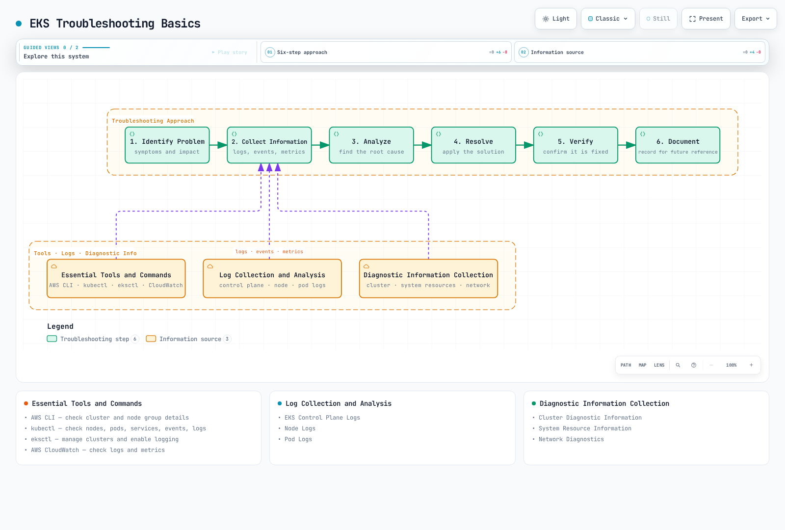

# Amazon EKS Troubleshooting

> **Última actualización**: 12 de septiembre de 2026

Al operar clusters de Amazon EKS pueden surgir distintos problemas. Este documento describe problemas habituales en los clusters de EKS y cómo investigarlos y resolverlos.

## Table of Contents

1. [Conceptos básicos para solucionar problemas](#troubleshooting-basics)
2. [Problemas de creación y administración del clúster](#cluster-creation-and-management-issues)
3. [Problemas de red](#networking-issues)
4. [Problemas de nodos y Pods](#node-and-pod-issues)
5. [Problemas de IAM y autenticación](#iam-and-authentication-issues)
6. [Problemas de almacenamiento](#storage-issues)
7. [Problemas de registros y supervisión](#logging-and-monitoring-issues)
8. [Problemas de rendimiento](#performance-issues)
9. [Problemas de actualización](#upgrade-issues)
10. [Mensajes de error comunes y soluciones](#common-error-messages-and-solutions)

## Troubleshooting Basics



[🔍 Ver diagrama interactivo](https://www.atomai.click/kubernetes-docs/archmaps/en-eks-09-eks-troubleshooting-0.html)

### Troubleshooting Approach

1. Identifica el síntoma, los usuarios o las cargas de trabajo afectados y el intervalo del incidente.
2. Antes de cambiar recursos, recopila el estado, los registros, los eventos y las métricas pertinentes.
3. Contrasta las hipótesis con la evidencia; no tomes un error genérico como causa demostrada.
4. Aplica una corrección acotada y bajo responsabilidad definida, con efectos conocidos sobre los datos y la disponibilidad.
5. Verifica la recuperación mediante el comportamiento de la aplicación y las métricas, no solo por el código de salida del comando.
6. Registra la causa, los cambios, los resultados, la incertidumbre pendiente y las medidas preventivas.

Los comandos de este capítulo son plantillas para un entorno revisado, no un script que deba ejecutarse de principio a fin. Consultar un recurso, crear una carga de depuración, reiniciar un componente y eliminar infraestructura tienen efectos distintos. Para esta revisión no se ejecutaron operaciones en AWS ni Kubernetes.

### Essential Tools and Commands

En un cluster **existente**, define la cuenta, la región, el cluster y el contexto de kubectl previstos, y comprueba que coincidan. No deduzcas el nombre del cluster a partir de un alias de contexto arbitrario. Si la creación falló antes de que hubiera un cluster utilizable, usa en cambio la cuenta, la región y la evidencia de la solicitud o stack original que se describe en la sección de creación.

```bash
set -euo pipefail
: "${AWS_REGION:?Set the intended Region}"
: "${CLUSTER_NAME:?Set the existing cluster name}"
: "${EXPECTED_ACCOUNT_ID:?Set the intended 12-digit account ID}"
: "${KUBE_CONTEXT:?Set the explicit kubectl context}"
ACTUAL_ACCOUNT_ID=$(aws sts get-caller-identity --query Account --output text)
if [ "$ACTUAL_ACCOUNT_ID" != "$EXPECTED_ACCOUNT_ID" ]; then
  echo "Account mismatch" >&2; exit 1
fi
CLUSTER_ENDPOINT=$(aws eks describe-cluster --name "$CLUSTER_NAME" --region "$AWS_REGION" \
  --query cluster.endpoint --output text)
KUBE_ENDPOINT=$(kubectl config view --context "$KUBE_CONTEXT" --minify \
  -o jsonpath='{.clusters[0].cluster.server}')
if [ "$CLUSTER_ENDPOINT" != "$KUBE_ENDPOINT" ]; then
  echo "kubectl context does not match the selected EKS cluster" >&2; exit 1
fi
export AWS_REGION CLUSTER_NAME EXPECTED_ACCOUNT_ID KUBE_CONTEXT
```

#### AWS CLI and eksctl

```bash
aws eks describe-cluster --name "$CLUSTER_NAME" --region "$AWS_REGION" \
  --query 'cluster.{arn:arn,status:status,version:version,health:health,access:accessConfig}'
aws eks list-nodegroups --cluster-name "$CLUSTER_NAME" --region "$AWS_REGION"
aws eks list-addons --cluster-name "$CLUSTER_NAME" --region "$AWS_REGION"
eksctl get nodegroup --cluster "$CLUSTER_NAME" --region "$AWS_REGION"
```

Estos comandos enumeran los grupos de nodos administrados y los complementos de EKS instalados, pero no todos los controladores autoadministrados ni todos los recursos de cómputo. Identifica al responsable real y el tipo de cómputo antes de elegir un procedimiento.

#### kubectl

```bash
kubectl --context "$KUBE_CONTEXT" get nodes -o wide
kubectl --context "$KUBE_CONTEXT" get pods -A -o wide
kubectl --context "$KUBE_CONTEXT" get services -A
kubectl --context "$KUBE_CONTEXT" get events -A --sort-by='.metadata.creationTimestamp'
: "${NAMESPACE:?}"; : "${POD_NAME:?}"
kubectl --context "$KUBE_CONTEXT" -n "$NAMESPACE" describe pod "$POD_NAME"
```

Indica explícitamente el namespace, el Pod, el contenedor y el nodo afectados. La salida de `describe` y los registros de la aplicación pueden contener información operativa sensible. `kubectl auth can-i` comprueba la autorización para una acción concreta; `aws sts get-caller-identity` identifica las credenciales de AWS. Ninguno de los dos demuestra por sí solo que haya acceso de red ni que se disponga de todos los permisos de Kubernetes.

### Log Collection and Analysis

#### EKS Control Plane Logs

Comprueba la configuración de registro existente y limita la consulta al intervalo del incidente:

```bash
set -euo pipefail
: "${CLUSTER_NAME:?}"; : "${AWS_REGION:?}"
: "${START_TIME_MS:?Set the incident-window start in epoch milliseconds}"
: "${END_TIME_MS:?Set the incident-window end in epoch milliseconds}"
aws eks describe-cluster --name "$CLUSTER_NAME" --region "$AWS_REGION" \
  --query cluster.logging --output json
aws logs filter-log-events --region "$AWS_REGION" \
  --log-group-name "/aws/eks/$CLUSTER_NAME/cluster" \
  --start-time "$START_TIME_MS" --end-time "$END_TIME_MS" \
  --max-items 200 --output json --no-cli-pager
```

Habilitar los registros del plano de control es un cambio `UpdateClusterConfig` separado, con su propio ID de actualización, permisos y cargos de CloudWatch. No recupera registros anteriores ni habilita la recopilación de registros de aplicaciones o del host. La ausencia del grupo, una solicitud denegada o un intervalo vacío indican una limitación de visibilidad. Para registros de aplicaciones o del host, consulta `/aws/containerinsights/<cluster>/...` o el destino real del colector.

#### Node Logs

En un nodo Linux EC2 estándar al que el operador pueda acceder, verifica `spec.providerID`, la cuenta, la región y los requisitos previos de SSM antes de abrir una sesión:

```bash
: "${INSTANCE_ID:?Verify the node EC2 ProviderID and account/Region first}"
aws ssm start-session --target "$INSTANCE_ID" --region "$AWS_REGION"
```

Ejecuta lo siguiente **dentro de la sesión del nodo**, no en el terminal local. Estos ejemplos de systemd y containerd presuponen que la imagen del nodo incluye esas herramientas; Bottlerocket, Fargate y Auto Mode requieren sus vías de diagnóstico compatibles.

```bash
sudo journalctl -u kubelet --since "15 minutes ago" --no-pager
sudo journalctl -u containerd --since "15 minutes ago" --no-pager
df -h
df -i
free -m
```

Los nodos Linux optimizados para EKS usan containerd. El registro del daemon de Docker no es el registro del runtime de kubelet en esos nodos. Conserva evidencia de registros, disco e inodos antes de podar imágenes, depurar journals o reiniciar componentes. La ausencia de métricas de `kubectl top` en un nodo con problemas no demuestra por sí sola agotamiento de CPU o memoria.

#### Pod Logs

```bash
set -euo pipefail
: "${KUBE_CONTEXT:?}"; : "${NAMESPACE:?}"; : "${POD_NAME:?}"; : "${CONTAINER_NAME:?}"
kubectl --context "$KUBE_CONTEXT" -n "$NAMESPACE" logs "$POD_NAME" \
  -c "$CONTAINER_NAME" --since=15m --tail=200 --timestamps=true
# Run only when a previous container instance exists in this same Pod.
kubectl --context "$KUBE_CONTEXT" -n "$NAMESPACE" logs "$POD_NAME" \
  -c "$CONTAINER_NAME" --previous --tail=200 --timestamps=true
```

`--previous` se refiere a la instancia anterior ya terminada del contenedor indicado dentro del **mismo Pod**. No recupera los registros de un Pod predecesor eliminado; para el historial retenido, consulta el backend de registros. Revisa el estado, la disponibilidad y los motivos de salida de los contenedores normales y de inicialización.

### Diagnostic Information Collection

```bash
set -euo pipefail
: "${EVIDENCE_PARENT:?Set an existing private directory}"
: "${KUBE_CONTEXT:?}"; : "${NAMESPACE:?}"
umask 077
EVIDENCE_DIR=$(mktemp -d "$EVIDENCE_PARENT/eks-diagnosis.XXXXXXXX")
kubectl --context "$KUBE_CONTEXT" get nodes -o wide > "$EVIDENCE_DIR/nodes.txt"
kubectl --context "$KUBE_CONTEXT" -n "$NAMESPACE" get pods -o wide > "$EVIDENCE_DIR/pods.txt"
kubectl --context "$KUBE_CONTEXT" -n "$NAMESPACE" get services -o wide > "$EVIDENCE_DIR/services.txt"
kubectl --context "$KUBE_CONTEXT" -n "$NAMESPACE" get events \
  --sort-by='.metadata.creationTimestamp' > "$EVIDENCE_DIR/events.txt"
printf 'Evidence saved to %s; assess the findings before remediation.\n' "$EVIDENCE_DIR"
```

Si una consulta falla, este ejemplo se detiene; los archivos existentes solo contienen evidencia parcial. Evita ejecutar `cluster-info dump` sin alcance o describir todos los Pods cuando basta un inventario acotado. Antes de compartir la evidencia, revísala y elimina los datos sensibles.

Para investigar presión de recursos, compara solicitudes y límites, recursos asignables del nodo y `kubectl top` cuando Metrics Server esté disponible. En nodos accesibles, comprueba tanto `df -h` como `df -i`: disponer de bytes libres no descarta el agotamiento de inodos. Un Pod de depuración de nodo tiene su propio sistema de archivos raíz, mientras que la raíz del host se monta en `/host`; ejecutar `df -h` sin indicar la ruta prevista puede consultar el sistema de archivos equivocado. Crear ese Pod requiere revisar el namespace, la imagen, el perfil de depuración, los permisos y la limpieza posterior.

Para diagnosticar la red, identifica el Pod, namespace y nodo de origen, el destino, el protocolo y el puerto. Primero revisa las políticas aplicables y el resolvedor usado por el origen. Un Pod de depuración nuevo puede tener labels, identidad, DNS o rutas diferentes de la carga afectada. Un ping por ICMP no demuestra que la aplicación sea accesible por TCP o UDP. Haz una prueba acotada por la ruta realmente permitida y prepara las herramientas y la limpieza con su responsable; evita crear repetidamente Pods `dnsutils` o `netshoot` sin fijar imagen y nombre.

Fuentes: [solución de problemas de EKS](https://docs.aws.amazon.com/eks/latest/userguide/troubleshooting.html), [registros de Kubernetes](https://kubernetes.io/docs/reference/kubectl/generated/kubectl_logs/), [depuración de nodos](https://kubernetes.io/docs/tasks/debug/debug-cluster/kubectl-node-debug/).

## Cluster Creation and Management Issues


[🔍 Ver diagrama interactivo](https://www.atomai.click/kubernetes-docs/archmaps/en-eks-09-eks-troubleshooting-1.html)

### Cluster Creation Failure

#### Common Causes

Revisa la solicitud fallida exacta o el evento de CloudFormation en busca de permisos del solicitante, confianza o políticas del rol de servicio del cluster, cuotas, selección de subredes/AZ admitidas, capacidad de direcciones IP, conflictos de nombres o disponibilidad del servicio. Son hipótesis: su probabilidad depende del error real.

#### Troubleshooting Steps

```bash
set -euo pipefail
: "${AWS_REGION:?}"; : "${CLUSTER_ROLE_NAME:?}"; : "${VPC_ID:?}"
aws sts get-caller-identity
aws iam get-role --role-name "$CLUSTER_ROLE_NAME" \
  --query 'Role.{Arn:Arn,Trust:AssumeRolePolicyDocument}'
aws iam list-attached-role-policies --role-name "$CLUSTER_ROLE_NAME"
aws iam list-role-policies --role-name "$CLUSTER_ROLE_NAME"
aws ec2 describe-subnets --region "$AWS_REGION" --filters "Name=vpc-id,Values=$VPC_ID" \
  --query 'Subnets[].{Id:SubnetId,AZ:AvailabilityZone,AZId:AvailabilityZoneId,AvailableIPs:AvailableIpAddressCount,CIDR:CidrBlock}'
aws service-quotas list-service-quotas --service-code eks --region "$AWS_REGION"
aws cloudtrail lookup-events --region "$AWS_REGION" \
  --lookup-attributes AttributeKey=EventName,AttributeValue=CreateCluster \
  --max-items 20 --output json
```

Las políticas adjuntas por sí solas no muestran los permisos efectivos del solicitante: incluye políticas insertadas, límites de permisos, políticas de sesión y controles de AWS Organizations. `AmazonEKSClusterPolicy` corresponde al rol de servicio del cluster de EKS; adjuntarla a un usuario humano no concede los permisos necesarios `eks:CreateCluster` o `iam:PassRole`, ni acceso a Kubernetes. La creación del rol vinculado al servicio también tiene sus propios permisos y ciclo de vida.

Para revisar la red, usa las subredes seleccionadas para el cluster y examina sus rutas, grupos de seguridad y NACL exactos. Los requisitos de subredes del plano de control y la capacidad de direcciones para nodos, Pods y balanceadores son asuntos distintos. Los clusters privados pueden usar los endpoints de servicio necesarios sin NAT Gateway ni acceso general a Internet. La etiqueta `kubernetes.io/cluster/...` no es una solución universal para crear el plano de control.

Ante un error de cuota, identifica el servicio y la cuota indicados y consulta el límite aplicado actual antes de solicitar un aumento. Las cuotas de clusters de EKS, vCPU/familia de instancias EC2 y límites de VPC son diferentes. Mensajes históricos como «límite de 5» son ejemplos, no indican el límite actual de la cuenta.

#### Common Solutions

Corrige el permiso, la relación de confianza del rol de servicio, la selección de subredes, la asignación de IP o la cuota concreta con el responsable de infraestructura; después, revisa si corresponde reintentar. `UnsupportedAvailabilityZoneException` significa que una subred especificada para el cluster pertenece a una AZ donde EKS no está disponible para esa cuenta; usa las AZ admitidas que indique la excepción. No se diagnostica solo consultando los tipos de instancia disponibles en EC2.

Comprueba AWS Health para detectar un evento del servicio. Cambiar de región implica un diseño distinto de ubicación, datos y red, y puede requerir otro cluster; no es el reintento predeterminado para diagnosticar el fallo. `eksctl create cluster --verbose ...` y las opciones de depuración de AWS CLI siguen ejecutando la creación. Antes de enviar otra solicitud de aprovisionamiento, usa los eventos del stack existente y el ID de solicitud.

### Cluster Endpoint Access Issues

#### Diagnose DNS, transport, TLS, authentication and authorization separately

Revisa el modo del endpoint, los CIDR públicos permitidos y el grupo de seguridad del cluster; luego haz una prueba con la CA del cluster y un tiempo límite:

```bash
set -euo pipefail
: "${CLUSTER_NAME:?}"; : "${AWS_REGION:?}"; : "${EVIDENCE_PARENT:?}"
umask 077
ENDPOINT_DIR=$(mktemp -d "$EVIDENCE_PARENT/eks-endpoint.XXXXXXXX")
aws eks describe-cluster --name "$CLUSTER_NAME" --region "$AWS_REGION" \
  --output json > "$ENDPOINT_DIR/cluster.json"
jq -er '.cluster.certificateAuthority.data' "$ENDPOINT_DIR/cluster.json" \
  | base64 --decode > "$ENDPOINT_DIR/cluster-ca.crt"
ENDPOINT=$(jq -er '.cluster.endpoint' "$ENDPOINT_DIR/cluster.json")
jq '.cluster.resourcesVpcConfig | {endpointPublicAccess,endpointPrivateAccess,publicAccessCidrs,clusterSecurityGroupId,vpcId}' \
  "$ENDPOINT_DIR/cluster.json"
curl --silent --show-error --connect-timeout 5 --max-time 10 \
  --cacert "$ENDPOINT_DIR/cluster-ca.crt" --output /dev/null \
  --write-out 'HTTP status: %{http_code}\n' "$ENDPOINT"
```

Esta solicitud no envía un token bearer de Kubernetes. Una respuesta 401/403 puede demostrar que DNS, TCP y TLS funcionan aunque el acceso esté denegado; una respuesta HTTP satisfactoria no demuestra que la aplicación esté sana. `curl -k` ocultaría errores de validación del certificado. Si necesitas consultar DNS, usa el nombre de host de la URL del endpoint; no pases una URL `https://` a `nslookup`.

Para un endpoint público, compara la dirección de salida/NAT real del cliente con los CIDR permitidos. Para uno privado, revisa la ruta desde la VPC o la red conectada, la resolución DNS y el acceso del grupo de seguridad. El endpoint de interfaz `com.amazonaws.<region>.eks` sirve para las **API de administración de EKS**, no para el servidor API de Kubernetes. Habilitarlo por sí solo no corrige el acceso de kubectl. El endpoint privado de Kubernetes del cluster es independiente.

#### kubeconfig and permissions

Inspecciona el nombre del contexto y el servidor sin imprimir credenciales sin procesar. Para crear un kubeconfig de diagnóstico separado, define una ruta y un alias explícitos; asigna a `NAMESPACE` el ámbito de autorización previsto:

```bash
set -euo pipefail
: "${CLUSTER_NAME:?}"; : "${AWS_REGION:?}"
: "${NAMESPACE:?Set the namespace for the authorization check}"
: "${DIAGNOSTIC_KUBECONFIG:?Set a separate writable kubeconfig path}"
: "${KUBE_CONTEXT:?Choose an explicit alias for this cluster}"
umask 077
aws eks update-kubeconfig --name "$CLUSTER_NAME" --region "$AWS_REGION" \
  --kubeconfig "$DIAGNOSTIC_KUBECONFIG" --alias "$KUBE_CONTEXT"
export KUBECONFIG="$DIAGNOSTIC_KUBECONFIG"
kubectl --context "$KUBE_CONTEXT" auth can-i get pods --namespace "$NAMESPACE"
```

Crear un kubeconfig requiere `eks:DescribeCluster`; la autenticación y autorización de Kubernetes son requisitos separados. Si asumes un rol, usa el `--role-arn` revisado y sus permisos de confianza/STS. Renueva las credenciales mediante el proveedor real de credenciales (por ejemplo, la sesión SSO configurada), en vez de imprimir tokens de sesión.

```bash
set -euo pipefail
: "${CLUSTER_NAME:?}"; : "${AWS_REGION:?}"
aws eks describe-cluster --name "$CLUSTER_NAME" --region "$AWS_REGION" \
  --query 'cluster.accessConfig'
# Use the next command when API or API_AND_CONFIG_MAP authentication is enabled.
aws eks list-access-entries --cluster-name "$CLUSTER_NAME" --region "$AWS_REGION"
```

Si está habilitada la autenticación mediante access entries, inspecciona la entrada pertinente y el ámbito de las políticas asociadas. Los clusters heredados `CONFIG_MAP` o mixtos también pueden usar `aws-auth`; conserva las asignaciones de nodos existentes y sigue una migración planificada. No concedas `system:masters` ni sobrescribas todo el ConfigMap como arreglo genérico. El proveedor IAM OIDC de IRSA entrega credenciales de AWS a cargas de trabajo; no asigna a una identidad humana de IAM permisos de Kubernetes.

#### Correct the access path

Usa una ruta administrativa privada conectada o una lista revisada de CIDR públicos apropiada para el modo del endpoint. No abras `0.0.0.0/0` solo para que funcione un comando de diagnóstico. Prueba la ruta privada antes de quitar el acceso público, conserva las opciones de VPC no relacionadas y registra el ID de actualización de configuración. Para un cambio planificado, sigue el [procedimiento de endpoint del capítulo de seguridad](./05-eks-security.md).

#### One-click CloudShell access

La función de acceso con un clic, anunciada el 30 de abril de 2026, está disponible. Elige **Connect** en los detalles del cluster para abrir CloudShell con kubectl configurado. Admite endpoints de API públicos y privados; si el endpoint es privado, inicia automáticamente un entorno CloudShell de VPC y solicita su nombre. La función no tiene un cargo adicional y está disponible en las regiones de EKS.

La ruta de consola aún requiere los permisos de IAM, CloudShell y entorno de VPC correspondientes, acceso a Kubernetes y una configuración de red funcional. Evita la configuración local, pero no las comprobaciones de autorización. Antes de ejecutar comandos, revisa los cargos aplicables por recursos o transferencia de datos y la identidad de la sesión.

Fuentes: [kubeconfig y CloudShell](https://docs.aws.amazon.com/eks/latest/userguide/create-kubeconfig.html), [anuncio de acceso con un clic](https://aws.amazon.com/about-aws/whats-new/2026/04/amazon-eks-one-click-cluster-access/), [distinción de EKS PrivateLink](https://docs.aws.amazon.com/eks/latest/userguide/vpc-interface-endpoints.html), [solución de problemas de clusters](https://docs.aws.amazon.com/eks/latest/userguide/troubleshooting.html).

### Cluster Deletion Issues

#### Identify the blocking dependency

Eliminar un cluster es un desmantelamiento deliberado, no una medida general para solucionar problemas. Lee el error exacto de EKS/CloudFormation, el ARN, la cuenta y región del cluster, el estado de actualización y la configuración de protección contra eliminación. Además de los grupos de nodos administrados y perfiles Fargate, pueden impedir la eliminación la protección y las EKS Capabilities instaladas. Conserva los roles IAM y de servicio del cluster hasta que la eliminación termine.

Inventaría el cluster seleccionado y compara su endpoint con el contexto explícito de kubectl. Los siguientes comandos son de solo lectura y no seleccionan recursos para eliminarlos automáticamente:

```bash
set -euo pipefail
: "${CLUSTER_NAME:?Set the cluster being deliberately retired}"
: "${AWS_REGION:?}"; : "${KUBE_CONTEXT:?}"; : "${EXPECTED_ACCOUNT_ID:?}"
ACTUAL_ACCOUNT_ID=$(aws sts get-caller-identity --query Account --output text)
if [ "$ACTUAL_ACCOUNT_ID" != "$EXPECTED_ACCOUNT_ID" ]; then
  echo "Account mismatch; stop" >&2
  exit 1
fi
aws eks describe-cluster --name "$CLUSTER_NAME" --region "$AWS_REGION" \
  --query 'cluster.{arn:arn,status:status,deletionProtection:deletionProtection,endpoint:endpoint}'
kubectl config view --context "$KUBE_CONTEXT" --minify \
  -o jsonpath='{.clusters[0].cluster.server}{"\n"}'
# Compare the endpoints before inspecting Kubernetes resources.
kubectl --context "$KUBE_CONTEXT" get services -A \
  -o custom-columns='NAMESPACE:.metadata.namespace,NAME:.metadata.name,TYPE:.spec.type,CLASS:.spec.loadBalancerClass,ADDRESS:.status.loadBalancer.ingress'
kubectl --context "$KUBE_CONTEXT" get ingress -A
kubectl --context "$KUBE_CONTEXT" get pvc -A
kubectl --context "$KUBE_CONTEXT" get pv \
  -o custom-columns='NAME:.metadata.name,CLAIM_NS:.spec.claimRef.namespace,CLAIM:.spec.claimRef.name,RECLAIM:.spec.persistentVolumeReclaimPolicy,DRIVER:.spec.csi.driver,HANDLE:.spec.csi.volumeHandle'
aws eks list-nodegroups --cluster-name "$CLUSTER_NAME" --region "$AWS_REGION"
aws eks list-fargate-profiles --cluster-name "$CLUSTER_NAME" --region "$AWS_REGION"
aws eks list-capabilities --cluster-name "$CLUSTER_NAME" --region "$AWS_REGION"
aws eks list-addons --cluster-name "$CLUSTER_NAME" --region "$AWS_REGION"
```

La salida `EXTERNAL-IP` de un Service no demuestra por sí sola quién es su propietario: distingue los Services `LoadBalancer` administrados por un controlador, las IP externas configuradas manualmente y otros tipos de Service. Registra namespace/nombre/UID, controlador propietario, ARN del recurso de AWS y etiquetas pertinentes. Incluye Ingress y recursos Gateway/TargetGroupBinding si están instalados sus controladores, y averigua si se comparten los destinos o balanceadores.

#### Retire resources in the owner's sequence

1. Migra el tráfico y las cargas de trabajo; verifica que las copias de seguridad y la restauración sean coherentes con la aplicación y respeta los requisitos de retención de datos. Guardar el YAML de un PVC no es una copia de seguridad de los datos. Una política de recuperación `Delete` puede eliminar el almacenamiento al borrar el claim; `Retain` requiere una decisión independiente sobre los datos y el almacenamiento.
2. Mientras sigan ejecutándose los controladores de balanceadores necesarios, elimina solo los recursos de Kubernetes revisados que sean propietarios de balanceadores. Espera a que se procesen los finalizers y verifica que se hayan liberado los recursos de AWS correspondientes. Resuelve los errores IAM o las dependencias del controlador antes de eliminar sus nodos. No retires finalizers solo para ocultar una limpieza fallida.
3. Retira las EKS Capabilities conforme a la semántica documentada de propiedad y eliminación de recursos. Elimina los grupos de nodos administrados y perfiles Fargate en un orden revisado, y espera a que finalicen. Los nodos y stacks autoadministrados requieren su propio desmantelamiento. Eliminar un complemento también puede retirar componentes de Kubernetes; conserva los controladores de red y almacenamiento hasta que terminen las limpiezas que dependen de ellos.
4. Deshabilita la protección contra eliminación solo como parte explícita del desmantelamiento y elimina el cluster mediante su propietario original de infraestructura. Al eliminar un cluster de Auto Mode también se eliminan los nodos y balanceadores que administra; ten en cuenta ese alcance y el ciclo de vida de los grupos de destino de TargetGroupBinding integrado.
5. Revisa los recursos restantes según su propietario exacto: stacks/VPC dedicados, volúmenes y snapshots, balanceadores, recursos IAM, registros y scrapers de Prometheus. Los recursos compartidos y los datos retenidos tienen ciclos de vida independientes y pueden seguir generando cargos.

Por ejemplo, el comando siguiente elimina **un** Service seleccionado explícitamente después de revisar el tráfico y los datos. No es un bucle que descubre y elimina recursos:

```bash
set -euo pipefail
: "${KUBE_CONTEXT:?}"; : "${SERVICE_NAMESPACE:?}"; : "${SERVICE_NAME:?}"
# Separate approved teardown step after traffic/data migration and owner review.
kubectl --context "$KUBE_CONTEXT" -n "$SERVICE_NAMESPACE" get service "$SERVICE_NAME" -o yaml
kubectl --context "$KUBE_CONTEXT" -n "$SERVICE_NAMESPACE" delete service "$SERVICE_NAME" \
  --wait=true --timeout=10m
```

Un timeout no demuestra que el balanceador de AWS se conservara o eliminara; inspecciona los finalizers, los eventos del controlador y el ARN exacto de AWS. La limpieza de Kubernetes y AWS puede concluir en momentos distintos.

#### Deletion errors and force behavior

Usa los detalles de actualización de EKS y los eventos del stack de CloudFormation para detectar fallos de dependencias, autorización u operaciones en curso. En eksctl 0.229, `delete cluster --force` es una opción válida que permite continuar la eliminación cuando hay errores. No demuestra que la limpieza haya concluido ni determina con seguridad quién posee un recurso huérfano. `--disable-nodegroup-eviction` evita por separado las comprobaciones de PDB al usar la eliminación. Ninguna opción es la respuesta predeterminada a un incidente.

No canalices un listado de ELB/ELBv2 de toda la cuenta y región hacia comandos de eliminación, ni borres todos los Services, PVC o namespaces para resolver un error de dependencia. Si es necesario retirar manualmente un recurso huérfano, establece primero su cluster/stack propietario exacto y el impacto en datos y tráfico; después sigue el procedimiento revisado para ese servicio.

Fuentes: [eliminación de clusters de EKS](https://docs.aws.amazon.com/eks/latest/userguide/delete-cluster.html), [diagnóstico de problemas de eliminación](https://repost.aws/knowledge-center/eks-delete-cluster-issues), [ciclo de vida de volúmenes persistentes](https://kubernetes.io/docs/concepts/storage/persistent-volumes/).

## Networking Issues


[🔍 Ver diagrama interactivo](https://www.atomai.click/kubernetes-docs/archmaps/en-eks-09-eks-troubleshooting-2.html)

Identifica primero el plano de cómputo y de datos real. Los nodos EC2 estándar con VPC CNI de código abierto, Fargate y Auto Mode no usan los mismos agentes ni configuración. Para Auto Mode, usa los controles de red de su `NodeClass`; modificar el DaemonSet `aws-node` o `ENIConfig` no configura sus nodos.

### Pod-to-Pod Communication Issues

#### Trace the failing path

Registra el Pod, namespace y nodo/AZ de origen, el destino, la familia IP, el protocolo y el puerto de destino. Compara el comportamiento en el mismo nodo y entre nodos cuando una prueba aprobada permita aislar esa diferencia. Evalúa la política, los grupos de seguridad, rutas/NACL, estado de CNI, asignación de IP y MTU de la ruta real.

```bash
set -euo pipefail
: "${KUBE_CONTEXT:?}"; : "${NAMESPACE:?}"; : "${POD_NAME:?}"
kubectl --context "$KUBE_CONTEXT" -n "$NAMESPACE" get pod "$POD_NAME" -o wide
kubectl --context "$KUBE_CONTEXT" -n "$NAMESPACE" get pod "$POD_NAME" \
  -o jsonpath='{.metadata.labels}{"\n"}{.spec.nodeName}{"\n"}{.spec.hostNetwork}{"\n"}'
kubectl --context "$KUBE_CONTEXT" get namespace "$NAMESPACE" --show-labels
kubectl --context "$KUBE_CONTEXT" -n "$NAMESPACE" get networkpolicies
kubectl --context "$KUBE_CONTEXT" -n "$NAMESPACE" get events \
  --sort-by='.metadata.creationTimestamp'
```

Las NetworkPolicies estándar `networking.k8s.io/v1` suman las reglas de tráfico permitido: no tienen prioridades ni una regla de «gana la última política». Si ambos extremos están aislados, deben permitir el flujo tanto la salida del origen como la entrada del destino. Las API de políticas administrativas/de cluster y los motores de políticas de proveedores tienen semánticas distintas. Comprueba las etiquetas de namespace y si `namespaceSelector` y `podSelector` pertenecen al mismo peer (AND) o a peers separados (OR).

VPC CNI permite aplicar políticas de red nativas; no instales Calico/Cilium solo porque no veas un Pod de un complemento de terceros. Verifica que la plataforma, la versión de kernel y la configuración del agente de políticas sean compatibles y estén habilitadas. En el modo de inicio estándar, un Pod nuevo permite inicialmente el tráfico hasta que se configuran sus políticas; el modo estricto comienza en denegación y necesita las políticas requeridas para DNS y dependencias. Consulta la documentación de la implementación correspondiente para el comportamiento de host-network y otros límites de cobertura.

En una instalación estándar del VPC CNI, revisa, si está presente, el Pod `aws-node` y sus registros del contenedor `aws-network-policy-agent`. Que `kubectl get pods -l ...` devuelva una lista vacía no demuestra que haya un complemento instalado. Auto Mode usa en su lugar los controles de políticas integrados.

#### Correct only the intended flow

Revisa la matriz completa de flujos permitidos en vez de añadir reglas de entrada/salida que permitan todo el tráfico del namespace o eliminar políticas. Este ejemplo selecciona los Pods API del backend y permite solo tráfico TCP 8080 desde los Pods web del frontend:

```yaml
# Example ingress policy only: review both peers and the complete allowed-flow matrix.
apiVersion: networking.k8s.io/v1
kind: NetworkPolicy
metadata:
  name: api-from-web
  namespace: backend
spec:
  podSelector:
    matchLabels:
      app: api
  policyTypes:
    - Ingress
  ingress:
    - from:
        - namespaceSelector:
            matchLabels:
              kubernetes.io/metadata.name: frontend
          podSelector:
            matchLabels:
              app: web
      ports:
        - protocol: TCP
          port: 8080
```

La aplicación de esta política puede aislar del resto del tráfico de entrada a los Pods backend seleccionados, salvo que otras políticas lo permitan. No configura la salida del cliente, DNS ni todas las dependencias. Compruébalos por separado con pruebas positivas y negativas. Usa los namespaces y labels reales de la carga de trabajo, no copies los nombres del ejemplo.

En los grupos de seguridad, inspecciona los grupos de las ENI de origen y destino, incluidos los grupos asociados a Pods y subredes personalizadas cuando corresponda. El responsable debe permitir el origen y puerto necesarios; no habilites todos los protocolos ni CIDR amplios como arreglo genérico. Valores MTU como 1500 o 9001 dependen de la ruta: mide el fallo y considera la encapsulación antes de cambiar CNI o reemplazar Pods.

### Service Access Issues

Revisa juntos el selector del Service, la disponibilidad real del Pod, las condiciones del endpoint y el mapeo de puertos:

```bash
set -euo pipefail
: "${KUBE_CONTEXT:?}"; : "${NAMESPACE:?}"; : "${SERVICE_NAME:?}"
SERVICE_JSON=$(kubectl --context "$KUBE_CONTEXT" -n "$NAMESPACE" get service "$SERVICE_NAME" -o json)
printf '%s\n' "$SERVICE_JSON" | jq '{metadata: {name: .metadata.name, namespace: .metadata.namespace}, spec: .spec, status: .status}'
SELECTOR=$(printf '%s\n' "$SERVICE_JSON" | jq -r '(.spec.selector // {}) | to_entries | map("\(.key)=\(.value)") | join(",")')
if [ -n "$SELECTOR" ]; then
  kubectl --context "$KUBE_CONTEXT" -n "$NAMESPACE" get pods -l "$SELECTOR" -o wide
  kubectl --context "$KUBE_CONTEXT" -n "$NAMESPACE" get pods -l "$SELECTOR" -o json \
    | jq '.items[] | {name:.metadata.name,phase:.status.phase,ready:[.status.conditions[]? | select(.type=="Ready")],containers:.status.containerStatuses}'
else
  printf 'No selector: inspect ExternalName or explicitly managed EndpointSlices as applicable.\n'
fi
kubectl --context "$KUBE_CONTEXT" -n "$NAMESPACE" get endpointslices \
  -l "kubernetes.io/service-name=$SERVICE_NAME" -o yaml
```

Usa EndpointSlices en vez de depender de la API Endpoints obsoleta. Revisa las condiciones `ready`, `serving` y `terminating`, y opciones del Service como `publishNotReadyAddresses`, `externalTrafficPolicy` e `internalTrafficPolicy`. Un Pod en estado Running no necesariamente está Ready.

Para un Service `ExternalName`, diagnostica el alias DNS en vez de esperar Pods seleccionados. En un Service headless, `clusterIP: None` es intencional. Los Services sin selector pueden usar EndpointSlices gestionados por su propietario. `port` puede diferir de `targetPort`; declarar un puerto en el contenedor no hace que la aplicación escuche en él.

Si las labels o los puertos son incorrectos, actualiza la plantilla propietaria del Service/Pod mediante la configuración de su release. Cambiar las labels de un Pod controlado no es duradero. Antes de aplicar un parche, revisa todos los puertos y los campos inmutables. No elimines y recrees el Service, cambies su ClusterIP ni reinicies todos los Pods kube-proxy sin diagnosticar la causa.

Compara la conectividad directa del Pod y del Service desde el mismo origen y con el mismo protocolo, solo cuando las políticas lo permitan. Confirma si el plano de datos es kube-proxy, una implementación alternativa o Auto Mode antes de inspeccionar iptables/nftables/eBPF. La ausencia de un Pod kube-proxy no siempre indica un fallo.

### Load Balancer Issues

Identifica al controlador mediante la clase del Service/Ingress, las anotaciones y la propiedad del recurso. AWS Load Balancer Controller estándar y EKS Auto Mode usan clases/API y reglas de ciclo de vida distintas. Para ese propietario, revisa eventos del controlador, selección de subredes, IAM, grupos de seguridad, registro de destinos y comprobaciones de estado.

Usa los ARN exactos del balanceador y grupo de destino asociados a la carga de trabajo:

```bash
set -euo pipefail
: "${AWS_REGION:?}"; : "${LOAD_BALANCER_ARN:?}"; : "${TARGET_GROUP_ARN:?}"
aws elbv2 describe-load-balancers --region "$AWS_REGION" \
  --load-balancer-arns "$LOAD_BALANCER_ARN"
aws elbv2 describe-tags --region "$AWS_REGION" \
  --resource-arns "$LOAD_BALANCER_ARN" "$TARGET_GROUP_ARN"
aws elbv2 describe-load-balancer-attributes --region "$AWS_REGION" \
  --load-balancer-arn "$LOAD_BALANCER_ARN"
aws elbv2 describe-target-groups --region "$AWS_REGION" \
  --target-group-arns "$TARGET_GROUP_ARN"
aws elbv2 describe-target-health --region "$AWS_REGION" \
  --target-group-arn "$TARGET_GROUP_ARN"
```

`describe-load-balancer-attributes` muestra atributos, no el estado operativo; `describe-load-balancers` sí incluye el estado. Revisa los códigos de motivo del estado del destino, el protocolo/puerto/ruta de comprobación de estado, el listener y las reglas de enrutamiento, además de la respuesta de la aplicación. Los destinos de tipo instancia suelen llegar a un nodo/NodePort; los de tipo IP llegan al puerto de destino del Pod. Las reglas de grupos de seguridad deben coincidir con la ruta real.

Las etiquetas de función de subred influyen en el descubrimiento automático; revisa el esquema público/interno, las tablas de rutas, las IP libres y la cobertura de AZ. Poner etiquetas de función pública e interna a las mismas subredes no es una solución. La selección explícita de subred y la versión del controlador pueden cambiar los requisitos de etiquetas. No abras a `0.0.0.0/0` los grupos de seguridad frontend/backend para eludir una comprobación de estado fallida.

Usa el esquema y tipo admitidos por el controlador propietario. Las anotaciones heredadas `aws-load-balancer-internal` o `aws-load-balancer-type: nlb` no son intercambiables con las clases actuales del controlador. Cambiar el propietario del controlador o el esquema del balanceador puede exigir un reemplazo planificado y migración de tráfico; cambiar una anotación no garantiza una conversión en el mismo recurso. Auto Mode no adopta balanceadores que ya administre el controlador autogestionado.

Eliminar un Service puede eliminar su balanceador, y exportar el YAML sin procesar del Service no constituye un plan completo de reversión de tráfico/datos. Crear un ALB manualmente no lo conecta automáticamente con un Service de Kubernetes. Antes del cambio, consulta las [guías de red](./03-eks-networking-part2.md) correspondientes al propietario elegido.

### DNS Issues

#### Inspect the resolver used by the affected Pod

```bash
set -euo pipefail
: "${KUBE_CONTEXT:?}"; : "${NAMESPACE:?}"; : "${POD_NAME:?}"; : "${CONTAINER_NAME:?}"
kubectl --context "$KUBE_CONTEXT" -n "$NAMESPACE" get pod "$POD_NAME" \
  -o jsonpath='{.spec.dnsPolicy}{"\n"}{.spec.dnsConfig}{"\n"}{.spec.hostNetwork}{"\n"}'
kubectl --context "$KUBE_CONTEXT" -n "$NAMESPACE" exec "$POD_NAME" \
  -c "$CONTAINER_NAME" -- cat /etc/resolv.conf
# Where this container actually includes nslookup, test the intended name.
: "${DNS_TEST_NAME:?Set the intended Service FQDN or reviewed external hostname}"
kubectl --context "$KUBE_CONTEXT" -n "$NAMESPACE" exec "$POD_NAME" \
  -c "$CONTAINER_NAME" -- nslookup "$DNS_TEST_NAME"
```

Si la imagen no incluye un shell o una herramienta DNS, eso es una limitación de las herramientas, no una consulta DNS fallida. Prepara un método de depuración revisado que conserve el contexto de red e identidad pertinente. Un Pod nuevo de depuración puede usar DNS o políticas diferentes.

En nodos estándar distintos de Auto Mode, inspecciona el Deployment/Service de CoreDNS instalado, su configuración y sus EndpointSlices:

```bash
kubectl --context "$KUBE_CONTEXT" -n kube-system get deployment coredns
kubectl --context "$KUBE_CONTEXT" -n kube-system get pods -l k8s-app=kube-dns -o wide
kubectl --context "$KUBE_CONTEXT" -n kube-system get service kube-dns
kubectl --context "$KUBE_CONTEXT" -n kube-system get endpointslices \
  -l kubernetes.io/service-name=kube-dns
kubectl --context "$KUBE_CONTEXT" -n kube-system get configmap coredns -o yaml
kubectl --context "$KUBE_CONTEXT" -n kube-system logs -l k8s-app=kube-dns \
  --all-containers=true --prefix=true --since=15m --tail=100
```

En los nodos de **Auto Mode**, CoreDNS se ejecuta como servicio del sistema del nodo. Un cluster íntegramente de Auto Mode puede funcionar sin el Deployment tradicional de CoreDNS. Un cluster mixto debe conservar ese Deployment para los nodos que no son de Auto Mode. No instales NodeLocal DNSCache ni reinicies un Deployment inexistente como solución para Auto Mode.

Distingue el nameserver del Pod, el upstream de CoreDNS/NodeLocal y el resolvedor de VPC. `169.254.20.10` es una dirección de NodeLocal DNSCache elegida con frecuencia, no el servidor DNS universal de VPC. Un resolvedor público como `8.8.8.8` no sustituye al DNS de las zonas de Service de Kubernetes ni al DNS privado de AWS.

```bash
set -euo pipefail
: "${AWS_REGION:?}"; : "${VPC_ID:?}"
aws ec2 describe-vpc-attribute --region "$AWS_REGION" --vpc-id "$VPC_ID" \
  --attribute enableDnsSupport
aws ec2 describe-vpc-attribute --region "$AWS_REGION" --vpc-id "$VPC_ID" \
  --attribute enableDnsHostnames
aws ec2 describe-vpcs --region "$AWS_REGION" --vpc-ids "$VPC_ID" \
  --query 'Vpcs[].{VpcId:VpcId,DhcpOptionsId:DhcpOptionsId}'
```

Usa `describe-vpc-attribute` para consultar los atributos DNS; no son campos que devuelva `describe-vpcs`. Consulta las opciones DHCP mediante el ID obtenido. No sustituyas la configuración DHCP de una VPC compartida sin revisar el efecto en las demás cargas de trabajo.

#### Apply a targeted DNS correction

Cuando corresponda, comprueba UDP y TCP en el puerto 53, la disponibilidad y configuración reales de CoreDNS, el acceso a servidores upstream, la política DNS y los parámetros de búsqueda personalizados. Por lo general, los Pods con `hostNetwork` necesitan `ClusterFirstWithHostNet` para usar el DNS del clúster; `dnsPolicy: None` requiere una configuración de resolución completa e intencional. Una política de salida que permita solo DNS también aísla el resto del tráfico saliente de los Pods seleccionados, salvo que otras políticas lo permitan.

Conserva las personalizaciones existentes de Corefile y usa el esquema de configuración admitido por el complemento. Antes de escalar o reiniciar CoreDNS, revisa las réplicas, los recursos, el PDB, la programación y quién administra el escalado. Registra el ID de actualización y comprueba la resolución DNS funcional; como primer paso, no elimines todos los Pods DNS ni instales una imagen «latest» elegida al azar.

### VPC CNI Issues

La inspección siguiente se aplica a **nodos EC2 estándar que usan el VPC CNI de código abierto**. Selecciona explícitamente el Pod del nodo afectado; `kubectl exec` no acepta un selector de labels.

```bash
set -euo pipefail
: "${KUBE_CONTEXT:?}"; : "${NODE_NAME:?}"
kubectl --context "$KUBE_CONTEXT" get node "$NODE_NAME" \
  -o jsonpath='{.spec.providerID}{"\n"}{.status.nodeInfo}{"\n"}{.status.allocatable.pods}{"\n"}'
kubectl --context "$KUBE_CONTEXT" -n kube-system get daemonset aws-node -o json \
  | jq '.spec.template.spec | {containers:[.containers[] | {name,image,args,env}],initContainers:[.initContainers[]? | {name,image,args,env}]}'
kubectl --context "$KUBE_CONTEXT" -n kube-system get pods \
  -l k8s-app=aws-node --field-selector "spec.nodeName=$NODE_NAME" -o wide
kubectl --context "$KUBE_CONTEXT" get pods -A \
  --field-selector "spec.nodeName=$NODE_NAME" -o wide
: "${AWS_NODE_POD:?Select the aws-node Pod on that exact node}"
kubectl --context "$KUBE_CONTEXT" -n kube-system logs "$AWS_NODE_POD" \
  -c aws-node --since=15m --tail=200
```

Inspecciona `configurationValues` del complemento, el entorno del DaemonSet y los recursos personalizados pertinentes. No supongas que un ConfigMap `aws-node` contiene todos los ajustes. `.spec.podCIDR` del nodo no es un inventario confiable de las direcciones de los Pods del VPC CNI; revisa las IP reales de los Pods, las ENI de EC2, los prefijos y las subredes.

```bash
set -euo pipefail
: "${AWS_REGION:?}"; : "${INSTANCE_ID:?Verify it from the selected node ProviderID}"
aws ec2 describe-instances --region "$AWS_REGION" --instance-ids "$INSTANCE_ID" \
  --query 'Reservations[].Instances[].{Id:InstanceId,Type:InstanceType,Subnet:SubnetId,SGs:SecurityGroups,ENIs:NetworkInterfaces}'
: "${SUBNET_ID:?Set the actual node or custom Pod subnet being investigated}"
aws ec2 describe-subnets --region "$AWS_REGION" --subnet-ids "$SUBNET_ID" \
  --query 'Subnets[].{Id:SubnetId,CIDR:CidrBlock,AvailableIPs:AvailableIpAddressCount}'
: "${INSTANCE_TYPE:?Set the selected instance type}"
aws ec2 describe-instance-types --region "$AWS_REGION" --instance-types "$INSTANCE_TYPE" \
  --query 'InstanceTypes[].{Type:InstanceType,Network:NetworkInfo}'
```

Si la introspección de IPAMD está habilitada, está disponible en el endpoint de introspección configurado para el nodo (normalmente en el loopback del puerto 61679). Usa un método de diagnóstico permitido para el nodo/agente y asegúrate de tener la herramienta necesaria; que la imagen del CNI no incluya curl no indica un fallo de IPAM.

#### Distinguish allocation constraints

- **Agotamiento o fragmentación de subredes:** compara las direcciones y los prefijos libres. La delegación de prefijos necesita instancias y configuración compatibles, además de bloques de prefijos contiguos disponibles; contar las IP libres no demuestra que se pueda asignar un /28.
- **Límites de ENI/IP de la instancia:** inspecciona `NetworkInfo` y las ENI existentes. Cambiar el mínimo, el máximo o el objetivo del grupo de nodos cambia la cantidad de nodos, no el tipo de instancia ni sus límites por instancia. Para cambiar la configuración de la instancia, usa un grupo nuevo revisado o la ruta admitida de actualización de la plantilla de lanzamiento original.
- **Redes personalizadas:** prepara la `ENIConfig` correspondiente, las subredes y los grupos de seguridad de los Pods, y la selección de nodos antes de habilitarla. Cambia de dónde proceden las ENI secundarias y las IP de los Pods; no crea capacidad ilimitada.
- **Objetivos de calentamiento:** `WARM_IP_TARGET` controla el margen de IP libres; `MINIMUM_IP_TARGET` establece un mínimo de IP asignadas en total. Estos parámetros prevalecen sobre el comportamiento de ENI de reserva según la documentación, y los objetivos de IP/mínimo también afectan al comportamiento de prefijos de reserva en modo de prefijos. Un mínimo sin margen positivo de IP de reserva puede impedir asignaciones posteriores. Calcula los valores según las cargas y el presupuesto de IP en vez de copiar ajustes arbitrarios de 1/2/5.
- **Identidad y responsabilidad:** inspecciona la identidad real del CNI —IRSA, Pod Identity o el rol de nodo aplicable— y la política IPv4/IPv6. Asociar una política CNI de IPv4 a todos los roles de nodo no es una solución universal.

Auto Mode usa controles de subred, grupos de seguridad y políticas en `NodeClass`; no admite estos parámetros de IP/ENI de reserva ni `ENIConfig`. Conserva su modelo de red administrado.

Aplica una versión/configuración del CNI revisada y gestionada por su responsable, siguiendo las versiones intermedias y el esquema de configuración admitidos. Usa la [guía de actualización](./08-eks-upgrades.md) para supervisar la actualización exacta del complemento y validar después la red. No sustituyas solo la imagen de un contenedor, sobrescribas la configuración a ciegas ni reinicies todas las cargas para ocultar fallos de asignación.

Fuentes: [configuración de políticas del VPC CNI](https://docs.aws.amazon.com/eks/latest/userguide/cni-network-policy-configure.html), [redes en Auto Mode](https://docs.aws.amazon.com/eks/latest/userguide/auto-networking.html), [redes personalizadas](https://docs.aws.amazon.com/eks/latest/best-practices/custom-networking.html), [configuración del CNI](https://github.com/aws/amazon-vpc-cni-k8s), [NetworkPolicy de Kubernetes](https://kubernetes.io/docs/concepts/services-networking/network-policies/), [EndpointSlices](https://kubernetes.io/docs/concepts/services-networking/endpoint-slices/).

## Node and Pod Issues


[🔍 Ver diagrama interactivo](https://www.atomai.click/kubernetes-docs/archmaps/en-eks-09-eks-troubleshooting-3.html)

### Node NotReady Issues

#### Inspect conditions and the actual node

`Ready=False` y `Ready=Unknown` requieren evidencias distintas: un kubelet/runtime con fallos puede reportar un error, mientras que la pérdida de latidos puede deberse a una desconexión o a que el nodo se detuvo. La presión de memoria, disco y PID son condiciones distintas y no siempre implican `NotReady`. Revisa los motivos y las horas de las condiciones, además de leases y eventos, en vez de deducir la causa de una sola etiqueta.

```bash
set -euo pipefail
: "${KUBE_CONTEXT:?}"; : "${NODE_NAME:?}"
NODE_JSON=$(kubectl --context "$KUBE_CONTEXT" get node "$NODE_NAME" -o json)
printf '%s\n' "$NODE_JSON" | jq '{name:.metadata.name,uid:.metadata.uid,labels:.metadata.labels,providerID:.spec.providerID,taints:.spec.taints,unschedulable:.spec.unschedulable,nodeInfo:.status.nodeInfo,conditions:.status.conditions,capacity:.status.capacity,allocatable:.status.allocatable}'
NODE_UID=$(printf '%s\n' "$NODE_JSON" | jq -er '.metadata.uid')
kubectl --context "$KUBE_CONTEXT" get events -A --field-selector "involvedObject.uid=$NODE_UID" \
  --sort-by='.metadata.creationTimestamp'
kubectl --context "$KUBE_CONTEXT" get pods -A --field-selector "spec.nodeName=$NODE_NAME" -o wide
```

Usa el ProviderID exacto para consultar EC2; buscar una IP de nodo con `grep` puede seleccionar un recurso equivocado. En grupos de nodos administrados, revisa el estado, la imagen/versión y la configuración de reparación:

```bash
set -euo pipefail
: "${CLUSTER_NAME:?}"; : "${AWS_REGION:?}"; : "${NODEGROUP_NAME:?}"
aws eks describe-nodegroup --cluster-name "$CLUSTER_NAME" --nodegroup-name "$NODEGROUP_NAME" \
  --region "$AWS_REGION" \
  --query 'nodegroup.{status:status,health:health,version:version,releaseVersion:releaseVersion,amiType:amiType,nodeRepairConfig:nodeRepairConfig,updateConfig:updateConfig,scalingConfig:scalingConfig}'
```

Cuando el acceso al nodo sea compatible, usa el procedimiento de sesión remota de la sección básica para revisar los journals de kubelet/containerd, la red, los bytes e inodos del disco y la memoria. Inspecciona las rutas configuradas de certificados y kubeconfig sin imprimir claves privadas. `kubeadm certs renew` no repara el plano de control administrado por EKS, y `eksctl replace nodegroup` no es un comando admitido de eksctl. AL2023 usa la configuración de nodeadm; no vuelvas a ejecutar la receta de AL2 `/etc/eks/bootstrap.sh` en todas las imágenes.

#### Recovery and automatic repair

Después de conservar la evidencia, elige una acción de recuperación con responsable definido. Reiniciar kubelet/containerd, reiniciar el nodo o reemplazarlo afecta a las cargas de trabajo y quizá no resuelva un problema persistente de IAM/red/bootstrap. La respuesta de la API de reinicio no significa que la instancia o kubelet estén listos; antes de quitar el cordón, verifica el mismo nodo/instancia y sus cargas de trabajo.

Para un reemplazo planificado, revisa la capacidad, los datos con estado, los PDB y quién administra el reemplazo; después drena un único nodo seleccionado con un timeout:

```bash
set -euo pipefail
: "${KUBE_CONTEXT:?Set the reviewed cluster context}"
: "${NODE_NAME:?Set one reviewed old node}"
kubectl --context "$KUBE_CONTEXT" get node "$NODE_NAME" -o wide
kubectl --context "$KUBE_CONTEXT" get node "$NODE_NAME" \
  -o jsonpath='{.spec.providerID}{"\n"}'
kubectl --context "$KUBE_CONTEXT" get pods --all-namespaces \
  --field-selector "spec.nodeName=$NODE_NAME" -o wide
# Stop on failure. Do not terminate the instance or delete the node group here.
kubectl --context "$KUBE_CONTEXT" drain "$NODE_NAME" --ignore-daemonsets --timeout=10m
```

Si el drenaje falla, no continúes con la terminación de EC2 ni descartes datos de `emptyDir` de manera predeterminada. Un nodo drenado parcialmente puede quedar acordonado. Los PDB cubren la ruta de eviction, no todos los fallos de infraestructura, terminaciones o reducciones del controlador. Para un reemplazo administrado, sigue el [procedimiento de actualización de nodos](./08-eks-upgrades.md) en vez de cambiar paquetes en el sitio.

La reparación automática de nodos de EKS es un mecanismo independiente y real. Auto Mode la habilita de forma predeterminada; los grupos de nodos administrados pueden habilitar `nodeRepairConfig`, y Karpenter tiene sus propios requisitos de función/configuración. La supervisión de nodos informa condiciones adicionales, pero detectarlas no habilita la reparación. La tabla de valores predeterminados actual contempla el reemplazo ante fallos persistentes de `Ready`, runtime, kernel, red y almacenamiento; `MemoryPressure` y `DiskPressure` **no tienen una acción de reparación predeterminada**. Los controles de umbral/paralelismo y de flota no saludable/ARC pueden detener acciones nuevas mientras continúan las que ya están en curso. No prometas que una Lambda personalizada, una etiqueta de ASG o `maxUnavailable` proporcionen automáticamente este comportamiento.

### Pod Not Running Issues

#### Read state, events and the owning controller

```bash
set -euo pipefail
: "${KUBE_CONTEXT:?}"; : "${NAMESPACE:?}"; : "${POD_NAME:?}"
POD_JSON=$(kubectl --context "$KUBE_CONTEXT" -n "$NAMESPACE" get pod "$POD_NAME" -o json)
printf '%s\n' "$POD_JSON" | jq '{
  name:.metadata.name,uid:.metadata.uid,owners:.metadata.ownerReferences,
  node:.spec.nodeName,serviceAccount:.spec.serviceAccountName,
  imagePullSecrets:.spec.imagePullSecrets,
  containers:[.spec.containers[] | {name,image,imagePullPolicy,resources}],
  initContainers:[.spec.initContainers[]? | {name,image,resources}],
  phase:.status.phase,reason:.status.reason,message:.status.message,
  conditions:.status.conditions,containerStatuses:.status.containerStatuses,
  initContainerStatuses:.status.initContainerStatuses
}'
POD_UID=$(printf '%s\n' "$POD_JSON" | jq -er '.metadata.uid')
kubectl --context "$KUBE_CONTEXT" -n "$NAMESPACE" get events \
  --field-selector "involvedObject.uid=$POD_UID" --sort-by='.metadata.creationTimestamp'
```

Usa el procedimiento de registros específico del contenedor descrito en la sección básica. `Pending`, `ContainerCreating`, espera de descarga de imagen, fallo del contenedor de inicialización, fallo de readiness, `OOMKilled` y backoff de reinicio describen problemas distintos. `CrashLoopBackOff` es el backoff tras fallos repetidos del contenedor; no es la causa raíz.

| Evidencia | Siguientes comprobaciones |
| --- | --- |
| Error al descargar la imagen | Registro/nombre/tag/digest/arquitectura, DNS/TLS/rutas del nodo, límites de solicitudes e identidad real usada para descargar |
| FailedScheduling | Solicitudes frente a capacidad asignable, cantidad de Pods, taints/afinidad/topología, cuota y restricciones del consumidor de PVC |
| FailedMount / attach | PVC/PV/StorageClass, CSI/identidad, zona de disponibilidad y asociación actual; consulta la sección de almacenamiento |
| OOMKilled / Evicted | Estado de terminación del contenedor, límites, presión del nodo e historial de uso; no supongas que hay una fuga de memoria |
| Forbidden / fallo de admisión | Actor exacto de la API, RBAC o política de admisión; añadir permisos para listar Pods no corrige el acceso al registro o sistema de archivos |

Cambiar `imagePullPolicy` a `Always` no corrige una imagen inexistente ni credenciales inválidas. Descargar la imagen con Docker en un portátil no verifica la ruta/identidad del nodo, y cargarla en Docker no la añade automáticamente al runtime containerd.

#### Registry credentials and workload changes

Para ECR privado, revisa la identidad real de ejecución del nodo/Fargate y la política del repositorio. IRSA/Pod Identity de la aplicación no es la identidad que descarga su imagen antes del inicio. La conectividad de red a ECR privado puede requerir acceso a ECR API/DKR y S3; un endpoint de ECR no proporciona acceso privado a registros arbitrarios.

Si el registro requiere un Secret para descargar imágenes, usa un archivo JSON Docker auth protegido y autónomo, con las credenciales correctas del registro. No imprimas `.dockerconfigjson` ni contraseñas en registros/argumentos de comandos; las referencias de un ayudante de credenciales del escritorio no son credenciales que kubelet pueda usar.

```bash
set -euo pipefail
: "${KUBE_CONTEXT:?}"; : "${NAMESPACE:?}"; : "${DEPLOYMENT_NAME:?}"
: "${PULL_SECRET_NAME:?Choose an application-specific secret name}"
: "${DOCKER_CONFIG_JSON:?Provide a protected registry auth JSON file}"
# Separate reviewed change; an existing Secret causes create to fail rather than replacing it.
kubectl --context "$KUBE_CONTEXT" -n "$NAMESPACE" create secret generic "$PULL_SECRET_NAME" \
  --type=kubernetes.io/dockerconfigjson \
  --from-file=".dockerconfigjson=$DOCKER_CONFIG_JSON"
PATCH=$(jq -n --arg name "$PULL_SECRET_NAME" \
  '{spec:{template:{spec:{imagePullSecrets:[{name:$name}]}}}}')
kubectl --context "$KUBE_CONTEXT" -n "$NAMESPACE" patch deployment "$DEPLOYMENT_NAME" \
  --type=strategic --patch "$PATCH"
kubectl --context "$KUBE_CONTEXT" -n "$NAMESPACE" rollout status \
  "deployment/$DEPLOYMENT_NAME" --timeout=5m
```

El Secret debe estar en el namespace del Pod. El parche estratégico a la plantilla de Pod combina las entradas de secretos por nombre e inicia un rollout controlado del Deployment; conserva la propiedad del release y el resto de sus parámetros. Por lo general, `imagePullSecrets` de un Pod existente no es un campo editable. Los valores predeterminados de ServiceAccount afectan a los Pods admitidos después del cambio; cambiar la ServiceAccount predeterminada de un namespace puede afectar cargas ajenas. Renueva las credenciales próximas a caducar mediante su responsable, en vez de borrar y recrear un Secret compartido según un temporizador.

Para otros cambios de configuración, corrige la plantilla declarada del controlador y observa el rollout/readiness. Borrar un Pod solo lo recrea si existe un controlador adecuado, y puede eliminar evidencia útil. Un Pod de depuración `--copy-to` puede duplicar los efectos secundarios de la aplicación; usa un método y una imagen de diagnóstico revisados, con permisos y limpieza explícitos, en lugar de instalar paquetes en una aplicación activa.

### Resource Constraint Issues

```bash
kubectl --context "$KUBE_CONTEXT" -n "$NAMESPACE" get resourcequotas,limitranges
kubectl --context "$KUBE_CONTEXT" -n "$NAMESPACE" get pods -o wide
kubectl --context "$KUBE_CONTEXT" -n "$NAMESPACE" top pods --containers
kubectl --context "$KUBE_CONTEXT" top nodes
```

Estos comandos de métricas requieren Metrics Server y acceso funcional a kubelet. El scheduler usa solicitudes de recursos y capacidad asignable del nodo, no el uso actual de `kubectl top`. Cuando corresponda, incluye contenedores de inicialización, overhead del Pod, almacenamiento efímero, recursos extendidos y límites de cantidad de Pods. Las cuotas de namespace y los LimitRange son restricciones distintas.

Reduce las solicitudes solo cuando las necesidades medidas de la carga lo justifiquen; reducir la solicitud de memoria no corrige `Insufficient pods` ni garantiza que un contenedor quepa dentro de su límite. Límites más altos pueden trasladar la presión al nodo. Resuelve primero el uso de disco/inodos e imágenes/sistema de archivos; no borres registros o cachés sin conservar la evidencia del incidente.

Aumentar el número de nodos no cambia la capacidad por instancia. En grupos administrados, coordina los valores deseados/mínimos/máximos con el autoscaler; reducir la configuración de escalado no respeta los PDB. Para cambiar el tipo de instancia, usa un grupo nuevo adecuado o la ruta admitida de plantilla/versión de lanzamiento original. No quites taints, afinidad ni restricciones de topología solo para que se programe un Pod.

### Autoscaling Issues

Distingue el escalado de réplicas (HPA), las recomendaciones/actualizaciones de recursos (VPA), el aprovisionamiento de nodos (CA, Karpenter o Auto Mode) y los cuellos de botella de la aplicación. Es normal que no haya un Pod de CA cuando otro aprovisionador de nodos administra la capacidad.

```bash
set -euo pipefail
: "${KUBE_CONTEXT:?}"; : "${NAMESPACE:?}"
kubectl --context "$KUBE_CONTEXT" -n "$NAMESPACE" get hpa -o json \
  | jq '.items[] | {name:.metadata.name,target:.spec.scaleTargetRef,min:.spec.minReplicas,max:.spec.maxReplicas,current:.status.currentReplicas,desired:.status.desiredReplicas,metrics:.status.currentMetrics,conditions:.status.conditions}'
kubectl --context "$KUBE_CONTEXT" get apiservice v1beta1.metrics.k8s.io
kubectl --context "$KUBE_CONTEXT" get --raw "/apis/metrics.k8s.io/v1beta1/namespaces/$NAMESPACE/pods"
kubectl --context "$KUBE_CONTEXT" -n "$NAMESPACE" get events \
  --sort-by='.metadata.creationTimestamp'
```

Revisa condiciones de HPA como `AbleToScale`, `ScalingActive` y `ScalingLimited`, las métricas actuales y el comportamiento configurado. Una diferencia temporal entre réplicas deseadas y actuales no es necesariamente un fallo. Los objetivos de utilización de CPU/memoria requieren solicitudes de recursos; las métricas personalizadas/externas usan su propio adaptador de API o integración con KEDA. Los errores de métricas pueden impedir que se reduzca el escalado.

Para CA, revisa la versión instalada, la versión menor de Kubernetes admitida, la identidad, las etiquetas de descubrimiento, las restricciones de Pods no programables y los máximos/cuotas del grupo de nodos. CA no añade nodos solo porque el promedio de CPU sea alto. Para Karpenter/Auto Mode, revisa los límites y eventos correspondientes de NodePool/NodeClaim/proveedor; no instales CA como solución general.

Para VPA, distingue el modo `Off` (solo recomendaciones), `Initial` (al crear) y los modos de actualización deliberados. `Auto` está obsoleto y se recomienda `Recreate`; cambiar de modo puede interrumpir cargas y entrar en conflicto con HPA si ambos usan las señales de CPU/memoria. Una consulta fallida a la API no demuestra que falte la CRD de VPA.

Este es un ejemplo de HPA con **métricas de recursos**, no una configuración de adaptador de métricas personalizadas:

```yaml
# Resource metrics example, not a custom/external-metrics adapter configuration.
apiVersion: autoscaling/v2
kind: HorizontalPodAutoscaler
metadata:
  name: app-hpa
  namespace: applications
spec:
  scaleTargetRef:
    apiVersion: apps/v1
    kind: Deployment
    name: app
  minReplicas: 2
  maxReplicas: 10
  metrics:
    - type: Resource
      resource:
        name: cpu
        target:
          type: Utilization
          averageUtilization: 70
    - type: Resource
      resource:
        name: memory
        target:
          type: Utilization
          averageUtilization: 80
  behavior:
    scaleDown:
      stabilizationWindowSeconds: 300
```

Los valores 70 %/80 %, los límites de réplicas y la ventana de estabilización son ilustrativos, no recomendaciones medidas. Debe existir el Deployment objetivo con solicitudes adecuadas y capacidad suficiente. HPA elige la recomendación de mayor cantidad de réplicas entre las métricas; el comportamiento con memoria y los fallos del adaptador requieren pruebas específicas de la carga. Mantén un único responsable del escalado de réplicas y evita que Terraform/GitOps restablezca continuamente `.spec.replicas`.

Consulta los [conceptos de escalado automático](../core/09-cluster-administration.md) y la configuración documentada del controlador instalado. Verifica los valores reales de Helm/la identidad y que el release esté firmado/anclado, en vez de aplicar un manifiesto `master` sin revisar o conceder `AutoScalingFullAccess` al rol del nodo.

Fuentes: [reparación de nodos de EKS](https://docs.aws.amazon.com/eks/latest/userguide/node-repair.html), [ciclo de vida de Pods](https://kubernetes.io/docs/concepts/workloads/pods/pod-lifecycle/), [descarga de imágenes privadas](https://kubernetes.io/docs/tasks/configure-pod-container/pull-image-private-registry/), [HPA](https://kubernetes.io/docs/tasks/run-application/horizontal-pod-autoscale/), [VPA](https://github.com/kubernetes/autoscaler/tree/master/vertical-pod-autoscaler).

## IAM and Authentication Issues

<!-- Audit 2026-09-11: parent diagram repair pending; see core-audit/eks-troubleshooting/diagram-review.json.


[🔍 Ver diagrama interactivo](https://www.atomai.click/kubernetes-docs/archmaps/en-eks-09-eks-troubleshooting-4.html)
-->

### Cluster Access Denied

Distingue la identidad del solicitante de AWS, los permisos de la API de EKS, la autenticación de kubeconfig/STS, el mapeo de identidad del clúster y la autorización de Kubernetes. El rol IAM que usa el plano de control de EKS no es el rol del operador humano. Poder ejecutar `DescribeCluster` correctamente no otorga acceso a Kubernetes.

```bash
set -euo pipefail
: "${CLUSTER_NAME:?}"; : "${AWS_REGION:?}"; : "${KUBE_CONTEXT:?}"; : "${NAMESPACE:?}"
aws sts get-caller-identity
aws eks describe-cluster --name "$CLUSTER_NAME" --region "$AWS_REGION" \
  --query 'cluster.{arn:arn,endpoint:endpoint,access:accessConfig}'
kubectl config view --context "$KUBE_CONTEXT" --minify \
  -o jsonpath='{.contexts[0].name}{"\n"}{.clusters[0].cluster.server}{"\n"}'
kubectl --context "$KUBE_CONTEXT" auth can-i get pods -n "$NAMESPACE"
```

Para errores de transporte, usa las comprobaciones de endpoint/CA de la sección de acceso. Si las credenciales caducaron, renueva la sesión SSO/federada/rol asumido configurada y confirma el perfil/rol seleccionado. `sts get-session-token` no es un comando de renovación universal, y mostrar su resultado puede exponer credenciales.

Antes de decidir cómo se mapea una identidad, inspecciona el modo de autenticación del clúster:

```bash
set -euo pipefail
: "${CLUSTER_NAME:?}"; : "${AWS_REGION:?}"; : "${PRINCIPAL_ARN:?Set the exact IAM principal}"
# These APIs apply to clusters with API or API_AND_CONFIG_MAP authentication.
aws eks list-access-entries --cluster-name "$CLUSTER_NAME" --region "$AWS_REGION"
aws eks describe-access-entry --cluster-name "$CLUSTER_NAME" --region "$AWS_REGION" \
  --principal-arn "$PRINCIPAL_ARN"
aws eks list-associated-access-policies --cluster-name "$CLUSTER_NAME" --region "$AWS_REGION" \
  --principal-arn "$PRINCIPAL_ARN"
```

Para el acceso basado en API, inspecciona el principal exacto, el tipo de entrada, los grupos de Kubernetes y el ámbito del namespace/clúster de las políticas de acceso asociadas. `aws-auth` corresponde a `CONFIG_MAP` y a la parte heredada del modo mixto; su ausencia no significa que todo el acceso esté roto. Conserva los mapeos de nodos y sigue la ruta de migración documentada antes de cambiar el modo de autenticación.

No sustituyas `aws-auth` por un ejemplo breve ni concedas `system:masters` como solución genérica. Los permisos limitados al namespace no revocan permisos más amplios que ya existan por otra asociación o política de acceso. Corrige la ruta de acceso prevista mediante su responsable.

### RBAC Issues

Un fallo de autenticación, una respuesta Kubernetes `Forbidden` y una solicitud de impersonación denegada son evidencias diferentes. Comprueba el verbo de API, el recurso/subrecurso, el namespace y el tipo de sujeto exactos.

```bash
set -euo pipefail
: "${KUBE_CONTEXT:?}"; : "${NAMESPACE:?}"
kubectl --context "$KUBE_CONTEXT" -n "$NAMESPACE" get roles,rolebindings
kubectl --context "$KUBE_CONTEXT" get clusterroles,clusterrolebindings
: "${SUBJECT_NAME:?Set the exact subject name}"
kubectl --context "$KUBE_CONTEXT" get rolebindings -A -o json \
  | jq --arg name "$SUBJECT_NAME" '.items[] | select(any(.subjects[]?; .name == $name)) | {namespace:.metadata.namespace,name:.metadata.name,roleRef,subjects}'
kubectl --context "$KUBE_CONTEXT" get clusterrolebindings -o json \
  | jq --arg name "$SUBJECT_NAME" '.items[] | select(any(.subjects[]?; .name == $name)) | {name:.metadata.name,roleRef,subjects}'
```

Las consultas localizan nombres candidatos de sujetos; revisa `kind`, el namespace de la ServiceAccount y `roleRef`, porque una misma cadena puede identificar sujetos distintos. `kubectl auth can-i --as=...` requiere permiso de impersonación. Las comprobaciones RBAC con impersonación y la salida de `--list` no reproducen todas las concesiones de las políticas de acceso EKS; comprueba también la identidad autenticada prevista.

Por ejemplo, tras asociar deliberadamente una entrada de acceso IAM estándar al grupo `eks-troubleshoot-readers`, este Role concede solo lectura de Pods/Services/eventos/EndpointSlices y registros de Pods dentro del namespace:

```yaml
# Example for a deliberately mapped Kubernetes group in an existing namespace.
apiVersion: rbac.authorization.k8s.io/v1
kind: Role
metadata:
  name: troubleshooting-reader
  namespace: applications
rules:
  - apiGroups: [""]
    resources: [pods, services, events]
    verbs: [get, list, watch]
  - apiGroups: [""]
    resources: [pods/log]
    verbs: [get]
  - apiGroups: [discovery.k8s.io]
    resources: [endpointslices]
    verbs: [get, list, watch]
---
apiVersion: rbac.authorization.k8s.io/v1
kind: RoleBinding
metadata:
  name: troubleshooting-readers
  namespace: applications
subjects:
  - kind: Group
    name: eks-troubleshoot-readers
    apiGroup: rbac.authorization.k8s.io
roleRef:
  kind: Role
  name: troubleshooting-reader
  apiGroup: rbac.authorization.k8s.io
```

El namespace ya debe existir y el mapeo del grupo debe revisarse por separado. Para una ServiceAccount de aplicación, usa un binding distinto con `kind: ServiceAccount`, su nombre exacto y su namespace. Leer nodos/namespaces es un permiso de ámbito de clúster y requiere un ClusterRole revisado explícitamente; no concedas cluster-admin a todos los usuarios de diagnóstico. El acceso a registros puede revelar datos de la aplicación aunque este Role no conceda acceso a Secrets.

### IRSA and Pod Identity Issues

IRSA proporciona **credenciales de AWS a las cargas de trabajo**; el proveedor OIDC IAM del clúster no es el mecanismo para que una persona con IAM obtenga acceso RBAC a Kubernetes. Inspecciona la ServiceAccount real del Pod, la relación de confianza y las políticas de permisos, la cadena de credenciales del SDK y la conectividad al endpoint del servicio:

```bash
set -euo pipefail
: "${CLUSTER_NAME:?}"; : "${AWS_REGION:?}"; : "${KUBE_CONTEXT:?}"
: "${NAMESPACE:?}"; : "${SERVICE_ACCOUNT:?}"; : "${POD_NAME:?}"; : "${ROLE_NAME:?}"
aws eks describe-cluster --name "$CLUSTER_NAME" --region "$AWS_REGION" \
  --query cluster.identity.oidc.issuer --output text
aws iam get-role --role-name "$ROLE_NAME" --query 'Role.{Arn:Arn,Trust:AssumeRolePolicyDocument}'
aws iam list-attached-role-policies --role-name "$ROLE_NAME"
aws iam list-role-policies --role-name "$ROLE_NAME"
kubectl --context "$KUBE_CONTEXT" -n "$NAMESPACE" get serviceaccount "$SERVICE_ACCOUNT" -o json \
  | jq '{name:.metadata.name,namespace:.metadata.namespace,annotations:.metadata.annotations}'
kubectl --context "$KUBE_CONTEXT" -n "$NAMESPACE" get pod "$POD_NAME" -o json \
  | jq '{serviceAccount:.spec.serviceAccountName,containers:[.spec.containers[] | {name,awsEnvironmentNames:[.env[]? | select(.name | startswith("AWS_")) | .name]}]}'
```

Aquí solo se muestran los nombres de variables de entorno de AWS. No vuelques todas las variables de entorno del Pod ni los tokens proyectados para diagnosticar identidad. Con IRSA, confirma que un SDK compatible usa el token de identidad web proyectado y el rol configurado; una fuente de credenciales estáticas/predeterminadas anterior puede tener precedencia.

Esta declaración de confianza ilustrativa vincula un único sujeto ServiceAccount y la audiencia STS. Sustituye la cuenta, partición, región, ID del emisor y sujeto por valores verificados; no es una política que se deba usar para sobrescribir un rol compartido:

```json
{
  "Version": "2012-10-17",
  "Statement": [
    {
      "Effect": "Allow",
      "Principal": {
        "Federated": "arn:aws:iam::123456789012:oidc-provider/oidc.eks.us-west-2.amazonaws.com/id/EXAMPLE"
      },
      "Action": "sts:AssumeRoleWithWebIdentity",
      "Condition": {
        "StringEquals": {
          "oidc.eks.us-west-2.amazonaws.com/id/EXAMPLE:aud": "sts.amazonaws.com",
          "oidc.eks.us-west-2.amazonaws.com/id/EXAMPLE:sub": "system:serviceaccount:applications:app"
        }
      }
    }
  ]
}
```

Conserva otras declaraciones de confianza legítimas al cambiar el rol administrado. Las políticas de permisos IAM, políticas de recursos, concesiones KMS y controles de la organización todavía pueden denegar la acción de AWS aunque la asunción del rol funcione. Actualizar una anotación de ServiceAccount no inyecta retroactivamente variables de entorno/volúmenes en un Pod existente; coordina un rollout con el responsable de la carga.

La guía actual de EKS admite un endpoint PrivateLink independiente `com.amazonaws.<region>.oidc-eks` para el descubrimiento de OIDC/JWKS. Es distinto del endpoint de administración de EKS, de `eks-auth` para Pod Identity y de STS. Tener acceso OIDC privado no crea por sí solo el proveedor IAM, concede confianza al rol ni proporciona acceso a STS.

Para EKS Pod Identity, inspecciona la asociación de la ServiceAccount y el namespace exactos:

```bash
set -euo pipefail
: "${CLUSTER_NAME:?}"; : "${AWS_REGION:?}"; : "${NAMESPACE:?}"; : "${SERVICE_ACCOUNT:?}"
aws eks list-pod-identity-associations --cluster-name "$CLUSTER_NAME" --region "$AWS_REGION" \
  --namespace "$NAMESPACE" --service-account "$SERVICE_ACCOUNT"
```

Después, revisa el ID de asociación devuelto, la confianza/permisos del rol y los requisitos compatibles del agente/SDK/cómputo. Que falte una anotación IRSA no significa que haya fallado Pod Identity. Importan las actualizaciones de asociación, la caché de credenciales y proveedores SDK anteriores; no cambies de mecanismo de identidad ni elimines la confianza IRSA existente antes de validar todos los consumidores. Consulta el capítulo de [seguridad](./05-eks-security.md) para las rutas actuales de configuración/migración.

### Node Join Failure

```bash
set -euo pipefail
: "${CLUSTER_NAME:?}"; : "${AWS_REGION:?}"; : "${NODEGROUP_NAME:?}"
aws eks describe-nodegroup --cluster-name "$CLUSTER_NAME" --nodegroup-name "$NODEGROUP_NAME" \
  --region "$AWS_REGION" \
  --query 'nodegroup.{name:nodegroupName,status:status,health:health,nodeRole:nodeRole,subnets:subnets,amiType:amiType,release:releaseVersion,launchTemplate:launchTemplate}'
aws eks describe-cluster --name "$CLUSTER_NAME" --region "$AWS_REGION" \
  --query 'cluster.{endpoint:endpoint,access:accessConfig,vpc:resourcesVpcConfig}'
```

En un grupo administrado, revisa `health.issues`, los detalles de la plantilla de lanzamiento/AMI/bootstrap y el estado real de la instancia EC2. En nodos autoadministrados/híbridos, inspecciona su propio proceso de bootstrap y registro en vez de asumir que una API de nodo administrado los describe.

Confirma el **ARN del rol**, no el ARN del perfil de instancia, y el mapeo de autenticación/entrada de acceso de nodos correspondiente. Los grupos de nodos administrados y Fargate tienen comportamientos de identidad administrados por el servicio; no sobrescribas sus mapeos. Las entradas de acceso de nodos tienen tipos y semánticas distintas de las entradas humanas estándar. Las rutas de roles y las limitaciones de `aws-auth` heredado también requieren seguir la guía del modo de autenticación pertinente.

Inspecciona las políticas requeridas del nodo y los permisos de descarga de ECR; mantén los permisos CNI/CSI/de aplicación en sus identidades reales cuando sea compatible. Añadir `AmazonEKSClusterPolicy` o todos los permisos de CNI/almacenamiento al rol del nodo no es una solución general para registrar nodos.

Comprueba HTTPS desde el nodo al servidor API, el puerto 10250 del servidor API al kubelet y las rutas reales de webhooks/dependencias, incluidos DNS, rutas/NACL y la dirección de los grupos de seguridad. Las reglas para un webhook backend no implican que todos los nodos necesiten entrada 443 desde cualquier origen.

Usa el modelo de bootstrap de la AMI: AL2023/nodeadm, la configuración de Bottlerocket y las AMI personalizadas tienen requisitos previos distintos. Volver a ejecutar un script AL2 o reemplazar solo kubelet no repara todas las imágenes. Conserva la evidencia y sigue el procedimiento de reemplazo de nodos de su responsable una vez resuelta la causa verificada.

Fuentes: [entradas de acceso EKS](https://docs.aws.amazon.com/eks/latest/userguide/access-entries.html), [RBAC](https://kubernetes.io/docs/reference/access-authn-authz/rbac/), [IRSA](https://docs.aws.amazon.com/eks/latest/userguide/iam-roles-for-service-accounts.html), [PrivateLink para OIDC](https://docs.aws.amazon.com/eks/latest/userguide/irsa-fetch-keys.html), [EKS Pod Identity](https://docs.aws.amazon.com/eks/latest/userguide/pod-identities.html).

## Storage Issues

### PVC, PV and Consumer Diagnosis

Empieza por el namespace, claim/UID, aprovisionador y consumidor exactos. Un `Pending` con `WaitForFirstConsumer` puede ser normal hasta que se programe un Pod consumidor compatible. Inspecciona también las restricciones de programación/zona/capacidad de ese Pod y el controlador de almacenamiento.

```bash
set -euo pipefail
: "${KUBE_CONTEXT:?}"; : "${NAMESPACE:?}"; : "${PVC_NAME:?}"
PVC_JSON=$(kubectl --context "$KUBE_CONTEXT" -n "$NAMESPACE" get pvc "$PVC_NAME" -o json)
printf '%s\n' "$PVC_JSON" | jq '{name:.metadata.name,uid:.metadata.uid,status:.status,spec:.spec,storageClassFieldPresent:(.spec | has("storageClassName"))}'
PVC_UID=$(printf '%s\n' "$PVC_JSON" | jq -er '.metadata.uid')
kubectl --context "$KUBE_CONTEXT" -n "$NAMESPACE" get events \
  --field-selector "involvedObject.uid=$PVC_UID" --sort-by='.metadata.creationTimestamp'
SC_NAME=$(printf '%s\n' "$PVC_JSON" | jq -r '.spec.storageClassName // empty')
if [ -n "$SC_NAME" ]; then
  kubectl --context "$KUBE_CONTEXT" get storageclass "$SC_NAME" -o yaml
else
  printf 'Inspect absent versus explicitly empty storageClassName and default/static binding intent.\n'
fi
PV_NAME=$(printf '%s\n' "$PVC_JSON" | jq -r '.spec.volumeName // empty')
if [ -n "$PV_NAME" ]; then
  kubectl --context "$KUBE_CONTEXT" get pv "$PV_NAME" -o yaml
  kubectl --context "$KUBE_CONTEXT" get volumeattachments -o json \
    | jq --arg pv "$PV_NAME" '.items[] | select(.spec.source.persistentVolumeName == $pv) | {name:.metadata.name,spec,status}'
fi
kubectl --context "$KUBE_CONTEXT" -n "$NAMESPACE" get pods -o json \
  | jq --arg pvc "$PVC_NAME" '.items[] | select(any(.spec.volumes[]?; .persistentVolumeClaim.claimName == $pvc)) | {name:.metadata.name,node:.spec.nodeName,phase:.status.phase,conditions:.status.conditions}'
```

No hay un selector de campos de Pod admitido para `spec.volumes.persistentVolumeClaim.claimName`; la consulta JSON anterior localiza consumidores sin usar ese filtro de API inválido. La ausencia de `storageClassName` y una cadena explícitamente vacía tienen intenciones distintas para el valor predeterminado/asociación estática. No consultes una clase literal `<default>`.

El YAML del PVC describe la configuración del objeto, no su contenido de respaldo. Borrar y recrear un claim puede eliminar el almacenamiento subyacente con `Delete`, o dejar un PV retenido que requiera reasociarlo deliberadamente. No lo uses como solución general para Pending/FailedMount. Antes de cambiar el ciclo de vida, revisa la política de recuperación, snapshots/copias de seguridad y quién es dueño de la carga y los datos. Un claim Bound no demuestra que la aplicación pueda montar o leerlo.

### EBS Volume Issues

#### Check the driver and actual volume

Distingue `ebs.csi.aws.com` estándar, `ebs.csi.eks.amazonaws.com` de Auto Mode, volúmenes heredados/migrados y sus responsables. Los permisos del controlador CSI EBS estándar suelen provenir de su identidad IAM configurada; revisar solo el rol IAM del nodo no basta. Incluye permisos KMS para la clave real y el estado de los componentes del controlador/nodo.

El cifrado del disco raíz/datos del nodo en Auto Mode no determina el cifrado de cada PVC de la carga. La [referencia de StorageClass de Auto Mode](https://docs.aws.amazon.com/eks/latest/userguide/create-storage-class.html) actual indica que `encrypted` tiene valor predeterminado `false`; solicita explícitamente `encrypted: "true"` en cualquiera de los dos aprovisionadores EBS y verifica el volumen/clave EBS reales. Los valores predeterminados de cifrado de la cuenta y las propiedades del snapshot también pueden influir.

Auto Mode no necesita instalar por separado el controlador CSI EBS estándar para sus propios volúmenes. Los volúmenes EBS no se pueden montar en Pods de Fargate, y el controlador CSI EBS/los volúmenes no son compatibles con EKS Hybrid Nodes. Ejecutar un controlador en Fargate no habilita montajes EBS para cargas de Fargate.

```bash
set -euo pipefail
: "${AWS_REGION:?}"; : "${VOLUME_ID:?Verify it from the selected PV CSI volumeHandle}"
aws ec2 describe-volumes --region "$AWS_REGION" --volume-ids "$VOLUME_ID" \
  --query 'Volumes[].{Id:VolumeId,State:State,AZ:AvailabilityZone,Type:VolumeType,Size:Size,Encrypted:Encrypted,KmsKey:KmsKeyId,Attachments:Attachments}'
aws ec2 describe-volume-status --region "$AWS_REGION" --volume-ids "$VOLUME_ID"
```

Verifica que el Pod/nodo seleccionado y el volumen EBS puedan usar la misma zona de disponibilidad; revisa también los límites de asociación, errores CSI y el estado actual de VolumeAttachment/EC2. Los nombres de PVC no son únicos entre namespaces o volúmenes antiguos; identifica el volumen exacto mediante su PV.

#### Attachment and mount recovery

Ante Multi-Attach, determina si un consumidor anterior todavía se está ejecutando o escribiendo, si su nodo responde/está aislado y si un rollout colocó otro consumidor en un nodo distinto. `ReadWriteOnce` permite acceso desde un solo nodo; no bloquea un solo Pod. Coordina el apagado de la carga y el unmount/detach de CSI; no borres simplemente el objeto Pod suponiendo que su proceso se detuvo.

La asociación/desasociación manual no sustituye la reconciliación CSI. Si la recuperación requiere intervención manual, confirma que se detuvieron los escritores, protege los datos y sigue el procedimiento de recuperación EBS; desasociar un volumen montado puede corromper los datos. No evadas errores de asociación reiniciando nodos repetidamente ni forzando el detach.

#### StorageClass and provisioning

Para una **clase nueva** del controlador estándar, este ejemplo muestra cifrado explícito, asociación diferida y retención:

```yaml
# New, explicitly selected StorageClass for standard EBS CSI, not an in-place edit.
apiVersion: storage.k8s.io/v1
kind: StorageClass
metadata:
  name: diagnostic-ebs-gp3
provisioner: ebs.csi.aws.com
parameters:
  type: gp3
  encrypted: "true"
  csi.storage.k8s.io/fstype: ext4
volumeBindingMode: WaitForFirstConsumer
allowVolumeExpansion: true
reclaimPolicy: Retain
```

Esto no modifica la clase de un PVC existente. El aprovisionador/parámetros/modo de asociación no son libremente modificables en una StorageClass existente, y cambiar la clase predeterminada afecta a otros claims. `Retain` deja intencionalmente el almacenamiento para una decisión de limpieza separada y puede generar cargos continuos. La expansión requiere compatibilidad del controlador, clase y sistema de archivos; no permite reducir un PVC cambiando el tamaño solicitado.

Elige y configura un complemento CSI compatible mediante su responsable actual, incluida la identidad IRSA/Pod Identity real y la configuración completa. `eksctl create iamserviceaccount --role-only` crea un rol; por sí solo no asocia ese rol a un complemento. Usa la identidad y el procedimiento de actualización inspeccionados para el complemento, en vez de reinstalarlo con `--force`.

Para migrar a Auto Mode, la [guía EBS](https://docs.aws.amazon.com/eks/latest/userguide/ebs-csi.html) documenta la migración por snapshots; la [guía de migración de Auto Mode](https://docs.aws.amazon.com/eks/latest/userguide/migrate-auto.html) también describe la ruta con carga detenida, Retain y PV estático. Antes de elegir, valida el controlador aplicable, las etiquetas/IAM, el ciclo de vida de claims/finalizers y el plan de recuperación. Cambiar la cadena del aprovisionador en un claim asociado no es una migración. El uso de snapshots también requiere el controlador/CRD CSI de snapshots y clases/permisos apropiados.

### EFS Volume Issues

#### Trace provisioning and mount access separately

Inspecciona el sistema de archivos/punto de acceso del PV, el nodo/zona del consumidor, los mount targets disponibles, DNS y la ruta NFS. Los permisos API del controlador para crear puntos de acceso y los permisos del cliente para montar/acceder a los archivos son distintos. Revisa las políticas del sistema de archivos, TLS/IAM, la identidad POSIX del punto de acceso, la propiedad del directorio raíz y UID/GID de la aplicación.

```bash
set -euo pipefail
: "${AWS_REGION:?}"; : "${FILE_SYSTEM_ID:?Verify the filesystem from the PV}"
aws efs describe-file-systems --region "$AWS_REGION" --file-system-id "$FILE_SYSTEM_ID"
aws efs describe-mount-targets --region "$AWS_REGION" --file-system-id "$FILE_SYSTEM_ID"
aws efs describe-access-points --region "$AWS_REGION" --file-system-id "$FILE_SYSTEM_ID"
: "${MOUNT_TARGET_ID:?Choose the mount target on the affected path}"
aws efs describe-mount-target-security-groups --region "$AWS_REGION" \
  --mount-target-id "$MOUNT_TARGET_ID"
```

Comprueba TCP 2049 de NFS entre la identidad de red real del cliente y el mount target, incluidas rutas/NACL y grupos de seguridad. No deduzcas las subredes de los nodos a partir de las subredes del plano de control. Usa un mount target adecuado para la zona/topología de la carga; crear otro mount target es un cambio de infraestructura separado.

En configuraciones EC2 compatibles, inspecciona el controlador/plugin de nodo CSI EFS instalado y su versión compatible actual. Fargate incluye montaje EFS integrado con la ruta de aprovisionamiento estático documentada; la guía actual de EKS no admite aprovisionamiento dinámico en nodos Fargate. El controlador CSI EFS no es compatible con contenedores Windows ni con EKS Hybrid Nodes. No instales a ciegas un manifiesto antiguo `release-1.5` ni dupliques un complemento administrado.

#### Dynamic and static provisioning are alternatives

El aprovisionamiento dinámico crea puntos de acceso en un sistema de archivos EFS **existente**; no crea ese sistema de archivos ni sus mount targets. Sustituye el ID ilustrativo y revisa la propiedad/permisos del punto de acceso, la cuota y la retención:

```yaml
# Dynamic EFS access-point provisioning example for a supported EC2-node setup.
apiVersion: storage.k8s.io/v1
kind: StorageClass
metadata:
  name: diagnostic-efs-ap
provisioner: efs.csi.aws.com
parameters:
  provisioningMode: efs-ap
  fileSystemId: fs-0123456789abcdef0
  directoryPerms: "700"
mountOptions:
  - tls
reclaimPolicy: Retain
```

Como alternativa, se puede referenciar un punto de acceso existente y preparado deliberadamente mediante un PV estático:

```yaml
# Alternative static provisioning: replace the filesystem/access-point IDs.
apiVersion: v1
kind: PersistentVolume
metadata:
  name: diagnostic-efs-static
spec:
  capacity:
    storage: 5Gi
  volumeMode: Filesystem
  accessModes:
    - ReadWriteMany
  persistentVolumeReclaimPolicy: Retain
  storageClassName: ""
  mountOptions:
    - tls
  csi:
    driver: efs.csi.aws.com
    volumeHandle: fs-0123456789abcdef0::fsap-0123456789abcdef0
```

Asocia el PV estático con un claim revisado que especifique `storageClassName: ""` y el `volumeName` previsto; conserva la semántica de asociación/claimRef. No combines esto con la clase dinámica y provoques sin querer que un claim nuevo se asocie a la raíz del sistema de archivos. El campo de capacidad `5Gi` es metadato de asociación de Kubernetes, no una cuota de tamaño aplicada al directorio o sistema de archivos EFS.

Para diagnosticar montajes, empieza por eventos y registros existentes del Pod/CSI. Un Pod de diagnóstico debe usar el namespace del claim y un nodo/identidad compatibles; montar un PVC de aplicación en lectura/escritura solo para ejecutar `df` puede introducir otro escritor. Si hace falta una prueba, usa un montaje de solo lectura revisado explícitamente, una imagen preparada, duración acotada y limpieza que respete al responsable. No crees volúmenes EBS ajenos ni conectes manualmente un dispositivo como «prueba» de almacenamiento.

Fuentes: [CSI EBS](https://docs.aws.amazon.com/eks/latest/userguide/ebs-csi.html), [CSI EFS](https://docs.aws.amazon.com/eks/latest/userguide/efs-csi.html), [volúmenes persistentes](https://kubernetes.io/docs/concepts/storage/persistent-volumes/), [StorageClass](https://kubernetes.io/docs/concepts/storage/storage-classes/).

## Logging and Monitoring Issues

### CloudWatch Logs and Container Insights

Distingue la entrega de registros del plano de control de EKS, la recolección de aplicaciones/host mediante Fluent Bit u otro colector, las métricas del agente de CloudWatch y la instrumentación de aplicaciones. Habilitar el registro del clúster no instala un colector de aplicaciones, y que un colector esté activo no demuestra que los datos hayan llegado a la cuenta/región/grupo previstos.

```bash
set -euo pipefail
: "${CLUSTER_NAME:?}"; : "${AWS_REGION:?}"; : "${KUBE_CONTEXT:?}"
aws eks describe-cluster --name "$CLUSTER_NAME" --region "$AWS_REGION" \
  --query cluster.logging
aws logs describe-log-groups --region "$AWS_REGION" \
  --log-group-name-prefix "/aws/eks/$CLUSTER_NAME/"
aws logs describe-log-groups --region "$AWS_REGION" \
  --log-group-name-prefix "/aws/containerinsights/$CLUSTER_NAME/"
: "${COLLECTOR_NAMESPACE:?}"; : "${COLLECTOR_POD:?}"; : "${COLLECTOR_CONTAINER:?}"
kubectl --context "$KUBE_CONTEXT" -n "$COLLECTOR_NAMESPACE" get pod "$COLLECTOR_POD" -o wide
kubectl --context "$KUBE_CONTEXT" -n "$COLLECTOR_NAMESPACE" logs "$COLLECTOR_POD" \
  -c "$COLLECTOR_CONTAINER" --since=15m --tail=200 --timestamps=true
```

Usa el namespace, Pod, contenedor, configuración y destino del colector instalado; no supongas convenciones de nombres/labels. Revisa rutas de entrada, analizadores, filtros, buffering/backpressure, capacidad del sistema de archivos, marcas de tiempo, errores de salida, DNS/TLS/endpoints y cuotas. La ausencia de grupos de registros puede indicar que no hubo entrega, que el destino era otro o que faltan permisos de consulta; crear un grupo a ciegas no corrige el productor.

Inspecciona la identidad real —IRSA/Pod Identity u otra admitida—. Una política del nodo o una anotación de ServiceAccount por sí sola no demuestra qué credenciales usa el colector. Si está instalado el complemento CloudWatch Observability de EKS, inspecciona su propia identidad/estado:

```bash
set -euo pipefail
: "${CLUSTER_NAME:?}"; : "${AWS_REGION:?}"
# Only for an installation actually owned by this EKS add-on.
aws eks describe-addon --cluster-name "$CLUSTER_NAME" --region "$AWS_REGION" \
  --addon-name amazon-cloudwatch-observability \
  --query 'addon.{status:status,version:addonVersion,health:health,role:serviceAccountRoleArn,podIdentity:podIdentityAssociations}'
```

Un error de API no demuestra que falte un complemento; revisa el error y quién lo administra realmente (Helm o EKS). Conserva ese responsable y la configuración personalizada al actualizar. No apliques un inicio rápido antiguo de Fluentd/Fluent Bit sin renderizar ni sobrescribas una ServiceAccount existente como recuperación genérica. Las rutas de recolección para Windows, Fargate, Auto Mode y EC2 son distintas.

Para Container Insights, consulta el namespace real de métricas, las dimensiones y el intervalo de tiempo. Una lista de métricas es metadato, no un punto de datos actual ni evidencia de que una alarma/notificación funcione. Haz consultas acotadas y compáralas con los registros del colector. Protege la configuración y la evidencia de registros; cambia retención/KMS solo mediante el responsable del grupo de registros.

### Metrics Server and Resource Metrics

```bash
set -euo pipefail
: "${KUBE_CONTEXT:?}"; : "${NAMESPACE:?}"
kubectl --context "$KUBE_CONTEXT" get apiservice v1beta1.metrics.k8s.io -o yaml
kubectl --context "$KUBE_CONTEXT" get --raw "/apis/metrics.k8s.io/v1beta1/namespaces/$NAMESPACE/pods"
kubectl --context "$KUBE_CONTEXT" -n "$NAMESPACE" top pods --containers
kubectl --context "$KUBE_CONTEXT" top nodes
```

El Metrics API de recursos, las métricas de objetos de kube-state-metrics y las muestras de Prometheus/cAdvisor son fuentes de datos distintas. Inspecciona las condiciones de APIService, el acceso del agregador/RBAC, los registros de Metrics Server y su conexión con cada kubelet.

Ante `Unauthorized`, identifica qué solicitante y endpoint rechazaron las credenciales. Ante `Forbidden`, examina el verbo/recurso RBAC exactos. Los fallos de scrape pueden deberse a rutas, dirección/puerto de kubelet, validación del certificado, autenticación o un kubelet no saludable. No habilites el puerto antiguo sin autenticar 10255 ni uses `--kubelet-insecure-tls` como solución general.

Un error de recurso `v1.Pod` no encontrado no demuestra por sí solo un defecto de configuración del API server de EKS. Confirma kubeconfig/URL, descubrimiento API, compatibilidad del cliente y respuestas del proxy. Reinstalar la última versión de Metrics Server o reiniciar todos sus Pods antes de recopilar evidencia puede ocultar el problema.

### Prometheus and Grafana

```bash
set -euo pipefail
: "${KUBE_CONTEXT:?}"; : "${MONITORING_NAMESPACE:?}"; : "${MONITORING_RELEASE:?}"
helm status "$MONITORING_RELEASE" --namespace "$MONITORING_NAMESPACE" --kube-context "$KUBE_CONTEXT"
helm history "$MONITORING_RELEASE" --namespace "$MONITORING_NAMESPACE" --kube-context "$KUBE_CONTEXT"
kubectl --context "$KUBE_CONTEXT" -n "$MONITORING_NAMESPACE" get pods,services,pvc
kubectl --context "$KUBE_CONTEXT" -n "$MONITORING_NAMESPACE" get events \
  --sort-by='.metadata.creationTimestamp'
```

Identifica el chart/operador real, el namespace del release, puertos de servicios, almacenamiento y selectores. `prometheus-community/prometheus` es un chart independiente; instalarlo no ofrece la reconciliación del Prometheus Operator para recursos ServiceMonitor. Un stack basado en Operator añade CRD, recursos personalizados Prometheus y requisitos de selección/RBAC.

Para inspeccionar un endpoint Prometheus existente, mantén abierto este port-forward limitado al loopback en una terminal:

```bash
: "${KUBE_CONTEXT:?}"; : "${MONITORING_NAMESPACE:?}"
: "${PROMETHEUS_SERVICE:?Select the actual Prometheus Service}"
: "${PROMETHEUS_SERVICE_PORT:?Select its Service port}"
kubectl --context "$KUBE_CONTEXT" -n "$MONITORING_NAMESPACE" port-forward \
  --address 127.0.0.1 "service/$PROMETHEUS_SERVICE" "9090:$PROMETHEUS_SERVICE_PORT"
```

En otra terminal local, para un endpoint que permita este acceso:

```bash
set -euo pipefail
curl --fail --silent --show-error --max-time 10 \
  http://127.0.0.1:9090/api/v1/targets \
  | jq '.data.activeTargets[] | {scrapePool,health,lastError,lastScrape}'
```

Adapta el esquema y la autenticación al endpoint real; no evadas sus controles de acceso. Revisa errores de scrape, relabeling, descubrimiento de destinos, intervalos de consulta y retención. Una consulta vacía puede indicar ausencia de labels/datos, no un uso saludable de cero.

#### ServiceMonitor selection

Este ejemplo conecta el puerto de métricas con nombre de una aplicación existente a un ServiceMonitor de Operator:

```yaml
# Requires an existing application exporting metrics on a named container port "metrics".
apiVersion: v1
kind: Service
metadata:
  name: app-metrics
  namespace: applications
  labels:
    app: metrics-demo
spec:
  selector:
    app: metrics-demo
  ports:
    - name: metrics
      port: 9090
      targetPort: metrics
---
# Requires Prometheus Operator and a Prometheus CR selecting this namespace/label.
apiVersion: monitoring.coreos.com/v1
kind: ServiceMonitor
metadata:
  name: app-metrics
  namespace: monitoring
  labels:
    release: observability
spec:
  namespaceSelector:
    matchNames:
      - applications
  selector:
    matchLabels:
      app: metrics-demo
  endpoints:
    - port: metrics
      path: /metrics
      interval: 30s
```

Sustituye namespaces, labels y selector del release por los de la instalación real. Importan tres selecciones: Prometheus selecciona namespaces de ServiceMonitor; su `serviceMonitorSelector` selecciona labels del monitor; y `namespaceSelector` y `selector` del monitor seleccionan Services. `endpoints.port` identifica el **puerto del Service**, no un puerto arbitrario del contenedor. La aplicación debe escuchar y exponer la ruta de métricas prevista. Prometheus también necesita permisos de descubrimiento y acceso de red/TLS/autenticación.

#### Preserve configuration and verify the change

```bash
set -euo pipefail
: "${KUBE_CONTEXT:?}"; : "${MONITORING_NAMESPACE:?}"; : "${MONITORING_RELEASE:?}"
: "${EVIDENCE_PARENT:?Set an existing private directory}"
umask 077
MONITORING_EVIDENCE=$(mktemp -d "$EVIDENCE_PARENT/monitoring-config.XXXXXXXX")
helm get values "$MONITORING_RELEASE" --namespace "$MONITORING_NAMESPACE" \
  --kube-context "$KUBE_CONTEXT" --all > "$MONITORING_EVIDENCE/values.yaml"
printf 'Protected configuration snapshot: %s\n' "$MONITORING_EVIDENCE"
```

Los valores pueden contener información sensible aunque se guarden en un archivo protegido; redacta los datos antes de compartirlos. Revisa valores predeterminados de chart/versión, migración de CRD, valores personalizados, recursos de cargas y capacidad de PVC. Aplica actualizaciones mediante el responsable existente y después valida el comportamiento de scrape/alertas. Instalar un segundo stack o parchear límites de recursos a ciegas no es un diagnóstico.

En Grafana, verifica UID/URL/autenticación de la fuente de datos, acceso de red, labels/intervalos de consulta y aprovisionamiento/selección del sidecar de dashboards. Un ConfigMap sin el label/namespace que espera el sidecar no se convierte automáticamente en dashboard. Usa el flujo de inicio de sesión/SSO existente; evita imprimir contraseñas de administrador en los registros de diagnóstico.

Consulta [supervisión y registros de EKS](./06-eks-monitoring-logging.md) para los procedimientos revisados de instalación, consultas y alertas. Los ejemplos anteriores son plantillas de diagnóstico/configuración; no afirman que haya entrega de registros activa, cobertura de supervisión ni preparación de producción probada.

Fuentes: [complemento CloudWatch para EKS](https://docs.aws.amazon.com/AmazonCloudWatch/latest/monitoring/Container-Insights-setup-EKS-addon.html), [Metrics Server](https://github.com/kubernetes-sigs/metrics-server), [solución de problemas de Prometheus Operator](https://prometheus-operator.dev/docs/platform/troubleshooting/).

## Performance Issues

### Establish a Comparable Baseline

Registra la carga afectada, la tasa de solicitudes, la distribución de latencia/errores, las solicitudes/límites de recursos, nodo/AMI/runtime, ubicación y ventana temporal. El uso actual no equivale a capacidad reservada ni a saturación, y un aumento de memoria por sí solo no demuestra una fuga. Distingue cuellos de botella de nodo, Pod, almacenamiento, red y aplicación.

```bash
set -euo pipefail
: "${KUBE_CONTEXT:?}"; : "${NAMESPACE:?}"; : "${POD_NAME:?}"; : "${NODE_NAME:?}"
kubectl --context "$KUBE_CONTEXT" top nodes
kubectl --context "$KUBE_CONTEXT" -n "$NAMESPACE" top pods --containers
kubectl --context "$KUBE_CONTEXT" get node "$NODE_NAME" -o json \
  | jq '{nodeInfo:.status.nodeInfo,allocatable:.status.allocatable,conditions:.status.conditions}'
kubectl --context "$KUBE_CONTEXT" -n "$NAMESPACE" get pod "$POD_NAME" -o json \
  | jq '{containers:[.spec.containers[] | {name,resources}],status:.status}'
```

Las métricas requieren que funcione su ruta de recolección. Cuando corresponda, incluye throttling de CPU, working set/RSS/comportamiento del heap, estado de terminación OOM, latencia/colas de disco y pérdidas de red. Correlaciónalo con la carga de la aplicación; no prescribas los mismos valores de recursos 100m/128Mi a cargas distintas.

### Node Performance Issues

En una sesión remota Linux verificada en el nodo, y con las herramientas pertinentes disponibles, recoge observaciones acotadas:

```bash
top -b -n 1
free -m
df -h
df -i
iostat -x 1 5
ip -s link
ss -s
```

No instales herramientas dentro de un contenedor de aplicación de producción solo para ejecutar estos comandos. Usa una imagen de diagnóstico preparada o el método admitido de acceso al nodo y conserva la evidencia antes de cambiar el host.

Añadir nodos aumenta la capacidad para programar Pods, pero no cambia los límites de red/ENI/EBS por nodo. Cambiar el tipo de instancia requiere la ruta admitida de reemplazo/plantilla de lanzamiento del grupo; `update-nodegroup-config --launch-template` no es un comando válido. Coordina con el autoscaler y el responsable de la ubicación de cargas en vez de redimensionar por tu cuenta.

#### Kernel settings

Antes de considerar ajustes, inspecciona la configuración pertinente en el namespace previsto del host o Pod:

```bash
sysctl net.ipv4.ip_local_port_range net.ipv4.tcp_fin_timeout
sysctl net.core.somaxconn net.ipv4.tcp_max_syn_backlog fs.file-max
```

Muchos sysctl de red tienen alcance de namespace. `hostPID: true` por sí solo no sitúa un contenedor en el namespace de red del host; por tanto, un DaemonSet privilegiado puede cambiar otro namespace de red a la vez que modifica ajustes globales del nodo. Para parámetros permitidos usa `securityContext.sysctls` del Pod; para parámetros de nodo, la configuración administrada del nodo. Antes de cambiarlos, comprueba el soporte de política/kernel/Kubernetes, aislamiento y efectos. Ajustar sysctl privilegiados en todo el clúster no es un diagnóstico de rendimiento.

#### EBS performance changes

Antes de cambiar nada, inspecciona el tipo/IOPS/throughput del volumen real y el ancho de banda EBS de la instancia. Los mapeos de dispositivos de bloque de EC2 `modify-instance-attribute` no permiten ajustar tipo/IOPS/throughput del volumen; la operación EBS correspondiente es `ModifyVolume`. En almacenamiento gestionado por CSI, usa el flujo admitido por el responsable del almacenamiento y reconcilia la configuración en vez de crear drift.

El siguiente **cambio** opcional supone que el responsable del volumen revisó los límites/ratios admitidos, capacidad de la instancia, coste, estado de modificación actual e impacto en la aplicación/datos:

```bash
set -euo pipefail
: "${AWS_REGION:?}"; : "${VOLUME_ID:?Verify the owned EBS volume}"
: "${TARGET_IOPS:?Set a reviewed supported gp3 IOPS value}"
: "${TARGET_THROUGHPUT:?Set a reviewed supported gp3 MiB/s value}"
: "${EVIDENCE_PARENT:?Set an existing private directory}"
umask 077
EBS_CHANGE_DIR=$(mktemp -d "$EVIDENCE_PARENT/ebs-performance.XXXXXXXX")
aws ec2 describe-volumes --region "$AWS_REGION" --volume-ids "$VOLUME_ID" \
  --output json > "$EBS_CHANGE_DIR/before.json"
# Separate approved volume change; this is not a diagnostic read.
aws ec2 modify-volume --region "$AWS_REGION" --volume-id "$VOLUME_ID" \
  --volume-type gp3 --iops "$TARGET_IOPS" --throughput "$TARGET_THROUGHPUT" \
  --output json > "$EBS_CHANGE_DIR/request.json"
aws ec2 describe-volumes-modifications --region "$AWS_REGION" --volume-ids "$VOLUME_ID" \
  --output json
```

La solicitud es asíncrona. Supervisa los estados `modifying`, `optimizing`, `completed` o `failed`; la primera respuesta no significa que haya terminado. Respeta los límites de frecuencia de modificación aplicables y espera a que finalice la modificación anterior antes de enviar otra solicitud. Si aumenta la capacidad, la expansión del sistema de archivos es un paso separado. El ejemplo antiguo de 16000 IOPS/1000 MiB/s era una ilustración de configuración, no un óptimo universal medido; en esta revisión no se modificó EBS.

### Pod Performance and Memory Issues

Correlaciona uso/límites por contenedor y motivos de reinicio/terminación con la carga de solicitudes. `OOMKilled` aparece en el estado del contenedor y puede no mostrarse como motivo literal de Event. Un límite cgroup puede causar OOM aunque el nodo todavía tenga memoria libre. El crecimiento de caché, el comportamiento del asignador, los picos de carga y los objetos retenidos accesibles requieren investigaciones distintas; recolectar basura periódicamente o reiniciar nodos no son soluciones genéricas para fugas.

Elige un profiler para el runtime/versión reales y conéctalo al proceso previsto mediante un procedimiento revisado. Iniciar `node --inspect` crea otro proceso, no se conecta automáticamente a la aplicación existente. Los profilers de JVM/Python/Go tienen requisitos de herramientas, símbolos, código o endpoints. Los heap dumps pueden pausar cargas, agotar el disco y contener secretos; limita su captura y protege el artefacto. Para este capítulo no se ejecutó ningún perfil ni benchmark.

Ajusta solicitudes/límites según requisitos medidos e incluye el overhead del runtime. Comprueba cuotas de recursos, rollout y quién administra HPA/VPA. La anti-afinidad preferida y la distribución topológica `ScheduleAnyway` son preferencias, no garantías; reglas estrictas pueden dejar Pods en Pending si no hay nodos elegibles suficientes. Escalar réplicas no siempre resuelve cuellos de botella de un solo hilo, almacenamiento o servicios posteriores.

### Network Performance Issues

Inspecciona las rutas reales de CNI/políticas/grupos de seguridad, límites de ancho de banda/PPS/conexiones de la instancia, MTU, comportamiento DNS y ubicación de origen/destino. Cambiar MTU a 9001, habilitar ENA o reemplazar una versión de plantilla no es una solución universal en vivo; sigue los requisitos previos de plataforma/estado y un rollout con responsable. Auto Mode ya proporciona DNS de nodo y su propia configuración de red.

Para una prueba programada, prepara imágenes cliente/servidor compatibles, recursos, ubicación de nodo/zona y acceso TCP 5201 permitido en un ámbito de prueba aislado. Registra imagen/versión, dirección y topología. Este ejemplo acotado conserva los 30 segundos originales y limita la tasa objetivo de un flujo:

```bash
set -euo pipefail
: "${KUBE_CONTEXT:?Set the approved test context}"
: "${TEST_NAMESPACE:?}"; : "${CLIENT_POD:?}"; : "${CLIENT_CONTAINER:?}"
: "${SERVER_IP:?Set the prepared test server IP}"
# Existing prepared test client/server only: one stream, 30 seconds, 10 Mbit/s target.
kubectl --context "$KUBE_CONTEXT" -n "$TEST_NAMESPACE" exec "$CLIENT_POD" \
  -c "$CLIENT_CONTAINER" -- iperf3 -c "$SERVER_IP" -P 1 -t 30 -b 10M -J
```

El objetivo de 10 Mbit/s es el ritmo de la prueba, no el rendimiento esperado ni una prueba del límite de red. Cada flujo recibiría ese límite. Espera a que cliente y servidor estén listos antes del comando y limpia después solo los recursos de prueba preparados. Al medir DNS, distingue aciertos de caché, consultas upstream y la latencia del comando/exec. No afirmes throughput/latencia de producción ni un benchmark exitoso sin evidencia real.

Fuentes: [sysctl de Kubernetes](https://kubernetes.io/docs/tasks/administer-cluster/sysctl-cluster/), [ModifyVolume de EBS](https://docs.aws.amazon.com/botocore/latest/reference/services/ec2/client/modify_volume.html), [manual de iperf](https://software.es.net/iperf/invoking.html).

## Upgrade Issues

### Identify the Exact Operation

El estado `ACTIVE` del clúster/grupo de nodos no sustituye el resultado de una solicitud específica. Registra el ID de actualización, alcance de la operación, versión/configuración prevista, última etapa correcta y errores:

```bash
set -euo pipefail
: "${CLUSTER_NAME:?}"; : "${AWS_REGION:?}"; : "${UPDATE_ID:?}"
: "${UPDATE_KIND:?Set control-plane, nodegroup, or addon}"
args=(--name "$CLUSTER_NAME" --region "$AWS_REGION" --update-id "$UPDATE_ID")
case "$UPDATE_KIND" in
  control-plane) ;;
  nodegroup) : "${NODEGROUP_NAME:?}"; args+=(--nodegroup-name "$NODEGROUP_NAME") ;;
  addon) : "${ADDON_NAME:?}"; args+=(--addon-name "$ADDON_NAME") ;;
  *) echo "Invalid UPDATE_KIND" >&2; exit 2 ;;
esac
aws eks describe-update "${args[@]}" --output json --no-cli-pager
```

Si la operación sigue en curso, usa el sondeador limitado por ID exacto de [actualizaciones de EKS](./08-eks-upgrades.md). Solo `Successful` significa éxito; un fallo/cancelación/estado desconocido o error de consulta requiere investigación. Un timeout local no cancela una operación de AWS.

### Control Plane and API Compatibility

```bash
set -euo pipefail
: "${CLUSTER_NAME:?}"; : "${AWS_REGION:?}"; : "${TARGET_VERSION:?}"
FILTER=$(jq -n --arg target "$TARGET_VERSION" \
  '{categories:["UPGRADE_READINESS"],kubernetesVersions:[$target]}')
aws eks list-insights --cluster-name "$CLUSTER_NAME" --region "$AWS_REGION" \
  --filter "$FILTER" --output json
aws eks describe-addon-versions --kubernetes-version "$TARGET_VERSION" --region "$AWS_REGION" \
  --output json
```

El catálogo de complementos no es el catálogo de versiones del clúster. Selecciona la siguiente versión menor de EKS admitida en el catálogo del clúster y según la versión actual real; no deduzcas el soporte de EKS a partir de una versión upstream. Como preparación conservadora, alinea los nodos con la versión actual del plano de control y distingue esto del límite de desfase admitido. Algunos complementos requieren versiones puente antes del cambio del plano de control.

Inspecciona los manifiestos/metadata de Helm originales, clientes API en ejecución, información de actualizaciones y webhooks de admisión/conversión. Las listas de imágenes de contenedor o el `.apiVersion` de los objetos devueltos no demuestran que los clientes ya no usen una API eliminada. Usa la guía de migración y los comandos Pluto verificados del capítulo de actualizaciones de la fuente; `kubectl convert` es un complemento independiente, no una herramienta universal integrada de migración/prueba.

La aplicación normal de `--force` a las conclusiones de actualización está revertida temporalmente en la guía actual de EKS; esto es distinto de las condiciones bloqueantes `ROLLBACK_READINESS`. No vuelvas a enviar una actualización solo porque un comando anterior agotó el tiempo, ni supongas que se puede cancelar una actualización normal del plano de control una vez iniciada.

### Node Group and Add-on Recovery

Inspecciona las disrupciones permitidas por PDB, réplicas/readiness, capacidad de reemplazo EC2/IP, AMI/bootstrap y errores reales de actualización del nodo administrado. `kubectl drain --force` permite quitar Pods no administrados; **no** omite las comprobaciones de eviction de PDB. `--disable-eviction` y una actualización forzada de nodos administrados tienen semánticas disruptivas diferentes. No configures `minAvailable: 0` ni descartes datos de `emptyDir` solo para borrar un error.

Para una AMI optimizada para EKS, revisa tanto la versión de Kubernetes como la versión de AMI. Un grupo con AMI personalizada usa una nueva versión revisada de su plantilla de lanzamiento original con la API/opciones correctas. Una actualización fallida no garantiza la reversión automática de la flota. Usa la sección actual de nodos/Pods y el procedimiento de actualización por etapas en vez de crear y borrar grupos de inmediato.

En complementos, conserva versión/configuración/esquema, IAM/Pod Identity y responsable. `PRESERVE` no combina toda la configuración ni garantiza la funcionalidad; `OVERWRITE` puede descartar personalizaciones. Borrar/recrear un complemento de red/almacenamiento puede interrumpir la limpieza dependiente y el acceso de las cargas. Un payload genérico `{"key":"value"}` o un manifiesto VPC CNI etiquetado como CoreDNS no es una reparación válida.

### Rollback Is a Separate Decision

EKS admite una reversión condicional a la versión menor inmediatamente anterior dentro de los siete días posteriores a una actualización in-place completada. Siguen aplicándose elegibilidad, política de soporte, requisitos previos de funciones, orden del tipo de cómputo y `ROLLBACK_READINESS`. La reversión de nodos administrados precede a la del plano de control; Auto Mode coordina primero los nodos. Las reglas de timeout/cancelación/disrupción difieren de las de una actualización normal.

`--force` omite las conclusiones de rollback, no la validación de requisitos previos ni los controles de disrupción de Auto Mode. La reversión de versión conserva el estado de cargas/datos en vez de restaurar una copia de seguridad, y no revierte automáticamente los complementos. Usa el [procedimiento completo de rollback](./08-eks-upgrades.md) para Fargate, nodos híbridos/personalizados, política de soporte y condiciones de recuperación; una reversión de Git/CloudFormation no es la operación del servicio.

Fuentes: [actualizaciones de EKS](https://docs.aws.amazon.com/eks/latest/userguide/update-cluster.html), [actualizaciones de nodos administrados](https://docs.aws.amazon.com/eks/latest/userguide/update-managed-node-group.html), [rollback de EKS](https://docs.aws.amazon.com/eks/latest/userguide/rollback-cluster.html), [rollback de Auto Mode](https://docs.aws.amazon.com/eks/latest/userguide/rollback-automode.html).

## Common Error Messages and Solutions

Son mensajes o patrones ilustrativos; no se afirma que todos los controladores actuales emitan exactamente la misma cadena. Usa el código de error, UID del recurso, ID de solicitud y condiciones reales. Una posible causa sigue siendo una hipótesis hasta que la respalde la evidencia.

| Mensaje / patrón | Evidencia y siguiente paso adecuado |
| --- | --- |
| `UnsupportedAvailabilityZoneException` | Una subred/zona seleccionada no es compatible con EKS en esta cuenta; revisa las zonas compatibles que indica el error, no solo la oferta de tipos EC2 |
| `ResourceLimitExceeded` / error de cuota | Identifica el servicio/cuota concretos y el límite vigente aplicado; el texto histórico «límite 5» no es un límite actual |
| `InvalidParameterException: Error in role params` | Revisa que exista el rol, la relación de confianza, `iam:PassRole` del solicitante, permisos necesarios y solicitud exacta; no crees un rol compartido nuevo a ciegas |
| `ClusterUnreachable` | Comprueba DNS del endpoint, rutas, SG/NACL y TLS; regenerar kubeconfig no repara el transporte |
| `You must be logged in ... (Unauthorized)` / `the server has asked for the client to provide credentials` | Revisa proveedor de credenciales, rol/perfil, autenticación exec y modo de autenticación/entrada de acceso del clúster o mapeo heredado |
| `Forbidden` | Revisa sujeto autenticado, verbo/recurso/subrecurso/namespace y todas las concesiones aplicables; distingue un fallo de impersonación |
| `error loading ... .kube/config ... permission denied` | Comprueba el archivo seleccionado, propietario y permisos del directorio padre; el modo 600 solo ayuda si ruta y propiedad son correctas |
| `dial tcp: lookup ... no such host` | Resuelve el hostname del endpoint e inspecciona el resolvedor/ruta privada real; no pases la URL HTTPS completa a una consulta DNS |
| `FailedScheduling ... Insufficient memory` | Compara solicitudes/overhead y capacidad asignable de nodos elegibles, ubicación y cuota; memoria libre y salida de top no bastan para calcular la decisión del scheduler |
| `Insufficient pods` | Revisa los slots de Pod asignables del nodo y la asignación actual; bajar solicitudes de memoria no crea slots de Pods |
| `CrashLoopBackOff` | Inspecciona estado de terminación actual/anterior del contenedor y contenedor de inicialización, registros de la instancia anterior, configuración y probes |
| `ImagePullBackOff` | Lee el error de descarga para imagen/digest/plataforma, ruta/TLS/límite de solicitudes del registro desde el nodo e identidad real; nunca expongas credenciales para diagnosticarlo |
| `Evicted` | Lee el motivo/mensaje del Pod y la presión/cronología del nodo; sigue la ruta de recuperación pertinente para datos/disponibilidad |
| `FailedCreateServiceEndpoints` / error al actualizar EndpointSlice | Inspecciona selector/tipo de Service, Pod Ready/condiciones del endpoint, puertos con nombre y eventos del controlador |
| `EniLimitExceeded` / error de asignación IPAM | Comprueba límites reales de ENI/IP/subred/prefijos y contexto de cuota/error; redes personalizadas/prefijos no eliminan todos los límites |
| `FailedLoadBalancerCreation` / error de aprovisionamiento del controlador | Inspecciona responsable exacto del controlador, selección de subred, IAM, estado de destinos y ruta SG; no etiquetes todas las subredes ni abras todo el tráfico |
| `FailedAttachVolume: Multi-Attach ...` | Determina los consumidores reales y el estado de asociación/fencing; coordina unmount/detach de CSI y seguridad de datos en vez de forzar detach |
| `FailedMount ... timeout ...` | Comprueba plugin CSI de controlador/nodo, identidad/KMS, topología, sistema de archivos y eventos de asociación; reiniciar un nodo no es una solución automática |
| `PersistentVolumeClaim is not bound` | Distingue el binding diferido esperado de problemas de clase/aprovisionador/identidad/planificación del consumidor; no borres el claim |
| `Failed to list *v1.Pod: Unauthorized` | Identifica el endpoint/solicitante que rechaza la llamada y el token/identidad; reiniciar Metrics Server no repone credenciales faltantes |
| `Failed to scrape node` | Inspecciona la ruta de scrape autenticada de kubelet, certificados, dirección/puerto, red y salud del nodo |
| `Failed to list *v1.Pod: the server could not find the requested resource` | Verifica URL/contexto de API, descubrimiento y respuesta del cliente/proxy antes de atribuirlo a la configuración del plano de control de EKS |

Usa la sección pertinente para recopilar evidencia acotada y elegir una corrección con responsable definido. Conserva los resultados y las hipótesis pendientes; ninguno de estos mensajes de ejemplo demuestra un diagnóstico o una recuperación probada.

## Quiz

Comprueba lo que has aprendido con el [cuestionario del tema](../quizzes/eks/09-eks-troubleshooting-quiz.md).
