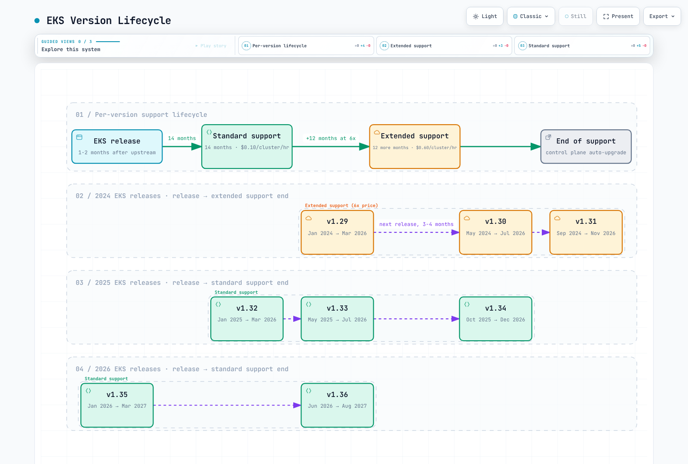
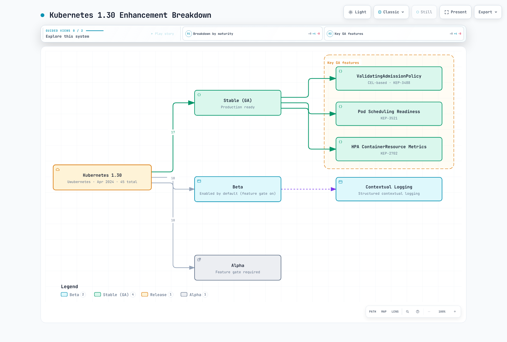
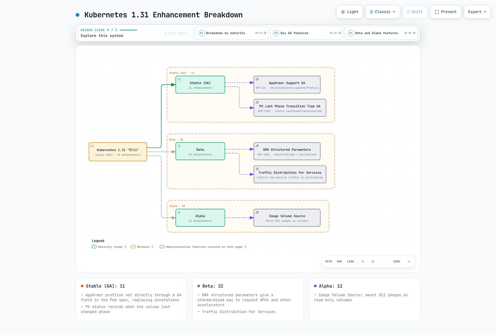
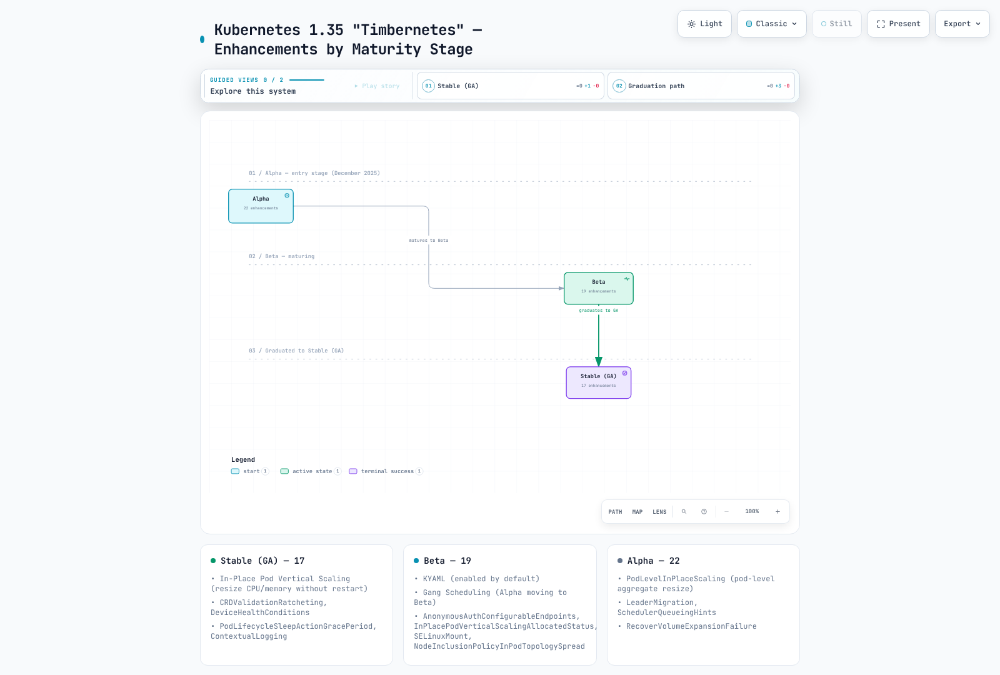
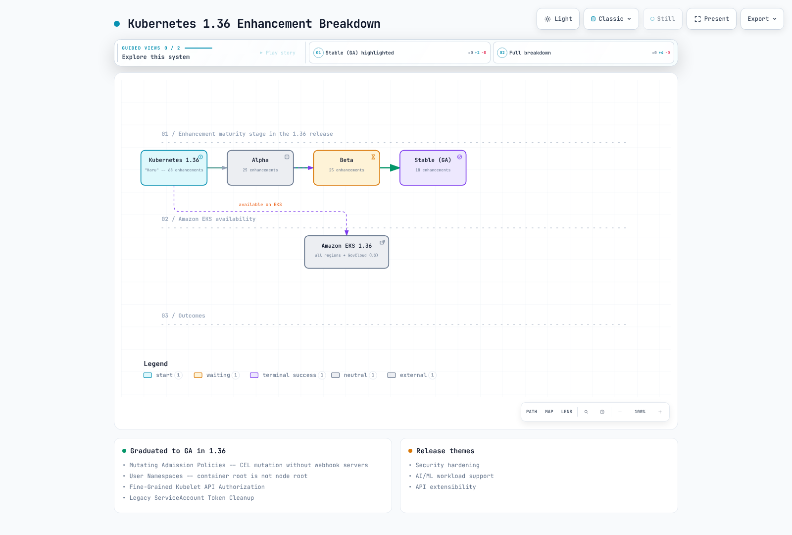

# Características y hoja de ruta de versiones de Kubernetes

> **Cobertura histórica**: Kubernetes 1.29–1.36; el soporte vigente de EKS se indica por separado
> **Última actualización**: 12 de octubre de 2026

Kubernetes evoluciona rápidamente: cada año publica tres versiones que incorporan funciones nuevas, promueven otras a etapas más estables y deprecian API antiguas. Para los equipos empresariales que ejecutan Amazon EKS, conocer el panorama de versiones es esencial para planificar actualizaciones, adoptar capacidades nuevas en el momento adecuado y evitar interrupciones por funciones deprecadas. Este documento ofrece una referencia detallada por versión, desde Kubernetes 1.29 hasta 1.36, con orientación específica para EKS en cada lanzamiento.

## Tabla de contenido

1. [Descripción general y objetivos de aprendizaje](#1-overview-and-learning-objectives)
2. [Ciclo de lanzamiento de Kubernetes](#2-kubernetes-release-cycle)
3. [Matriz de soporte de versiones de EKS](#3-eks-version-support-matrix)
4. [Guía de funciones por versión](#4-version-by-version-feature-guide)
5. [Cronología de graduación de funciones clave](#5-key-feature-graduation-timeline)
6. [Deprecaciones y eliminaciones](#6-deprecations-and-removals)
7. [Consideraciones específicas de EKS](#7-eks-specific-considerations)
8. [Planificación de actualizaciones de versión](#8-version-upgrade-planning)
9. [Perspectivas futuras](#9-future-outlook)
10. [Referencias](#10-references)

---

<span id="1-overview-and-learning-objectives"></span>

## 1. Descripción general y objetivos de aprendizaje

### Propósito de este documento

Este documento es una referencia centralizada sobre:

- **Funciones nuevas específicas de cada versión** incorporadas en Kubernetes 1.29 a 1.36
- **Cronologías de graduación de funciones**, desde alfa hasta beta y GA
- **Calendarios de deprecación** y acciones de migración necesarias
- **Períodos de soporte de EKS**, incluidas las fechas de soporte estándar y extendido
- **Orientación para planificar actualizaciones** dirigida a equipos empresariales

### Objetivos de aprendizaje

Al terminar de leer este documento, podrás:

1. Explicar el ciclo de lanzamiento de Kubernetes y el modelo de madurez de sus funciones
2. Identificar las funciones disponibles en cada versión de Kubernetes
3. Relacionar las feature gates con versiones concretas y comprender su ciclo de vida
4. Planificar actualizaciones según la disponibilidad de funciones y los calendarios de deprecación
5. Comprender las políticas de soporte de versiones de EKS, incluido el soporte estándar y el extendido
6. Evaluar los costos y riesgos de permanecer en versiones antiguas
7. Distinguir los hitos publicados de las fechas propuestas al seguir funciones futuras

### A quién está dirigido

| Público | Secciones principales |
|----------|-------------|
| **Ingenieros de plataformas** | Guía de funciones por versión, planificación de actualizaciones y deprecaciones |
| **Administradores de clústeres** | Matriz de soporte de EKS, planificación de actualizaciones y consideraciones específicas de EKS |
| **Desarrolladores de aplicaciones** | Guía de funciones (sidecars, redimensionamiento in situ y DRA) y cronología de graduación |
| **Equipos de seguridad** | Deprecaciones, funciones de seguridad por versión, StructuredAuthz y espacios de nombres de usuario |
| **Gerentes de ingeniería** | Descripción general, matriz de soporte e implicaciones de costos del soporte extendido |

---

<span id="2-kubernetes-release-cycle"></span>

## 2. Ciclo de lanzamiento de Kubernetes

### Cadencia y fases de lanzamiento

Kubernetes suele publicar unas tres versiones **menores** al año, separadas por aproximadamente cuatro meses. Las versiones de parche siguen otra cadencia, por lo general mensual. Las ramas de parches de upstream reciben soporte durante unos 14 meses: aproximadamente 12 meses de mantenimiento normal y, después, dos meses de mantenimiento para corregir CVE y problemas críticos. Esto es distinto del período de 14 meses de soporte estándar de EKS, que empieza en la fecha de lanzamiento de la versión de EKS.

El equipo de lanzamiento publica fechas límite para incluir mejoras, congelar el código, estabilizarlo y publicar versiones candidatas. El diagrama original de «semana 15» es un esquema del ciclo, no un calendario garantizado ni una tabla universal de números de semana. Consulta el calendario y el proceso de excepciones de la versión que tengas como objetivo.


[🔍 Ver el diagrama interactivo](https://www.atomai.click/kubernetes-docs/archmaps/en-eks-12-kubernetes-version-roadmap-1.html)

### Madurez de las funciones, estabilidad de las API y feature gates

| Etapa | Interpretación |
|---|---|
| Alfa | Por lo general, está desactivada de forma predeterminada; el comportamiento o la API pueden cambiar o desaparecer. Comprueba la feature gate y los requisitos previos exactos. |
| Beta | Se prueba más ampliamente, pero los valores predeterminados y la compatibilidad aún dependen de la función y la versión. Algunas feature gates beta siguen desactivadas. |
| Estable / GA | Se aplican compromisos de estabilidad de la API; esto no certifica como segura una carga de trabajo, un controlador, un sistema operativo ni una implementación determinados. |

Desde la versión 1.24, las **API beta nuevas** están desactivadas de forma predeterminada; las API beta que ya estaban habilitadas y las versiones nuevas de API beta existentes reciben otro tratamiento. La configuración para ofrecer una API y las feature gates están relacionadas, pero son distintas. No supongas que todas las funciones beta exigen activación voluntaria ni que toda función estable funciona sin configurar la carga de trabajo.

Una versión de API GA no se puede eliminar dentro de la misma versión principal de Kubernetes. Esa regla es distinta de la eliminación de feature gates: una gate que pasa de beta a GA tiene un período mínimo de deprecación de seis meses o dos versiones, lo que sea más largo. Hay que comprobar en qué versión se eliminará realmente. Una gate bloqueada o eliminada no es un mecanismo de desactivación compatible. Por ejemplo, el código de Kubernetes 1.36.2 publicado aún contiene la gate `SidecarContainers`, bloqueada; que la función alcanzara GA en 1.33 no demuestra que la gate se eliminara en 1.35.

El siguiente es un **fragmento histórico de configuración**, no un KubeletConfiguration completo ni un cambio del plano de control de EKS. En un nodo actual, usa la configuración compatible con su versión exacta; no copies gates retiradas en un archivo de arranque nuevo.

```yaml
# Historical fragment for a self-managed Kubernetes 1.33 test node.
# Merge through the supported node bootstrap/configuration mechanism.
featureGates:
  InPlacePodVerticalScaling: true
  UserNamespacesSupport: true
```

AWS administra la configuración del plano de control de EKS; los clientes no pueden editar el Pod estático kube-apiserver de EKS ni pasarle flags arbitrarios. Las preguntas frecuentes de EKS sobre versiones indican que las funciones alfa no tienen soporte. Cambiar una gate en un nodo autoadministrado no habilita una API del plano de control que no esté disponible. Consulta las instrucciones de AWS para cada función y los requisitos del entorno de ejecución y del sistema operativo del nodo.

El endpoint `configz` del nodo muestra la configuración del kubelet seleccionado; esa salida no confirma los valores predeterminados omitidos ni el comportamiento del plano de control. `/metrics` requiere la autorización adecuada para URL que no sean recursos; las métricas de funciones pueden no estar disponibles o tener etiquetas adicionales. Que no haya salida o que se deniegue el acceso no significa que la función esté «desactivada».

```bash
# Authorized, read-only diagnostics; these endpoints may be restricted.
: "${KUBE_CONTEXT:?}"; : "${NODE_NAME:?Choose the actual node}"
kubectl --context "$KUBE_CONTEXT" --request-timeout=15s \
  get --raw="/api/v1/nodes/$NODE_NAME/proxy/configz" | jq '.kubeletconfig.featureGates'
```

```bash
# Run separately; absence of a metric is not proof that a feature is disabled.
: "${KUBE_CONTEXT:?}"
kubectl --context "$KUBE_CONTEXT" --request-timeout=15s get --raw='/metrics' \
  | awk '/^kubernetes_feature_enabled/ { print }'
```

### Grupos de interés especial y propuestas de mejora

Los grupos de interés especial (SIG) se encargan de áreas relacionadas: Node (entorno de ejecución y ciclo de vida), Auth (autenticación y autorización), Network (enrutamiento de Service), Storage (CSI y volúmenes), Scheduling, Apps, API Machinery, Instrumentation y Autoscaling. Las mejoras importantes siguen una KEP que incluye motivación, diseño, criterios de graduación, pruebas y revisión de preparación para producción. Un hito planificado no garantiza que se publique; confirma el historial de la API publicada y de su feature gate.

[Política de parches de upstream](https://kubernetes.io/releases/patch-releases/) · [Feature gates](https://kubernetes.io/docs/reference/command-line-tools-reference/feature-gates/) · [Política de deprecación](https://kubernetes.io/docs/reference/deprecation-policy/) · [Implementación de gates en Kubernetes 1.36.2](https://github.com/kubernetes/kubernetes/blob/v1.36.2/pkg/features/kube_features.go)

---

<span id="3-eks-version-support-matrix"></span>

## 3. Matriz de soporte de versiones de EKS

### Períodos de soporte y base de precios

| Nivel | Período desde la disponibilidad en EKS | Tarifa de soporte de versión |
|---|---|---|
| Estándar | Primeros 14 meses | $0.10 por clúster-hora |
| Extendido | Siguientes 12 meses | $0.60 en total por clúster-hora ($0.10 + $0.50) |

Estas son las tarifas publicadas por soporte de versión, no el costo total de operación del clúster. Los niveles de plano de control aprovisionado, el cómputo, Auto Mode/Hybrid Nodes, otras capacidades, el almacenamiento y las redes pueden agregar cargos. A una tarifa constante durante 365 días, las tarifas correspondientes son $876 y $5,256 por clúster: una diferencia de $4,380. Como ejemplo de 730 horas mensuales, serían $73 y $438. Son cálculos aritméticos, no facturas medidas.

### Calendario de soporte verificado: 12 de octubre de 2026 (UTC)

| Versión | Lanzamiento de upstream | Lanzamiento de EKS | Fin del soporte estándar | Fin del soporte extendido | Estado en la fecha de revisión |
|---|---|---|---|---|---|
| 1.31 | 2024-08-13 | 2024-09-26 | 2025-11-26 | 2026-11-26 | Extendido |
| 1.32 | 2024-12-11 | 2025-01-23 | 2026-03-23 | 2027-03-23 | Extendido |
| 1.33 | 2025-04-23 | 2025-05-29 | 2026-07-29 | 2027-07-29 | Extendido |
| 1.34 | 2025-08-27 | 2025-10-02 | 2026-12-02 | 2027-12-02 | Estándar |
| 1.35 | 2025-12-17 | 2026-01-27 | 2027-03-27 | 2028-03-27 | Estándar |
| 1.36 | 2026-04-22 | 2026-06-02 | 2027-08-02 | 2028-08-02 | Estándar |
| 1.37 | 2026-08-26 | 2026-10-01 | 2027-12-01 | 2028-12-01 | Estándar |

El calendario actual de AWS incluye EKS 1.31–1.37. Las versiones 1.29 y 1.30 se incluyen aquí como referencia histórica de funciones, no como objetivos de implementación con soporte.

La facturación del soporte extendido empieza a las 00:00 UTC de la fecha indicada como fin del soporte estándar. Antes de programar un cambio, vuelve a consultar el calendario o la API vigente; las fechas futuras que AWS publica solo por mes son estimaciones.

EKS 1.35 estuvo disponible desde el **27 de enero de 2026**, EKS 1.36 desde el **2 de junio de 2026** y EKS 1.37 desde el **1 de octubre de 2026**. Los anuncios de EKS Distro corresponden a otros lanzamientos; la fecha combinada anterior, el 28 de enero, no sustituye al calendario de EKS.

Las secciones de cada versión conservan sus requisitos de ejecución y admisión. Los temas de reversión de EKS, escalado del plano de control y SLA se tratan en [Actualizaciones de EKS](08-eks-upgrades.md).

```bash
# Read-only when executed with your normal authorized AWS identity.
: "${AWS_REGION:?Choose the intended Region}"
aws eks describe-cluster-versions --region "$AWS_REGION" --no-cli-pager \
  --query clusterVersions --output json
```

Esto imprime los registros de versiones del servicio en lugar de dar por hecho que el primer elemento de la lista es la versión más reciente o reutilizar el estado de un ejemplo antiguo. Durante esta auditoría no se ejecutó ninguna consulta de AWS.

### Política de actualizaciones y actualizaciones automáticas

`EXTENDED` es la política de actualización predeterminada del clúster. Un clúster que use `STANDARD` puede actualizarse automáticamente una vez que termine el soporte estándar; permanecer en una versión durante el soporte extendido es una decisión deliberada de costo y ciclo de vida. Cuando termina el soporte extendido, EKS actualiza gradualmente los planos de control que aún tengan una versión no compatible. AWS no garantiza la hora exacta de la actualización y declara que no envía una notificación inmediatamente antes de ella. El aviso de al menos 60 días describe el **fin del soporte estándar** anunciado; no es un nuevo período de gracia de 60 días después del soporte extendido ni garantiza avisos en secuencia a los 60, 30 y 7 días.

Los grupos de nodos administrados, los nodos autoadministrados, los Pods de Fargate y los Hybrid Nodes requieren sus propios procesos de actualización o reemplazo. Los nodos de Auto Mode pueden actualizarse automáticamente; los complementos instalados normalmente aún requieren revisar su compatibilidad y quién los administra. Cuando sea práctico, mantén las versiones de los nodos y del plano de control alineadas; no tomes la diferencia máxima de versiones permitida como objetivo. Comprueba el estado de preparación de las cargas de trabajo y el estado real de la actualización, no solo la cadena de versión del plano de control. La actualización automática al terminar el soporte extendido no se puede revertir con la función nativa de EKS durante siete días; consulta el capítulo de actualización para conocer los requisitos y el orden de reversión de nodos primero.

[Calendario de soporte y preguntas frecuentes de EKS](https://docs.aws.amazon.com/eks/latest/userguide/kubernetes-versions.html) · [Precios de EKS](https://aws.amazon.com/eks/pricing/)

<!-- Parent diagram repair pending: stage/default guarantees and support status/notification timing are stale.


[🔍 View interactive diagram](https://www.atomai.click/kubernetes-docs/archmaps/en-eks-12-kubernetes-version-roadmap-2.html)



[🔍 View interactive diagram](https://www.atomai.click/kubernetes-docs/archmaps/en-eks-12-kubernetes-version-roadmap-3.html)


[🔍 View interactive diagram](https://www.atomai.click/kubernetes-docs/archmaps/en-eks-12-kubernetes-version-roadmap-5.html)

-->

---

<span id="4-version-by-version-feature-guide"></span>

## 4. Guía de funciones por versión

Esta sección detalla las funciones incorporadas, graduadas y deprecadas en cada versión de Kubernetes, desde 1.29 hasta 1.36.


### 4.1 Kubernetes 1.29 «Mandala» (diciembre de 2023)

El anuncio del lanzamiento del 13 de diciembre de 2023 enumera **49 mejoras: 11 estables, 19 beta y 19 alfa**. Son cifras históricas de la versión; no significan que EKS aún admita 1.29. Las etiquetas de valor predeterminado y uso en producción del diagrama son generalizaciones; consulta el historial de cada feature gate y los requisitos del entorno de ejecución descritos anteriormente.


[🔍 Ver el diagrama interactivo](https://www.atomai.click/kubernetes-docs/archmaps/en-eks-12-kubernetes-version-roadmap-6.html)

#### Cifrado en reposo con KMS v2: GA

KMS v2 mejora el rendimiento del cifrado de sobre: deriva claves de cifrado de datos de un solo uso a partir de una semilla secreta, y emplea el complemento de KMS para proteger y rotar esa semilla. Así, no es necesario hacer una nueva operación de cifrado remota por cada escritura de objeto. Ambos diseños de cifrado de sobre tienen capas de cifrado de datos y de claves; KMS v1 no era un diseño de «una sola capa». Esta mejora no garantiza una latencia constante.

KMS v1 se deprecó en 1.28 y se desactivó de forma predeterminada en 1.29. La guía upstream actual de KMS aún documenta su implementación heredada; era incorrecto afirmar que se eliminó en 1.31. Prefiere la ruta de migración compatible a v2.

Esta configuración es para un servidor de API upstream administrado por el administrador, con el complemento v2 revisado e instalado en el socket indicado. **No es un manifiesto del plano de control de EKS**. KMS v2 no admite `cachesize`. El proveedor `identity` al final permite leer texto sin cifrar que ya existía durante la migración; no ofrece una alternativa de texto sin cifrar si el primer proveedor no consigue cifrar una escritura. Revisa la migración del cifrado y elimina el soporte de lectura de texto sin cifrar solo después de validar la migración.

```yaml
apiVersion: apiserver.config.k8s.io/v1
kind: EncryptionConfiguration
resources:
- resources:
  - secrets
  providers:
  - kms:
      apiVersion: v2
      name: reviewed-kms-provider
      endpoint: unix:///var/run/kmsplugin/socket.sock
      timeout: 3s
  - identity: {}
```

**Diferencia para EKS:** La guía actual de AWS proporciona cifrado de sobre KMS v2 predeterminado para todos los datos de la API de Kubernetes en EKS 1.28 y versiones posteriores, con una clave propiedad de AWS a menos que se configure una clave administrada por el cliente. Esto cubre los datos de la API, como Secrets y ConfigMaps, no datos arbitrarios de nodos ni volúmenes EBS. No deduzcas que solo está disponible desde EKS 1.29 ni apliques a EKS este archivo de configuración upstream.

#### ReadWriteOncePod: GA

`ReadWriteOncePod` limita una PVC a un solo Pod en todo el clúster. `ReadWriteOnce` permite, en cambio, varios Pods en un mismo nodo. RWOP requiere un volumen o controlador CSI compatible; las versiones mínimas upstream de los sidecars son csi-provisioner 3.0.0, csi-attacher 3.3.0 y csi-resizer 1.3.0. Son requisitos mínimos de esta función, no versiones actuales recomendadas. Elige versiones compatibles con el clúster y el aprovisionador reales.

El ejemplo requiere que ya existan el espacio de nombres `version-lab` y una `reviewed-csi-class` adecuada. La coordinación del modo de acceso no es una barrera de seguridad del kernel frente al acceso privilegiado al host, no implementa la elección de líder de una base de datos y no sustituye al aislamiento de escrituras ni a las copias de seguridad de la aplicación.

```yaml
apiVersion: v1
kind: PersistentVolumeClaim
metadata:
  name: database-pvc
  namespace: version-lab
spec:
  accessModes:
  - ReadWriteOncePod
  storageClassName: reviewed-csi-class
  resources:
    requests:
      storage: 100Gi
```

#### Algunas funciones beta y alfa

| Función | Estado en 1.29 | Significado |
|---|---|---|
| SidecarContainers | Beta, habilitada de forma predeterminada | Contenedores init reiniciables; fue alfa en 1.28 y llega a GA en 1.33 |
| NFTablesProxyMode | Alfa, deshabilitada de forma predeterminada | Backend del proxy de Service para Linux; hay que comprobar el kernel, CNI y comportamiento de NodePort |
| LoadBalancerIPMode | Alfa | Modo de estado de ingreso LoadBalancer informado por un controlador, no un campo arbitrario del Pod |
| PodSchedulingReadiness | Beta | Las puertas de programación retrasan la consideración del Pod por el planificador |
| NodeLogQuery | Alfa | Consultar los registros del nodo requiere la configuración y el acceso pertinentes de kubelet |
| KubeletTracing | Beta | No llegó a GA en 1.29; llega a GA en 1.34 |
| MinDomainsInPodTopologySpread | Beta | Llega a GA en 1.30 |

Un sidecar nativo usa el siguiente **fragmento de Pod-spec**. Sustituye la imagen ilustrativa por una implementación revisada y configura su canal real de registros. Esto no instala Fluent Bit. El inicio continúa cuando arranca el sidecar (y cuando pasa su startupProbe, si la tiene); la preparación y el apagado gradual aún requieren sondas correctas, el comportamiento adecuado de la aplicación y tiempo suficiente para terminar.

```yaml
initContainers:
- name: log-helper
  image: example.invalid/version-lab/log-helper:reviewed
  restartPolicy: Always
```

El lanzamiento también graduó `NodeExpandSecret` de CSI, que permite incluir las credenciales adecuadas en la solicitud de expansión del lado del nodo de un controlador. El endpoint deprecado `flowcontrol.apiserver.k8s.io/v1beta2` dejó de ofrecerse en 1.29; usa la API estable `v1` y revisa los cambios en sus campos. `SecurityContextDeny` ya se había deprecado y se eliminó en 1.30; no se deprecó por primera vez en 1.29. Aquí no se establece un umbral universal de rendimiento de «5.000 Services» ni un benchmark medido del proxy.

[Lanzamiento de Kubernetes 1.29](https://kubernetes.io/blog/2023/12/13/kubernetes-v1-29-release/) · [Proveedor KMS](https://kubernetes.io/docs/tasks/administer-cluster/kms-provider/) · [Cifrado de sobre de EKS](https://docs.aws.amazon.com/eks/latest/userguide/envelope-encryption.html) · [Volúmenes persistentes y RWOP](https://kubernetes.io/docs/concepts/storage/persistent-volumes/) · [Guía de migración de API](https://kubernetes.io/docs/reference/using-api/deprecation-guide/)

---

### 4.2 Kubernetes 1.30 «Uwubernetes» (abril de 2024)

El lanzamiento del 17 de abril incluye **45 mejoras: 17 estables, 18 beta y 10 alfa**. Las etiquetas de madurez no sustituyen las comprobaciones de configuración y entorno de ejecución de cada función.



[🔍 Ver el diagrama interactivo](https://www.atomai.click/kubernetes-docs/archmaps/en-eks-12-kubernetes-version-roadmap-7.html)

#### ValidatingAdmissionPolicy: GA

ValidatingAdmissionPolicy evalúa CEL dentro del servidor de API. Puede sustituir muchos webhooks de validación y sus dependencias de red, certificados y servidores, pero una política incorrecta, un error de evaluación o una configuración que deniega al fallar puede rechazar solicitudes. La política, su vinculación y los objetos de parámetros opcionales cumplen funciones distintas; los parámetros pueden ser recursos integrados o personalizados, no necesariamente un tercer tipo de CRD obligatorio.

Los ejemplos siguientes usan las API `v1` estables actuales. Sus vinculaciones son **solo de auditoría** y seleccionan los espacios de nombres con la etiqueta `version-lab-policy=enabled`; las infracciones agregan anotaciones de auditoría, pero no deniegan solicitudes. Configura la recopilación del registro de auditoría para observarlas. Controla quién puede establecer esa etiqueta en los espacios de nombres. Primero evalúa casos de prueba positivos y negativos; si quieres aplicar la política, selecciona `Deny` deliberadamente. Estos ejemplos no demuestran cómo se comportará la admisión en producción.

La política de recursos comprueba que los contenedores normales y los init declaren las claves de los límites de CPU y memoria. No valida que los valores sean positivos y adecuados: incluir una clave cuyo valor sea cero no crea un límite máximo útil. Para establecer requisitos de capacidad, usa LimitRange y políticas de recursos apropiados. Los contenedores efímeros no pueden declarar esos límites y quedan excluidos. Se incluye `pods/resize` para los clústeres actuales; ese subrecurso apareció después de la graduación original de VAP en 1.30.

```yaml
apiVersion: admissionregistration.k8s.io/v1
kind: ValidatingAdmissionPolicy
metadata:
  name: version-lab-resource-limits
spec:
  failurePolicy: Fail
  matchConstraints:
    resourceRules:
    - apiGroups:
      - ''
      apiVersions:
      - v1
      operations:
      - CREATE
      - UPDATE
      resources:
      - pods
      - pods/resize
  validations:
  - expression: "object.spec.containers.all(c,\n  has(c.resources) && has(c.resources.limits)\
      \ &&\n  has(c.resources.limits.cpu) && has(c.resources.limits.memory)\n) &&\n\
      (!has(object.spec.initContainers) || object.spec.initContainers.all(c,\n  has(c.resources)\
      \ && has(c.resources.limits) &&\n  has(c.resources.limits.cpu) && has(c.resources.limits.memory)\n\
      ))"
    message: Regular and init containers must declare CPU and memory limits.
    reason: Invalid
---
apiVersion: admissionregistration.k8s.io/v1
kind: ValidatingAdmissionPolicyBinding
metadata:
  name: version-lab-resource-limits
spec:
  policyName: version-lab-resource-limits
  validationActions:
  - Audit
  matchResources:
    namespaceSelector:
      matchLabels:
        version-lab-policy: enabled
```

La política de imágenes usa prefijos completos de registro y repositorio, incluido el límite `/`. El prefijo antiguo `123456789012.dkr.ecr.` también aceptaba dominios de imitación. Sustituye la cuenta, la región y el alias público de ejemplo por las fuentes aprobadas por tu organización. La política valida las referencias de imagen; no valida firmas, vulnerabilidades ni que los digest sean inmutables. Las listas opcionales de contenedores init y efímeros se protegen con verificaciones de presencia, y se selecciona explícitamente el subrecurso de contenedores efímeros.

```yaml
apiVersion: admissionregistration.k8s.io/v1
kind: ValidatingAdmissionPolicy
metadata:
  name: version-lab-image-registries
spec:
  failurePolicy: Fail
  matchConstraints:
    resourceRules:
    - apiGroups:
      - ''
      apiVersions:
      - v1
      operations:
      - CREATE
      - UPDATE
      resources:
      - pods
      - pods/ephemeralcontainers
  validations:
  - expression: object.spec.containers.all(c, c.image.startsWith('123456789012.dkr.ecr.us-west-2.amazonaws.com/')
      || c.image.startsWith('public.ecr.aws/approved-alias/'))
    message: Regular container images must use an approved registry/repository prefix.
  - expression: '!has(object.spec.initContainers) || object.spec.initContainers.all(c,
      c.image.startsWith(''123456789012.dkr.ecr.us-west-2.amazonaws.com/'') || c.image.startsWith(''public.ecr.aws/approved-alias/''))'
    message: Init container images must use an approved registry/repository prefix.
  - expression: '!has(object.spec.ephemeralContainers) || object.spec.ephemeralContainers.all(c,
      c.image.startsWith(''123456789012.dkr.ecr.us-west-2.amazonaws.com/'') || c.image.startsWith(''public.ecr.aws/approved-alias/''))'
    message: Ephemeral container images must use an approved registry/repository prefix.
---
apiVersion: admissionregistration.k8s.io/v1
kind: ValidatingAdmissionPolicyBinding
metadata:
  name: version-lab-image-registries
spec:
  policyName: version-lab-image-registries
  validationActions:
  - Audit
  matchResources:
    namespaceSelector:
      matchLabels:
        version-lab-policy: enabled
```

Otros **fragmentos de listas de validación** muestran la herencia efectiva de `runAsNonRoot` para contenedores normales y la verificación de etiquetas de aplicación no vacías. El valor del contenedor prevalece sobre el del Pod. Estos fragmentos requieren una política y una vinculación; no validan todos los Pod Security Standards, los contenedores init o efímeros ni el usuario de la imagen. Para las claves de mapas que contienen `/` se usan pruebas de pertenencia; `has(map["key"])` no es sintaxis de macro CEL válida.

```yaml
- expression: "object.spec.containers.all(c,\n  has(c.securityContext) && has(c.securityContext.runAsNonRoot)\n\
    \    ? c.securityContext.runAsNonRoot\n    : (has(object.spec.securityContext)\
    \ &&\n       has(object.spec.securityContext.runAsNonRoot) &&\n       object.spec.securityContext.runAsNonRoot)\n\
    )"
  message: Regular containers must effectively set runAsNonRoot.
- expression: 'has(object.metadata.labels) &&

    ''app.kubernetes.io/name'' in object.metadata.labels &&

    ''app.kubernetes.io/version'' in object.metadata.labels &&

    object.metadata.labels[''app.kubernetes.io/name''] != '''' &&

    object.metadata.labels[''app.kubernetes.io/version''] != '''' '
  message: Nonempty application name and version labels are required.
```

#### Pod Scheduling Readiness: GA

Las puertas de programación excluyen un Pod del proceso de programación. Se pueden establecer durante la creación o admisión del Pod y retirar después, pero no se pueden agregar puertas nuevas una vez creado. Un Pod con puertas no activa por sí mismo el aprovisionamiento normal de nodos para Pods no programables; un flujo de trabajo externo de aprobación o aprovisionamiento debe satisfacer la condición. Las puertas, por sí solas, no implementan una programación atómica por grupos.

Este ejemplo requiere un espacio de nombres que controles, una versión revisada de la imagen ilustrativa y capacidad y controladores de GPU adecuados. Los nombres de las dos puertas representan una aprobación externa de cuota y un análisis de seguridad; Kubernetes no realiza esas acciones porque una puerta tenga ese nombre.

```yaml
apiVersion: v1
kind: Pod
metadata:
  name: gated-training
  namespace: version-lab
spec:
  schedulingGates:
  - name: example.com/gpu-quota-approved
  - name: example.com/security-scan-passed
  containers:
  - name: trainer
    image: example.invalid/version-lab/training:reviewed
    resources:
      limits:
        nvidia.com/gpu: 4
```

Después de verificar por separado la condición indicada, esta mutación retira únicamente esa puerta. Las operaciones `test` de JSON Patch protegen el UID, resourceVersion y nombre de la puerta seleccionada; una actualización o sustitución concurrente hace que falle el parche. Si no se cumple la condición previa, vuelve a leer y evaluar el Pod en vez de eliminar un índice supuesto. El Pod solo queda habilitado cuando se retiran todas las puertas; siguen aplicándose las restricciones habituales de ubicación y capacidad.

```bash
# MUTATION: remove only the named gate after independently verifying its condition.
set -euo pipefail
: "${KUBE_CONTEXT:?}"; : "${NAMESPACE:?}"; : "${POD_NAME:?}"; : "${GATE_NAME:?}"
gate_patch=$(kubectl --context "$KUBE_CONTEXT" --request-timeout=15s -n "$NAMESPACE" \
  get pod "$POD_NAME" -o json | jq -ce --arg gate "$GATE_NAME" '
    .metadata as $m |
    [(.spec.schedulingGates // []) | to_entries[] | select(.value.name == $gate)] as $matches |
    if ($matches | length) != 1 then error("Expected exactly one matching gate")
    else ($matches[0].key | tostring) as $i | [
      {op:"test", path:"/metadata/uid", value:$m.uid},
      {op:"test", path:"/metadata/resourceVersion", value:$m.resourceVersion},
      {op:"test", path:("/spec/schedulingGates/" + $i + "/name"), value:$gate},
      {op:"remove", path:("/spec/schedulingGates/" + $i)}
    ] end')
kubectl --context "$KUBE_CONTEXT" --request-timeout=15s -n "$NAMESPACE" \
  patch pod "$POD_NAME" --type=json --patch "$gate_patch"
```

#### Métricas ContainerResource de HPA: GA (KEP-2702)

ContainerResource mide un contenedor específico por nombre, de modo que un sidecar de registro o proxy no distorsione la señal de utilización de la aplicación. El Deployment de destino debe existir en `version-lab` y contener un contenedor `app` con solicitudes adecuadas. También se necesita un proveedor funcional de métricas de recursos. La utilización se calcula respecto de las solicitudes, no de los límites. Si hay varias métricas, HPA elige la recomendación de réplicas mayor; las métricas faltantes, la preparación y la estabilización pueden afectar el escalado. Los límites de 2 a 50 réplicas son valores ilustrativos de capacidad, no una configuración óptima medida.

```yaml
apiVersion: autoscaling/v2
kind: HorizontalPodAutoscaler
metadata:
  name: web-app-hpa
  namespace: version-lab
spec:
  scaleTargetRef:
    apiVersion: apps/v1
    kind: Deployment
    name: web-app
  minReplicas: 2
  maxReplicas: 50
  metrics:
  - type: ContainerResource
    containerResource:
      name: cpu
      container: app
      target:
        type: Utilization
        averageUtilization: 70
  - type: ContainerResource
    containerResource:
      name: memory
      container: app
      target:
        type: Utilization
        averageUtilization: 80
```

#### Otros cambios seleccionados

| Función | Estado en 1.30 |
|---|---|
| MinDomainsInPodTopologySpread | GA |
| StableLoadBalancerNodeSet | GA |
| PodDisruptionConditions | Beta; pasa a GA en 1.31 |
| NodeLogQuery | Beta, deshabilitada de forma predeterminada; pasa a GA en 1.36 |
| UserNamespacesSupport | Beta, deshabilitada de forma predeterminada |
| ContextualLogging | Beta; los puntos de llamada deben proporcionar o usar registradores contextuales; no todos los mensajes obtienen campos Pod/nodo automáticamente |
| RecursiveReadOnlyMounts | Alfa; requiere compatibilidad del kernel y del entorno de ejecución |
| RelaxedEnvironmentVariableValidation | Alfa; cambia los **nombres** de variables de entorno permitidos, no sus valores |
| ServiceAccountTokenJTI | Beta; el token incluye un identificador de seguimiento |

`SecurityContextDeny` se eliminó en 1.30; evalúa Pod Security Admission y las políticas necesarias para tu entorno. La madurez de una función no sustituye una prueba de migración.

[Lanzamiento de Kubernetes 1.30](https://kubernetes.io/blog/2024/04/17/kubernetes-v1-30-release/) · [ValidatingAdmissionPolicy](https://kubernetes.io/docs/reference/access-authn-authz/validating-admission-policy/) · [Preparación para la programación](https://kubernetes.io/docs/concepts/scheduling-eviction/pod-scheduling-readiness/) · [Métricas de contenedores de HPA](https://kubernetes.io/docs/tasks/run-application/horizontal-pod-autoscale/#container-resource-metrics)

---


### 4.3 Kubernetes 1.31 «Elli» (agosto de 2024)

El anuncio del lanzamiento del 13 de agosto enumera **45 mejoras: 11 estables, 22 beta y 12 alfa**.

<!-- Parent repair: DRA structured parameters remained alpha in 1.31, not beta as drawn.


[🔍 Ver el diagrama interactivo](https://www.atomai.click/kubernetes-docs/archmaps/en-eks-12-kubernetes-version-roadmap-8.html)
-->

#### Campos nativos de AppArmor: GA

En 1.30 se agregaron campos nativos para configurar perfiles AppArmor; alcanzaron GA en 1.31. Sustituyen las antiguas anotaciones beta por contenedor. El host debe tener AppArmor habilitado, el entorno de ejecución debe admitirlo y, en cada nodo apto, debe estar cargado el perfil `Localhost`. Una etiqueta personalizada del nodo solo deja constancia de que un operador verificó ese requisito previo; no instala ni impone el perfil.

El primer ejemplo usa un perfil preinstalado; el segundo proporciona el selector y las etiquetas del Pod que faltaban en el ejemplo anterior de Deployment. Sustituye la imagen ilustrativa y prepara el espacio de nombres. `RuntimeDefault` usa el perfil del entorno de ejecución; `Unconfined` deshabilita el confinamiento de AppArmor. No se garantiza que el perfil configurado sea compatible con todos los sistemas operativos o tipos de cómputo de EKS. AppArmor, seccomp y SELinux son controles distintos, no nombres intercambiables de una misma protección.

```yaml
apiVersion: v1
kind: Pod
metadata:
  name: apparmor-local-profile
  namespace: version-lab
spec:
  nodeSelector:
    version-lab.example.com/apparmor-profile: reviewed
  containers:
  - name: app
    image: example.invalid/version-lab/app:reviewed
    securityContext:
      appArmorProfile:
        type: Localhost
        localhostProfile: reviewed-app-profile
```

```yaml
apiVersion: apps/v1
kind: Deployment
metadata:
  name: apparmor-runtime-default
  namespace: version-lab
spec:
  replicas: 1
  selector:
    matchLabels:
      app: apparmor-runtime-default
  template:
    metadata:
      labels:
        app: apparmor-runtime-default
    spec:
      containers:
      - name: app
        image: example.invalid/version-lab/app:reviewed
        securityContext:
          appArmorProfile:
            type: RuntimeDefault
```

#### Hora de la última transición de fase de PersistentVolume: GA

El campo `.status.lastPhaseTransitionTime` de PV registra la transición más reciente de fase. Úsalo junto con los eventos y la evidencia del backend para diagnosticar el ciclo de vida; no contiene el historial completo de transiciones ni reconstruye eventos antiguos que falten. El siguiente comando no modifica ni elimina el volumen.

```bash
# Read-only, for one owned cluster-scoped PV.
: "${KUBE_CONTEXT:?}"; : "${PV_NAME:?}"
kubectl --context "$KUBE_CONTEXT" --request-timeout=15s get pv "$PV_NAME" -o json | jq '{
  name:.metadata.name,phase:.status.phase,lastPhaseTransitionTime:.status.lastPhaseTransitionTime
}'
```

#### Parámetros estructurados de DRA: todavía alfa en 1.31

El rediseño de DRA hizo visibles para Kubernetes la información y las solicitudes de dispositivos por medio de API estructuradas y ResourceSlices, lo que permite que el planificador asigne los dispositivos. **DRA clásico aún estaba disponible en 1.31**, protegido por la feature gate independiente `DRAControlPlaneController`, desactivada de forma predeterminada. Esa gate aparece en el código publicado de 1.31; el código de 1.32 ya no la incluye. Por eso es incorrecta la afirmación del cuestionario anterior de que DRA clásico ya se había eliminado en 1.31.

DRA seguía en alfa en 1.31, pasó a beta en 1.32 y su API principal se estabilizó en 1.34. El ejemplo anterior con `resource.k8s.io/v1beta1` no representaba correctamente la generación de API de 1.31. Para la sintaxis actual, usa el ejemplo estable de DRA de la sección 1.34 y comprueba las DeviceClasses, ResourceSlices, atributos y capacidades del controlador instalado. La API de Kubernetes no instala por sí sola un controlador de GPU ni implementa el reparto temporal o MIG.

#### Distribución del tráfico de Service: beta

El campo `trafficDistribution: PreferClose` de `Service v1` solicita que se prefieran los endpoints de la misma zona. Es una preferencia de enrutamiento, no una regla estricta de localidad, un cálculo de distancia geográfica ni una garantía de eliminar cargos entre zonas de disponibilidad. También influyen la disponibilidad de endpoints, el proxy que implementa la función y la prioridad de las políticas de tráfico. El selector debe coincidir con Pods reales de la carga de trabajo; el ejemplo no crea esos endpoints.

```yaml
apiVersion: v1
kind: Service
metadata:
  name: zone-preference
  namespace: version-lab
spec:
  trafficDistribution: PreferClose
  selector:
    app: web-app
  ports:
  - port: 80
    targetPort: 8080
```

#### Otros cambios seleccionados

| Función | Estado en 1.31 |
|---|---|
| NFTablesProxyMode | Beta, habilitada de forma predeterminada; elegir el modo de proxy y comprobar la compatibilidad con Linux, el kernel y CNI son pasos distintos |
| MultiCIDRServiceAllocator | Beta, deshabilitada de forma predeterminada |
| VolumeAttributesClass | Beta, deshabilitada de forma predeterminada; requiere soporte del controlador, el controlador de gestión y la API |
| ImageVolume | Alfa, deshabilitada de forma predeterminada |
| PodDisruptionConditions | GA |
| JobPodReplacementPolicy | Beta; pasa a GA en 1.34 |
| SidecarContainers | Ya estaba en beta desde 1.29; no pasó a beta por primera vez en 1.31 |

El backend nftables no migra automáticamente la red. El comportamiento de NodePort y del firewall puede diferir del de iptables; evalúa la implementación real antes de cambiar el modo de proxy en producción.

[Lanzamiento de Kubernetes 1.31](https://kubernetes.io/blog/2024/08/13/kubernetes-v1-31-release/) · [Requisitos previos de AppArmor](https://kubernetes.io/docs/tutorials/security/apparmor/) · [Código fuente de funciones en 1.31](https://github.com/kubernetes/kubernetes/blob/v1.31.0/pkg/features/kube_features.go) · [Código fuente de funciones en 1.32](https://github.com/kubernetes/kubernetes/blob/v1.32.0/pkg/features/kube_features.go)

---

### 4.4 Kubernetes 1.32 «Penelope» (diciembre de 2024)

El anuncio del 11 de diciembre enumera **44 mejoras: 13 estables, 12 beta y 19 alfa**. Las etiquetas del diagrama que indican funciones activadas de forma predeterminada simplifican la leyenda de madurez; algunas de las funciones beta que se describen a continuación pueden seguir desactivadas.


[🔍 Ver el diagrama interactivo](https://www.atomai.click/kubernetes-docs/archmaps/en-eks-12-kubernetes-version-roadmap-9.html)

#### Configuración estructurada de autorización: GA

`AuthorizationConfiguration` usa la API estable `apiserver.config.k8s.io/v1` para configurar el sistema. Es una alternativa a los flags del modo de autorización, no una prueba de que se eliminó `--authorization-mode`. No combines el mecanismo de flags con el de archivo de configuración. EKS administra esta configuración del plano de control; el archivo siguiente es para un servidor de API administrado por el administrador, no un recurso que se aplique con kubectl ni una interfaz para personalizar EKS.

Los autorizadores se ejecutan en orden; una decisión definitiva de permitir o denegar termina la cadena. En este ejemplo, el webhook solo recibe las solicitudes de recursos coincidentes de `version-lab` que Node y RBAC todavía no hayan resuelto. Por lo tanto, **no aplica un filtro de denegación a solicitudes que RBAC ya permitió**. Las condiciones de coincidencia de CEL seleccionan qué llamadas se hacen al webhook; CEL no es otro tipo independiente de autorizador. La solicitud es la especificación de un SubjectAccessReview, por lo que el espacio de nombres está en `request.resourceAttributes` y se verifica que exista para las solicitudes que no son de recursos.

```yaml
apiVersion: apiserver.config.k8s.io/v1
kind: AuthorizationConfiguration
authorizers:
- type: Node
  name: node
- type: RBAC
  name: rbac
- type: Webhook
  name: reviewed-webhook
  webhook:
    authorizedTTL: 5m
    unauthorizedTTL: 30s
    timeout: 3s
    subjectAccessReviewVersion: v1
    matchConditionSubjectAccessReviewVersion: v1
    failurePolicy: Deny
    connectionInfo:
      type: KubeConfigFile
      kubeConfigFile: /etc/kubernetes/reviewed-authz-webhook.kubeconfig
    matchConditions:
    - expression: has(request.resourceAttributes) && request.resourceAttributes.namespace
        == 'version-lab'
```

Antes de usarlo, prepara el webhook real, la confianza TLS y el kubeconfig protegido. `failurePolicy: Deny` se aplica si fallan el webhook o una condición pertinente; las decisiones almacenadas en caché pueden retrasar el efecto de un cambio en la política del backend. Usa una configuración coherente en todos los servidores de API. Se admite recargar la configuración, pero no agregar ni eliminar autorizadores Node o RBAC; valida toda la política y el procedimiento de recuperación en un entorno que no sea de producción.

#### Política de retención de PVC de StatefulSet: GA

La función que llegó a GA en 1.32 es la **eliminación y retención automáticas de PVC creados a partir de plantillas de claims de volumen de StatefulSet**, no una nueva garantía de que desaparezca de inmediato el finalizador de protección de todos los PVC sin uso. `whenDeleted` controla qué ocurre al eliminar el StatefulSet y `whenScaled` controla qué ocurre al reducir réplicas; ambos admiten `Retain` o `Delete`. De forma predeterminada se retienen los datos. Este es un fragmento que debes revisar en un StatefulSet existente:

```yaml
spec:
  persistentVolumeClaimRetentionPolicy:
    whenDeleted: Retain
    whenScaled: Retain
```

Elegir `Delete` cambia el ciclo de vida de los datos: al eliminar el PVC también se puede borrar el almacenamiento del backend, según la política de recuperación del PV. La propiedad del Pod, la recolección de basura, las operaciones CSI y los finalizadores aún afectan cuándo se completa el proceso. La protección de PVC en uso existe desde mucho antes de 1.32; si un claim queda atascado, investiga consumidores, UID, asociaciones y controladores. No elimines finalizadores en bloque ni des por sentado que una actualización resolverá el problema.

#### VolumeAttributesClass: todavía beta en 1.32

VAC pasó a beta en 1.31 y a GA en 1.34. Su API beta es `storage.k8s.io/v1beta1`; cuando el clúster y el controlador CSI lo admitan, los ejemplos actuales deben usar la API estable de la sección 1.34. Los parámetros de una clase son inmutables; un PVC puede cambiar la referencia de clase para solicitar otros atributos compatibles con el controlador, como IOPS o rendimiento de EBS.

Esta modificación de almacenamiento es asíncrona y no garantiza que no haya interrupciones. Confirma la versión del controlador y del componente de gestión, la disponibilidad de la API, los permisos de IAM/KMS, los límites del tipo de volumen, los tiempos de espera entre modificaciones y el estado. No apliques un objeto PVC incompleto como si fuera un manifiesto completo de creación. La siguiente consulta compara la clase deseada con el progreso informado:

```bash
# Read-only: inspect one existing owned PVC and the CSI modification state.
: "${KUBE_CONTEXT:?}"; : "${NAMESPACE:?}"; : "${PVC_NAME:?}"
kubectl --context "$KUBE_CONTEXT" --request-timeout=15s -n "$NAMESPACE" \
  get pvc "$PVC_NAME" -o json | jq '{
    requestedClass:.spec.volumeAttributesClassName,
    currentClass:.status.currentVolumeAttributesClassName,
    modification:.status.modifyVolumeStatus,
    conditions:.status.conditions
  }'
```

Las notas de AWS para 1.34 distinguen entre la API VAC estable y el soporte anterior de sidecar beta. La versión del plano de control de EKS por sí sola no demuestra que una versión cualquiera de EBS CSI siga siendo compatible con la API VAC.

#### Espacios de nombres de usuario: beta, deshabilitados de forma predeterminada en 1.32

Los espacios de nombres de usuario pasaron a beta en 1.30, se habilitaron de forma predeterminada en 1.33 y llegaron a GA en 1.36. Un Pod los habilita mediante `hostUsers: false`. El UID 0 dentro del contenedor se asigna a un UID no raíz del host elegido por la implementación; no se aplica una fórmula universal como `65534 + offset`. Se requiere un kernel, sistema de archivos y CRI/entorno de ejecución compatibles, y no todas las cargas de trabajo ni los patrones de acceso al host serán compatibles.

El ejemplo muestra intencionalmente el UID 0 del contenedor para explicar la asignación; sustituye la imagen ilustrativa y usa un entorno de prueba compatible. Es una defensa en profundidad, no una garantía contra todas las vulnerabilidades de escape del kernel o del contenedor, ni sustituye otros controles de seguridad.

```yaml
apiVersion: v1
kind: Pod
metadata:
  name: userns-example
  namespace: version-lab
spec:
  hostUsers: false
  containers:
  - name: app
    image: example.invalid/version-lab/app:reviewed
    securityContext:
      runAsUser: 0
```

#### Otros cambios seleccionados

| Función | Estado en 1.32 |
|---|---|
| CustomResourceFieldSelectors | GA; quienes escriben CRD deben declarar los campos seleccionables compatibles |
| RetryGenerateName | GA; reintenta colisiones de nombres, pero no garantiza que la creación siempre tenga éxito |
| SizeMemoryBackedVolumes | GA; los límites de emptyDir respaldados por memoria también dependen de la memoria del Pod y del nodo |
| ServiceAccountTokenJTI | GA; identificador del token, no un permiso de autorización nuevo |
| JobManagedBy | Beta; pasa a GA en 1.35 |
| DynamicResourceAllocation | Beta, deshabilitada de forma predeterminada; la API principal se estabiliza en 1.34 |
| MultiCIDRServiceAllocator | Sigue en beta y deshabilitada de forma predeterminada |
| NFTablesProxyMode | Sigue en beta; pasa a GA en 1.33 |
| MutatingAdmissionPolicy | Alfa; pasa a beta en 1.34 y a GA en 1.36 |

`StableLoadBalancerNodeSet` ya había llegado a GA en 1.30. Mantén separadas estas etapas históricas de las funciones habilitadas actualmente en un clúster concreto de EKS.

[Lanzamiento de Kubernetes 1.32](https://kubernetes.io/blog/2024/12/11/kubernetes-v1-32-release/) · [Configuración de autorización](https://kubernetes.io/docs/reference/access-authn-authz/authorization/) · [Retención de PVC de StatefulSet](https://kubernetes.io/docs/concepts/workloads/controllers/statefulset/#persistentvolumeclaim-retention) · [Notas de versión de EKS](https://docs.aws.amazon.com/eks/latest/userguide/kubernetes-versions-standard.html)

---


### 4.5 Kubernetes 1.33 «Octarine» (abril de 2025)

El lanzamiento del 23 de abril enumera **64 mejoras: 18 estables, 20 beta, 24 alfa y 2 deprecadas o retiradas**. El diagrama muestra los tres grupos de madurez (62 elementos) como proporciones del total de 64; los otros dos no aparecen. Fue un lanzamiento amplio de 2025, pero eso no demuestra que aumentara el rendimiento ni que todas las cargas de trabajo estén listas.


[🔍 Ver el diagrama interactivo](https://www.atomai.click/kubernetes-docs/archmaps/en-eks-12-kubernetes-version-roadmap-10.html)

#### Sidecars nativos: GA

La función pasó de alfa en 1.28 a beta en 1.29 y a GA en 1.33. Un contenedor init reiniciable tiene `restartPolicy: Always`. Kubelet continúa con el siguiente contenedor init cuando el estado `started` del sidecar pasa a ser verdadero: su proceso está en ejecución si no tiene startupProbe, o la sonda se completó correctamente. La preparación es una señal distinta. El contenedor init normal del ejemplo se ejecuta **después de que hayan arrancado ambos sidecars**; luego se inicia la aplicación.

Este es un ejemplo estructural. Hay que sustituir todas las imágenes `example.invalid` por implementaciones revisadas; el proxy debe responder en el endpoint de preparación declarado y el agente de registros necesita su configuración real de canalización. Elegir una imagen de Envoy, Istio o Fluent Bit no configura por sí mismo una malla de servicios ni un destino de registros. Una migración real de base de datos también requiere coordinación e idempotencia; no se debe suponer que sea seguro ejecutarla una vez por réplica.

```yaml
apiVersion: apps/v1
kind: Deployment
metadata:
  name: sidecar-lifecycle
  namespace: version-lab
spec:
  replicas: 2
  selector:
    matchLabels:
      app: sidecar-lifecycle
  template:
    metadata:
      labels:
        app: sidecar-lifecycle
    spec:
      terminationGracePeriodSeconds: 60
      initContainers:
      - name: proxy-helper
        image: example.invalid/version-lab/reviewed-proxy:reviewed
        restartPolicy: Always
        startupProbe:
          httpGet:
            path: /ready
            port: 15021
          periodSeconds: 2
          failureThreshold: 30
        resources:
          requests:
            cpu: 100m
            memory: 128Mi
          limits:
            cpu: 500m
            memory: 256Mi
      - name: log-helper
        image: example.invalid/version-lab/reviewed-log-agent:reviewed
        restartPolicy: Always
        volumeMounts:
        - name: app-logs
          mountPath: /var/log/app
        resources:
          requests:
            cpu: 50m
            memory: 64Mi
          limits:
            cpu: 200m
            memory: 128Mi
      - name: initialize-app
        image: example.invalid/version-lab/reviewed-init:reviewed
        volumeMounts:
        - name: app-logs
          mountPath: /var/log/app
      containers:
      - name: app
        image: example.invalid/version-lab/reviewed-app:reviewed
        volumeMounts:
        - name: app-logs
          mountPath: /var/log/app
      volumes:
      - name: app-logs
        emptyDir: {}
```

Durante un apagado gradual normal, los contenedores principales se detienen antes que los sidecars, y estos se detienen en orden inverso. Sigue aplicándose el presupuesto compartido de tiempo de gracia del Pod: si el apagado del contenedor principal tarda mucho, los sidecars pueden tener poco o ningún tiempo para terminar con gracia. Los sidecars nativos no impiden que se complete un Job cuando termina su contenedor principal; este comportamiento no apareció por primera vez al llegar a GA. Al dimensionar los recursos, considera la superposición de los contenedores init, sidecar y aplicación, así como la sobrecarga del Pod. Aquí no se midieron tiempos del ciclo de vida ni la disponibilidad de la aplicación.


[🔍 Ver el diagrama interactivo](https://www.atomai.click/kubernetes-docs/archmaps/en-eks-12-kubernetes-version-roadmap-11.html)

#### Redimensionamiento de recursos de contenedor in situ: beta en 1.33

El redimensionamiento in situ cambia la asignación de CPU y memoria deseada sin recrear el Pod, aunque `resizePolicy` aún puede exigir reiniciar un contenedor. La función se estabilizó en 1.35. El siguiente ejemplo con el esquema actual conserva la clase QoS `Burstable` y configura CPU como `NotRequired` y memoria como `RestartContainer`. Por política, un cambio de memoria solicita reiniciar el contenedor; eso no significa que todo cambio de memoria siempre provoque un reinicio.

Usa un entorno de ejecución Linux y una política de nodo compatibles, una diferencia de versiones de kubectl admitida, un espacio de nombres bajo tu control y una imagen revisada. La guía de 1.36 excluye Windows y los casos predeterminados con administradores estáticos de CPU o memoria; las capacidades que dependen de otras gates deben evaluarse según la versión. Esta API no modifica automáticamente las plantillas de Deployment o StatefulSet ni coordina con los administradores de recursos HPA, VPA o GitOps.

```yaml
apiVersion: v1
kind: Pod
metadata:
  name: resizable-app
  namespace: version-lab
spec:
  containers:
  - name: app
    image: example.invalid/version-lab/app:reviewed
    resources:
      requests:
        cpu: 500m
        memory: 256Mi
      limits:
        cpu: '1'
        memory: 512Mi
    resizePolicy:
    - resourceName: cpu
      restartPolicy: NotRequired
    - resourceName: memory
      restartPolicy: RestartContainer
```

Tras revisar la capacidad y quién administra los recursos, este ejemplo, limitado a CPU, solicita un núcleo con un límite de dos. Selecciona el contenedor por nombre, conserva la clase `Burstable` existente, rechaza una política de CPU que exige reinicio y comprueba el UID y resourceVersion del Pod antes de aplicar el parche. No cambia la memoria. Si hay un conflicto, vuelve a leer y evaluar el objetivo; no fuerces la actualización.

```bash
# MUTATION: reviewed CPU-only resize; desired request=1 core and limit=2 cores.
set -euo pipefail
: "${KUBE_CONTEXT:?}"; : "${NAMESPACE:?}"; : "${POD_NAME:?}"; : "${CONTAINER_NAME:?}"
resize_patch=$(kubectl --context "$KUBE_CONTEXT" --request-timeout=15s -n "$NAMESPACE" \
  get pod "$POD_NAME" -o json | jq -ce --arg container "$CONTAINER_NAME" '
    . as $pod |
    [(.spec.containers | to_entries[]) | select(.value.name == $container)] as $matches |
    if .status.phase != "Running" or .metadata.deletionTimestamp != null
       or ($matches | length) != 1
    then error("Expected one target container in a non-deleting Running Pod")
    elif .status.qosClass != "Burstable"
    then error("This example preserves an existing Burstable QoS class")
    elif $matches[0].value.resources.requests.cpu == null
         or $matches[0].value.resources.limits.cpu == null
    then error("This example requires existing CPU request and limit keys")
    elif any($matches[0].value.resizePolicy[]?; .resourceName == "cpu" and .restartPolicy == "RestartContainer")
    then error("This example requires CPU resize policy NotRequired")
    elif ([.status.containerStatuses[]? | select(.name == $container and .state.running != null)] | length) != 1
    then error("Target container is not reported running")
    else ($matches[0].key | tostring) as $i | [
      {op:"test",path:"/metadata/uid",value:$pod.metadata.uid},
      {op:"test",path:"/metadata/resourceVersion",value:$pod.metadata.resourceVersion},
      {op:"test",path:("/spec/containers/" + $i + "/name"),value:$container},
      {op:"replace",path:("/spec/containers/" + $i + "/resources/requests/cpu"),value:"1"},
      {op:"replace",path:("/spec/containers/" + $i + "/resources/limits/cpu"),value:"2"}
    ] end')
kubectl --context "$KUBE_CONTEXT" --request-timeout=15s -n "$NAMESPACE" \
  patch pod "$POD_NAME" --subresource=resize --type=json --patch "$resize_patch"
```

Usa los campos de estado actuales, no la antigua cadena `.status.resize`. `PodResizePending=True` puede informar `Deferred` o `Infeasible`; `PodResizeInProgress=True` indica que la aplicación del cambio sigue pendiente. Compara la especificación deseada, la generación confirmada y `status.containerStatuses[].resources` del contenedor seleccionado por nombre. `allocatedResources` es un campo avanzado de asignación, no la única prueba de que se aplicaron los límites en el entorno de ejecución. La ausencia de una condición o la aceptación del parche no demuestra que la carga de trabajo esté en buen estado.

```bash
# Read-only observation; an accepted patch is not proof of completed actuation.
set -euo pipefail
: "${KUBE_CONTEXT:?}"; : "${NAMESPACE:?}"; : "${POD_NAME:?}"; : "${CONTAINER_NAME:?}"
kubectl --context "$KUBE_CONTEXT" --request-timeout=15s -n "$NAMESPACE" \
  get pod "$POD_NAME" -o json | jq --arg container "$CONTAINER_NAME" '{
    uid:.metadata.uid,generation:.metadata.generation,
    observedGeneration:.status.observedGeneration,qosClass:.status.qosClass,
    resizeConditions:[.status.conditions[]? | select(.type == "PodResizePending" or .type == "PodResizeInProgress")],
    desired:[.spec.containers[] | select(.name == $container) | .resources],
    reported:[.status.containerStatuses[]? | select(.name == $container) |
      {name,resources,allocatedResources,containerID,restartCount,ready}]
  }'
```

Un redimensionamiento no cambia la clase QoS del Pod. Los Pods `Guaranteed` deben conservar solicitudes y límites iguales de CPU y memoria; el ejemplo anterior es intencionalmente `Burstable`. Reducir memoria con `NotRequired` se hace al mejor esfuerzo y puede quedar pendiente si el uso supera el nuevo límite; una condición de carrera aún puede causar una terminación por OOM. No se pueden redimensionar contenedores init que no sean reiniciables ni contenedores efímeros. La madurez de la función no garantiza cero tiempo de inactividad, una latencia determinada ni que el redimensionamiento tenga éxito.

#### La integración actual de VPA es una decisión de versión independiente

Este es un **ejemplo de 2026 con un componente complementario**; no afirma que VPA 1.8 existiera cuando se lanzó Kubernetes 1.33. La API publicada de VPA **1.8.0** admite `InPlace`, incorporado como alfa en 1.7.0 y aún alfa en 1.8.0. Requiere la feature gate `InPlace` de VPA tanto en admission-controller como en updater, además del soporte para redimensionamiento in situ de Kubernetes 1.33 o posterior; VPA 1.8.x documenta compatibilidad con Kubernetes 1.36–1.38. Evita la alternativa de expulsar el Pod que usa VPA; no garantiza que el redimensionamiento finalice ni que ninguna política de contenedor exija un reinicio. Empieza con `Off` si solo quieres observar recomendaciones.

La política limitada a CPU que sigue usa valores ilustrativos para un Deployment y contenedor existentes. Antes de habilitar cambios, revisa los flags de implementación del controlador y la capacidad. `InPlaceOrRecreate` es otro modo: puede volver a crear el Pod como alternativa, llegó a GA en VPA 1.6 y su antigua gate se eliminó en 1.7. No habilites una gate eliminada ni deduzcas el comportamiento de VPA solo a partir de que Kubernetes haya llegado a GA.

```yaml
apiVersion: autoscaling.k8s.io/v1
kind: VerticalPodAutoscaler
metadata:
  name: current-in-place-example
  namespace: version-lab
spec:
  targetRef:
    apiVersion: apps/v1
    kind: Deployment
    name: web-app
  updatePolicy:
    updateMode: InPlace
  resourcePolicy:
    containerPolicies:
    - containerName: app
      minAllowed:
        cpu: 100m
      maxAllowed:
        cpu: '4'
      controlledResources:
      - cpu
      controlledValues: RequestsAndLimits
```

#### ServiceCIDR e IPAddress: GA

Kubernetes upstream puede ampliar las direcciones disponibles para Service mediante objetos `ServiceCIDR` adicionales de `networking.k8s.io/v1`, si están habilitados el asignador y la API. El objeto predeterminado llamado `kubernetes` representa el rango inicial del servidor de API. Antes de agregar rangos, revisa IPAM, la familia de direcciones y los solapamientos de enrutamiento; los finalizadores impiden eliminar rangos que dejarían huérfanas direcciones asignadas de Service. Un `ServiceCIDR` no es una subred VPC ni un CIDR de direcciones de Pod.

Este manifiesto IPv4 es un ejemplo upstream, no una ampliación de rango ejecutada en EKS. El parámetro de creación `serviceIpv4Cidr` de EKS no se puede cambiar después de crear el clúster. Crear otro `ServiceCIDR` de Kubernetes es una operación distinta; las fuentes de AWS revisadas aquí no documentan un procedimiento probado para hacerlo en EKS. Antes de usarlo en EKS, confirma el soporte del proveedor, la política de admisión y la red prevista. Poder descubrir la API no equivale a esa validación.

```yaml
apiVersion: networking.k8s.io/v1
kind: ServiceCIDR
metadata:
  name: reviewed-extra-service-range
spec:
  cidrs:
  - 10.200.0.0/16
```

```bash
# Read-only discovery; do not interpret availability alone as an approved EKS change.
set -euo pipefail
: "${KUBE_CONTEXT:?}"
kubectl --context "$KUBE_CONTEXT" --request-timeout=15s api-resources --api-group=networking.k8s.io
kubectl --context "$KUBE_CONTEXT" --request-timeout=15s get servicecidrs
kubectl --context "$KUBE_CONTEXT" --request-timeout=15s get ipaddresses
```

#### Enrutamiento según la topología y distribución del tráfico: GA

Las indicaciones de endpoint según la topología y la preferencia `trafficDistribution` de Service son mecanismos relacionados pero distintos. El siguiente ejemplo usa `PreferClose` para favorecer la misma zona; no impone una regla estricta de zona, no calcula distancias dentro de la región ni declara que una anotación esté obsoleta universalmente. La distribución de endpoints listos, la implementación del proxy y `internalTrafficPolicy` o `externalTrafficPolicy` pueden afectar la ruta.

El tráfico entre zonas de disponibilidad puede generar cargos, pero el antiguo precio fijo de `$0.01/GB` no era un modelo de precios completo. Los cargos dependen del servicio, la ruta y los lados de entrada y salida que se contabilicen; existen excepciones para cierto tráfico dentro de una región. Compara el tráfico y los datos de facturación reales en vez de prometer un ahorro fijo.

```yaml
apiVersion: v1
kind: Service
metadata:
  name: same-zone-preference
  namespace: version-lab
spec:
  trafficDistribution: PreferClose
  selector:
    app: web-app
  ports:
  - port: 80
    targetPort: 8080
```

#### Política de éxito de Job: GA

La política de éxito se aplica a Jobs indexados. En este caso debe tener éxito el índice 0; solo representa un líder si la aplicación implementa el protocolo correspondiente. Kubernetes no deduce que el resultado distribuido esté completo o sea duradero. También importan la política de fallos y la terminación de los Pods restantes. La plantilla de Job especifica `restartPolicy: Never`, que faltaba en los ejemplos originales.

```yaml
apiVersion: batch/v1
kind: Job
metadata:
  name: indexed-success-example
  namespace: version-lab
spec:
  completionMode: Indexed
  completions: 8
  parallelism: 8
  backoffLimit: 2
  successPolicy:
    rules:
    - succeededIndexes: '0'
      succeededCount: 1
  template:
    spec:
      restartPolicy: Never
      containers:
      - name: trainer
        image: example.invalid/version-lab/training:reviewed
        env:
        - name: JOB_COMPLETION_INDEX
          valueFrom:
            fieldRef:
              fieldPath: metadata.annotations['batch.kubernetes.io/job-completion-index']
```

#### Volúmenes de imágenes OCI: beta, deshabilitados de forma predeterminada en 1.33

Un volumen de imagen expone contenido de una imagen OCI a un Pod, por ejemplo datos de modelos, sin incluirlo en la imagen de la aplicación. Requiere un entorno de ejecución compatible, la configuración apropiada de la función y credenciales para descargar del registro. El montaje es de solo lectura; no es un PVC con capacidad de escritura. Revisa y fija las versiones de las imágenes de aplicación y datos. ImageVolume quedó habilitada de forma predeterminada en 1.35 y llegó a estable en 1.36; no alcanzó GA en 1.34.

```yaml
apiVersion: v1
kind: Pod
metadata:
  name: image-volume-example
  namespace: version-lab
spec:
  containers:
  - name: inference
    image: example.invalid/version-lab/inference:reviewed
    volumeMounts:
    - name: model
      mountPath: /models
      readOnly: true
  volumes:
  - name: model
    image:
      reference: example.invalid/version-lab/model:reviewed
      pullPolicy: IfNotPresent
```

#### Otras etapas seleccionadas en 1.33

| Función | Estado |
|---|---|
| NFTablesProxyMode, RecursiveReadOnlyMounts | GA |
| CRDValidationRatcheting | GA; no permite omitir la validación de campos no válidos que se modifican |
| MatchLabelKeysInPodAffinity, NodeInclusionPolicyInPodTopologySpread | GA |
| Protección contra eliminación de PV con política de recuperación | GA; es distinta de la protección de PVC en uso |
| UserNamespacesSupport | Beta, ahora habilitada de forma predeterminada |
| PodLevelResources | Sigue en alfa; pasa a beta en 1.34 |
| StructuredAuthenticationConfiguration | Beta; pasa a GA en 1.34 |
| MutatingAdmissionPolicy | Sigue en alfa; pasa a beta en 1.34 |
| PodLifecycleSleepAction | Beta; pasa a GA en 1.34 |
| JobManagedBy | Beta; pasa a GA en 1.35 |

LoadBalancerIPMode y RetryGenerateName ya habían llegado a GA en 1.32. KYAML apareció en 1.34, no en 1.33.

[Lanzamiento de Kubernetes 1.33](https://kubernetes.io/blog/2025/04/23/kubernetes-v1-33-release/) · [Guía de redimensionamiento para 1.36](https://github.com/kubernetes/website/blob/release-1.36/content/en/docs/tasks/configure-pod-container/resize-container-resources.md) · [Funciones de VPA 1.8.0](https://github.com/kubernetes/autoscaler/blob/vertical-pod-autoscaler-1.8.0/vertical-pod-autoscaler/docs/features.md) · [Compatibilidad de VPA 1.8.0](https://github.com/kubernetes/autoscaler/blob/vertical-pod-autoscaler-1.8.0/vertical-pod-autoscaler/docs/installation.md#compatibility) · [Ampliación de rangos de Service](https://kubernetes.io/docs/tasks/network/extend-service-ip-ranges/) · [API de configuración de red de EKS](https://docs.aws.amazon.com/eks/latest/APIReference/API_KubernetesNetworkConfigRequest.html) · [Interpretación de cargos por transferencia de datos](https://docs.aws.amazon.com/cur/latest/userguide/cur-data-transfers-charges.html)

---


### 4.6 Kubernetes 1.34 «Of Wind & Will» (agosto de 2025)

El lanzamiento del 27 de agosto enumera **58 mejoras: 23 estables, 22 beta y 13 alfa**. Los valores predeterminados varían entre las funciones beta; la flecha genérica del diagrama que las muestra activadas no es una matriz de habilitación.


[🔍 Ver el diagrama interactivo](https://www.atomai.click/kubernetes-docs/archmaps/en-eks-12-kubernetes-version-roadmap-12.html)

#### API principales de DRA: GA

DeviceClass, ResourceClaim, ResourceClaimTemplate y ResourceSlice son API integradas de `resource.k8s.io/v1`; no son CRD principales de DRA que debas instalar. Los controladores publican el inventario de dispositivos mediante ResourceSlices; el planificador asigna los recursos aptos y kubelet coordina la preparación del dispositivo con el controlador. El diagrama de arquitectura muestra el flujo lógico y omite el transporte por el servidor de API y ResourceSlice.

DRA no elimina el modelo de complementos de dispositivos existente ni proporciona automáticamente el reparto temporal, MPS, MIG, NUMA o las funciones de red de cada proveedor. Las funciones avanzadas de DRA tienen feature gates y etapas propias. No configures dos asignadores independientes para los mismos dispositivos sin un modelo de coordinación compatible.


[🔍 Ver el diagrama interactivo](https://www.atomai.click/kubernetes-docs/archmaps/en-eks-12-kubernetes-version-roadmap-13.html)

El siguiente ejemplo usa un **contrato explícito de controlador sintético**: `gpu.example.com` publica un atributo de cadena `model` y un atributo `numa`. No describe los nombres de atributos ni la configuración reales del controlador NVIDIA. Sustituye el controlador y los atributos después de inspeccionar los ResourceSlices del controlador instalado. En las solicitudes estables, `deviceClassName`, `allocationMode` y `count` van dentro de `exactly`; la forma antigua los ubicaba incorrectamente en el nivel raíz. `matchAttribute` exige una igualdad exacta entre los dispositivos solicitados, no expresa preferencia por NUMA.

```yaml
apiVersion: resource.k8s.io/v1
kind: DeviceClass
metadata:
  name: example-a100
spec:
  selectors:
  - cel:
      expression: 'device.driver == "gpu.example.com" &&

        "gpu.example.com" in device.attributes &&

        "model" in device.attributes["gpu.example.com"] &&

        device.attributes["gpu.example.com"].model == "A100"'
---
apiVersion: resource.k8s.io/v1
kind: ResourceClaim
metadata:
  name: training-gpus
  namespace: version-lab
spec:
  devices:
    requests:
    - name: gpu
      exactly:
        deviceClassName: example-a100
        allocationMode: ExactCount
        count: 4
    constraints:
    - requests:
      - gpu
      matchAttribute: gpu.example.com/numa
---
apiVersion: resource.k8s.io/v1
kind: ResourceClaimTemplate
metadata:
  name: four-gpu-template
  namespace: version-lab
spec:
  spec:
    devices:
      requests:
      - name: gpu
        exactly:
          deviceClassName: example-a100
          allocationMode: ExactCount
          count: 4
      constraints:
      - requests:
        - gpu
        matchAttribute: gpu.example.com/numa
```

Según el ciclo de vida deseado, elige entre un claim administrado explícitamente y claims por Pod creados desde una plantilla. Los ejemplos siguientes muestran ambas alternativas. La plantilla solicita cuatro dispositivos para coincidir con `--tensor-parallel-size 4`; la anterior solo solicitaba uno. La imagen de inferencia debe implementar ese argumento y todas las imágenes son marcadores de posición. Una réplica requiere cuatro dispositivos aptos; tres réplicas requieren doce. No se ejecutó una asignación de GPU ni un benchmark de servicio de modelos.

```yaml
apiVersion: v1
kind: Pod
metadata:
  name: direct-gpu-claim
  namespace: version-lab
spec:
  resourceClaims:
  - name: accelerators
    resourceClaimName: training-gpus
  containers:
  - name: trainer
    image: example.invalid/version-lab/trainer:reviewed
    resources:
      claims:
      - name: accelerators
        request: gpu
```

```yaml
apiVersion: apps/v1
kind: Deployment
metadata:
  name: four-gpu-serving
  namespace: version-lab
spec:
  replicas: 1
  selector:
    matchLabels:
      app: four-gpu-serving
  template:
    metadata:
      labels:
        app: four-gpu-serving
    spec:
      resourceClaims:
      - name: accelerators
        resourceClaimTemplateName: four-gpu-template
      containers:
      - name: inference
        image: example.invalid/version-lab/inference:reviewed
        args:
        - --tensor-parallel-size
        - '4'
        resources:
          claims:
          - name: accelerators
            request: gpu
```

#### VolumeAttributesClass: GA

VAC usa `storage.k8s.io/v1` desde 1.34. Estas clases están dirigidas al controlador estándar `ebs.csi.aws.com` y a un volumen gp3 regional existente y compatible; no son automáticamente una receta de almacenamiento para Auto Mode. Antes de cambiar la clase de un PVC, verifica la compatibilidad del controlador y sus sidecars, las versiones de API, los permisos, el tamaño y tipo de volumen, el período de espera entre modificaciones y los límites EBS de la instancia.

Los límites actuales de gp3 regional alcanzan **80.000 IOPS y 2.000 MiB/s**, con 500 IOPS/GiB por encima del nivel base de 3.000 IOPS y 0,25 MiB/s por IOPS aprovisionado. Por tanto, los 64.000 IOPS del ejemplo original pueden ser válidos (con al menos 128 GiB), pero 4.000 MiB/s no era un rendimiento gp3 válido. El ejemplo corrige el valor a 2.000 y supone un volumen verificado de 500 GiB. Outposts tiene límites inferiores: 16.000 IOPS y 1.000 MiB/s. Los límites aprovisionados del volumen no garantizan que la aplicación o la instancia puedan sostener ese rendimiento.

```yaml
apiVersion: storage.k8s.io/v1
kind: VolumeAttributesClass
metadata:
  name: high-iops
driverName: ebs.csi.aws.com
parameters:
  iops: '16000'
  throughput: '1000'
---
apiVersion: storage.k8s.io/v1
kind: VolumeAttributesClass
metadata:
  name: standard
driverName: ebs.csi.aws.com
parameters:
  iops: '3000'
  throughput: '125'
---
apiVersion: storage.k8s.io/v1
kind: VolumeAttributesClass
metadata:
  name: io-intensive
driverName: ebs.csi.aws.com
parameters:
  iops: '64000'
  throughput: '2000'
---
apiVersion: storage.k8s.io/v1
kind: VolumeAttributesClass
metadata:
  name: throughput-optimized
driverName: ebs.csi.aws.com
parameters:
  iops: '3000'
  throughput: '750'
```

Los parámetros de una clase son inmutables; selecciona otra clase mediante el PVC existente en vez de editar la clase o crear un PVC incompleto. Confirma `.status.currentVolumeAttributesClassName`, `.status.modifyVolumeStatus`, los eventos y el estado real de EBS. Que se acepte una solicitud no significa que haya terminado el cambio de rendimiento.

A los CronJobs antiguos para horario laboral les faltaban una identidad y RBAC, así como controles de zona horaria y superposición. El esqueleto completo **sigue suspendido** y es un ejemplo operativo que no se ha ejecutado: prepara `version-lab`, el `database-pvc` que controles, las clases compatibles y una imagen revisada que incluya kubectl, jq y configuración confiable del cliente. Su ServiceAccount puede obtener y modificar solo ese PVC por nombre y dentro del espacio de nombres; RBAC no limita qué campos del PVC puede cambiar un parche.

```yaml
apiVersion: v1
kind: ServiceAccount
metadata:
  name: vac-scheduler
  namespace: version-lab
---
apiVersion: rbac.authorization.k8s.io/v1
kind: Role
metadata:
  name: vac-scheduler
  namespace: version-lab
rules:
- apiGroups:
  - ''
  resources:
  - persistentvolumeclaims
  resourceNames:
  - database-pvc
  verbs:
  - get
  - patch
---
apiVersion: rbac.authorization.k8s.io/v1
kind: RoleBinding
metadata:
  name: vac-scheduler
  namespace: version-lab
subjects:
- kind: ServiceAccount
  name: vac-scheduler
  namespace: version-lab
roleRef:
  apiGroup: rbac.authorization.k8s.io
  kind: Role
  name: vac-scheduler
```

```yaml
apiVersion: batch/v1
kind: CronJob
metadata:
  name: vac-business-hours
  namespace: version-lab
spec:
  schedule: 0 8 * * 1-5
  timeZone: Asia/Seoul
  suspend: true
  concurrencyPolicy: Forbid
  startingDeadlineSeconds: 300
  successfulJobsHistoryLimit: 1
  failedJobsHistoryLimit: 3
  jobTemplate:
    spec:
      backoffLimit: 0
      activeDeadlineSeconds: 120
      template:
        spec:
          serviceAccountName: vac-scheduler
          restartPolicy: Never
          containers:
          - name: request-class
            image: example.invalid/version-lab/kubectl-jq:reviewed
            command:
            - /bin/sh
            - -c
            - "set -eu\n: \"${POD_NAMESPACE:?}\"; : \"${TARGET_CLASS:?}\"\ncase \"\
              $TARGET_CLASS\" in high-iops|standard|io-intensive|throughput-optimized)\
              \ ;; *) exit 2 ;; esac\nstate=$(kubectl --request-timeout=15s -n \"\
              $POD_NAMESPACE\" get pvc database-pvc -o json)\npatch=$(printf '%s\\\
              n' \"$state\" | jq -ce --arg class \"$TARGET_CLASS\" '\n  if .metadata.deletionTimestamp\
              \ != null or .status.phase != \"Bound\"\n  then error(\"Expected an\
              \ existing non-deleting Bound PVC\")\n  elif .status.modifyVolumeStatus\
              \ != null\n  then error(\"Existing modification needs review before\
              \ another request\")\n  elif .spec.volumeAttributesClassName == $class\n\
              \  then []\n  else [\n    {op:\"test\",path:\"/metadata/uid\",value:.metadata.uid},\n\
              \    {op:\"test\",path:\"/metadata/resourceVersion\",value:.metadata.resourceVersion},\n\
              \    {op:\"add\",path:\"/spec/volumeAttributesClassName\",value:$class}\n\
              \  ] end')\nif [ \"$patch\" = '[]' ]; then\n  printf '%s\\n' 'Class\
              \ already requested; verify actual modification status separately.'\n\
              else\n  kubectl --request-timeout=15s -n \"$POD_NAMESPACE\" patch pvc\
              \ database-pvc --type=json --patch \"$patch\"\n  printf '%s\\n' 'Class\
              \ change requested; this is not proof of completed EBS modification.'\n\
              fi\n"
            env:
            - name: POD_NAMESPACE
              valueFrom:
                fieldRef:
                  fieldPath: metadata.namespace
            - name: TARGET_CLASS
              value: io-intensive
            resources:
              requests:
                cpu: 50m
                memory: 64Mi
              limits:
                cpu: 200m
                memory: 128Mi
---
apiVersion: batch/v1
kind: CronJob
metadata:
  name: vac-off-hours
  namespace: version-lab
spec:
  schedule: 0 22 * * 1-5
  timeZone: Asia/Seoul
  suspend: true
  concurrencyPolicy: Forbid
  startingDeadlineSeconds: 300
  successfulJobsHistoryLimit: 1
  failedJobsHistoryLimit: 3
  jobTemplate:
    spec:
      backoffLimit: 0
      activeDeadlineSeconds: 120
      template:
        spec:
          serviceAccountName: vac-scheduler
          restartPolicy: Never
          containers:
          - name: request-class
            image: example.invalid/version-lab/kubectl-jq:reviewed
            command:
            - /bin/sh
            - -c
            - "set -eu\n: \"${POD_NAMESPACE:?}\"; : \"${TARGET_CLASS:?}\"\ncase \"\
              $TARGET_CLASS\" in high-iops|standard|io-intensive|throughput-optimized)\
              \ ;; *) exit 2 ;; esac\nstate=$(kubectl --request-timeout=15s -n \"\
              $POD_NAMESPACE\" get pvc database-pvc -o json)\npatch=$(printf '%s\\\
              n' \"$state\" | jq -ce --arg class \"$TARGET_CLASS\" '\n  if .metadata.deletionTimestamp\
              \ != null or .status.phase != \"Bound\"\n  then error(\"Expected an\
              \ existing non-deleting Bound PVC\")\n  elif .status.modifyVolumeStatus\
              \ != null\n  then error(\"Existing modification needs review before\
              \ another request\")\n  elif .spec.volumeAttributesClassName == $class\n\
              \  then []\n  else [\n    {op:\"test\",path:\"/metadata/uid\",value:.metadata.uid},\n\
              \    {op:\"test\",path:\"/metadata/resourceVersion\",value:.metadata.resourceVersion},\n\
              \    {op:\"add\",path:\"/spec/volumeAttributesClassName\",value:$class}\n\
              \  ] end')\nif [ \"$patch\" = '[]' ]; then\n  printf '%s\\n' 'Class\
              \ already requested; verify actual modification status separately.'\n\
              else\n  kubectl --request-timeout=15s -n \"$POD_NAMESPACE\" patch pvc\
              \ database-pvc --type=json --patch \"$patch\"\n  printf '%s\\n' 'Class\
              \ change requested; this is not proof of completed EBS modification.'\n\
              fi\n"
            env:
            - name: POD_NAMESPACE
              valueFrom:
                fieldRef:
                  fieldPath: metadata.namespace
            - name: TARGET_CLASS
              value: throughput-optimized
            resources:
              requests:
                cpu: 50m
                memory: 64Mi
              limits:
                cpu: 200m
                memory: 128Mi
```

Los horarios especifican Asia/Seoul. `Forbid` se aplica por separado a cada CronJob; no es un bloqueo compartido entre ambos horarios ni con otros operadores. Las comprobaciones de UID y resourceVersion protegen el parche de la API, no toda la operación asíncrona de EBS. El comando rechaza una modificación existente e informa únicamente que se solicitó una clase. Mantén los CronJobs suspendidos hasta establecer el impacto en las cargas de trabajo, las comprobaciones del estado del backend, la coordinación y la recuperación; no se afirma que esté listo para producción.

#### Eliminación ordenada de espacios de nombres: GA

El cambio elimina los Pods antes que los demás recursos del espacio de nombres, lo que ayuda a evitar situaciones en que desaparecen controles de seguridad como NetworkPolicies mientras los Pods siguen en ejecución. No calcula un grafo de dependencias arbitrario ni garantiza que se complete la eliminación de todos los espacios de nombres: las API que no están disponibles, los controladores y los finalizadores todavía pueden bloquearla. Inspecciona las condiciones reales en vez de forzar la eliminación de finalizadores o tratar una transcripción de ejemplo como una corrección medida.

#### KYAML: formato de salida del cliente, alfa en 1.34

KYAML corresponde a **KEP-5295**, no a KEP-4222. Es un formato de salida compatible con YAML y menos ambiguo, con delimitadores explícitos y valores de cadena entre comillas. No valida la admisión en el servidor de API, no migra globalmente a YAML 1.2 ni obliga a quitar anclas de todos los manifiestos. Pasó a beta y se habilitó de forma predeterminada en kubectl 1.35, siguió en beta en 1.36 y llegó a estable en 1.37.

Guarda el siguiente YAML normal como `format-example.yaml`. El ejemplo local se comprobó con kubectl 1.36.2: se acepta el ancla y la salida conserva las dos cadenas `"no"`. No se conecta a ningún clúster.

```yaml
apiVersion: v1
kind: ConfigMap
metadata:
  name: kyaml-local-example
data:
  first: &string_value "no"
  norway: *string_value
```

```bash
# Local formatting example, checked with kubectl 1.36.2; no cluster request.
kubectl --kubeconfig=/dev/null --server=https://127.0.0.1:1 --request-timeout=1s \
  label --local --dry-run=client -f format-example.yaml \
  audit.example.com/checked=true -o kyaml
```

En kubectl 1.36.2, `KUBECTL_KYAML=false` deshabilita el formateador `-o kyaml`, pero la entrada en formato KYAML se sigue analizando como YAML cuando se usan otros formatos de salida. No cambia la configuración del plano de control de EKS. La validación de esquemas o de admisión y el formato siguen siendo comprobaciones distintas. Las transcripciones anteriores de advertencias o rechazos de KYAML no demostraban correctamente una función del servidor.

#### MutatingAdmissionPolicy: beta en 1.34

MAP pasó a alfa en 1.32, a beta en 1.34 (deshabilitada de forma predeterminada) y a GA en 1.36. Lo que sigue es la **forma estable actual para 1.36 o versiones posteriores**, no un manifiesto que se pueda aplicar sin cambios en 1.34; la API beta histórica era `v1beta1` y requería la configuración adecuada de la API ofrecida y de la feature gate. AWS administra las gates del plano de control de EKS.

Esta política agrega etiquetas predeterminadas a Deployments, pero conserva los valores explícitos existentes. La etiqueta de costos derivada del espacio de nombres es ilustrativa, no una regla de asignación financiera validada. La vinculación selecciona solo los espacios de nombres que la habilitan voluntariamente. `failurePolicy: Fail` aún puede bloquear solicitudes coincidentes si ocurre un error de evaluación. La expresión se probó con el compilador y parcheador de mutaciones nativo de Kubernetes 1.36.2 en Deployments sintéticos; no se probó la cadena de admisión completa ni el entorno de producción. Un CEL determinista no hace que todas las políticas compuestas sean idempotentes ni elimina las consideraciones de reinvocación y orden.

```yaml
apiVersion: admissionregistration.k8s.io/v1
kind: MutatingAdmissionPolicy
metadata:
  name: version-lab-default-labels
spec:
  failurePolicy: Fail
  reinvocationPolicy: IfNeeded
  matchConstraints:
    resourceRules:
    - apiGroups:
      - apps
      apiVersions:
      - v1
      operations:
      - CREATE
      resources:
      - deployments
  mutations:
  - patchType: ApplyConfiguration
    applyConfiguration:
      expression: "Object{\n  metadata: Object.metadata{\n    labels: {\n      \"\
        app.kubernetes.io/managed-by\":\n        has(object.metadata.labels) && \"\
        app.kubernetes.io/managed-by\" in object.metadata.labels\n        ? object.metadata.labels[\"\
        app.kubernetes.io/managed-by\"] : \"platform-team\",\n      \"cost-center\"\
        :\n        has(object.metadata.labels) && \"cost-center\" in object.metadata.labels\n\
        \        ? object.metadata.labels[\"cost-center\"] : request.namespace\n \
        \   }\n  }\n}"
---
apiVersion: admissionregistration.k8s.io/v1
kind: MutatingAdmissionPolicyBinding
metadata:
  name: version-lab-default-labels
spec:
  policyName: version-lab-default-labels
  matchResources:
    namespaceSelector:
      matchLabels:
        version-lab-policy: enabled
```

#### Otras etapas seleccionadas en 1.34

| Función | Estado |
|---|---|
| PodLevelResources | Beta, habilitada de forma predeterminada; todavía no es GA |
| ImageVolume | Beta, deshabilitada de forma predeterminada hasta 1.35 |
| UserNamespacesSupport | Beta, habilitada de forma predeterminada; llega a GA en 1.36 |
| NFTablesProxyMode, MatchLabelKeysInPodAffinity, CRDValidationRatcheting | Ya eran GA en 1.33 |
| KubeletTracing, PodLifecycleSleepAction | GA; la segunda incluye la acción de suspensión PreStop |
| JobPodReplacementPolicy, RecoverVolumeExpansionFailure | GA |
| StructuredAuthenticationConfiguration, AnonymousAuthConfigurableEndpoints | GA |
| NodeLogQuery | Sigue en beta; pasa a GA en 1.36 |

En estos ejemplos no existe una política de descarga estándar llamada `IfNotPresentOrNewer`; usa la semántica compatible de `Always`, `IfNotPresent` o `Never` y revisa por separado que la imagen sea inmutable.

[Lanzamiento de Kubernetes 1.34](https://kubernetes.io/blog/2025/08/27/kubernetes-v1-34-release/) · [DRA](https://kubernetes.io/docs/concepts/scheduling-eviction/dynamic-resource-allocation/) · [Límites de EBS gp3](https://docs.aws.amazon.com/ebs/latest/userguide/general-purpose.html) · [KYAML KEP-5295](https://github.com/kubernetes/enhancements/tree/master/keps/sig-cli/5295-kyaml) · [Registro de cambios de Kubernetes 1.37](https://github.com/kubernetes/kubernetes/blob/v1.37.0/CHANGELOG/CHANGELOG-1.37.md) · [MutatingAdmissionPolicy](https://kubernetes.io/docs/reference/access-authn-authz/mutating-admission-policy/)

---


### 4.7 Kubernetes 1.35 «Timbernetes» (diciembre de 2025)

El anuncio del 17 de diciembre informa **60 mejoras**, con un desglose principal de **17 estables, 19 beta y 22 alfa**. Estas tres cifras suman 58; el desglose no clasifica los otros dos elementos. Aquí se conservan los totales publicados originalmente, sin inventar otra categoría ni interpretarlos como mediciones de rendimiento.



[🔍 Ver el diagrama interactivo](https://www.atomai.click/kubernetes-docs/archmaps/en-eks-12-kubernetes-version-roadmap-15.html)

#### Redimensionamiento de recursos de contenedor in situ: GA

La función pasó de alfa en 1.27 a beta en 1.33 y a estable en 1.35. La versión alfa original no se limitaba a «CPU hasta 1.33». GA estabiliza la API, pero no garantiza que el redimensionamiento de memoria, el entorno de ejecución, la política del nodo o la aplicación eviten interrupciones. Usa las comprobaciones UID/resourceVersion y los campos de estado actuales del ejemplo de redimensionamiento anterior, y revisa las limitaciones específicas de la versión.

Actualizar la plantilla normal de un Deployment aún inicia el proceso de actualización gradual. Que esta API de Pod haya llegado a GA no implementa automáticamente el «redimensionamiento in situ gradual de Deployment». Redimensionar un Pod administrado y cambiar la plantilla de su controlador son acciones distintas. Los Pods de reemplazo se crean mediante la plantilla y la cadena de admisión; coordina HPA, VPA, GitOps y cualquier redimensionador personalizado para que no compitan por administrar los recursos.

Este Deployment proporciona el objetivo `web-app`/`app` que usa el ejemplo anterior de VPA. Las imágenes y los valores de recursos requieren revisión; la aplicación debe implementar realmente cualquier endpoint de Service, como el puerto 8080. No se probó una actualización gradual, un redimensionamiento ni la disponibilidad del Service en EKS.

```yaml
apiVersion: apps/v1
kind: Deployment
metadata:
  name: web-app
  namespace: version-lab
spec:
  replicas: 2
  selector:
    matchLabels:
      app: web-app
  template:
    metadata:
      labels:
        app: web-app
    spec:
      containers:
      - name: app
        image: example.invalid/version-lab/app:reviewed
        resources:
          requests:
            cpu: 500m
            memory: 256Mi
          limits:
            cpu: '1'
            memory: 512Mi
        resizePolicy:
        - resourceName: cpu
          restartPolicy: NotRequired
        - resourceName: memory
          restartPolicy: RestartContainer
```

VPA tiene un ciclo de versiones independiente. `InPlaceOrRecreate` llegó a GA en VPA 1.6 y puede recrear Pods si falla una actualización in situ; `InPlace` es un modo alfa de VPA 1.7 que requiere su propia gate. No expulsar el Pod no significa que todas las políticas de redimensionamiento eviten reiniciar contenedores ni que se puedan aplicar todas las recomendaciones. El ejemplo anterior de VPA actual documenta esos requisitos. Kubernetes 1.35, por sí solo, no habilita ese modo de VPA.

#### Distribución de tráfico PreferSameNode: GA

La función `PreferSameTrafficDistribution` es estable en 1.35. `PreferSameNode` prefiere los endpoints del nodo local cuando están disponibles, con una alternativa si no lo están; no equivale a la regla estricta `internalTrafficPolicy: Local`. Verifica la implementación real de Service, los endpoints listos y la prioridad de las políticas de tráfico. No controla universalmente el enrutamiento de ALB/NLB ni garantiza que no haya tráfico entre zonas.

```yaml
apiVersion: v1
kind: Service
metadata:
  name: prefer-same-node
  namespace: version-lab
spec:
  trafficDistribution: PreferSameNode
  selector:
    app: web-app
  ports:
  - port: 80
    targetPort: 8080
```

#### KYAML: beta, habilitado de forma predeterminada en kubectl

La habilitación predeterminada de KYAML en beta en 1.35 se refiere al formato de salida `-o kyaml`. No cambia el análisis de todas las entradas del servidor de API a un nuevo analizador estricto, no advierte sobre todas las anclas YAML ni requiere abrir un caso de soporte de EKS para cambiar una feature gate del servidor. El ejemplo local de formato y las comprobaciones nativas en 1.36.2 de la sección anterior muestran el comportamiento real. KYAML pasa a estable en 1.37, no en 1.36.

#### Programación nativa por grupos: alfa, KEP-4671

Kubernetes 1.35 incorporó conceptos de programación nativa por grupos y consciente de las cargas de trabajo. Siguen en alfa en 1.36; requieren `GenericWorkload`/`GangScheduling` y habilitar las API y el planificador correspondientes. Las preguntas frecuentes de EKS sobre versiones no admiten funciones alfa; una gate en un nodo autoadministrado no puede habilitar una API del plano de control de EKS que no esté disponible.

El siguiente es un **ejemplo de esquema `v1alpha2` de 1.36 para un entorno experimental upstream**, no el esquema anterior de 1.35 ni una receta GA para EKS. Usa `spec.schedulingPolicy.gang.minCount` y `spec.schedulingGroup.podGroupName` en el Pod. Los campos antiguos `minMember` y `scheduleTimeoutSeconds`, o usar solo una etiqueta del Pod o una `schedulingGate`, no definen esta API nativa. Los CRD PodGroup de terceros tienen contratos propios.

```yaml
apiVersion: scheduling.k8s.io/v1alpha2
kind: PodGroup
metadata:
  name: experimental-training
  namespace: version-lab
spec:
  schedulingPolicy:
    gang:
      minCount: 8
```

```yaml
apiVersion: batch/v1
kind: Job
metadata:
  name: experimental-training
  namespace: version-lab
spec:
  completionMode: Indexed
  completions: 8
  parallelism: 8
  backoffLimit: 0
  template:
    spec:
      restartPolicy: Never
      schedulingGroup:
        podGroupName: experimental-training
      containers:
      - name: worker
        image: example.invalid/version-lab/worker:reviewed
        resources:
          requests:
            cpu: 100m
            memory: 64Mi
          limits:
            cpu: '1'
            memory: 256Mi
```

El tamaño mínimo del grupo, el paralelismo del Job y la cantidad de finalizaciones son ocho. Es una ilustración independiente de un grupo: un controlador propietario debe administrar su ciclo de vida y mantener estable la asociación mientras se programan los Pods. Una decisión de programación no garantiza que los procesos se inicien al mismo tiempo, que estén listos, que el cálculo distribuido tenga éxito ni que no ocurra ningún interbloqueo. La aplicación aún requiere barreras, lógica de tiempo de espera y recuperación, y capacidad compatible. Estos objetos solo se validaron contra el esquema; no se ejecutó un experimento de colocación de grupos.

#### Selección de versión y consideraciones para actualizar

| Tema | Interpretación correcta |
|---|---|
| JobManagedBy | GA en 1.35 |
| ImageVolume | Beta, ahora habilitada de forma predeterminada; GA en 1.36 |
| PodLevelResources | Sigue en beta tras su graduación a beta en 1.34 |
| UserNamespacesSupport | Sigue en beta; GA en 1.36 |
| ContextualLogging | Sigue en beta; no llegó a GA en 1.35 |
| CRDValidationRatcheting | Ya era GA en 1.33 |
| NodeInclusionPolicyInPodTopologySpread | Ya era GA en 1.33 |
| RecoverVolumeExpansionFailure / endpoints anónimos configurables | Ya eran GA en 1.34 |

Al actualizar nodos, comprueba los requisitos de cgroups y del entorno de ejecución; no supongas que «GA significa seguro para producción». Las notas de EKS 1.35 describen que, de forma predeterminada, kubelet rechaza cgroup v1, además de casos específicos del proveedor como Fargate; no modifiques la configuración del host administrado de Fargate. Según esa guía, Kubernetes 1.35 es la última versión compatible con containerd 1.x y se eliminó el flag de kubelet `--pod-infra-container-image`. Usa los procedimientos actuales de nodos y AMI de EKS y el capítulo de actualizaciones; no sobrescribas flags de arranque a ciegas.

[Lanzamiento de Kubernetes 1.35](https://kubernetes.io/blog/2025/12/17/kubernetes-v1-35-release/) · [Feature gates de la versión 1.36](https://github.com/kubernetes/kubernetes/blob/v1.36.2/pkg/features/kube_features.go) · [Esquema de API de Kubernetes 1.36.2](https://github.com/kubernetes/kubernetes/blob/v1.36.2/api/openapi-spec/swagger.json) · [Notas de versión de EKS](https://docs.aws.amazon.com/eks/latest/userguide/kubernetes-versions-standard.html)

---


### 4.8 Kubernetes 1.36 «Haru» (abril de 2026) {#_4-8-kubernetes-1-36-haru-april-2026}

El anuncio del 22 de abril informa **70 mejoras**, con un desglose por nivel de madurez de **18 estables, 25 beta y 25 alfa**. Los tres grupos suman 68; el capítulo original usó por error ese subtotal como total de la versión. La disponibilidad en EKS se registra por separado en el calendario de soporte.

<!-- Parent repair: release total is70, not68; verify stage/default/provider labels before restoring.


[🔍 View interactive diagram](https://www.atomai.click/kubernetes-docs/archmaps/en-eks-12-kubernetes-version-roadmap-17.html)
-->

#### MutatingAdmissionPolicy: GA

Los recursos estables de MAP son `MutatingAdmissionPolicy` y `MutatingAdmissionPolicyBinding` en `admissionregistration.k8s.io/v1`. CEL dentro del proceso evita usar un webhook aparte para las mutaciones compatibles, pero no elimina los fallos de políticas, los límites de costos ni las consideraciones sobre el orden y la reinvocación. El determinismo no garantiza idempotencia en todos los casos.

El ejemplo de política de redimensionamiento que sigue es expresamente optativo. Agrega valores predeterminados solo a los contenedores que no tienen un `resizePolicy` definido y conserva las políticas explícitas existentes. CEL de Kubernetes admite `indexOf()`; la expresión original era válida, pero sobrescribía las políticas existentes. Una prueba con el compilador y el parcheador nativos de Kubernetes 1.36.2 verificó tanto el comportamiento original como esta corrección. `resizePolicy` es una lista atómica, por lo que el parcheador de ApplyConfiguration rechaza las modificaciones de ese campo; aquí corresponde usar JSONPatch. En esta implementación, si una operación `test` de JSONPatch falla dentro de MAP, no se aplica ningún cambio: no se deniega automáticamente la admisión.

```yaml
apiVersion: admissionregistration.k8s.io/v1
kind: MutatingAdmissionPolicy
metadata:
  name: inject-resizepolicy
spec:
  failurePolicy: Fail
  reinvocationPolicy: Never
  matchConstraints:
    resourceRules:
    - apiGroups:
      - ''
      apiVersions:
      - v1
      operations:
      - CREATE
      resources:
      - pods
  matchConditions:
  - name: only-resize-enabled
    expression: has(object.metadata.annotations) && ("resize.example.com/enabled"
      in object.metadata.annotations) && object.metadata.annotations["resize.example.com/enabled"]
      == "true"
  mutations:
  - patchType: JSONPatch
    jsonPatch:
      expression: "object.spec.containers.filter(c, !has(c.resizePolicy)).map(c, JSONPatch{\n\
        \  op: \"add\",\n  path: \"/spec/containers/\" + string(object.spec.containers.indexOf(c))\
        \ + \"/resizePolicy\",\n  value: [\n    {\"resourceName\": \"cpu\",    \"\
        restartPolicy\": \"NotRequired\"},\n    {\"resourceName\": \"memory\", \"\
        restartPolicy\": \"RestartContainer\"}\n  ]\n})"
---
apiVersion: admissionregistration.k8s.io/v1
kind: MutatingAdmissionPolicyBinding
metadata:
  name: inject-resizepolicy-binding
spec:
  policyName: inject-resizepolicy
  matchResources:
    namespaceSelector:
      matchLabels:
        map-demo: 'true'
```

Para esta vinculación, agrega etiquetas solo a los espacios de nombres de prueba que controles. `failurePolicy: Fail` aún puede rechazar la creación de Pods coincidentes si falla la evaluación. Antes de habilitarla para cargas de trabajo, verifica que la política esté lista, prueba casos negativos y revisa toda la cadena de admisión; una espera fija después de crear la política no garantiza que esté lista. Observar un campo inyectado, por sí solo, no permite saber qué componente de admisión lo produjo.

#### Redimensionamiento in situ y presupuestos a nivel del Pod

El redimensionamiento por contenedor ya alcanzó GA en 1.35. La función independiente `InPlacePodLevelResourcesVerticalScaling` pasa a beta y está habilitada de forma predeterminada en 1.36, junto con la función `PodLevelResources`, que sigue en beta. Los presupuestos a nivel del Pod y los límites de los contenedores requieren controles de contabilidad y políticas distintos. El prototipo de reducción de CPU que aparece más adelante no administra este ejemplo: rechaza expresamente los presupuestos a nivel del Pod.

```yaml
apiVersion: v1
kind: Pod
metadata:
  name: pod-budget-example
  namespace: version-lab
spec:
  os:
    name: linux
  nodeSelector:
    kubernetes.io/os: linux
  resources:
    requests:
      cpu: '2'
      memory: 4Gi
    limits:
      cpu: '4'
      memory: 8Gi
  containers:
  - name: app
    image: example.invalid/version-lab/app:reviewed
    resources:
      requests:
        cpu: '1'
        memory: 2Gi
  - name: helper
    image: example.invalid/version-lab/helper:reviewed
    resources:
      requests:
        cpu: 500m
        memory: 512Mi
```

Las mejoras de los puntos de control de CPUManager no demuestran que todas las cargas de trabajo con administradores estáticos de CPU o memoria se puedan redimensionar o conservar una ubicación NUMA específica. Esas rutas tienen requisitos propios de función y soporte. `NotRequired` evita un reinicio exigido por una política, pero no toda posible interrupción. Con `RestartContainer`, un cambio de recursos solicita un reinicio; con `NotRequired`, la reducción de memoria se hace al mejor esfuerzo y puede detenerse o competir con un OOM. Supervisa los recursos reales del contenedor y el comportamiento de la aplicación.

#### Espacios de nombres de usuario, autorización de kubelet y estado de los dispositivos

UserNamespacesSupport pasa a GA en **1.36**; la función sigue presente y bloqueada en el código fuente publicado de 1.36.2. Los Pods pueden habilitarla con `hostUsers: false`, siempre que el kernel, el sistema de archivos y el entorno de ejecución sean compatibles. La reasignación de UID añade defensa en profundidad, pero no demuestra que cualquier escape sea inocuo ni que todas las aplicaciones funcionen sin cambios.

KubeletFineGrainedAuthz también pasa a GA. Agrega verificaciones más específicas para `/pods`, `/runningPods`, `/configz` y `/healthz` antes de recurrir al acceso más amplio `nodes/proxy`. `/metrics`, `/stats` y `/logs` ya tienen sus propias distinciones de subrecursos. No lo confundas con las reglas del autorizador Node, que rigen el acceso de kubelet al servidor de API; revisa los permisos reales de quien realiza la llamada y evita el acceso amplio de proxy cuando basten permisos más acotados.

ResourceHealthStatus pasa a beta en 1.36 y puede informar el estado de cada dispositivo para los complementos de dispositivos y DRA. Inspecciona `status.containerStatuses[].allocatedResourcesStatus`; `status.resourceClaimStatuses` asigna referencias de claims a nombres generados. Un estado ausente, Unknown o Unhealthy requiere correlacionarlo con el controlador, el nodo y la aplicación. Por sí solo, no demuestra la causa raíz ni autoriza a restablecer el dispositivo.

```bash
# Read-only per-container resource health; no device reset or Pod deletion.
set -euo pipefail
: "${KUBE_CONTEXT:?}"; : "${NAMESPACE:?}"; : "${POD_NAME:?}"
kubectl --context "$KUBE_CONTEXT" --request-timeout=15s -n "$NAMESPACE" get pod "$POD_NAME" -o json |
  jq '{uid:.metadata.uid,containers:[.status.containerStatuses[]? |
       {name,allocatedResourcesStatus}]}'
```

LegacyServiceAccountTokenCleanUp ya había alcanzado GA en **1.30**; no es una función que pase a GA en 1.36. La limpieza identifica los Secrets de tokens heredados autogenerados mediante las referencias a ServiceAccount y otras condiciones de uso o montaje. De forma predeterminada, transcurre un año sin uso antes de invalidar el token; luego debe pasar más tiempo sin uso para que se elimine. Esto no significa que se eliminen todos los tokens antiguos o creados manualmente. Prefiere tokens TokenRequest con duración limitada; nunca imprimas los valores de los tokens como atajo de auditoría.

#### SELinux, redes y otros cambios de compatibilidad

Las definiciones de las funciones en Kubernetes 1.36.2 distinguen **SELinuxMountReadWriteOncePod** y **SELinuxChangePolicy** (GA) de **SELinuxMount** (que sigue en beta y desactivada de forma predeterminada). Algunos resúmenes describen el cambio de forma más amplia. Revisa la configuración real del nodo y del proveedor, la compatibilidad con CSI y los patrones de uso compartido de volúmenes; no afirmes que todos los volúmenes usan ahora el mismo comportamiento de etiquetas de montaje. Los volúmenes compartidos con distintas etiquetas de SELinux pueden requerir una revisión explícita.

`StrictIPCIDRValidation` pasa a beta y se habilita de forma predeterminada en 1.36. Usa valores IP/CIDR canónicos al crear o modificar campos integrados sujetos a esta validación; los valores ya almacenados pueden seguir siendo compatibles mediante validación progresiva. Esto no normaliza automáticamente todos los CRD. El controlador de volúmenes `gitRepo` queda deshabilitado de forma permanente en 1.36 aunque el esquema de la API todavía acepte el campo: kubelet se niega a ejecutar esos volúmenes. Migra el patrón de carga de trabajo antes de actualizar.

El uso de `externalIPs` en Services queda obsoleto en 1.36; la fecha de eliminación publicada es un objetivo futuro, no una eliminación de esta versión. El código de Kubernetes 1.36.2 aún incluye e instancia el proxy IPVS. La descripción de eliminación en el resumen de versiones de AWS contradice ese código upstream; no la presentes como una eliminación universal de upstream ni supongas que una imagen concreta del complemento de EKS sigue teniendo soporte. Verifica por separado el complemento elegido y la ruta de migración. Aquí no se probó ningún entorno IPVS en EKS.

ImageVolume y NodeLogQuery pasan a GA en 1.36. La partición de dispositivos DRA, la capacidad consumible y las condiciones de enlace de dispositivos tienen sus propias funciones beta. KYAML sigue en beta como función de kubectl en 1.36 (pasa a estable en 1.37), mientras que GenericWorkload y GangScheduling siguen en alfa en 1.36. No vuelvas a presentar como graduaciones nuevas de 1.36 las funciones que alcanzaron GA en versiones anteriores.

#### Prototipo de reducción de CPU según la fase

Una aplicación con un inicio que consume muchos recursos puede beneficiarse de una asignación de CPU distinta durante el funcionamiento estable, pero el nivel mínimo adecuado debe medirse para esa aplicación. El estado `Running` de Kubernetes no indica que haya terminado el calentamiento. El controlador siguiente es **experimental y no se ha ejecutado en un clúster**; de forma predeterminada, usa una señal real de startupProbe y aplica un contrato acotado a CPU. No es un controlador listo para producción ni garantiza la disponibilidad.

Sus entradas obligatorias son un `WATCH_NAMESPACE` y un `MIN_STEADY_CPU` positivo y revisado. Observa únicamente los Pods de ese espacio de nombres que tienen la etiqueta `resize.example.com/managed=true` y también exige la anotación de participación voluntaria. Seleccionar recursos por etiquetas y anotaciones no constituye un límite de autorización; se debe confiar en quienes pueden escribir cargas de trabajo en ese espacio de nombres. El ejemplo solo acepta Pods Linux de tipo Guaranteed seleccionados expresamente, con recursos a nivel de contenedor y solicitudes de CPU y memoria iguales a sus límites en contenedores de aplicación e init. Rechaza cambios de memoria, aumentos de recursos, objetivos no válidos, políticas de reinicio de CPU no compatibles, redimensionamientos pendientes y recursos observados que no hayan sido reconocidos o no coincidan con los valores esperados.

StartupProbePassed requiere una startupProbe real y que `started=true` para cada objetivo. Ready y Delay son activadores alternativos explícitos; Ready necesita una señal de preparación significativa, mientras que Delay solo es un temporizador y no demuestra que haya terminado el calentamiento. El ciclo de resincronización de 30 segundos y la latencia de la API y la reconciliación impiden garantizar tiempos exactos.

Usa dependencias compatibles (la auditoría usó Go 1.27.1 y las bibliotecas de Kubernetes v0.36.2):

```text
module example.com/pod-resizer

go 1.26.0

require (
    k8s.io/api v0.36.2
    k8s.io/apimachinery v0.36.2
    k8s.io/client-go v0.36.2
)
```

```go
// Experimental CPU-downscale controller for Kubernetes 1.36.
// Not a production-readiness or zero-downtime guarantee.
package main

import (
	"context"
	"encoding/json"
	"errors"
	"fmt"
	"io"
	"log"
	"os"
	"os/signal"
	"strconv"
	"strings"
	"sync"
	"syscall"
	"time"

	corev1 "k8s.io/api/core/v1"
	apierrors "k8s.io/apimachinery/pkg/api/errors"
	"k8s.io/apimachinery/pkg/api/resource"
	metav1 "k8s.io/apimachinery/pkg/apis/meta/v1"
	"k8s.io/apimachinery/pkg/types"
	"k8s.io/apimachinery/pkg/util/validation"
	"k8s.io/client-go/informers"
	"k8s.io/client-go/kubernetes"
	"k8s.io/client-go/rest"
	"k8s.io/client-go/tools/cache"
	"k8s.io/client-go/util/workqueue"
)

const (
	managedLabel = "resize.example.com/managed"
	annEnabled   = "resize.example.com/enabled"
	annTrigger   = "resize.example.com/trigger"
	annDelay     = "resize.example.com/delay-seconds"
	annSteady    = "resize.example.com/steady-resources"
)

type config struct {
	namespace string
	minCPU    resource.Quantity
}

type resourceValues struct {
	Requests map[string]string `json:"requests"`
	Limits   map[string]string `json:"limits"`
}

type patchOperation struct {
	Op    string `json:"op"`
	Path  string `json:"path"`
	Value any    `json:"value"`
}

func main() {
	namespace := os.Getenv("WATCH_NAMESPACE")
	minCPU, err := resource.ParseQuantity(os.Getenv("MIN_STEADY_CPU"))
	if len(validation.IsDNS1123Label(namespace)) != 0 || err != nil || minCPU.Sign() <= 0 {
		log.Fatal("Set one valid WATCH_NAMESPACE and a reviewed positive MIN_STEADY_CPU")
	}
	cfg := config{namespace: namespace, minCPU: minCPU}
	ctx, stop := signal.NotifyContext(context.Background(), os.Interrupt, syscall.SIGTERM)
	defer stop()
	clientConfig, err := rest.InClusterConfig()
	if err != nil {
		log.Fatal("In-cluster client configuration unavailable")
	}
	clientConfig.QPS, clientConfig.Burst = 5, 10
	client, err := kubernetes.NewForConfig(clientConfig)
	if err != nil {
		log.Fatal("Client initialization failed")
	}
	factory := informers.NewSharedInformerFactoryWithOptions(client, 30*time.Second,
		informers.WithNamespace(namespace),
		informers.WithTweakListOptions(func(options *metav1.ListOptions) {
			options.LabelSelector = managedLabel + "=true"
		}))
	informer := factory.Core().V1().Pods().Informer()
	queue := workqueue.NewTypedRateLimitingQueue(workqueue.DefaultTypedControllerRateLimiter[string]())
	enqueue := func(obj any) {
		key, err := cache.MetaNamespaceKeyFunc(obj)
		if err == nil {
			queue.Add(key)
		}
	}
	_, err = informer.AddEventHandler(cache.ResourceEventHandlerFuncs{
		AddFunc: enqueue, UpdateFunc: func(_, current any) { enqueue(current) },
	})
	if err != nil {
		log.Fatal("Informer handler registration failed")
	}
	factory.Start(ctx.Done())
	if !cache.WaitForCacheSync(ctx.Done(), informer.HasSynced) {
		queue.ShutDown()
		return
	}
	log.Printf("Cache synchronized; watching one namespace: %s", namespace)
	var workers sync.WaitGroup
	workers.Add(1)
	go func() {
		defer workers.Done()
		for {
			key, shutdown := queue.Get()
			if shutdown {
				return
			}
			obj, exists, err := informer.GetIndexer().GetByKey(key)
			if err == nil && exists {
				pod, ok := obj.(*corev1.Pod)
				if ok {
					err = requestResize(ctx, client, pod, cfg, time.Now())
				}
			}
			if err != nil && ctx.Err() == nil && queue.NumRequeues(key) < 5 {
				queue.AddRateLimited(key)
			} else {
				queue.Forget(key)
				if err != nil {
					log.Printf("Request failed for %s (%s); later events/resync may retry", key, apierrors.ReasonForError(err))
				}
			}
			queue.Done(key)
		}
	}()
	<-ctx.Done()
	queue.ShutDown()
	workers.Wait()
}

func requestResize(ctx context.Context, client kubernetes.Interface, pod *corev1.Pod, cfg config, now time.Time) error {
	patch, err := buildResizePatch(pod, cfg, now)
	if err != nil {
		// Do not log annotation values, credentials or entire Pod objects.
		log.Printf("Configuration needs review for %s/%s: %v", pod.Namespace, pod.Name, err)
		return nil // Retry only on a later event/resync, not a tight error loop.
	}
	if len(patch) == 0 {
		return nil
	}
	requestCtx, cancel := context.WithTimeout(ctx, 10*time.Second)
	defer cancel()
	_, err = client.CoreV1().Pods(pod.Namespace).Patch(requestCtx, pod.Name,
		types.JSONPatchType, patch, metav1.PatchOptions{}, "resize")
	if err == nil {
		log.Printf("RESIZE_REQUESTED %s/%s uid=%s; verify kubelet status separately",
			pod.Namespace, pod.Name, pod.UID)
	}
	return err
}

func buildResizePatch(pod *corev1.Pod, cfg config, now time.Time) ([]byte, error) {
	if pod == nil || pod.Namespace != cfg.namespace || pod.Labels[managedLabel] != "true" ||
		pod.Annotations[annEnabled] != "true" || pod.DeletionTimestamp != nil ||
		pod.Status.Phase != corev1.PodRunning {
		return nil, nil
	}
	if pod.UID == "" || pod.ResourceVersion == "" {
		return nil, errors.New("missing Pod identity/version")
	}
	// This prototype deliberately handles only container-level Guaranteed Linux Pods.
	if pod.Spec.OS == nil || pod.Spec.OS.Name != corev1.Linux ||
		pod.Spec.NodeSelector[corev1.LabelOSStable] != "linux" ||
		pod.Spec.Resources != nil || pod.Status.QOSClass != corev1.PodQOSGuaranteed {
		return nil, errors.New("prototype requires declared Linux, container-level Guaranteed resources")
	}
	for _, c := range append(append([]corev1.Container{}, pod.Spec.Containers...), pod.Spec.InitContainers...) {
		for _, name := range []corev1.ResourceName{corev1.ResourceCPU, corev1.ResourceMemory} {
			request, hasRequest := c.Resources.Requests[name]
			limit, hasLimit := c.Resources.Limits[name]
			if !hasRequest || !hasLimit || request.Sign() <= 0 || request.Cmp(limit) != 0 {
				return nil, errors.New("all app/init resources must satisfy the Guaranteed contract")
			}
		}
	}
	if pod.Status.ObservedGeneration < pod.Generation {
		return nil, nil
	}
	for _, condition := range pod.Status.Conditions {
		if condition.Status == corev1.ConditionTrue &&
			(condition.Type == corev1.PodResizePending || condition.Type == corev1.PodResizeInProgress) {
			return nil, nil
		}
	}
	raw := pod.Annotations[annSteady]
	if len(raw) == 0 || len(raw) > 4096 {
		return nil, errors.New("missing or oversized steady-resources annotation")
	}
	var desired map[string]resourceValues
	decoder := json.NewDecoder(strings.NewReader(raw))
	decoder.DisallowUnknownFields()
	if err := decoder.Decode(&desired); err != nil {
		return nil, errors.New("invalid steady-resources JSON shape")
	}
	if err := decoder.Decode(new(any)); err != io.EOF || len(desired) == 0 {
		return nil, errors.New("expected one nonempty steady-resources object")
	}
	trigger := pod.Annotations[annTrigger]
	if trigger == "" {
		trigger = "StartupProbePassed"
	}
	delay := 0
	switch trigger {
	case "StartupProbePassed", "Ready":
	case "Delay":
		var err error
		delay, err = strconv.Atoi(pod.Annotations[annDelay])
		if err != nil || delay < 1 || delay > 3600 {
			return nil, errors.New("Delay requires an integer from1 to3600 seconds")
		}
	default:
		return nil, errors.New("unknown trigger")
	}
	podReady := false
	for _, condition := range pod.Status.Conditions {
		if condition.Type == corev1.PodReady && condition.Status == corev1.ConditionTrue {
			podReady = true
		}
	}
	statuses := make(map[string]corev1.ContainerStatus, len(pod.Status.ContainerStatuses))
	for _, status := range pod.Status.ContainerStatuses {
		statuses[status.Name] = status
	}
	ops := []patchOperation{
		{Op: "test", Path: "/metadata/uid", Value: string(pod.UID)},
		{Op: "test", Path: "/metadata/resourceVersion", Value: pod.ResourceVersion},
	}
	matched := 0
	for i, container := range pod.Spec.Containers {
		values, selected := desired[container.Name]
		if !selected {
			continue
		}
		matched++
		if len(values.Requests) != 1 || len(values.Limits) != 1 ||
			values.Requests["cpu"] == "" || values.Limits["cpu"] == "" {
			return nil, errors.New("only explicit CPU request and limit are supported")
		}
		request, errRequest := resource.ParseQuantity(values.Requests["cpu"])
		limit, errLimit := resource.ParseQuantity(values.Limits["cpu"])
		current := container.Resources.Requests[corev1.ResourceCPU]
		if errRequest != nil || errLimit != nil || request.Sign() <= 0 ||
			request.Cmp(limit) != 0 || request.Cmp(cfg.minCPU) < 0 || request.Cmp(current) > 0 {
			return nil, errors.New("CPU target must be equal, positive, above the floor and no larger than current")
		}
		for _, policy := range container.ResizePolicy {
			if policy.ResourceName == corev1.ResourceCPU && policy.RestartPolicy == corev1.RestartContainer {
				return nil, errors.New("CPU restart policy is incompatible with this prototype")
			}
		}
		status, exists := statuses[container.Name]
		if !exists || status.State.Running == nil || status.Resources == nil {
			return nil, nil
		}
		observedRequest, rqOK := status.Resources.Requests[corev1.ResourceCPU]
		observedLimit, lmOK := status.Resources.Limits[corev1.ResourceCPU]
		if !rqOK || !lmOK || observedRequest.Cmp(current) != 0 || observedLimit.Cmp(current) != 0 {
			return nil, nil
		}
		switch trigger {
		case "StartupProbePassed":
			if container.StartupProbe == nil {
				return nil, errors.New("StartupProbePassed requires a real startupProbe on every target")
			}
			if status.Started == nil || !*status.Started {
				return nil, nil
			}
		case "Ready":
			if !podReady {
				return nil, nil
			}
		case "Delay":
			if status.State.Running.StartedAt.IsZero() ||
				now.Sub(status.State.Running.StartedAt.Time) < time.Duration(delay)*time.Second {
				return nil, nil
			}
		}
		if request.Cmp(current) == 0 {
			continue
		}
		base := fmt.Sprintf("/spec/containers/%d", i)
		ops = append(ops,
			patchOperation{Op: "test", Path: base + "/name", Value: container.Name},
			patchOperation{Op: "replace", Path: base + "/resources/requests/cpu", Value: request.String()},
			patchOperation{Op: "replace", Path: base + "/resources/limits/cpu", Value: request.String()})
	}
	if matched != len(desired) {
		return nil, errors.New("steady-resources contains an unknown regular container")
	}
	if len(ops) == 2 {
		return nil, nil
	}
	return json.Marshal(ops)
}
```

Las operaciones PATCH exitosas se registran como `RESIZE_REQUESTED`; eso no significa que hayan terminado. Las comprobaciones de UID y resourceVersion rechazan nombres desactualizados u objetos modificados. Una cola de trabajo limita los reintentos, gestiona la cancelación y evita el antiguo mapa de UID procesados que crecía sin límite. El prototipo no vuelve a asignar la CPU inicial si se reinicia un contenedor dentro de un Pod existente; tampoco coordina con otro escritor HPA/VPA/GitOps, implementa empaquetado, preparación o políticas de alta disponibilidad para el despliegue, ni demuestra los SLO de la aplicación. Distintos controladores de carga de trabajo pueden crear Pods que cumplan las condiciones, pero hay que probar cómo interactúan con sus propias actualizaciones graduales, reemplazos y almacenamiento.

La cuenta de servicio tiene permisos, limitados a su espacio de nombres, para leer Pods y solo puede escribir en el subrecurso de redimensionamiento; no tiene permiso general para modificar Pods ni para leer Secrets. Prepara el espacio de nombres y las etiquetas existentes, crea y revisa la imagen del controlador, ejecútalo con esta cuenta de servicio y define las dos variables de entorno obligatorias. El nivel de demostración `50m` es ilustrativo, no una recomendación genérica para producción.

```yaml
apiVersion: v1
kind: Namespace
metadata:
  name: version-lab
  labels:
    map-demo: 'true'
---
apiVersion: v1
kind: ServiceAccount
metadata:
  name: pod-resizer
  namespace: version-lab
---
apiVersion: rbac.authorization.k8s.io/v1
kind: Role
metadata:
  name: pod-resizer
  namespace: version-lab
rules:
- apiGroups:
  - ''
  resources:
  - pods
  verbs:
  - get
  - list
  - watch
- apiGroups:
  - ''
  resources:
  - pods/resize
  verbs:
  - patch
---
apiVersion: rbac.authorization.k8s.io/v1
kind: RoleBinding
metadata:
  name: pod-resizer
  namespace: version-lab
subjects:
- kind: ServiceAccount
  name: pod-resizer
  namespace: version-lab
roleRef:
  apiGroup: rbac.authorization.k8s.io
  kind: Role
  name: pod-resizer
```

La carga de trabajo siguiente cumple el contrato del controlador. Simula el calentamiento con sleep, no con trabajo real de CPU, y conserva los valores históricos de demostración de 200m→50m/64Mi. Revisa y fija la versión de la imagen antes de usarla. El proceso de inicio crea el archivo que indica que está listo; la sonda solo comprueba que exista. Esto corrige la sonda original, que esperaba ocho segundos pese a tener un tiempo de espera predeterminado de un segundo y dependía de un archivo que el proceso principal nunca creaba.

```yaml
apiVersion: apps/v1
kind: Deployment
metadata:
  name: phase-aware-demo
  namespace: version-lab
spec:
  replicas: 2
  selector:
    matchLabels:
      app: phase-aware-demo
  template:
    metadata:
      labels:
        app: phase-aware-demo
        resize.example.com/managed: 'true'
      annotations:
        resize.example.com/enabled: 'true'
        resize.example.com/trigger: StartupProbePassed
        resize.example.com/steady-resources: '{"app":{"requests":{"cpu":"50m"},"limits":{"cpu":"50m"}}}'
    spec:
      os:
        name: linux
      nodeSelector:
        kubernetes.io/os: linux
      automountServiceAccountToken: false
      containers:
      - name: app
        image: busybox:1.36
        command:
        - sh
        - -ec
        - 'echo ''starting illustrative warmup''

          sleep 10

          touch "$READY_FILE"

          echo ''readiness file created''

          exec sleep 86400'
        env:
        - name: READY_FILE
          value: /tmp/ready
        resizePolicy:
        - resourceName: cpu
          restartPolicy: NotRequired
        - resourceName: memory
          restartPolicy: RestartContainer
        resources:
          requests:
            cpu: 200m
            memory: 64Mi
          limits:
            cpu: 200m
            memory: 64Mi
        startupProbe:
          exec:
            command:
            - sh
            - -ec
            - test -f "$READY_FILE"
          initialDelaySeconds: 1
          periodSeconds: 2
          timeoutSeconds: 1
          failureThreshold: 30
```

```bash
# Read-only observation for the owned example.
set -euo pipefail
: "${KUBE_CONTEXT:?}"
kubectl --context "$KUBE_CONTEXT" --request-timeout=15s -n version-lab \
  get pods -l app=phase-aware-demo -o json | jq '.items[] | {
    name:.metadata.name,uid:.metadata.uid,generation:.metadata.generation,
    observedGeneration:.status.observedGeneration,qosClass:.status.qosClass,
    desired:[.spec.containers[] | {name,resources}],
    reported:[.status.containerStatuses[]? | {name,started,ready,resources,restartCount,containerID}],
    conditions:.status.conditions
  }'
```

La auditoría local ejecutó 50 pruebas unitarias de nivel hoja con Kubernetes simulado y comportamiento RFC6902, además de pruebas de esquema y del script de la sonda en el host. No ejecutó el bucle informer contra EKS, inició BusyBox, midió el tiempo de calentamiento ni validó el rendimiento de cgroups o de la aplicación. VPA 1.7 también ofrece la función alfa CPUStartupBoost; se activa cuando el Pod está Ready, con una duración opcional, no con el contrato StartupProbePassed de este ejemplo. Tiene indicadores y compromisos operativos propios.

#### Instantáneas originales informadas de EKS: procedencia no verificada

El capítulo anterior afirmaba que las pruebas se hicieron con EKS 1.36.1, containerd 2.2.3, AL2023, cgroup v2 y arm64/Graviton. No se proporcionaron los artefactos originales de ejecución ni el código fuente. Las tablas y líneas de registro originales que aparecen a continuación se conservan como **resultados informados cuya procedencia no se verificó**; no son pruebas repetidas, resultados del controlador actual ni evidencia independiente de que no hubiera tiempo de inactividad. Las dos tablas de MAP repiten la afirmación original; no son dos mediciones independientes.

| Caso | Anotación | resizePolicy inyectado | Resultado |
|------|-----------|------------------------|-----------|
| with-annotation | presente | `[{cpu:NotRequired},{memory:RestartContainer}]` | ✅ inyectado (sin webhook) |
| without-annotation | ausente | `[]` (ninguno) | ✅ no inyectado (matchCondition funcionó) |

```text
2026/06/28 09:12:03 pod-resizer starting; watching pods annotated resize.example.com/enabled=true
2026/06/28 09:12:03 informer cache synced; ready
2026/06/28 09:12:41 RESIZED resize-demo/busybox-resize-demo-7f8b9c6d4-k2xnm [ReplicaSet] trigger=StartupProbePassed patch={"spec":{"containers":[{"name":"busybox","resources":{"limits":{"cpu":"50m"},"requests":{"cpu":"50m"}}}]}}
2026/06/28 09:12:41 RESIZED resize-demo/busybox-resize-demo-7f8b9c6d4-p9wvj [ReplicaSet] trigger=StartupProbePassed patch={"spec":{"containers":[{"name":"busybox","resources":{"limits":{"cpu":"50m"},"requests":{"cpu":"50m"}}}]}}
2026/06/28 09:13:05 RESIZED resize-demo/busybox-resize-ds-xq7zt [DaemonSet] trigger=StartupProbePassed patch={"spec":{"containers":[{"name":"busybox","resources":{"limits":{"cpu":"50m"},"requests":{"cpu":"50m"}}}]}}
2026/06/28 09:13:22 RESIZED resize-demo/busybox-resize-sts-0 [StatefulSet] trigger=StartupProbePassed patch={"spec":{"containers":[{"name":"busybox","resources":{"limits":{"cpu":"50m"},"requests":{"cpu":"50m"}}}]}}
```

| Carga de trabajo | QoS | CPU (solicitud/límite) | restartCount | containerID |
|----------|-----|---------------|--------------|-------------|
| Deployment (x2) | Guaranteed -> **Guaranteed** | 200m -> **50m** | 0 -> **0** | **Idéntico** |
| DaemonSet | Guaranteed -> **Guaranteed** | 200m -> **50m** | 0 -> **0** | **Idéntico** |
| StatefulSet | Guaranteed -> **Guaranteed** | 200m -> **50m** | 0 -> **0** | **Idéntico** |

| Caso | Anotación presente | resizePolicy inyectado | Veredicto |
|------|-------------------|----------------------|---------|
| with-annotation | Sí | `[{cpu:NotRequired},{memory:RestartContainer}]` | Inyectado (sin webhook necesario) |
| without-annotation | No | `[]` (ninguno) | No inyectado (matchCondition funcionó) |

El antiguo registro `RESIZED` se emitía después de que la solicitud PATCH tuviera éxito. Que `containerID` y `restartCount` no cambien, junto con un cambio en la especificación deseada, no demuestra por sí solo que se haya aplicado el cambio a cgroups, cuál fue la latencia de la aplicación ni que no se descartaran solicitudes. La verificación requiere correlacionar el UID del Pod y los intervalos de tiempo con los recursos reales y la generación informados por kubelet, y observar el entorno de ejecución y la aplicación. Ningún valor numérico histórico se atribuye a una nueva versión de Kubernetes ni se presenta como si se hubiera medido de nuevo.

[Kubernetes 1.36](https://kubernetes.io/blog/2026/04/22/kubernetes-v1-36-release/) · [Definiciones de funciones en 1.36.2](https://github.com/kubernetes/kubernetes/blob/v1.36.2/pkg/features/kube_features.go) · [Autorización de kubelet](https://kubernetes.io/docs/reference/access-authn-authz/kubelet-authn-authz/) · [Administración de cuentas de servicio](https://kubernetes.io/docs/reference/access-authn-authz/service-accounts-admin/) · [Contexto de seguridad de SELinux](https://kubernetes.io/docs/tasks/configure-pod-container/security-context/) · [Ruta de selección IPVS publicada](https://github.com/kubernetes/kubernetes/blob/v1.36.2/cmd/kube-proxy/app/server_linux.go) · [Funciones de VPA 1.7.1](https://github.com/kubernetes/autoscaler/blob/vertical-pod-autoscaler-1.7.1/vertical-pod-autoscaler/docs/features.md)

---

<span id="5-key-feature-graduation-timeline"></span>

## 5. Cronología de graduación de funciones clave

Esta tabla resume una selección del historial upstream **hasta Kubernetes 1.36**, a partir principalmente de las definiciones de feature gates publicadas en 1.36.2 y del historial oficial de gates eliminadas. «Beta» indica el primer lanzamiento beta, no necesariamente que se habilitara de forma predeterminada. Un guion no promete un hito futuro. Aún hay que comprobar por separado la disponibilidad de la API, los requisitos del entorno de ejecución y del controlador, y el soporte de EKS.

| Función | Primera versión alfa | Primera versión beta | Estable en 1.36 |
|---|---|---|---|
| Sidecar containers | 1.28 | 1.29 | 1.33 |
| Redimensionamiento de contenedores in situ | 1.27 | 1.33 | 1.35 |
| Preparación de Pods para programación | 1.26 | 1.27 | 1.30 |
| Política de éxito de Job | 1.30 | 1.31 | 1.33 |
| Recursos a nivel del Pod | 1.32 | 1.34 | - |
| ValidatingAdmissionPolicy | 1.26 | 1.28 | 1.30 |
| MutatingAdmissionPolicy | 1.32 | 1.34 | 1.36 |
| Autorización estructurada | 1.29 | 1.30 | 1.32 |
| Campos nativos de AppArmor | - | 1.30 | 1.31 |
| Espacios de nombres de usuario | 1.25 | 1.30 | 1.36 |
| ServiceCIDR/IPAddress | 1.27 | 1.31 | 1.33 |
| Indicaciones según topología | 1.21 | 1.23 | 1.33 |
| Proxy nftables | 1.29 | 1.31 | 1.33 |
| Distribución de tráfico de Service | 1.30 | 1.31 | 1.33 |
| Preferencias por el mismo nodo o zona | 1.33 | 1.34 | 1.35 |
| ReadWriteOncePod | 1.22 | 1.27 | 1.29 |
| VolumeAttributesClass | 1.29 | 1.31 | 1.34 |
| Última transición de fase de PV | 1.28 | 1.29 | 1.31 |
| Recuperación de expansión de volumen | 1.23 | 1.32 | 1.34 |
| Programación nativa por grupos | 1.35 | - | - |
| Dominios topológicos mínimos | 1.24 | 1.25 | 1.30 |
| DRA principal | 1.26 | 1.32 | 1.34 |
| Métricas de contenedor de HPA | 1.20 | 1.27 | 1.30 |
| Volúmenes de imágenes | 1.31 | 1.33 | 1.36 |
| Consulta de registros de nodo | 1.27 | 1.30 | 1.36 |
| KMS v2 | 1.25 | 1.27 | 1.29 |
| Trazado de kubelet | 1.25 | 1.27 | 1.34 |
| KYAML | 1.34 | 1.35 | - |

Detalles importantes del historial:

- Las anotaciones de AppArmor existían como beta desde 1.4; la fila registra los campos nativos más recientes (beta en 1.30 y GA en 1.31).
- El trabajo con espacios de nombres de usuario empezó con un soporte limitado y sin estado; el historial de gates publicado registra alfa en 1.25, beta en 1.30, habilitación predeterminada en 1.33 y GA en 1.36. No deduzcas que la gate se eliminó en la fecha en que llegó a GA.
- La etapa alfa de DRA en 1.26 corresponde a su diseño original. El rediseño posterior de parámetros estructurados (KEP-4381) no mantiene una trayectoria de API sin cambios; DRA clásico siguió detrás de una gate en 1.31 y se eliminó en 1.32. La sintaxis actual de solicitudes estables usa `exactly`.
- La programación nativa por grupos corresponde a KEP-4671 y sigue en alfa en 1.36. KYAML corresponde a KEP-5295 y pasa a estable en upstream 1.37, fuera del período cubierto por la tabla; ninguna de las dos estaba en GA en 1.36.
- Los valores beta predeterminados cambiaron de manera independiente: UserNamespacesSupport se habilitó de forma predeterminada en 1.33, ImageVolume en 1.35 y PodLevelResources pasó a beta por primera vez en 1.34.

Gateway API es un proyecto de API y CRD con sus propios lanzamientos. No le atribuyas versiones de canal, versiones de tipos ni niveles de conformidad como «alfa en 1.18 / GA en 1.26» de Kubernetes. Del mismo modo, los modos de actualización de VPA, Karpenter y los controladores CSI tienen sus propias matrices de versión y soporte. Que una API principal llegue a GA no certifica esos componentes ni hace que todos los ejemplos estén listos para producción.

<!-- Parent repair: graduation diagram has stale DRA/Gang and other milestone assertions.


[🔍 Ver el diagrama interactivo](https://www.atomai.click/kubernetes-docs/archmaps/en-eks-12-kubernetes-version-roadmap-14.html)
-->

[Historial de funciones publicadas en Kubernetes 1.36.2](https://github.com/kubernetes/kubernetes/blob/v1.36.2/pkg/features/kube_features.go) · [Feature gates](https://kubernetes.io/docs/reference/command-line-tools-reference/feature-gates/) · [Gates eliminadas](https://kubernetes.io/docs/reference/command-line-tools-reference/feature-gates-removed/) · [Historial de KYAML](https://github.com/kubernetes/enhancements/tree/master/keps/sig-cli/5295-kyaml)

---

<span id="6-deprecations-and-removals"></span>

## 6. Deprecaciones y eliminaciones

### Distinguir versiones de API, campos, implementaciones y feature gates

Una **versión de API GA** no se puede eliminar dentro de la misma versión principal de Kubernetes. Eso no es lo mismo que un flag de CLI, una feature gate, un campo individual o una implementación de volumen. Las API beta tienen su propio período mínimo antes de retirarse: nueve meses o tres versiones menores después de la deprecación, lo que sea más largo. Las API alfa pueden cambiar o desaparecer sin esa garantía. Era incorrecta la regla original que afirmaba que «las API GA se pueden eliminar después de 12 meses o 3 versiones».

Las gates siguen reglas distintas de deprecación y eliminación; hay que comprobar en qué versión se retiran realmente. No elimines ni desactives una gate solo por sumarle dos a la versión en que llegó a GA. Las secciones anteriores y el código publicado distinguen la habilitación predeterminada, el bloqueo y la eliminación real.

### Algunos hitos de retiro de API

| API y tipos | Dejó de ofrecerse desde | Reemplazo actual y asunto de migración |
|---|---|---|
| HPA `autoscaling/v2beta1` | 1.25 | `autoscaling/v2`; inspecciona el esquema de métricas |
| HPA `autoscaling/v2beta2` | 1.26 | `autoscaling/v2` |
| CronJob `batch/v1beta1` | 1.25 | `batch/v1` |
| PDB `policy/v1beta1` | 1.25 | `policy/v1`; la semántica del selector vacío es distinta |
| FlowSchema/PriorityLevelConfiguration `flowcontrol.apiserver.k8s.io/v1beta2` | 1.29 | `v1`; revisa los cambios en el campo y valor predeterminado de concurrency-shares |
| FlowSchema/PriorityLevelConfiguration `flowcontrol.apiserver.k8s.io/v1beta3` | 1.32 | `v1` |
| ValidatingAdmissionPolicy/Binding `admissionregistration.k8s.io/v1beta1` | 1.34 | `v1`; no lo confundas con MutatingAdmissionPolicy, que usa el mismo grupo y versión |
| ResourceClaim/Template, DeviceClass y ResourceSlice `resource.k8s.io/v1alpha3` | 1.34 | `v1` estable para uso actual; las representaciones antiguas almacenadas requieren un plan de migración específico de la versión |
| CSIDriver, CSINode, StorageClass y VolumeAttachment `storage.k8s.io/v1beta1` | 1.22 | `storage.k8s.io/v1` |
| CSIStorageCapacity `storage.k8s.io/v1beta1` | 1.27 | `storage.k8s.io/v1` |
| API beta de Ingress, CRD y configuración de webhook de admisión | 1.22 | `v1` estable; la conversión incluye cambios de esquema y campos |

El grupo de recursos todavía contiene otros tipos `v1alpha3`; no declares que se retiró el grupo y versión completo por la eliminación de los cuatro tipos principales de DRA. El registro de cambios de 1.34 también advierte sobre representaciones antiguas almacenadas de DRA. Coordina las copias de seguridad, la propiedad de cargas de trabajo y claims, y la ruta de migración o recreación indicada; no elimines claims en bloque ni te limites a cambiar la cadena `apiVersion`.

### API beta que todavía existen en la implementación de 1.36

Los metadatos del ciclo de vida y el almacenamiento REST publicados con 1.36.2 siguen distinguiendo estas versiones. Las fechas de eliminación futuras son objetivos registrados, no una promesa de que una versión posterior no vaya a cambiarlas ni de que un servicio administrado habilite cada API de forma predeterminada.

| API y tipos | Deprecada en los metadatos | Eliminación registrada como objetivo |
|---|---|---|
| API principal de DRA `resource.k8s.io/v1beta1` | 1.35 | 1.38 |
| API principal de DRA `resource.k8s.io/v1beta2` | 1.36 | 1.39 |
| VAC `storage.k8s.io/v1beta1` | 1.34 | 1.37 |
| MutatingAdmissionPolicy/Binding `admissionregistration.k8s.io/v1beta1` | 1.37 | 1.40 |

Que una API beta llegara a GA no la eliminó de inmediato. A la inversa, si un registro de cambios publicado posteriormente modifica la implementación, un pronóstico antiguo sobre la eliminación de una API alfa deja de ser una fuente confiable.

Otras correcciones importantes: KMS v1 está deprecada y deshabilitada de forma predeterminada, no eliminada en 1.31; `--authorization-mode` sigue siendo una alternativa a la configuración estructurada de autorización; el modo de proxy iptables no se eliminó en 1.34; IPVS está deprecado, pero aún se implementa en upstream 1.36.2. La generación automática de Secrets heredados de ServiceAccount cambió en 1.24, no en 1.33. No presentes la antigua eliminación de `kubectl --export` como un cambio nuevo de 1.35. Para los complementos de almacenamiento integrados en el árbol, verifica el complemento y la versión específicos, el estado de migración CSI, los identificadores de volumen y la disponibilidad del controlador; no uses un calendario universal.

### Auditar por separado los manifiestos almacenados y el uso real de los clientes

La respuesta GET representa la versión de API solicitada o preferida, y puede ocultar qué versión usó originalmente un cliente. `kubectl get flowschemas -o json`, el descubrimiento de API o una lista de webhooks de conversión de CRD no demuestran que se haya usado una API deprecada. Tampoco todas las API `v1beta1` están deprecadas. Combina los manifiestos renderizados de Git o Helm, la configuración original aplicada cuando esté disponible, las métricas de uso de API o los registros de auditoría, EKS Insights y las pruebas con la versión objetivo. Revisa por separado las versiones servidas y almacenadas de los CRD y su comportamiento de conversión.

Esta métrica puede mostrar las solicitudes deprecadas que observó el proceso del servidor de API; no es un conteo histórico completo ni garantiza cobertura de todas las réplicas del servidor de API. La falta de métricas o los errores de acceso no significan que la revisión haya dado un resultado limpio.

```bash
# Read-only, explicitly selected cluster; metrics access may be restricted.
set -euo pipefail
: "${KUBE_CONTEXT:?}"; : "${EVIDENCE_PARENT:?Existing private directory}"
umask 077
evidence_dir=$(mktemp -d "$EVIDENCE_PARENT/api-usage.XXXXXXXX")
kubectl --context "$KUBE_CONTEXT" --request-timeout=20s get --raw='/metrics' > "$evidence_dir/metrics.prom"
awk '/^apiserver_requested_deprecated_apis/ {print}' "$evidence_dir/metrics.prom"
```

### Comprobador local limitado del ciclo de vida

El siguiente ejemplo requiere Python, PyYAML y un directorio propio con manifiestos YAML/JSON renderizados. Usa un catálogo finito basado en la revisión de 1.36.2 y acepta como objetivo las versiones 1.29–1.36. Distingue los tipos que comparten una versión de API, rechaza errores de análisis y directorios vacíos, y nunca imprime cuerpos de recursos. **No es una auditoría completa del esquema, del uso por los clientes ni de la compatibilidad del entorno de ejecución.** No detecta todas las API deprecadas, todos los cambios semánticos ni todos los problemas de YAML/esquema; usa también un validador de esquemas asociado a la versión y a los CRD reales. Hay que revisar `notInCatalog`.

El código de salida 1 indica que se encontraron problemas del ciclo de vida; 2 indica un problema de entrada o análisis; 0 solo significa que no se encontraron problemas conocidos del catálogo en los archivos analizados. No suprimas esos errores ni llames «compatible» a un análisis parcial.

```python
"""Limited offline GVK lifecycle audit, snapshot: Kubernetes 1.36.2.
Requires PyYAML. This is not a schema, runtime or complete client-usage audit.
"""
import argparse
import json
import re
from pathlib import Path

import yaml


CATALOG = {}


def add(api, kinds, deprecated, removed, replacement):
    for kind in kinds.split(","):
        CATALOG[(api, kind)] = (deprecated, removed, replacement)


add("autoscaling/v2beta1", "HorizontalPodAutoscaler", 22, 25, "autoscaling/v2")
add("autoscaling/v2beta2", "HorizontalPodAutoscaler", 23, 26, "autoscaling/v2")
add("batch/v1beta1", "CronJob", 21, 25, "batch/v1")
add("policy/v1beta1", "PodDisruptionBudget", 21, 25, "policy/v1")
add("networking.k8s.io/v1beta1", "Ingress", 19, 22, "networking.k8s.io/v1")
add("extensions/v1beta1", "Ingress", 14, 22, "networking.k8s.io/v1")
add("apiextensions.k8s.io/v1beta1", "CustomResourceDefinition", 16, 22, "apiextensions.k8s.io/v1")
add("admissionregistration.k8s.io/v1beta1", "MutatingWebhookConfiguration,ValidatingWebhookConfiguration", 16, 22, "admissionregistration.k8s.io/v1")
add("admissionregistration.k8s.io/v1beta1", "ValidatingAdmissionPolicy,ValidatingAdmissionPolicyBinding", 31, 34, "admissionregistration.k8s.io/v1")
add("admissionregistration.k8s.io/v1beta1", "MutatingAdmissionPolicy,MutatingAdmissionPolicyBinding", 37, 40, "admissionregistration.k8s.io/v1")
add("flowcontrol.apiserver.k8s.io/v1beta1", "FlowSchema,PriorityLevelConfiguration", 23, 26, "flowcontrol.apiserver.k8s.io/v1")
add("flowcontrol.apiserver.k8s.io/v1beta2", "FlowSchema,PriorityLevelConfiguration", 26, 29, "flowcontrol.apiserver.k8s.io/v1")
add("flowcontrol.apiserver.k8s.io/v1beta3", "FlowSchema,PriorityLevelConfiguration", 29, 32, "flowcontrol.apiserver.k8s.io/v1")
add("storage.k8s.io/v1beta1", "CSIDriver", 19, 22, "storage.k8s.io/v1")
add("storage.k8s.io/v1beta1", "CSINode", 17, 22, "storage.k8s.io/v1")
add("storage.k8s.io/v1beta1", "StorageClass", 19, 22, "storage.k8s.io/v1")
add("storage.k8s.io/v1beta1", "VolumeAttachment", 19, 22, "storage.k8s.io/v1")
add("storage.k8s.io/v1beta1", "CSIStorageCapacity", 24, 27, "storage.k8s.io/v1")
add("storage.k8s.io/v1beta1", "VolumeAttributesClass", 34, 37, "storage.k8s.io/v1")
# Alpha core DRA kinds were actually removed in 1.34, overriding older plans.
add("resource.k8s.io/v1alpha3", "ResourceClaim,ResourceClaimTemplate,DeviceClass,ResourceSlice", 34, 34, "resource.k8s.io/v1")
add("resource.k8s.io/v1beta1", "ResourceClaim,ResourceClaimTemplate,DeviceClass,ResourceSlice", 35, 38, "resource.k8s.io/v1")
add("resource.k8s.io/v1beta2", "ResourceClaim,ResourceClaimTemplate,DeviceClass,ResourceSlice", 36, 39, "resource.k8s.io/v1")


def resources(obj, seen=None):
    seen = set() if seen is None else seen
    if obj is None:
        return
    if not isinstance(obj, dict):
        raise ValueError("expected a resource mapping")
    if id(obj) in seen:
        raise ValueError("recursive resource List")
    if len(seen) >= 32:
        raise ValueError("resource List nesting exceeds32")
    seen.add(id(obj))
    try:
        if obj.get("kind") == "List":
            for item in obj.get("items", []):
                yield from resources(item, seen)
        else:
            yield obj
    finally:
        seen.remove(id(obj))


def audit(directory, target_minor):
    findings, errors, skipped = [], [], 0
    files = sorted(p for p in directory.rglob("*") if p.is_file() and p.suffix.lower() in {".yaml", ".yml", ".json"})
    if len(files) > 5000:
        raise ValueError("limit exceeded: 5000 rendered files")
    if not files:
        errors.append({"path": str(directory), "errorType": "NoManifestFiles", "line": None})
    for path in files:
        try:
            if path.is_symlink() or path.stat().st_size > 16 * 1024 * 1024:
                raise ValueError("symlink or file exceeds16MiB")
            for document in yaml.safe_load_all(path.read_text(encoding="utf-8")):
                for obj in resources(document):
                    key = (obj.get("apiVersion"), obj.get("kind"))
                    entry = CATALOG.get(key)
                    if entry is None:
                        skipped += 1
                        continue
                    deprecated, removed, replacement = entry
                    if target_minor < deprecated:
                        continue
                    metadata = obj.get("metadata") or {}
                    if not isinstance(metadata, dict) or any(
                        metadata.get(k) is not None and not isinstance(metadata[k], str)
                        for k in ("name", "namespace")
                    ):
                        raise ValueError("invalid metadata identity fields")
                    findings.append({
                        "path": str(path), "apiVersion": key[0], "kind": key[1],
                        "namespace": metadata.get("namespace"), "name": metadata.get("name"),
                        "state": "removed" if target_minor >= removed else "deprecated",
                        "replacement": replacement,
                    })
        except (OSError, UnicodeError, ValueError, TypeError, yaml.YAMLError) as exc:
            # Do not print parser snippets or resource/Secret bodies.
            mark = getattr(exc, "problem_mark", None)
            errors.append({"path": str(path), "errorType": type(exc).__name__,
                           "line": mark.line + 1 if mark is not None else None})
    return {"snapshot": "Kubernetes1.36.2", "files": len(files), "findings": findings,
            "errors": errors, "notInCatalog": skipped,
            "limit": "Selected GVK lifecycle checks only; no matches do not certify compatibility."}


if __name__ == "__main__":
    parser = argparse.ArgumentParser()
    parser.add_argument("--directory", type=Path, required=True)
    parser.add_argument("--target-version", required=True)
    args = parser.parse_args()
    match = re.fullmatch(r"1\.(\d+)(?:\.\d+)?", args.target_version)
    if not match or not 29 <= int(match[1]) <= 36 or not args.directory.is_dir():
        parser.error("provide a rendered directory and a reviewed target from1.29 through1.36")
    try:
        result = audit(args.directory, int(match[1]))
    except ValueError as exc:
        parser.error(str(exc))
    print(json.dumps(result, indent=2))
    raise SystemExit(2 if result["errors"] else 1 if result["findings"] else 0)
```

```bash
# Save the Python example as api-version-audit.py; requires PyYAML.
: "${MANIFEST_DIR:?Directory containing owned rendered manifests}"
python3 api-version-audit.py --directory "$MANIFEST_DIR" --target-version 1.36.0
```

### Límites de Pluto, kubent y Helm

Pluto sirve como detector adicional, pero que la herramienta o sus reglas estén actualizadas no demuestra que sus resultados sean correctos. En las pruebas nativas de esta auditoría, **Pluto 5.24.3** no detectó la API beta eliminada de VAP, devolvió código 0 ante YAML malformado y clasificó DRA beta1 como eliminada en 1.36, a pesar de la evidencia publicada del ciclo de vida y el almacenamiento de la versión 1.36.2. Trata sus resultados como pistas que hay que cotejar con fuentes primarias. Sus códigos predeterminados 2, 3 y 4 indican hallazgos de deprecación, eliminación o reemplazo no disponible; también hay que investigar otros errores. `--components k8s` evita usar sin avisar las versiones predeterminadas de otros componentes incluidos.

```bash
# Advisory only: record the reviewed Pluto version and its rule coverage.
: "${MANIFEST_DIR:?Directory containing owned rendered manifests}"
pluto detect-files --directory "$MANIFEST_DIR" \
  --target-versions k8s=v1.36.0 --components k8s --output json
```

```bash
# Read-only cluster/Helm inspection can require access to release Secrets.
: "${KUBE_CONTEXT:?}"; : "${NAMESPACE:?Owned namespace}"
pluto detect-all-in-cluster --kube-context "$KUBE_CONTEXT" --namespace "$NAMESPACE" \
  --target-versions k8s=v1.36.0 --components k8s --output json
```

```bash
# Inspect names with their namespaces; a Helm release name is not globally unique.
: "${KUBE_CONTEXT:?}"; : "${NAMESPACE:?}"; : "${RELEASE_NAME:?}"
helm list --kube-context "$KUBE_CONTEXT" --namespace "$NAMESPACE" --output json
# If exporting manifests, use a private file: they can contain Secret values.
: "${PRIVATE_MANIFEST_FILE:?Choose a private destination}"
umask 077
helm get manifest --kube-context "$KUBE_CONTEXT" --namespace "$NAMESPACE" \
  "$RELEASE_NAME" > "$PRIVATE_MANIFEST_FILE"
```

Kubent es otro detector de manifiestos originales, no una fuente de verdad del servidor de API. La versión publicada más reciente observada aquí fue la 0.7.3, de agosto de 2024; verifica que sus reglas cubran las API objetivo más nuevas. Son relevantes los flags documentados `--context`, `--target-version` y `--exit-error`; para recopilar información de Helm se requieren permisos para leer los Secrets o ConfigMaps de los lanzamientos. `kubectl convert` convierte representaciones compatibles de objetos; no detecta el uso de API por clientes deprecados. Que haya un webhook configurado para convertir un CRD no significa por sí solo que esté deprecado.

[Política de deprecación de Kubernetes](https://kubernetes.io/docs/reference/deprecation-policy/) · [Guía de migración de API](https://kubernetes.io/docs/reference/using-api/deprecation-guide/) · [Registro de cambios de 1.34](https://github.com/kubernetes/kubernetes/blob/v1.34.0/CHANGELOG/CHANGELOG-1.34.md) · [Almacenamiento REST de DRA en 1.36.2](https://github.com/kubernetes/kubernetes/blob/v1.36.2/pkg/registry/resource/rest/storage_resource.go) · [Pluto](https://github.com/FairwindsOps/pluto) · [Kubent](https://github.com/doitintl/kube-no-trouble)

---

<span id="7-eks-specific-considerations"></span>

## 7. Consideraciones específicas de EKS

### Disponibilidad de versiones y funciones

EKS sigue su propio calendario de calificación y soporte. Las fechas de la sección 3 son registros de disponibilidad verificados, no una promesa de que todas las versiones futuras lleguen con el mismo retraso. La madurez de una API upstream, su disponibilidad en la API de EKS y las capacidades del nodo o del entorno de ejecución son cuestiones distintas. AWS administra los indicadores del plano de control de EKS; editar un Pod de kube-apiserver, aplicar una configuración de kubeadm o cambiar un indicador en un nodo no permite configurar el plano de control de EKS.

La sección de preguntas frecuentes de EKS indica que se admiten las API de Kubernetes con disponibilidad general, que las API beta nuevas no se habilitan de forma predeterminada y que las funciones alfa no son compatibles. Las API beta existentes y las nuevas versiones de API beta existentes reciben un tratamiento distinto. Consulta las notas de la versión concreta de EKS y la implementación de cómputo; no des por sentado que todos los campos beta están disponibles ni que toda función GA se puede usar sin controladores, configuración o nodos compatibles.


[🔍 Ver el diagrama interactivo](https://www.atomai.click/kubernetes-docs/archmaps/en-eks-12-kubernetes-version-roadmap-20.html)

### Consulta los registros de compatibilidad en vez de una tabla de versiones mínimas supuestas

La antigua matriz de complementos `v1.x+` no acreditaba la compatibilidad con compilaciones de EKS, versiones de plataforma, arquitecturas ni tipos de cómputo, y mezclaba esquemas de versiones de recopiladores, charts y complementos. Primero registra la cuenta, la región, la versión del clúster y los componentes instalados que administras. Que el campo del rol IRSA sea nulo no demuestra que el complemento carezca de acceso a AWS; puede usar Pod Identity o una identidad administrada por el proveedor. Es posible que los componentes integrados de Auto Mode no aparezcan como complementos instalados convencionales.

```bash
# Read-only inventory in the explicitly selected account/Region/cluster.
set -euo pipefail
: "${AWS_REGION:?}"; : "${CLUSTER_NAME:?}"; : "${EXPECTED_ACCOUNT_ID:?}"
actual_account=$(aws sts get-caller-identity --region "$AWS_REGION" --query Account --output text)
test "$actual_account" = "$EXPECTED_ACCOUNT_ID" || { printf '%s\n' 'Account mismatch' >&2; exit 1; }
aws eks describe-cluster --region "$AWS_REGION" --name "$CLUSTER_NAME" --no-cli-pager \
  --query 'cluster.{version:version,platform:platformVersion,compute:computeConfig,upgradePolicy:upgradePolicy}' --output json
aws eks list-addons --region "$AWS_REGION" --cluster-name "$CLUSTER_NAME" --no-cli-pager --output json
```

```bash
# Inspect one addon, not a guessed first element or a bare component version.
: "${AWS_REGION:?}"; : "${CLUSTER_NAME:?}"; : "${ADDON_NAME:?}"
aws eks describe-addon --region "$AWS_REGION" --cluster-name "$CLUSTER_NAME" \
  --addon-name "$ADDON_NAME" --no-cli-pager \
  --query 'addon.{name:addonName,version:addonVersion,status:status,issues:health.issues,role:serviceAccountRoleArn,podIdentityAssociations:podIdentityAssociations}' --output json
```

La consulta candidata siguiente busca la **versión de Kubernetes solicitada** en cada registro de compatibilidad. Conserva los datos de arquitectura, tipos de cómputo, versiones de plataforma, selección predeterminada y requisitos de configuración e IAM. El primer elemento del arreglo y la versión lexicográficamente mayor no son «la versión más reciente compatible». El indicador predeterminado de AWS corresponde a un registro de compatibilidad concreto, no es una clasificación global.

```bash
# Read-only candidates; no addon is installed or changed.
set -euo pipefail
: "${AWS_REGION:?}"; : "${TARGET_K8S_VERSION:?For example1.36}"; : "${ADDON_NAME:?}"
aws eks describe-addon-versions --region "$AWS_REGION" --no-cli-pager \
  --kubernetes-version "$TARGET_K8S_VERSION" --addon-name "$ADDON_NAME" --output json |
  jq -e --arg target "$TARGET_K8S_VERSION" --arg name "$ADDON_NAME" '
    [.addons[]? | select(.addonName == $name) | . as $addon |
      .addonVersions[]? as $release | $release.compatibilities[]? |
      select(.clusterVersion == $target) |
      {addon:$addon.addonName,version:$release.addonVersion,
       architecture:$release.architecture,computeTypes:$release.computeTypes,
       requiresConfiguration:$release.requiresConfiguration,requiresIamPermissions:$release.requiresIamPermissions,
       platformVersions:.platformVersions,defaultForThisCompatibility:.defaultVersion}] |
    if length == 0 then error("No matching compatibility record; do not infer support")
    else . end'
```

Estos son candidatos, no una decisión de despliegue. Comprueba la plataforma de destino, las arquitecturas y la combinación de cómputo de los nodos, las notas de la versión, la configuración requerida y los permisos de AWS. Si no hay resultados o falla la CLI, detén la selección. Consulta el esquema exacto de configuración del complemento y conserva los valores intencionales existentes antes de realizar una actualización revisada por separado. No uses OVERWRITE a ciegas, no reduzcas la versión a una anterior arbitraria ni supongas que actualizar el plano de control actualiza todos los complementos. La auditoría probó estos comandos con respuestas simuladas y modelos actuales de la CLI, no contra el catálogo activo de AWS.

### Auto Mode y clústeres mixtos

Auto Mode administra sus componentes integrados de cómputo, red y almacenamiento; eso no implica una regla permanente de versiones de nodos `n−1` ni el mantenimiento automático de cada complemento de terceros. Las restricciones de las cargas de trabajo y los controles de disrupción pueden retrasar los reemplazos. Comprueba el estado real de las actualizaciones y las versiones de los nodos, y revisa la compatibilidad de los NodePool personalizados. Los grupos de nodos administrados, los nodos autoadministrados o Hybrid y los Pods de Fargate tienen sus propios procesos de actualización y reemplazo.

Los nodos actuales de Auto Mode ejecutan CoreDNS como **servicio del sistema del nodo**. Cuando todas las cargas de trabajo aplicables se hayan trasladado a nodos de Auto Mode, un clúster que solo use Auto Mode puede quitar el Deployment tradicional de CoreDNS. Un clúster mixto con Auto Mode y nodos que no usan Auto Mode debe conservar el Deployment para estos últimos. La ausencia de Pods convencionales de CoreDNS, VPC CNI o kube-proxy no significa automáticamente que Auto Mode tenga un problema, y su presencia tampoco demuestra que el modo previsto esté funcionando correctamente.

```bash
# Read-only node inventory; the label is evidence, not an availability check.
set -euo pipefail
: "${KUBE_CONTEXT:?}"
kubectl --context "$KUBE_CONTEXT" --request-timeout=15s get nodes -o json | jq '[
  .items[] | {name:.metadata.name,kubelet:.status.nodeInfo.kubeletVersion,
             computeType:.metadata.labels["eks.amazonaws.com/compute-type"]}]'
```

Un ClusterConfig de eksctl con un `metadata.version` nuevo no ejecuta por sí solo una actualización. Usa el procedimiento de actualización revisado y sigue el ID de actualización que devuelve. Los PDB no garantizan la disponibilidad: entiende qué operación de reemplazo los respeta y qué rutas de escalado o eliminación funcionan de otra manera. Incluye en el plan la preparación de la disponibilidad de las aplicaciones, el almacenamiento y la reversión.

### Costes del soporte extendido

La diferencia verificada en la tarifa de soporte por versión es de $0.50 por clúster y hora. Para un año ilustrativo de 365 días, las tarifas adicionales ascienden a $4,380 para 1 clúster, $21,900 para 5, $43,800 para 10, $109,500 para 25 y $219,000 para 50. Estas cifras no incluyen cómputo, niveles aprovisionados del plano de control, redes ni otros cargos. Un mes de 730 horas es una hipótesis de planificación, no la duración de todos los meses calendario.

El tamaño de la flota es solo una dimensión de planificación: un clúster crítico puede entrañar más riesgo operativo que muchos clústeres sencillos. Acercarse al final del soporte estándar debería aumentar la prioridad de planificación, no justificar que se omita la validación en un entorno de prueba ni que se actualice directamente producción con comprobaciones mínimas. Cuando corresponda, compara una actualización controlada con el coste del soporte extendido que se haya aceptado explícitamente.


[🔍 Ver el diagrama interactivo](https://www.atomai.click/kubernetes-docs/archmaps/en-eks-12-kubernetes-version-roadmap-19.html)

<!-- Parent repair: imminent-support-end path must not recommend direct production upgrade with minimal validation.


[🔍 View interactive diagram](https://www.atomai.click/kubernetes-docs/archmaps/en-eks-12-kubernetes-version-roadmap-16.html)
-->

[Política de soporte de EKS](https://docs.aws.amazon.com/eks/latest/userguide/kubernetes-versions.html) · [DescribeAddonVersions](https://docs.aws.amazon.com/eks/latest/APIReference/API_DescribeAddonVersions.html) · [Redes y DNS de Auto Mode](https://docs.aws.amazon.com/eks/latest/userguide/auto-networking.html) · [Precios de EKS](https://aws.amazon.com/eks/pricing/) · [Guía de actualización de EKS revisada](08-eks-upgrades.md)

---

<span id="8-version-upgrade-planning"></span>

## 8. Planificación de la actualización de versiones

### Elabora un plan ejecutable para un paso de una versión menor

Las actualizaciones de EKS avanzan de una versión menor a la siguiente. Usa el calendario verificado de versiones y soporte, los registros de compatibilidad específicos del destino y la guía de actualización vigente de EKS; no deduzcas la elegibilidad a partir de la etiqueta upstream más reciente. Las estimaciones originales de una o dos semanas de preparación y uno o dos días de ejecución son ejemplos de planificación, no plazos ni duraciones medidas.

1. Registra la cuenta, la región y el clúster que administras; las versiones del plano de control y de los nodos; los modos de cómputo; las compilaciones de los complementos; el uso de las API; los operadores y responsables de las cargas de trabajo. Lleva los nodos a una versión actual segura antes de la siguiente actualización del plano de control. La diferencia de versiones permitida define un límite de compatibilidad; no recomienda mantener los nodos tres versiones menores por detrás ni describe de forma universal cómo se aplica cada API.
2. Revisa los cambios de la versión de destino, las API obsoletas o eliminadas y los requisitos para migrar versiones almacenadas, además de la compatibilidad del entorno de ejecución, el sistema operativo y la AMI, los CRD y las políticas de admisión. Un resultado de salida 0 de una herramienta, una respuesta GET convertida o una etiqueta GA no constituyen una prueba completa de compatibilidad.
3. Haz copias de seguridad del estado de las aplicaciones y de la configuración de Kubernetes según corresponda, y prueba su restauración. EKS administra su etcd; los clientes no pueden inspeccionar un calendario de copias de seguridad de un etcd administrado ni ejecutar comandos de instantáneas de etcd como si fueran propietarios del plano de control. Git no sustituye las copias de seguridad de bases de datos ni de PVC.
4. Ensaya el paso de versión y la secuencia real de componentes en un entorno representativo que no sea de producción. Valida la disponibilidad de las aplicaciones, las redes y el DNS, el almacenamiento, el escalado automático, la identidad y la observabilidad. Define antes de producción los criterios para revertir o recuperar los datos.
5. Ejecuta la actualización aprobada del plano de control y sigue el ID de actualización devuelto hasta que alcance un estado terminal satisfactorio. Actualiza los nodos y componentes aplicables en el orden documentado. Parte del trabajo de compatibilidad o migración debe hacerse antes de actualizar el plano de control; no existe una secuencia universal «kube-proxy → CoreDNS → VPC CNI → CSI» válida para todas las versiones y modos de cómputo.
6. Tras cada fase, verifica el comportamiento observable por el cliente, la disponibilidad de las réplicas, el estado de la API y de la actualización, y el estado de los componentes. Que haya Pods en ejecución no demuestra que estén listos. Conserva las evidencias y actualiza el procedimiento operativo.

A la fecha de esta revisión, la guía de actualización de EKS indica que se revirtió temporalmente la aplicación del requisito `--force` para ciertos problemas de información de actualización durante algunas **actualizaciones**. Esto difiere de las comprobaciones de preparación para una reversión. La información de actualización sigue siendo importante para planificar; la nota sobre la aplicación del requisito no permite ignorar los problemas de compatibilidad.

### Pruebas de funciones y responsabilidad sobre el cómputo

No copies nombres obsoletos de indicadores ni una estructura no compatible como `managedNodeGroups[].kubelet.featureGates` en eksctl. Usa el mecanismo de arranque compatible con el sistema operativo o aprovisionador del nodo y el esquema actual de la [guía de creación de clústeres](02-eks-cluster-creation.md). Los indicadores del plano de control administrado de EKS siguen bajo la responsabilidad de AWS. Usa clientes compatibles y distingue entre las comprobaciones de esquema sin conexión, la simulación del lado del servidor y las pruebas reales en tiempo de ejecución.

Auto Mode administra el reemplazo de nodos, pero las restricciones de disponibilidad y disrupción de las cargas de trabajo pueden retrasarlo. Los clústeres mixtos conservan los requisitos de DNS y complementos para los nodos que no usan Auto Mode. Las actualizaciones progresivas de los grupos de nodos administrados y el escalado deseado, mínimo y máximo son operaciones distintas; un PDB no es una protección universal ante el escalado, la eliminación directa ni todas las rutas de recuperación. Fargate y Hybrid Nodes requieren sus propios procedimientos de ciclo de vida.

### Reversión nativa y alternativas de recuperación de EKS

La reversión de versión es una función real de EKS. Debe iniciarse dentro de los siete días posteriores a una **actualización in situ completada**, solo puede volver a la versión menor anterior y requiere un clúster y una versión compatibles que cumplan los requisitos. Un clúster creado en su versión actual, una actualización posterior, el vencimiento del periodo de elegibilidad o una función incompatible de EKS pueden impedir la reversión. Las actualizaciones automáticas al final del soporte extendido no permiten revertir. Elegir una versión con soporte extendido también tiene implicaciones para las políticas de actualización y la facturación.

Cuando un operador inicia la reversión, Auto Mode revierte primero sus nodos y después el plano de control. Los grupos de nodos administrados requieren primero una reversión independiente de UpdateNodegroupVersion; los nodos autoadministrados o Hybrid necesitan su propia preparación. La versión de los nodos de trabajo de Fargate no se puede revertir in situ: el procedimiento oficial exige coordinar una retirada y un nuevo despliegue planificados antes o después de revertir el plano de control. No consideres compatible una desviación de versiones de kubelet forzada ni elimines a ciegas cargas de trabajo activas de Fargate.

`--force` puede omitir las comprobaciones de información ERROR, WARNING o UNKNOWN durante una reversión, pero no la validación de elegibilidad y requisitos previos ni los controles de disrupción de Auto Mode. No es una opción segura predeterminada. Sigue el procedimiento detallado de [Actualizaciones de EKS](08-eks-upgrades.md), incluido el seguimiento exacto del estado de actualización y los límites de fase, tiempo de espera y cancelación de Auto Mode. Revertir el plano de control no revierte la aplicación ni la base de datos: EKS conserva etcd y los datos del cliente en vez de restaurar todas las aplicaciones a un estado anterior.

| Capa | Planificación de la recuperación |
|---|---|
| Plano de control | Reversión nativa si se cumplen los requisitos, o una ruta de recuperación preparada con un clúster paralelo si no está disponible |
| Nodos | Versiones compatibles y reemplazo o drenaje controlados; añadir una taint no traslada por sí solo los Pods ni el tráfico existentes |
| Cargas de trabajo | Reversión revisada de la revisión de GitOps o Helm, junto con comprobaciones de compatibilidad de la aplicación y los datos |
| Complementos | Compilaciones exactas compatibles, revisión de configuración e IAM y comportamiento de degradación compatible; no uses OVERWRITE a ciegas |
| Datos persistentes | Copias de seguridad y restauración probadas, con recuperación coherente con la aplicación e independiente de la versión del clúster |

### Cambios de Terraform durante una actualización en un proyecto existente

Estos son **fragmentos de atributos para recursos existentes administrados por el estado de Terraform**, no un despliegue de Terraform independiente. Conserva el resto de la configuración del proyecto para IAM, redes, acceso, cifrado, plantillas de lanzamiento y escalado. Define las variables revisadas a partir del inventario real e inspecciona el plan; copiar un recurso mínimo para reemplazar el actual puede restablecer opciones o crear otro clúster.

En el recurso del clúster existente, elige deliberadamente el paso de una versión menor y la política de soporte de destino. STANDARD puede activar la actualización automática cuando termina el soporte estándar; EXTENDED acepta el periodo posterior de soporte de pago.

```hcl
# Edit these arguments inside the existing aws_eks_cluster.main resource.
version = var.reviewed_target_version

upgrade_policy {
  support_type = var.reviewed_support_type
}
```

Un recurso completo de grupo de nodos administrado requiere `node_role_arn`, `subnet_ids` y `scaling_config`; el ejemplo anterior omitía los dos primeros. Conserva los valores existentes. Los valores anteriores de deseado 3, mínimo 2, máximo 10 y el presupuesto de actualización del 33 % son ilustrativos, no valores predeterminados de actualización ni garantías de disponibilidad.

```hcl
# Relevant arguments inside the existing aws_eks_node_group.main resource.
# Retain the rest of the existing resource, including its scaling_config.
node_role_arn = var.existing_node_role_arn
subnet_ids    = var.existing_node_subnet_ids
version       = aws_eks_cluster.main.version

update_config {
  max_unavailable_percentage = 33
}
```

Para cada complemento existente, usa la compilación de EKS revisada y una política explícita para los conflictos de actualización. PRESERVE es una opción de actualización, no una opción de conflicto de CreateAddon. No elimina las comprobaciones del esquema de configuración, la identidad ni la reversión.

```hcl
# Edit one already-managed aws_eks_addon resource after compatibility review.
addon_version               = var.reviewed_addon_version
resolve_conflicts_on_update = "PRESERVE"
```

<!-- Parent repair: execution graphic needs operation-specific ordering and validation gates beyond API-server health.


[🔍 View interactive diagram](https://www.atomai.click/kubernetes-docs/archmaps/en-eks-12-kubernetes-version-roadmap-18.html)
-->

[Procedimiento de actualización de EKS](https://docs.aws.amazon.com/eks/latest/userguide/update-cluster.html) · [Requisitos y secuencia de reversión de EKS](https://docs.aws.amazon.com/eks/latest/userguide/rollback-cluster.html) · [Referencia de grupos de nodos EKS de Terraform](https://registry.terraform.io/providers/hashicorp/aws/latest/docs/resources/eks_node_group) · [Referencia de complementos EKS de Terraform](https://registry.terraform.io/providers/hashicorp/aws/latest/docs/resources/eks_addon)

---

<span id="9-future-outlook"></span>

## 9. Perspectivas futuras

### Diferencia los cambios upstream publicados de la disponibilidad en EKS

Al 12 de octubre de 2026, Kubernetes **1.37 está disponible en EKS**. AWS lo habilitó el 1 de octubre, después de su publicación upstream el 26 de agosto.

La cobertura detallada por versión de este capítulo termina en 1.36. Los ejemplos se comprobaron principalmente con 1.36.2 y no se han actualizado de forma implícita a 1.37.

Antes de actualizar, lee las notas de la versión de EKS y verifica la compatibilidad de los complementos, la imagen de nodo, el controlador CSI y las cargas de trabajo.

| Cambio de EKS 1.37 | Comportamiento actual | Implicación para la actualización |
|---|---|---|
| Consolidación de NodePool en Auto Mode | Los NodePool personalizados nuevos que omiten `spec.disruption.consolidationPolicy` usan `Balanced` de forma predeterminada. Los grupos integrados `general-purpose` y `system` usan `Balanced` y no se pueden cambiar. | Establece una política explícita en los grupos personalizados cuando se busque otro comportamiento. |
| Montajes de volúmenes SELinux | Estables y habilitados de forma predeterminada para las configuraciones compatibles de CSI y Pod. | Comprueba la compatibilidad del controlador y de las cargas de trabajo que comparten volúmenes con distintas etiquetas SELinux antes de actualizar los nodos. |

| Elemento upstream 1.37 verificado | Interpretación |
|---|---|
| KYAML | Formato de salida estable de kubectl; no es un nuevo validador YAML del servidor de API |
| GenericWorkload | Beta, deshabilitado de forma predeterminada; la planificación nativa de grupos no es GA solo porque cambie el indicador independiente GangScheduling |
| DRADeviceTaints / DRAResourceClaimDeviceStatus | Promovidos a estables; siguen aplicándose los requisitos del controlador y de informes |
| PodLevelResources / cambio de tamaño in situ a nivel de Pod | Siguen en beta según el historial publicado de indicadores; no alcanzaron la disponibilidad GA que se había pronosticado |
| DRAPartitionableDevices | Sigue en beta; no promete una implementación universal de uso compartido de GPU |

Usa el código y los registros de cambios publicados, además del KEP específico, en vez de una fecha «prevista para la próxima versión» que no se haya comprobado. Los valores predeterminados y el bloqueo de indicadores, así como la disponibilidad de API y controladores, pueden variar incluso si una función es estable.

### La evolución del ecosistema no constituye un compromiso de versión de Kubernetes

Los controladores DRA, el uso compartido de dispositivos, la colocación que tiene en cuenta la topología y la coordinación de trabajos por lotes siguen evolucionando. El comportamiento de la fragmentación temporal de GPU, MIG o RDMA depende del hardware y del controlador reales, no solo de la versión de una API central. La firma y verificación de la cadena de suministro, los contenedores confidenciales, GitOps, la ingeniería de plataformas, OpenTelemetry y Wasm son temas de integración del ecosistema, cada uno con sus propios proyectos y políticas de publicación. No pasan automáticamente a formar parte de Kubernetes ni están garantizados para un año futuro concreto.

Mantén una cadencia periódica de actualizaciones y ensayos que se ajuste a los plazos de soporte, la compatibilidad y el riesgo empresarial. «Trimestral» y la cadencia upstream de aproximadamente cuatro meses son calendarios distintos. Mantener una versión adecuada de EKS con soporte estándar puede evitar la tarifa adicional por versión, pero no existe una regla universal de `latest−1` que sustituya la validación de las aplicaciones, ni hay que adoptar de inmediato todas las funciones GA sin evaluar sus riesgos.

### Plantilla histórica de planificación: no es una recomendación de despliegue actual

El capítulo coreano anterior incluía el inventario de ejemplo y los meses previstos que aparecen a continuación. Los valores de versión, cantidad y mes se conservan como datos ilustrativos históricos; no describen una flota descubierta, una actualización ejecutada ni una combinación de componentes verificada. En particular, no se deben considerar compatibles con versiones más recientes de Kubernetes las versiones antiguas de Istio, Argo CD y sus charts. Para elaborar un plan nuevo, sustitúyelas por un inventario real y evidencias de compatibilidad actuales. Las acciones de revisión siguientes corrigen las suposiciones anteriores sobre nftables automático, DRA CRD y KYAML, sin inventar que se haya repetido la revisión.

```yaml
historical_planning_example:
  provenance: Illustrative prior chapter inputs; no executed upgrade or verified component
    compatibility.
  starting_state:
    cluster_version: '1.33'
    node_count: 50
    workload_count: 200
    component_versions:
    - name: istio
      version: '1.22'
    - name: argocd
      version: '2.11'
    - name: prometheus-stack
      version: '60.0'
  target_version: '1.36'
  upgrade_path:
  - '1.33'
  - '1.34'
  - '1.35'
  - '1.36'
  phases:
  - target: '1.34'
    historical_planned_month: 2025-11
    review:
    - DRA API/driver and VAC compatibility
    - Proxy backend migration only if deliberately selected; not automatic
  - target: '1.35'
    historical_planned_month: 2026-03
    review:
    - In-place resize and the actual VPA release/mode
    - KYAML is a client output format, not a server parsing migration
  - target: '1.36'
    historical_planned_month: 2026-07
    review:
    - Pod-level resource policies and supported compute/runtime
    - Gang scheduling is still alpha in1.36; not a GA EKS prerequisite
```

---

<span id="10-references"></span>

## 10. Referencias

La documentación de la versión específica y de las API del proveedor prevalece sobre las tablas de resumen antiguas o las suposiciones incorporadas en una herramienta. Antes de un cambio real, vuelve a comprobar la versión de destino, el proveedor, la versión del componente y su configuración de funciones.

- [Versiones de Kubernetes](https://kubernetes.io/releases/)
- [Política de soporte de versiones menores](https://kubernetes.io/releases/patch-releases/)
- [Feature gates](https://kubernetes.io/docs/reference/command-line-tools-reference/feature-gates/)
- [Feature gates eliminados](https://kubernetes.io/docs/reference/command-line-tools-reference/feature-gates-removed/)
- [Política de obsolescencia de API](https://kubernetes.io/docs/reference/deprecation-policy/)
- [Guía de migración de API](https://kubernetes.io/docs/reference/using-api/deprecation-guide/)
- [Código fuente de Kubernetes 1.36.2](https://github.com/kubernetes/kubernetes/tree/v1.36.2)
- [Registro de cambios de Kubernetes 1.37](https://github.com/kubernetes/kubernetes/blob/v1.37.0/CHANGELOG/CHANGELOG-1.37.md)
- [Calendario de soporte de EKS](https://docs.aws.amazon.com/eks/latest/userguide/kubernetes-versions.html)
- [Notas de versiones de EKS](https://docs.aws.amazon.com/eks/latest/userguide/kubernetes-versions-standard.html)
- [Actualizaciones de EKS](https://docs.aws.amazon.com/eks/latest/userguide/update-cluster.html)
- [Reversión de EKS](https://docs.aws.amazon.com/eks/latest/userguide/rollback-cluster.html)
- [API de compatibilidad de complementos de EKS](https://docs.aws.amazon.com/eks/latest/APIReference/API_DescribeAddonVersions.html)
- [Redes de EKS Auto Mode](https://docs.aws.amazon.com/eks/latest/userguide/auto-networking.html)
- [Prácticas recomendadas de EKS](https://docs.aws.amazon.com/eks/latest/best-practices/introduction.html)
- [Precios de EKS](https://aws.amazon.com/eks/pricing/)
- [Funciones de VPA 1.8.0](https://github.com/kubernetes/autoscaler/blob/vertical-pod-autoscaler-1.8.0/vertical-pod-autoscaler/docs/features.md)
- [Pluto](https://github.com/FairwindsOps/pluto)
- [Kubent](https://github.com/doitintl/kube-no-trouble)

### Anuncios oficiales de versiones

- [Kubernetes 1.29](https://kubernetes.io/blog/2023/12/13/kubernetes-v1-29-release/)
- [Kubernetes 1.30](https://kubernetes.io/blog/2024/04/17/kubernetes-v1-30-release/)
- [Kubernetes 1.31](https://kubernetes.io/blog/2024/08/13/kubernetes-v1-31-release/)
- [Kubernetes 1.32](https://kubernetes.io/blog/2024/12/11/kubernetes-v1-32-release/)
- [Kubernetes 1.33](https://kubernetes.io/blog/2025/04/23/kubernetes-v1-33-release/)
- [Kubernetes 1.34](https://kubernetes.io/blog/2025/08/27/kubernetes-v1-34-release/)
- [Kubernetes 1.35](https://kubernetes.io/blog/2025/12/17/kubernetes-v1-35-release/)
- [Kubernetes 1.36](https://kubernetes.io/blog/2026/04/22/kubernetes-v1-36-release/)

## Cuestionario y próximos pasos

- [Cuestionario sobre funciones y hoja de ruta de versiones](../quizzes/eks/12-kubernetes-version-roadmap-quiz.md)
- [Actualizaciones de EKS](08-eks-upgrades.md)
- [Depuración avanzada de EKS](11-eks-advanced-debugging.md)
- [Laboratorio de creación de clústeres de EKS](../labs/eks/01-eks-cluster-creation-lab.md)
- [EKS Auto Mode](../eks-auto-mode/README.md)

< [Anterior: Depuración avanzada de EKS](11-eks-advanced-debugging.md) | [Tabla de contenido](../README.md) >
