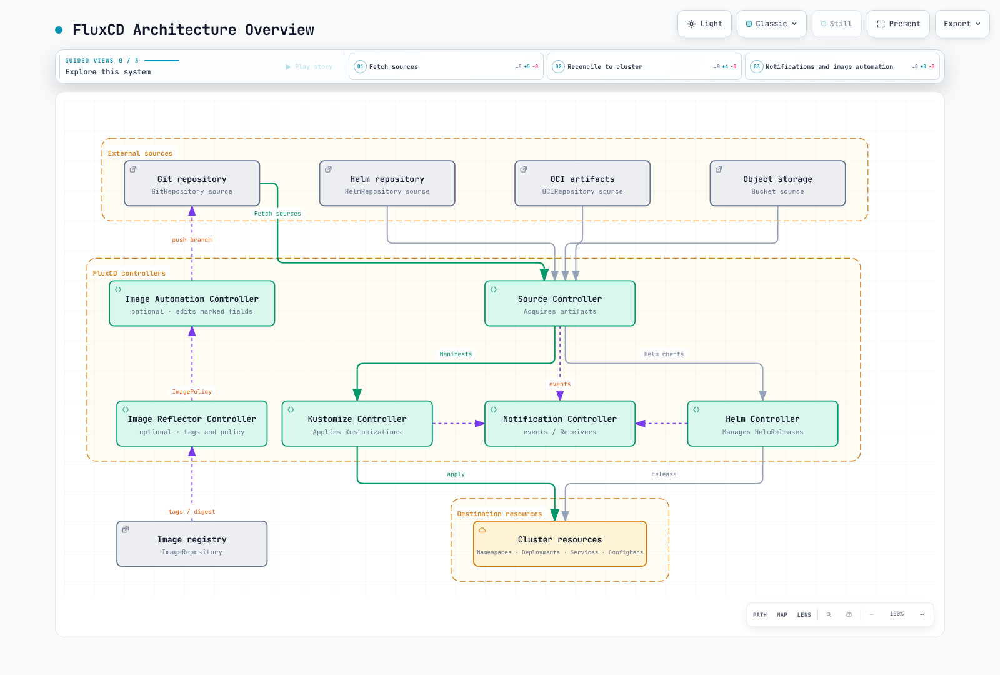

# FluxCD

> **Línea base de revisión**: Flux 2.9.5 autogestionado; actualizado al parche 2.9.6 tras revisar las notas de la versión (los ejemplos no se volvieron a ejecutar)
> **Última actualización**: 12 de octubre de 2026

FluxCD es un conjunto de soluciones de entrega continua y progresiva para Kubernetes que son abiertas y extensibles. FluxCD se graduó de la CNCF en noviembre de 2022, lo que lo convierte en una de las herramientas GitOps más maduras del ecosistema nativo de la nube.

Este capítulo se orienta a **Flux 2.9.6 autogestionado**. La comprobación previa de la CLI requiere Kubernetes 1.33 como mínimo; revisa también el periodo de soporte real de la distribución. Consulta el procedimiento de migración de API 2.7+ antes de actualizar desde la versión 2.6 o anteriores. Las API OCIRepository, Bucket e image mencionadas a continuación usan v1; Notification Provider/Alert siguen en v1beta3.

Los ejemplos usan recursos `flux-system` confiables y gestionados por la plataforma. Las definiciones Kustomization repetidas son alternativas o fragmentos que puedes combinar; no forman una secuencia de sustituciones. Prepara las URL, rutas, espacios de nombres y Secrets reales del repositorio. El uso multiinquilino requiere espacios de nombres dedicados, RBAC e impersonación mediante `spec.serviceAccountName`, además de restricciones para las referencias entre espacios de nombres.

## Introducción

FluxCD implementa los principios GitOps mediante repositorios Git como fuente de verdad para definir el estado deseado de los clústeres de Kubernetes. Reconcilia periódicamente los cambios de las fuentes y la desviación. Los fallos de autorización, disponibilidad y de las comprobaciones de estado pueden retrasar o impedir la convergencia.

### Características principales

- **GitOps nativo**: Creado desde cero para flujos de trabajo GitOps
- **Multiinquilino**: Admite varios equipos con configuraciones aisladas
- **Multiclúster**: Gestiona varios clústeres desde un único repositorio Git
- **Extensible**: Arquitectura modular con controladores especializados
- **Kubernetes nativo**: Usa Custom Resource Definitions (CRDs) para la configuración

## Descripción general de la arquitectura

FluxCD consta de un conjunto de controladores especializados que trabajan juntos para implementar flujos de trabajo GitOps:



[🔍 Ver diagrama interactivo](https://www.atomai.click/kubernetes-docs/archmaps/en-gitops-02-fluxcd-0.html)

## Componentes principales

La instalación predeterminada incluye los controladores source/kustomize/helm/notification. La automatización de imágenes también requiere los controladores **image-reflector-controller e image-automation-controller**. El source-watcher opcional proporciona composición de fuentes mediante API como ArtifactGenerator.

| Secret | Contenido requerido |
|---|---|
| git-credentials | Nombre de usuario/contraseña de Git por HTTPS o autenticación correspondiente; las actualizaciones de imágenes también necesitan acceso de escritura al repositorio |
| registry-credentials | Un Secret kubernetes.io/dockerconfigjson para el ImageRepository privado |
| slack-bot-token | Token OAuth de Slack Bot bajo la clave `token` |
| github-webhook-token | El `token` compartido con el webhook de GitHub |

Prepara los ConfigMaps/Secrets a los que se hace referencia en el mismo espacio de nombres que el recurso Flux. Proporciona los valores reales mediante una gestión de secretos protegida, no mediante archivos Git de texto sin formato.

### Controlador Source

El controlador Source se encarga de obtener artefactos de fuentes externas. Admite varios tipos de fuentes:

#### GitRepository

Sigue un repositorio Git y lo pone a disposición de otros controladores:

```yaml
apiVersion: source.toolkit.fluxcd.io/v1
kind: GitRepository
metadata:
  name: my-app
  namespace: flux-system
spec:
  interval: 1m
  url: https://github.com/my-org/my-app
  ref:
    branch: main
  secretRef:
    name: git-credentials
```

#### HelmRepository

Sigue un repositorio de charts Helm:

```yaml
apiVersion: source.toolkit.fluxcd.io/v1
kind: HelmRepository
metadata:
  name: podinfo
  namespace: flux-system
spec:
  interval: 1h
  url: https://stefanprodan.github.io/podinfo
```

#### OCIRepository

Esto describe un **artefacto OCI con manifiestos o contenido Helm para Flux**, no una imagen de contenedor de carga de trabajo. Publica primero un artefacto compatible y fija su etiqueta o digest.

Sigue los artefactos almacenados en registros compatibles con OCI (incluidos registros de contenedores):

```yaml
apiVersion: source.toolkit.fluxcd.io/v1
kind: OCIRepository
metadata:
  name: my-artifacts
  namespace: flux-system
spec:
  interval: 5m
  url: oci://ghcr.io/my-org/my-artifacts
  ref:
    tag: v1.0.0
```

#### Bucket

El ejemplo de AWS presupone que source-controller tiene configurada una cadena de credenciales predeterminada, como IRSA o EKS Pod Identity. Prepara la autenticación de EKS y los permisos del bucket que se describen a continuación.

Sigue los artefactos guardados en sistemas compatibles con S3:

```yaml
apiVersion: source.toolkit.fluxcd.io/v1
kind: Bucket
metadata:
  name: my-bucket
  namespace: flux-system
spec:
  interval: 5m
  provider: aws
  bucketName: my-flux-bucket
  endpoint: s3.us-east-1.amazonaws.com
  region: us-east-1
```

### Controlador de Kustomize

El controlador de Kustomize aplica capas de Kustomize y manifiestos de Kubernetes simples desde las fuentes.

#### Kustomization CRD

`targetNamespace` no crea un espacio de nombres. Créalo previamente o incluye un manifiesto Namespace en la Kustomization. `prune: true` puede eliminar recursos gestionados previamente que se hayan quitado de la fuente; revisa los límites de la fuente y la política de eliminación.

```yaml
apiVersion: kustomize.toolkit.fluxcd.io/v1
kind: Kustomization
metadata:
  name: my-app
  namespace: flux-system
spec:
  interval: 10m
  targetNamespace: production
  sourceRef:
    kind: GitRepository
    name: my-app
  path: ./deploy/production
  prune: true
  healthChecks:
  - apiVersion: apps/v1
    kind: Deployment
    name: my-app
    namespace: production
  timeout: 2m
```

#### Sustitución de variables

Las entradas de `substituteFrom` sobrescriben las entradas anteriores; `substitute` en línea tiene precedencia. Las sustituciones de Secret entran en los manifiestos renderizados, así que controla la salida y el acceso. El kustomize-controller 1.9.6 incluido con Flux 2.9.6 habilita `StrictPostBuildSubstitutions` de forma predeterminada y falla cuando falta una variable sin valor predeterminado. Comprueba si una implementación existente deshabilita explícitamente esa feature gate. Los campos numéricos aún deben renderizarse como valores numéricos de Kubernetes.

FluxCD admite la sustitución de variables mediante `postBuild`:

```yaml
apiVersion: kustomize.toolkit.fluxcd.io/v1
kind: Kustomization
metadata:
  name: my-app
  namespace: flux-system
spec:
  interval: 10m
  sourceRef:
    kind: GitRepository
    name: my-app
  path: ./deploy
  postBuild:
    substitute:
      ENVIRONMENT: production
      REPLICAS: '3'
    substituteFrom:
    - kind: ConfigMap
      name: cluster-config
    - kind: Secret
      name: cluster-secrets
  prune: true
  targetNamespace: production
```

#### Comprobaciones de estado

Define comprobaciones de estado personalizadas para los recursos implementados:

```yaml
spec:
  healthChecks:
  - apiVersion: apps/v1
    kind: Deployment
    name: frontend
    namespace: production
  - apiVersion: apps/v1
    kind: StatefulSet
    name: database
    namespace: production
  timeout: 5m
```

### Controlador de Helm

El controlador de Helm gestiona de forma declarativa las releases de charts de Helm.

#### HelmRelease CRD

```yaml
apiVersion: helm.toolkit.fluxcd.io/v2
kind: HelmRelease
metadata:
  name: podinfo
  namespace: flux-system
spec:
  interval: 5m
  chart:
    spec:
      chart: podinfo
      version: 6.15.0
      sourceRef:
        kind: HelmRepository
        name: podinfo
        namespace: flux-system
  targetNamespace: web
  install:
    createNamespace: true
    remediation:
      retries: 3
  upgrade:
    remediation:
      retries: 3
  values:
    replicaCount: 2
    service:
      type: ClusterIP
  releaseName: podinfo
```

#### Anulaciones de valores

Las entradas `valuesFrom` posteriores sobrescriben las anteriores, seguidas por los valores en línea. Una referencia `targetPath` puede sobrescribir incluso valores en línea, así que gestiona ese caso de forma explícita.

Anula los valores de Helm desde varias fuentes:

```yaml
spec:
  valuesFrom:
  - kind: ConfigMap
    name: podinfo-values
    valuesKey: values.yaml
  - kind: Secret
    name: podinfo-secrets
    valuesKey: credentials.yaml
  values:
    replicaCount: 3
```

#### Detección de desviaciones

Ignora las réplicas solo cuando otro controlador, como HPA, sea su propietario. Las reglas innecesarias para ignorar recursos pueden ocultar desviaciones manuales.

Habilita la detección de desviaciones para garantizar que los recursos implementados coincidan con el estado deseado:

```yaml
spec:
  driftDetection:
    mode: enabled
    ignore:
    - paths:
      - /spec/replicas
      target:
        kind: Deployment
```

### Controlador de notificaciones

El controlador de notificaciones gestiona eventos entrantes y salientes.

#### Proveedores

El ejemplo usa la API de Slack Bot. Configura el permiso `chat:write`, invita al bot al canal de destino y sustituye `channel` por el ID real del canal. Una URL de Incoming Webhook no equivale a un token de bot.

Configura los proveedores de notificaciones para las alertas:

```yaml
apiVersion: notification.toolkit.fluxcd.io/v1beta3
kind: Provider
metadata:
  name: slack
  namespace: flux-system
spec:
  type: slack
  channel: C0123456789
  secretRef:
    name: slack-bot-token
  address: https://slack.com/api/chat.postMessage
```

Los proveedores admitidos incluyen:
- Slack
- Microsoft Teams Workflows (`msteams`)
- Discord
- PagerDuty
- Opsgenie (clientes existentes; cierre anunciado para 2027-04-05)
- GitHub
- GitLab
- Grafana
- Webhooks genéricos

#### Alertas

Define alertas para los eventos de FluxCD:

```yaml
apiVersion: notification.toolkit.fluxcd.io/v1beta3
kind: Alert
metadata:
  name: on-call
  namespace: flux-system
spec:
  providerRef:
    name: slack
  eventSeverity: error
  eventSources:
  - kind: GitRepository
    name: '*'
  - kind: Kustomization
    name: '*'
  - kind: HelmRelease
    name: '*'
  eventMetadata:
    summary: Cluster alerts
```

#### Receivers (Webhooks)

La creación de un recurso Receiver no expone por sí sola un endpoint a Internet. Combina un Ingress previamente revisado que use TLS y dirija al Service `webhook-receiver` con `status.webhookPath`; configura el mismo token en GitHub y conserva la verificación de firma para `type: github`.

Configura los webhooks para eventos externos:

```yaml
apiVersion: notification.toolkit.fluxcd.io/v1
kind: Receiver
metadata:
  name: github-receiver
  namespace: flux-system
spec:
  type: github
  events:
  - ping
  - push
  secretRef:
    name: github-webhook-token
  resources:
  - kind: GitRepository
    name: my-app
```

### Automatización de imágenes

FluxCD puede actualizar automáticamente etiquetas de imágenes de contenedor en repositorios Git.

#### ImageRepository

El image-reflector-controller analiza las etiquetas y evalúa ImagePolicy. No crea imágenes, analiza vulnerabilidades ni descarga imágenes de cargas de trabajo.

Analiza registros de contenedores para detectar etiquetas nuevas:

```yaml
apiVersion: image.toolkit.fluxcd.io/v1
kind: ImageRepository
metadata:
  name: my-app
  namespace: flux-system
spec:
  image: ghcr.io/my-org/my-app
  interval: 1m
  secretRef:
    name: registry-credentials
```

#### ImagePolicy

Define políticas para seleccionar etiquetas de imagen:

```yaml
apiVersion: image.toolkit.fluxcd.io/v1
kind: ImagePolicy
metadata:
  name: my-app
  namespace: flux-system
  labels:
    app: my-app
spec:
  imageRepositoryRef:
    name: my-app
  policy:
    semver:
      range: '>=1.0.0 <2.0.0'
  digestReflectionPolicy: IfNotPresent
```

#### ImageUpdateAutomation

Los campos YAML que quieras actualizar deben incluir marcadores de política. La estrategia `IfNotPresent` refleja el digest de una etiqueta seleccionada; no valida firmas ni vulnerabilidades. Esta automatización sube los cambios a la rama dedicada flux/image-updates. La creación o aprobación de un PR dirigido a main forma parte de un flujo independiente de CI u operador, que Flux no proporciona automáticamente. Reserva la rama para la automatización y concede a las credenciales de Git acceso de escritura.

```yaml
# Deployment Pod-template fragment; the policy marker is required.
spec:
  template:
    spec:
      containers:
        - name: app
          image: ghcr.io/my-org/my-app:1.0.0 # {"$imagepolicy": "flux-system:my-app"}
```

Automatiza los commits de Git cuando se detecten nuevas imágenes:

```yaml
apiVersion: image.toolkit.fluxcd.io/v1
kind: ImageUpdateAutomation
metadata:
  name: my-app
  namespace: flux-system
spec:
  interval: 30m
  sourceRef:
    kind: GitRepository
    name: my-app
  git:
    checkout:
      ref:
        branch: main
    commit:
      author:
        email: flux@my-org.com
        name: Flux
      messageTemplate: |
        Automated image update

        Automation: {{ .AutomationObject }}

        Files:
        {{ range $filename, $_ := .Changed.FileChanges -}}
        - {{ $filename }}
        {{ end -}}

        Objects:
        {{ range $resource, $changes := .Changed.Objects -}}
        - {{ $resource.Kind }} {{ $resource.Name }}
          {{- range $_, $change := $changes }}
          {{ $change.OldValue }} -> {{ $change.NewValue }}
          {{- end }}
        {{ end -}}
    push:
      branch: flux/image-updates
  update:
    path: ./deploy
    strategy: Setters
  policySelector:
    matchLabels:
      app: my-app
```

## Instalación

### Uso de la CLI de Flux

Ejemplo de instalación de la versión publicada y verificada para Linux amd64/arm64. Para otros sistemas operativos, sigue la [guía oficial de instalación de la CLI](https://fluxcd.io/flux/installation/#install-the-flux-cli) y verifica la versión instalada.

```bash
set -euo pipefail
FLUX_VERSION=2.9.6
case "$(uname -m)" in
  x86_64)
    flux_arch=amd64
    flux_sha=b853df82adfd7736f580692f9f734473d571606307139f8fd20c2a80dd1ff473 ;;
  aarch64|arm64)
    flux_arch=arm64
    flux_sha=f3e159af616ec0b9bd0a405c2185cf09d06b74652c1de3c7f377e8166826651a ;;
  *) echo "Use the official installer for this architecture" >&2; exit 1 ;;
esac
flux_tmp="$(mktemp -d)"
trap 'rm -rf "$flux_tmp"' EXIT
curl -fsSL -o "$flux_tmp/flux.tar.gz" \
  "https://github.com/fluxcd/flux2/releases/download/v${FLUX_VERSION}/flux_${FLUX_VERSION}_linux_${flux_arch}.tar.gz"
printf '%s  %s\n' "$flux_sha" "$flux_tmp/flux.tar.gz" | sha256sum -c -
tar -xzf "$flux_tmp/flux.tar.gz" -C "$flux_tmp" flux
mkdir -p "$HOME/.local/bin"
install -m 0755 "$flux_tmp/flux" "$HOME/.local/bin/flux"
export PATH="$HOME/.local/bin:$PATH"
flux --version
```

### Bootstrap

El proceso de bootstrap escribe la configuración en Git e instala los controladores en el clúster. Verifica el contexto de `kubectl` y la autorización del repositorio, y elige GitHub o GitLab. `my-org` representa una organización o grupo; usa `--personal` solo con una cuenta personal. Proporciona los tokens de forma segura mediante variables de entorno. Estos ejemplos instalan también los controladores de automatización de imágenes. Si automatizas el repositorio de bootstrap, habilita por separado el acceso de escritura de la clave de despliegue.

```bash
kubectl config current-context
flux check --pre

# Alternative A: GitHub organization; provide authorized GITHUB_TOKEN securely.
flux bootstrap github \
  --owner=my-org \
  --repository=fleet-infra \
  --branch=main \
  --path=clusters/production \
  --version=v2.9.6 \
  --components-extra=image-reflector-controller,image-automation-controller

# Alternative B: GitLab group; provide authorized GITLAB_TOKEN securely.
flux bootstrap gitlab \
  --owner=my-org \
  --repository=fleet-infra \
  --branch=main \
  --path=clusters/production \
  --version=v2.9.6 \
  --components-extra=image-reflector-controller,image-automation-controller
```

### Verificar la instalación

```bash
# Check Flux components
flux check --components-extra=image-reflector-controller,image-automation-controller

# Get all Flux resources
flux get all

# Watch for changes
flux get kustomizations --watch
```

## Multiclúster con Flux

FluxCD admite la gestión de varios clústeres desde un único repositorio.

### Estructura del repositorio fleet

```
fleet-infra/
├── clusters/
│   ├── production/
│   │   ├── flux-system/
│   │   │   ├── gotk-components.yaml
│   │   │   ├── gotk-sync.yaml
│   │   │   └── kustomization.yaml
│   │   └── apps.yaml
│   ├── staging/
│   │   ├── flux-system/
│   │   │   ├── gotk-components.yaml
│   │   │   ├── gotk-sync.yaml
│   │   │   └── kustomization.yaml
│   │   └── apps.yaml
│   └── development/
│       ├── flux-system/
│       │   └── gotk-sync.yaml
│       └── apps.yaml
├── infrastructure/
│   ├── base/
│   │   ├── cert-manager/
│   │   ├── envoy-gateway/
│   │   └── monitoring/
│   └── overlays/
│       ├── production/
│       └── staging/
└── apps/
    ├── base/
    │   ├── frontend/
    │   └── backend/
    └── overlays/
        ├── production/
        └── staging/
```

### Dependencias de Kustomization en un plano de control

`dependsOn` espera la condición Ready de los objetos Kustomization observados por este plano de control Flux. Son dos objetos en un clúster, no una barrera entre clústeres. `wait: true` hace que la preparación de la infraestructura incluya la salud de las cargas de trabajo. El GitRepository de bootstrap predeterminado se llama `flux-system`, nombre que el ejemplo utiliza en `sourceRef`.

Inicializa cada clúster independiente con su propio contexto/ruta, o configura explícitamente un `kubeConfig` remoto y la autorización. Desde Flux 2.9.5, los kubeconfigs de Secret rechazan referencias a archivos locales en `certificate-authority`, `tokenFile`, `client-certificate` y `client-key`. Proporciona las credenciales/certificados requeridos como datos en línea protegidos o usa una configuración compatible de identidad de carga de trabajo.

```yaml
apiVersion: kustomize.toolkit.fluxcd.io/v1
kind: Kustomization
metadata:
  name: infrastructure
  namespace: flux-system
spec:
  interval: 1h
  sourceRef:
    kind: GitRepository
    name: flux-system
  path: ./infrastructure/overlays/production
  prune: true
  wait: true
  timeout: 5m
---
apiVersion: kustomize.toolkit.fluxcd.io/v1
kind: Kustomization
metadata:
  name: apps
  namespace: flux-system
spec:
  dependsOn:
  - name: infrastructure
  interval: 10m
  sourceRef:
    kind: GitRepository
    name: flux-system
  path: ./apps/overlays/production
  prune: true
```

## FluxCD en Amazon EKS

### Autenticación de AWS por controlador

Este ejemplo utiliza **IRSA a nivel de controlador**. Primero configura el proveedor OIDC de EKS, la relación de confianza del rol con el subject exacto de la ServiceAccount y la audiencia `sts.amazonaws.com`, además de los permisos necesarios para los recursos. Una anotación `role-ARN` no crea confianza ni políticas. EKS Pod Identity requiere, en cambio, configurar la asociación y el agente correspondientes; no se configura con la anotación de IRSA.

| Controlador | Propósito del acceso a AWS |
|---|---|
| source-controller | Artefactos OCI/Helm, buckets de S3, fuentes Git de CodeCommit |
| image-reflector-controller | Análisis de etiquetas/digest de imágenes de cargas de trabajo de ECR |
| image-automation-controller | Permisos para clonar y subir cambios con Git al usar directamente CodeCommit |
| kustomize-controller | Descifrado de SOPS KMS o reconciliación de EKS remoto |
| helm-controller | Reconciliación de releases Helm en EKS remoto |

Asignar un rol a source-controller no autentica a los demás controladores. En entornos multiinquilino, revisa por separado la identidad de carga de trabajo permitida para el objeto, la feature gate que la habilita, la ServiceAccount y la configuración de RBAC.

Fusiona este parche en flux-system/kustomization.yaml, dentro de la ruta de bootstrap, y gestiónalo en Git sin eliminar los parches ni recursos existentes. Un cambio exclusivo de la ServiceAccount no vuelve a inyectar IRSA en los Pods existentes; después de la reconciliación, vuelve a desplegar el controlador afectado.

```yaml
apiVersion: kustomize.config.k8s.io/v1beta1
kind: Kustomization
resources:
- gotk-components.yaml
- gotk-sync.yaml
patches:
- target:
    kind: ServiceAccount
    name: source-controller
  patch: |
    apiVersion: v1
    kind: ServiceAccount
    metadata:
      name: source-controller
      annotations:
        eks.amazonaws.com/role-arn: arn:aws:iam::123456789012:role/flux-source-controller
```

```bash
kubectl rollout restart deployment/source-controller -n flux-system
kubectl rollout status deployment/source-controller -n flux-system --timeout=180s
```

### Artefactos de GitOps en ECR

Estos permisos permiten a source-controller leer el repositorio dedicado `gitops-artifacts`. La acción `GetAuthorizationToken` no admite limitar el alcance al ARN del repositorio; por eso, usa el recurso `*` y añade a la política una condición para la región solicitada. Las acciones de lectura de contenido están delimitadas al ARN del repositorio. Sustituye los valores de cuenta, región y repositorio.

```json
{
  "Version": "2012-10-17",
  "Statement": [
    {
      "Effect": "Allow",
      "Action": "ecr:GetAuthorizationToken",
      "Resource": "*",
      "Condition": {
        "StringEquals": {
          "aws:RequestedRegion": "us-east-1"
        }
      }
    },
    {
      "Effect": "Allow",
      "Action": [
        "ecr:BatchCheckLayerAvailability",
        "ecr:GetDownloadUrlForLayer",
        "ecr:BatchGetImage"
      ],
      "Resource": "arn:aws:ecr:us-east-1:123456789012:repository/gitops-artifacts"
    }
  ]
}
```

```yaml
apiVersion: source.toolkit.fluxcd.io/v1
kind: OCIRepository
metadata:
  name: gitops-artifacts
  namespace: flux-system
spec:
  interval: 5m
  url: oci://123456789012.dkr.ecr.us-east-1.amazonaws.com/gitops-artifacts
  ref:
    tag: v1.0.0
  provider: aws
```

OCIRepository lee artefactos OCI con manifiestos o contenido Helm para Flux. No implementa imágenes de contenedor de cargas de trabajo ni concede permisos para descargarlas en nodos de EKS o en Fargate. El análisis de ImageRepository de ECR necesita autenticación independiente de image-reflector-controller y permisos de lectura del registro.

### Fuente S3 de tipo Bucket

Usa un bucket de artefactos dedicado y añade los permisos siguientes al rol del controlador. Si usas cifrado KMS gestionado por el cliente, también necesitas la política de clave y `kms:Decrypt`; el acceso entre cuentas requiere además la política del bucket.

```yaml
apiVersion: source.toolkit.fluxcd.io/v1
kind: Bucket
metadata:
  name: artifacts
  namespace: flux-system
spec:
  interval: 5m
  provider: aws
  bucketName: my-flux-artifacts
  endpoint: s3.us-east-1.amazonaws.com
  region: us-east-1
```

```json
{
  "Version": "2012-10-17",
  "Statement": [
    {
      "Effect": "Allow",
      "Action": "s3:ListBucket",
      "Resource": "arn:aws:s3:::my-flux-artifacts"
    },
    {
      "Effect": "Allow",
      "Action": "s3:GetObject",
      "Resource": "arn:aws:s3:::my-flux-artifacts/*"
    }
  ]
}
```

### Fuente HTTPS de CodeCommit

Esta es una **integración de fuentes para una instalación Flux existente**, no un procedimiento de bootstrap ni de creación de credenciales de IAM. source-controller 1.9.6 (incluido con Flux 2.9.6) admite `provider: aws` con un endpoint HTTPS de CodeCommit e IRSA o EKS Pod Identity. Añade el permiso de lectura al rol del controlador y referencia este GitRepository desde la Kustomization deseada.

```yaml
apiVersion: source.toolkit.fluxcd.io/v1
kind: GitRepository
metadata:
  name: codecommit-manifests
  namespace: flux-system
spec:
  interval: 1m
  provider: aws
  url: https://git-codecommit.us-east-1.amazonaws.com/v1/repos/fleet-infra
  ref:
    branch: main
```

```json
{
  "Version": "2012-10-17",
  "Statement": [
    {
      "Effect": "Allow",
      "Action": "codecommit:GitPull",
      "Resource": "arn:aws:codecommit:us-east-1:123456789012:fleet-infra"
    }
  ]
}
```

Si ImageUpdateAutomation envía cambios a CodeCommit, la identidad de su controlador u objeto también necesita permisos GitPull/GitPush y una política específica de rama y PR. SSH requiere como nombre de usuario el ID de una clave SSH registrada en IAM y la clave privada correspondiente; una URL ssh:// o una opción de generación de claves de la CLI no registra una clave IAM.

## Prácticas recomendadas

### Estructura del repositorio

- Usa un monorepo para equipos pequeños
- Usa repositorios separados para infraestructura y aplicaciones en organizaciones grandes
- Implementa capas específicas por entorno con Kustomize

### Seguridad

- Gestiona los ciclos de vida de los Secret y las claves con SOPS/Sealed Secrets o External Secrets Operator
- Configura espacios de nombres para inquilinos, RBAC e impersonación mediante spec.serviceAccountName y restricciones para las referencias entre espacios de nombres
- Habilita la validación de webhooks para receivers

### Monitorización

- Configura alertas para fallos de reconciliación
- Exporta métricas a Prometheus
- Configura paneles para los componentes de Flux

### Rendimiento

- Ajusta los intervalos de reconciliación según la frecuencia de cambios
- Usa la caché para repositorios Helm
- Implementa comprobaciones de estado con tiempos de espera adecuados

## Referencias

- [Versión de Flux 2.9.5 y aviso de seguridad de kubeconfig](https://github.com/fluxcd/flux2/releases/tag/v2.9.5)
- [Notas de la versión de Flux 2.9.6](https://github.com/fluxcd/flux2/releases/tag/v2.9.6)
- [Instalación de Flux](https://fluxcd.io/flux/installation/)
- [Integración de AWS](https://fluxcd.io/flux/integrations/aws/)
- [GitRepository v1](https://github.com/fluxcd/source-controller/blob/v1.9.5/docs/spec/v1/gitrepositories.md)
- [ImageUpdateAutomation v1](https://github.com/fluxcd/image-automation-controller/blob/v1.2.5/docs/spec/v1/imageupdateautomations.md)
- [Kustomization v1](https://github.com/fluxcd/kustomize-controller/blob/v1.9.5/docs/spec/v1/kustomizations.md)
- [Providers de notificaciones](https://github.com/fluxcd/notification-controller/blob/v1.9.4/docs/spec/v1beta3/providers.md)
- [Ciclo de vida de Opsgenie](https://www.atlassian.com/software/opsgenie)

## Cuestionario

Para comprobar lo que aprendiste, prueba el [cuestionario de FluxCD](../quizzes/gitops/02-fluxcd-quiz.md).
