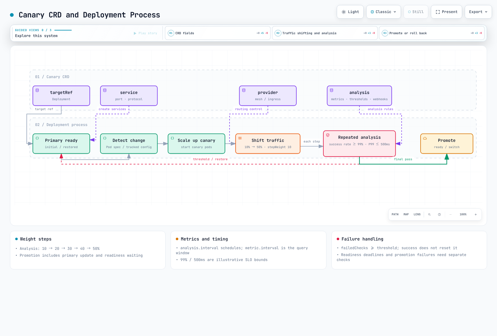

# Entrega progresiva con Flagger

> **Referencia de revisión**: Flagger/Chart 1.45.0, Loadtester 0.39.0, Flux 2.9.5 (actualizado a la versión de parche 2.9.6 tras revisar las notas de la versión; no se volvieron a ejecutar los ejemplos), Podinfo 6.15.0
> **Última actualización**: 12 de octubre de 2026

Flagger administra la entrega progresiva de cargas de trabajo de Kubernetes mediante el CRD Canary. Controla el tráfico y las revisiones, pero no revierte transaccionalmente las bases de datos ni los efectos secundarios externos. Estos ejemplos de laboratorio requieren redes, instrumentación, autorización y SLO de servicio compatibles.

El código incluye manifiestos completos y fragmentos de spec/valores de Helm. Intégralos en el recurso propietario indicado; los ejemplos de estrategias con el mismo nombre son alternativas, no una secuencia de bloques que se deban aplicar.

## Tabla de contenidos

- [Descripción general y objetivos de aprendizaje](#overview-and-learning-objectives)
- [Arquitectura de Flagger](#flagger-architecture)
- [Instalación y configuración en EKS](#eks-installation-and-configuration)
- [Estrategia de despliegue Canary](#canary-deployment-strategy)
- [Estrategia de despliegue Blue-Green](#blue-green-deployment-strategy)
- [Estrategia de pruebas A/B](#ab-testing-strategy)
- [Métricas personalizadas y webhooks](#custom-metrics-and-webhooks)
- [Integración con GitOps (Flux + Flagger)](#gitops-integration-flux--flagger)
- [Observabilidad y alertas](#observability-and-alerting)
- [Prácticas recomendadas para producción](#production-best-practices)

## Descripción general y objetivos de aprendizaje {#overview-and-learning-objectives}

RollingUpdate de un Deployment de Kubernetes ya reemplaza los Pods gradualmente. Flagger añade control explícito del tráfico entre revisiones y promoción basada en métricas y pruebas. Este capítulo abarca la propiedad de los recursos, tres estrategias, métricas y controles, GitOps y observabilidad.

| Estrategia | Control | Comprobación |
|---|---|---|
| Canary | Pesos incrementales | Réplicas adicionales, tráfico mínimo, criterios de fallo |
| Blue-Green | Validar una revisión independiente y, después, cambiar | Ambas cargas de trabajo más el excedente, compatibilidad con la base de datos |
| A/B | Coincidencia admitida de encabezados y cookies | Asignación de cohortes, estadísticas, autorización independiente |

Blue-Green no garantiza exactamente el doble de recursos, una reversión instantánea ni tiempo de inactividad cero. Flagger actualiza primary a la nueva revisión; después no conserva una instancia de reserva completa de la versión anterior.

### Flagger y Argo Rollouts

| Aspecto | Flagger | Argo Rollouts |
|---|---|---|
| Recursos | Canary hace referencia a una carga de trabajo existente | CRD Rollout, incluido Deployment workloadRef |
| GitOps | Flux y otras herramientas de GitOps | Argo CD y otras herramientas de GitOps |
| Análisis | MetricTemplate, umbrales, webhooks | AnalysisTemplate/AnalysisRun y proveedores Web/Job |
| Familia del proyecto | Flux Graduated de CNCF | Argo Graduated de CNCF |

La integración con un ecosistema no implica una dependencia exclusiva. No permitas que dos controladores de entrega progresiva administren la misma carga de trabajo.

## Arquitectura de Flagger {#flagger-architecture}


[Ver diagrama interactivo](https://www.atomai.click/kubernetes-docs/archmaps/en-gitops-04-flagger-1.html)

En el ejemplo con Deployment, podinfo es el recurso original y la carga de trabajo canary. La nueva carga de trabajo estable es podinfo-primary. podinfo-canary es el nombre de un Service, no un Deployment ni un CloneSet adicional.

| Recurso | Propiedad/propósito |
|---|---|
| Deployment podinfo | Plantilla de Pod de Git/Helm, control de Canary por parte de Flagger |
| Deployment podinfo-primary | Carga de trabajo estable creada/promovida por Flagger |
| Services podinfo / podinfo-primary / podinfo-canary | Selección de punto de entrada/destino administrada por Flagger |
| Autoscaler de primary | Autoscaler correspondiente cuando se usa autoscalerRef |
| VirtualService/DestinationRule/HTTPRoute, etc. | Enrutamiento para el proveedor seleccionado |


[Ver diagrama interactivo](https://www.atomai.click/kubernetes-docs/archmaps/en-gitops-04-flagger-2.html)

Después de la configuración inicial de primary, los cambios en la plantilla de Pod o en un ConfigMap/Secret cuyo seguimiento esté habilitado preparan canary. Tras las comprobaciones previas al rollout, el análisis y el enrutamiento, la promoción sirve tráfico a través de canary cuando está lista, mientras primary adopta la nueva spec. Cuando primary está lista, el tráfico vuelve a ella y canary reduce su escala.

**Un fallo en el análisis** normalmente restablece una primary en buen estado. **Un fallo durante la actualización de primary** es distinto: durante Promoting/Finalising, la versión 1.45.0 puede mantener/devolver el tráfico a canary, que sigue en buen estado, a la vez que informa del fallo. El estado Failed por sí solo no demuestra que primary, la versión anterior, esté sirviendo el tráfico.

### Proveedores y ciclo de vida

| Proveedor | Comprobación |
|---|---|
| Istio | VirtualService/DestinationRule y métricas HTTP de sidecar |
| gatewayapi:v1 | Funcionalidades de HTTPRoute de Gateway y MetricTemplate |
| Linkerd/Contour/Gloo/Traefik/Kuma, etc. | Capacidades de la versión instalada y contrato de métricas |
| kubernetes | Cambio de Service para Blue-Green, no enrutamiento ponderado de L7 ni A/B |
| App Mesh / ingress-nginx / OSM | Limitaciones del ciclo de vida heredado que se indican a continuación |

La compatibilidad con AWS App Mesh **finalizó el 30-09-2026**; AWS indica que la consola y los recursos ya no están accesibles después de esa fecha. ingress-nginx de la comunidad se retiró en marzo de 2026 y el repositorio de OSM está archivado.

La disponibilidad de un adaptador no garantiza el mantenimiento para nuevos usos en producción. Verifica la compatibilidad con A/B, la duplicación de tráfico y la afinidad de sesión para cada implementación.

## Instalación y configuración en EKS {#eks-installation-and-configuration}

La configuración de referencia requiere una versión compatible de EKS/Kubernetes, un entorno de sidecars de Istio instalado y Prometheus recopilando las métricas necesarias. Sustituye su URL por el Service real. Flagger no instala Istio ni la instrumentación. La imagen de Prometheus incluida en el chart usa la versión antigua 2.41.0, por lo que se deshabilita.

Elige un único método de lanzamiento/administración. Instalar instancias de Flagger independientes en distintos namespaces puede hacer que ambas controlen el mismo Canary. Los ejemplos usan flagger-system para los controladores y flagger-demo para las cargas de trabajo. Adapta las etiquetas de inyección a la revisión real de Istio.

```yaml
apiVersion: v1
kind: Namespace
metadata:
  name: flagger-system
  labels:
    istio-injection: enabled
---
apiVersion: v1
kind: Namespace
metadata:
  name: flagger-demo
  labels:
    istio-injection: enabled
---
apiVersion: v1
kind: ServiceAccount
metadata:
  name: flagger-loadtester
  namespace: flagger-system
automountServiceAccountToken: false
```

### Instalación de Flagger con Helm

```yaml
fullnameOverride: flagger
meshProvider: istio
namespace: flagger-demo
noCrossNamespaceRefs: true
metricsServer: http://prometheus.monitoring.svc.cluster.local:9090
prometheus:
  install: false
leaderElection:
  enabled: true
  replicaCount: 2
resources:
  requests:
    cpu: 100m
    memory: 128Mi
  limits:
    cpu: '1'
    memory: 512Mi
podDisruptionBudget:
  enabled: true
  minAvailable: 1
```

```bash
helm repo add flagger https://flagger.app
helm repo update flagger
helm upgrade --install flagger flagger/flagger --version 1.45.0 \
  --namespace flagger-system -f flagger-values.yaml --wait --timeout 5m
```

namespace limita lo que se observa, no los permisos de ClusterRole del chart. Restringe por separado el RBAC de los tenants. leaderElection.replicaCount es un valor real del chart. Las actualizaciones normales de Helm no actualizan crds/ como lo hace la instalación inicial; aplica por separado los CRD revisados o usa la política de CRD de Flux.

```bash
kubectl apply --server-side -f https://raw.githubusercontent.com/fluxcd/flagger/v1.45.0/artifacts/flagger/crd.yaml
```

### Loadtester y ámbito de acceso

```yaml
fullnameOverride: flagger-loadtester
replicaCount: 1
service:
  type: ClusterIP
  port: 80
serviceAccountName: flagger-loadtester
rbac:
  create: false
cmd:
  timeout: 2m
  namespaceRegexp: ^flagger-demo$
resources:
  requests:
    cpu: 100m
    memory: 64Mi
  limits:
    cpu: 500m
    memory: 256Mi
securityContext:
  enabled: true
  context:
    allowPrivilegeEscalation: false
    capabilities:
      drop:
      - ALL
    readOnlyRootFilesystem: true
    runAsUser: 100
    runAsGroup: 101
volumes:
- name: tmp
  emptyDir: {}
volumeMounts:
- name: tmp
  mountPath: /tmp
```

```bash
helm upgrade --install flagger-loadtester flagger/loadtester --version 0.39.0 \
  --namespace flagger-system -f loadtester-values.yaml --wait --timeout 5m
```

Loadtester ejecuta comandos recibidos en solicitudes HTTP. namespaceRegexp filtra una cadena del cuerpo; no autentica a quien realiza la solicitud. No lo expongas a Internet y restringe la entrada a los Pods del controlador mediante una política de CNI. Controla con RBAC el uso de exec/port-forward por parte de los operadores. Usa una réplica para los laboratorios de controles de aprobación con estado en memoria.

```yaml
apiVersion: networking.k8s.io/v1
kind: NetworkPolicy
metadata:
  name: flagger-loadtester-ingress
  namespace: flagger-system
spec:
  podSelector:
    matchLabels:
      app.kubernetes.io/name: loadtester
  policyTypes:
  - Ingress
  ingress:
  - from:
    - namespaceSelector:
        matchLabels:
          kubernetes.io/metadata.name: flagger-system
      podSelector:
        matchLabels:
          app.kubernetes.io/name: flagger
    ports:
    - protocol: TCP
      port: 8080
```

Permite las rutas de mTLS de Istio y de scrape necesarias. Este Loadtester no realiza operaciones de API, por lo que se deshabilita el montaje automático del token de ServiceAccount. Para añadir pruebas con Helm/kubectl se necesitan permisos explícitos y rutas con acceso de escritura.

### Alternativa con Gateway API

Se presupone que ya existe un GatewayClass de Istio y que los CRD de Gateway API son compatibles. No los sobrescribas con un bundle antiguo. Otras implementaciones requieren instrumentación/consultas compatibles. Configura la exposición del Service/LB, el DNS y TLS para el entorno.

```yaml
apiVersion: gateway.networking.k8s.io/v1
kind: Gateway
metadata:
  name: podinfo-gateway
  namespace: flagger-demo
spec:
  gatewayClassName: istio
  listeners:
  - name: http
    protocol: HTTP
    port: 80
    allowedRoutes:
      namespaces:
        from: Same
```

Usa **gatewayapi:v1** y Canary service.gatewayRefs, no un valor de Helm inventado como gatewayApi.gateway. Prepara los tres MetricTemplate que aparecen a continuación y usa este Canary como **alternativa** al enfoque de Istio.

```yaml
apiVersion: flagger.app/v1beta1
kind: Canary
metadata:
  name: podinfo
  namespace: flagger-demo
spec:
  provider: gatewayapi:v1
  targetRef:
    apiVersion: apps/v1
    kind: Deployment
    name: podinfo
  autoscalerRef:
    apiVersion: autoscaling/v2
    kind: HorizontalPodAutoscaler
    name: podinfo
  progressDeadlineSeconds: 120
  service:
    port: 9898
    targetPort: 9898
    hosts:
    - app.example.com
    gatewayRefs:
    - name: podinfo-gateway
      namespace: flagger-demo
      sectionName: http
  analysis:
    interval: 1m
    threshold: 5
    maxWeight: 50
    stepWeight: 10
    metrics:
    - name: error-rate
      templateRef:
        name: istio-error-rate
      thresholdRange:
        min: 0
        max: 1
      interval: 1m
    - name: latency-p99-ms
      templateRef:
        name: istio-latency-ms
      thresholdRange:
        min: 0
        max: 500
      interval: 1m
    - name: request-count
      templateRef:
        name: istio-request-count
      thresholdRange:
        min: 100
      interval: 1m
    webhooks:
    - name: smoke-test
      type: pre-rollout
      url: http://flagger-loadtester.flagger-system.svc.cluster.local/
      timeout: 30s
      metadata:
        type: bash
        cmd: |-
          set -euo pipefail
          curl -fsS --max-time 10 http://podinfo-canary.flagger-demo.svc.cluster.local:9898/healthz >/dev/null
          curl -fsS --max-time 10 http://podinfo-canary.flagger-demo.svc.cluster.local:9898/readyz >/dev/null
    - name: load-test
      type: rollout
      url: http://flagger-loadtester.flagger-system.svc.cluster.local/
      timeout: 5s
      metadata:
        type: cmd
        cmd: hey -z 1m -q 10 -c 2 http://podinfo-canary.flagger-demo.svc.cluster.local:9898/
```

```bash
helm upgrade --install flagger flagger/flagger --version 1.45.0 \
  --namespace flagger-system -f flagger-values.yaml --set meshProvider=gatewayapi:v1
```

## Estrategia de despliegue Canary {#canary-deployment-strategy}

Estos son la carga de trabajo Istio y el HPA de referencia; se requiere Metrics Server. Omite del repositorio las réplicas del Deployment para que HPA/Flagger puedan administrar el escalado, y no crees un Service que compita con ellos. Elige estos manifiestos o la alternativa posterior con HelmRelease.

```yaml
apiVersion: apps/v1
kind: Deployment
metadata:
  name: podinfo
  namespace: flagger-demo
spec:
  selector:
    matchLabels:
      app: podinfo
  template:
    metadata:
      labels:
        app: podinfo
    spec:
      containers:
      - name: podinfo
        image: ghcr.io/stefanprodan/podinfo:6.15.0
        ports:
        - name: http
          containerPort: 9898
        readinessProbe:
          httpGet:
            path: /readyz
            port: http
        livenessProbe:
          httpGet:
            path: /healthz
            port: http
        resources:
          requests:
            cpu: 100m
            memory: 64Mi
          limits:
            cpu: 500m
            memory: 256Mi
---
apiVersion: autoscaling/v2
kind: HorizontalPodAutoscaler
metadata:
  name: podinfo
  namespace: flagger-demo
spec:
  scaleTargetRef:
    apiVersion: apps/v1
    kind: Deployment
    name: podinfo
  minReplicas: 2
  maxReplicas: 4
  metrics:
  - type: Resource
    resource:
      name: cpu
      target:
        type: Utilization
        averageUtilization: 80
```



[Ver diagrama interactivo](https://www.atomai.click/kubernetes-docs/archmaps/en-gitops-04-flagger-3.html)

```yaml
apiVersion: flagger.app/v1beta1
kind: Canary
metadata:
  name: podinfo
  namespace: flagger-demo
spec:
  provider: istio
  targetRef:
    apiVersion: apps/v1
    kind: Deployment
    name: podinfo
  autoscalerRef:
    apiVersion: autoscaling/v2
    kind: HorizontalPodAutoscaler
    name: podinfo
  progressDeadlineSeconds: 120
  service:
    port: 9898
    targetPort: 9898
    portName: http
    gateways:
    - mesh
    hosts:
    - podinfo
    trafficPolicy:
      tls:
        mode: ISTIO_MUTUAL
  analysis:
    interval: 1m
    threshold: 5
    maxWeight: 50
    stepWeight: 10
    metrics:
    - name: request-success-rate
      thresholdRange:
        min: 99
        max: 100
      interval: 1m
    - name: request-duration
      thresholdRange:
        min: 0
        max: 500
      interval: 1m
    webhooks:
    - name: smoke-test
      type: pre-rollout
      url: http://flagger-loadtester.flagger-system.svc.cluster.local/
      timeout: 30s
      metadata:
        type: bash
        cmd: |-
          set -euo pipefail
          curl -fsS --max-time 10 http://podinfo-canary.flagger-demo.svc.cluster.local:9898/healthz >/dev/null
          curl -fsS --max-time 10 http://podinfo-canary.flagger-demo.svc.cluster.local:9898/readyz >/dev/null
    - name: load-test
      type: rollout
      url: http://flagger-loadtester.flagger-system.svc.cluster.local/
      timeout: 5s
      metadata:
        type: cmd
        cmd: hey -z 1m -q 10 -c 2 http://podinfo-canary.flagger-demo.svc.cluster.local:9898/
```

Las iteraciones eligen Blue-Green o A/B cuando hay una coincidencia; no las combines con un Canary ponderado. StepWeight 10 y maxWeight 50 describen el análisis en incrementos de 10→20→30→40→50 % antes de la promoción. El tiempo total depende de la disponibilidad, la latencia de las comprobaciones, los fallos/aprobaciones y el rollout de primary.

Analysis.interval programa el análisis; el intervalo de la métrica establece la ventana de consulta/agregación. Threshold 5 se aplica a las comprobaciones fallidas acumuladas para una revisión, no a un recuento de fallos consecutivos que se restablezca con cada éxito. Al llegar a cinco, se produce una reversión en la reconciliación posterior. Los fallos de las comprobaciones previas al rollout y los del rollout/métricas siguen esta ruta. ProgressDeadlineSeconds limita el progreso/la disponibilidad de la carga de trabajo, no el doble del tiempo total del rollout.

Para pesos no lineales, usa stepWeights y elimina los stepWeight/maxWeight existentes. Las conexiones y la convergencia del enrutamiento hacen que los pesos configurados no garanticen una proporción exacta de solicitudes en cada instante.

```yaml
spec:
  analysis:
    stepWeights:
    - 1
    - 2
    - 5
    - 10
    - 25
    - 50
```

```bash
kubectl get canary podinfo -n flagger-demo --watch
kubectl describe canary podinfo -n flagger-demo
kubectl logs -n flagger-system -l app.kubernetes.io/name=flagger -c flagger --prefix --tail=100
```

Después de la configuración inicial estable, aplica mediante Git un cambio revisado de imagen/etiqueta/digest o de plantilla de Pod para iniciar el análisis. Sustituir el contenido remoto detrás de la misma etiqueta no reemplaza un cambio en Git. No edites directamente los recursos generados primary, Service ni de enrutamiento.

## Estrategia de despliegue Blue-Green {#blue-green-deployment-strategy}


[Ver diagrama interactivo](https://www.atomai.click/kubernetes-docs/archmaps/en-gitops-04-flagger-4.html)

```yaml
apiVersion: flagger.app/v1beta1
kind: Canary
metadata:
  name: podinfo
  namespace: flagger-demo
spec:
  provider: istio
  targetRef:
    apiVersion: apps/v1
    kind: Deployment
    name: podinfo
  autoscalerRef:
    apiVersion: autoscaling/v2
    kind: HorizontalPodAutoscaler
    name: podinfo
  progressDeadlineSeconds: 120
  service:
    port: 9898
    targetPort: 9898
    portName: http
    gateways:
    - mesh
    hosts:
    - podinfo
    trafficPolicy:
      tls:
        mode: ISTIO_MUTUAL
  analysis:
    interval: 1m
    threshold: 5
    metrics:
    - name: request-success-rate
      thresholdRange:
        min: 99
        max: 100
      interval: 1m
    - name: request-duration
      thresholdRange:
        min: 0
        max: 500
      interval: 1m
    webhooks:
    - name: smoke-test
      type: pre-rollout
      url: http://flagger-loadtester.flagger-system.svc.cluster.local/
      timeout: 30s
      metadata:
        type: bash
        cmd: |-
          set -euo pipefail
          curl -fsS --max-time 10 http://podinfo-canary.flagger-demo.svc.cluster.local:9898/healthz >/dev/null
          curl -fsS --max-time 10 http://podinfo-canary.flagger-demo.svc.cluster.local:9898/readyz >/dev/null
    - name: load-test
      type: rollout
      url: http://flagger-loadtester.flagger-system.svc.cluster.local/
      timeout: 5s
      metadata:
        type: cmd
        cmd: hey -z 1m -q 10 -c 2 http://podinfo-canary.flagger-demo.svc.cluster.local:9898/
    iterations: 10
```

Este ejemplo analiza tráfico sintético mientras el tráfico en vivo sigue yendo a primary. Tras superar las comprobaciones, el tráfico pasa a canary mientras primary se actualiza; luego vuelve cuando primary está lista. Se siguen aplicando los umbrales de fallo; una medición fallida no siempre provoca una reversión inmediata. No se trata de un entorno independiente que conserve una instancia de reserva completa de la versión anterior.

### Duplicación opcional del tráfico

```yaml
spec:
  analysis:
    mirror: true
    mirrorWeight: 10
```

Los proveedores compatibles pueden duplicar el tráfico como etapa previa de Canary o para Blue-Green. Verifica la compatibilidad con RequestMirror para Gateway API. Descartar las respuestas no evita escrituras en bases de datos, pagos, mensajes ni carga; usa solicitudes de solo lectura verificadas o aislamiento. La duplicación no equivale a replicación ni a reversión de una base de datos.

<span id="ab-testing-strategy"></span>

## Estrategia de pruebas A/B

```yaml
apiVersion: flagger.app/v1beta1
kind: Canary
metadata:
  name: podinfo
  namespace: flagger-demo
spec:
  provider: istio
  targetRef:
    apiVersion: apps/v1
    kind: Deployment
    name: podinfo
  autoscalerRef:
    apiVersion: autoscaling/v2
    kind: HorizontalPodAutoscaler
    name: podinfo
  progressDeadlineSeconds: 120
  service:
    port: 9898
    targetPort: 9898
    portName: http
    gateways:
    - mesh
    hosts:
    - podinfo
    trafficPolicy:
      tls:
        mode: ISTIO_MUTUAL
  analysis:
    interval: 1m
    threshold: 5
    metrics:
    - name: request-success-rate
      thresholdRange:
        min: 99
        max: 100
      interval: 1m
    - name: request-duration
      thresholdRange:
        min: 0
        max: 500
      interval: 1m
    webhooks:
    - name: smoke-test
      type: pre-rollout
      url: http://flagger-loadtester.flagger-system.svc.cluster.local/
      timeout: 30s
      metadata:
        type: bash
        cmd: |-
          set -euo pipefail
          curl -fsS --max-time 10 http://podinfo-canary.flagger-demo.svc.cluster.local:9898/healthz >/dev/null
          curl -fsS --max-time 10 http://podinfo-canary.flagger-demo.svc.cluster.local:9898/readyz >/dev/null
    - name: load-test
      type: rollout
      url: http://flagger-loadtester.flagger-system.svc.cluster.local/
      timeout: 5s
      metadata:
        type: cmd
        cmd: hey -z 1m -q 10 -c 2 http://podinfo-canary.flagger-demo.svc.cluster.local:9898/
    iterations: 10
    match:
    - headers:
        x-canary:
          exact: insider
    - headers:
        cookie:
          regex: (^|.*;\s*)canary=always(;.*|$)
```

Las entradas de match son alternativas unidas por OR; las condiciones dentro de una entrada siguen las reglas del proveedor. La expresión regular de la cookie maneja los espacios después de los puntos y coma. sourceLabels de Istio describe etiquetas de la carga de trabajo, no direcciones IP de origen. Verifica la compatibilidad con el comparador para cada implementación/versión de Gateway.

El enrutamiento no es autorización ni un experimento estadístico completo. No confíes en marcadores controlados por el cliente como permisos de empleados. Asigna cohortes en un punto de entrada de confianza y autoriza en el servidor; las conclusiones A/B significativas también requieren muestras, un diseño de asignación y pruebas estadísticas.

Verifica la ruta de malla de referencia desde el Pod loadtester con inyección. Prueba las rutas de Gateway externas a través del host/TLS/ingress real. Llamar directamente a -canary no valida las coincidencias de enrutamiento.

```bash
kubectl exec -n flagger-system deployment/flagger-loadtester -- \
  curl -fsS http://podinfo.flagger-demo.svc.cluster.local:9898/
kubectl exec -n flagger-system deployment/flagger-loadtester -- \
  curl -fsS -H 'x-canary: insider' http://podinfo.flagger-demo.svc.cluster.local:9898/
kubectl exec -n flagger-system deployment/flagger-loadtester -- \
  curl -fsS -b 'canary=always' http://podinfo.flagger-demo.svc.cluster.local:9898/
```

## Métricas personalizadas y webhooks {#custom-metrics-and-webhooks}

### MetricTemplate de Prometheus

Estas consultas usan un contrato de métricas de sidecar de Istio. Verifica las etiquetas de namespace/carga de trabajo, reporter y el scrape. Si falta la serie 5xx, el numerador se convierte en cero; la ausencia de tráfico o un denominador cero no se convierten en éxito. El mínimo de 100 solicitudes y los demás límites son ejemplos; elige valores basados en los SLO y los requisitos de muestreo.

```yaml
apiVersion: flagger.app/v1beta1
kind: MetricTemplate
metadata:
  name: istio-error-rate
  namespace: flagger-demo
spec:
  provider:
    type: prometheus
    address: http://prometheus.monitoring.svc.cluster.local:9090
  query: |
    (sum(rate(istio_requests_total{reporter="destination", destination_workload_namespace="{{ namespace }}", destination_workload="{{ target }}", response_code=~"5.."}[{{ interval }}])) or vector(0)) / sum(rate(istio_requests_total{reporter="destination", destination_workload_namespace="{{ namespace }}", destination_workload="{{ target }}"}[{{ interval }}])) * 100
---
apiVersion: flagger.app/v1beta1
kind: MetricTemplate
metadata:
  name: istio-latency-ms
  namespace: flagger-demo
spec:
  provider:
    type: prometheus
    address: http://prometheus.monitoring.svc.cluster.local:9090
  query: |
    histogram_quantile(0.99, sum(rate(istio_request_duration_milliseconds_bucket{reporter="destination", destination_workload_namespace="{{ namespace }}", destination_workload="{{ target }}"}[{{ interval }}])) by (le))
---
apiVersion: flagger.app/v1beta1
kind: MetricTemplate
metadata:
  name: istio-request-count
  namespace: flagger-demo
spec:
  provider:
    type: prometheus
    address: http://prometheus.monitoring.svc.cluster.local:9090
  query: |
    sum(increase(istio_requests_total{reporter="destination", destination_workload_namespace="{{ namespace }}", destination_workload="{{ target }}"}[{{ interval }}]))
---
spec:
  analysis:
    metrics:
    - name: error-rate
      templateRef:
        name: istio-error-rate
      thresholdRange:
        min: 0
        max: 1
      interval: 1m
    - name: latency-p99-ms
      templateRef:
        name: istio-latency-ms
      thresholdRange:
        min: 0
        max: 500
      interval: 1m
    - name: request-count
      templateRef:
        name: istio-request-count
      thresholdRange:
        min: 100
      interval: 1m
```

MetricTemplate debe devolver un valor numérico. El proveedor de Prometheus rechaza los resultados vacíos/NaN. Limita los porcentajes a rangos finitos de 0–100 y haz coincidir las unidades de latencia personalizadas. Los límites son inclusivos. Las mediciones con ventanas de consulta superpuestas no son muestras independientes.

### Unidades de Datadog y punto de datos seleccionado

```yaml
apiVersion: flagger.app/v1beta1
kind: MetricTemplate
metadata:
  name: datadog-average-latency-ms
  namespace: flagger-demo
spec:
  provider:
    type: datadog
    address: https://api.datadoghq.com
    secretRef:
      name: datadog-api
  query: |
    avg:myapp.request_duration_ms{kube_deployment:{{ target }},kube_namespace:{{ namespace }}}.rollup(avg, 60)
---
apiVersion: v1
kind: Secret
metadata:
  name: datadog-api
  namespace: flagger-demo
type: Opaque
stringData:
  datadog_api_key: REPLACE_WITH_API_KEY
  datadog_application_key: REPLACE_WITH_APPLICATION_KEY
```

myapp.request_duration_ms es una latencia media personalizada en ms que debes publicar; no es P99. Selecciona el sitio con provider.address. El cliente lee las dos claves Secret mostradas, no datadog_site. Consulta diez veces el intervalo de la métrica y devuelve el punto más antiguo de la primera serie. No la uses como única prueba del estado actual de canary; acompáñala de mediciones recientes específicas de la revisión.

Las pruebas locales con respuestas simuladas del cliente original también confirmaron que un primer punto de datos null se decodifica como cero. Por tanto, un control de latencia que acepta cero milisegundos puede resultar engañoso. Usa un puente que valide las marcas de tiempo/valores faltantes o mediciones recientes de Prometheus.

### Campos y límites de CloudWatch

```yaml
apiVersion: flagger.app/v1beta1
kind: MetricTemplate
metadata:
  name: cloudwatch-error-percent
  namespace: flagger-demo
spec:
  provider:
    type: cloudwatch
    region: ap-northeast-2
  query: |
    [
      {
        "Id": "errorrate",
        "Expression": "IF(FILL(requests,0)>=100,100*FILL(errors,0)/FILL(requests,0),-1)",
        "Label": "CanaryErrorPercent",
        "ReturnData": true
      },
      {
        "Id": "errors",
        "MetricStat": {
          "Metric": {
            "Namespace": "MyApp",
            "MetricName": "5xxErrors",
            "Dimensions": [
              {
                "Name": "Service",
                "Value": "{{ target }}"
              },
              {
                "Name": "Namespace",
                "Value": "{{ namespace }}"
              }
            ]
          },
          "Period": 60,
          "Stat": "Sum"
        },
        "ReturnData": false
      },
      {
        "Id": "requests",
        "MetricStat": {
          "Metric": {
            "Namespace": "MyApp",
            "MetricName": "TotalRequests",
            "Dimensions": [
              {
                "Name": "Service",
                "Value": "{{ target }}"
              },
              {
                "Name": "Namespace",
                "Value": "{{ namespace }}"
              }
            ]
          },
          "Period": 60,
          "Stat": "Sum"
        },
        "ReturnData": false
      }
    ]
---
spec:
  analysis:
    metrics:
    - name: cw-error-percent
      templateRef:
        name: cloudwatch-error-percent
      thresholdRange:
        min: 0
        max: 1
      interval: 1m
```

Provider.region es compatible y obligatorio. Publica por separado las métricas MyApp y las dimensiones Service/Namespace. La expresión devuelve -1 para periodos con datos ausentes o poco volumen, lo que incumple el límite de 0–1 %. Los retrasos de ingesta pueden rechazar un rollout; verifica la publicación real y las ventanas de agregación/consulta.

El proveedor nativo consulta diez veces el intervalo de la métrica y selecciona el primer valor del primer resultado, sin validar por separado la marca de tiempo/StatusCode. Complétalo con comprobaciones actuales de solicitudes/salud de Prometheus para la revisión actual, de modo que no se confundan puntos antiguos ni métricas agregadas de ALB con el estado actual de canary. Su permiso de API de AWS es GetMetricData.

```json
{
  "Version": "2012-10-17",
  "Statement": [
    {
      "Effect": "Allow",
      "Action": "cloudwatch:GetMetricData",
      "Resource": "*",
      "Condition": {
        "StringEquals": {
          "aws:RequestedRegion": "ap-northeast-2"
        }
      }
    }
  ]
}
```

Configura la autenticación de ServiceAccount de Flagger y la relación de confianza del rol cuando se use CloudWatch, y haz coincidir la condición de región. Esta revisión no realizó llamadas a las API de AWS ni desplegó un rol.

### Contrato de webhook

| Tipo | Significado / comportamiento de rechazo |
|---|---|
| confirm-rollout | Espera la aprobación para iniciar |
| pre-rollout | Comprobación antes del cambio inicial de tráfico; incrementa los fallos |
| rollout | Se invoca durante el análisis; incrementa los fallos |
| confirm-traffic-increase | Espera antes de aumentar el peso |
| confirm-promotion | Espera antes de la promoción |
| post-rollout | Notifica/limpia después de Succeeded o Failed; no revierte el resultado |
| rollback | El éxito durante el análisis/la espera de aprobación solicita una reversión |
| event | Reenvía eventos relacionados con el estado |

Normalmente debe responder con HTTP 200. La versión 1.45.0 trata los códigos superiores a 202 como errores, así que no des por hecho que 204 tiene éxito. Los metadatos se copian literalmente; `{{ .Version }}` no se interpola. Usa name/namespace/phase/checksum de la carga útil. Los cuerpos de las respuestas que no indiquen éxito pueden incluirse en registros/eventos, así que no devuelvas valores sensibles.

```yaml
name: podinfo
namespace: flagger-demo
phase: Progressing
checksum: example-revision-checksum
metadata:
  gate: promotion
```

La configuración del webhook no permite definir encabezados Authorization arbitrarios. Implementa la autenticación necesaria mediante un límite de mTLS/proxy interno revisado; no pongas secretos en URL de Git pública/metadatos ni deshabilites la verificación de TLS de forma predeterminada.

Las pruebas de carga cmd se aceptan de forma asíncrona; el éxito de HTTP no determina la calidad de la prueba de carga. Bash espera hasta que finalice y debe ajustarse a su timeout. La imagen 0.39.0 incluye curl/jq/hey/wrk/bash, pero no k6. k6 requiere una imagen y unos umbrales verificados por separado, porque check() por sí solo no garantiza un estado de salida fallido.

Este script es para una imagen de prueba dedicada que tenga k6 instalado; no es un comando que funcione en la imagen predeterminada de loadtester.

```javascript
import http from 'k6/http';
import { check, sleep } from 'k6';

export const options = {
  vus: 2,
  duration: '20s',
  thresholds: {
    checks: ['rate==1'],
    http_req_failed: ['rate<0.01'],
    http_req_duration: ['p(99)<500'],
  },
};
export default function () {
  const result = http.get('http://podinfo-canary.flagger-demo.svc.cluster.local:9898/');
  check(result, { 'HTTP 200': (response) => response.status === 200 });
  sleep(0.5);
}
```

### Control manual

```yaml
spec:
  analysis:
    webhooks:
    - name: promotion-approval
      type: confirm-promotion
      url: http://flagger-loadtester.flagger-system.svc.cluster.local/gate/check
      timeout: 5s
      metadata:
        gate: promotion
```

Integra esta entrada en la lista de webhooks del Canary existente. /gate/approve siempre aprueba; no es un control manual. /gate/check lee el estado en memoria name.namespace. Envía el mismo cuerpo JSON para abrir/cerrar/comprobar. Cerrarlo detiene la promoción, no provoca una reversión.

```bash
# Close before starting a new revision.
kubectl exec -n flagger-system deployment/flagger-loadtester -- \
  curl -fsS -X POST -H 'Content-Type: application/json' \
  -d '{"name":"podinfo","namespace":"flagger-demo"}' http://localhost:8080/gate/close
# Approve the reviewed revision.
kubectl exec -n flagger-system deployment/flagger-loadtester -- \
  curl -fsS -X POST -H 'Content-Type: application/json' \
  -d '{"name":"podinfo","namespace":"flagger-demo"}' http://localhost:8080/gate/open
# A closed gate returns 403.
kubectl exec -n flagger-system deployment/flagger-loadtester -- \
  curl -sS -o /dev/null -w '%{http_code}\n' -X POST -H 'Content-Type: application/json' \
  -d '{"name":"podinfo","namespace":"flagger-demo"}' http://localhost:8080/gate/check
```

El control integrado no es específico de un checksum, se restablece al reiniciar el Pod y no se comparte entre réplicas. Ciérralo antes de la siguiente revisión. La aprobación de producción necesita autenticación, auditoría, caducidad y estado indexado por name/namespace/checksum/gate. Un único control de aprobación con estado en memoria compartido por el inicio y la promoción no equivale a dos aprobaciones independientes.

### Reversión manual y suspensión

```yaml
spec:
  analysis:
    webhooks:
    - name: operator-rollback
      type: rollback
      url: http://flagger-loadtester.flagger-system.svc.cluster.local/rollback/check
      timeout: 5s
```

El endpoint de rollback normalmente devuelve 403 si no hay ninguna señal y 200 cuando se solicita una reversión. Una respuesta de éxito de un receptor de notificaciones puede provocar una reversión involuntaria. Las siguientes solicitudes piden una reversión durante la reconciliación normal, durante el análisis o mientras se espera la aprobación de la promoción; no son un interruptor de recuperación instantánea para todas las fases.

```bash
kubectl get canary podinfo -n flagger-demo -o jsonpath='{.status.phase}{"\n"}'
kubectl exec -n flagger-system deployment/flagger-loadtester -- \
  curl -fsS -X POST -H 'Content-Type: application/json' \
  -d '{"name":"podinfo","namespace":"flagger-demo"}' http://localhost:8080/rollback/open
kubectl get canary podinfo -n flagger-demo --watch
# Reset the request after observing the operation.
kubectl exec -n flagger-system deployment/flagger-loadtester -- \
  curl -fsS -X POST -H 'Content-Type: application/json' \
  -d '{"name":"podinfo","namespace":"flagger-demo"}' http://localhost:8080/rollback/close
```

Los fallos del controlador/de disponibilidad o un control confirm-rollout cerrado pueden detener la reconciliación antes de este hook. Los fallos de primary durante Promoting/Finalising requieren el mecanismo de recuperación independiente descrito antes. Si se deja abierta la solicitud de reversión después de completar la operación, puede afectar a la siguiente revisión.

No trates las anotaciones flagger.app/rollback, flagger.app/suspend ni flagger.app/skipAnalysis como API de control. Suspend/skipAnalysis son campos de spec. Suspend detiene la reconciliación, incluidos los hooks de reversión, sin devolver el tráfico a primary. SkipAnalysis promueve sin análisis; no es una reversión. Actualiza también el recurso propietario en Git.

```yaml
spec:
  suspend: true
```

<span id="gitops-integration-flux--flagger"></span>

## Integración con GitOps (Flux + Flagger)


[Ver diagrama interactivo](https://www.atomai.click/kubernetes-docs/archmaps/en-gitops-04-flagger-0.html)


[Ver diagrama interactivo](https://www.atomai.click/kubernetes-docs/archmaps/en-gitops-04-flagger-5.html)

El bootstrap de Flux no instala Flagger como controlador integrado. Instálalo por separado mediante HelmRelease o Kustomization. No administres simultáneamente la misma versión mediante la CLI de Helm. Administra también en Git los namespaces, el ServiceAccount y el NetworkPolicy anteriores.

```yaml
apiVersion: source.toolkit.fluxcd.io/v1
kind: HelmRepository
metadata:
  name: flagger
  namespace: flagger-system
spec:
  interval: 1h
  url: https://flagger.app
---
apiVersion: helm.toolkit.fluxcd.io/v2
kind: HelmRelease
metadata:
  name: flagger
  namespace: flagger-system
spec:
  interval: 1h
  releaseName: flagger
  chart:
    spec:
      chart: flagger
      version: 1.45.0
      sourceRef:
        kind: HelmRepository
        name: flagger
  install:
    crds: Create
  upgrade:
    crds: CreateReplace
  values:
    fullnameOverride: flagger
    meshProvider: istio
    namespace: flagger-demo
    noCrossNamespaceRefs: true
    metricsServer: http://prometheus.monitoring.svc.cluster.local:9090
    prometheus:
      install: false
    leaderElection:
      enabled: true
      replicaCount: 2
    resources:
      requests:
        cpu: 100m
        memory: 128Mi
      limits:
        cpu: '1'
        memory: 512Mi
    podDisruptionBudget:
      enabled: true
      minAvailable: 1
---
apiVersion: helm.toolkit.fluxcd.io/v2
kind: HelmRelease
metadata:
  name: loadtester
  namespace: flagger-system
spec:
  interval: 1h
  releaseName: flagger-loadtester
  chart:
    spec:
      chart: loadtester
      version: 0.39.0
      sourceRef:
        kind: HelmRepository
        name: flagger
  values:
    fullnameOverride: flagger-loadtester
    replicaCount: 1
    service:
      type: ClusterIP
      port: 80
    serviceAccountName: flagger-loadtester
    rbac:
      create: false
    cmd:
      timeout: 2m
      namespaceRegexp: ^flagger-demo$
    resources:
      requests:
        cpu: 100m
        memory: 64Mi
      limits:
        cpu: 500m
        memory: 256Mi
    securityContext:
      enabled: true
      context:
        allowPrivilegeEscalation: false
        capabilities:
          drop:
          - ALL
        readOnlyRootFilesystem: true
        runAsUser: 100
        runAsGroup: 101
    volumes:
    - name: tmp
      emptyDir: {}
    volumeMounts:
    - name: tmp
      mountPath: /tmp
```

El manejo de CRD CreateReplace de Flux no garantiza que la migración sea segura. Revisa los cambios de los CRD y los objetos almacenados antes de las actualizaciones. Aplica los objetos Canary después de que las fuentes y la instalación del proveedor estén listas.

### Alternativa con HelmRelease de la aplicación

```yaml
apiVersion: source.toolkit.fluxcd.io/v1
kind: HelmRepository
metadata:
  name: podinfo
  namespace: flagger-demo
spec:
  interval: 1h
  url: https://stefanprodan.github.io/podinfo
---
apiVersion: helm.toolkit.fluxcd.io/v2
kind: HelmRelease
metadata:
  name: podinfo
  namespace: flagger-demo
spec:
  interval: 5m
  releaseName: podinfo
  chart:
    spec:
      chart: podinfo
      version: 6.15.0
      sourceRef:
        kind: HelmRepository
        name: podinfo
  values:
    service:
      enabled: false
    hpa:
      enabled: true
      minReplicas: 2
      maxReplicas: 4
    resources:
      requests:
        cpu: 100m
        memory: 64Mi
      limits:
        cpu: 500m
        memory: 256Mi
```

Podinfo 6.15.0 service.enabled=false evita la propiedad de un Service que compita con otra. Con hpa.enabled=true, el chart no fija las réplicas del Deployment. No apliques este HelmRelease junto con los manifiestos de carga de trabajo nativos. Comprueba mediante la renderización el comportamiento equivalente de otros charts, en lugar de presuponer que usan los mismos nombres de valores.

Administra el Canary anterior junto con la aplicación. Ready de Flux/Helm se refiere a la aplicación/disponibilidad de los recursos; no demuestra automáticamente que Flagger haya promovido la revisión actual. Condiciona el siguiente entorno al estado/checksum de Canary y a que la versión desplegada coincida con el cambio previsto.

### Alternativa con Kustomization

```yaml
apiVersion: kustomize.toolkit.fluxcd.io/v1
kind: Kustomization
metadata:
  name: podinfo
  namespace: flux-system
spec:
  interval: 10m
  targetNamespace: flagger-demo
  sourceRef:
    kind: GitRepository
    name: flux-system
  path: ./apps/podinfo
  prune: true
  timeout: 5m
```

```yaml
apiVersion: kustomize.config.k8s.io/v1beta1
kind: Kustomization
namespace: flagger-demo
resources:
- deployment.yaml
- hpa.yaml
- canary.yaml
```

sourceRef usa el nombre predeterminado del GitRepository de bootstrap. Guarda los manifiestos nativos en apps/podinfo y omite los Services/recursos primary propiedad de Flagger. Que Kustomization se aplique correctamente no significa que la promoción se haya completado.

Un overlay de entorno puede modificar explícitamente la configuración escalar. Son opciones ilustrativas, no un estándar universal de producción. Comprueba también el comportamiento de reemplazo de arrays al modificar CRD.

```yaml
apiVersion: kustomize.config.k8s.io/v1beta1
kind: Kustomization
resources:
- ../base
patches:
- target:
    group: flagger.app
    version: v1beta1
    kind: Canary
    name: podinfo
  patch: |
    - op: replace
      path: /spec/analysis/threshold
      value: 3
    - op: replace
      path: /spec/analysis/maxWeight
      value: 30
    - op: replace
      path: /spec/analysis/stepWeight
      value: 5
```

### Automatización de imágenes y ramas de promoción


[Ver diagrama interactivo](https://www.atomai.click/kubernetes-docs/archmaps/en-gitops-04-flagger-6.html)

```yaml
apiVersion: image.toolkit.fluxcd.io/v1
kind: ImageRepository
metadata:
  name: podinfo
  namespace: flux-system
spec:
  image: ghcr.io/stefanprodan/podinfo
  interval: 5m
---
apiVersion: image.toolkit.fluxcd.io/v1
kind: ImagePolicy
metadata:
  name: podinfo
  namespace: flux-system
  labels:
    app: podinfo
spec:
  imageRepositoryRef:
    name: podinfo
  policy:
    semver:
      range: '>=6.15.0 <7.0.0'
  digestReflectionPolicy: IfNotPresent
---
apiVersion: image.toolkit.fluxcd.io/v1
kind: ImageUpdateAutomation
metadata:
  name: podinfo
  namespace: flux-system
spec:
  interval: 5m
  sourceRef:
    kind: GitRepository
    name: flux-system
  policySelector:
    matchLabels:
      app: podinfo
  git:
    checkout:
      ref:
        branch: main
    commit:
      author:
        name: Flux
        email: flux@example.com
      messageTemplate: |-
        Update podinfo image
        {{ range .Changed.Changes }}{{ .OldValue }} -> {{ .NewValue }}
        {{ end }}
    push:
      branch: flux/podinfo-updates
  update:
    path: ./apps/podinfo
    strategy: Setters
```

Esto requiere los controladores image-reflector/image-automation, marcadores de políticas y acceso de escritura a Git. Empuja los cambios a una rama dedicada, así que la creación de PR, las comprobaciones y la fusión se realizan por separado. Adapta el repositorio/las rutas y reserva la rama para la automatización. Usa el modelo actual de plantilla de confirmación .Changed, no un campo .NewTag inexistente.

```yaml
# Native Deployment Pod-template fragment.
spec:
  template:
    spec:
      containers:
      - name: podinfo
        image: ghcr.io/stefanprodan/podinfo:6.15.0 # {"$imagepolicy": "flux-system:podinfo"}
```

```yaml
# Alternative: merge into HelmRelease.spec.values.
image:
  repository: ghcr.io/stefanprodan/podinfo
  tag: "6.15.0" # {"$imagepolicy": "flux-system:podinfo:tag"}
```

Un marcador que solo fija la etiqueta no fija un digest. Comprueba la compatibilidad del chart con digest o la inmutabilidad de las etiquetas del registro y su validación. No sobrescribas una imagen de forma incoherente con Kustomize images y un marcador de Deployment a la vez. ECR requiere una autenticación independiente de image-reflector con AWS y la autorización real para extraer imágenes del Pod.

## Observabilidad y alertas {#observability-and-alerting}

Las métricas de Flagger y las métricas de Istio/aplicación tienen distintos destinos de scrape. Las anotaciones no hacen que todas las instalaciones de Prometheus recopilen métricas automáticamente. Para Prometheus Operator, ajusta serviceMonitor.enabled del chart a los selectores, namespaces y acceso mTLS reales.

```yaml
serviceMonitor:
  enabled: true
  labels:
    release: prometheus
```

La etiqueta release es un ejemplo y debe coincidir con serviceMonitorSelector de Prometheus. Los CRD de Operator deben estar instalados.

| Métrica | Tipo / significado real |
|---|---|
| flagger_info | Gauge, versión/mesh_provider |
| flagger_canary_total | Gauge, recuento de objetos Canary por namespace |
| flagger_canary_status | Gauge, 0=Progressing, 2=Failed, otras fases se asignan a 1 |
| flagger_canary_weight | Gauge, peso del tráfico por carga de trabajo/namespace |
| flagger_canary_metric_analysis | Gauge, valor real de la métrica, no un booleano genérico de aprobado/reprobado |
| flagger_canary_duration_seconds | Histograma, tiempo de procesamiento de la reconciliación del análisis, no duración total del rollout |
| flagger_canary_successes_total / failures_total | Counter, resultados con etiquetas strategy/analysis_status |

No deduzcas que el estado es Succeeded a partir del valor 1; las fases de aprobación/promoción y otras pueden compartirlo. Comprueba Canary.status.phase y la revisión prevista. La etiqueta name es targetRef.name, que no necesariamente coincide con el nombre del objeto Canary. Weight usa workload en lugar de name. Consulta status.iterations en vez de presuponer que existe una métrica iterations exportada.

### Panel de Grafana

Usa las siguientes consultas en paneles actuales de Grafana Stat/Time series. Filtra una etiqueta de clúster externa al agregar datos de forma centralizada. clusterName de Flagger afecta las alertas; no añade automáticamente una etiqueta cluster a las métricas de Prometheus.

```promql
flagger_canary_status{namespace="flagger-demo"}
flagger_canary_weight{namespace="flagger-demo",workload="podinfo"}
flagger_canary_metric_analysis{namespace="flagger-demo",name="podinfo",metric="request-success-rate"}
increase(flagger_canary_successes_total{namespace="flagger-demo",analysis_status="completed"}[7d])
increase(flagger_canary_failures_total{namespace="flagger-demo",analysis_status="completed"}[7d])
```

El JSON del panel oficial de Istio es una referencia; valida los nombres de las fuentes de datos y la compatibilidad del panel/esquema con la versión actual de Grafana y, después, expórtalo. El JSON del panel no es un manifiesto de Kubernetes. Aprovisiona el modelo del panel exportado, no un envoltorio de la API HTTP {"dashboard": ...}.

```bash
curl -fsSL -o flagger-istio-reference.json \
  https://raw.githubusercontent.com/fluxcd/flagger/v1.45.0/charts/grafana/dashboards/istio.json
# After reviewing/exporting flagger-dashboard.json in Grafana:
jq -e '.title and (.panels | type == "array")' flagger-dashboard.json >/dev/null
kubectl create configmap flagger-dashboard -n monitoring \
  --from-file=flagger-dashboard.json=./flagger-dashboard.json \
  --dry-run=client -o yaml > flagger-dashboard-cm.yaml
kubectl label --local -f flagger-dashboard-cm.yaml grafana_dashboard=1 \
  -o yaml > flagger-dashboard-ready.yaml
```

Revisa el ConfigMap generado e inclúyelo en GitOps. Configura el sidecar/provisioner de Grafana para que observe su etiqueta y namespace. No te bases en un ID de panel no verificado como instrucción de instalación.

### Alertas de Prometheus

```yaml
apiVersion: monitoring.coreos.com/v1
kind: PrometheusRule
metadata:
  name: flagger-alerts
  namespace: monitoring
spec:
  groups:
  - name: flagger
    rules:
    - alert: FlaggerAnalysisFailed
      expr: flagger_canary_status == 2
      for: 1m
      labels:
        severity: warning
      annotations:
        summary: Flagger analysis failed for {{ $labels.namespace }}/{{ $labels.name }}
        description: Inspect Canary phase, events, and actual routing before assuming the old primary is serving
          traffic.
    - alert: FlaggerAnalysisLongRunning
      expr: flagger_canary_status == 0
      for: 1h
      labels:
        severity: warning
      annotations:
        summary: Flagger analysis remains active for {{ $labels.namespace }}/{{ $labels.name }}
        description: Check approval gates, failed checks and workload readiness; this is not a measurement of rollout
          duration.
```

Estas reglas presuponen un Prometheus local al clúster. La condición ==0 con for:1h mide una condición Progressing observada continuamente, no todas las fases activas ni la marca de tiempo de inicio del rollout. Evalúa aparte las esperas intencionadas en controles. Los buckets del histograma representan tiempos cortos de procesamiento de la reconciliación; no uses time()-duration ni una alerta de P99 de rollout de 600 segundos.

### Notificaciones a Slack, Teams y externas

```yaml
apiVersion: flagger.app/v1beta1
kind: AlertProvider
metadata:
  name: slack
  namespace: flagger-demo
spec:
  type: slack
  channel: C0123456789
  username: flagger
  secretRef:
    name: slack-bot
---
apiVersion: v1
kind: Secret
metadata:
  name: slack-bot
  namespace: flagger-demo
type: Opaque
stringData:
  address: https://slack.com/api/chat.postMessage
  token: REPLACE_WITH_SLACK_BOT_TOKEN
---
spec:
  analysis:
    alerts:
    - name: deployment-alerts
      severity: info
      providerRef:
        name: slack
```

Los valores del Secret son marcadores de posición; no guardes los tokens reales en Git. En esta versión, secretRef de AlertProvider requiere address y también token para la API de Slack Bot. Configura chat:write y la pertenencia al canal, y sustituye channel por el ID real. Para Incoming Webhooks, verifica el canal asociado y las sobrescrituras permitidas.

Severity es un nivel mínimo, no un enrutamiento exclusivo: info recibe todos los niveles, warn recibe warn/error y error recibe los errores. Las suscripciones duplicadas pueden duplicar las notificaciones.

msteams nativo de Flagger 1.45.0 sigue emitiendo MessageCard. No presupongas que basta con cambiar su URL por un endpoint de Adaptive Card de Workflows. Configura un convertidor compatible o un receptor de eventos con autenticación y conversión de la carga útil. Esto difiere del comportamiento de Teams de Flux 2.9.6.

No des por hecho que existe un AlertProvider nativo para la API de eventos de PagerDuty. Enviar type: slack directamente a una URL de PagerDuty genera una carga útil incorrecta. Usa una integración establecida con Slack o un adaptador de eventos verificado.

### Historial de despliegues y eventos

```yaml
spec:
  analysis:
    webhooks:
    - name: deployment-events
      type: event
      url: http://deployment-events.flagger-system.svc.cluster.local/events
      timeout: 5s
      metadata:
        environment: demo
```

deployment-events es un receptor interno que debes proporcionar por separado. Valida/almacena name/namespace/phase/checksum y eventMessage/eventType/timestamp. post-rollout se ejecuta tanto si hay éxito como si hay fallo; no registres siempre la operación como promovida. Los eventSources de Flux Notification Alert no admiten Canary ni recopilan automáticamente eventos arbitrarios de Kubernetes.

```bash
kubectl get events -n flagger-demo \
  --field-selector involvedObject.kind=Canary,involvedObject.name=podinfo \
  --sort-by='.lastTimestamp'
kubectl get canaries -A -o custom-columns=\
NAME:.metadata.name,NAMESPACE:.metadata.namespace,PHASE:.status.phase,WEIGHT:.status.canaryWeight,LAST:.status.lastTransitionTime
```

Los eventos de Kubernetes tienen límites de retención; conserva el historial duradero de forma externa. changes(status[7d]) cuenta transiciones, no despliegues. Interpreta los contadores de resultados teniendo en cuenta los casos omitidos/completados y las revisiones reales.

## Prácticas recomendadas para producción {#production-best-practices}

Empieza con cargas de trabajo de laboratorio y no críticas, y prueba el éxito, los fallos, los datos ausentes, las esperas de aprobación y los fallos de promoción de primary. Un umbral de fallos más alto puede retrasar la reversión en lugar de aumentar la seguridad. Un stepWeight mayor expone a más usuarios; los intervalos de análisis más largos pueden retrasar la detección.

| Decisión | Evidencia |
|---|---|
| Límites de error/latencia | SLO del servicio, unidades reales y distribución normal |
| Solicitudes mínimas / ventana de consulta | Bajo tráfico, retraso de ingesta, tamaño de muestra |
| Umbral de fallos | Tiempo de exposición permitido y falsas alarmas |
| Pasos de peso | Radio de impacto y réplicas/nodos disponibles |
| Límite de progreso | Inicio de Pod, disponibilidad, progreso de la actualización gradual |
| Aprobación / reversión | Autenticación, identidad de revisión, procedimiento de recuperación |

No deduzcas porcentajes de 99,9 %, 200 ms ni duraciones exactas del rollout basándote únicamente en etiquetas de entorno/sector. Mide, ajusta y verifica periódicamente el comportamiento ante fallos/recuperación.

### Seguimiento de la configuración y autoescalado

El seguimiento de ConfigMap/Secret está habilitado de forma predeterminada, y los cambios en configuraciones referenciadas pueden iniciar un análisis. Excluye un ConfigMap/Secret seleccionado con esta anotación en ese recurso. También se puede usar configTracking.enabled=false globalmente, pero revisa cómo afecta a la detección y a las copias de configuración de primary.

```yaml
metadata:
  annotations:
    flagger.app/config-tracking: disabled
```

HPA/escaladores KEDA compatibles necesitan el autoscalerRef correcto y Metrics Server/el proveedor de métricas. Verifica que Flux/Helm no sobrescriba continuamente el escalado/control de Service de Flagger. Los PDB rigen principalmente los desalojos voluntarios, no garantizan la protección frente a la reducción de escala del controlador ni frente a las actualizaciones graduales de Deployment. Configura por separado la estrategia de actualización de la carga de trabajo y la disponibilidad.

### Flagger en varios clústeres


[Ver diagrama interactivo](https://www.atomai.click/kubernetes-docs/archmaps/en-gitops-04-flagger-8.html)

Configura el bootstrap de Flux en cada clúster con rutas de Git distintas, o configura Flux central con kubeConfig/identidad de carga de trabajo explícitos para la reconciliación remota. Compartir un repositorio de Git no concede acceso remoto. Flagger controla las cargas de trabajo localmente en cada clúster.

```yaml
apiVersion: kustomize.toolkit.fluxcd.io/v1
kind: Kustomization
metadata:
  name: podinfo-production-a
  namespace: flux-system
spec:
  interval: 10m
  targetNamespace: flagger-demo
  sourceRef:
    kind: GitRepository
    name: flux-system
  path: ./apps/podinfo/overlays/production-a
  prune: true
```

Este objeto se ejecuta en el Flux del clúster de destino. No hagas que dependa de sí mismo ni esperes que dependsOn encuentre un objeto con el mismo nombre en un clúster independiente. Aunque haya Kustomization remotas distintas en un mismo plano de control, Ready no demuestra automáticamente que se haya promovido la revisión actual; condiciona el cambio de Git del siguiente entorno al resultado real del lanzamiento.

Configura etiquetas de clúster y retención para la observabilidad centralizada. Las alertas/MetricTemplate con ámbito de namespace por sí solas no completan el aislamiento entre tenants; también restringe RBAC, referencias entre namespaces, redes y acceso a Secret.

## Referencias

- [Código fuente de Flagger 1.45.0](https://github.com/fluxcd/flagger/tree/v1.45.0)
- [Estrategias de despliegue](https://github.com/fluxcd/flagger/blob/v1.45.0/docs/gitbook/usage/deployment-strategies.md)
- [Contrato de webhook](https://github.com/fluxcd/flagger/blob/v1.45.0/docs/gitbook/usage/webhooks.md)
- [Registrador real de métricas](https://github.com/fluxcd/flagger/blob/v1.45.0/pkg/metrics/recorder.go)
- [Planificador / comportamiento de reversión](https://github.com/fluxcd/flagger/blob/v1.45.0/pkg/controller/scheduler.go)
- [Ejemplos de Gateway API](https://github.com/fluxcd/flagger/blob/v1.45.0/docs/gitbook/tutorials/gatewayapi-progressive-delivery.md)
- [Fin del soporte de AWS App Mesh](https://docs.aws.amazon.com/app-mesh/latest/userguide/what-is-app-mesh.html)
- [Interrupciones de Kubernetes / PDB](https://kubernetes.io/docs/concepts/workloads/pods/disruptions/)
- [FluxCD](02-fluxcd.md)
- [Administración del tráfico en Argo Rollouts](argocd/05-traffic-management.md)

[Anterior: Comparación de GitOps](03-gitops-comparison.md) · [Siguiente: Feature Flags](05-feature-flags.md) · [Descripción general](README.md)

## Cuestionario

Pon a prueba tus conocimientos con el [cuestionario de Flagger](../quizzes/gitops/04-flagger-quiz.md).
