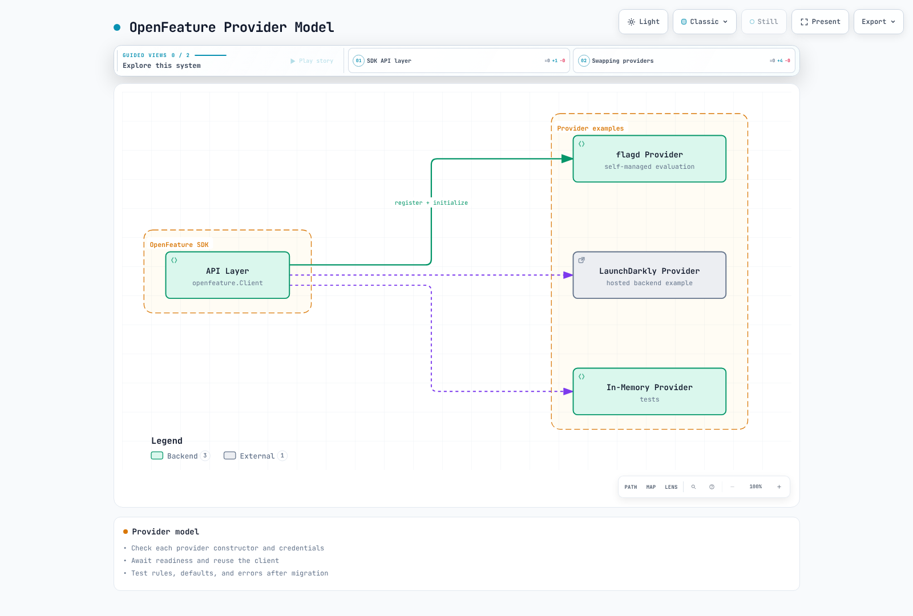
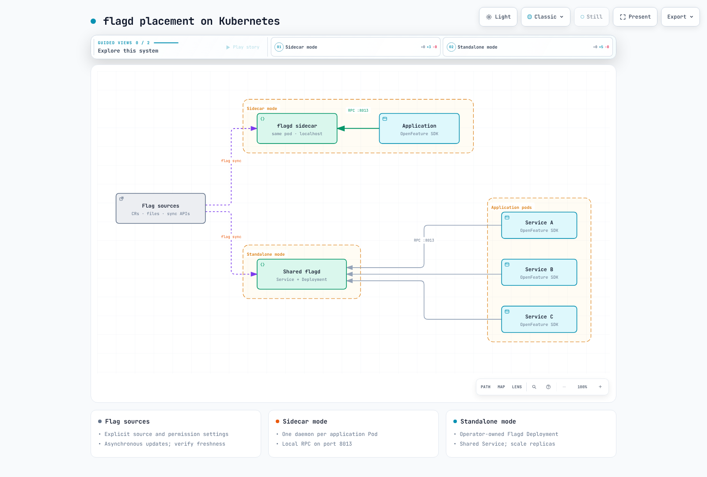
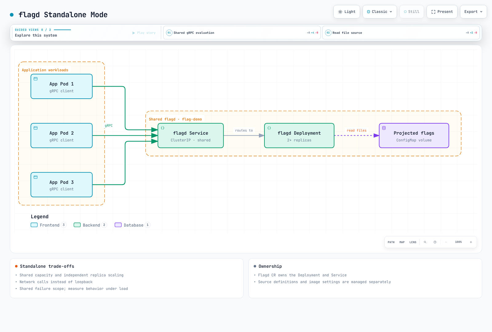

# Feature Flags y OpenFeature

> **Línea base revisada**: flagd 0.16.3, OpenFeature Operator 0.9.3 y Flagger 1.45.0; las versiones de los SDK están fijadas en sus ejemplos
> **Última actualización**: 11 de septiembre de 2026

Los feature flags separan el despliegue del código de la exposición de una funcionalidad en tiempo de ejecución. Esta guía cubre OpenFeature, flagd, la configuración del Operator de Kubernetes, la integración de SDK y los flujos de trabajo de GitOps. Los cambios dependen de la sincronización y del estado de los consumidores; no garantizan una reversión instantánea.

Alcance de la validación: los cuatro ejemplos de SDK se compilaron y ejecutaron en modo de archivos locales. La evaluación HTTP nativa de flagd y las métricas de Prometheus se comprobaron en una red de prueba aislada. También se revisaron Helm, Kustomize, los esquemas y los scripts. Esto no valida un despliegue real en EKS, imágenes de aplicaciones, todas las rutas RPC/TLS ni carga de producción. Adapte las URL de despliegue, las imágenes y las políticas al entorno real.

---

## Tabla de contenido

- [Descripción general y objetivos de aprendizaje](#overview-and-learning-objectives)
- [Arquitectura de OpenFeature](#openfeature-architecture)
- [flagd en Kubernetes](#flagd-on-kubernetes)
- [OpenFeature Operator](#openfeature-operator)
- [Integración de aplicaciones](#application-integration)
- [Combinación de lanzamientos canary y feature flags](#canary-release-and-feature-flag-combination)
- [Integración de GitOps](#gitops-integration)
- [Observabilidad](#observability)
- [Buenas prácticas de producción](#production-best-practices)
- [Referencias](#references)

---

## Descripción general y objetivos de aprendizaje {#overview-and-learning-objectives}

### Objetivos de aprendizaje

Al completar esta sección, podrá:

- Explicar la función de los feature flags en la entrega progresiva y el despliegue continuo
- Comparar plataformas de feature flags y elegir la herramienta adecuada para su entorno
- Desplegar flagd en Kubernetes mediante OpenFeature Operator
- Integrar SDK de OpenFeature en aplicaciones Go, Java, Python y Node.js
- Combinar feature flags con lanzamientos canary para aplicar estrategias de despliegue
- Gestionar la configuración de feature flags como código mediante flujos de GitOps
- Supervisar las evaluaciones de flags con Prometheus y Grafana

### ¿Qué son los feature flags?

Un feature flag (también llamado *feature toggle* o *feature switch*) permite activar o desactivar una funcionalidad durante la ejecución sin desplegar código nuevo. La idea básica consiste en envolver una ruta de código en una condición que comprueba el valor del flag y controlar ese valor de forma externa.

```
if featureEnabled("new-checkout"):
    renderNewCheckout()
else:
    renderLegacyCheckout()
```

Los feature flags tienen varios fines distintos en la entrega de software:

| Categoría | Propósito | Duración | Ejemplo |
|----------|-----------|----------|---------|
| **Flags de lanzamiento** | Desacoplar el despliegue del lanzamiento | Días a semanas | Ocultar durante el desarrollo una funcionalidad aún incompleta |
| **Flags de experimentación** | Pruebas A/B y decisiones basadas en datos | Semanas a meses | Mostrar la variante B de una página de precios al 10 % de los usuarios |
| **Flags operativos** | Control operativo e interruptores de circuito | Permanente | Desactivar una dependencia posterior no crítica |
| **Flags de permisos** | Derechos y control de acceso | Permanente | Habilitar una función prémium solo para clientes de pago |

La exposición de una funcionalidad no sustituye la autenticación ni la autorización. El código desactivado puede seguir presente en una imagen; los flags no son un almacén de secretos ni un límite de control de acceso.

### Feature flags en la entrega progresiva

La entrega progresiva amplía la entrega continua con un control más preciso sobre quién ve una funcionalidad nueva y cuándo. Los feature flags son un componente importante de este modelo:


[🔍 Ver el diagrama interactivo](https://www.atomai.click/kubernetes-docs/archmaps/en-gitops-05-feature-flags-0.html)

El código sigue la estrategia de despliegue de la carga de trabajo, como una actualización gradual. Por separado, los feature flags controlan qué comportamiento de la aplicación se selecciona. Esto difiere de dividir el tráfico (por ejemplo, con un despliegue canary), que determina a qué versión del Pod llega una solicitud. Ambas técnicas se complementan, como se explica en [Combinación de lanzamientos canary y feature flags](#canary-release-and-feature-flag-combination).

### Comparación de herramientas de feature flags

Evalúe conjuntamente las funciones de gestión, la evaluación en tiempo de ejecución y la disponibilidad de providers para cada lenguaje. La disponibilidad de un provider no implica que sus hooks, eventos o semántica de targeting sean iguales en todos los lenguajes. Consulte la documentación actual de cada proveedor para conocer precios y condiciones contractuales; esta comparación se centra en la integración y la responsabilidad operativa.

| Herramienta | Función | Comprobaciones de integración y operación |
|-------------|---------|--------------------------------------------|
| flagd | Evaluación autogestionada y sincronización de reglas | Configure fuentes, modo RPC o en proceso, Operator, disponibilidad y observabilidad |
| [LaunchDarkly](https://launchdarkly.com/docs/sdk/openfeature) | Servicio gestionado de feature flags | Compruebe el provider de cada lenguaje, el mapeo de contexto y eventos, y las funciones del SDK subyacente |
| [Flagsmith](https://docs.flagsmith.com/integrating-with-flagsmith/openfeature) | Plataforma de flags gestionada o autohospedada | Compruebe las diferencias entre providers de servidor y web, y la cobertura de lenguajes |
| [Harness FME](https://github.com/harness/developer-hub/tree/main/docs/feature-management-experimentation) | Gestión de funcionalidades y experimentación | Compruebe la migración desde instalaciones de Split, los providers y la integración de datos de experimentos |
| [Unleash](https://github.com/Unleash/unleash-openfeature-node-provider) | Ecosistema de providers respaldado por los SDK de Unleash | Compruebe la traducción del contexto, la persistencia de asignación y las funciones opcionales; el provider de Node no implementa la API de tracking |

Esta guía valida directamente la ruta de flagd. No prueba conexiones a cuentas comerciales ni la equivalencia de funciones entre todos los providers.

### El estándar OpenFeature

OpenFeature es un proyecto incubador de CNCF que ofrece una API neutral respecto al proveedor y desarrollada por la comunidad para evaluar feature flags. Reduce la dependencia de un proveedor mediante una interfaz estándar que funciona con distintos providers de backend.

Ventajas principales de OpenFeature:

- **API neutral respecto al proveedor**: reduce los cambios en las llamadas de evaluación, pero al migrar todavía hay que migrar la configuración y las reglas del provider
- **Modelo de evaluación coherente**: tipos booleanos, de cadena, numéricos y de objeto con una API uniforme
- **Hooks**: etapas del ciclo de vida para registro, métricas, validación y trazas
- **Contexto de evaluación**: contexto estructurado (atributos de usuario e información del entorno) que se transmite a cada evaluación
- **Compatibilidad con varios lenguajes**: SDK oficiales para Go, Java, Python, Node.js, .NET, PHP y otros

---

## Arquitectura de OpenFeature {#openfeature-architecture}

### Estructura del SDK

El SDK de OpenFeature sigue una arquitectura por capas que separa la API de evaluación del backend que gestiona los flags:


[🔍 Ver el diagrama interactivo](https://www.atomai.click/kubernetes-docs/archmaps/en-gitops-05-feature-flags-1.html)

### Componentes principales

**API de evaluación**: interfaz con la que interactúa el código de la aplicación. Proporciona métodos tipados (`getBooleanValue`, `getStringValue`, `getNumberValue`, `getObjectValue`) y una abstracción `Client` para delimitar las evaluaciones.

**Provider**: implementación concreta que conecta el SDK de OpenFeature con un backend de gestión de flags. Solo hay un provider activo a la vez por dominio, y el SDK le delega la resolución de los flags.

**Contexto de evaluación**: conjunto de atributos clave-valor que aporta contexto para evaluar un flag. Entre los atributos habituales están `targetingKey` (ID de usuario), `email`, `region`, `environment` y propiedades personalizadas. El contexto recorre todo el flujo de evaluación.

**Hooks**: interceptan el ciclo de vida de la evaluación en cuatro etapas:

| Etapa | Momento | Usos habituales |
|-------|---------|-----------------|
| `before` | Antes de evaluar | Enriquecer el contexto y validar entradas |
| `after` | Tras una evaluación correcta | Registrar métricas y decisiones |
| `error` | Si falla la evaluación | Informar del error y aplicar la lógica de reserva |
| `finally` | Se ejecuta siempre, como try/finally | Limpiar recursos y cerrar spans |

### Modelo de provider

La abstracción de provider reduce el acoplamiento al backend. La siguiente interfaz es esquemática, no un contrato de implementación para un lenguaje concreto; el soporte de inicialización, eventos y cambios de contexto varía según el SDK:

```
Provider Interface:
  - resolveBooleanValue(flagKey, defaultValue, context) -> ResolutionDetails
  - resolveStringValue(flagKey, defaultValue, context) -> ResolutionDetails
  - resolveNumberValue(flagKey, defaultValue, context) -> ResolutionDetails
  - resolveObjectValue(flagKey, defaultValue, context) -> ResolutionDetails
  - initialize(context) -> void
  - shutdown() -> void
```

Cambiar de provider conserva la API de evaluación cuando ambos la admiten, pero también hay que migrar y probar las claves de flags, variantes, targeting, credenciales, semántica del contexto y comportamiento operativo. Compruebe el constructor de cada provider y espere a que esté listo antes de reutilizar un cliente. Consulte el ejemplo completo del [SDK de Go](#go-sdk). El diagrama ilustra la selección de un provider; no establece que flagd solo sirva para desarrollo.



[🔍 Ver el diagrama interactivo](https://www.atomai.click/kubernetes-docs/archmaps/en-gitops-05-feature-flags-2.html)

### Flujo de evaluación

La ruta correcta ejecuta, en orden, Before, la resolución del provider, After y Finally. Si hay un error en Before, al resolver el provider o en After, se pasa por Error antes de finalizar. En la interfaz actual de Go, Finally recibe los detalles de la evaluación.


[🔍 Ver el diagrama interactivo](https://www.atomai.click/kubernetes-docs/archmaps/en-gitops-05-feature-flags-11.html)

---

## flagd en Kubernetes {#flagd-on-kubernetes}

### ¿Qué es flagd?

flagd es un daemon ligero y de código abierto para feature flags, y una implementación de referencia de un motor de evaluación compatible con OpenFeature. Está diseñado para entornos nativos de la nube y se ejecuta directamente en Kubernetes.

Características principales:

- **Ligero**: servicio Go cuyo consumo de CPU y memoria depende de la cantidad de flags y fuentes, el tráfico y la telemetría habilitada
- **Nativo de Kubernetes**: lee la configuración de flags desde CRD FeatureFlag, ConfigMaps o archivos
- **gRPC y HTTP**: el servicio de evaluación utiliza el puerto 8013; el endpoint HTTP OFREP independiente, el 8016. De forma predeterminada, la gestión y las métricas usan el 8014, y la sincronización de definiciones, el 8015
- **Sincronización**: sincroniza definiciones desde las fuentes configuradas; las actualizaciones son asíncronas y hay que comprobar la vigencia en los consumidores
- **Evaluación fraccional**: admite despliegues porcentuales mediante hashing consistente
- **Reglas de targeting**: usa JSON Logic para segmentar audiencias complejas

### Arquitectura de flagd



[🔍 Ver el diagrama interactivo](https://www.atomai.click/kubernetes-docs/archmaps/en-gitops-05-feature-flags-3.html)

### Instalación con Helm {#helm-installation}

El repositorio oficial publica el chart `open-feature-operator`. No dé por hecho que existe un chart independiente `openfeature/flagd`. Tras instalar el Operator, configure la inyección en los Pods o un recurso `Flagd` para crear un servicio de evaluación. Antes, prepare [cert-manager](../security/10-cert-manager.md) para los certificados del webhook.

Guarde el archivo `openfeature-values.yaml`. Con la configuración predeterminada, Operator `v0.9.3` usa la imagen flagd `v0.16.2`; este ejemplo fija en `v0.16.3` las imágenes del sidecar y del despliegue compartido. Estos valores de recursos son un punto de partida para un laboratorio, no un dimensionamiento medido para producción.

```yaml
sidecarConfiguration:
  image:
    repository: ghcr.io/open-feature/flagd
    tag: v0.16.3
  resources:
    requests:
      cpu: 50m
      memory: 64Mi
    limits:
      cpu: 200m
      memory: 256Mi
flagdConfiguration:
  image:
    repository: ghcr.io/open-feature/flagd
    tag: v0.16.3
```


```bash
helm repo add openfeature https://open-feature.github.io/open-feature-operator/
helm repo update
helm upgrade --install open-feature-operator openfeature/open-feature-operator \
  --version v0.9.3 \
  --namespace open-feature-operator-system --create-namespace \
  -f openfeature-values.yaml --wait --timeout 5m
```

`sidecarConfiguration` y `flagdConfiguration` configuran ubicaciones distintas. Los ejemplos antiguos `sidecarConfig`, `flagdProxyConfig` y `controllerManager.manager.env` no corresponden a las rutas de configuración de este chart. El webhook usa `failurePolicy: Ignore` de forma predeterminada, por lo que, si no está disponible, puede admitir Pods sin sidecar. Antes de elegir `Fail`, limite el alcance a las cargas afectadas y valore el impacto de un fallo; defina también el comportamiento de inicialización del provider y la reserva de la aplicación.

### FeatureFlag CRD

El Operator de OpenFeature incorpora la definición de recurso personalizado `FeatureFlag`, que permite declarar flags como recursos de Kubernetes. Es el mecanismo principal para administrar la configuración de flags de forma nativa en Kubernetes.

El siguiente ejemplo completo de un recurso `FeatureFlag` muestra los tipos de flags y las reglas de targeting principales:

```yaml
apiVersion: v1
kind: Namespace
metadata:
  name: flag-demo
---
apiVersion: core.openfeature.dev/v1beta1
kind: FeatureFlag
metadata:
  name: product-flags
  namespace: flag-demo
spec:
  flagSpec:
    flags:
      new-checkout:
        state: ENABLED
        variants:
          'on': true
          'off': false
        defaultVariant: 'off'
        targeting:
          if:
          - ==:
            - var: tier
            - internal
          - 'on'
          - fractional:
            - - 'on'
              - 10
            - - 'off'
              - 90
      banner-color:
        state: ENABLED
        variants:
          blue: '#0055ff'
          green: '#008855'
        defaultVariant: blue
        targeting:
          if:
          - ==:
            - var: tier
            - enterprise
          - green
          - blue
      rate-limit:
        state: ENABLED
        variants:
          standard: 100
          premium: 500
        defaultVariant: standard
        targeting:
          if:
          - in:
            - var: tier
            - - premium
              - enterprise
          - premium
          - standard
      feature-config:
        state: ENABLED
        variants:
          default:
            maxUploadBytes: 10485760
            enableOCR: false
          enhanced:
            maxUploadBytes: 52428800
            enableOCR: true
        defaultVariant: default
        targeting:
          if:
          - and:
            - ==:
              - var: environment
              - production
            - in:
              - var: tier
              - - premium
                - enterprise
          - enhanced
          - default
```

### Inyección de sidecar frente a despliegue independiente

flagd puede ejecutarse en Kubernetes de dos modos. La elección depende de los requisitos de latencia, el modelo operativo y el presupuesto de recursos.

**Modo sidecar** (inyectado por OpenFeature Operator):


[🔍 Ver el diagrama interactivo](https://www.atomai.click/kubernetes-docs/archmaps/en-gitops-05-feature-flags-4.html)

**Modo independiente** (despliegue centralizado):



[🔍 Ver el diagrama interactivo](https://www.atomai.click/kubernetes-docs/archmaps/en-gitops-05-feature-flags-5.html)

| Aspecto | Sidecar | Independiente |
|---------|---------|---------------|
| **Ruta RPC** | Llamada a localhost | Llamada a un Service compartido; mida la latencia real |
| **Uso de recursos** | Un flagd por Pod | Compartido entre Pods |
| **Alcance de un fallo** | El fallo del daemon es local a cada Pod; una configuración compartida puede afectar a varios Pods | El fallo del servicio compartido puede afectar a varios consumidores |
| **Escalado** | Escala con los Pods de la aplicación | Escala de forma independiente |
| **Configuración** | Admisión del Pod por el Operator y referencia a la fuente | CR Flagd administrado por el Operator o despliegue administrado aparte |
| **Compensación** | Sobrecarga operativa y de ejecución por Pod | Capacidad compartida y dependencia del servicio |

Antes de aplicar este `Flagd` compartido, cree FeatureFlag y FeatureFlagSource como se describe más adelante. El Operator administra su Deployment y Service ClusterIP. La fuente de archivos no requiere montar un token de API en el Pod de flagd. El servicio es `flagd.flag-demo.svc.cluster.local` y usa el puerto RPC 8013.

```yaml
apiVersion: v1
kind: ServiceAccount
metadata:
  name: flagd-demo
  namespace: flag-demo
automountServiceAccountToken: false
---
apiVersion: core.openfeature.dev/v1beta1
kind: Flagd
metadata:
  name: flagd
  namespace: flag-demo
spec:
  replicas: 2
  serviceType: ClusterIP
  serviceAccountName: flagd-demo
  featureFlagSource: product-flags-source
```

---

## OpenFeature Operator

OpenFeature Operator administra el ciclo de vida de las instancias de flagd y sincroniza las configuraciones de feature flags. Es la opción recomendada para ejecutar flagd en entornos Kubernetes de producción.

### Instalación

Use la instalación fijada del Operator y las sustituciones de imagen descritas en [Instalación con Helm](#helm-installation). Instalar el Operator no despliega automáticamente un servicio flagd compartido para cada aplicación.

### CRD incorporadas por el Operator

El Operator incorpora varias CRD para administrar feature flags:

| CRD | Propósito |
|-----|-----------|
| `FeatureFlag` | Declara definiciones de flags en línea (clave, variantes y reglas de targeting) |
| `FeatureFlagSource` | Señala la(s) fuente(s) de configuración de flags para una carga (CRD, archivo o HTTP) |

### CRD FeatureFlagSource

`FeatureFlagSource` configura las fuentes y los ajustes de las instancias de flagd inyectadas o compartidas. Esta línea base usa la fuente `file` para referirse a `flag-demo/product-flags`. El Operator proporciona un volumen ConfigMap, por lo que el contenedor flagd no tiene que observar directamente Kubernetes. Cree primero ese FeatureFlag.

```yaml
apiVersion: core.openfeature.dev/v1beta1
kind: FeatureFlagSource
metadata:
  name: product-flags-source
  namespace: flag-demo
spec:
  sources:
  - source: flag-demo/product-flags
    provider: file
  port: 8013
  managementPort: 8014
  evaluator: json
  logFormat: json
  probesEnabled: true
```

| Fuente | Formato de `source` | Requisito previo |
|--------|---------------------|------------------|
| `file` | `namespace/FeatureFlag-name` | Volumen ConfigMap suministrado por el Operator |
| `kubernetes` | `namespace/FeatureFlag-name` | Permisos de la API de Kubernetes y credenciales para flagd |
| `flagd-proxy` | Configuración de fuente proxy documentada por el Operator | Servicio proxy y límite de acceso |
| `http` | Endpoint JSON HTTPS real | Conectividad, autenticación y confianza del servidor |
| `grpc` | `host:port` real | Servidor de sincronización, TLS y autenticación requerida |

Cada fuente configurada debe existir. Estos valores pertenecen a FeatureFlagSource; no son URI de autodetección de la CLI de flagd. Para la autodetección de Kubernetes, la CLI acepta `core.openfeature.dev/flag-demo/product-flags`. No almacene tokens de autenticación en un CR. `evaluator: json` selecciona el motor de evaluación; no habilita caché ni un registro de cada evaluación de flag.

Al añadir otro CR FeatureFlag, refiéralo desde FeatureFlagSource o combine sus definiciones con el mapa existente `product-flags`. Crear un CR por sí solo no hace que todas las instancias de flagd o los SDK lo consuman.

### Inyección automática de Pods

Defina ambas anotaciones en la plantilla de Pod del Deployment; una etiqueta en el namespace no habilita la inyección por sí sola. Esta plantilla requiere una imagen real de aplicación que use el SDK y sirva HTTP en el puerto 8080. Con la fuente de archivos, el sidecar no necesita un token para la API de Kubernetes.

```yaml
apiVersion: v1
kind: ServiceAccount
metadata:
  name: order-service
  namespace: flag-demo
automountServiceAccountToken: false
---
apiVersion: apps/v1
kind: Deployment
metadata:
  name: order-service
  namespace: flag-demo
spec:
  replicas: 3
  selector:
    matchLabels:
      app: order-service
  template:
    metadata:
      labels:
        app: order-service
      annotations:
        # This annotation triggers flagd sidecar injection
        openfeature.dev/enabled: "true"
        # Reference the FeatureFlagSource to use
        openfeature.dev/featureflagsource: "product-flags-source"
    spec:
      serviceAccountName: order-service
      automountServiceAccountToken: false
      containers:
        - name: order-service
          image: YOUR_REGISTRY/order-service:YOUR_VERSION
          ports:
            - containerPort: 8080
              name: http
          env:
            # The flagd provider connects to localhost because the sidecar
            # runs in the same pod
            - name: FLAGD_HOST
              value: "localhost"
            - name: FLAGD_PORT
              value: "8013"
```

Inspeccione el Pod admitido para confirmar que la inyección se realizó y que su imagen, argumentos y volúmenes coinciden con FeatureFlagSource. Que el Pod esté en ejecución no demuestra que la inyección haya funcionado si la política de fallo del webhook es Ignore.

### Sincronización de ConfigMap y CRD

Para la fuente de archivos usada aquí, el Operator proporciona las definiciones FeatureFlag mediante volúmenes ConfigMap. Las fuentes directas de Kubernetes y proxy siguen otras rutas. El siguiente diagrama muestra el flujo de la fuente de archivos:


[🔍 Ver el diagrama interactivo](https://www.atomai.click/kubernetes-docs/archmaps/en-gitops-05-feature-flags-6.html)

Los cambios de definiciones en la fuente de archivos pueden consumirse sin reiniciar el Pod, pero la proyección de ConfigMap y la lectura del archivo son asíncronas. Si cambia una imagen o la configuración de una fuente, inspeccione por separado la configuración desplegada del Pod y el rollout necesario. La disponibilidad inicial no demuestra que todos los consumidores tengan la definición más reciente.

---

## Integración de aplicaciones {#application-integration}

### SDK de Go {#go-sdk}

Este ejemplo usa Go 1.25 o posterior, OpenFeature Go SDK `v1.18.0` y flagd Provider `v0.6.0`. `NewProvider` devuelve un provider y un error. Para resolver desde archivos locales, seleccione `WithFileResolver` y `WithOfflineFilePath`; los ejemplos antiguos con `WithResolverType` o `flagd.GRPC` no coinciden con esta API del provider.

Guarde como `flags.json` el objeto JSON contenido en `spec.flagSpec`, no el recurso de Kubernetes completo. Debe incluir las cuatro claves de flag que se leen más abajo. Si exporta un recurso existente, seleccione su namespace real.

```bash
kubectl get featureflag product-flags -n flag-demo -o json | jq '.spec.flagSpec' > flags.json
mkdir go-flag-demo
cp flags.json go-flag-demo/
cd go-flag-demo
go mod init example.com/go-flag-demo
go get github.com/open-feature/go-sdk@v1.18.0
go get github.com/open-feature/go-sdk-contrib/providers/flagd@v0.6.0
# Save the code below as main.go, then run it.
go run . flags.json
```

El modo de archivos es una ruta de validación local; no llama a Kubernetes ni a un servidor flagd. En producción, obtenga atributos como `tier` del estado autenticado del servidor. Los encabezados de solicitudes no confiables no deben determinar derechos ni autorización.

```go
package main

import (
    "context"
    "encoding/json"
    "errors"
    "log"
    "os"
    "time"

    "github.com/open-feature/go-sdk/openfeature"
    flagd "github.com/open-feature/go-sdk-contrib/providers/flagd/pkg"
)

func run(flagFile string) error {
    provider, err := flagd.NewProvider(
        flagd.WithFileResolver(),
        flagd.WithOfflineFilePath(flagFile),
    )
    if err != nil {
        return err
    }
    if err := openfeature.SetProviderAndWait(provider); err != nil {
        return err
    }
    defer openfeature.Shutdown()

    client := openfeature.NewClient("docs-demo")
    ctx, cancel := context.WithTimeout(context.Background(), time.Second)
    defer cancel()
    evaluation := openfeature.NewEvaluationContext("synthetic-user", map[string]interface{}{
        "tier": "internal",
        "region": "ap-northeast-2",
        "environment": "development",
    })

    enabled, errBool := client.BooleanValue(ctx, "new-checkout", false, evaluation)
    color, errString := client.StringValue(ctx, "banner-color", "#000000", evaluation)
    limit, errInteger := client.IntValue(ctx, "rate-limit", 10, evaluation)
    config, errObject := client.ObjectValue(ctx, "feature-config", map[string]interface{}{}, evaluation)
    if err := errors.Join(errBool, errString, errInteger, errObject); err != nil {
        return err
    }
    return json.NewEncoder(os.Stdout).Encode(map[string]interface{}{
        "enabled": enabled,
        "color": color,
        "limit": limit,
        "config": config,
    })
}

func main() {
    if len(os.Args) != 2 {
        log.Fatal("usage: go run . flags.json")
    }
    if err := run(os.Args[1]); err != nil {
        log.Fatal(err)
    }
}
```

Para usar RPC con un sidecar flagd, sustituya únicamente el constructor por el siguiente. Mantenga la espera a que el provider esté listo, el tratamiento de errores de evaluación y el cierre. En un despliegue `Flagd` compartido, use el nombre DNS del Service en vez de loopback y ajuste la red y TLS a ese despliegue.

```go
provider, err := flagd.NewProvider(
    flagd.WithHost("127.0.0.1"),
    flagd.WithPort(8013),
)
```

### SDK de Java

Este ejemplo usa JDK 21, Maven 3.9, OpenFeature Java SDK `1.22.1` y flagd Provider `0.14.1`. Seleccione el resolver mediante `Config.Resolver`, no `FlagdOptions.ResolverType`. `MutableContext.add` tiene sobrecargas para cadenas, enteros, booleanos y otros valores de contexto admitidos.

Guarde este `pom.xml` en un proyecto nuevo.

```xml
<project xmlns="http://maven.apache.org/POM/4.0.0" xmlns:xsi="http://www.w3.org/2001/XMLSchema-instance" xsi:schemaLocation="http://maven.apache.org/POM/4.0.0 https://maven.apache.org/xsd/maven-4.0.0.xsd">
  <modelVersion>4.0.0</modelVersion>
  <groupId>example.docs</groupId><artifactId>flag-demo</artifactId><version>1.0.0</version>
  <properties><maven.compiler.release>21</maven.compiler.release><project.build.sourceEncoding>UTF-8</project.build.sourceEncoding></properties>
  <dependencies>
    <dependency><groupId>dev.openfeature</groupId><artifactId>sdk</artifactId><version>1.22.1</version></dependency>
    <dependency><groupId>dev.openfeature.contrib.providers</groupId><artifactId>flagd</artifactId><version>0.14.1</version></dependency>
  </dependencies>
  <build><plugins><plugin><groupId>org.apache.maven.plugins</groupId><artifactId>maven-compiler-plugin</artifactId><version>3.14.1</version></plugin></plugins></build>
</project>
```

Guarde lo siguiente como `src/main/java/FlagDemo.java` y coloque el mismo `flags.json` en la raíz del proyecto. El modo de archivos evalúa flags sin conectarse a un servidor.

```java
import dev.openfeature.contrib.providers.flagd.Config;
import dev.openfeature.contrib.providers.flagd.FlagdOptions;
import dev.openfeature.contrib.providers.flagd.FlagdProvider;
import dev.openfeature.sdk.Client;
import dev.openfeature.sdk.FlagEvaluationDetails;
import dev.openfeature.sdk.MutableContext;
import dev.openfeature.sdk.MutableStructure;
import dev.openfeature.sdk.OpenFeatureAPI;
import dev.openfeature.sdk.Value;
import java.nio.file.Path;
import java.util.List;

public class FlagDemo {
    public static void main(String[] args) {
        if (args.length != 1) throw new IllegalArgumentException("usage: FlagDemo flags.json");
        OpenFeatureAPI api = OpenFeatureAPI.getInstance();
        FlagdOptions options = FlagdOptions.builder()
                .resolverType(Config.Resolver.FILE)
                .offlineFlagSourcePath(Path.of(args[0]).toAbsolutePath().toString())
                .build();
        try {
            api.setProviderAndWait(new FlagdProvider(options));
            Client client = api.getClient("docs-demo");
            MutableContext context = new MutableContext("synthetic-user");
            context.add("tier", "internal");
            FlagEvaluationDetails<Boolean> enabled = client.getBooleanDetails("new-checkout", false, context);
            FlagEvaluationDetails<String> color = client.getStringDetails("banner-color", "#000000", context);
            FlagEvaluationDetails<Integer> limit = client.getIntegerDetails("rate-limit", 10, context);
            Value fallback = new Value(new MutableStructure().add("maxUploadBytes", 0).add("enableOCR", false));
            FlagEvaluationDetails<Value> config = client.getObjectDetails("feature-config", fallback, context);
            for (FlagEvaluationDetails<?> result : List.of(enabled, color, limit, config)) {
                if (result.getErrorCode() != null) throw new IllegalStateException(result.getErrorCode().toString());
            }
            System.out.printf("enabled=%s color=%s limit=%d config=%s%n", enabled.getValue(), color.getValue(), limit.getValue(), config.getValue().asStructure().asObjectMap());
        } finally {
            api.shutdown();
        }
    }
}
```


```bash
mvn compile org.apache.maven.plugins:maven-dependency-plugin:3.8.1:build-classpath \
  -Dmdep.outputFile=classpath.txt
java -cp "target/classes:$(cat classpath.txt)" FlagDemo flags.json
```

Para RPC, elija `Config.Resolver.RPC`, configure `host`, `port` y `deadline`, y quite `offlineFlagSourcePath`. Use `setProviderAndWait` con un servidor listo y llame a `shutdown` al cerrar la aplicación. Este ejemplo independiente no añade una implementación de registro, por lo que SLF4J puede mostrar una advertencia de logger NOP. En un servicio real, use la configuración SLF4J que ya tenga la aplicación.

### SDK de Python

Este ejemplo completo con archivos locales usa Python 3.10 o posterior, `openfeature-sdk==0.10.0` y `openfeature-provider-flagd==0.5.2`. Reutilice el mismo `flags.json`. El parámetro público del constructor es `resolver_type`, con un valor enum como `ResolverType.FILE`; `ResolverType.GRPC` y la cadena simple `"rpc"` no corresponden a esta API de configuración.

```bash
python -m venv python-flag-demo/.venv
python-flag-demo/.venv/bin/python -m pip install \
  openfeature-sdk==0.10.0 openfeature-provider-flagd==0.5.2
# Save the code below as python-flag-demo/main.py.
python-flag-demo/.venv/bin/python python-flag-demo/main.py flags.json
```


```python
import json
import sys
from pathlib import Path

from openfeature import api
from openfeature.contrib.provider.flagd import FlagdProvider
from openfeature.contrib.provider.flagd.config import ResolverType
from openfeature.evaluation_context import EvaluationContext

if len(sys.argv) != 2:
    raise SystemExit("usage: python main.py flags.json")

provider = FlagdProvider(
    resolver_type=ResolverType.FILE,
    offline_flag_source_path=str(Path(sys.argv[1]).resolve()),
)
try:
    api.set_provider_and_wait(provider)
    client = api.get_client("docs-demo")
    context = EvaluationContext(targeting_key="synthetic-user", attributes={"tier": "internal"})
    results = {
        "enabled": client.get_boolean_details("new-checkout", False, context),
        "color": client.get_string_details("banner-color", "#000000", context),
        "limit": client.get_integer_details("rate-limit", 10, context),
        "config": client.get_object_details("feature-config", {"maxUploadBytes": 0, "enableOCR": False}, context),
    }
    for name, result in results.items():
        if result.error_code is not None:
            raise RuntimeError(f"{name}: {result.error_code}")
    print(json.dumps({name: result.value for name, result in results.items()}))
finally:
    api.shutdown()
```

Para RPC, use `FlagdProvider(host="127.0.0.1", port=8013,
resolver_type=ResolverType.RPC, deadline_ms=500)`. Quite la opción de archivo sin conexión e inicialice el provider con un servidor flagd listo. Mantenga `set_provider_and_wait` y `shutdown`. Para distinguir un valor de reserva de una evaluación correcta, compruebe `error_code` en el resultado detallado, como se muestra arriba.

### SDK de Node.js

Este ejemplo de TypeScript usa Node.js 22, `@openfeature/server-sdk@1.23.0` y `@openfeature/flagd-provider@0.16.1`. `resolverType` acepta `rpc` o `in-process`, no `grpc`. En este SDK, añadir `offlineFlagSourcePath` al resolver en proceso selecciona archivos locales en lugar de la sincronización de red.

```bash
mkdir node-flag-demo
cp flags.json node-flag-demo/
cd node-flag-demo
npm init -y
npm pkg set type=module
npm install @openfeature/server-sdk@1.23.0 @openfeature/flagd-provider@0.16.1
npm install --save-dev typescript@5.9.3 @types/node@22.19.0
# Save the code below as main.ts.
npx tsc main.ts --target ES2022 --module NodeNext --moduleResolution NodeNext \
  --strict --skipLibCheck --outDir dist
node dist/main.js flags.json
```


```typescript
import { OpenFeature, type EvaluationContext } from '@openfeature/server-sdk';
import { FlagdProvider } from '@openfeature/flagd-provider';

const flagFile = process.argv[2];
if (!flagFile) throw new Error('usage: node dist/main.js flags.json');
const provider = new FlagdProvider({
  resolverType: 'in-process',
  offlineFlagSourcePath: flagFile,
});
try {
  await OpenFeature.setProviderAndWait(provider);
  const client = OpenFeature.getClient('docs-demo');
  const context: EvaluationContext = {targetingKey: 'synthetic-user', tier: 'internal'};
  const results = {
    enabled: await client.getBooleanDetails('new-checkout', false, context),
    color: await client.getStringDetails('banner-color', '#000000', context),
    limit: await client.getNumberDetails('rate-limit', 10, context),
    config: await client.getObjectDetails('feature-config', {maxUploadBytes: 0, enableOCR: false}, context),
  };
  for (const [name, result] of Object.entries(results)) {
    if (result.errorCode) throw new Error(`${name}: ${result.errorCode}`);
  }
  console.log(JSON.stringify(Object.fromEntries(Object.entries(results).map(([name, result]) => [name, result.value]))));
} finally {
  await OpenFeature.clearProviders();
}
```

Para RPC, configure `resolverType: 'rpc'`, el `host` del servidor y `port: 8013`, y quite `offlineFlagSourcePath`. Espere a `setProviderAndWait` antes de aceptar solicitudes y a `clearProviders` al cerrar la aplicación. No cree un provider por solicitud. Esta prueba con archivos locales no valida una conexión RPC real.

### Análisis detallado de las reglas de targeting

`targeting` debe devolver finalmente un **nombre de variante** existente en `variants`. `fractional` devuelve un nombre de variante, no una lista de usuarios; por tanto, no compruebe si una clave de usuario está `in` ese resultado. Combine una regla para usuarios internos con un despliegue gradual, como en la línea base: `if: [internal condition, on, fractional rule]`.

Haga referencia a este CR adicional en la fuente o combine sus definiciones con el mapa `flags` de la línea base. Use atributos confiables y normalice `app_version` como SemVer.

```yaml
apiVersion: core.openfeature.dev/v1beta1
kind: FeatureFlag
metadata:
  name: targeting-examples
  namespace: flag-demo
spec:
  flagSpec:
    flags:
      premium-feature:
        state: ENABLED
        variants:
          'on': true
          'off': false
        defaultVariant: 'off'
        targeting:
          if:
          - and:
            - ==:
              - var: tier
              - enterprise
            - '>=':
              - var: account_age_days
              - 30
          - 'on'
          - 'off'
      new-search-algo:
        state: ENABLED
        variants:
          'on': true
          'off': false
        defaultVariant: 'off'
        targeting:
          fractional:
          - - 'on'
            - 20
          - - 'off'
            - 80
      api-v2:
        state: ENABLED
        variants:
          'on': true
          'off': false
        defaultVariant: 'off'
        targeting:
          if:
          - sem_ver:
            - var: app_version
            - '>='
            - 2.0.0
          - 'on'
          - 'off'
```

Los pesos enteros de fractional son relativos. El ejemplo divide el espacio de hash 20/80; no garantiza exactamente el 20 % de usuarios o solicitudes reales. La clave de asignación predeterminada combina la clave del flag y `targetingKey`. Use una clave estable y no vacía, y no asigne la misma clave a todos los visitantes anónimos. La evaluación repetida con la misma regla y clave es estable; los cambios de pesos, claves o implementaciones del evaluador pueden cambiar las asignaciones.

El `defaultVariant` del flag cuando el targeting no produce un resultado es distinto del valor predeterminado que pasa quien llama al SDK. En el provider flagd probado para Go, `DISABLED` devuelve el valor predeterminado del llamador sin error e informa la razón `DISABLED`. Desactivar un flag no implica necesariamente que devuelva false. Diseñe el interruptor para seleccionar una variante off explícita mientras permanece `ENABLED`, y compruebe los valores, errores, razones y propagación a los consumidores.

---

## Combinación de lanzamientos canary y feature flags {#canary-release-and-feature-flag-combination}

Esta secuencia presupone que existe una versión primaria v1 inicializada y en buen estado. Distinga la inicialización del primer Canary del análisis de una revisión posterior de la carga de trabajo. Confirme el estado OFF inicial mediante una evaluación real, incluido el targeting; un valor predeterminado off por sí solo no basta.

Los feature flags y los lanzamientos canary son estrategias complementarias. Los canary controlan el tráfico en la infraestructura (qué versión del Pod sirve una solicitud), mientras que los flags controlan el comportamiento de la aplicación (qué ruta de código se ejecuta). Combinarlos ofrece mayor control sobre la seguridad del lanzamiento.

### Arquitectura: Flagger y feature flags


[🔍 Ver el diagrama interactivo](https://www.atomai.click/kubernetes-docs/archmaps/en-gitops-05-feature-flags-7.html)

Esta es una plantilla de integración con Istio para [Flagger](./04-flagger.md) 1.45. El controlador debe observar `flag-demo`, y ya deben existir el Deployment, Istio y las métricas de Prometheus. La imagen de aplicación debe integrar realmente el SDK. `threshold: 5` es el límite acumulado de comprobaciones fallidas de un análisis, no un número de éxitos requeridos. Estas cifras ilustran una política; adáptelas al SLO real.

Un `release_id` proporcionado por la aplicación y de confianza puede limitar la elegibilidad para el nuevo comportamiento. No confunda la función canary de un Pod con el ID de versión de la aplicación. La promoción de la carga no habilita automáticamente el feature flag para el 100 %; ampliar o restaurar el flag requiere una aprobación independiente, cambios en Git o automatización implementada.

### Flujo de Flagger y feature flags

Este flujo usa Flagger para gestionar el tráfico y feature flags para controlar con más precisión el comportamiento dentro de los Pods canary:

**Fase 1 -- Desplegar con el flag desactivado**: publique v2 con la nueva funcionalidad detrás de un flag (predeterminado: desactivado). Flagger empieza a dirigir una pequeña parte del tráfico a v2.

**Fase 2 -- Habilitar un grupo limitado**: use atributos confiables, como `tier: internal`, y el ID de versión previsto. Confirme la revisión real del consumidor y su exposición antes de ampliar el grupo.

**Fase 3 -- Ampliar el grupo**: cambie por separado los pesos aprobados del flag y supervise los resultados de la aplicación junto con el análisis de la carga de trabajo.

**Fase 4 -- Separar las decisiones de promoción**: Flagger puede promover la carga tras su análisis. Habilitar el flag para el 100 % es un cambio de configuración aparte, con su propia validación.

Ejemplo de recurso Canary de Flagger:

```yaml
apiVersion: flagger.app/v1beta1
kind: Canary
metadata:
  name: order-service
  namespace: flag-demo
spec:
  targetRef:
    apiVersion: apps/v1
    kind: Deployment
    name: order-service
  progressDeadlineSeconds: 600
  service:
    port: 8080
    targetPort: 8080
  analysis:
    interval: 1m
    threshold: 5
    maxWeight: 50
    stepWeight: 10
    metrics:
    - name: request-success-rate
      thresholdRange:
        min: 99
      interval: 1m
    - name: request-duration
      thresholdRange:
        max: 500
      interval: 1m
```

La integración con webhooks requiere un receptor real, autenticación, reintentos y comprobaciones de revisión. Un hook `rollback` correcto solicita una reversión; no es una notificación posterior a ella. `post-rollout` puede ejecutarse tanto si hay éxito como si hay fallo, así que compruebe el resultado. Las cadenas de metadatos son literales, no expresiones de plantilla Go. Este ejemplo no instala un servicio externo de control de flags.

### Pruebas A/B con feature flags

Una clave de targeting estable y una regla sin cambios producen una asignación de variante estable. Añada este CR a la fuente o combínelo con el mapa de flags existente. Los pesos 34/33/33 no son cuotas que garanticen cantidades exactas de usuarios.

```yaml
apiVersion: core.openfeature.dev/v1beta1
kind: FeatureFlag
metadata:
  name: ab-test-checkout
  namespace: flag-demo
spec:
  flagSpec:
    flags:
      checkout-variant:
        state: ENABLED
        variants:
          control: classic
          variant-a: streamlined
          variant-b: one-click
        defaultVariant: control
        targeting:
          fractional:
          - - control
            - 34
          - - variant-a
            - 33
          - - variant-b
            - 33
```

Use los detalles de evaluación de cadenas para inspeccionar el valor, la variante y el error. Registre la exposición cuando se entregue realmente la experiencia seleccionada; evaluar un flag no demuestra exposición ni conversión. Defina por separado los eventos de conversión, el tamaño de muestra, la duración del experimento y las métricas de resultado. El bucketing estable no garantiza la misma experiencia entre versiones antiguas y nuevas de la aplicación ni con conjuntos de reglas desactualizados.

### Patrón de lanzamiento en sombra

Un lanzamiento en sombra despliega funcionalidad nueva en producción, pero solo la expone a usuarios internos o a un flujo de sombra. Los feature flags facilitan este patrón:

```yaml
apiVersion: core.openfeature.dev/v1beta1
kind: FeatureFlag
metadata:
  name: dark-launch-quote-v2
  namespace: flag-demo
spec:
  flagSpec:
    flags:
      shadow-quote-v2:
        state: ENABLED
        variants:
          "on": true
          "off": false
        defaultVariant: "off"
        targeting:
          # Only enable for specific internal test accounts
          if:
            - in:
              - var: targetingKey
              - - "test-user-001"
                - "test-user-002"
                - "qa-bot-001"
            - "on"
            - "off"
```

La ejecución en sombra no debe realizar dos veces la operación de negocio. En particular, no llame a dos procesadores de pago para el mismo pedido. Compare un cálculo de solo lectura o vuelva a reproducir entradas saneadas en un entorno aislado que no pueda cobrar, escribir registros de negocio ni enviar notificaciones. La llamada sigue recibiendo el resultado de la implementación existente.

El siguiente fragmento es un ejemplo de integración: `calculateLegacyQuote`, `calculateCandidateQuote` y `compareQuotes` son funciones de la aplicación. Ambos cálculos deben ser inocuos, sin efectos secundarios, y respetar la cancelación del contexto. Este ejemplo síncrono puede añadir a la solicitud hasta el tiempo de espera del candidato; una implementación asíncrona necesita una cola acotada y su propio timeout.

```go
func quoteOrder(ctx context.Context, order Order,
    evalCtx openfeature.EvaluationContext) (Quote, error) {
    original, err := calculateLegacyQuote(ctx, order)
    if err != nil {
        return original, err
    }

    shadowEnabled, flagErr := client.BooleanValue(
        ctx, "shadow-quote-v2", false, evalCtx,
    )
    if flagErr == nil && shadowEnabled {
        shadowCtx, cancel := context.WithTimeout(ctx, 50*time.Millisecond)
        defer cancel()
        candidate, err := calculateCandidateQuote(shadowCtx, order)
        if err == nil {
            compareQuotes(original, candidate)
        }
    }
    return original, nil
}
```

### Rollout automático basado en métricas

Las siguientes plantillas requieren la instrumentación de la aplicación y el PodMonitor descritos en [Observabilidad](#observability). La etiqueta `app` debe identificar el Deployment de destino y excluir el primario. Sustituya la URL de Prometheus por la dirección real del servicio. Las métricas del servidor flagd compartido no permiten identificar de forma fiable los fallos de evaluación de un Canary concreto.

```yaml
apiVersion: flagger.app/v1beta1
kind: MetricTemplate
metadata:
  name: app-flag-errors
  namespace: flag-demo
spec:
  provider:
    type: prometheus
    address: http://prometheus.monitoring.svc:9090
  query: |-
    100 * (
      sum(rate(app_feature_flag_evaluations_total{namespace="{{ namespace }}",app="{{ target }}",flag_key="new-checkout",reason="ERROR"}[{{ interval }}]))
      or vector(0)
    ) / sum(rate(app_feature_flag_evaluations_total{namespace="{{ namespace }}",app="{{ target }}",flag_key="new-checkout"}[{{ interval }}]))
---
apiVersion: flagger.app/v1beta1
kind: MetricTemplate
metadata:
  name: app-flag-samples
  namespace: flag-demo
spec:
  provider:
    type: prometheus
    address: http://prometheus.monitoring.svc:9090
  query: sum(increase(app_feature_flag_evaluations_total{namespace="{{ namespace }}",app="{{
    target }}",flag_key="new-checkout"}[{{ interval }}]))
```

Añada estos elementos a la lista `spec.analysis.metrics` existente del Canary después de confirmar que existen las series. Estas políticas ilustrativas exigen al menos 100 evaluaciones del SDK por minuto y como máximo un 1 % de errores; no cuentan usuarios únicos ni demuestran que el comportamiento de negocio sea correcto. Supervise por separado los resultados DISABLED y predeterminados.

```yaml
- name: app-flag-error-rate
  templateRef:
    name: app-flag-errors
  thresholdRange:
    max: 1
  interval: 1m
- name: app-flag-evaluation-count
  templateRef:
    name: app-flag-samples
  thresholdRange:
    min: 100
  interval: 1m
```

Una evaluación satisfactoria de Flagger solo permite promover la carga de trabajo. El cambio del feature flag sigue siendo una decisión separada. La ausencia de observaciones y NaN no deben tratarse como éxito.

---

## Integración de GitOps {#gitops-integration}

### Feature flags como código

Use los recursos validados anteriormente: `product-flags.yaml` contiene Namespace y FeatureFlag; `feature-source.yaml` contiene FeatureFlagSource en modo de archivos; y `flagd.yaml` contiene ServiceAccount y Flagd para el servicio compartido. Instale primero el Operator y cert-manager. Sustituya la URL del repositorio y configure la autenticación necesaria.

```text
gitops-config/
├── base/feature-flags/
│   ├── kustomization.yaml
│   ├── product-flags.yaml
│   ├── feature-source.yaml
│   └── flagd.yaml
├── overlays/dev/feature-flags/kustomization.yaml
├── overlays/production/feature-flags/kustomization.yaml
├── validate-flags.py
└── .github/workflows/feature-flags.yml
```

`base/feature-flags/kustomization.yaml`:

```yaml
apiVersion: kustomize.config.k8s.io/v1beta1
kind: Kustomization
resources:
- product-flags.yaml
- feature-source.yaml
- flagd.yaml
```

### Sustituciones por entorno con Kustomize

Estos son **parches dentro de una Kustomization**, no recursos FeatureFlag incompletos para aplicar directamente. Para habilitar el flag a todos los usuarios de desarrollo, quite también la regla de targeting existente y cambie la variante predeterminada a on. El targeting puede prevalecer sobre un valor predeterminado cambiado. Los otros tres flags permanecen intactos.

`overlays/dev/feature-flags/kustomization.yaml`:

```yaml
apiVersion: kustomize.config.k8s.io/v1beta1
kind: Kustomization
resources:
- ../../../base/feature-flags
patches:
- target:
    group: core.openfeature.dev
    version: v1beta1
    kind: FeatureFlag
    name: product-flags
  patch: |
    - op: remove
      path: /spec/flagSpec/flags/new-checkout/targeting
    - op: replace
      path: /spec/flagSpec/flags/new-checkout/defaultVariant
      value: 'on'
```

`overlays/production/feature-flags/kustomization.yaml`:

```yaml
apiVersion: kustomize.config.k8s.io/v1beta1
kind: Kustomization
resources:
- ../../../base/feature-flags
patches:
- target:
    group: core.openfeature.dev
    version: v1beta1
    kind: FeatureFlag
    name: product-flags
  patch: |
    - op: replace
      path: /spec/flagSpec/flags/new-checkout/targeting
      value:
        if:
        - ==:
          - var: tier
          - internal
        - 'on'
        - fractional:
          - - 'on'
            - 5
          - - 'off'
            - 95
```

Renderice ambas configuraciones con Kustomize 5.8.1 y revise toda la salida antes del despliegue.

```bash
kustomize build overlays/dev/feature-flags
kustomize build overlays/production/feature-flags
```

### Despliegue de CR FeatureFlag con Argo CD

El AppProject `platform` existente debe permitir el repositorio real, el destino `flag-demo` y los tipos de recurso Namespace, ServiceAccount y OpenFeature que usa este flujo. Una sincronización correcta no demuestra que el Deployment creado por el Operator ni todos los SDK hayan consumido las definiciones de flags más recientes.

```yaml
apiVersion: argoproj.io/v1alpha1
kind: Application
metadata:
  name: feature-flags
  namespace: argocd
spec:
  project: platform
  source:
    repoURL: https://github.com/YOUR_ORG/gitops-config.git
    targetRevision: main
    path: overlays/production/feature-flags
  destination:
    server: https://kubernetes.default.svc
    namespace: flag-demo
  syncPolicy:
    automated:
      prune: true
      selfHeal: true
    retry:
      limit: 3
      backoff:
        duration: 5s
        factor: 2
        maxDuration: 1m
```

### Despliegue de CR FeatureFlag con Flux

Se presupone que el Operator ya está instalado, por lo que no se declara con `dependsOn` una Kustomization inexistente. Si Flux administra también el Operator, use el nombre real de su dependencia. La comprobación de estado observa la disponibilidad inicial del Deployment `flagd` creado por el Operator; no demuestra continuamente que los flags estén actualizados.

```yaml
apiVersion: source.toolkit.fluxcd.io/v1
kind: GitRepository
metadata:
  name: feature-flags
  namespace: flux-system
spec:
  interval: 1m
  url: https://github.com/YOUR_ORG/gitops-config.git
  ref:
    branch: main
---
apiVersion: kustomize.toolkit.fluxcd.io/v1
kind: Kustomization
metadata:
  name: feature-flags-production
  namespace: flux-system
spec:
  interval: 5m
  sourceRef:
    kind: GitRepository
    name: feature-flags
  path: ./overlays/production/feature-flags
  prune: true
  timeout: 3m
  healthChecks:
  - apiVersion: apps/v1
    kind: Deployment
    name: flagd
    namespace: flag-demo
```

### Flujo de cambios de flags mediante pull request


[🔍 Ver el diagrama interactivo](https://www.atomai.click/kubernetes-docs/archmaps/en-gitops-05-feature-flags-8.html)

El siguiente `.github/workflows/feature-flags.yml` valida las definiciones renderizadas. Fija las herramientas y los esquemas, y comprueba sus sumas de verificación. No accede al clúster, no usa secretos ni puede escribir comentarios en pull requests. Configure CODEOWNERS y las revisiones obligatorias por separado mediante la protección del repositorio.

```yaml
name: Validate Feature Flags
'on':
  pull_request:
    paths:
    - base/feature-flags/**
    - overlays/**/feature-flags/**
    - validate-flags.py
    - .github/workflows/feature-flags.yml
permissions:
  contents: read
jobs:
  validate:
    runs-on: ubuntu-24.04
    steps:
    - uses: actions/checkout@3d3c42e5aac5ba805825da76410c181273ba90b1
    - uses: actions/setup-python@ece7cb06caefa5fff74198d8649806c4678c61a1
      with:
        python-version: '3.12'
    - name: Install pinned tools and schemas
      run: |
        curl -fsSL https://github.com/kubernetes-sigs/kustomize/releases/download/kustomize%2Fv5.8.1/kustomize_v5.8.1_linux_amd64.tar.gz -o kustomize.tgz
        echo '029a7f0f4e1932c52a0476cf02a0fd855c0bb85694b82c338fc648dcb53a819d  kustomize.tgz' | sha256sum --check
        tar -xzf kustomize.tgz kustomize
        mkdir -p .flag-schemas rendered
        curl -fsSL https://raw.githubusercontent.com/open-feature/flagd-schemas/58d732724359b272001ee6a5b8b7a96c549397e4/json/flags.json -o .flag-schemas/flags.json
        curl -fsSL https://raw.githubusercontent.com/open-feature/flagd-schemas/58d732724359b272001ee6a5b8b7a96c549397e4/json/targeting.json -o .flag-schemas/targeting.json
        echo 'a9b065cc3e140d10a5e139a3f2bbd2f24d4fe8a728ce824a5f2a1231ed60680b  .flag-schemas/flags.json' | sha256sum --check
        echo 'fb94d3d24f0edab22b28d1895ee045c698eed0ff8d4c151c791a92a07738a605  .flag-schemas/targeting.json' | sha256sum --check
        python -m pip install PyYAML==6.0.3 jsonschema==4.26.0
    - name: Validate rendered definitions
      run: |
        for environment in dev production; do
          ./kustomize build "overlays/${environment}/feature-flags" > "rendered/${environment}.yaml"
        done
        python validate-flags.py rendered .flag-schemas
```

Guarde este archivo completo `validate-flags.py` en la raíz del repositorio. Rechaza claves YAML duplicadas, variantes predeterminadas inexistentes, definiciones mal formadas y conjuntos vacíos de recursos comprobados. Kebab-case es una política de nombres de este ejemplo, no un requisito general de OpenFeature. El script no sustituye la admisión/CEL de Kubernetes, las comprobaciones de referencias ni las pruebas de intención de negocio. Añada evaluaciones del SDK para contextos representativos y verifique los consumidores después del despliegue.

```python
import json
import re
import sys
from pathlib import Path
from urllib.parse import urljoin

import jsonschema
import yaml
from referencing import Registry, Resource


class UniqueKeys(yaml.SafeLoader):
    pass


def unique_mapping(loader, node, deep=False):
    loader.flatten_mapping(node)
    result = {}
    for key_node, value_node in node.value:
        key = loader.construct_object(key_node, deep=deep)
        if key in result:
            raise ValueError(f"duplicate YAML key: {key}")
        result[key] = loader.construct_object(value_node, deep=deep)
    return result


UniqueKeys.add_constructor(yaml.resolver.BaseResolver.DEFAULT_MAPPING_TAG, unique_mapping)
rendered, schema_dir = map(Path, sys.argv[1:3])
registry, schemas = Registry(), {}
for name in ("flags.json", "targeting.json"):
    uri = f"https://flagd.dev/schema/v0/{name}"
    schema = json.loads((schema_dir / name).read_text())
    schema["$id"] = uri

    def normalize_refs(value):
        if isinstance(value, dict):
            for key, item in list(value.items()):
                if key == "$ref" and isinstance(item, str) and not item.startswith("#"):
                    value[key] = urljoin(uri, item)
                else:
                    normalize_refs(item)
        elif isinstance(value, list):
            for item in value:
                normalize_refs(item)

    normalize_refs(schema)
    schemas[name] = schema
    registry = registry.with_resource(uri, Resource.from_contents(schema))
validator = jsonschema.Draft7Validator(schemas["flags.json"], registry=registry)
checked = 0
for path in sorted(rendered.glob("*.yaml")):
    for resource in yaml.load_all(path.read_text(), Loader=UniqueKeys):
        if not isinstance(resource, dict) or resource.get("kind") != "FeatureFlag":
            continue
        definition = resource["spec"]["flagSpec"]
        validator.validate(definition)
        for key, flag in definition["flags"].items():
            if not re.fullmatch(r"[a-z0-9]+(?:-[a-z0-9]+)*", key):
                raise ValueError(f"example naming policy failed: {key}")
            if flag["defaultVariant"] not in flag["variants"]:
                raise ValueError(f"default variant missing: {key}")
        checked += 1
if checked == 0:
    raise ValueError("no rendered FeatureFlag resources were checked")
print(f"validated {checked} rendered FeatureFlag resources")
```

---

## Observabilidad {#observability}

### Métricas de evaluación de flags (Prometheus)

Estos nombres se comprobaron con solicitudes sintéticas contra el exporter Prometheus predeterminado de flagd 0.16.3 en el puerto 8014, ruta `/metrics`. No mezcle los nombres de OTLP y Prometheus.

| Métrica | Significado y límite |
|---------|----------------------|
| `feature_flag_flagd_impression_total` | Evaluaciones correctas de flag/variante; no es el denominador de todos los errores |
| `feature_flag_flagd_result_reason_total` | Razones de evaluación, incluidos errores; las muestras de error pueden omitir `feature_flag_key` |
| `http_server_request_duration_seconds` | Histograma del procesamiento HTTP, no la latencia de extremo a extremo de todos los transportes y SDK |

En la prueba, un flag inexistente devolvió HTTP 404, pero la etiqueta de estado de la duración HTTP registró 200. En esta versión no use esa etiqueta para determinar si la evaluación del flag tuvo éxito. La información de variantes correctas y las razones de error pueden aparecer en contadores distintos.

El Service flagd compartido usa `app: flagd` y un puerto de Service llamado `metrics`. Prometheus Operator debe estar instalado y sus selectores de etiquetas de versión y namespace deben incluir este ServiceMonitor.

```yaml
apiVersion: monitoring.coreos.com/v1
kind: ServiceMonitor
metadata:
  name: flagd
  namespace: flag-demo
  labels:
    release: prometheus
spec:
  selector:
    matchLabels:
      app: flagd
  namespaceSelector:
    matchNames:
    - flag-demo
  endpoints:
  - port: metrics
    path: /metrics
    interval: 15s
```

Para un PodMonitor del sidecar, inspeccione el Pod admitido y use su puerto con nombre `management`. La cadena `"8014"` puede interpretarse como nombre de puerto, no como número. Las evaluaciones de SDK en proceso no incrementan automáticamente los contadores de evaluación de un servidor flagd remoto.

### Métricas de evaluación de la aplicación

Este código se validó con Go SDK 1.18.0 y `github.com/prometheus/client_golang@v1.24.1`. Llame a las evaluaciones a través de este wrapper y exponga su registry mediante el servidor HTTP de la aplicación. Instalar un SDK o declarar contadores no instrumenta las evaluaciones automáticamente. No etiquete las métricas con ID de usuario ni valor del flag; limite el conjunto de claves de flag que utiliza la aplicación.

```go
package main

import (
    "context"
    "time"
    "github.com/open-feature/go-sdk/openfeature"
    "github.com/prometheus/client_golang/prometheus"
)

type FlagMetrics struct {
    evaluations *prometheus.CounterVec
    duration *prometheus.HistogramVec
}

func NewFlagMetrics(reg prometheus.Registerer) *FlagMetrics {
    m := &FlagMetrics{
        evaluations: prometheus.NewCounterVec(prometheus.CounterOpts{
            Name: "app_feature_flag_evaluations_total",
            Help: "SDK evaluations, including explicit fallback reasons.",
        }, []string{"flag_key", "variant", "reason"}),
        duration: prometheus.NewHistogramVec(prometheus.HistogramOpts{
            Name: "app_feature_flag_evaluation_duration_seconds",
            Help: "SDK evaluation duration including local or remote resolution.",
            Buckets: prometheus.DefBuckets,
        }, []string{"flag_key"}),
    }
    reg.MustRegister(m.evaluations, m.duration)
    return m
}

func (m *FlagMetrics) Boolean(ctx context.Context, client *openfeature.Client,
    key string, fallback bool, evaluation openfeature.EvaluationContext) (bool, error) {
    start := time.Now()
    result, err := client.BooleanValueDetails(ctx, key, fallback, evaluation)
    reason, variant := string(result.Reason), result.Variant
    if err != nil { reason = "ERROR" }
    if variant == "" { variant = "fallback" }
    m.evaluations.WithLabelValues(key, variant, reason).Inc()
    m.duration.WithLabelValues(key).Observe(time.Since(start).Seconds())
    return result.Value, err
}
```

Integre el siguiente fragmento en la inicialización y evaluación de la aplicación. `promhttp` pertenece al mismo módulo cliente de Prometheus. El ciclo de vida del servidor HTTP sigue siendo responsabilidad de la aplicación.

```go
registry := prometheus.NewRegistry()
flagMetrics := NewFlagMetrics(registry)
http.Handle("/metrics", promhttp.HandlerFor(registry, promhttp.HandlerOpts{}))
value, err := flagMetrics.Boolean(ctx, client, "new-checkout", false, evaluation)
```

Separe los resultados correctos, ERROR y DISABLED. DISABLED puede usar el valor predeterminado del llamador del SDK sin error. El histograma mide la duración de la llamada al SDK, no la solicitud completa del usuario.

Este PodMonitor presupone que la aplicación expone métricas en un puerto llamado `http`. Copia la etiqueta `app` del Pod para diferenciar el Deployment de destino de Flagger del primario. Antes de usar las consultas, confirme en las series reales de Prometheus las etiquetas `namespace` y `app`.

```yaml
apiVersion: monitoring.coreos.com/v1
kind: PodMonitor
metadata:
  name: order-service-flags
  namespace: flag-demo
  labels:
    release: prometheus
spec:
  namespaceSelector:
    matchNames:
    - flag-demo
  selector:
    matchExpressions:
    - key: app
      operator: In
      values:
      - order-service
      - order-service-primary
  podTargetLabels:
  - app
  podMetricsEndpoints:
  - port: http
    path: /metrics
    interval: 15s
```

### Dashboard de Grafana

Cree paneles con estas consultas y configure el intervalo de tiempo, las unidades y las fuentes de datos. La tasa de error de un servidor flagd compartido no representa la tasa de error de una aplicación canary concreta. Para aprovisionamiento, exporte un dashboard verificado en Grafana; no use como archivo del dashboard el envoltorio `{"dashboard": ...}` de una solicitud API.

Tasa de errores de evaluación del servidor (%):

```promql
100 * (
  sum(rate(feature_flag_flagd_result_reason_total{namespace="flag-demo",feature_flag_reason="ERROR"}[5m]))
  or vector(0)
) / sum(rate(feature_flag_flagd_result_reason_total{namespace="flag-demo"}[5m]))
```

Proporción de variantes entre evaluaciones correctas (%); no equivale a exposición ni conversión:

```promql
100 * sum by (feature_flag_result_variant) (
  rate(feature_flag_flagd_impression_total{namespace="flag-demo",feature_flag_key="new-checkout"}[5m])
) / scalar(sum(rate(feature_flag_flagd_impression_total{namespace="flag-demo",feature_flag_key="new-checkout"}[5m])))
```

Tasa de error del flag en la aplicación de destino (%):

```promql
100 * (
  sum(rate(app_feature_flag_evaluations_total{namespace="flag-demo",app="order-service",flag_key="new-checkout",reason="ERROR"}[5m]))
  or vector(0)
) / sum(rate(app_feature_flag_evaluations_total{namespace="flag-demo",app="order-service",flag_key="new-checkout"}[5m]))
```

P99 de duración de la evaluación SDK de la aplicación (segundos):

```promql
histogram_quantile(0.99, sum by (le) (
  rate(app_feature_flag_evaluation_duration_seconds_bucket{namespace="flag-demo",app="order-service",flag_key="new-checkout"}[5m])
))
```

La falta de observaciones o de evaluaciones puede producir ningún resultado o NaN. No lo convierta en una tasa de error saludable del 0 %. Las decisiones de despliegue también requieren una muestra suficiente, exposición real y resultados de negocio.

### Seguimiento del historial de cambios

El autor en Git, el actor de la API de Kubernetes y el reconciliador de Argo CD o Flux pueden ser identidades distintas. Correlacione el historial de Git, las revisiones desplegadas y los registros de auditoría de la API. No dé por hecho que siempre se emite un evento `FlagConfigurationUpdated` no documentado.

Consulte los eventos de Kubernetes:

```bash
kubectl get events -n flag-demo --sort-by='.metadata.creationTimestamp'
```

Los eventos de Kubernetes son señales operativas de corta duración, no un registro de auditoría persistente. `/readyz` también sigue devolviendo 200 después de que todas las fuentes se hayan sincronizado una vez; no demuestra que sigan actualizadas. Compruebe por separado las revisiones de metadatos, las respuestas reales del SDK y el estado de la fuente/provider.

### Registro de auditoría

Un archivo de política de auditoría autogestionado configura el servidor de API; no es un recurso normal para aplicar. En EKS, use el registro de auditoría del plano de control admitido. Defina la retención y el acceso según la política del equipo. `evaluator: json` o `logFormat: json` no garantiza un registro de cada evaluación.

Use los servicios, triggers y plantillas validados en [Notificaciones de Argo CD](./argocd/08-notifications.md). No sobrescriba un ConfigMap de notificaciones existente con un ejemplo abreviado independiente.

---

## Buenas prácticas de producción {#production-best-practices}

### Gestión del ciclo de vida de los flags

Asigne propietarios y fechas de revisión a los flags de lanzamiento y experimentación, distinguiéndolos de los interruptores operativos de larga duración. Antes de quitar ramas y definiciones, compruebe todas las versiones de la aplicación, los demás consumidores y la ventana de reversión. No elimine una definición mientras el código dependa de esa clave.


[🔍 Ver el diagrama interactivo](https://www.atomai.click/kubernetes-docs/archmaps/en-gitops-05-feature-flags-9.html)

### Prevención de deuda técnica

Este es un **fragmento de metadatos para añadir a un FeatureFlag existente**. Si un CR contiene varios flags, las anotaciones se aplican al recurso completo. La fecha de revisión es una política del equipo; el Operator no elimina ni desactiva los flags automáticamente en esa fecha.

```yaml
metadata:
  annotations:
    example.com/owner: checkout-team
    example.com/review-on: "2026-12-31"
```

Este CronJob de solo lectura informa de los recursos cuya fecha de revisión vence hasta hoy en UTC y de las fechas no válidas. Solo puede enumerar FeatureFlags de su propio namespace y sigue la paginación. El token de su ServiceAccount autentica la solicitud a la API. No modifica ni elimina flags; que el Job termine correctamente tampoco demuestra que se hayan completado las revisiones. El análisis de los registros y las alertas se configura aparte.

```yaml
apiVersion: v1
kind: ServiceAccount
metadata:
  name: flag-review
  namespace: flag-demo
---
apiVersion: rbac.authorization.k8s.io/v1
kind: Role
metadata:
  name: flag-review
  namespace: flag-demo
rules:
- apiGroups:
  - core.openfeature.dev
  resources:
  - featureflags
  verbs:
  - list
---
apiVersion: rbac.authorization.k8s.io/v1
kind: RoleBinding
metadata:
  name: flag-review
  namespace: flag-demo
subjects:
- kind: ServiceAccount
  name: flag-review
  namespace: flag-demo
roleRef:
  apiGroup: rbac.authorization.k8s.io
  kind: Role
  name: flag-review
---
apiVersion: batch/v1
kind: CronJob
metadata:
  name: flag-review
  namespace: flag-demo
spec:
  schedule: 0 9 * * 1
  timeZone: Etc/UTC
  concurrencyPolicy: Forbid
  successfulJobsHistoryLimit: 1
  failedJobsHistoryLimit: 1
  jobTemplate:
    spec:
      backoffLimit: 1
      activeDeadlineSeconds: 60
      template:
        spec:
          serviceAccountName: flag-review
          restartPolicy: Never
          securityContext:
            runAsNonRoot: true
            runAsUser: 65532
            seccompProfile:
              type: RuntimeDefault
          containers:
          - name: review
            image: python:3.12.13-slim@sha256:229a2c5bfa27522db7815ea81f9bed70af17ccb9de9fc7ad142b1877b5830d36
            command:
            - python
            - -I
            - -B
            - -c
            - |
              import datetime
              import json
              import re
              import ssl
              import urllib.parse
              import urllib.request
              from pathlib import Path

              ANNOTATION = "example.com/review-on"


              def review_dates(items, today):
                  results = []
                  for item in items:
                      metadata = item.get("metadata", {})
                      value = metadata.get("annotations", {}).get(ANNOTATION)
                      if value is None:
                          continue
                      identity = {"namespace": metadata.get("namespace"), "name": metadata.get("name")}
                      try:
                          if not re.fullmatch(r"\d{4}-\d{2}-\d{2}", value):
                              raise ValueError("expected YYYY-MM-DD")
                          due = datetime.date.fromisoformat(value)
                      except (ValueError, TypeError):
                          results.append({**identity, "status": "invalid-review-date"})
                          continue
                      if due <= today:
                          results.append({**identity, "status": "review-due", "reviewOn": due.isoformat()})
                  return results


              def fetch_flags(namespace, token, tls_context, open_url=urllib.request.urlopen):
                  endpoint = (
                      "https://kubernetes.default.svc/apis/core.openfeature.dev/v1beta1/namespaces/"
                      + urllib.parse.quote(namespace, safe="") + "/featureflags"
                  )
                  items, cursor = [], ""
                  while True:
                      query = urllib.parse.urlencode({"limit": 500, "continue": cursor})
                      request = urllib.request.Request(endpoint + "?" + query, headers={
                          "Authorization": "Bearer " + token, "Accept": "application/json"
                      })
                      with open_url(request, context=tls_context, timeout=10) as response:
                          page = json.load(response)
                      items.extend(page.get("items", []))
                      cursor = page.get("metadata", {}).get("continue", "")
                      if not cursor:
                          return items


              if __name__ == "__main__":
                  service_account = Path("/var/run/secrets/kubernetes.io/serviceaccount")
                  namespace = (service_account / "namespace").read_text().strip()
                  token = (service_account / "token").read_text().strip()
                  tls_context = ssl.create_default_context(cafile=str(service_account / "ca.crt"))
                  today = datetime.datetime.now(datetime.timezone.utc).date()
                  for result in review_dates(fetch_flags(namespace, token, tls_context), today):
                      print(json.dumps(result))
            resources:
              requests:
                cpu: 50m
                memory: 64Mi
              limits:
                cpu: 200m
                memory: 128Mi
            securityContext:
              allowPrivilegeEscalation: false
              readOnlyRootFilesystem: true
              capabilities:
                drop:
                - ALL
        metadata:
          annotations:
            sidecar.istio.io/inject: 'false'
```

### Interruptor de apagado de emergencia

Diseñe los interruptores para que seleccionen un valor booleano explícito. Este ejemplo permanece `ENABLED` y cambia `defaultVariant` entre on y off, sin targeting. `DISABLED` puede devolver el valor predeterminado que pasó el llamador del SDK; por eso no garantiza un valor false.

```yaml
apiVersion: core.openfeature.dev/v1beta1
kind: FeatureFlag
metadata:
  name: kill-switches
  namespace: flag-demo
spec:
  flagSpec:
    flags:
      external-payment-enabled:
        state: ENABLED
        variants:
          'on': true
          'off': false
        defaultVariant: 'on'
      recommendation-enabled:
        state: ENABLED
        variants:
          'on': true
          'off': false
        defaultVariant: 'on'
      notification-enabled:
        state: ENABLED
        variants:
          'on': true
          'off': false
        defaultVariant: 'on'
```

Haga referencia a este CR adicional en FeatureFlagSource o combine sus flags con el mapa existente. Antes de un cambio manual, coordine la propiedad de GitOps y la autorreparación del recurso, y prepare la actualización correspondiente en Git. No suspenda globalmente aplicaciones que no estén relacionadas.

Este script Bash/jq rechaza acciones no válidas, flags con targeting y variantes booleanas incorrectas. Una comprobación resourceVersion en el mismo JSON Patch evita sobrescribir un cambio concurrente. Si hay un conflicto, vuelva a leer el estado y confirme el cambio previsto.

```bash
#!/usr/bin/env bash
set -euo pipefail
FLAG_NAME="${1:?usage: emergency-kill-switch.sh FLAG on|off}"
FLAG_ACTION="${2:?usage: emergency-kill-switch.sh FLAG on|off}"
case "$FLAG_ACTION" in on|off) ;; *) echo 'action must be on or off' >&2; exit 2 ;; esac
[[ "$FLAG_NAME" =~ ^[a-z0-9]+(-[a-z0-9]+)*$ ]] || { echo 'invalid flag name' >&2; exit 2; }
FLAG_OBJECT_JSON="$(kubectl get featureflag kill-switches -n flag-demo -o json)"
jq -e --arg flag "$FLAG_NAME" '
  .spec.flagSpec.flags[$flag] as $f |
  ($f != null) and ($f.state == "ENABLED") and
  ($f.variants.on == true) and ($f.variants.off == false) and
  (($f | has("targeting")) | not)
' <<< "$FLAG_OBJECT_JSON" >/dev/null || { echo 'expected an ENABLED boolean kill switch without targeting' >&2; exit 2; }
FLAG_RESOURCE_VERSION="$(jq -er '.metadata.resourceVersion' <<< "$FLAG_OBJECT_JSON")"
FLAG_PATCH="$(jq -nc --arg version "$FLAG_RESOURCE_VERSION" --arg flag "$FLAG_NAME" --arg action "$FLAG_ACTION" '
  [ {op:"test", path:"/metadata/resourceVersion", value:$version},
    {op:"replace", path:("/spec/flagSpec/flags/" + $flag + "/defaultVariant"), value:$action} ]
')"
kubectl patch featureflag kill-switches -n flag-demo --type=json -p "$FLAG_PATCH"
echo 'Configuration updated; verify GitOps reconciliation and actual consumer behavior.'
```

Una respuesta correcta de Kubernetes confirma que se actualizó la configuración. Compruebe también el comportamiento del consumidor y la revisión: la sincronización o las cachés pueden tardar, y algunos providers conservan reglas anteriores. El cambio del flag y la reversión de la carga de trabajo no forman automáticamente una sola transacción.

### Estrategias de despliegue gradual

Elija la audiencia, el período de observación y los criterios de promoción a partir del SLO y del tamaño de muestra. Esta secuencia es un ejemplo, no fija porcentajes ni plazos universales.

| Etapa | Comprobaciones principales |
|-------|----------------------------|
| Audiencia interna | Comportamiento, compatibilidad, disponibilidad del SDK y política de reserva |
| Grupo limitado | Errores, latencia, exposición real y conversión |
| Ampliación | Muestra suficiente, capacidad y resultados de negocio |
| Audiencia completa | Propagación real del flag y de la carga de trabajo, y plan de reversión |
| Limpieza | Consumidores restantes y ventana de reversión antes de quitar el código y las definiciones |

Cambie los pesos mediante la ruta validada de Kustomize/Git. El hashing no produce un porcentaje exacto del tráfico y el recuento de evaluaciones no equivale al número de usuarios únicos.

### Minimización del impacto en el rendimiento

- Mida la latencia RPC o en proceso, CPU, memoria y demora de sincronización en el entorno real. No existe una garantía universal de 20 MB de memoria ni de 5 ms de latencia.
- Use el comportamiento documentado de caché e invalidación de cada provider. Reutilice el resultado dentro de una solicitud si el contexto no cambia. Una caché duradera cuya clave solo incluya el flag y el ID de usuario puede omitir otros atributos, actualizaciones de reglas, cambios de provider y valores de reserva.
- La evaluación en proceso utiliza reglas locales. Que una desconexión conserve las reglas anteriores o devuelva errores/valores predeterminados depende del estado y la configuración del provider; compruebe que los flags estén actualizados.
- Defina plazos y políticas de valor predeterminado en la aplicación. Observe DISABLED, DEFAULT y otras razones, además de los errores. La disponibilidad inicial no demuestra que las reglas estén actualizadas.
- La evaluación por lotes y las optimizaciones de red dependen del producto/provider; no son una API universalmente admitida por los SDK de OpenFeature.

---

## Referencias {#references}

### Documentación oficial

- [Definiciones y targeting de flagd](https://flagd.dev/reference/flag-definitions/)
- [Supervisión y disponibilidad inicial de flagd](https://flagd.dev/reference/monitoring/)
- [Configuración y CRD de Operator 0.9.3](https://github.com/open-feature/open-feature-operator/tree/v0.9.3/docs)

- [Especificación de OpenFeature](https://openfeature.dev/specification/)
- [Documentación de los SDK de OpenFeature](https://openfeature.dev/docs/reference/intro/)
- [Documentación de flagd](https://flagd.dev/)
- [OpenFeature Operator](https://github.com/open-feature/open-feature-operator)
- [Proyecto OpenFeature de CNCF](https://www.cncf.io/projects/openfeature/)

### Documentación de providers

- [Provider flagd (Go)](https://github.com/open-feature/go-sdk-contrib/tree/main/providers/flagd)
- [Provider flagd (Java)](https://github.com/open-feature/java-sdk-contrib/tree/main/providers/flagd)
- [Provider flagd (Python)](https://github.com/open-feature/python-sdk-contrib/tree/main/providers/openfeature-provider-flagd)
- [Provider flagd (Node.js)](https://github.com/open-feature/js-sdk-contrib/tree/main/libs/providers/flagd)
- [Providers OpenFeature de LaunchDarkly](https://launchdarkly.com/docs/sdk/openfeature)
- [Providers OpenFeature de Flagsmith](https://docs.flagsmith.com/integrating-with-flagsmith/openfeature)

### Documentación interna relacionada

- [Descripción general de GitOps](./README.md) -- Principios de GitOps y selección de herramientas
- [Argo CD](./argocd/README.md) -- Instalación, aplicaciones y estrategias de sincronización
- [FluxCD](./02-fluxcd.md) -- Controladores de FluxCD y automatización de imágenes
- [Gestión del tráfico de Argo CD](./argocd/05-traffic-management.md) -- Argo Rollouts y entrega progresiva
- [División de tráfico de Istio](../service-mesh/istio/traffic-management/04-traffic-splitting.md) -- Gestión del tráfico de la service mesh
- [Prometheus](../observability/metrics/01-prometheus.md) -- Recopilación de métricas y alertas
- [Grafana](../observability/grafana/README.md) -- Creación y visualización de dashboards

### Recursos de la comunidad

- [Organización OpenFeature en GitHub](https://github.com/open-feature)
- [Ecosistema OpenFeature](https://openfeature.dev/ecosystem/) -- Lista completa de providers, hooks e integraciones
- [Buenas prácticas para feature flags (Martin Fowler)](https://martinfowler.com/articles/feature-toggles.html)
