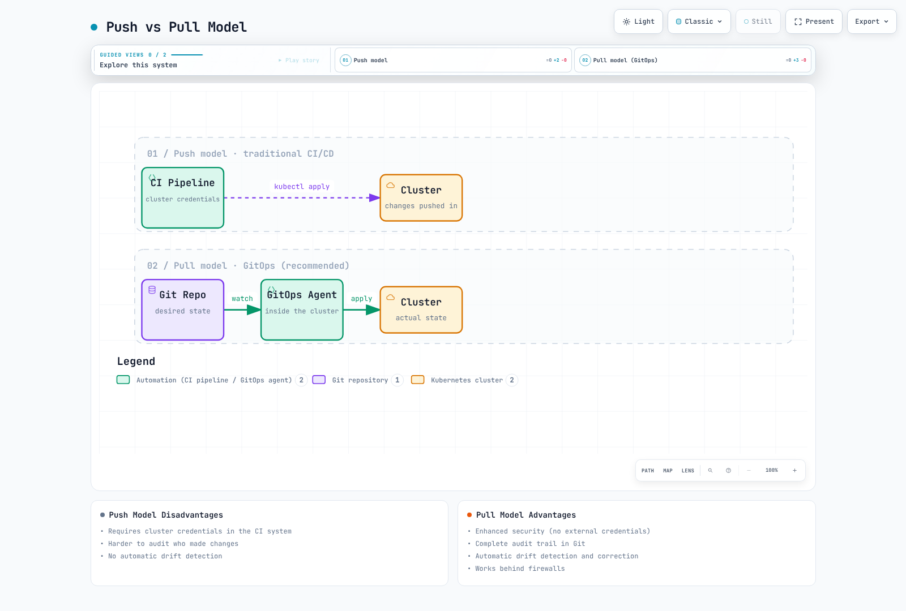

# GitOps

> **Última actualización**: October 12, 2026

## Tabla de contenidos
- [¿Qué es GitOps?](#what-is-gitops)
- [Principios fundamentales](#core-principles)
- [Modelo Push vs Pull](#push-vs-pull-model)
- [Descripción general de las herramientas GitOps](#gitops-tools-overview)
- [Guía de selección de herramientas](#tool-selection-guide)
- [GitOps en Amazon EKS](#gitops-on-amazon-eks)
- [Primeros pasos](#getting-started)

## ¿Qué es GitOps?

GitOps es un marco operativo que aplica las prácticas recomendadas de DevOps para la automatización de infraestructura —como el control de versiones, la colaboración, el cumplimiento y CI/CD— a la gestión de infraestructura. El término fue acuñado por Weaveworks en 2017 y desde entonces se ha convertido en una metodología reconocida por CNCF para el despliegue de aplicaciones cloud-native.

En esencia, GitOps utiliza repositorios Git como la única fuente de verdad para las configuraciones declarativas de infraestructura y aplicaciones. Los cambios en el estado deseado se realizan mediante commits de Git, y los procesos automatizados garantizan que el estado real del sistema coincida con el estado declarado.


[🔍 Ver diagrama interactivo](https://www.atomai.click/kubernetes-docs/archmaps/en-gitops-readme-10.html)

### Historia y evolución

| Hito | Historial verificado del proyecto |
|---|---|
| Flux | CNCF Sandbox July 2019; Incubating March 2021; Graduated November 30, 2022 |
| Argo project | CNCF Incubating March 2020; Graduated December 6, 2022 |
| OpenGitOps | Publishes versioned principles; distinguish released documents from the working main branch |

### Definición de CNCF OpenGitOps

El proyecto OpenGitOps define GitOps mediante cuatro principios:

1. **Declarativo**: Un sistema gestionado por GitOps debe tener su estado deseado expresado de forma declarativa
2. **Versionado e inmutable**: El estado deseado se almacena de una forma que impone inmutabilidad y versionado, y conserva un historial completo de versiones
3. **Obtenido automáticamente**: Los agentes de software obtienen automáticamente las declaraciones de estado deseado desde la fuente
4. **Reconciliado continuamente**: Los agentes de software observan continuamente el estado real del sistema e intentan aplicar el estado deseado

## Principios fundamentales

El historial de Git registra la configuración deseada. Un revert de Git no restaura las migraciones de bases de datos, los datos eliminados ni el estado externo. La sincronización automatizada, prune y selfHeal de Argo CD son configuraciones independientes; GitOps describe un bucle de control que intenta realizar la reconciliación.

### Configuración declarativa

Todo se define como código: infraestructura, aplicaciones, políticas y configuraciones. Esto permite:

- **Reproducibilidad**: La configuración versionada junto con los artefactos, secretos y datos disponibles permite la recreación
- **Auditabilidad**: Historial de configuración conservado; los registros de auditoría de runtime/API aún deben recopilarse
- **Coherencia**: Bases compartidas con diferencias explícitas y revisadas entre entornos

```yaml
# Example: Declarative application state
apiVersion: apps/v1
kind: Deployment
metadata:
  name: web-app
  labels:
    app: web-app
    version: v1.2.3
spec:
  replicas: 3
  selector:
    matchLabels:
      app: web-app
  template:
    metadata:
      labels:
        app: web-app
    spec:
      containers:
      - name: web-app
        image: myregistry/web-app:v1.2.3
        ports:
        - containerPort: 8080
```

### Git como única fuente de verdad

Los repositorios Git almacenan el estado deseado de todo el sistema:

- **Configuraciones de aplicaciones**
- **Definiciones de infraestructura**
- **Políticas de seguridad**
- **Configuraciones específicas del entorno**

### Reconciliación automatizada

Los agentes GitOps continuamente:

1. Supervisan el repositorio Git para detectar cambios
2. Comparan el estado deseado con el estado real
3. Aplican cambios para que los sistemas cumplan con lo establecido
4. Informan el estado y la desviación

### Sistemas de autorreparación

Los intentos de reconciliación dependen de la política de sync/self-heal, los permisos y el estado de salud. Por ejemplo, la sincronización automatizada y selfHeal de Argo CD requieren configuración; la instalación por sí sola no revierte todos los cambios manuales ni recupera los datos perdidos.

## Modelo Push vs Pull

Compare el despliegue push tradicional con GitOps basado en pull. Una canalización de solo CI con `kubectl apply` no satisface por sí misma los principios de obtención automática y reconciliación continua de OpenGitOps:



[🔍 Ver diagrama interactivo](https://www.atomai.click/kubernetes-docs/archmaps/en-gitops-readme-11.html)

### Modelo Push

En el modelo push tradicional:
- La canalización CI/CD tiene acceso directo al clúster
- Las credenciales se almacenan en el sistema CI
- Los cambios se envían desde fuera del clúster

**Desventajas:**
- Requiere credenciales del clúster en el sistema CI
- Es más difícil auditar quién realizó los cambios
- No hay detección automática de desviaciones

### Modelo Pull (Recomendado)

En el modelo pull de GitOps:
- El agente se ejecuta en el clúster de destino o en un clúster de gestión independiente
- El agente obtiene los cambios desde Git
- Los agentes del clúster de gestión aún requieren acceso autorizado de red/API a los destinos remotos

**Ventajas:**
- Puede reducir las credenciales del clúster de destino en CI; los agentes aún conservan derechos de acceso a la fuente/API
- Historial de auditoría completo en Git
- Detección y corrección automáticas de desviaciones
- Funciona detrás de firewalls

## Descripción general de las herramientas GitOps

### ArgoCD

[ArgoCD](argocd/README.md) es una herramienta declarativa de entrega continua GitOps para Kubernetes.

**Características principales:**
- Web UI para visualización
- Compatibilidad con múltiples clústeres
- Integración de SSO
- Capacidades de rollback
- Supervisión del estado de salud
- ApplicationSet para la gestión de flotas

**Ideal para:** Equipos que desean gestión visual, despliegues multiclúster y funciones empresariales

### FluxCD

FluxCD es un conjunto de soluciones de entrega continua para Kubernetes que son abiertas y extensibles.

**Características principales:**
- Ligero y modular
- Compatibilidad nativa con Helm y Kustomize
- Automatización de imágenes
- Multi-tenancy
- Controladores de notificaciones

**Ideal para:** Equipos que prefieren soluciones ligeras centradas en CLI y flujos de trabajo de automatización de imágenes

### Jenkins X / JayeX

Jenkins X / JayeX proporciona CI/CD para aplicaciones cloud-native en Kubernetes.

**Características principales:**
- Canalizaciones CI/CD automatizadas
- Entornos de vista previa
- Promoción GitOps
- Canalizaciones basadas en Tekton

**Evaluar para:** Flujos de trabajo integrados de CI/CD y de entornos de vista previa; JayeX/Jenkins X / JayeX no es simplemente Jenkins con GitOps habilitado

### Matriz de comparación

| Requisito | Argo CD | Flux |
|---|---|---|
| UI predeterminada | Web UI y CLI integradas | Controladores/CLI principales; UIs opcionales del ecosistema |
| Comportamiento de Helm | helm template; Argo CD posee el ciclo de vida de los recursos | Helm Controller posee el ciclo de vida del release de Helm |
| Actualizaciones de imágenes | Argo CD Image Updater independiente | Controladores opcionales Image Reflector/Automation |
| Multi-tenancy | AppProjects, RBAC, restricciones de destino/fuente | Kubernetes RBAC, suplantación de ServiceAccount, restricciones entre namespaces |
| Fuentes OCI | Fuentes OCI/Helm generales; validar capas/tipos de medios | Fuentes OCIRepository/Helm; validar configuración de verificación/capas |
| Capacidad | Medir el recuento de aplicaciones/clústeres y la carga de reconciliación | Medir los controladores, fuentes y carga de reconciliación instalados |

## Guía de selección de herramientas

### Elija ArgoCD cuando:

- Necesite un panel visual para las operaciones
- Se requiera gestión multiclúster
- SSO/RBAC empresarial sea importante
- El equipo prefiera flujos de trabajo basados en UI
- Necesite ApplicationSet para la gestión de flotas

### Elija FluxCD cuando:

- Prefiera una arquitectura ligera y modular
- La automatización de imágenes sea un requisito principal
- Se prefiera un flujo de trabajo centrado en CLI
- Las restricciones de recursos sean una preocupación
- Necesite una integración estrecha con el controlador Helm

### Marco de decisión

El diagrama ilustra preguntas de selección, no capacidades exclusivas. Compare las funciones actuales, los límites de autorización y el costo operativo con la tabla y una prueba representativa.


[🔍 Ver diagrama interactivo](https://www.atomai.click/kubernetes-docs/archmaps/en-gitops-readme-12.html)

## GitOps en Amazon EKS

### Consideraciones específicas de EKS

Al implementar GitOps en Amazon EKS:

#### Integración de IAM

Una anotación de ServiceAccount por sí sola no establece acceso a IAM. Configure el proveedor OIDC/la política de confianza/la compatibilidad de SDK de IRSA o una asociación de EKS Pod Identity. Los permisos de AWS API y la autenticación/RBAC de Kubernetes API de destino son independientes.

Utilice IAM Roles for Service Accounts (IRSA) para un acceso seguro a AWS API:

```yaml
apiVersion: v1
kind: ServiceAccount
metadata:
  name: gitops-controller
  annotations:
    eks.amazonaws.com/role-arn: arn:aws:iam::123456789012:role/GitOpsRole
```

#### Arquitectura multicuenta


[🔍 Ver diagrama interactivo](https://www.atomai.click/kubernetes-docs/archmaps/en-gitops-readme-13.html)

#### Integración de servicios de AWS

GitOps puede gestionar recursos de AWS mediante:

- **AWS Controllers for Kubernetes (ACK)**: CRDs nativos de K8s para servicios de AWS
- **Crossplane**: Aprovisionamiento de recursos multicloud
- **Terraform Controller**: Gestión del estado de Terraform mediante GitOps

### Arquitectura recomendada

```
├── infrastructure/
│   ├── base/                    # Shared infrastructure
│   │   ├── vpc/
│   │   ├── eks/
│   │   └── iam/
│   └── environments/
│       ├── dev/
│       ├── staging/
│       └── production/
├── applications/
│   ├── base/                    # Application base configs
│   └── overlays/
│       ├── dev/
│       ├── staging/
│       └── production/
└── platform/
    ├── argocd/                  # GitOps tooling
    ├── monitoring/              # Observability stack
    └── security/                # Security policies
```

## Primeros pasos

### Inicio rápido de ArgoCD

Utilice una versión compatible de Kubernetes, un namespace dedicado vacío y permisos de clúster para CRDs/RBAC. Este ejemplo de instalación sin HA fija Argo CD 3.5.4; revise la [guía de instalación](argocd/01-installation.md) completa antes de producción. Las credenciales iniciales de administrador deben cambiarse y el Secret de bootstrap debe eliminarse después de usarlo.

1. **Instale ArgoCD:**
   ```bash
   kubectl create namespace argocd
   kubectl apply --server-side -n argocd -f https://raw.githubusercontent.com/argoproj/argo-cd/v3.5.4/manifests/install.yaml
   ```

2. **Acceda a la UI:**
   ```bash
   kubectl port-forward svc/argocd-server -n argocd 8080:443
   ```

3. **Obtenga la contraseña inicial:**
   ```bash
   kubectl -n argocd get secret argocd-initial-admin-secret -o jsonpath="{.data.password}" | base64 -d
   ```

Para una configuración detallada de ArgoCD, consulte la [documentación de ArgoCD](argocd/README.md).

### Inicio rápido de FluxCD

Prepare `GITHUB_ORG`/`GITOPS_REPOSITORY`, la autenticación de GitHub documentada y los permisos de Kubernetes. Bootstrap escribe en Git e instala controladores de clúster. Agregue `--personal` solo para un propietario personal y seleccione explícitamente los controladores opcionales de automatización de imágenes cuando sea necesario.

1. **Instale Flux CLI:**
   ```bash
   curl --fail --location https://fluxcd.io/install.sh -o install-flux.sh
   # Review the script and select a supported version before running it.
   sudo bash install-flux.sh
   ```

2. **Inicialice Flux:**
   ```bash
   flux bootstrap github \
     --owner="$GITHUB_ORG" \
     --repository="$GITOPS_REPOSITORY" \
     --path=clusters/my-cluster
   ```

Para una configuración detallada de FluxCD, consulte la documentación de FluxCD.

## Navegación por secciones

| Tema | Descripción |
|-------|-------------|
| [ArgoCD](argocd/README.md) | Guía completa de ArgoCD con instalación, aplicaciones, estrategias de sincronización y más |
| [FluxCD](02-fluxcd.md) | Configuración de FluxCD, controladores de fuentes y automatización de imágenes |

## Lectura adicional

- [CNCF GitOps Working Group](https://github.com/cncf/tag-app-delivery/tree/main/gitops-wg)
- [OpenGitOps Project](https://opengitops.dev/)
- [GitOps Principles](https://www.gitops.tech/)

## Cuestionario

Para comprobar lo que ha aprendido, pruebe los siguientes cuestionarios:
- [ArgoCD Quiz](../quizzes/gitops/01-argocd-quiz.md)
- [FluxCD Quiz](../quizzes/gitops/02-fluxcd-quiz.md)
- [GitOps Comparison Quiz](../quizzes/gitops/03-gitops-comparison-quiz.md)

### Fuentes de revisión

- [OpenGitOps principles](https://github.com/open-gitops/documents/blob/v1.0.0/PRINCIPLES.md)
- [Argo project maturity](https://www.cncf.io/projects/argo/)
- [Flux project maturity](https://www.cncf.io/projects/flux/)
- [Argo CD OCI sources](https://argo-cd.readthedocs.io/en/stable/user-guide/oci/)
- [Argo CD automated sync](https://argo-cd.readthedocs.io/en/stable/user-guide/auto_sync/)
- [Flux multi-tenancy](https://fluxcd.io/flux/installation/configuration/multitenancy/)
- [Flux ecosystem](https://fluxcd.io/ecosystem/)
- [JayeX project](https://jayex.io/v3/about/)
