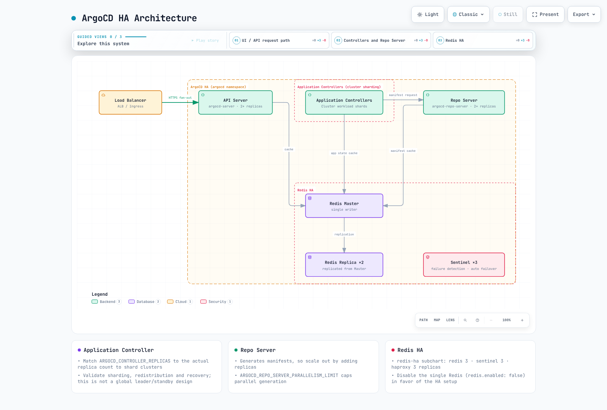

# Instalación de ArgoCD

> **Línea base de revisión**: Argo CD 3.5.2 / Helm Chart 10.8.4; las versiones fijadas para los manifiestos y la CLI se actualizaron a la versión de parche 3.5.5 tras revisar las notas de la versión (no se volvieron a ejecutar los ejemplos)
> **Última actualización**: October 16, 2026

## Tabla de contenido
- [Requisitos previos](#prerequisites)
- [Métodos de instalación](#installation-methods)
- [Instalación de la CLI](#cli-installation)
- [Acceso inicial](#initial-access)
- [Configuración de alta disponibilidad](#high-availability-setup)
- [ArgoCD en Amazon EKS](#argocd-on-amazon-eks)
- [Configuración declarativa](#declarative-setup)
- [Actualización de ArgoCD](#upgrading-argocd)

## Requisitos previos {#prerequisites}

Esta guía explica una instalación autogestionada. Argo CD administrado por EKS utiliza procesos separados para crear, autorizar y configurar capacidades; no superponga allí una instalación autogestionada. Consulte la [tabla de compatibilidad general](README.md) y los períodos de soporte de EKS. La versión mínima de kubeVersion de un chart no garantiza que se haya probado ni que tenga soporte.

Tener permiso para crear un namespace no demuestra que se tengan permisos para CRD, ClusterRoles y enlaces. Compruebe el contexto y la autorización reales. El paquete de alta disponibilidad requiere al menos tres nodos para la antiafinidad. Mida el uso de CPU y memoria según la escala de las aplicaciones, los clústeres y los repositorios; no siempre se requiere un PVC de Redis fijo de 10/50 GB.

```bash
kubectl version --client
kubectl config current-context
kubectl cluster-info
kubectl auth can-i create customresourcedefinitions.apiextensions.k8s.io
kubectl auth can-i create clusterrolebindings.rbac.authorization.k8s.io
```

## Métodos de instalación {#installation-methods}

Elija un único responsable de la instalación: manifiestos, Helm o Kustomize. Los comandos de alta disponibilidad y sin alta disponibilidad que aparecen a continuación son alternativas, no pasos secuenciales. Si utiliza un namespace personalizado, también debe actualizar los sujetos de ServiceAccount en los ClusterRoleBindings.

### Método 1: Manifiestos simples (recomendado para empezar)

El método de instalación más sencillo, mediante manifiestos oficiales:

```bash
# Create namespace
kubectl create namespace argocd

# Install ArgoCD (non-HA)
kubectl apply --server-side -n argocd -f https://raw.githubusercontent.com/argoproj/argo-cd/v3.5.5/manifests/install.yaml

```

Para alta disponibilidad:

```bash
# Install HA manifests
kubectl apply --server-side -n argocd -f https://raw.githubusercontent.com/argoproj/argo-cd/v3.5.5/manifests/ha/install.yaml
```

### Método 2: Helm Chart (recomendado para producción)

El Helm chart ofrece más opciones de configuración:

```bash
# Add Argo Helm repository
helm repo add argo https://argoproj.github.io/argo-helm
helm repo update

# Install with default values
helm install argocd argo/argo-cd --version 10.8.4 \
  --namespace argocd \
  --create-namespace

# Install with custom values
helm install argocd argo/argo-cd --version 10.8.4 \
  --namespace argocd \
  --create-namespace \
  --values values.yaml
```

El chart 10.8.4 implementa Argo CD v3.5.2 (su `appVersion`), no el parche 3.5.5 fijado en los ejemplos de manifiestos, por lo que no incluye las correcciones de seguridad de la versión 3.5.4. Argo CD 3.5.5 se publica por primera vez en el chart 10.10.3, una actualización de versión menor del chart que esta guía no ha revisado; lea el registro de cambios del chart antes de actualizar la versión fijada.

Ejemplo de `values.yaml` para producción:

Estos son valores iniciales para alta disponibilidad que se deben ajustar con carga real. El chart configura la cantidad de shards del controller y la elección de líder de ApplicationSet; Dex permanece con una sola réplica. Elija una instalación predeterminada o personalizada. Revise primero el resultado de `helm template`; habilite ServiceMonitor solo si están instalados los CRD del Operator.

```yaml
fullnameOverride: argocd
global:
  domain: argocd.example.com
configs:
  params:
    server.insecure: false
  cm:
    url: https://argocd.example.com
    users.anonymous.enabled: 'false'
    exec.enabled: 'false'
controller:
  replicas: 2
  resources:
    requests:
      cpu: 250m
      memory: 512Mi
    limits:
      cpu: '1'
      memory: 2Gi
  pdb:
    enabled: true
    minAvailable: 1
server:
  replicas: 2
  service:
    type: ClusterIP
  ingress:
    enabled: false
  resources:
    requests:
      cpu: 100m
      memory: 128Mi
    limits:
      cpu: 500m
      memory: 512Mi
  pdb:
    enabled: true
    minAvailable: 1
repoServer:
  replicas: 2
  resources:
    requests:
      cpu: 100m
      memory: 256Mi
    limits:
      cpu: '1'
      memory: 1Gi
  pdb:
    enabled: true
    minAvailable: 1
applicationSet:
  replicas: 2
  pdb:
    enabled: true
    minAvailable: 1
notifications:
  enabled: true
redis:
  enabled: false
redis-ha:
  enabled: true
  replicas: 3
  persistentVolume:
    enabled: false
  haproxy:
    enabled: true
    replicas: 3
```

### Método 3: Kustomize

Para instalaciones de ArgoCD administradas con GitOps:

```yaml
# kustomization.yaml
apiVersion: kustomize.config.k8s.io/v1beta1
kind: Kustomization

namespace: argocd

resources:
  - https://raw.githubusercontent.com/argoproj/argo-cd/v3.5.5/manifests/install.yaml

patches:
  - patch: |-
      - op: replace
        path: /spec/template/spec/containers/0/resources
        value:
          requests:
            cpu: 500m
            memory: 512Mi
          limits:
            cpu: 2000m
            memory: 2Gi
    target:
      kind: Deployment
      name: argocd-server

configMapGenerator:
  - name: argocd-cm
    behavior: merge
    literals:
      - url=https://argocd.example.com
```

Aplique con:

```bash
kubectl apply --server-side -k .
```

## Instalación de la CLI {#cli-installation}

### Linux / macOS

Guarde lo siguiente como script y ejecútelo. Asegúrese de que coincidan la arquitectura de la CPU y la versión del servidor, y verifique las sumas de comprobación oficiales de la versión. Homebrew es una alternativa en macOS; compruebe la versión instalada.

```bash
#!/usr/bin/env bash
set -euo pipefail
ARGOCD_VERSION=v3.5.5
case "$(uname -s)" in
  Linux) ARGOCD_OS=linux ;;
  Darwin) ARGOCD_OS=darwin ;;
  *) echo 'Select the release package for your OS' >&2; exit 1 ;;
esac
case "$(uname -m)" in
  x86_64) ARGOCD_ARCH=amd64 ;;
  arm64|aarch64) ARGOCD_ARCH=arm64 ;;
  *) echo 'Select a supported release architecture' >&2; exit 1 ;;
esac
ARGOCD_BINARY="argocd-${ARGOCD_OS}-${ARGOCD_ARCH}"
ARGOCD_INSTALL_TMP=$(mktemp -d)
trap 'rm -rf -- "$ARGOCD_INSTALL_TMP"' EXIT
cd "$ARGOCD_INSTALL_TMP"
curl --fail --location --remote-name \
  "https://github.com/argoproj/argo-cd/releases/download/${ARGOCD_VERSION}/${ARGOCD_BINARY}"
curl --fail --location --remote-name \
  "https://github.com/argoproj/argo-cd/releases/download/${ARGOCD_VERSION}/cli_checksums.txt"
EXPECTED=$(awk -v name="$ARGOCD_BINARY" '$2 == name || $2 == "*" name {print $1}' cli_checksums.txt)
[[ "$EXPECTED" =~ ^[a-f0-9]{64}$ ]]
if command -v sha256sum >/dev/null; then
  ACTUAL=$(sha256sum "$ARGOCD_BINARY" | awk '{print $1}')
else
  ACTUAL=$(shasum -a 256 "$ARGOCD_BINARY" | awk '{print $1}')
fi
[[ "$ACTUAL" == "$EXPECTED" ]]
sudo install -m 0755 "$ARGOCD_BINARY" /usr/local/bin/argocd
argocd version --client
```

### Windows

Descargue `argocd-windows-amd64.exe` y `cli_checksums.txt` de la versión v3.5.5. Compare `Get-FileHash -Algorithm SHA256` con la entrada de suma de comprobación correspondiente. Instálelo en un directorio propiedad del usuario y agréguelo al PATH del usuario, en lugar de usar System32 como ubicación predeterminada.

### Finalización

```bash
# Bash session
source <(argocd completion bash)
# Zsh alternative:
# source <(argocd completion zsh)
```

## Acceso inicial {#initial-access}

### Opción 1: Reenvío de puertos (desarrollo)

```bash
# Forward API server port
kubectl port-forward svc/argocd-server -n argocd 8080:443

# Access at https://localhost:8080
```

### Acceso mediante Ingress

Utilice un controller con mantenimiento, un certificado válido y un límite de acceso deliberado. ingress-nginx de la comunidad dejó de recibir soporte en marzo de 2026 y no es la nueva opción predeterminada aquí. La sección de EKS a continuación ofrece un ejemplo coherente de ALB interno con backend HTTPS; para passthrough/gRPC, siga la documentación de otro controller.

### Recuperar la contraseña inicial

```bash
# Get the auto-generated admin password
kubectl -n argocd get secret argocd-initial-admin-secret \
  -o jsonpath="{.data.password}" | base64 -d && echo
```

### Iniciar sesión

```bash
# CLI login
argocd login argocd.example.com

# Or with port-forwarding
argocd login localhost:8080

# Use the interactive password prompt
argocd login localhost:8080 --username admin
```

### Cambiar la contraseña de administrador

```bash
# Update password interactively
argocd account update-password

# Delete the initial secret after changing password
kubectl -n argocd delete secret argocd-initial-admin-secret
```

## Configuración de alta disponibilidad {#high-availability-setup}

### Arquitectura de alta disponibilidad



[🔍 Ver diagrama interactivo](https://www.atomai.click/kubernetes-docs/archmaps/en-gitops-argocd-01-installation-0.html)

Compruebe lo siguiente en el ejemplo de Helm renderizado.

- Application Controller distribuye los clústeres entre shards, en lugar de usar un único líder global y réplicas en espera. El chart alinea la cantidad de réplicas con `ARGOCD_CONTROLLER_REPLICAS`. Valide el algoritmo, la redistribución y la recuperación; la distribución dinámica es una función independiente.
- La elección de líder de ApplicationSet es distinta del sharding de Application Controller. Este chart habilita la elección de líder para varias réplicas de ApplicationSet.
- Dex incluido usa almacenamiento en memoria; agregar réplicas puede generar datos incoherentes. Mantenga el valor predeterminado de una sola réplica y valide un diseño compatible para cualquier requisito adicional de alta disponibilidad.
- Redis es una caché descartable; los objetos de Kubernetes conservan la configuración de Argo. La cantidad de réplicas de Redis HA es `redis-ha.replicas`, no `redis-ha.redis.replicas`. El paquete utiliza tres instancias de Redis/Sentinel.
- Los PDB limitan las expulsiones voluntarias, no los fallos de nodos ni todos los despliegues. Pruebe la distribución, la disponibilidad, las dependencias y la recuperación de la reconciliación.
- Ajuste la concurrencia de Repo Server, el HPA y los límites de CPU según la carga real de generación de manifiestos y memoria. No existe un umbral universal de «100 aplicaciones significa dos shards».

## ArgoCD en Amazon EKS {#argocd-on-amazon-eks}

### ALB y TLS

Este ejemplo utiliza un ALB interno. Prepare AWS Load Balancer Controller, las subredes/etiquetas/grupos de seguridad, DNS y un certificado ACM válido de la misma región. Reemplace el marcador del certificado/nombre de host y proporcione al cliente de administración acceso de red al ALB.

```yaml
apiVersion: networking.k8s.io/v1
kind: Ingress
metadata:
  name: argocd-server
  namespace: argocd
  annotations:
    alb.ingress.kubernetes.io/scheme: internal
    alb.ingress.kubernetes.io/target-type: ip
    alb.ingress.kubernetes.io/backend-protocol: HTTPS
    alb.ingress.kubernetes.io/healthcheck-protocol: HTTPS
    alb.ingress.kubernetes.io/healthcheck-path: /healthz
    alb.ingress.kubernetes.io/listen-ports: '[{"HTTPS":443}]'
    alb.ingress.kubernetes.io/certificate-arn: REPLACE_WITH_ACM_CERTIFICATE_ARN
    alb.ingress.kubernetes.io/ssl-policy: ELBSecurityPolicy-TLS13-1-2-2021-06
spec:
  ingressClassName: alb
  rules:
  - host: argocd.example.com
    http:
      paths:
      - path: /
        pathType: Prefix
        backend:
          service:
            name: argocd-server
            port:
              number: 443
```

Mantenga `server.insecure=false` porque el backend utiliza HTTPS. Use `--grpc-web` para el tráfico de la CLI a través de este único grupo de destino HTTP. gRPC nativo requiere un grupo de destino gRPC independiente y condiciones de enrutamiento, tal como se documenta en el proyecto upstream.

```bash
argocd login argocd.example.com --grpc-web
```

### IRSA y permisos específicos para cada función

Una anotación de IAM por sí sola no configura las integraciones de AWS ni la renovación de tokens. Distinga la identidad real de cada función.

| Función | Identidad |
|---|---|
| Desplegar en otra API de EKS | Controller y rol de administración requerido de ApplicationSet/Server → AssumeRole de destino → EKS Access Entry/RBAC |
| Leer fuentes OCI/Helm | Autenticación de registro, proveedor de credenciales y renovación de tokens del Repo Server real |
| Detectar imágenes/actualizar Git | Image Updater independiente |
| Leer Secrets Manager | Rol de la persona que realmente realiza la llamada a AWS, como External Secrets |
| Obtener imágenes de Pod | Rol del nodo o rol de ejecución de Fargate |

IRSA requiere un proveedor OIDC y una relación de confianza restringida por aud/sub; Pod Identity requiere el agente, la asociación y un SDK compatible. Limite la confianza de destino y los permisos AssumeRole del rol de administración a los ARN previstos. Configure por separado las entradas de acceso de EKS de destino, la autorización del namespace y la conectividad con la API. Si es necesario, vuelva a crear los Pods afectados después de cambiar la identidad de la carga de trabajo.

### Registro declarativo del clúster de EKS

Después de establecer los roles y permisos, registre el clúster con el endpoint y la CA reales. Seleccione explícitamente el contexto de kubeconfig del clúster de administración.

```bash
# IAM roles, trust relationships and target EKS access/RBAC must already exist.
set -euo pipefail
: "${ARGOCD_CONTEXT:?Set the management cluster kubeconfig context}"
: "${TARGET_EKS_NAME:?Set the target EKS cluster name}"
: "${TARGET_AWS_REGION:?Set the target region}"
: "${TARGET_ROLE_ARN:?Set the authorized target-cluster IAM role}"
umask 077
aws eks describe-cluster --name "$TARGET_EKS_NAME" --region "$TARGET_AWS_REGION" \
  --query 'cluster.{name:name,server:endpoint,ca:certificateAuthority.data}' \
  --output json > target-eks.json
jq --arg role "$TARGET_ROLE_ARN" '{
  apiVersion:"v1", kind:"Secret",
  metadata:{name:"target-eks",namespace:"argocd",
    labels:{"argocd.argoproj.io/secret-type":"cluster"}},
  type:"Opaque",
  data:{name:(.name|@base64),server:(.server|@base64),config:({
    awsAuthConfig:{clusterName:.name,roleARN:$role},
    tlsClientConfig:{insecure:false,caData:.ca}
  }|tojson|@base64)}
}' target-eks.json > target-cluster-secret.json
kubectl --context "$ARGOCD_CONTEXT" apply -f target-cluster-secret.json
argocd cluster list
```

El comando imperativo `argocd cluster add` acepta un nombre de contexto de kubeconfig. Un contexto predeterminado de EKS puede ser un ARN, pero este comando no es una llamada a la API de AWS que acepte ARN arbitrarios. Puede crear objetos de ServiceAccount/RBAC en el clúster de destino; restrínjalos a los namespaces y permisos necesarios.

## Configuración declarativa {#declarative-setup}

En Helm, administre `configs.cm`/`configs.params` en los valores. En los manifiestos, combine las claves necesarias que aparecen a continuación con la configuración existente. Evite que Helm y un proceso independiente de kubectl compitan por los mismos campos.

```yaml
apiVersion: v1
kind: ConfigMap
metadata:
  name: argocd-cm
  namespace: argocd
  labels:
    app.kubernetes.io/part-of: argocd
data:
  url: https://argocd.example.com
  users.anonymous.enabled: "false"
  exec.enabled: "false"
---
apiVersion: v1
kind: ConfigMap
metadata:
  name: argocd-cmd-params-cm
  namespace: argocd
  labels:
    app.kubernetes.io/part-of: argocd
data:
  server.insecure: "false"
```

Establezca admin.enabled=false solo después de probar la autorización de SSO y el acceso de recuperación. Diseñe cualquier subruta /argocd junto con las rutas de ingress y server.rootpath/basehref; no es un requisito predeterminado. Es posible que los ajustes de línea de comandos/entorno requieran desplegar de nuevo un componente.

Prefiera las comprobaciones de estado integradas para los recursos compatibles, como Rollouts. El Lua personalizado debe devolver un estado válido incluso cuando no haya status; no equipare un estado desconocido con Healthy. Las versiones personalizadas de Kustomize requieren `kustomize.path.<version>` y el ejecutable correspondiente. Para los repositorios, use los Secrets que se indican a continuación en lugar de los campos obsoletos repositories/repository.credentials de ConfigMap.

### Credenciales del repositorio

Estos ejemplos aprovisionan Secrets a partir de archivos protegidos. Proporcione usuarios/repositorios/ID de aplicaciones reales y solo los permisos de lectura necesarios. No confirme tokens, claves privadas ni Secrets codificados en base64 en Git. Use un único responsable, como External Secrets, para la rotación continua.

#### Plantilla de credenciales HTTPS

```bash
set -euo pipefail
# Bootstrap one credential method; use an external secret manager for rotation.
# Credential files must contain only their value, without an accidental trailing newline.
kubectl -n argocd create secret generic github-repo-creds \
  --from-literal=url=https://github.com/myorg/ \
  --from-file=username=/secure/path/github-user \
  --from-file=password=/secure/path/github-token
kubectl -n argocd label secret github-repo-creds \
  argocd.argoproj.io/secret-type=repo-creds
```

repo-creds es una plantilla de credenciales para un prefijo de URL; repository registra un único repositorio. Compruebe la precedencia cuando un repositorio ya tenga credenciales explícitas.

#### SSH

```bash
set -euo pipefail
kubectl -n argocd create secret generic private-repo-ssh \
  --from-literal=type=git \
  --from-literal=url=git@github.com:myorg/private-repo.git \
  --from-file=sshPrivateKey=/secure/path/id_ed25519
kubectl -n argocd label secret private-repo-ssh \
  argocd.argoproj.io/secret-type=repository
```

Verifique la clave de host del servidor SSH por un canal de confianza antes de agregarla a los hosts conocidos; no confíe en una clave obtenida mediante un escaneo sin verificar.

#### GitHub App

```bash
set -euo pipefail
kubectl -n argocd create secret generic github-app-creds \
  --from-literal=url=https://github.com/myorg/ \
  --from-literal=githubAppID=123456 \
  --from-literal=githubAppInstallationID=12345678 \
  --from-file=githubAppPrivateKey=/secure/path/github-app.pem
kubectl -n argocd label secret github-app-creds \
  argocd.argoproj.io/secret-type=repo-creds
```

## Actualización de ArgoCD {#upgrading-argocd}

### Lista de comprobación previa a la actualización

Revise todas las guías pertinentes sobre cambios incompatibles desde la versión instalada hasta la versión de destino y haga pruebas en un entorno de staging. No dé por sentado que basta con sustituir directamente la versión 2.x por la 3.5. Mantenga el mismo responsable de la instalación. Cifre y restrinja el acceso a las copias de seguridad de los Secret; no es seguro confirmarlas en Git.

1. **Revise las notas de la versión** para identificar cambios incompatibles
2. **Haga una copia de seguridad de la instalación actual**:
   ```bash
   umask 077
   kubectl get applications,applicationsets -n argocd -o yaml > applications-backup.yaml
   kubectl get appprojects -n argocd -o yaml > projects-backup.yaml
   kubectl get secrets -n argocd -l argocd.argoproj.io/secret-type -o yaml > secrets-backup.yaml
   ```
3. **Compruebe la compatibilidad del clúster**, los valores del chart, los permisos del clúster de destino y los procedimientos de reversión/restauración. La copia de seguridad de la configuración no respalda las bases de datos de las aplicaciones.

### Actualización mediante manifiestos

```bash
# Apply new version manifests
kubectl apply --server-side -n argocd -f https://raw.githubusercontent.com/argoproj/argo-cd/v3.5.5/manifests/install.yaml

# Wait for rollout
kubectl rollout status deployment argocd-server -n argocd
kubectl rollout status deployment argocd-repo-server -n argocd
kubectl rollout status statefulset/argocd-application-controller -n argocd
```

### Actualización mediante Helm

```bash
# Update repo
helm repo update

# Check available versions
helm search repo argo/argo-cd --versions

# Upgrade
helm upgrade argocd argo/argo-cd \
  --namespace argocd \
  --values values.yaml \
  --version 10.8.4
```

### Verificación posterior a la actualización

```bash
# Verify versions
argocd version

# Check all applications sync status
argocd app list

# Verify component health
kubectl get pods -n argocd
```

## Solución de problemas de instalación

### Problemas comunes

**Los Pods no se inician:**
```bash
# Check pod events
kubectl describe pod -n argocd -l app.kubernetes.io/name=argocd-server

# Check logs
kubectl logs -n argocd -l app.kubernetes.io/name=argocd-server --tail=100
```

**Error de conexión con el repositorio:**
```bash
# Test repository access
argocd repo list
argocd repo get https://github.com/myorg/myrepo.git
```

**Problemas con los certificados:**
```bash
# Check TLS certificates
# Select the Secret actually used by the server (argocd-server-tls or its configured fallback).
: "${ARGOCD_TLS_SECRET:?Set the actual TLS Secret name}"
kubectl get secret -n argocd "$ARGOCD_TLS_SECRET" -o jsonpath='{.data.tls\.crt}' \
  | base64 -d | openssl x509 -noout -dates -subject -issuer
# An ALB frontend ACM certificate is a separate TLS layer.
```

## Cuestionario

Para poner a prueba lo que ha aprendido, intente el [cuestionario de instalación de ArgoCD](../../quizzes/gitops/argocd/01-installation-quiz.md).

### Fuentes de referencia

- [Instalación de Argo CD 3.5.5](https://github.com/argoproj/argo-cd/blob/v3.5.5/docs/operator-manual/installation.md)
- [Argo CD de alta disponibilidad](https://github.com/argoproj/argo-cd/blob/v3.5.5/docs/operator-manual/high_availability.md)
- [Configuración de EKS y repositorios](https://github.com/argoproj/argo-cd/blob/v3.5.5/docs/operator-manual/declarative-setup.md)
- [Ingress y gRPC](https://github.com/argoproj/argo-cd/blob/v3.5.5/docs/operator-manual/ingress.md)
- [Chart 10.8.4](https://github.com/argoproj/argo-helm/releases/tag/argo-cd-10.8.4)
- [Fin del soporte de Ingress NGINX](https://kubernetes.io/blog/2025/11/11/ingress-nginx-retirement/)
