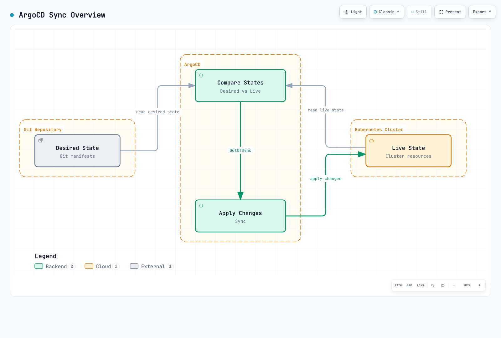

# Estrategias de sincronización de ArgoCD

> **Base de la revisión**: Argo CD 3.5.2; actualizado al parche 3.5.4 después de revisar las notas de la versión (los ejemplos no se volvieron a ejecutar)
> **Última actualización**: 16 de octubre de 2026

## Tabla de contenido
- [Sincronización manual frente a automatizada](#manual-vs-automated-sync)
- [Políticas de sincronización automática](#auto-sync-policies)
- [Opciones de sincronización](#sync-options)
- [Ondas y fases de sincronización](#sync-waves-and-phases)
- [Ventanas de sincronización](#sync-windows)
- [Personalización de diferencias](#diffing-customization)
- [Políticas de reintento](#retry-policies)
- [Sincronización selectiva](#selective-sync)

## Sincronización manual frente a automatizada {#manual-vs-automated-sync}

Los ejemplos son fragmentos de políticas independientes. Conserva el origen/destino/proyecto de una Application real y selecciona únicamente las opciones necesarias. La sincronización aplica cambios; Refresh actualiza la comparación desde las fuentes/caché. Synced es independiente de la salud y de la disponibilidad real del servicio.

ArgoCD admite dos modos de sincronización: manual y automatizado.

### Sincronización manual

En el modo manual, los usuarios deben activar explícitamente la sincronización:

```yaml
apiVersion: argoproj.io/v1alpha1
kind: Application
metadata:
  name: manual-sync-app
  namespace: argocd
spec:
  project: default
  source:
    repoURL: https://github.com/myorg/myrepo.git
    targetRevision: HEAD
    path: manifests
  destination:
    server: https://kubernetes.default.svc
    namespace: my-app
  # No syncPolicy.automated = manual sync
```

Activación de la sincronización manual:

```bash
# Via CLI
argocd app sync my-app

# Sync specific resources only
argocd app sync my-app --resource 'apps:Deployment:my-deployment'

# Preview changes; pruning and force are separate, potentially destructive decisions
argocd app sync my-app --dry-run
```

### Sincronización automatizada

En el modo automatizado, ArgoCD sincroniza automáticamente cuando se detectan cambios:

```yaml
apiVersion: argoproj.io/v1alpha1
kind: Application
metadata:
  name: auto-sync-app
  namespace: argocd
spec:
  project: default
  source:
    repoURL: https://github.com/myorg/myrepo.git
    targetRevision: HEAD
    path: manifests
  destination:
    server: https://kubernetes.default.svc
    namespace: my-app
  syncPolicy:
    automated: {}  # Enable auto-sync with defaults
```



[🔍 Ver diagrama interactivo](https://www.atomai.click/kubernetes-docs/archmaps/en-gitops-argocd-03-sync-strategies-0.html)

## Políticas de sincronización automática {#auto-sync-policies}

La presencia de automated: {} o la omisión de enabled (o su valor nulo) habilita la sincronización automática; enabled: false la deshabilita. La corrección de desviaciones solo del estado activo requiere selfHeal, y prune es independiente. Las combinaciones fallidas idénticas de commit/parámetros no se reintentan indefinidamente de forma predeterminada; configura una política de reintento. Cambia la plantilla propietaria para las Applications administradas por ApplicationSet.

### Prune

Elimina automáticamente recursos que ya no existen en Git:

```yaml
syncPolicy:
  automated:
    prune: true
```

**Caso de uso**: Garantiza que el estado del clúster coincida exactamente con el repositorio Git. Elimina recursos huérfanos.

Prune afecta a los recursos rastreados de la Application, no a todos los huérfanos del clúster. PruneLast cambia el orden; no protege los datos ni reemplaza la revisión de eliminaciones.

### Self-Heal

Revierte automáticamente los cambios manuales realizados en el clúster:

```yaml
syncPolicy:
  automated:
    selfHeal: true
```

**Caso de uso**: Evita la desviación de configuración causada por cambios manuales con kubectl u otras herramientas.


[🔍 Ver diagrama interactivo](https://www.atomai.click/kubernetes-docs/archmaps/en-gitops-argocd-03-sync-strategies-1.html)

### Permitir vacío

Permite Applications sin recursos:

```yaml
syncPolicy:
  automated:
    allowEmpty: true
```

Con prune automatizado habilitado, allowEmpty puede permitir eliminar todos los recursos administrados cuando el renderizado devuelve un conjunto vacío. No es un requisito genérico de arranque.

### Configuración completa de sincronización automática

```yaml
apiVersion: argoproj.io/v1alpha1
kind: Application
metadata:
  name: fully-automated-app
  namespace: argocd
spec:
  project: default
  source:
    repoURL: https://github.com/myorg/myrepo.git
    targetRevision: HEAD
    path: manifests
  destination:
    server: https://kubernetes.default.svc
    namespace: my-app
  syncPolicy:
    automated:
      prune: true        # Remove orphaned resources
      selfHeal: true     # Revert manual changes
      allowEmpty: false  # Prevent auto-prune from deleting everything on an empty render
```

## Opciones de sincronización {#sync-options}

Las opciones de sincronización proporcionan un control detallado del comportamiento de sincronización.

### Opciones de sincronización disponibles

| Opción | Descripción | Predeterminado |
|--------|-------------|---------|
| `Validate` | Valida recursos con el esquema | true |
| `CreateNamespace` | Crea el namespace si no existe | false |
| `PrunePropagationPolicy` | Política de propagación de eliminación | foreground |
| `PruneLast` | Ejecuta prune después de todas las demás sincronizaciones | false |
| `Replace` | Usa replace en lugar de apply | false |
| `FailOnSharedResource` | Falla si otra Application de Argo CD rastrea el recurso | false |
| `ApplyOutOfSyncOnly` | Aplica solo recursos fuera de sincronización | false |
| `ServerSideApply` | Usa apply del lado del servidor | false |
| `RespectIgnoreDifferences` | Respeta ignoreDifferences en la sincronización | false |

`Validate=false` omite la validación del esquema durante apply; no instala un CRD ausente. Argo CD omite automáticamente la ejecución en seco de un CR cuando su CRD se instala en la misma sincronización. Usa `SkipDryRunOnMissingResource=true` solo para un caso justificado, como un CRD creado por otro controlador, y verifica que el CRD esté disponible.

`PruneLast=true` programa prune en una onda implícita final después de que se despliegan y están Healthy los demás recursos. `FailOnSharedResource=true` comprueba si otra Application de Argo CD también rastrea el recurso; no detecta todos los conflictos de propiedad con otros controladores de Kubernetes o Flux.

### Opciones a nivel de Application

```yaml
apiVersion: argoproj.io/v1alpha1
kind: Application
metadata:
  name: my-app
  namespace: argocd
spec:
  project: default
  source:
    repoURL: https://github.com/myorg/myrepo.git
    targetRevision: main
    path: manifests
  destination:
    server: https://kubernetes.default.svc
    namespace: my-app
  syncPolicy:
    syncOptions:
      - CreateNamespace=true
      - PrunePropagationPolicy=foreground
      - PruneLast=true
      - Validate=true
      - ApplyOutOfSyncOnly=true
```

### Opciones a nivel de recurso

Aplica opciones de sincronización a recursos específicos mediante anotaciones:

```yaml
# Merge into an existing complete resource manifest.
metadata:
  annotations:
    argocd.argoproj.io/sync-options: ServerSideApply=true
```

### Apply del lado del servidor

Argo CD 3.5.4 invoca --server-side --force-conflicts. Se rastrea la propiedad de los campos, pero esto no garantiza que se rechacen los conflictos; revisa la posible transferencia forzada de la propiedad de campos.

Usa Kubernetes server-side apply para una mejor detección de conflictos:

```yaml
syncPolicy:
  syncOptions:
    - ServerSideApply=true
```

O por recurso:

```yaml
metadata:
  annotations:
    argocd.argoproj.io/sync-options: ServerSideApply=true
```

**Beneficios**:
- Mejor rastreo de propiedad de los campos
- Argo CD puede resolver a la fuerza los conflictos de propiedad de campos; inspecciona los límites previstos entre los gestores de campos
- Funciona bien con CRD y webhooks

### Replace y Force

Replace selecciona kubectl replace/create. No hace automáticamente editables los campos inmutables. Force=true con Replace=true puede eliminar/recrear objetos y es una decisión destructiva independiente:

```yaml
metadata:
  annotations:
    argocd.argoproj.io/sync-options: Replace=true
```

Los cambios inmutables necesitan un plan de migración/recreación específico para el recurso. No lo uses como atajo para la migración de la clase de almacenamiento de PVC. Revisa la retención/los datos/la disponibilidad antes de eliminar. Replace tiene prioridad sobre ServerSideApply.

## Ondas y fases de sincronización {#sync-waves-and-phases}

Las ondas de sincronización controlan el orden en que se aplican los recursos.

### Cómo funcionan las ondas

Los recursos se agrupan por número de onda y se sincronizan en orden:
1. Se ordenan por fase, después por onda, tipo y nombre.
2. Una onda Sync negativa no se ejecuta antes de la fase PreSync.
3. El avance de onda sigue el estado de sincronización/salud; no dependas de la concurrencia física dentro de la misma onda para las dependencias. Los recursos personalizados necesitan comprobaciones de salud significativas cuando la preparación deba bloquear el trabajo posterior.


[🔍 Ver diagrama interactivo](https://www.atomai.click/kubernetes-docs/archmaps/en-gitops-argocd-03-sync-strategies-2.html)

### Configurar la onda de sincronización

Combina este fragmento en los metadatos de un manifiesto de recurso completo. A continuación hay un ejemplo completo.

```yaml
metadata:
  annotations:
    argocd.argoproj.io/sync-wave: "-1"
```

### Combinar ondas con hooks

PreSync se ejecuta antes de cada onda Sync ordinaria. El Service, namespace, DB Secret y la imagen de migración existentes a continuación ya deben estar preparados; un PreSync no puede asumir acceso a una base de datos creada en una onda Sync posterior.

```yaml
apiVersion: batch/v1
kind: Job
metadata:
  name: dependency-preflight
  annotations:
    argocd.argoproj.io/hook: PreSync
    argocd.argoproj.io/sync-wave: "-5"
    argocd.argoproj.io/hook-delete-policy: BeforeHookCreation,HookSucceeded
spec:
  backoffLimit: 0
  activeDeadlineSeconds: 60
  template:
    spec:
      restartPolicy: Never
      automountServiceAccountToken: false
      containers:
      - name: check
        image: curlimages/curl:8.23.0
        command: ["curl"]
        args: ["--fail", "--show-error", "--silent", "--connect-timeout", "5", "--max-time", "20", "http://existing-data-service:8080/health"]
---
apiVersion: batch/v1
kind: Job
metadata:
  name: db-migration
  annotations:
    argocd.argoproj.io/hook: PreSync
    argocd.argoproj.io/sync-wave: "-3"
    argocd.argoproj.io/hook-delete-policy: BeforeHookCreation,HookSucceeded
spec:
  backoffLimit: 0
  activeDeadlineSeconds: 300
  template:
    spec:
      restartPolicy: Never
      containers:
      - name: migrate
        image: myapp/migrations:v1.0.0
        command: ["./migrate.sh"]
        env:
        - name: DATABASE_URL
          valueFrom:
            secretKeyRef:
              name: existing-db-credentials
              key: url
```

Un Job que solo imprime pg_dump en stdout no es un procedimiento de copia de seguridad restaurable. Usa almacenamiento persistente cifrado, verificación de finalización y pruebas de restauración. Valida la idempotencia/el bloqueo/la recuperación de la migración; un fallo de PostSync no implica una reversión automática.

### Ejemplo mínimo de ordenamiento funcional

Este ejemplo mínimo ordena Namespace → ConfigMap → Service → un Deployment con una sonda de disponibilidad dentro de la misma fase Sync. Un objeto Service en estado Healthy no demuestra que tenga endpoints listos; la sonda del Deployment comprueba que la carga de trabajo esté lista. Prepara el acceso a Argo Project/RBAC y al registro de imágenes.

```yaml
apiVersion: v1
kind: Namespace
metadata:
  name: wave-demo
  annotations:
    argocd.argoproj.io/sync-wave: "-2"
---
apiVersion: v1
kind: ConfigMap
metadata:
  name: wave-demo-config
  namespace: wave-demo
  annotations:
    argocd.argoproj.io/sync-wave: "-1"
data:
  DEMO_ENVIRONMENT: demo
---
apiVersion: v1
kind: Service
metadata:
  name: wave-demo
  namespace: wave-demo
  annotations:
    argocd.argoproj.io/sync-wave: "0"
spec:
  type: ClusterIP
  selector:
    app: wave-demo
  ports:
  - name: http
    port: 80
    targetPort: http
---
apiVersion: apps/v1
kind: Deployment
metadata:
  name: wave-demo
  namespace: wave-demo
  annotations:
    argocd.argoproj.io/sync-wave: "1"
spec:
  replicas: 2
  selector:
    matchLabels:
      app: wave-demo
  template:
    metadata:
      labels:
        app: wave-demo
    spec:
      automountServiceAccountToken: false
      securityContext:
        runAsNonRoot: true
        runAsUser: 10001
        seccompProfile:
          type: RuntimeDefault
      containers:
      - name: podinfo
        image: ghcr.io/stefanprodan/podinfo:6.15.0
        ports:
        - name: http
          containerPort: 9898
        envFrom:
        - configMapRef:
            name: wave-demo-config
        readinessProbe:
          httpGet:
            path: /readyz
            port: http
        resources:
          requests: {cpu: 100m, memory: 64Mi}
          limits: {cpu: 500m, memory: 128Mi}
        securityContext:
          allowPrivilegeEscalation: false
          capabilities:
            drop: [ALL]
```

Para una base de datos, prepara primero la autenticación, la persistencia y el Service, y verifica que esté realmente disponible. HPA necesita solicitudes de CPU y disponibilidad de métricas. No coloques un Service/ConfigMap requerido para la preparación en una onda posterior.

## Ventanas de sincronización {#sync-windows}

Este ejemplo permite las Applications prod-* del proyecto de producción el domingo de 02:00 a 06:00 KST, con una congelación de 03:00 a 04:00. Sustituye el repositorio/destino por el ámbito autorizado real.

```yaml
apiVersion: argoproj.io/v1alpha1
kind: AppProject
metadata:
  name: production
  namespace: argocd
spec:
  sourceRepos:
  - https://github.com/myorg/myapp.git
  destinations:
  - server: https://kubernetes.default.svc
    namespace: production
  syncWindows:
  - kind: allow
    description: Example Sunday maintenance window
    schedule: '0 2 * * 0'
    duration: 4h
    timeZone: Asia/Seoul
    applications: ['prod-*']
    namespaces: [production]
    andOperator: true
    manualSync: false
    syncOverrun: false
  - kind: deny
    description: Example freeze within the maintenance window
    schedule: '0 3 * * 0'
    duration: 1h
    timeZone: Asia/Seoul
    applications: ['prod-*']
    namespaces: [production]
    andOperator: true
    manualSync: false
    syncOverrun: false
```

Para una nueva solicitud de sincronización automática:

1. Ninguna ventana coincidente significa que no hay restricción de ventana.
2. Una denegación coincidente activa la bloquea.
3. De lo contrario, una autorización coincidente activa la permite.
4. Las ventanas de autorización coincidentes que están todas inactivas la bloquean.
5. Sin ventana de autorización y solo denegaciones inactivas, se permite.

Los selectores de Application/namespace/clúster usan OR de forma predeterminada; no hay clasificación por especificidad. Usa andOperator: true cuando todos los selectores proporcionados deban coincidir. La zona horaria predeterminada es UTC; un comentario de KST no la cambia.

Las excepciones manuales dependen de que todas las ventanas de bloqueo pertinentes permitan manualSync y de que quien realiza la llamada tenga derechos de sincronización. La opción --force no permite eludir estas restricciones. Una autorización de 24 h siempre activa no es un interruptor de emergencia activado manualmente y también puede permitir la sincronización automática. La ejecución continua más allá del límite de una ventana depende de syncOverrun, la hora de inicio y las ventanas pertinentes; no garantiza la finalización ni la reversión.

```bash
argocd proj windows list production -o yaml
argocd app get my-app
```


[🔍 Ver diagrama interactivo](https://www.atomai.click/kubernetes-docs/archmaps/en-gitops-argocd-03-sync-strategies-4.html)

## Personalización de diferencias {#diffing-customization}

Ignora solo campos reales propiedad de otro controlador, delimitados por nombre/namespace. Por ejemplo, excluye las réplicas de un Deployment administrado por HPA. No uses de forma predeterminada exclusiones amplias de imágenes, de todas las anotaciones/recursos o de todos los gestores de campos.

```yaml
spec:
  ignoreDifferences:
  - group: apps
    kind: Deployment
    name: my-deployment
    namespace: production
    jsonPointers:
    - /spec/replicas
  syncPolicy:
    syncOptions: [RespectIgnoreDifferences=true]
```

ignoreDifferences controla la comparación; RespectIgnoreDifferences lo extiende a la sincronización, pero la creación inicial sin un objeto activo sigue usando el manifiesto deseado. Inspecciona los campos realmente administrados antes de seleccionar un gestor de campos. Las exclusiones de comparación globales/de estado no deshabilitan la evaluación de salud y no deben ocultar la manipulación de imágenes.

Consulta los [ejemplos de ignore-difference de Application](02-applications.md#ignore-differences) para conocer reglas delimitadas.

## Políticas de reintento {#retry-policies}

limit: 5 permite cinco reintentos después del intento inicial, hasta seis intentos en total. Los retrasos comienzan en 5s,10s,20s,40s,80s; maxDuration limita un backoff individual, no toda la sincronización ni el hook. El reintento de Application y backoffLimit/activeDeadlineSeconds de Job son capas distintas.

Configura el reintento automático ante fallos de sincronización.

### Configuración básica de reintento

```yaml
apiVersion: argoproj.io/v1alpha1
kind: Application
metadata:
  name: my-app
  namespace: argocd
spec:
  project: default
  source:
    repoURL: https://github.com/myorg/myrepo.git
    targetRevision: main
    path: manifests
  destination:
    server: https://kubernetes.default.svc
    namespace: my-app
  syncPolicy:
    retry:
      limit: 5          # Maximum retry attempts
      backoff:
        duration: 5s    # Initial delay
        factor: 2       # Multiplier for each retry
        maxDuration: 3m # Maximum delay
```

### Flujo de reintento

limit: 5 permite hasta cinco reintentos después del intento inicial. Con duration 5s y factor 2, los retrasos comienzan en 5s, 10s, 20s, 40s, 80s. maxDuration limita un retraso backoff individual; no es un tiempo de espera global de sincronización/hook.

### Comprobación previa de dependencia acotada

Un hook de comprobación previa puede fallar con un plazo acotado; no añade un filtro de reintentos de Argo por código de error. La dependencia de abajo ya debe existir.

```yaml
apiVersion: batch/v1
kind: Job
metadata:
  name: check-prerequisites
  annotations:
    argocd.argoproj.io/hook: PreSync
    argocd.argoproj.io/hook-delete-policy: BeforeHookCreation,HookSucceeded
spec:
  backoffLimit: 0
  activeDeadlineSeconds: 100
  template:
    spec:
      restartPolicy: Never
      automountServiceAccountToken: false
      containers:
      - name: check
        image: curlimages/curl:8.23.0
        command:
        - sh
        - -c
        - |
          for i in 1 2 3 4 5 6; do
            if curl --fail --silent --show-error --connect-timeout 3 --max-time 10 http://existing-service:8080/readyz; then
              exit 0
            fi
            sleep 5
          done
          exit 1
```

## Sincronización selectiva {#selective-sync}

La selección explícita mediante --resource/--label omite hooks e historial. ApplyOutOfSyncOnly/--apply-out-of-sync-only conserva hooks/historial en 3.5.4. --label selecciona recursos; --selector(-l) selecciona Applications.

Sincroniza solo recursos específicos dentro de una Application.

### Mediante CLI

```bash
# Sync specific resource by kind and name
argocd app sync my-app --resource 'apps:Deployment:my-deployment'

# Sync resources by group
argocd app sync my-app --resource 'apps:Deployment:*'

# Sync multiple resources
argocd app sync my-app \
  --resource ':ConfigMap:my-config' \
  --resource ':Secret:my-secret' \
  --resource 'apps:Deployment:my-deployment'

# Sync by label
argocd app sync my-app --label 'app.kubernetes.io/component=backend'
```

### Opciones de sincronización selectiva

```bash
# Apply only out-of-sync resources
argocd app sync my-app --apply-out-of-sync-only

# Preview what would be synced
argocd app sync my-app --dry-run

# Sync with prune
argocd app sync my-app --prune
```

### Formato de ruta de recurso

```
<group>:<kind>:<name>

Examples:
:ConfigMap:my-config                 # Core API group
apps:Deployment:my-deployment        # apps API group
networking.k8s.io:Ingress:my-ingress # networking.k8s.io group
*:*:*                                # All resources
```

## Cuestionario

Para comprobar lo que has aprendido, prueba el [cuestionario sobre estrategias de sincronización de ArgoCD](../../quizzes/gitops/argocd/03-sync-strategies-quiz.md).

## Fuentes de revisión versionadas

- [opciones de sincronización 3.5.4](https://github.com/argoproj/argo-cd/blob/v3.5.4/docs/user-guide/sync-options.md)
- [Ventanas de sincronización](https://github.com/argoproj/argo-cd/blob/v3.5.4/docs/user-guide/sync_windows.md)
- [Coincidencia de ventanas y CanSync](https://github.com/argoproj/argo-cd/blob/v3.5.4/pkg/apis/application/v1alpha1/types.go)
- [Fases y ondas](https://github.com/argoproj/argo-cd/blob/v3.5.4/docs/user-guide/sync-waves.md)
- [Selectores de recursos/app de CLI](https://github.com/argoproj/argo-cd/blob/v3.5.4/docs/user-guide/commands/argocd_app_sync.md)
