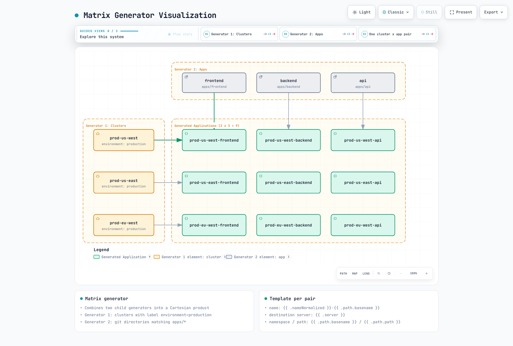

# ArgoCD ApplicationSets

> **Revisado con**: Argo CD 3.5.2, incluido su controlador ApplicationSet; actualizado al parche 3.5.4 tras revisar las notas de la versión (los ejemplos no se volvieron a ejecutar)
> **Última actualización**: 12 de octubre de 2026

## Tabla de contenido
- [Descripción general de ApplicationSet](#applicationset-overview)
- [Generadores](#generators)
- [Plantillas Go](#go-templating)
- [Sincronización progresiva](#progressive-sync)
- [Patrones multiclúster](#multi-cluster-patterns)
- [Parches de plantillas](#template-patches)

## Descripción general de ApplicationSet {#applicationset-overview}

ApplicationSet es un controlador de Kubernetes que permite generar objetos Application de ArgoCD a partir de plantillas. Facilita la gestión de varias aplicaciones con configuraciones similares en distintos clústeres, entornos o repositorios.

### Cuándo usar ApplicationSet

| Escenario | ¿Usar ApplicationSet? |
|----------|---------------------|
| La misma app en varios clústeres | Sí |
| Varios entornos (dev/staging/prod) | Sí |
| Monorepo con muchos servicios | Sí |
| Entornos dinámicos a partir de PR | Sí |
| Despliegue de una sola aplicación | No (use Application) |

`myorg`, `example.com`, las URL de clústeres y los charts privados que aparecen a continuación son marcadores de posición. Antes de aplicar los ejemplos, configure las rutas de repositorio, los charts, los archivos de valores, los clústeres registrados, los permisos de AppProject y las credenciales reales. ApplicationSet no registra clústeres ni crea AppProjects. `CreateNamespace=true` solo crea un Namespace de destino para el que se tienen permisos. Todos los ejemplos completos habilitan explícitamente las plantillas Go.

Permita que solo administradores de confianza creen o modifiquen ApplicationSets y las entradas de sus generadores. Una entrada de Git o de una PR que controle el proyecto, el origen o el destino puede ampliar los privilegios de despliegue; utilice AppProjects fijos con permisos limitados y entradas revisadas.

### Estructura básica

```yaml
apiVersion: argoproj.io/v1alpha1
kind: ApplicationSet
metadata:
  name: my-appset
  namespace: argocd
spec:
  generators:
  - list:
      elements:
      - cluster: dev
        url: https://dev.k8s.local
      - cluster: prod
        url: https://prod.k8s.local
  template:
    metadata:
      name: '{{ .cluster }}-myapp'
    spec:
      project: default
      source:
        repoURL: https://github.com/myorg/myrepo.git
        targetRevision: HEAD
        path: overlays/{{ .cluster }}
      destination:
        server: '{{ .url }}'
        namespace: myapp
      syncPolicy:
        syncOptions:
        - CreateNamespace=true
  goTemplate: true
  goTemplateOptions:
  - missingkey=error
```

## Generadores {#generators}

Los generadores producen parámetros que se sustituyen en la plantilla para crear Applications.

### 1. Generador List

El generador más sencillo: define una lista estática de valores:

```yaml
apiVersion: argoproj.io/v1alpha1
kind: ApplicationSet
metadata:
  name: list-example
  namespace: argocd
spec:
  generators:
  - list:
      elements:
      - cluster: dev
        url: https://kubernetes.default.svc
        namespace: dev
        values:
          replicas: '1'
          logLevel: debug
      - cluster: staging
        url: https://staging.k8s.local
        namespace: staging
        values:
          replicas: '2'
          logLevel: info
      - cluster: production
        url: https://production.k8s.local
        namespace: production
        values:
          replicas: '5'
          logLevel: warn
  template:
    metadata:
      name: myapp-{{ .cluster }}
      labels:
        environment: '{{ .cluster }}'
    spec:
      project: default
      source:
        repoURL: https://github.com/myorg/myapp.git
        targetRevision: HEAD
        path: charts/myapp
        helm:
          parameters:
          - name: replicaCount
            value: '{{ .values.replicas }}'
          - name: logging.level
            value: '{{ .values.logLevel }}'
      destination:
        server: '{{ .url }}'
        namespace: '{{ .namespace }}'
      syncPolicy:
        automated:
          prune: true
          selfHeal: true
        syncOptions:
        - CreateNamespace=true
  goTemplate: true
  goTemplateOptions:
  - missingkey=error
```

### 2. Generador Cluster

Selecciona automáticamente los clústeres registrados en ArgoCD:

```yaml
apiVersion: argoproj.io/v1alpha1
kind: ApplicationSet
metadata:
  name: cluster-example
  namespace: argocd
spec:
  generators:
  - clusters:
      selector: {}
      values:
        clusterName: '{{ .name }}'
  template:
    metadata:
      name: '{{ .nameNormalized }}-guestbook'
    spec:
      project: default
      source:
        repoURL: https://github.com/argoproj/argocd-example-apps.git
        targetRevision: HEAD
        path: guestbook
      destination:
        server: '{{ .server }}'
        namespace: guestbook
      syncPolicy:
        syncOptions:
        - CreateNamespace=true
  goTemplate: true
  goTemplateOptions:
  - missingkey=error
```

#### Etiquetas de clústeres para la selección

Primero, añada etiquetas a los Secrets de sus clústeres:

```yaml
apiVersion: v1
kind: Secret
metadata:
  name: production-cluster
  namespace: argocd
  labels:
    argocd.argoproj.io/secret-type: cluster
    environment: production
    region: us-west-2
    tier: critical
type: Opaque
stringData:
  name: production
  server: https://production.k8s.local
  config: |
    {
      "tlsClientConfig": {
        "insecure": false,
        "caData": "..."
      }
    }
```

Después, seleccione clústeres por etiqueta:

```yaml
generators:
  - clusters:
      selector:
        matchLabels:
          environment: production
        matchExpressions:
          - key: tier
            operator: In
            values:
              - critical
              - high
```

Un selector vacío del generador Cluster puede incluir el clúster local. El clúster local predeterminado no tiene un Secret y puede quedar fuera de los selectores de etiquetas; cree o configure su Secret de clúster si necesita seleccionarlo por etiquetas. Use `nameNormalized` para los nombres de Application y compruebe por separado las restricciones de nombres de Namespace y etiquetas. Los fragmentos de Secret solo muestran la estructura: `...` no es un certificado de CA ni una credencial válidos.

### 3. Generador Git - Directorios

Explore un repositorio Git en busca de directorios:

```yaml
apiVersion: argoproj.io/v1alpha1
kind: ApplicationSet
metadata:
  name: git-directories
  namespace: argocd
spec:
  generators:
  - git:
      repoURL: https://github.com/myorg/gitops-repo.git
      revision: HEAD
      directories:
      - path: apps/*
      - path: apps/excluded-app
        exclude: true
  template:
    metadata:
      name: '{{ .path.basename }}'
    spec:
      project: default
      source:
        repoURL: https://github.com/myorg/gitops-repo.git
        targetRevision: HEAD
        path: '{{ .path.path }}'
      destination:
        server: https://kubernetes.default.svc
        namespace: '{{ .path.basename }}'
      syncPolicy:
        syncOptions:
        - CreateNamespace=true
  goTemplate: true
  goTemplateOptions:
  - missingkey=error
```

#### Estructura de repositorio para el generador de directorios

```
gitops-repo/
├── apps/
│   ├── frontend/
│   │   ├── deployment.yaml
│   │   └── service.yaml
│   ├── backend/
│   │   ├── deployment.yaml
│   │   └── service.yaml
│   ├── database/
│   │   ├── statefulset.yaml
│   │   └── service.yaml
│   └── excluded-app/    # Excluded via generator
│       └── ...
```

### 4. Generador Git - Archivos

Lea la configuración desde archivos JSON/YAML en Git:

```yaml
apiVersion: argoproj.io/v1alpha1
kind: ApplicationSet
metadata:
  name: git-files
  namespace: argocd
spec:
  generators:
  - git:
      repoURL: https://github.com/myorg/gitops-repo.git
      revision: HEAD
      files:
      - path: config/**/config.json
  template:
    metadata:
      name: '{{ .cluster.name }}-{{ .app.name }}'
      labels:
        environment: '{{ .cluster.environment }}'
    spec:
      project: default
      source:
        repoURL: '{{ .app.repoURL }}'
        targetRevision: '{{ .app.revision }}'
        path: '{{ .app.path }}'
        helm:
          valueFiles:
          - values.yaml
          - values-{{ .cluster.environment }}.yaml
      destination:
        server: '{{ .cluster.server }}'
        namespace: '{{ .app.namespace }}'
      syncPolicy:
        syncOptions:
        - CreateNamespace=true
  goTemplate: true
  goTemplateOptions:
  - missingkey=error
```

#### Ejemplo de archivo de configuración

```json
{
  "cluster": {
    "name": "prod-us-west-2",
    "server": "https://prod-usw2.k8s.local",
    "environment": "production"
  },
  "app": {
    "name": "myapp",
    "repoURL": "https://github.com/myorg/myapp.git",
    "revision": "v1.2.3",
    "path": "charts/myapp",
    "namespace": "myapp-prod"
  }
}
```

### 5. Generador Matrix

Combine dos generadores para crear un producto cartesiano:

```yaml
apiVersion: argoproj.io/v1alpha1
kind: ApplicationSet
metadata:
  name: matrix-example
  namespace: argocd
spec:
  generators:
  - matrix:
      generators:
      - clusters:
          selector:
            matchLabels:
              environment: production
      - git:
          repoURL: https://github.com/myorg/apps.git
          revision: HEAD
          directories:
          - path: apps/*
  template:
    metadata:
      name: '{{ .nameNormalized }}-{{ .path.basename }}'
    spec:
      project: default
      source:
        repoURL: https://github.com/myorg/apps.git
        targetRevision: HEAD
        path: '{{ .path.path }}'
      destination:
        server: '{{ .server }}'
        namespace: '{{ .path.basename }}'
      syncPolicy:
        syncOptions:
        - CreateNamespace=true
  goTemplate: true
  goTemplateOptions:
  - missingkey=error
```

#### Visualización de Matrix



[🔍 Ver diagrama interactivo](https://www.atomai.click/kubernetes-docs/archmaps/en-gitops-argocd-04-applicationsets-0.html)

Matrix combina exactamente dos generadores secundarios; los generadores de combinación solo admiten un nivel de anidamiento. Use `pathParamPrefix` cuando dos generadores Git puedan generar parámetros de ruta con nombres en conflicto.

### 6. Generador Merge

Combine las salidas de varios generadores para reunir sus parámetros:

```yaml
apiVersion: argoproj.io/v1alpha1
kind: ApplicationSet
metadata:
  name: merge-example
  namespace: argocd
spec:
  generators:
  - merge:
      mergeKeys:
      - cluster
      generators:
      - list:
          elements:
          - cluster: dev
            replicas: '1'
            enableHA: 'false'
          - cluster: staging
            replicas: '2'
            enableHA: 'false'
          - cluster: production
            replicas: '5'
            enableHA: 'false'
      - list:
          elements:
          - cluster: production
            replicas: '10'
            enableHA: 'true'
  template:
    metadata:
      name: myapp-{{ .cluster }}
    spec:
      project: default
      source:
        repoURL: https://github.com/myorg/myapp.git
        targetRevision: HEAD
        path: charts/myapp
        helm:
          parameters:
          - name: replicas
            value: '{{ .replicas }}'
          - name: highAvailability
            value: '{{ .enableHA }}'
      destination:
        server: https://kubernetes.default.svc
        namespace: '{{ .cluster }}'
      syncPolicy:
        syncOptions:
        - CreateNamespace=true
  goTemplate: true
  goTemplateOptions:
  - missingkey=error
```

Merge conserva las entradas del generador base y aplica las sobrescrituras que coinciden según `mergeKeys`. Los generadores posteriores tienen prioridad y se descartan las entradas de sobrescritura sin coincidencia. Las claves de combinación anidadas no son compatibles con las plantillas Go.

### 7. Generador SCM Provider

Explore organizaciones de GitHub/GitLab en busca de repositorios:

#### GitHub

```yaml
apiVersion: argoproj.io/v1alpha1
kind: ApplicationSet
metadata:
  name: github-org-apps
  namespace: argocd
spec:
  generators:
  - scmProvider:
      github:
        organization: myorg
      filters:
      - repositoryMatch: ^service-.*
        pathsExist:
        - kubernetes/
        labelMatch: ^deploy-to-k8s$
  template:
    metadata:
      name: '{{ .repository }}'
    spec:
      project: default
      source:
        repoURL: '{{ .url }}'
        targetRevision: '{{ .branch }}'
        path: kubernetes
      destination:
        server: https://kubernetes.default.svc
        namespace: '{{ .repository }}'
      syncPolicy:
        syncOptions:
        - CreateNamespace=true
  goTemplate: true
  goTemplateOptions:
  - missingkey=error
```

#### GitLab

```yaml
apiVersion: argoproj.io/v1alpha1
kind: ApplicationSet
metadata:
  name: gitlab-group-apps
  namespace: argocd
spec:
  generators:
  - scmProvider:
      gitlab:
        group: mygroup
        includeSubgroups: true
      filters:
      - pathsExist:
        - deploy/
  template:
    metadata:
      name: '{{ .repository }}'
    spec:
      project: default
      source:
        repoURL: '{{ .url }}'
        targetRevision: '{{ .branch }}'
        path: deploy
      destination:
        server: https://kubernetes.default.svc
        namespace: '{{ .repository }}'
      syncPolicy:
        syncOptions:
        - CreateNamespace=true
  goTemplate: true
  goTemplateOptions:
  - missingkey=error
```

`scmProvider.filters` está al mismo nivel que el objeto del proveedor. Las condiciones de un mismo filtro se combinan con AND; los filtros separados se combinan con OR. El ejemplo reúne los requisitos de nombre, ruta y etiqueta en un único filtro. Para acceder a repositorios privados y gestionar los límites de solicitudes de la API, utilice un token o una GitHub App con los permisos adecuados.

### 8. Generador Pull Request

Cree entornos para pull requests:

```yaml
apiVersion: argoproj.io/v1alpha1
kind: ApplicationSet
metadata:
  name: pr-environments
  namespace: argocd
spec:
  generators:
  - pullRequest:
      github:
        owner: myorg
        repo: myapp
        tokenRef:
          secretName: github-token
          key: token
        labels:
        - preview
      requeueAfterSeconds: 180
  template:
    metadata:
      name: pr-{{ .number }}-{{ .branch_slug }}
      labels:
        preview: 'true'
        pr-number: '{{ .number }}'
    spec:
      project: previews
      source:
        repoURL: https://github.com/myorg/myapp.git
        targetRevision: '{{ .head_sha }}'
        path: kubernetes
        kustomize:
          nameSuffix: -pr-{{ .number }}
          images:
          - myapp:pr-{{ .number }}
      destination:
        server: https://kubernetes.default.svc
        namespace: preview-{{ .number }}
      syncPolicy:
        automated:
          prune: true
          selfHeal: true
        syncOptions:
        - CreateNamespace=true
  goTemplate: true
  goTemplateOptions:
  - missingkey=error
```

Utilice el ejemplo de PR únicamente con un AppProject `previews` creado de antemano que limite los clústeres y Namespaces de los entornos de vista previa. GitHub exige todas las etiquetas indicadas; una etiqueta no garantiza que el código de una PR sea seguro. No exponga Secrets de producción ni credenciales de cluster-admin a las cargas de esos entornos. Con la política de eliminación predeterminada, las Applications de PR cerradas o que ya no cumplen los criterios se eliminan durante la reconciliación. La eliminación de sus recursos depende de los finalizers y de la configuración de conservación. Un Namespace creado únicamente mediante `CreateNamespace=true` no se incorpora automáticamente a los recursos cuyo ciclo de vida se gestiona.

### 9. Generador Cluster Decision Resource

Delegue la selección de clústeres a un recurso externo:

```yaml
apiVersion: argoproj.io/v1alpha1
kind: ApplicationSet
metadata:
  name: cluster-decision
  namespace: argocd
spec:
  generators:
  - clusterDecisionResource:
      configMapRef: cluster-decisions
      labelSelector:
        matchLabels:
          cluster.open-cluster-management.io/placement: production
      requeueAfterSeconds: 180
  template:
    metadata:
      name: '{{ normalize .name }}-addon'
    spec:
      project: default
      source:
        repoURL: https://github.com/myorg/myapp.git
        targetRevision: HEAD
        path: manifests
      destination:
        server: '{{ .server }}'
        namespace: myapp
      syncPolicy:
        syncOptions:
        - CreateNamespace=true
  goTemplate: true
  goTemplateOptions:
  - missingkey=error
```

Configuración del recurso de decisión:

```yaml
apiVersion: v1
kind: ConfigMap
metadata:
  name: cluster-decisions
  namespace: argocd
data:
  apiVersion: cluster.open-cluster-management.io/v1beta1
  kind: placementdecisions
  statusListKey: decisions
  matchKey: clusterName
```

Este ejemplo requiere una instalación existente de Open Cluster Management y un Placement `production` que genere objetos PlacementDecision. Conceda al controlador ApplicationSet permisos de lectura sobre esos objetos en el Namespace `argocd`. Cada `status.decisions[].clusterName` debe coincidir con un clúster registrado en Argo CD; utilice el valor `server` generado como dirección de su API. Seleccione las decisiones por nombre o mediante labelSelector.

### 10. Generador Plugin

Configure un generador con lógica personalizada mediante un ConfigMap:

```yaml
apiVersion: argoproj.io/v1alpha1
kind: ApplicationSet
metadata:
  name: plugin-example
  namespace: argocd
spec:
  generators:
  - plugin:
      configMapRef:
        name: my-plugin
      input:
        parameters:
          environment: production
          region: us-west-2
      requeueAfterSeconds: 300
  template:
    metadata:
      name: '{{ .name }}'
    spec:
      project: default
      source:
        repoURL: '{{ .repoURL }}'
        targetRevision: '{{ .revision }}'
        path: '{{ .path }}'
      destination:
        server: '{{ .server }}'
        namespace: '{{ .namespace }}'
      syncPolicy:
        syncOptions:
        - CreateNamespace=true
  goTemplate: true
  goTemplateOptions:
  - missingkey=error
```

Configuración de conexión del Plugin:

```yaml
apiVersion: v1
kind: ConfigMap
metadata:
  name: my-plugin
  namespace: argocd
data:
  token: "$appset-plugin-token:token"
  baseUrl: "https://appset-plugin.example.com"
  requestTimeout: "30"
```

El ConfigMap no ejecuta código. Un servicio HTTP desplegado por separado debe atender solicitudes POST a `/api/v1/getparams.execute` y devolver un array `output.parameters`. Sustituya el dominio de ejemplo por un endpoint cuyo certificado TLS se valide. Cree el Secret `appset-plugin-token` en `argocd` con la clave `token` y la etiqueta `app.kubernetes.io/part-of: argocd`; mantenga su valor fuera de Git. Antes de conectar el servicio, implemente la autenticación, la validación de entradas y el esquema de respuesta documentado.

## Plantillas Go {#go-templating}

Configure `spec.goTemplate: true` para utilizar plantillas Go; en 3.5.4, el motor predeterminado sigue siendo fasttemplate. Los ejemplos de esta página habilitan explícitamente las plantillas Go con `missingkey=error`. Cada campo de texto se renderiza de forma independiente: las instrucciones de control no pueden abarcar varios campos YAML. Para modificar booleanos, objetos o listas, utilice `templatePatch`. Use `dig` para las claves opcionales, ya que acceder directamente a una clave ausente provoca un error antes de que pueda ejecutarse `default`.

### Sintaxis básica

```yaml
template:
  metadata:
    name: '{{ .cluster }}-{{ .app }}'           # Simple substitution
    labels:
      env: '{{ .values.environment }}'       # Nested values
```

### Funciones

```yaml
template:
  metadata:
    # Normalize strings
    name: '{{normalize .cluster}}'

    # String manipulation
    labels:
      lower: '{{.cluster | lower}}'
      upper: '{{.cluster | upper}}'
      trimmed: '{{.cluster | trim}}'

    annotations:
      # Conditional
      tier: '{{if eq .env "prod"}}critical{{ else }}standard{{ end }}'
```

### Plantillas avanzadas

```yaml
apiVersion: argoproj.io/v1alpha1
kind: ApplicationSet
metadata:
  name: advanced-template
  namespace: argocd
spec:
  goTemplate: true
  goTemplateOptions:
  - missingkey=error
  generators:
  - list:
      elements:
      - name: app1
        env: prod
        regions:
        - us-west-2
        - us-east-1
  template:
    metadata:
      name: '{{.name}}-{{.env}}'
      annotations:
        regions: '{{range $i, $r := .regions}}{{if $i}},{{ end }}{{$r}}{{ end }}'
    spec:
      project: default
      source:
        repoURL: https://github.com/myorg/myapp.git
        targetRevision: main
        path: manifests
      destination:
        server: https://kubernetes.default.svc
        namespace: '{{ .name }}'
      syncPolicy:
        syncOptions:
        - CreateNamespace=true
```

## Sincronización progresiva {#progressive-sync}

Progressive Syncs está en Beta desde la versión 3.3 y debe habilitarse explícitamente también en 3.5.4. Añada `applicationsetcontroller.enable.progressive.syncs: "true"` a los datos existentes de `argocd-cmd-params-cm.data` y reinicie el controlador ApplicationSet. Si utiliza Helm, gestione la clave correspondiente en `configs.params`.

RollingSync selecciona las Applications mediante **las etiquetas de las Applications generadas** y espera a que todas las de un grupo estén Healthy antes de avanzar. Deshabilita la sincronización automática de las Applications generadas y solicita sincronizaciones a través del controlador ApplicationSet, respetando las ventanas de sincronización y la configuración de reintentos de Application. Las Applications que no coincidan con ningún paso requieren sincronización manual.

`maxUpdate: 0` pausa la sincronización automática del grupo; no concede una aprobación ni permite avanzar a un grupo duplicado. Sincronice manualmente el grupo pausado o aplique un cambio de estrategia revisado. Los porcentajes positivos se redondean hacia abajo, con un mínimo de una Application. El orden dentro de un grupo no está garantizado. El ejemplo siguiente utiliza Namespaces de un único clúster; `region` es un metadato de agrupación, no el clúster de destino.

Controle el despliegue progresivo entre aplicaciones con RollingSync.

### Estrategia RollingSync

```yaml
apiVersion: argoproj.io/v1alpha1
kind: ApplicationSet
metadata:
  name: progressive-rollout
  namespace: argocd
spec:
  generators:
  - list:
      elements:
      - name: dev
        env: dev
      - name: staging
        env: staging
      - name: prod-ap
        env: prod
        region: ap-northeast-2
      - name: prod-us
        env: prod
        region: us-west-2
  strategy:
    type: RollingSync
    rollingSync:
      steps:
      - matchExpressions:
        - key: env
          operator: In
          values:
          - dev
        maxUpdate: 100%
      - matchExpressions:
        - key: env
          operator: In
          values:
          - staging
        maxUpdate: 100%
      - matchExpressions:
        - key: env
          operator: In
          values:
          - prod
        maxUpdate: 1
  template:
    metadata:
      name: myapp-{{ .name }}
      labels:
        env: '{{ .env }}'
        region: '{{ dig "region" "global" . }}'
    spec:
      project: default
      source:
        repoURL: https://github.com/myorg/myapp.git
        targetRevision: HEAD
        path: envs/{{ .env }}
      destination:
        server: https://kubernetes.default.svc
        namespace: myapp-{{ .name }}
      syncPolicy:
        syncOptions:
        - CreateNamespace=true
  goTemplate: true
  goTemplateOptions:
  - missingkey=error
```

### Flujo de sincronización progresiva


[🔍 Ver diagrama interactivo](https://www.atomai.click/kubernetes-docs/archmaps/en-gitops-argocd-04-applicationsets-1.html)

## Patrones multiclúster {#multi-cluster-patterns}

### Patrón hub-and-spoke

Una instancia central de ArgoCD gestiona varios clústeres:

```yaml
apiVersion: argoproj.io/v1alpha1
kind: ApplicationSet
metadata:
  name: hub-spoke-platform
  namespace: argocd
spec:
  generators:
  - matrix:
      generators:
      - clusters:
          selector:
            matchLabels:
              managed-by: hub
      - list:
          elements:
          - app: monitoring
            chart: kube-prometheus-stack
            repo: https://prometheus-community.github.io/helm-charts
            version: 90.0.0
          - app: logging
            chart: loki
            repo: https://grafana-community.github.io/helm-charts
            version: 18.12.1
          - app: gateway
            chart: gateway-helm
            repo: docker.io/envoyproxy
            version: v1.9.1
  template:
    metadata:
      name: '{{ .nameNormalized }}-{{ .app }}'
    spec:
      project: platform
      destination:
        server: '{{ .server }}'
        namespace: '{{ .app }}'
      syncPolicy:
        automated:
          prune: true
          selfHeal: true
        syncOptions:
        - CreateNamespace=true
      sources:
      - repoURL: '{{ .repo }}'
        chart: '{{ .chart }}'
        targetRevision: '{{ .version }}'
        helm:
          valueFiles:
          - $values/platform/{{ .nameNormalized }}/{{ .app }}/values.yaml
      - repoURL: https://github.com/myorg/platform-config.git
        targetRevision: main
        ref: values
  goTemplate: true
  goTemplateOptions:
  - missingkey=error
```

El ejemplo hub-and-spoke requiere archivos de valores revisados para **cada** combinación de clúster y aplicación. Configure en ese repositorio el almacenamiento de objetos, el esquema y el modo de despliegue de Loki, las credenciales de Grafana, la persistencia y los requisitos previos de Gateway API. Registre `docker.io/envoyproxy` como repositorio Helm con OCI habilitado, como se explica en el capítulo de instalación. Si falta un archivo `$values`, el renderizado falla intencionadamente; no lo sustituya por valores vacíos. Loki sustituye al paquete retirado `loki-stack` y Envoy Gateway sustituye al ejemplo basado en el proyecto comunitario ingress-nginx, ya retirado. Estos cambios requieren una migración de rutas y valores, no una simple actualización de versiones.

### Patrón de promoción de entornos

```yaml
apiVersion: argoproj.io/v1alpha1
kind: ApplicationSet
metadata:
  name: environment-promotion
  namespace: argocd
spec:
  generators:
  - git:
      repoURL: https://github.com/myorg/env-config.git
      revision: HEAD
      files:
      - path: environments/*/config.yaml
  template:
    metadata:
      name: myapp-{{ .environment }}
    spec:
      project: default
      source:
        repoURL: https://github.com/myorg/myapp.git
        targetRevision: '{{ .gitRevision }}'
        path: kubernetes
        kustomize:
          images:
          - myapp:{{ .imageTag }}
      destination:
        server: '{{ .clusterUrl }}'
        namespace: '{{ .namespace }}'
      syncPolicy:
        syncOptions:
        - CreateNamespace=true
  goTemplate: true
  goTemplateOptions:
  - missingkey=error
```

Guarde cada documento YAML siguiente en el archivo cuyo nombre se indica; los separadores marcan los límites entre archivos. Promueva mediante Git versiones de artefactos revisadas e inmutables. Una anotación de Application como `sync-wave` no basta para ordenar Applications que se reconcilian de forma independiente. Si necesita un despliegue coordinado, utilice RollingSync y etiquetas.

Archivos de configuración:

```yaml
# environments/dev/config.yaml
environment: dev
namespace: myapp-dev
clusterUrl: https://dev.k8s.local
gitRevision: HEAD
imageTag: git-8c9f1a2
---

# environments/staging/config.yaml
environment: staging
namespace: myapp-staging
clusterUrl: https://staging.k8s.local
gitRevision: release-candidate
imageTag: rc-1.2.3
---

# environments/production/config.yaml
environment: production
namespace: myapp-prod
clusterUrl: https://production.k8s.local
gitRevision: v1.2.3
imageTag: v1.2.3

```

## Parches de plantillas {#template-patches}

Sobrescriba campos de la plantilla según la salida del generador.

### Parche básico

```yaml
apiVersion: argoproj.io/v1alpha1
kind: ApplicationSet
metadata:
  name: patched-apps
  namespace: argocd
spec:
  generators:
  - list:
      elements:
      - name: app1
        env: dev
      - name: app2
        env: prod
  template:
    metadata:
      name: '{{ .name }}'
    spec:
      project: default
      source:
        repoURL: https://github.com/myorg/apps.git
        targetRevision: HEAD
        path: '{{ .name }}'
      destination:
        server: https://kubernetes.default.svc
        namespace: '{{ .name }}'
      syncPolicy:
        syncOptions:
        - CreateNamespace=true
  templatePatch: |
    {{- if eq .env "prod" }}
    spec:
      syncPolicy:
        automated:
          prune: true
          selfHeal: true
    {{- end }}
  goTemplate: true
  goTemplateOptions:
  - missingkey=error
```

### Parche de combinación estratégica condicional

```yaml
apiVersion: argoproj.io/v1alpha1
kind: ApplicationSet
metadata:
  name: strategic-patch
  namespace: argocd
spec:
  generators:
  - list:
      elements:
      - cluster: dev
        autoSync: 'false'
      - cluster: prod
        autoSync: 'true'
  template:
    metadata:
      name: app-{{ .cluster }}
    spec:
      project: default
      source:
        repoURL: https://github.com/myorg/apps.git
        targetRevision: HEAD
        path: app
      destination:
        server: https://kubernetes.default.svc
        namespace: app-{{ .cluster }}
      syncPolicy:
        syncOptions:
        - CreateNamespace=true
  templatePatch: |
    spec:
      {{- if eq .autoSync "true" }}
      syncPolicy:
        automated:
          prune: true
          selfHeal: true
      {{- else }}
      syncPolicy: {}
      {{- end }}
  goTemplate: true
  goTemplateOptions:
  - missingkey=error
```

## Eliminación y conservación

Al eliminar un ApplicationSet, Kubernetes normalmente elimina también las Applications generadas mediante sus ownerReferences. `preserveResourcesOnDeletion: true` impide añadir a las Applications el finalizer que elimina sus recursos desplegados, por lo que estos se conservan; **esta opción no conserva los propios objetos Application**. Compruebe los finalizers de las Applications existentes antes de cambiar la configuración de su ciclo de vida.

Para eliminar únicamente el ApplicationSet padre, utilice `kubectl delete applicationset NAME -n argocd --cascade=orphan`. Las Applications huérfanas conservan la sincronización automática y los finalizers existentes; eliminarlas más adelante puede eliminar también sus recursos desplegados. `applicationsSync: create-update` limita las eliminaciones durante la reconciliación, pero no la eliminación automática mediante ownerReferences cuando se elimina el padre.

`templatePatch` requiere `goTemplate: true`. En 3.5.4, utiliza los parches de combinación estratégica de Kubernetes para el tipo Application. Los arrays de la especificación de Application sin etiquetas de combinación, como los valueFiles de Helm, se sustituyen por completo; no se combinan necesariamente por nombre como los contenedores de un Pod. Evite un `spec:` sin valor (null), que borra la configuración existente. No modifique `spec.project` mediante el parche y escape las cadenas insertadas que procedan de fuentes no confiables con funciones como `toJson`.

## Referencias

- [Generadores de ApplicationSet (3.5.4)](https://github.com/argoproj/argo-cd/blob/v3.5.4/docs/operator-manual/applicationset/Generators.md)
- [Reglas de plantillas Go](https://github.com/argoproj/argo-cd/blob/v3.5.4/docs/operator-manual/applicationset/GoTemplate.md)
- [Progressive Syncs](https://github.com/argoproj/argo-cd/blob/v3.5.4/docs/operator-manual/applicationset/Progressive-Syncs.md)
- [Eliminación de Application](https://github.com/argoproj/argo-cd/blob/v3.5.4/docs/operator-manual/applicationset/Application-Deletion.md)
- [Implementación del parche de plantilla](https://github.com/argoproj/argo-cd/blob/v3.5.4/applicationset/controllers/template/patch.go)

## Cuestionario

Para comprobar lo que ha aprendido, pruebe el [cuestionario de ArgoCD ApplicationSets](../../quizzes/gitops/argocd/04-applicationsets-quiz.md).
