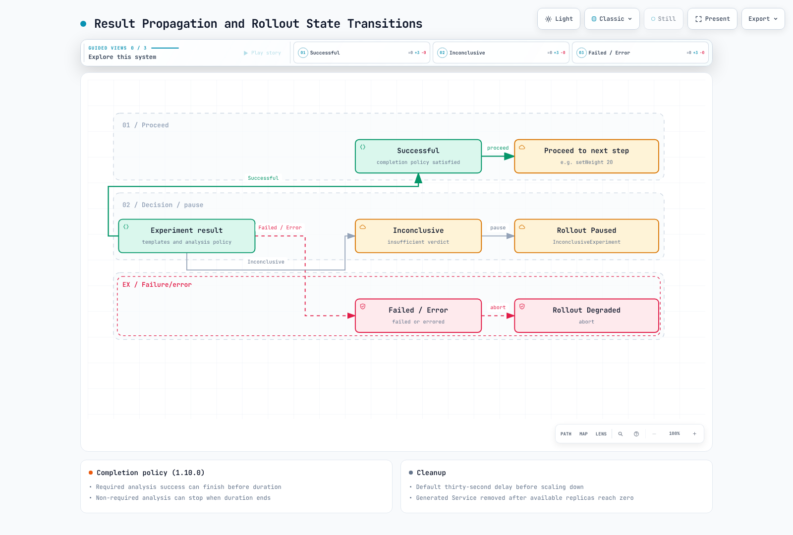

# Análisis detallado de experimentos de Argo Rollouts

> **Versiones compatibles**: Argo Rollouts 1.10.0 (el informe histórico 1.8.3/Kubernetes 1.33 se identifica por separado)
> **Última actualización**: 11 de septiembre de 2026

## Tabla de contenido

- [¿Qué es un experimento?](#what-is-an-experiment)
- [Jerarquía de recursos y cadena de creación](#resource-hierarchy-and-creation-chain)
- [Reglas de generación de nombres](#name-generation-rules)
- [Comportamiento del enrutamiento del tráfico](#traffic-routing-behavior)
- [Medición y resultado: AnalysisRun](#measurement-and-verdict-analysisrun)
- [Propagación de resultados y transiciones de estado de Rollout](#result-propagation-and-rollout-state-transitions)
- [Ejemplo práctico](#working-example)
- [Observación con el complemento de kubectl](#observing-with-the-kubectl-plugin)
- [Resultados de la verificación](#verification-results)
- [Pasos siguientes](#next-steps)
- [Referencias](#references)
- [Cuestionario](#quiz)

## ¿Qué es un experimento? {#what-is-an-experiment}

Un Experiment es un CRD de Argo Rollouts que crea ReplicaSets efímeros y ejecuta análisis. Admite comparaciones de referencia y canary, comprobaciones previas al despliegue y experimentos con tráfico real. **Crear ReplicaSets separados no aísla por sí solo el tráfico de producción.** Diseñe explícitamente los selectores de Service, los enrutadores y el tráfico de prueba.

| Aspecto | Paso canary | Paso Experiment |
|---|---|---|
| Pods | ReplicaSet canary de Rollout | ReplicaSets temporales de Experiment |
| Tráfico | Aproximación básica de canary por proporción de pods; enrutamiento ponderado si se configura | Tráfico aislado o real, según la configuración de Service/enrutador |
| Finalización | Puede convertirse en la nueva versión estable | Las réplicas se escalan a cero según la política de demora de limpieza |
| Análisis | Métricas de calidad específicas de la versión | Métricas independientes de referencia/canary y tráfico de prueba |

Se admiten tanto los Experiment independientes como los pasos Experiment de Rollout. `specRef` y `weight` pertenecen a las **plantillas de pasos de Rollout**. Los Experiment independientes definen directamente los selectores y las plantillas de Pod.

## Jerarquía de recursos y cadena de creación {#resource-hierarchy-and-creation-chain}

Cuando un Rollout llega a un paso de experimento, los recursos se crean mediante esta cadena:


[🔍 Ver diagrama interactivo](https://www.atomai.click/kubernetes-docs/archmaps/en-gitops-argocd-10-rollouts-experiment-0.html)

1. Una actualización que llega al paso de experimento crea un Experiment. La creación inicial establece la versión estable y omite los pasos canary normales; observe el experimento tras un **cambio posterior en la plantilla de Pod**.
2. El controlador crea un ReplicaSet por plantilla y espera a que estén disponibles las réplicas solicitadas. La preparación y minReadySeconds son relevantes; superar el plazo de progreso hace que el experimento falle.
3. Cuando todas están disponibles, se registra `status.availableAt` y comienza el análisis. La duración configurada se mide a partir de ese momento.
4. Se propaga el resultado de finalización: Successful avanza, Failed/Error aborta e **Inconclusive pausa**. La limpieza de ReplicaSet/Service es un proceso de reconciliación aparte.

## Reglas de generación de nombres {#name-generation-rules}

Los recursos de la familia Experiment reciben nombres sistemáticos que permiten deducir el Rollout propietario, la revisión y el paso.

| Recurso | Regla | Ejemplo medido |
|----------|------|------------------|
| Experiment | `<rollout-name>-<new-version PodTemplateHash>-<revision>-<step-index>` | `demo-app-74d8d8b4fb-2-0` |
| ReplicaSet | `<experiment-name>-<template-name>` | `demo-app-74d8d8b4fb-2-0-baseline`, `demo-app-74d8d8b4fb-2-0-canary` |
| AnalysisRun | `<experiment-name>-<analysis-name>` | `demo-app-74d8d8b4fb-2-0-success-rate` |

Los ejemplos anteriores corresponden al experimento del paso con índice 0 de la actualización de revisión 2 del Rollout `demo-app`. El resultado en árbol de [Resultados de la verificación](#verification-results) muestra la jerarquía real.

Estos son nombres base. Las colisiones de nombres de Experiment/AnalysisRun pueden añadir sufijos numéricos; use ownerReferences y el estado para encontrar los recursos reales.

## Comportamiento del enrutamiento del tráfico {#traffic-routing-behavior}

Un Service de producción que solo selecciona `app: demo-app` también puede seleccionar Pods de experimentos. Inspeccione asimismo los selectores reales específicos del hash; no suponga que un hash distinto siempre garantiza el aislamiento suficiente. El ejemplo requiere `traffic-class: production` en el Service de producción y lo sobrescribe como `experiment` en las plantillas de Experiment. Compruebe también los otros Services y las rutas de malla.

Estas son **dos alternativas** para una entrada de `spec.strategy.canary.steps` de Rollout. Crear un Service no conecta automáticamente el tráfico externo a este.

```yaml
- experiment:
    duration: 1m
    templates:
    - name: baseline
      specRef: stable
      service: {}
    - name: canary
      specRef: canary
      service: {}
```

```yaml
- experiment:
    duration: 1m
    templates:
    - name: baseline
      specRef: stable
      weight: 5
    - name: canary
      specRef: canary
      weight: 5
```

- `service: {}` crea un Service para esa plantilla. Su nombre predeterminado coincide con el ReplicaSet; `service.name` puede sobrescribirlo. Los puertos de contenedor declarados deben coincidir con los listeners reales de la aplicación.
- `weight` se aplica a cada plantilla. Cinco significa 5 % con el peso total predeterminado de 100; compruebe las unidades si usa un `maxTrafficWeight` personalizado. Un peso también crea un Service.
- Los Experiment ponderados requieren un enrutador compatible. La documentación de la versión 1.10 enumera ALB/Istio/SMI. El uso de pesos en un canary normal no implica que NGINX ni todos los complementos admitan división del tráfico de Experiment.

## Medición y resultado: AnalysisRun {#measurement-and-verdict-analysisrun}

AnalysisRun evalúa los resultados del proveedor mediante condiciones. Este es un **fragmento de la especificación de AnalysisTemplate**; el proveedor completo aparece en el ejemplo de abajo. Si falta la tasa de éxito o queda fuera del rango esperado, ambas condiciones son falsas y el resultado es Inconclusive. Los tipos no válidos, los fallos HTTP/de recopilación y los errores de expresiones siguen la ruta Error.

```yaml
metrics:
- name: success-rate
  interval: 15s
  count: 3
  successCondition: let payload = default(result, {}); payload?.status == 'ok' && payload?.success_rate != nil &&
    asFloat(payload.success_rate) >= 0.95 && asFloat(payload.success_rate) <= 1
  failureCondition: let payload = default(result, {}); payload?.status == 'ok' && payload?.success_rate != nil &&
    asFloat(payload.success_rate) >= 0 && asFloat(payload.success_rate) < 0.95
  failureLimit: 1
  inconclusiveLimit: 1
  consecutiveErrorLimit: 2
```

| Condición | Resultado de medición |
|---|---|
| failureCondition=true | Failed, con precedencia sobre el éxito |
| successCondition=true, failureCondition=false | Successful |
| Ambas falsas | Inconclusive |
| Error del proveedor o la expresión | Error |

Si solo hay una condición de éxito, false significa Failed. Si solo hay una condición de fallo, false significa Successful. Si no hay ninguna condición, una medición sin error de recopilación es Successful.

| Campo | Significado | Resultado al superar el límite |
|---|---|---|
| failureLimit | Mediciones Failed permitidas | Failed |
| inconclusiveLimit | Mediciones Inconclusive permitidas | Inconclusive |
| consecutiveErrorLimit | Errores consecutivos permitidos; predeterminado: 4 | Error |

`failureLimit: 1` se supera con el segundo resultado fallido. `count` cuenta las mediciones, no las solicitudes HTTP. Un intervalo sin count se repite indefinidamente; si se omiten ambos, se realiza una medición. Tres ventanas métricas que se solapan no son tres muestras independientes.

## Propagación de resultados y transiciones de estado de Rollout {#result-propagation-and-rollout-state-transitions}



[🔍 Ver diagrama interactivo](https://www.atomai.click/kubernetes-docs/archmaps/en-gitops-argocd-10-rollouts-experiment-1.html)

| Resultado de Experiment | Comportamiento de Rollout |
|---|---|
| Successful | Avanza al paso siguiente |
| Failed / Error | Aborta/queda Degraded; restaura la versión estable según las políticas configuradas de enrutamiento/réplicas |
| Inconclusive | Se pausa con `InconclusiveExperiment`; investigue y tome una decisión como operador |

La versión 1.10 no espera incondicionalmente a que transcurran la duración Y el análisis. Si todos los análisis requeridos tienen éxito, Experiment puede finalizar antes de que transcurra la duración. Si quedan análisis requeridos, el experimento puede seguir ejecutándose después de la duración; cuando esta termina, pueden finalizarse los análisis no requeridos. Si no hay duración ni análisis requeridos, el experimento sigue ejecutándose hasta que se termina explícitamente. El ejemplo omite la duración y usa análisis requeridos de recuento finito para completar el experimento.

`scaleDownDelaySeconds` tiene un valor predeterminado de treinta segundos. El estado terminal, la ausencia de Pods y la eliminación del Service no se garantizan simultáneamente. El controlador reduce la escala después de la demora y elimina los Services generados cuando el número de réplicas disponibles llega a cero. Los objetos ReplicaSet/AnalysisRun pueden permanecer conforme a las políticas de historial/recolección de elementos no utilizados. Abortar no revierte cambios en bases de datos ni efectos secundarios externos.

## Ejemplo práctico {#working-example}

Este es un **ejemplo educativo de flujo de control**. Instale Rollouts 1.10.0/CRD y el complemento, y proporcione por separado un Service HTTP llamado `metrics-mock` en el espacio de nombres `demo` que devuelva el JSON de abajo. No se incluye la implementación de su servidor, por lo que aplicar solo estos manifiestos no garantiza el éxito. Los valores fijos de la simulación no miden la calidad de referencia/canary ni las proporciones del tráfico real.

```json
{"status":"ok","success_rate":0.99}
```

```yaml
apiVersion: v1
kind: Namespace
metadata:
  name: demo
---
apiVersion: v1
kind: Service
metadata:
  name: demo-production
  namespace: demo
spec:
  selector:
    app: demo-app
    traffic-class: production
  ports:
  - name: http
    port: 9898
    targetPort: http
---
apiVersion: argoproj.io/v1alpha1
kind: AnalysisTemplate
metadata:
  name: success-rate-check
  namespace: demo
spec:
  metrics:
  - name: success-rate
    interval: 15s
    count: 3
    successCondition: let payload = default(result, {}); payload?.status == 'ok' && payload?.success_rate != nil
      && asFloat(payload.success_rate) >= 0.95 && asFloat(payload.success_rate) <= 1
    failureCondition: let payload = default(result, {}); payload?.status == 'ok' && payload?.success_rate != nil
      && asFloat(payload.success_rate) >= 0 && asFloat(payload.success_rate) < 0.95
    failureLimit: 1
    inconclusiveLimit: 1
    consecutiveErrorLimit: 2
    provider:
      web:
        url: http://metrics-mock.demo.svc.cluster.local/metrics.json
        jsonPath: '{$}'
---
apiVersion: argoproj.io/v1alpha1
kind: Rollout
metadata:
  name: demo-app
  namespace: demo
spec:
  replicas: 3
  revisionHistoryLimit: 3
  progressDeadlineSeconds: 180
  selector:
    matchLabels:
      app: demo-app
  strategy:
    canary:
      steps:
      - experiment:
          scaleDownDelaySeconds: 30
          templates:
          - name: baseline
            specRef: stable
            replicas: 1
            metadata:
              labels:
                traffic-class: experiment
                experiment-role: baseline
            service: {}
          - name: canary
            specRef: canary
            replicas: 1
            metadata:
              labels:
                traffic-class: experiment
                experiment-role: canary
            service: {}
          analyses:
          - name: success-rate
            templateName: success-rate-check
            requiredForCompletion: true
      - setWeight: 20
      - pause:
          duration: 10s
  template:
    metadata:
      labels:
        app: demo-app
        traffic-class: production
      annotations:
        demo-revision: v1
    spec:
      containers:
      - name: app
        image: ghcr.io/stefanprodan/podinfo:6.15.0
        ports:
        - name: http
          containerPort: 9898
        readinessProbe:
          httpGet:
            path: /readyz
            port: http
        resources:
          requests:
            cpu: 50m
            memory: 64Mi
          limits:
            cpu: 500m
            memory: 128Mi
```

Después de aplicar el archivo y establecer la primera revisión estable en un clúster de laboratorio dedicado, cambie la anotación de la plantilla de Pod para probar el paso de experimento. Esto demuestra el flujo del controlador, no la calidad de una imagen nueva. Para recursos administrados por Argo CD, realice el cambio en Git en lugar de modificar el estado activo. Una tasa simulada de 0.99 prueba el éxito, 0.50 supera failureLimit y provoca el aborto, y una tasa ausente prueba la pausa Inconclusive. Después, revise el alcance de limpieza de recursos del laboratorio.

```bash
kubectl argo rollouts status demo-app -n demo --timeout=180s
# A second Pod-template revision exercises the steps; the image stays unchanged in this demo.
kubectl patch rollout demo-app -n demo --type merge \
  -p '{"spec":{"template":{"metadata":{"annotations":{"demo-revision":"v2"}}}}}'
kubectl argo rollouts get rollout demo-app -n demo --watch
```

`setWeight: 20` es una aproximación de la proporción de Pods sin trafficRouting. Tres réplicas no pueden garantizar exactamente el 20 % de las solicitudes de usuario. Las comparaciones reales requieren tráfico de prueba, instrumentación/recopilación, muestras suficientes y los siguientes argumentos hash de **ReplicaSet de Experiment**. No son campos `podTemplateHashValue: Baseline/Canary`.

```yaml
args:
- name: baseline-hash
  value: '{{templates.baseline.podTemplateHash}}'
- name: canary-hash
  value: '{{templates.canary.podTemplateHash}}'
```

Consulte el [ejemplo de comparación de métricas](05-traffic-management.md#experiments).

## Observación con el complemento de kubectl {#observing-with-the-kubectl-plugin}

`kubectl argo rollouts get rollout <name> --watch` muestra en vivo toda la jerarquía de Experiment (Experiment → ReplicaSets → Pods, más el AnalysisRun). El resultado que sigue es el registro histórico original del documento para 1.8.3, no una ejecución nueva del ejemplo actual. No interprete sus nombres, horas ni tiempos de limpieza como resultados nuevos de la versión 1.10.0.

```
$ kubectl argo rollouts get rollout demo-app -n demo
Name:            demo-app
Namespace:       demo
Status:          ◌ Progressing
Strategy:        Canary
  Step:          0/3
  SetWeight:     0
  ActualWeight:  0

NAME                                                  KIND         STATUS         AGE  INFO
⟳ demo-app                                            Rollout      ◌ Progressing  51s
├──# revision:2
│  ├──⧉ demo-app-74d8d8b4fb                           ReplicaSet   • ScaledDown   29s  canary
│  └──Σ demo-app-74d8d8b4fb-2-0                       Experiment   ◌ Running      29s
│     ├──⧉ demo-app-74d8d8b4fb-2-0-baseline           ReplicaSet   ✔ Healthy      29s
│     │  └──□ demo-app-74d8d8b4fb-2-0-baseline-gvgnq  Pod          ✔ Running      29s  ready:1/1
│     ├──⧉ demo-app-74d8d8b4fb-2-0-canary             ReplicaSet   ✔ Healthy      29s
│     │  └──□ demo-app-74d8d8b4fb-2-0-canary-jq6lb    Pod          ✔ Running      29s  ready:1/1
│     └──α demo-app-74d8d8b4fb-2-0-success-rate       AnalysisRun  ◌ Running      29s  ✔ 2
└──# revision:1
   └──⧉ demo-app-779c8779bf                           ReplicaSet   ✔ Healthy      51s  stable
```

El seguimiento histórico muestra que se redujo la escala del ReplicaSet principal de la revisión 2. Esto no demuestra que no exista exposición de producción con otros órdenes de pasos o configuraciones de Service/enrutador. AnalysisRun conserva en su estado el historial de mediciones para análisis posterior:

```
$ kubectl get analysisrun demo-app-74d8d8b4fb-2-0-success-rate -n demo \
    -o jsonpath='{.status.metricResults[0]}' | python3 -m json.tool
{
    "consecutiveSuccess": 2,
    "count": 2,
    "measurements": [
        {
            "finishedAt": "2026-07-17T01:24:09Z",
            "phase": "Successful",
            "value": "{\"error_rate\":0.004,\"status\":\"ok\",\"success_rate\":0.99}"
        },
        ...
    ],
    "name": "success-rate",
    "phase": "Running",
    "successful": 2
}
```

## Resultados de la verificación {#verification-results}

El documento original informó estos resultados a partir de una compilación de código fuente 1.8.3 y Kubernetes 1.33/kwok (binarios reales del plano de control con ciclos de vida simulados de nodos/Pods). No se adjuntan los manifiestos ejecutados completos, volcados de la API sin procesar ni registros, por lo que esta revisión no pudo reproducir el informe. Son observaciones históricas, no resultados nuevos de la versión 1.10.0 ni pruebas de tráfico real, preparación de Pods o calidad de la aplicación.

| Elemento histórico | Informe original |
|---------------|--------|
| Experiment se crea automáticamente en el paso de experimento; nombre = `<rollout>-<PodHash>-<revision>-<step>` | Informado: `demo-app-74d8d8b4fb-2-0` (revisión 2, paso 0) |
| ReplicaSets creados desde las plantillas; nombre = `<experiment>-<template>` | Informado: `...-2-0-baseline`, `...-2-0-canary`, 1 réplica cada uno |
| Service con alcance de Experiment para la plantilla con `service: {}` creado y limpiado | Informado: se creó el Service `...-2-0-canary` y se confirmó su eliminación tras el experimento |
| AnalysisRun creado después de que todas las plantillas estuvieran en buen estado; mediciones repetidas con `interval: 15s`/`count: 3` | Informado: se registraron 3 mediciones a intervalos de 15 s; `successCondition` se evaluó como Successful |
| Ruta de éxito: transcurren 60 s → Experiment Successful → ReplicaSets de Experiment reducidos a 0 → paso siguiente (setWeight 20) → Rollout Healthy | Informado: funciona |
| Ruta de fallo: métricas degradadas → AnalysisRun Failed con `failed (2) > failureLimit (1)` → Experiment Failed → Rollout abortado (Degraded), se conserva la versión estable | Informado: funciona (el mensaje de aborto nombra textualmente la métrica causante) |

## Pasos siguientes {#next-steps}

1. **[Gestión del tráfico](05-traffic-management.md)**: combine pasos de experimento con estrategias canary/blue-green e integraciones de ingress.

2. **[Prácticas recomendadas](09-best-practices.md)**: conozca las prácticas operativas recomendadas para la entrega progresiva.

## Referencias {#references}

- [Documentación oficial de Experiment](https://argoproj.github.io/argo-rollouts/features/experiment/)
- [Documentación oficial de análisis](https://argoproj.github.io/argo-rollouts/features/analysis/)
- [Especificación de CRD de Experiment](https://argoproj.github.io/argo-rollouts/features/specification/)


- [Máquina de estados de Experiment 1.10.0](https://github.com/argoproj/argo-rollouts/blob/v1.10.0/experiments/experiment.go)
- [Gestión de pausa/aborto de Rollout 1.10.0](https://github.com/argoproj/argo-rollouts/blob/v1.10.0/rollout/experiment.go)
- [Limpieza de ReplicaSet en 1.10.0](https://github.com/argoproj/argo-rollouts/blob/v1.10.0/experiments/replicaset.go)

## Cuestionario {#quiz}

Compruebe lo aprendido en este capítulo con el [Cuestionario sobre experimentos de Rollouts](../../quizzes/gitops/argocd/10-rollouts-experiment-quiz.md).
