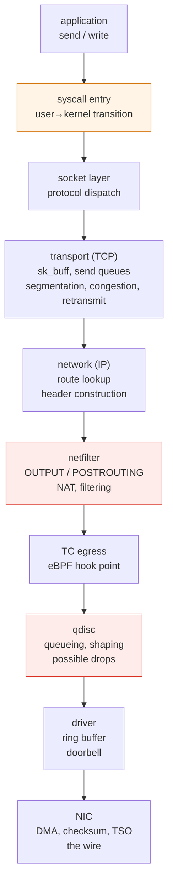
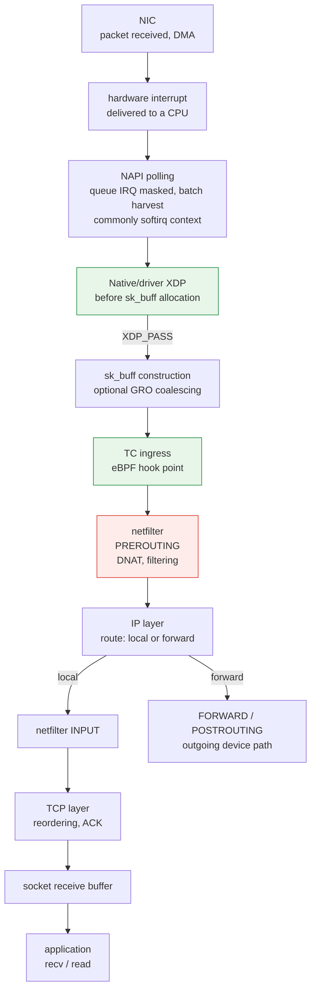

# Pila de red del kernel

> **Versiones compatibles**: Linux 6.1 / 6.12 / 6.18 (Amazon Linux 2023)
> **Última actualización**: 14 de septiembre de 2026

## Qué cubre este documento

- El recorrido que sigue un `send()` dentro del kernel hasta llegar al cable y la función de cada etapa
- Cómo se conectan los descriptores de archivo de sockets con el sistema de archivos virtual (VFS), y en qué difieren los búferes y ventanas TCP de la observación de colas
- Dónde se pueden asociar hooks y por qué la posición de XDP, TC y netfilter causa diferencias de rendimiento
- Por qué el tráfico Pod a Pod sigue rutas distintas en el mismo nodo, en la misma AZ y entre AZ

## Por qué necesitas conocer la ruta

«La red va lenta» no es una descripción que permita diagnosticar. La ruta de red del kernel tiene **varios puntos que provocan latencia y pérdida por motivos distintos**, y la respuesta cambia por completo según cuál sea.

| Síntoma | Posibles áreas a investigar |
|---|---|
| El rendimiento se estabiliza en cierto nivel | Tasa de la aplicación, búferes de socket, ventanas de recepción/congestión o límites de la ruta |
| Pérdidas solo durante ráfagas de tráfico | qdisc, colas de NIC/controlador, presión de memoria de la pila o pérdida aguas abajo |
| Solo una CPU está al 100 % | Distribución de colas/interrupciones, un solo flujo o trabajo de la aplicación en ese núcleo |
| Las solicitudes pequeñas tardan demasiado | El costo fijo (llamadas al sistema, cambios de contexto) domina |
| Se ralentizó a medida que crecieron las reglas | Evaluación de reglas de netfilter |

Conocer la ruta permite leer esta tabla al revés para decidir dónde buscar.

## Sockets y VFS: del FD al protocolo {#socket-vfs-bridge}

`socket()` devuelve un descriptor de archivo (FD), un índice en la tabla de descriptores del proceso. En el caso de un socket, esa entrada apunta a un **`struct file`**, cuyas operaciones de archivo de socket y `private_data` lo conectan con un **`struct socket`**. A su vez, un socket TCP de Internet tiene un **`struct sock`** que contiene el estado del protocolo. Compartir la abstracción de archivo permite que los sockets participen en `close()`, la duplicación de descriptores y el sondeo de disponibilidad; **un socket no es un archivo de disco** y los datos TCP ordinarios no pasan por la caché de páginas del disco ni por E/S de bloques.

La ruta de entrada depende de la API:

```text
FD → struct file → struct socket → struct sock / TCP state

read / write
  → VFS → socket_file_ops.read_iter / write_iter
  → sock_read_iter / sock_write_iter → socket receive/send operations

recv / send / recvmsg / sendmsg
  → socket-specific syscall path → look up the socket through the FD
  → socket receive/send operations
```

Así, `read()`/`write()` usan la distribución de llamadas de VFS hacia las operaciones de archivo de socket, mientras que las API específicas de sockets también aceptan flags, direcciones o datos auxiliares según corresponda. **No todas pasan por `vfs_read()`/`vfs_write()`**. Las rutas convergen en operaciones de socket/protocolo. Consulta Linux v6.12 [`net/socket.c`](https://github.com/torvalds/linux/blob/v6.12/net/socket.c) (`sock_alloc_file`, `socket_file_ops`, `__sys_sendto`, `__sys_recvfrom`) y [`fs/read_write.c`](https://github.com/torvalds/linux/blob/v6.12/fs/read_write.c). Son ejemplos con versión fijada, no una garantía de que los nombres de funciones internas nunca cambien.

TCP proporciona un flujo de bytes: un `write()` no tiene por qué corresponder a un paquete ni a un `read()` del par. Un `send()` satisfactorio informa cuántos bytes aceptó el sistema localmente, no demuestra que la aplicación del par los haya consumido ([socket(7)](https://man7.org/linux/man-pages/man7/socket.7.html), [tcp(7)](https://man7.org/linux/man-pages/man7/tcp.7.html)).

## Ruta de transmisión: de send() al cable

Esta es una ruta simplificada de **TCP/IP generado localmente hacia una NIC física**, no un itinerario obligatorio para todos los paquetes. Loopback y dispositivos virtuales, reenvío, XDP/AF_XDP u otras rutas alternativas, la descarga de flowtable de netfilter y las descargas de trabajo de la NIC pueden omitir, trasladar o combinar etapas. Los hooks solo trabajan cuando están configurados; NAT puede provocar otra consulta de ruta.



Lo que ocurre realmente en cada etapa es la base del diagnóstico.

### ① Entrada a la llamada al sistema: origen del costo fijo

Una llamada normal a `send()` entra al kernel mediante una llamada al sistema. La entrada y salida tienen un componente de costo por llamada; el costo total también depende de la copia, el trabajo del protocolo, la planificación y de si la llamada queda bloqueada.

Ese componente puede importar cuando se hacen muchas escrituras pequeñas. Solicitar 64 bytes diez mil veces frente a 640 000 bytes una sola vez pide la misma carga útil con diez mil veces más llamadas, suponiendo que cada llamada acepte los bytes solicitados.

El búfer de la aplicación o `sendmsg()` con dispersión/recolección puede combinar búferes en una llamada; `sendmmsg()` agrupa mensajes, mientras que `io_uring` puede agrupar envíos. Su semántica difiere y la agrupación no determina los límites de paquetes TCP.

### ② Capa de socket: sk_buff y búferes

A pesar de su nombre, **`sk_buff` no es todo el búfer de envío o recepción de un socket**. Describe los datos y metadatos de un paquete, incluidos los desplazamientos de cabecera y referencias a datos lineales o fragmentos de página. Un skb se puede clonar, dividir o combinar; GSO/GRO implican que no necesariamente corresponde a un paquete en el cable. Consulta la [documentación `sk_buff` del kernel](https://docs.kernel.org/networking/skbuff.html).

| Concepto | Qué representa |
|---|---|
| Bytes de la aplicación | Carga útil del flujo TCP enviada o leída por la aplicación |
| Búfer de envío del socket | Presupuesto de memoria para la salida en cola, incluidos los datos que esperan a enviarse y los que se conservan para su confirmación/retransmisión |
| Búfer de recepción del socket | Presupuesto de memoria para los datos recibidos, incluidos los que aún no se leyeron y los que pueden estar fuera de orden |
| Contabilización de memoria del kernel | Cargos de asignación, como metadatos skb, almacenamiento de datos y sobrecarga de asignación; no solo la longitud de la carga útil |
| Ventana de recepción anunciada (`rwnd`) | Cuánto espacio de secuencia adicional permite el receptor que envíe el par, según la capacidad de recepción disponible y las reglas de ventana TCP |
| Ventana de congestión (`cwnd`) | Límite de control de congestión del emisor para los datos pendientes; independiente del presupuesto de búfer del receptor |

Cuando no hay espacio de envío disponible, una llamada bloqueante puede esperar, mientras que una llamada no bloqueante que no acepta bytes devuelve `EAGAIN`/`EWOULDBLOCK`. Cualquiera de los dos modos puede devolver una escritura parcial satisfactoria; la aplicación debe gestionar los bytes restantes. Un búfer mayor permite más datos en cola local, pero no amplía directamente la ventana del par ni la `cwnd` del emisor.

### Política de búfer TCP y ajustes por socket {#tcp-buffer-policy}

Los sysctl TCP describen una política, no la ocupación actual de cada socket:

| Ajuste | Significado |
|---|---|
| `net.ipv4.tcp_rmem` / `net.ipv4.tcp_wmem` | Tres valores en **bytes**: mínimo bajo presión de memoria, valor predeterminado inicial y límite superior del ajuste automático de búfer de recepción/envío |
| `net.ipv4.tcp_moderate_rcvbuf` | Habilita el ajuste automático del búfer de recepción, sujeto a sus límites y a la presión de memoria |
| `SO_RCVBUF` / `SO_SNDBUF` | Solicitudes de la aplicación para un socket; establecer explícitamente cualquiera de ellos bloquea el tamaño del búfer en esa dirección frente al ajuste automático TCP normal |
| `net.core.rmem_max` / `net.core.wmem_max` | Límites de las solicitudes ordinarias `SO_RCVBUF` / `SO_SNDBUF` de la aplicación; son distintos de los máximos del ajuste automático TCP |

`SO_RCVBUF` establece `SOCK_RCVBUF_LOCK` y deshabilita el ajuste automático de recepción para ese socket; `SO_SNDBUF` establece `SOCK_SNDBUF_LOCK` e impide la expansión normal del búfer de envío. Son flags de configuración, no mutexes. Aumentar un sysctl TCP no deshace un ajuste explícito de la aplicación. Linux normalmente duplica la solicitud `SO_*BUF` aceptada para la contabilización y devuelve el valor duplicado mediante `getsockopt()` (sujeto a mínimos/límites); ese valor no es la memoria asignada en ese momento ni una capacidad de carga útil garantizada. No trates `tcp_rmem[2]` como el máximo permitido para una solicitud explícita `SO_RCVBUF` ni dupliques todos los valores `tcp_*mem`. Consulta [sysctl de IP](https://docs.kernel.org/networking/ip-sysctl.html), [socket(7)](https://man7.org/linux/man-pages/man7/socket.7.html) y Linux v6.12 [`net/core/sock.c`](https://github.com/torvalds/linux/blob/v6.12/net/core/sock.c) / [`tcp_input.c`](https://github.com/torvalds/linux/blob/v6.12/net/ipv4/tcp_input.c).

### BDP: razonar con unidades {#tcp-bdp-reasoning}

Para una ruta hipotética de **1 Gbit/s** con un RTT de **40 ms**, el producto ancho de banda-retardo es:

```text
BDP = 1,000,000,000 bit/s × 0.040 s ÷ 8 bit/byte
    = 5,000,000 bytes = 5 MB ≈ 4.77 MiB
```

Esto estima los datos útiles en tránsito necesarios para sostener esa tasa según un modelo idealizado de estado estable; usa el tiempo de ida y vuelta, no el de ida. Tanto la ventana de recepción como la de congestión deben permitir suficientes datos pendientes. `ss -i` suele expresar `cwnd` en segmentos, así que compara `cwnd × MSS` con cantidades en bytes. La memoria de socket también requiere espacio para contabilización, y el emisor puede poner bytes en cola que aún no estén en tránsito.

**BDP es una escala de diagnóstico, no una receta de sysctl.** La lentitud de producción de datos de una aplicación, la presión de CPU, las pérdidas, el pacing, los cambios de RTT o un límite de la ruta pueden ser dominantes; más datos en cola pueden aumentar la latencia y el uso de memoria. Compara las observaciones en el [laboratorio de búfer TCP](../networking/07-linux-network-diagnostics.md#tcp-buffer-lab) antes de sacar una conclusión.

### ③ Transporte (TCP): dónde vive el control de congestión

TCP coordina fiabilidad, control de flujo y control de congestión.

- Limita la carga útil del segmento según MSS y MTU de ruta; GSO/TSO pueden aplazar la segmentación efectiva
- Limita los datos pendientes tanto por la **ventana de recepción** del par como por la **ventana de congestión (`cwnd`)** del emisor, además de pacing y otras restricciones
- Mantiene una cola de retransmisión y retransmite cuando no llegan ACK

El algoritmo de control de congestión reside aquí. Dos ejemplos difieren en cómo regulan el envío:

| Algoritmo | Modelo principal | Interpretación |
|---|---|---|
| **cubic** | Aumenta y reduce la ventana tras eventos de congestión, como pérdida/ECN | Las pérdidas pueden tener causas distintas de la congestión; inspecciona la ruta |
| **bbr** | Las estimaciones de tasa de entrega y RTT guían el pacing y los datos en tránsito | Las estimaciones y el comportamiento de pérdida/recuperación dependen de la implementación/versión |

Ninguno de los modelos determina qué algoritmo será más rápido para una carga de trabajo, y BBR no vuelve irrelevantes las pérdidas ni la recuperación. Inspecciona el algoritmo activo y RTT/cwnd con `ss -ti`; cualquier comparación debe indicar la versión del kernel, la carga y la ruta. Implementaciones con versión fijada: [`tcp_cubic.c`](https://github.com/torvalds/linux/blob/v6.12/net/ipv4/tcp_cubic.c), [`tcp_bbr.c`](https://github.com/torvalds/linux/blob/v6.12/net/ipv4/tcp_bbr.c).

### ④ Capa de red (IP): consulta de ruta

Busca en la tabla de enrutamiento la ruta hacia el destino. **Esta consulta es propia de cada espacio de nombres de red**; por eso la tabla que ves dentro de un Pod no es la del nodo ([Funciones del kernel en contenedores](./01-container-primitives.md)).

### ⑤ netfilter: dónde se evalúan las reglas

El tráfico generado localmente puede pasar por `OUTPUT` y `POSTROUTING`; en cambio, el tráfico que entra desde el veth de un Pod puede seguir `PREROUTING` → `FORWARD` → `POSTROUTING` en el espacio de nombres del nodo. DNAT de servicios y MASQUERADE de salida dependen del dataplane y los hooks configurados, no de una única ruta universal.

Las cadenas iptables largas evaluadas linealmente pueden añadir trabajo de búsqueda a medida que crece la cantidad de Services. El costo real depende de las reglas, la estructura de búsqueda y el modo del dataplane; contar reglas no mide latencia. Una ruta rápida flowtable de netfilter configurada puede omitir hooks de reenvío posteriores ([flowtable de netfilter](https://docs.kernel.org/networking/nf_flowtable.html)).

### ⑥ qdisc: dónde se producen realmente algunas pérdidas

Una qdisc (disciplina de colas) **pone paquetes en cola antes de entregarlos a la NIC y decide el orden y la tasa**.

El dato importante para operar:

> El desbordamiento de qdisc es una causa posible de pérdidas en ráfaga. Correlaciona los contadores de qdisc, NIC/controlador, pila y red de nube antes de asignar una causa.

Una qdisc puede descartar debido a límites de cola o gestión activa de colas antes de llenarse. Su contador de descartes atribuye las pérdidas a esa qdisc; no contabiliza todas las pérdidas de la ruta. Algunos dispositivos usan `noqueue` y las rutas de transmisión directa/descarga pueden no encolar todos los paquetes.

**Observación**: compara los cambios de `dropped`, `backlog`, `overlimits` y `requeues` en `tc -s qdisc show dev <iface>` durante el intervalo afectado. `overlimits` puede reflejar decisiones de conformación de tráfico en vez de descartes; `requeues` registra paquetes que se volvieron a poner en cola. Comprueba también los contadores de interfaz y controlador, sin suponer que sus valores sean idénticos o sumables.

Las qdisc tienen características distintas.

| qdisc | Característica |
|---|---|
| `pfifo_fast` | FIFO simple (3 bandas de prioridad). El antiguo valor predeterminado |
| `fq_codel` | Cola por flujo con control de retardo CoDel; puede descartar o marcar ECN para señalar congestión |
| `fq` | Cola justa por flujo con soporte de pacing |
| `mq` | Envoltorio que coloca una qdisc por cada cola de hardware en NIC multicolas |

**Bufferbloat** es el retardo excesivo por colas: una cola mayor puede absorber una ráfaga, pero también retener los datos más tiempo. `fq_codel` supervisa el tiempo en cola y señala congestión mediante descartes o marcado ECN cuando corresponde. Una cola mayor no mejora las cosas automáticamente ([tc-fq_codel(8)](https://man7.org/linux/man-pages/man8/tc-fq_codel.8.html)).

### ⑦ Controlador y NIC: descargas de trabajo

En una ruta típica por una NIC física, el controlador asigna datos del paquete para DMA, prepara descriptores que apuntan a esa memoria en un anillo de transmisión y avisa a la NIC. La NIC no consume directamente una estructura C `sk_buff`; el controlador conserva sus datos de seguimiento hasta que termina la operación.

Las descargas de trabajo cambian dónde se ejecuta el trabajo y qué representan las observaciones del host.

| Descarga | Qué hace |
|---|---|
| **TSO / GSO** | TSO delega la segmentación al hardware compatible; GSO es el mecanismo genérico/de software de segmentación del kernel y su alternativa. No son ambas operaciones exclusivas de la NIC |
| **GRO** (Generic Receive Offload) | En recepción, **combina** paquetes pequeños antes de entregarlos → menos recorridos de la pila |
| **Descarga de checksum** | La NIC calcula checksums |
| **RSS** (Receive Side Scaling) | Distribuye mediante hash los flujos recibidos entre colas de hardware; la afinidad IRQ y la distribución posterior determinan la CPU |

TSO/GRO pueden reducir el trabajo por segmento. **Observación de solo lectura**: `ethtool -k <iface>` informa de las funciones configuradas; no demuestra que todos los paquetes las utilicen. Las capturas del host pueden mostrar unidades GSO/GRO grandes o un checksum de transmisión aún sin completar; por ello, un paquete grande capturado o un checksum aparentemente incorrecto no demuestran por sí solos un fallo en el cable ([descargas de segmentación](https://docs.kernel.org/networking/segmentation-offloads.html), [descarga de checksum](https://docs.kernel.org/networking/checksum-offloads.html)).

## Ruta de recepción: de la interrupción a la aplicación

El diagrama muestra una ruta habitual de recepción por NIC física que usa NAPI del controlador y XDP nativo opcional, seguida de la entrega local a TCP. `XDP_PASS` continúa por la pila; las acciones de descarte, redirección y transmisión siguen otras rutas. XDP genérico se ejecuta con un skb ya presente. Loopback, dispositivos virtuales, descarga de hardware, sondeo activo y NAPI en hilos pueden cambiar esta secuencia.



### NAPI: el mecanismo que evita tormentas de interrupciones

Una interrupción por paquete puede llevar, bajo mucha carga, a un estado en que **el sistema no hace más que atender interrupciones** (livelock).

En una configuración NAPI común impulsada por interrupciones, el controlador enmascara la interrupción de la cola pertinente y programa el sondeo. Cada sondeo procesa una cantidad limitada de trabajo; al terminar, el controlador puede volver a habilitar esa interrupción. Esto no deshabilita todas las interrupciones de CPU. El sondeo activo y NAPI en hilos son modos de ejecución alternativos ([NAPI](https://docs.kernel.org/networking/napi.html)).

La agrupación puede amortizar el costo por paquete; con carga alta todavía se puede agotar el presupuesto de sondeo y aumentar la latencia o las pérdidas.

### Interrupciones concentradas en un núcleo

Las interrupciones de recepción se dirigen a CPU concretas. Una sola cola o un procesamiento concentrado puede saturar un núcleo aunque el uso total de CPU sea bajo. Un único flujo o el trabajo de la aplicación también pueden explicar ese patrón.

Tres capas de solución:

| Función | Capa | Qué hace |
|---|---|---|
| **RSS** | Hardware | La NIC distribuye mediante hash los flujos entre colas de recepción; la afinidad IRQ puede repartir el procesamiento de las colas entre CPU |
| **RPS** | Software | El kernel deriva el procesamiento de recepción a otra CPU (si no hay RSS o hay pocas colas) |
| **RFS** | Software | Intenta orientar el procesamiento de recepción hacia la CPU de la aplicación consumidora para mejorar la localidad de caché |

**Diagnóstico**: consulta `/proc/interrupts` para ver si se distribuyen entre los núcleos y `mpstat -P ALL` para detectar un `%soft` (softirq) elevado en un solo núcleo.

RSS, RPS y RFS no trasladan todos las interrupciones de hardware. Un solo flujo puede permanecer en una cola para conservar el orden ([escalado de la pila de red](https://docs.kernel.org/networking/scaling.html)).

### Búferes de recepción del socket y contrapresión

Si la aplicación no lee los datos recibidos lo bastante rápido, se acumulan bytes sin leer y disminuye la capacidad de recepción disponible. TCP puede anunciar una ventana de recepción menor o igual a cero y aplicar contrapresión de control de flujo. El cálculo de ventana, el escalado negociado al iniciar la conexión y la memoria reservada significan que la ventana anunciada no equivale simplemente a `SO_RCVBUF - Recv-Q`.

Un `Recv-Q` que crece continuamente es motivo para investigar el avance de lectura, la planificación de CPU y el trabajo posterior de la aplicación junto con la evidencia de red. Una sola captura no demuestra que la aplicación sea la única causa. Un búfer mayor puede limitarse a posponer la contrapresión y conservar más datos.

## Comparación de puntos de hook: XDP, TC y netfilter

Todos «interceptan y procesan un paquete», pero **la posición determina el rendimiento y lo que se puede hacer**.

| Aspecto | **XDP** | **TC (eBPF)** | **netfilter** |
|---|---|---|---|
| **Posición** | XDP nativo/controlador: antes de `sk_buff`; XDP genérico: usa skb | Después de crear `sk_buff`, en entrada/salida | Hooks de la pila |
| **Dirección** | Principalmente entrada | Entrada y salida | Todas las direcciones |
| **Trabajo que se evita o añade** | El descarte temprano nativo puede evitar asignar skb y trabajo posterior de la pila | Se ejecuta después de crear skb; el programa y su asociación determinan el trabajo | El costo depende de hooks, reglas, seguimiento de estado y descarga de trabajo |
| **Información disponible** | Datos del paquete y metadatos/helpers/maps permitidos | Contexto/helpers `__sk_buff` permitidos por el verificador, no memoria arbitraria del kernel | Estado de conexión cuando conntrack está activo |
| **Usos principales** | **Descartes DDoS**, balanceo de carga, redirección de paquetes | Aplicación de políticas, observabilidad, redirección | NAT, filtrado con estado |
| **Descarga a hardware** | Algunas combinaciones de controlador/NIC | Algunas | Descarga de flowtable nftables seleccionada; no todas las reglas/rutas |

La ventaja del descarte temprano describe **XDP nativo/de controlador**, antes de asignar skb. XDP genérico ya tiene un skb, y el rendimiento real depende del soporte del controlador y del trabajo del programa. No uses la explicación de un modo como si fuera un resultado de referencia universal.

XDP no recibe automáticamente todo el contexto de sockets/pila, pero los mapas BPF pueden mantener estado y los helpers compatibles pueden exponer más información. **El procesamiento con estado no es inherentemente imposible en XDP**; evalúa los límites del programa, kernel, verificador y controlador concretos.

Un dataplane puede combinar hooks para distintos trabajos; los puntos de asociación reales de Cilium dependen de su configuración y de las funciones admitidas ([eBPF de Cilium](../networking/cilium/02-ebpf.md), [red L2-L7 de Cilium](../networking/cilium/05-l2-l7-networking.md)).

## Pod a Pod: por qué cambia la ruta

En Kubernetes, el tráfico Pod a Pod **recorre realmente rutas distintas del kernel** según dónde estén ubicados los Pods. Esto explica la escala de RTT medida en la [prueba comparativa de red de Pods](../networking/06-pod-network-benchmark.md) (mismo nodo 0.040 ms → misma AZ 0.339 ms → entre AZ 0.544 ms).

### Pods en el mismo nodo

```text
Pod A [net ns A] → veth A → (node net ns) → veth B → Pod B [net ns B]
```

En la ruta ilustrada habitual con veth/enrutada dentro del mismo nodo, el tráfico no necesita pasar por la NIC física. Otros dataplanes, overlays, SR-IOV o desvíos de políticas/servicios pueden cambiar esa ruta; los dispositivos virtuales también implican procesamiento del controlador del kernel.

Por eso el flujo único en el mismo nodo alcanzó **29.97 Gbps** en la prueba comparativa (mientras que entre nodos chocó con el límite de flujo único de EC2, 4.96 Gbps). El cuello de botella no era la red, sino la **CPU**: un núcleo del cliente al 99.8 %.

### Pods en nodos diferentes (VPC CNI)

```text
Pod A → veth → node net ns → ENI → VPC network → target ENI → veth → Pod B
```

Con Amazon VPC CNI, los Pods reciben **IP reales de la VPC**, de modo que no hay encapsulación overlay. Evitar el costo de encapsulación/desencapsulación y la pérdida de MTU frente a CNI overlay (VXLAN y similares) es la ventaja estructural de VPC CNI ([VPC CNI](../networking/01-vpc-cni.md)).

Esta ruta ordinaria entre nodos usa dispositivos de red físicos y está sujeta a **límites de red de la instancia EC2**: límites de flujo único, ancho de banda total de la instancia y límites de PPS. La cola y los hooks exactos siguen dependiendo del dispositivo y del dataplane.

### Cruce de una AZ

El experimento citado de flujo único observó +0.21 ms de RTT y cerca de 4.96 Gbps en ambas ubicaciones entre nodos. Ese resultado corresponde a sus instancias, carga y ruta; no demuestra que todas las cargas de trabajo entre AZ mantengan el mismo rendimiento.

### MTU y fragmentación

**MTU** es el límite de una interfaz para un paquete IP, incluida su cabecera IP; **PMTU** es la MTU efectiva menor de la ruta. **MSS** limita la carga útil TCP por segmento, sin incluir las cabeceras IP/TCP. Con una MTU IP de 1500 bytes y sin opciones, 20 bytes de cabecera IPv4 más 20 bytes de cabecera TCP dejan 1460 bytes; 40 bytes de IPv6 más 20 bytes de TCP dejan 1440 bytes. Las opciones y la encapsulación consumen espacio adicional. El MSS anunciado por un par no mide toda la ruta.

Los routers IPv4 pueden fragmentar un paquete demasiado grande si DF está desactivado; con DF activado, lo descartan y normalmente devuelven ICMP «fragmentation needed». Los routers IPv6 no fragmentan: devuelven ICMPv6 «Packet Too Big», y el emisor ajusta el tamaño o fragmenta en origen. PMTUD usa esa retroalimentación; perder el ICMP pertinente puede crear un agujero negro, aunque el sondeo de capa de paquetización a veces permita recuperarse. Las MTU jumbo como 9001 solo ayudan si toda la ruta admite ese tamaño.

«La negociación inicial funciona, pero los datos se atascan» **es compatible con** un problema de PMTU, pero no lo demuestra. Compara las MTU de interfaz, la información de MSS/PMTU de TCP y las capturas en puntos adecuados. GSO/TSO/GRO y la descarga de checksum pueden hacer que las capturas del host difieran de los paquetes en el cable; no deduzcas fragmentación ni corrupción de una sola unidad grande capturada en el host. Consulta el [laboratorio de MTU/MSS](../networking/07-linux-network-diagnostics.md#mtu-mss-lab), [PMTUD de IPv4](https://www.rfc-editor.org/rfc/rfc1191) y [PMTUD de IPv6](https://www.rfc-editor.org/rfc/rfc8201).

## Herramientas de observación

Cada capa requiere observar elementos distintos.

| Capa | Herramienta | Qué muestra |
|---|---|---|
| Socket | `ss -tinm`, `ss -ltn` | Estado TCP, colas de flujo frente a backlog de escucha, RTT/cwnd, memoria del socket |
| TCP global | `nstat` / `netstat -s` | Retransmisiones, paquetes fuera de orden, desbordamientos de búfer |
| netfilter | `iptables-save`, `nft list ruleset` | Cantidad y contenido de reglas |
| conntrack | `conntrack -S` | `insert_failed`: correlaciónalo con cantidad/límite y registros; no es exclusivo del agotamiento |
| qdisc | `tc -s qdisc show dev <if>` | Descartes, backlog, conformación y contadores de reencolado de esa qdisc |
| Interfaz | `ip -s link`, `ethtool -S <if>` | Contadores de interfaz y NIC |
| Descargas de trabajo | `ethtool -k <if>` | Estado de TSO/GRO/checksum |
| Interrupciones | `/proc/interrupts`, `mpstat -P ALL` | Desequilibrio entre núcleos, porcentaje de softirq |
| Captura de paquetes / estado de flujos | `tcpdump`, `ss`, herramientas eBPF | Paquetes o estado de socket/evento en el punto observado, con salvedades por descargas y asociaciones |

Empieza por los contadores de descartes y luego correlaciona momento, interfaz/espacio de nombres, tráfico y presión de recursos. Un contador que aumenta es evidencia para investigar, no prueba de la única causa; la ausencia de contadores tampoco descarta pérdidas en otro lugar. Usa RTT/cwnd, métricas de aplicación y captura de paquetes cuando corresponda.

### Lectura de colas TCP según el estado del socket {#ss-tcp-queues}

En sockets TCP Linux ordinarios, `ss` informa cantidades distintas según el estado:

| Estado | `Recv-Q` | `Send-Q` |
|---|---|---|
| `ESTABLISHED` | **Bytes** del flujo en orden recibidos, pero aún no copiados a la aplicación | **Bytes** del flujo escritos, pero aún no confirmados acumulativamente: incluye bytes no enviados y enviados/sin confirmar |
| `LISTEN` | **Cantidad** de conexiones en cola para `accept()` | Máximo configurado del backlog de aceptación, una **cantidad de conexiones**, no bytes de carga útil en cola |

Los valores del listener no representan ocupación de la cola SYN ni tamaños de búfer en bytes. El backlog de aceptación está limitado por `listen()` y `somaxconn`; las solicitudes incompletas y las SYN cookies tienen un comportamiento separado. Linux v6.12 [`tcp_diag_get_info()`](https://github.com/torvalds/linux/blob/v6.12/net/ipv4/tcp_diag.c) exporta estos valores según el estado; consulta también [listen(2)](https://man7.org/linux/man-pages/man2/listen.2.html).

`ss -m` añade contabilización de memoria `skmem`: campos como `r` (memoria de recepción), `rb` (presupuesto de recepción), `w` (memoria de envío en cola) y `tb` (presupuesto de envío) cuentan bytes del kernel, incluida la sobrecarga. No tienen por qué coincidir con `Recv-Q`/`Send-Q`. Los datos de recepción fuera de orden pueden ocupar memoria sin aparecer como bytes en orden legibles; un `Send-Q` distinto de cero no demuestra por sí solo que haya pérdidas ni que el búfer esté lleno. `ss -i` añade RTT, MSS y `cwnd` cuando están disponibles; `rcv_space` es una ayuda interna para el ajuste automático, no la ventana anunciada ([ss(8)](https://man7.org/linux/man-pages/man8/ss.8.html)).

Estos comandos observan sockets en el espacio de nombres de red actual y leen la política de búfer visible para el proceso:

```bash
ss -tinm
ss -ltn
sysctl net.ipv4.tcp_rmem net.ipv4.tcp_wmem net.ipv4.tcp_moderate_rcvbuf
sysctl net.core.rmem_max net.core.wmem_max net.core.somaxconn
```

Registra juntos el estado del socket, las unidades, el progreso de lectura/escritura de la aplicación y los cambios a lo largo del tiempo. Para ver un ejemplo controlado y su interpretación, continúa al [laboratorio de búfer TCP](../networking/07-linux-network-diagnostics.md#tcp-buffer-lab).

## Resumen

- Los FD de socket comparten abstracciones de archivo de VFS; `read`/`write` se distribuyen a través de las operaciones de archivo de socket, mientras que `send`/`recv` usan rutas de entrada específicas de sockets.
- Los objetos skb, los presupuestos de memoria de sockets, los bytes de flujo, `rwnd` y `cwnd` representan cantidades distintas. Interpreta las columnas de cola de `ss` según el estado del socket.
- Los sysctl de búfer TCP controlan el ajuste automático; los valores explícitos `SO_*BUF` bloquean la dirección correspondiente. BDP da una escala para razonar, no un valor universal de búfer.
- La ruta TCP/IP normal tiene varios puntos de observación; las rutas alternativas, el reenvío y las descargas cambian el recorrido. Los descartes de qdisc son una posible causa de pérdida.
- NAPI agrupa trabajo; RSS/RPS/RFS distribuyen colas o procesamiento. XDP nativo va antes de crear skb; XDP genérico no.
- El tráfico veth dentro del mismo nodo puede evitar una NIC física, pero el dataplane concreto determina la ruta. Los atascos PMTU y los artefactos de captura del host requieren evidencia, no inferencias basadas en un solo síntoma.

Siguiente: [Ajuste del kernel de nodos EKS](./03-eks-node-tuning.md) explica qué parámetros de esta ruta cambiar y cuándo.

## Referencias

- [Documentación de redes Linux: kernel](https://docs.kernel.org/networking/index.html)
- [NAPI: documentación del kernel Linux](https://docs.kernel.org/networking/napi.html)
- [Escalado de la pila de red Linux (RSS/RPS/RFS)](https://docs.kernel.org/networking/scaling.html)
- [XDP (eXpress Data Path)](https://docs.kernel.org/networking/af_xdp.html)
- [Implementación de sockets Linux v6.12](https://github.com/torvalds/linux/blob/v6.12/net/socket.c): FD, operaciones VFS y puntos de entrada de API de socket
- [API y opciones de sockets: socket(7)](https://man7.org/linux/man-pages/man7/socket.7.html)
- [TCP: tcp(7)](https://man7.org/linux/man-pages/man7/tcp.7.html)
- [Observación de sockets: ss(8)](https://man7.org/linux/man-pages/man8/ss.8.html)
- [Prueba comparativa de red de Pods](../networking/06-pod-network-benchmark.md)
- [Fundamentos de eBPF](../basics/05-ebpf-fundamentals.md)
- [Descargas de segmentación Linux](https://docs.kernel.org/networking/segmentation-offloads.html): TSO por hardware y GSO por software
- [Sysctl de IP Linux](https://docs.kernel.org/networking/ip-sysctl.html): dimensionamiento de búfer TCP y anulaciones de socket
