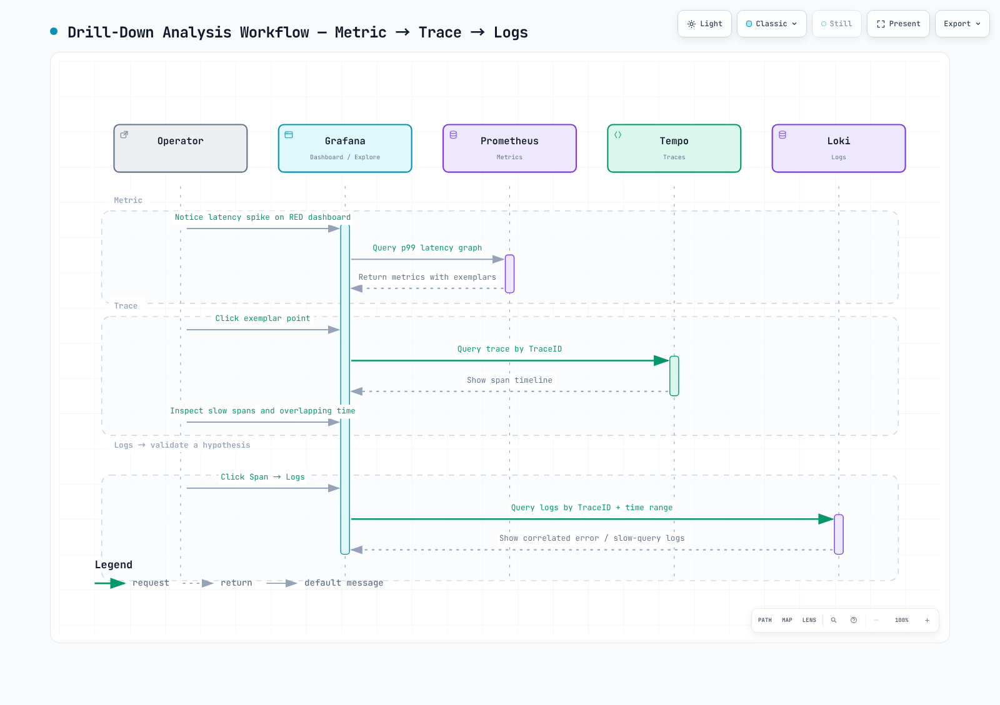

# Parte 6: Análisis de trazabilidad distribuida

<span id="cleanup-steps-table"></span>
<span id="drill-down-analysis-workflow"></span>
<span id="exercise-1-traceql-trace-search"></span>
<span id="exercise-2-service-graph-visualization"></span>
<span id="exercise-3-latency-identification-workflow"></span>
<span id="exercise-4-loki-tempo-correlation"></span>
<span id="exercise-5-exemplar-usage"></span>
<span id="exercise-6-comprehensive-dashboard-setup"></span>
<span id="final-verification-checklist"></span>
<span id="full-cleanup-script"></span>
<span id="key-takeaways"></span>
<span id="learning-objectives"></span>
<span id="next-steps"></span>
<span id="prerequisites"></span>
<span id="references"></span>
<span id="steps"></span>
<span id="steps-1"></span>
<span id="steps-2"></span>
<span id="steps-3"></span>
<span id="steps-4"></span>
<span id="steps-5"></span>
<span id="summary"></span>
<span id="traceql-query-reference"></span>
<span id="verification"></span>

> **Dificultad**: Avanzada · **Tiempo estimado**: 45 minutos
> **Última actualización**: 13 de septiembre de 2026

Sigue una solicitud real desde las métricas, pasando por un exemplar, hasta su traza y logs, separando las observaciones de las hipótesis causales. Esto requiere la ruta de ingesta de la [Parte 2](./02-observability-stack-lab.md) y la propagación de contexto de la [Parte 3](./03-msa-deployment-lab.md). El TraceQL a continuación se verificó con el analizador real de Tempo **3.0.3** y utiliza atributos OTel actuales.



[🔍 Ver diagrama interactivo](https://www.atomai.click/kubernetes-docs/archmaps/en-labs-observability-06-distributed-tracing-lab-0.html)

## 1. Búsqueda en TraceQL {#traceql}

```traceql
{ resource.service.name = "order-service" && span:duration > 1s }

{ trace:duration > 2s && resource.service.name = "order-service" }

{ span:kind = server && span.http.response.status_code >= 500 }

{ span.db.system.name = "postgresql" && span:duration > 100ms }

{ span.messaging.system = "aws_sqs" && span.messaging.operation.type = "send" }

{ resource.service.name = "api-gateway" } >> { resource.service.name = "order-service" }

{ resource.service.name = "order-service" } >> { span.db.system.name = "postgresql" }

{ span:status = error } | select(resource.service.name, span.http.response.status_code, span:duration)
```

`span:duration` mide un span individual; `trace:duration` mide toda la traza. Usa `span:` para intrínsecos explícitos y `span.`/`resource.` para atributos. `>>` encuentra spans del lado derecho que descienden de spans del lado izquierdo. Buscar descendientes de un span de DB es diferente de encontrar trabajo de DB bajo un servicio.

`sort(duration)`, SQL `order by`, `| limit 20` y `{ duration > p99 }` no pertenecen a esta sintaxis de búsqueda. Configura el orden de los resultados, el límite de búsqueda y el intervalo de tiempo en Grafana, y sustituye un p99 medido por un literal de duración como `800ms`. `select()` solicita los atributos que se muestran; no puede recrear spans que nunca se almacenaron.

Los SDK más antiguos pueden emitir `http.status_code`, `http.method`, `db.system`, `db.statement` o `messaging.operation`. Inspecciona los spans reales y las versiones de SDK antes de usar los actuales `http.response.status_code`, `http.request.method`, `db.system.name`, `db.query.text` o `messaging.operation.type`. Renombrar un atributo de consulta no transforma los datos recopilados. Captura texto de consultas solo bajo una política explícita de sanitización; excluye contraseñas, literales SQL y datos de clientes.

## 2. Requisitos previos del grafo de servicios {#service-graph}

Recibir trazas solo en Tempo no basta para completar el grafo de servicios de Grafana. Habilita el procesador `service-graphs` de `metrics-generator`, envía sus métricas a un backend de métricas real y vincula el UID `serviceMap` de la fuente de datos Tempo de Grafana con ese backend. Los spans de cliente/servidor o productor/consumidor deben compartir contexto. El muestreo, los spans que faltan y los tipos de span incorrectos afectan las aristas resultantes.

```promql
sum by (client, server) (rate(traces_service_graph_request_total[5m]))

(
  sum by (client, server) (rate(traces_service_graph_request_failed_total[5m]))
  or on (client, server)
  (0 * sum by (client, server) (rate(traces_service_graph_request_total[5m])))
)
/ on (client, server)
(sum by (client, server) (rate(traces_service_graph_request_total[5m])) > 0)

sum by (client, server) (rate(traces_service_graph_request_server_seconds_sum[5m]))
/
sum by (client, server) (rate(traces_service_graph_request_server_seconds_count[5m]))
```

El contador de fallos puede no tener ninguna serie hasta que ocurra el primero. Completa el numerador faltante con cero usando la serie correspondiente del total de solicitudes y exige un denominador positivo para distinguir un 0 % saludable de la ausencia de tráfico o de datos de ingesta.

La última consulta mide la duración media en el servidor. Para la duración en el cliente se usa `traces_service_graph_request_client_seconds_*`; no consultes la familia inexistente `traces_service_graph_request_duration_seconds_*`. Trata los intervalos sin tráfico como falta de evidencia. Los colores y el grosor de las aristas dependen de la configuración de Grafana y del dashboard; inspecciona los valores de solicitudes, errores y duración en lugar de asumir reglas fijas de color del 1 % o el 5 %.

## 3. Formula hipótesis de cuellos de botella a partir de la cascada {#waterfall}

| Observación | Seguimiento |
|---|---|
| Span de base de datos lento | Comprueba el plan de consulta, los bloqueos, el pool de conexiones y las métricas de la base de datos |
| Span del cliente demasiado largo | Compara los intervalos de espera o reintento de DNS, TLS, red y servidor |
| Brecha entre padre e hijo | Comprueba trabajo sin instrumentar, colas, GC y planificación |
| Spans hijos paralelos | Analiza la superposición y la ruta crítica en lugar de sumar las duraciones |
| Retraso de mensajería | Separa la duración del envío, la recepción y el procesamiento del tiempo de espera en cola y las reentregas |

La duración del padre incluye la duración de los hijos; sumar todos los spans cuenta el tiempo dos veces. Un span de DB de 1,8 segundos por sí solo no demuestra que falte un índice. Compara logs y métricas en la misma versión, tráfico e intervalo de tiempo antes de aceptar una hipótesis.

## 4. Vincula logs y trazas {#correlation}

```logql
{service_name="order-service"} | json | level="ERROR"

{service_name="order-service"} | json | trace_id="0123456789abcdef0123456789abcdef"
```

Estas consultas presuponen una etiqueta real de stream `service_name` y un campo JSON `trace_id`. Sustituye el ID de traza de ejemplo de 32 caracteres por un ID de solicitud real. `traceID`, `traceId` y `trace_id` son campos diferentes. Mantén los ID de traza en campos de log/metadatos estructurados, no en etiquetas de flujo únicas. Establece los límites de tiempo en los parámetros de Grafana/HTTP; no añadas `timestamp >= 2025-...` a LogQL.

Un campo derivado de Loki extrae el ID de traza y crea un enlace a la fuente de datos Tempo mediante su UID. En el YAML de aprovisionamiento de Grafana, escapa la expresión del enlace interno como `$${__value.raw}`. Las expresiones regulares entre comillas dobles y un `envsubst` de shell demasiado amplio pueden alterar las barras invertidas o las variables de Grafana; usa comillas simples cuando corresponda y limita el alcance de las sustituciones.

Configura Tempo `tracesToLogsV2` con el UID de Loki, el mapeo real de etiquetas de recursos a etiquetas de log, el margen temporal y el filtro por ID de traza. Inspecciona el LogQL generado después de hacer clic en “Logs for this span.” Que exista el enlace y que se recuperen correctamente los datos de la misma solicitud son comprobaciones independientes.

## 5. Significado y verificación de exemplars {#exemplars}


[🔍 Ver diagrama interactivo](https://www.atomai.click/kubernetes-docs/archmaps/en-labs-observability-06-distributed-tracing-lab-1.html)

Un exemplar es una **observación representativa** asociada a un agregado. Hacer clic en un punto de un gráfico p99 no demuestra que esa solicitud determinara el límite exacto del percentil. La generación de exemplars, su conservación por el exporter y el remote write, el almacenamiento de Prometheus y la vinculación de la fuente de datos de Grafana deben funcionar. El muestreo o la retención pueden dejar un ID de exemplar cuya traza no está disponible.

Inspecciona las respuestas reales de la API de exemplars de Prometheus y consulta Tempo con el `trace_id` devuelto. Habilitar una opción de visualización de Grafana o buscar un ConfigMap de Prometheus que no existe no valida la ingesta. Comprueba la configuración de almacenamiento de exemplars según las versiones instaladas de Prometheus y del chart, así como los argumentos del recurso o del runtime de Prometheus ya renderizado.

## 6. Dashboards RED y SLI/SLO {#slo}

Crea paneles RED a partir de nombres de métricas, etiquetas y unidades de histogramas reales. Compara la tasa de solicitudes, la proporción de fallos y la distribución de duración en el mismo ámbito de servicio/ruta. Define las solicitudes elegibles y el éxito antes de calcular la disponibilidad; indica cómo se tratan las respuestas 4xx, las comprobaciones de estado y los reintentos.

Un SLO de 30 días requiere retención y observaciones reales durante ese período. Una consulta `[30d]` en un laboratorio reciente no crea 30 días de evidencia. Gestiona la ausencia de tráfico, las series faltantes y los reinicios de contadores; divulga las limitaciones de percentiles de bajo volumen. Calcula los presupuestos de error usando los fallos permitidos y los fallos observados durante la misma ventana. Registra el período, el denominador y el valor en lugar de afirmar que se logró un “99,9 %” fijo.

## 7. Verifica el flujo y luego limpia {#cleanup}

Antes de la limpieza, registra una solicitud cuyo ID de exemplar, ID de traza de Tempo e ID de traza de log coincidan; verifica las dependencias reales del grafo de servicios y la entrega de alertas. Conserva los valores medidos, las marcas de tiempo y las versiones de configuración en lugar de completar los resultados con estimaciones.

| Orden | Acción y condición de finalización |
|---|---|
| 1 | Detén k6/Locust, la inyección de fallos y los activadores de análisis de IA; guarda los resultados |
| 2 | Detén la recreación del ApplicationSet u objeto padre de GitOps y elimina en cascada la aplicación real |
| 3 | Elimina los LoadBalancers/Ingresses, los workloads y los PVC del clúster de servicios; verifica que se hayan limpiado los balanceadores y volúmenes externos |
| 4 | Elimina los recursos personalizados de telemetría antes de desinstalar sus operadores; usa los nombres reales del release y del namespace |
| 5 | Drena/elimina los NodeClaims de Karpenter antes de eliminar el controlador; conserva los controladores de API/LB/almacenamiento mientras existan dependencias |
| 6 | Revisa los planes de destrucción usando el mismo estado de IaC; usa los ID/ARN exactos registrados para los recursos de AWS creados manualmente |
| 7 | Elimina EKS/VPC después de limpiar las dependencias y luego verifica la eliminación de servicios administrados y recursos residuales |

No elimines namespaces compartidos ni CRD de todo el clúster. Usa el release, namespace y versión de instalación registrados; no uses una URL de instalador `latest`. En un bucket S3 con versionado, comprueba las versiones anteriores y los marcadores de eliminación, además de los objetos actuales. Concilia la política de snapshots de Aurora, el bucket de MWAA/DAG, AMG, AMP, OpenSearch, SNS/SQS/DLQ, Lambda/API Gateway, las asociaciones de IAM, EBS/LBs, los grupos de logs y las alarmas con tu inventario. Las solicitudes de eliminación aceptadas no son eliminaciones completadas.

Revisa quién es propietario de cada recurso y conserva la evidencia y el estado. No ejecutes una destrucción con aprobación automática sin revisar, suprimas todos los errores ni borres todo el directorio de trabajo.

## Alcance de la validación y referencias

El analizador actual de Tempo validó 12 consultas y rechazó otras tres que eran incorrectas. Una instancia local y efímera de Loki 3.7.7 recibió dos líneas de log sintéticas; ambas consultas de LogQL recuperaron exactamente el ID de traza esperado. No se ejecutaron una búsqueda real en Tempo del servicio, la recopilación de Loki, la vinculación de datos en Grafana ni la eliminación de recursos en la nube.

- [TraceQL](https://grafana.com/docs/tempo/latest/traceql/)
- [Métricas del grafo de servicios](https://grafana.com/docs/tempo/latest/metrics-from-traces/service_graphs/)
- [Spans HTTP de OTel](https://opentelemetry.io/docs/specs/semconv/http/http-spans/)
- [Spans de base de datos de OTel](https://opentelemetry.io/docs/specs/semconv/database/database-spans/)
- [Campos derivados de Loki](https://grafana.com/docs/grafana/latest/datasources/loki/configure/)
- [Guía de Tempo](../../observability/tracing/01-tempo.md)
- [Guía de Loki](../../observability/logging/01-loki.md)
- [Índice de series](./README.md)
