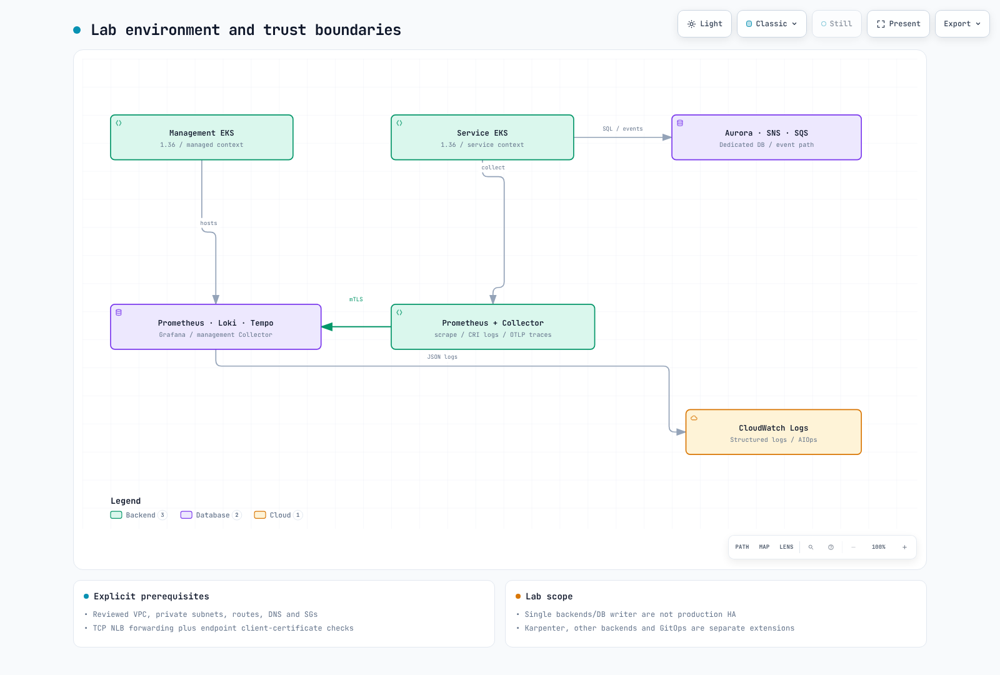
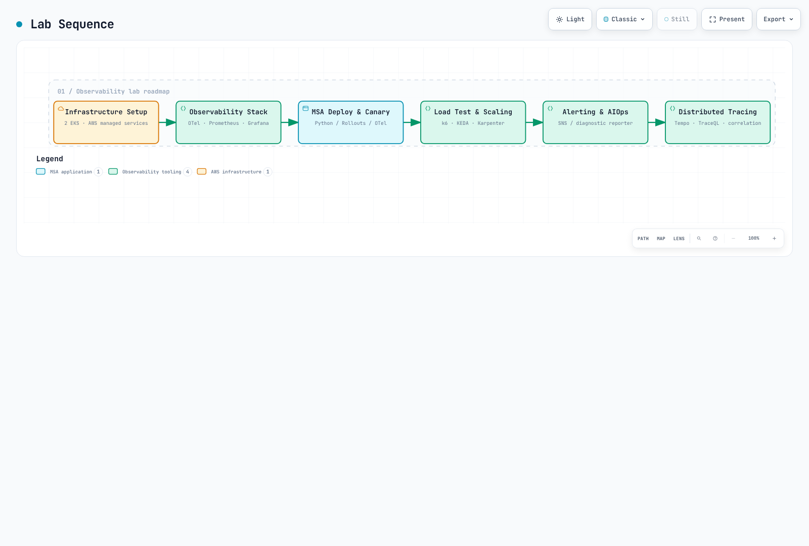
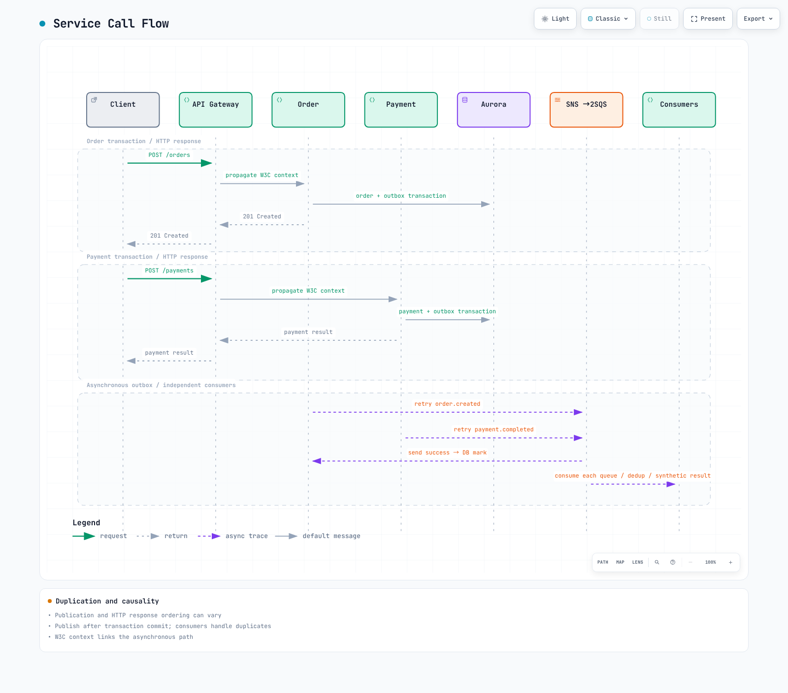
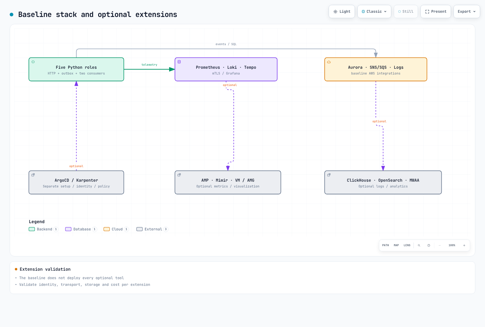

# Serie de labs de observabilidad

> **Dificultad**: Avanzado
> **Última actualización**: 13 de septiembre de 2026
Conecta una aplicación sintética de pedidos ejecutable y sus métricas, registros y trazas a través de dos clústeres de EKS. La configuración base usa Prometheus, Loki, Tempo y Grafana junto con AWS SNS/SQS, Aurora y CloudWatch. La configuración del laboratorio es distinta de la validación de alta disponibilidad y capacidad en producción.

[🔍 Ver diagrama interactivo](https://www.atomai.click/kubernetes-docs/archmaps/en-labs-observability-overview-0.html)

## Requisitos previos {#prerequisites}

Usa un rol temporal de AWS aprobado, una VPC privada y subredes, rutas, DNS y grupos de seguridad revisados, EBS CSI/gp3, un CNI compatible con NetworkPolicy y AWS Load Balancer Controller. No se requieren permisos generales FullAccess para servicios ni claves de acceso de larga duración. Vuelve a comprobar las versiones, los permisos y las cuotas en cada etapa.

| Herramienta | Versiones de referencia revisadas |
|---|---|
| EKS / kubectl | 1.36 / 1.36.2 |
| eksctl / Helm | 0.229.0 / 3.21.3 |
| Python / AWS CLI | 3.12 / v2 |
| k6 / Locust | 2.2.0 / 2.46.5 |
| Aplicación / controladores | Requisitos fijados, digest de imagen y versiones de charts en los ejemplos |

## Código ejecutable y secuencia {#sequence}

Usa los ejemplos de [aplicación](https://github.com/Atom-oh/kubernetes-docs/tree/main/examples/labs/observability/application), [pila](https://github.com/Atom-oh/kubernetes-docs/tree/main/examples/labs/observability/stack), [pruebas de carga](https://github.com/Atom-oh/kubernetes-docs/tree/main/examples/labs/observability/load-test) y [AIOps](https://github.com/Atom-oh/kubernetes-docs/tree/main/examples/labs/observability/aiops) de este repositorio. Fija un commit o una etiqueta revisados y conserva el valor privado de `LAB_STATE`; no clones el antiguo repositorio de ejemplos, que ya no existe.

[🔍 Ver diagrama interactivo](https://www.atomai.click/kubernetes-docs/archmaps/en-labs-observability-overview-2.html)

| Parte | Etapa | Resultado |
|---|---|---|
| 1 | [Infraestructura](01-infrastructure-setup-lab.md) | EKS, base de datos privada, fanout de SNS, roles restringidos |
| 2 | [Pila de observabilidad](02-observability-stack-lab.md) | Colectores y escritura remota con mTLS, Loki/Tempo/Grafana |
| 3 | [MSA/canary](03-msa-deployment-lab.md) | Cinco roles ejecutables, outbox, análisis solo por revisión |
| 4 | [Pruebas de carga y escalado](04-load-testing-scaling-lab.md) | Solicitudes medidas y observaciones de consumidores y nodos |
| 5 | [Alertas y AIOps](05-alerting-aiops-lab.md) | Emisor de diagnósticos con un tema separado y revisión humana |
| 6 | [Trazado distribuido](06-distributed-tracing-lab.md) | Correlación real de métricas, ejemplares, trazas y registros; limpieza |

## Aplicación y flujo de datos {#application}

Una sola imagen de Python se ejecuta con roles separados: `api-gateway`, `order-service`, `payment-service`, `notification` y `analytics`. Los pagos y las notificaciones son sintéticos; no se realizan cargos ni se envían correos electrónicos o SMS reales. Los pedidos y el registro de salida (outbox) comparten una transacción; colas independientes y la deduplicación por ID de evento sirven a `notification` y `analytics`. No se implementan ni se afirman la autenticación en la puerta de enlace, la limitación general de solicitudes ni una pasarela de pago real.

[🔍 Ver diagrama interactivo](https://www.atomai.click/kubernetes-docs/archmaps/en-labs-observability-overview-3.html)

## Base frente a extensiones opcionales {#coverage}

[🔍 Ver diagrama interactivo](https://www.atomai.click/kubernetes-docs/archmaps/en-labs-observability-overview-1.html)

| Base | Integración opcional independiente |
|---|---|
| Métricas de Prometheus / CloudWatch | VictoriaMetrics, Mimir, AMP |
| Loki / CloudWatch Logs | ClickHouse, OpenSearch |
| OTel / Tempo | X-Ray, Dynatrace |
| Grafana | Amazon Managed Grafana, herramientas comerciales |
| Alertmanager / SNS / Lambda de diagnóstico | Plataforma de guardia existente, grupo de CloudWatch Investigations |
| Consumidores de eventos sintéticos | Planificación con MWAA/analítica por lotes y sistemas de transacciones de producción |

La instalación no equivale a verificar la ingesta, las consultas, los permisos ni los costes. Consulta las guías de [métricas](../../observability/metrics/README.md), [registros](../../observability/logging/README.md), [trazado](../../observability/tracing/README.md) y [Grafana](../../observability/grafana/README.md) para conocer las extensiones. La parte 5 incorpora cambios como el archivado de OnCall OSS.

## Coste, verificación y limpieza {#cost-and-cleanup}

Estima los costes a partir del uso real: nodos específicos de la región, NAT, EBS, ACU/almacenamiento/entrada y salida de Aurora, ingesta y retención de registros, mensajes, KMS, balanceadores de carga, transferencia y llamadas al modelo. No sumes los cargos mensuales por usuario y la infraestructura por hora como si fueran un total fijo. Los laboratorios con un único escritor y backend no ofrecen alta disponibilidad de nivel de producción; los límites de réplicas no son topes absolutos del gasto.

Distingue la validación local nativa, la del SDK, la del esquema y la del navegador de los resultados reales en AWS. Inventaría los recursos, las asociaciones de IAM, las instantáneas, el DNS, los balanceadores de carga y los PVC; realiza la limpieza siguiendo el orden de dependencias de la parte 6. No silencies todos los errores ni elimines los clústeres antes que los recursos administrados que dependen de ellos.
