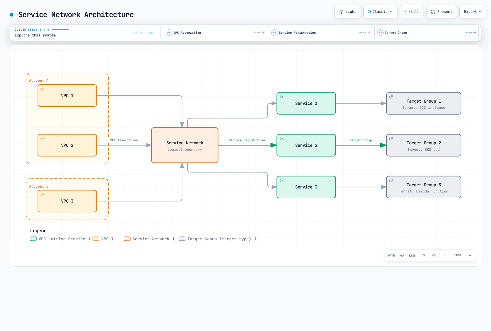

# VPC Lattice

Amazon VPC Lattice conecta aplicaciones entre VPC y cuentas de AWS. Este capítulo explica el modelo de recursos, una integración con EKS, el enrutamiento, la autorización IAM, la monitorización y la solución de problemas.

> **Última actualización**: September 11, 2026 contra AWS Gateway API Controller **v2.1.3** y Gateway API **v1.5.0**. Los ejemplos describen pasos de configuración y validación; no se han desplegado en una cuenta de AWS como parte de esta revisión.

## Tabla de contenidos

- [Descripción general](#overview)
- [Arquitectura](#architecture)
- [Integración de EKS y VPC Lattice](#eks-and-vpc-lattice-integration)
- [Instalación y configuración](#installation-and-configuration)
- [Gestión de servicios](#service-management)
- [Enrutamiento y gestión del tráfico](#routing-and-traffic-management)
- [Seguridad y autenticación](#security-and-authentication)
- [Monitorización y registro](#monitoring-and-logging)
- [Prácticas recomendadas](#best-practices)
- [Solución de problemas](#troubleshooting)
- [Referencias](#references)

## Descripción general

### ¿Qué es VPC Lattice?

VPC Lattice proporciona redes de aplicaciones sin requerir un proxy junto a cada aplicación. Una **service network** agrupa servicios y configuraciones de recursos y los conecta a consumidores autorizados. Los servicios proporcionan listeners, reglas de enrutamiento, target groups y nombres DNS de servicio.

El producto actual también conecta **resource configurations** mediante resource gateways, incluidos recursos como bases de datos RDS que usan TCP. Este modelo de acceso a recursos es distinto de un servicio HTTP respaldado por un target group; las políticas de autenticación IAM de service network/servicio no autorizan el tráfico de resource configurations. Un **service network VPC endpoint**, impulsado por PrivateLink, puede proporcionar acceso desde clientes alcanzados mediante peering, Transit Gateway, Direct Connect o VPN. Una asociación directa de VPC por sí sola no extiende el acceso a clientes detrás de un transit gateway o una conexión de peering.

Los usos habituales incluyen API de aplicaciones entre cuentas, comunicación entre EKS y otros servicios de computación, y acceso compartido a recursos de datos. La asociación, el enrutamiento, los security groups, la autenticación y la autorización de la aplicación aún requieren configuración.

### Comparación con otros servicios

| Servicio | Responsabilidad principal | Distinción importante |
|---|---|---|
| VPC Lattice | Conectividad privada de aplicaciones y recursos | Enrutamiento de servicios HTTP/HTTPS/gRPC y capacidades separadas de recursos TLS/TCP; no es una puerta de entrada de API de Internet |
| API Gateway | Endpoints de API administrados y gestión de API | Las API REST, HTTP o WebSocket tienen características diferentes; GraphQL no es un tipo de API de API Gateway independiente |
| AWS App Mesh | Service mesh basado en Envoy | El soporte de AWS finalizó el **2026-09-30**; la consola y los recursos ya no son accesibles. Migre los despliegues existentes; no es para instalaciones nuevas |
| Transit Gateway | Conectividad de red mediante enrutamiento IP | Conecta redes; no sustituye el enrutamiento y la autorización HTTP por servicio |
| Istio / Linkerd / Cilium | Capacidades de mesh implementadas con sus respectivos planos de datos | Las características y los costes operativos difieren. Los sidecars no son obligatorios en todas las arquitecturas de mesh |

VPC Lattice elimina la necesidad de operar su plano de datos administrado, pero no promete menor coste total ni funcionalidad de mesh idéntica. Compare los cargos por solicitud/datos/recursos, las operaciones del controller, los requisitos de identidad, los reintentos, las características de enrutamiento y la observabilidad para la carga de trabajo real. Consulte la [comparación Istio–Lattice](../service-mesh/istio/comparison/02-istio-vs-lattice.md).

## Arquitectura

### Componentes y flujo de tráfico

| Componente | Responsabilidad |
|---|---|
| Service network | Agrupación lógica y asociaciones; límite opcional de autorización IAM |
| Servicio | Endpoint de aplicación con su propio nombre DNS |
| Listener y reglas | Pertenecen a un **servicio**; seleccionan acciones y target groups |
| Target group | Targets registrados de instancia, IP, Lambda o ALB, con comportamiento específico del tipo de target |
| Asociación de VPC | Permite a los clientes de una VPC asociada acceder a la red, sujeto a controles de seguridad |
| Service network VPC endpoint | Acceso basado en PrivateLink, incluidas rutas de tránsito/on-premises compatibles |
| Resource configuration / resource gateway | Modelo de acceso a recursos independiente, incluidos recursos TCP/base de datos |



[Ver diagrama interactivo](https://www.atomai.click/kubernetes-docs/archmaps/en-networking-02-vpc-lattice-1.html)

La figura muestra asociaciones lógicas, no un único proceso de router. El acceso también depende de la conectividad de red y de las políticas aplicables. Una solicitud resuelve el nombre DNS **del servicio**, llega a su listener, pasa las comprobaciones de autorización aplicables y se enruta a un target según las reglas del listener. Un target group describe destinos; no es otro salto de aplicación.

Use `get-service --query dnsEntry` o la anotación de ruta del controller para descubrir el dominio real. No construya uno a partir del nombre de servicio y el ID de service network. Un nombre asignado contiene identificadores específicos del servicio; recrear un servicio puede cambiarlo.

### Modelo de seguridad

El acceso de red, la autorización IAM y el cifrado son controles independientes. `AWS_IAM` requiere una solicitud firmada compatible y políticas apropiadas. `NONE` deshabilita la autenticación IAM en esa capa concreta; no omite la política IAM de otra capa, los security groups ni la autorización de la aplicación. HTTPS protege el tráfico del cliente a Lattice. El HTTP del backend sigue en texto sin cifrar salvo que TLS del backend se configure explícitamente.

## Integración de EKS y VPC Lattice

AWS Gateway API Controller reconcilia recursos de Kubernetes en recursos de VPC Lattice:

| Recurso de Kubernetes | Interpretación de Lattice |
|---|---|
| GatewayClass | Selecciona `application-networking.k8s.aws/gateway-api-controller` |
| Gateway | Hace referencia a una service network mediante el **nombre de Gateway**, sin su namespace |
| HTTPRoute / GRPCRoute | Crea un servicio con su propio dominio y configuración de listener/enrutamiento |
| Backend Service y sus endpoints | Definen target groups y endpoints de Pod registrados |
| TargetGroupPolicy | Configura el protocolo y las comprobaciones de estado del target group |
| IAMAuthPolicy | Adjunta una política de autenticación a la red de un Gateway o al servicio de una Route |
| AccessLogPolicy | Configura el destino de logs de acceso de un recurso target |

Dos Gateways con el mismo nombre pueden hacer referencia a la misma service network aunque sus namespaces de Kubernetes difieran. Un Gateway por sí solo **no** crea la red ni una IP de entrada compartida. La red puede gestionarse externamente, con la opción `defaultServiceNetwork` del controller para casos simples, o con el CRD ServiceNetwork del controller. Elija un propietario para cada recurso de cloud.

Los ejemplos siguientes usan una red y una asociación de VPC administradas externamente. Dejan `defaultServiceNetwork` sin configurar y no adjuntan una VpcAssociationPolicy a esa asociación. Si adopta el modelo basado en CRD, gestione la red, la asociación de VPC y la autorización como recursos independientes; tampoco gestione los mismos recursos con CloudFormation.

## Instalación y configuración

### Requisitos previos

La guía de actualización v2.1 del controller requiere **Kubernetes 1.31 o posterior** y Gateway API **1.5 o posterior**. Este ejemplo fija la versión con la que se compiló v2.1, **1.5.0**. Este mínimo no es una matriz de soporte de EKS ni prueba de compatibilidad con todas las versiones posteriores de Gateway API. Compruebe el ciclo de vida de versiones de EKS y todos los controllers que comparten los CRD de Gateway API antes de cambiarlos. En particular, un controller v2.0 puede fallar tras la transición de almacenamiento/API de TLSRoute introducida con Gateway API 1.5.

Use un clúster de EKS compatible, `kubectl`, Helm, AWS CLI v2 correspondientes y un rol de operador autorizado para configurar los recursos previstos. El backend de ejemplo asume Pods Linux con IP alcanzables por VPC Lattice. Confirme la CNI del clúster, la capacidad de subred, la disponibilidad de endpoints, DNS y la configuración de network policy.

```bash
export AWS_REGION=us-west-2
export CLUSTER_NAME=my-cluster
export AWS_ACCOUNT_ID="$(aws sts get-caller-identity --query Account --output text)"
export VPC_ID="$(aws eks describe-cluster --name "$CLUSTER_NAME" \
  --query 'cluster.resourcesVpcConfig.vpcId' --output text)"
export NETWORK_NAME=my-network
export ASSOCIATION_SG_ID=sg-0123456789abcdef0
kubectl config current-context
kubectl version
```

Sustituya el ID de security group de ejemplo. El security group de asociación de VPC debe permitir **clientes aprobados** en TCP 443. Los security groups de Pod/nodo de backend deben permitir la prefix list administrada de Lattice aplicable en el puerto real de backend/health, TCP 8080 aquí. Inspeccione los grupos adjuntos a la ENI de Pod o ENI de nodo reales en vez de asumir que cada nodo usa el security group de clúster de EKS. Permita también que el plano de control de EKS alcance el webhook del controller en su puerto requerido. No abra todos los puertos a todo Internet.

### Configuración del rol IAM

El **rol de controller** administra recursos de cloud. El **rol de llamador** firma las solicitudes de aplicación y necesita `vpc-lattice-svcs:Invoke`; son roles diferentes.

Use EKS Pod Identity en nodos compatibles, o IRSA. El ejemplo de IRSA siguiente asume que el proveedor IAM OIDC del clúster ya existe y crea una service account dedicada. Para Pod Identity, use el complemento de EKS actual y una asociación para este mismo namespace/service account, con la política de confianza apropiada; tampoco se base en una anotación IRSA para el mismo ejemplo.

La política de controller recomendada de la versión incluye permisos amplios de `vpc-lattice:*` y logging/tagging. Trátela como un punto de partida upstream, **no como una política de mínimo privilegio**. Revise su ámbito de recursos y características habilitadas, conserve las condiciones restringidas de service-linked-role y guarde la política revisada antes de crearla. Reutilice un ARN de política revisada existente en vez de crear políticas duplicadas en ejecuciones posteriores.

```bash
curl --fail --location --output controller-policy-upstream.json \
  https://raw.githubusercontent.com/aws/aws-application-networking-k8s/v2.1.3/files/controller-installation/recommended-inline-policy.json

# Use the policy reviewed for this account and the enabled controller features.
export REVIEWED_POLICY_FILE=controller-policy-reviewed.json
test -s "$REVIEWED_POLICY_FILE"
export CONTROLLER_POLICY_ARN="$(aws iam create-policy \
  --policy-name VPCLatticeControllerPolicy \
  --policy-document "file://$REVIEWED_POLICY_FILE" \
  --query Policy.Arn --output text)"

# Prerequisite: this cluster's IAM OIDC provider already exists.
eksctl create iamserviceaccount \
  --cluster "$CLUSTER_NAME" --region "$AWS_REGION" \
  --namespace aws-application-networking-system \
  --name gateway-api-controller \
  --attach-policy-arn "$CONTROLLER_POLICY_ARN" \
  --approve
```

Una service account existente requiere una migración intencional de propiedad/rol; el ejemplo no la sobrescribe automáticamente.

### Instalar el controller publicado

```bash
curl --fail --location --output gateway-api-v1.5.0.yaml \
  https://github.com/kubernetes-sigs/gateway-api/releases/download/v1.5.0/standard-install.yaml
# Inspect changes first if any Gateway API controller is already installed.
kubectl apply --server-side -f gateway-api-v1.5.0.yaml

helm pull oci://public.ecr.aws/aws-application-networking-k8s/aws-gateway-controller-chart \
  --version v2.1.3
helm show crds ./aws-gateway-controller-chart-v2.1.3.tgz > lattice-crds.yaml
kubectl apply --server-side -f lattice-crds.yaml

helm install gateway-api-controller ./aws-gateway-controller-chart-v2.1.3.tgz \
  --namespace aws-application-networking-system --create-namespace \
  --set serviceAccount.create=false \
  --set serviceAccount.name=gateway-api-controller \
  --set-string awsRegion="$AWS_REGION" \
  --set-string awsAccountId="$AWS_ACCOUNT_ID" \
  --set-string clusterVpcId="$VPC_ID" \
  --set-string clusterName="$CLUSTER_NAME" \
  --wait --timeout 5m

kubectl -n aws-application-networking-system get pods
kubectl -n aws-application-networking-system logs \
  -l control-plane=gateway-api-controller -c manager --tail=100
```

Para una versión de Helm existente, use un plan de `helm upgrade` revisado con sus valores guardados. Helm no actualiza automáticamente los CRD en `crds/`; revise sus cambios por separado. No elimine CRD de Gateway API compartidos ni políticas de admisión para hacer que una actualización funcione.

Para la entrega basada en manifests, renderice este **mismo chart** con `helm template --include-crds`, usando los mismos valores y elección de service account, y luego revise y aplique el manifest resultante. Esto conserva RBAC publicado, observaciones de EndpointSlice, permisos de leader election y configuración de webhook. No use el despliegue v1.0 escrito manualmente y obsoleto. El chart genera certificados de webhook salvo que se suministren explícitamente o se administren mediante su opción cert-manager; mantenga el Secret del webhook y el bundle de CA consistentes durante las actualizaciones en vez de regenerar uno de forma independiente.

### Crear la service network

Elija **CLI o CloudFormation**, no ambos para la misma red. El ejemplo de CLI crea una red `AWS_IAM`. Hasta que se instale y propague una política Allow aplicable, las solicitudes se deniegan.

Guarde lo siguiente como `api-auth-policy.json`, sustituyendo la cuenta y el rol de llamador. La política de red permite deliberadamente solo el endpoint `/api` y subrutas de esta demostración. Una red de producción necesita una política revisada que cubra sus servicios y llamadores previstos.

```json
{
  "Version": "2012-10-17",
  "Statement": [
    {
      "Effect": "Allow",
      "Principal": {
        "AWS": "arn:aws:iam::123456789012:role/MyAppRole"
      },
      "Action": "vpc-lattice-svcs:Invoke",
      "Resource": "*",
      "Condition": {
        "StringLike": {
          "vpc-lattice-svcs:RequestPath": [
            "/api",
            "/api/*"
          ]
        }
      }
    }
  ]
}
```

```bash
aws vpc-lattice create-service-network --name "$NETWORK_NAME" \
  --auth-type AWS_IAM > service-network.json
export SERVICE_NETWORK_ID="$(python3 -c \
  'import json; print(json.load(open("service-network.json"))["id"])')"
export SERVICE_NETWORK_ARN="$(python3 -c \
  'import json; print(json.load(open("service-network.json"))["arn"])')"

aws vpc-lattice create-service-network-vpc-association \
  --service-network-identifier "$SERVICE_NETWORK_ID" \
  --vpc-identifier "$VPC_ID" --security-group-ids "$ASSOCIATION_SG_ID"

# Save the reviewed policy below as api-auth-policy.json, then compact it.
python3 -c 'import json; print(json.dumps(json.load(open("api-auth-policy.json")),separators=(",",":")))' \
  > api-auth-policy.compact.json
aws vpc-lattice put-auth-policy --resource-identifier "$SERVICE_NETWORK_ID" \
  --policy file://api-auth-policy.compact.json
aws vpc-lattice get-service-network --service-network-identifier "$SERVICE_NETWORK_ID"
aws vpc-lattice get-auth-policy --resource-identifier "$SERVICE_NETWORK_ID"
aws vpc-lattice list-service-network-vpc-associations \
  --service-network-identifier "$SERVICE_NETWORK_ID"
```

Verifique que la asociación esté `ACTIVE`, que la red aún tenga `authType: AWS_IAM` y que `get-auth-policy` devuelva la política prevista antes de exponer una ruta. La propagación de políticas puede tardar unos minutos.

La plantilla de CloudFormation equivalente de **red y asociación** es:

```yaml
AWSTemplateFormatVersion: '2010-09-09'
Description: VPC Lattice service network and client VPC association
Parameters:
  NetworkName:
    Type: String
    Default: my-network
    MinLength: 3
    MaxLength: 63
    AllowedPattern: '^[a-z0-9]+(-[a-z0-9]+)*$'
    Description: Must match the Kubernetes Gateway name
  VpcId:
    Type: AWS::EC2::VPC::Id
    Description: VPC containing the intended clients
  AssociationSecurityGroupIds:
    Type: List<AWS::EC2::SecurityGroup::Id>
    Description: Existing security groups allowing approved clients on listener ports
Resources:
  ServiceNetwork:
    Type: AWS::VpcLattice::ServiceNetwork
    Properties:
      Name: {Ref: NetworkName}
      AuthType: AWS_IAM
  ClientAssociation:
    Type: AWS::VpcLattice::ServiceNetworkVpcAssociation
    Properties:
      ServiceNetworkIdentifier: {Ref: ServiceNetwork}
      VpcIdentifier: {Ref: VpcId}
      SecurityGroupIds: {Ref: AssociationSecurityGroupIds}
Outputs:
  ServiceNetworkArn:
    Description: ARN used for authorization and sharing
    Value: {Fn::GetAtt: [ServiceNetwork, Arn]}
  ServiceNetworkId:
    Description: ID used with VPC Lattice API operations
    Value: {Fn::GetAtt: [ServiceNetwork, Id]}
```

Esta plantilla no adjunta una política de autenticación. Agregue un recurso de política de autenticación en el mismo modelo de propiedad, o aplique la política de red revisada explícitamente antes de probar solicitudes. Obtenga el ID/ARN de red de las salidas del stack. Valide la plantilla e inspeccione un change set antes del despliegue; el ejemplo no crea la VPC ni sus security groups.

### Gateway y aplicación

Guarde y aplique esto como `gateway.yaml`. El nombre de Gateway debe coincidir con `my-network` creado anteriormente.

```yaml
apiVersion: v1
kind: Namespace
metadata:
  name: lattice-demo
---
apiVersion: gateway.networking.k8s.io/v1
kind: GatewayClass
metadata:
  name: amazon-vpc-lattice
spec:
  controllerName: application-networking.k8s.aws/gateway-api-controller
---
apiVersion: gateway.networking.k8s.io/v1
kind: Gateway
metadata:
  name: my-network
  namespace: lattice-demo
spec:
  gatewayClassName: amazon-vpc-lattice
  listeners:
  - name: https
    protocol: HTTPS
    port: 443
    tls:
      mode: Terminate
      certificateRefs:
      - name: unused
```

`certificateRefs: [{name: unused}]` sigue la configuración documentada de este controller: satisface la configuración TLS de Gateway API, pero este controller no lee allí un Secret TLS de Kubernetes. Sin un hostname personalizado, Lattice proporciona un certificado para su dominio generado. Esto es **específico del controller**, no una receta portable de gestión de certificados.

Guarde lo siguiente como `stable.yaml`. Configura NGINX para que realmente escuche en 8080 y sirva `/health`; declarar solo `containerPort` no haría ninguna de las dos cosas.

```yaml
apiVersion: v1
kind: ConfigMap
metadata:
  name: service-stable
  namespace: lattice-demo
data:
  nginx.conf: |
    worker_processes 1;
    pid /tmp/nginx.pid;
    error_log stderr notice;
    events { worker_connections 1024; }
    http {
        access_log /dev/stdout;
        default_type application/json;
        client_body_temp_path /tmp/client_temp;
        proxy_temp_path /tmp/proxy_temp;
        fastcgi_temp_path /tmp/fastcgi_temp;
        uwsgi_temp_path /tmp/uwsgi_temp;
        scgi_temp_path /tmp/scgi_temp;
        server {
            listen 8080;
            location = /health { return 200 '{"status":"ok"}\n'; }
            location = /api { return 200 '{"version":"stable"}\n'; }
            location /api/ { return 200 '{"version":"stable"}\n'; }
            location / { return 404 '{"error":"not found"}\n'; }
        }
    }
---
apiVersion: apps/v1
kind: Deployment
metadata:
  name: service-stable
  namespace: lattice-demo
spec:
  replicas: 2
  selector:
    matchLabels: &id001
      app: lattice-demo
      version: stable
  template:
    metadata:
      labels: *id001
    spec:
      automountServiceAccountToken: false
      securityContext:
        runAsNonRoot: true
        runAsUser: 101
        runAsGroup: 101
        fsGroup: 101
        seccompProfile:
          type: RuntimeDefault
      containers:
      - name: app
        image: nginx:1.30.4-alpine@sha256:dc5069ad14f19660b141b21236140b91656bf89bbc3e2417c70ae650cd66104c
        command:
        - nginx
        args:
        - -c
        - /etc/lattice/nginx.conf
        - -g
        - daemon off;
        ports:
        - name: http
          containerPort: 8080
        readinessProbe:
          httpGet:
            path: /health
            port: http
          periodSeconds: 5
        resources:
          requests:
            cpu: 50m
            memory: 32Mi
          limits:
            cpu: 250m
            memory: 64Mi
        securityContext:
          allowPrivilegeEscalation: false
          readOnlyRootFilesystem: true
          capabilities:
            drop:
            - ALL
        volumeMounts:
        - name: config
          mountPath: /etc/lattice
          readOnly: true
        - name: tmp
          mountPath: /tmp
      volumes:
      - name: config
        configMap:
          name: service-stable
      - name: tmp
        emptyDir: {}
---
apiVersion: v1
kind: Service
metadata:
  name: service-stable
  namespace: lattice-demo
spec:
  selector:
    app: lattice-demo
    version: stable
  ports:
  - name: http
    port: 8080
    targetPort: http
```

Cree `canary.yaml` a partir de los mismos tres objetos, cambiando cada nombre `service-stable` a `service-canary`, ambas etiquetas `version: stable` de selector/template a `version: canary` y el valor de respuesta JSON `"stable"` a `"canary"`. Mantenga `app: lattice-demo`, el puerto y el endpoint de health sin cambios. Aplique ambos archivos en `lattice-demo`. La imagen fijada tiene variantes Linux AMD64 y ARM64. Las solicitudes de recursos y los recuentos de réplicas son ajustes de demostración, no dimensionamiento de producción medido.

Guarde y aplique la siguiente `TargetGroupPolicy`; cree una política `canary-health` equivalente destinada a `service-canary`.

```yaml
apiVersion: application-networking.k8s.aws/v1alpha1
kind: TargetGroupPolicy
metadata:
  name: stable-health
  namespace: lattice-demo
spec:
  targetRef:
    group: ''
    kind: Service
    name: service-stable
  protocol: HTTP
  protocolVersion: HTTP1
  healthCheck:
    enabled: true
    protocol: HTTP
    protocolVersion: HTTP1
    port: 8080
    path: /health
    intervalSeconds: 30
    timeoutSeconds: 5
    healthyThresholdCount: 2
    unhealthyThresholdCount: 2
    statusMatch: '200'
```

El CRD usa `intervalSeconds`, `timeoutSeconds` y `statusMatch`. AWS CLI usa nombres de campo diferentes, mostrados más adelante. Cambiar el protocolo/la versión puede sustituir un target group; eliminar la política revierte sus ajustes, incluido el comportamiento predeterminado HTTP/HTTP1.

## Gestión de servicios

### Crear un servicio mediante HTTPRoute

Guarde esto como `api-route.yaml`. Guarde también la IAMAuthPolicy siguiente como `api-iam.yaml`. Aplique las políticas de aplicación y health, después la ruta y la política de autenticación. Mantenga activa la política `AWS_IAM` de nivel de red mientras la reconciliación crea y protege el servicio de la ruta.

```yaml
apiVersion: gateway.networking.k8s.io/v1
kind: HTTPRoute
metadata:
  name: api
  namespace: lattice-demo
spec:
  parentRefs:
  - name: my-network
    sectionName: https
  rules:
  - matches:
    - path:
        type: PathPrefix
        value: /api
    backendRefs:
    - name: service-stable
      port: 8080
      weight: 90
    - name: service-canary
      port: 8080
      weight: 10
```

```yaml
apiVersion: application-networking.k8s.aws/v1alpha1
kind: IAMAuthPolicy
metadata:
  name: api-caller
  namespace: lattice-demo
spec:
  targetRef:
    group: gateway.networking.k8s.io
    kind: HTTPRoute
    name: api
  policy: '{"Version":"2012-10-17","Statement":[{"Effect":"Allow","Principal":{"AWS":"arn:aws:iam::123456789012:role/MyAppRole"},"Action":"vpc-lattice-svcs:Invoke","Resource":"*","Condition":{"StringLike":{"vpc-lattice-svcs:RequestPath":["/api","/api/*"]}}}]}'
```

`spec.policy` es una **cadena** JSON. Este CRD habilita `AWS_IAM` en el servicio target; una anotación de tipo de autenticación o un ConfigMap que contiene una política no lo sustituye. Una política destinada a `Gateway` gestionaría en cambio la política de la red, por lo que no debe competir con la política de red administrada externamente en este ejemplo.

Inspeccione `Accepted` / `ResolvedRefs` y el estado de la política, el estado del recurso AWS relevante y la disponibilidad del backend. Un `kubectl apply` correcto no demuestra que la reconciliación de cloud ni la entrega de logs se hayan realizado correctamente.

```bash
kubectl -n lattice-demo get gateway my-network -o yaml
kubectl -n lattice-demo get httproute api -o yaml
kubectl -n lattice-demo get iamauthpolicy api-caller -o yaml
kubectl -n lattice-demo get endpointslices \
  -l kubernetes.io/service-name=service-stable
kubectl -n lattice-demo rollout status deployment/service-stable --timeout=120s
kubectl -n lattice-demo rollout status deployment/service-canary --timeout=120s

export SERVICE_DNS="$(kubectl -n lattice-demo get httproute api \
  -o jsonpath='{.metadata.annotations.application-networking\.k8s\.aws/lattice-assigned-domain-name}')"
test -n "$SERVICE_DNS"
# A caller inside the associated VPC, with MyAppRole credentials, runs:
lattice-client/bin/python lattice_get.py --region "$AWS_REGION" "https://${SERVICE_DNS}/api"
```

Configure el cliente firmado de la sección siguiente antes de ejecutar el último comando. Ejecútelo desde una ubicación de red autorizada con credenciales de **rol de llamador**. Su estación de trabajo necesita una ruta de red apropiada además de credenciales AWS.

### Cliente HTTPS firmado

Guarde esto como `lattice_get.py`. Usa la cadena de proveedores de credenciales AWS predeterminada, congela las credenciales para cada solicitud, firma para **`vpc-lattice-svcs`** y configura **`UNSIGNED-PAYLOAD`** como requiere VPC Lattice. Valida TLS, no sigue redirecciones con una firma obsoleta y no reintenta solicitudes automáticamente.

```python
import argparse
import ssl
import sys
from urllib.error import HTTPError, URLError
from urllib.parse import urlsplit
from urllib.request import HTTPRedirectHandler, HTTPSHandler, Request, build_opener

from botocore.auth import SigV4Auth
from botocore.awsrequest import AWSRequest
from botocore.exceptions import BotoCoreError
from botocore.session import Session


class NoRedirect(HTTPRedirectHandler):
    def redirect_request(self, req, fp, code, msg, headers, newurl):
        return None


def signed_request(url: str, region: str, credentials) -> Request:
    parts = urlsplit(url)
    if (parts.scheme != "https" or not parts.hostname or parts.username
            or parts.password or parts.fragment):
        raise ValueError("Use an HTTPS URL without user info or a fragment")
    request = AWSRequest(method="GET", url=url, headers={
        "x-amz-content-sha256": "UNSIGNED-PAYLOAD",
    })
    request.context["payload_signing_enabled"] = False
    SigV4Auth(credentials, "vpc-lattice-svcs", region).add_auth(request)
    return Request(url, method="GET", headers=dict(request.headers.items()))


def main() -> int:
    parser = argparse.ArgumentParser()
    parser.add_argument("--region", required=True)
    parser.add_argument("url")
    args = parser.parse_args()
    try:
        provider = Session().get_credentials()
        if provider is None:
            raise ValueError("No AWS credentials available")
        request = signed_request(args.url, args.region, provider.get_frozen_credentials())
        opener = build_opener(NoRedirect(), HTTPSHandler(context=ssl.create_default_context()))
        with opener.open(request, timeout=10) as response:
            print(response.status)
            print(response.read(1048576).decode("utf-8", errors="replace"))
        return 0
    except HTTPError as exc:
        print(f"HTTP {exc.code}; check the policy and access logs", file=sys.stderr)
    except (URLError, BotoCoreError, ValueError) as exc:
        print(f"Request failed: {type(exc).__name__}", file=sys.stderr)
    return 1


if __name__ == "__main__":
    sys.exit(main())
```

```bash
python3.12 -m venv lattice-client
lattice-client/bin/python -m pip install 'botocore==1.43.93'
lattice-client/bin/python lattice_get.py --region "$AWS_REGION" "https://${SERVICE_DNS}/api"
```

Este ejemplo solo GET se comprobó con Python 3.12 y botocore 1.43.93. Las cargas de trabajo deben usar sus credenciales configuradas de Pod Identity o IRSA. No copie credenciales estáticas ni encabezados firmados en manifests, logs o tickets de soporte. SigV4A también es compatible con VPC Lattice; este ejemplo usa SigV4 regional.

### Gestión directa mediante AWS API

Lo siguiente es una **alternativa** para recursos administrados independientemente. Use una IP de backend estable y alcanzable que sirva HTTP en 8080 y `/health`; una IP de Pod temporal requiere un controller que siga los reemplazos. No cambie manualmente un servicio propiedad de HTTPRoute y espere que el controller conserve el cambio.

```bash
# Separate API-managed example; do not use for controller-managed resources.
export TARGET_IP=10.0.1.25
export TARGET_GROUP_ID="$(aws vpc-lattice create-target-group \
  --name api-manual --type IP \
  --config "{\"port\":8080,\"protocol\":\"HTTP\",\"protocolVersion\":\"HTTP1\",\"vpcIdentifier\":\"${VPC_ID}\"}" \
  --query id --output text)"
aws vpc-lattice register-targets --target-group-identifier "$TARGET_GROUP_ID" \
  --targets "id=$TARGET_IP,port=8080"
export SERVICE_ID="$(aws vpc-lattice create-service \
  --name api-manual --auth-type AWS_IAM --query id --output text)"
aws vpc-lattice put-auth-policy --resource-identifier "$SERVICE_ID" \
  --policy file://api-auth-policy.compact.json
export LISTENER_ID="$(aws vpc-lattice create-listener \
  --service-identifier "$SERVICE_ID" --name https --protocol HTTPS --port 443 \
  --default-action "{\"forward\":{\"targetGroups\":[{\"targetGroupIdentifier\":\"${TARGET_GROUP_ID}\",\"weight\":1}]}}" \
  --query id --output text)"
aws vpc-lattice create-service-network-service-association \
  --service-identifier "$SERVICE_ID" --service-network-identifier "$SERVICE_NETWORK_ID"
aws vpc-lattice list-targets --target-group-identifier "$TARGET_GROUP_ID"
aws vpc-lattice get-service --service-identifier "$SERVICE_ID" --query dnsEntry
```

Espere a que los targets estén en buen estado y las asociaciones activas antes de llamar al dominio HTTPS descubierto. Este ejemplo usa un certificado administrado por AWS para el dominio generado, no un dominio personalizado.

### Actualizar y eliminar servicios

Para recursos propiedad de Kubernetes, cambie el manifest de Route, la carga de trabajo de backend o la política y verifique la reconciliación. Para recursos propiedad de API, use la API de actualización correspondiente y compruebe el estado resultante. Capture los ID de recursos de las respuestas en vez de seleccionar el primer servicio de la cuenta.

Antes de eliminar, identifique todos los consumidores, asociaciones de red, listeners/reglas, referencias de target group y propiedad. Elimine las asociaciones específicas de ruta/servicio y los recursos de servicio en orden de dependencia, y luego los target groups sin usar. Un Gateway/red compartido puede afectar a otros namespaces o cuentas. Conserve el controller hasta que se completen los finalizers y la limpieza de cloud; no use eliminaciones globales.

**Eliminar IAMAuthPolicy deshabilita la autenticación IAM en su target (`NONE`) antes de separar la política.** No es una manera de denegar acceso ni de revertir la autorización con seguridad. Mantenga una política restrictiva mientras elimina un servicio y verifique los controles de red/servicio restantes.

## Enrutamiento y gestión del tráfico

### Coincidencia de ruta y encabezado

La ruta anterior coincide con `/api` y su subárbol de ruta. Para agregar una regla canary explícita basada en encabezado, sustituya la **misma** HTTPRoute por:

```yaml
apiVersion: gateway.networking.k8s.io/v1
kind: HTTPRoute
metadata:
  name: api
  namespace: lattice-demo
spec:
  parentRefs:
  - name: my-network
    sectionName: https
  rules:
  - matches:
    - path:
        type: PathPrefix
        value: /api
      headers:
      - name: x-version
        value: canary
    backendRefs:
    - name: service-canary
      port: 8080
      weight: 1
  - matches:
    - path:
        type: PathPrefix
        value: /api
    backendRefs:
    - name: service-stable
      port: 8080
      weight: 90
    - name: service-canary
      port: 8080
      weight: 10
```

El controller documenta coincidencia de ruta sin distinguir mayúsculas/minúsculas, una coincidencia de método por regla, hasta cinco coincidencias de encabezado y ninguna coincidencia de parámetro de consulta. No suponga que se implementa cada filtro o coincidencia de Gateway API. Una HTTPRoute independiente crea otro servicio/dominio de Lattice, en vez de agregar automáticamente una regla al primer servicio.

### Enrutamiento ponderado

`backendRefs.weight: 90` y `10` son configuración nativa de Gateway API; no se necesita anotación de enrutamiento ponderado. Expresan una distribución relativa, no un resultado exacto para diez solicitudes. Verifique los endpoints, estado, errores y latencia de ambas versiones en una muestra apropiada antes de aumentar el peso canary.

Para recursos AWS administrados independientemente:

```bash
# TG_STABLE and TG_CANARY are existing target groups managed by this API workflow.
aws vpc-lattice create-rule --service-identifier "$SERVICE_ID" \
  --listener-identifier "$LISTENER_ID" --name api-canary --priority 10 \
  --match '{"httpMatch":{"pathMatch":{"match":{"prefix":"/api"},"caseSensitive":false}}}' \
  --action "{\"forward\":{\"targetGroups\":[{\"targetGroupIdentifier\":\"${TG_STABLE}\",\"weight\":90},{\"targetGroupIdentifier\":\"${TG_CANARY}\",\"weight\":10}]}}"
```

La coincidencia de prefijo de CLI es un prefijo léxico; revise el comportamiento de límites por separado de la semántica `PathPrefix` de Kubernetes. Las coincidencias de enrutamiento no son un límite de autorización. No use una prueba de enrutamiento por ruta como prueba de que una política IAM cubre todas las variantes de ruta normalizadas o codificadas.

### Comprobaciones de estado

El ejemplo de Kubernetes usa `TargetGroupPolicy`. La actualización de API equivalente es:

```bash
aws vpc-lattice update-target-group --target-group-identifier "$TARGET_GROUP_ID" \
  --health-check '{"enabled":true,"protocol":"HTTP","protocolVersion":"HTTP1","port":8080,"path":"/health","healthCheckIntervalSeconds":30,"healthCheckTimeoutSeconds":5,"healthyThresholdCount":2,"unhealthyThresholdCount":2,"matcher":{"httpCode":"200"}}'
```

Las comprobaciones de estado evalúan la disponibilidad según umbrales; no garantizan disponibilidad ni tiempo de inactividad cero. Los target groups HTTP1 las habilitan de forma predeterminada, mientras que HTTP2 requiere consideración explícita. Los targets gRPC usan comprobaciones de estado HTTP1/HTTP2, y los tipos de target Lambda/ALB tienen un comportamiento de comprobación de estado diferente. Consulte la documentación actual de tipo de target en vez de aplicar el ejemplo de Pod a cada target.

## Seguridad y autenticación

### Políticas de autenticación y permisos de llamador

`put-auth-policy` / `get-auth-policy` gestionan la autorización de invocación. `put-resource-policy` es una API diferente de gestión/uso compartido. Use la acción **`vpc-lattice-svcs:Invoke`** para los llamadores.

Cuando tanto la red como el servicio usan `AWS_IAM`, la política de identidad del llamador y **ambas** políticas de autenticación aplicables deben permitir el acceso. Un Deny explícito prevalece. `NONE` en un recurso no cancela el requisito IAM de otro recurso. El tráfico directo a una ClusterIP/IP de Pod de Kubernetes omite la autenticación de Lattice; proteja esas rutas con controles de red y aplicación apropiados.

`StringEquals` no interpreta `/api/*` como un wildcard. El ejemplo usa `StringLike` e incluye `/api` además de `/api/*`. La coincidencia de condiciones IAM y la normalización de ruta de la aplicación pueden diferir del enrutamiento del controller. Para funcionalidad administrativa, prefiera un servicio dedicado restringido a roles administrativos y conserve la autorización de aplicación; no agregue un Allow general amplio y suponga que un wildcard de ruta protege cada alias.

### Acceso entre cuentas

El uso compartido de RAM permite asociación con la entidad compartida; no otorga por sí mismo invocación de aplicación. Las políticas de autenticación de red/servicio, permisos de llamador, security groups de asociación y ruta de red aún deben permitir la solicitud.

```bash
# Owner account: choose a verified account ID or the actual Organizations ARN.
export CONSUMER_ACCOUNT_ID=111122223333
aws ram create-resource-share --name lattice-network-share \
  --resource-arns "$SERVICE_NETWORK_ARN" --principals "$CONSUMER_ACCOUNT_ID"

# Consumer account: inspect invitations only when the sharing mode requires one.
aws ram get-resource-share-invitations
# After verifying the owner, resources, and intended permissions:
aws ram accept-resource-share-invitation \
  --resource-share-invitation-arn "$VERIFIED_INVITATION_ARN"

# Run with consumer credentials and that account's VPC/security group values.
aws vpc-lattice create-service-network-vpc-association \
  --service-network-identifier "$SERVICE_NETWORK_ARN" \
  --vpc-identifier "$CONSUMER_VPC_ID" \
  --security-group-ids "$CONSUMER_ASSOCIATION_SG_ID"
```

Con el uso compartido de Organizations habilitado, los consumidores dentro de la organización reciben acceso sin invitación. Otros acuerdos de uso compartido compatibles requieren aceptación de invitación. Para compartir con una organización u OU, use su **ARN real de Organizations**, incluido el identificador de cuenta de administración, en vez de componer uno a partir de un ID de cuenta miembro.

Los propietarios pueden compartir servicios, redes y resource configurations, no roles IAM individuales como consumidores de RAM. Detener un uso compartido impide nuevas asociaciones, pero **no elimina asociaciones existentes**. Revise estas explícitamente al revocar acceso.

### TLS y dominios personalizados

El Gateway de ejemplo expone solo HTTPS. Para un hostname personalizado, cree el servicio con ese hostname, obtenga un certificado ACM coincidente y configure DNS al dominio asignado real. Solo se admite un dominio personalizado por servicio y no puede cambiarse después de crear el servicio.

Para el controller, configure `spec.hostnames` de HTTPRoute y `tls.options["application-networking.k8s.aws/certificate-arn"]` del listener de Gateway, o use su descubrimiento ACM documentado. No ponga claves privadas en una anotación. La automatización ExternalDNS necesita además su controller, permisos y el CRD DNSEndpoint; configurar solo un hostname no demuestra que existan registros DNS.

```bash
# For an API-managed service created with the required custom domain name:
aws vpc-lattice update-service --service-identifier "$SERVICE_ID" \
  --certificate-arn "$ACM_CERTIFICATE_ARN"
# Create an HTTPS listener separately if the service does not already have one.
# create-listener uses --protocol HTTPS; there is no --tls mode=STRICT option.
```

HTTPS orientado al cliente y TLS del backend son independientes. Una `TargetGroupPolicy` de backend con `protocol: HTTPS` también necesita un backend que realmente hable TLS y una comprobación de estado HTTPS compatible. VPC Lattice **no valida los certificados de backend**; esto cifra la conexión sin autenticar la identidad del certificado del backend. Use el modelo independiente TLSRoute/TLS passthrough cuando ese sea el diseño previsto y revise sus limitaciones de características.

## Monitorización y registro

### Métricas de CloudWatch, dashboard y alarma

Las métricas de servicio usan el namespace **`AWS/VpcLattice`**:

| Métrica | Significado / estadístico |
|---|---|
| `TotalRequestCount` | Recuento de solicitudes; `Sum` |
| `HTTPCode_4XX_Count` | Respuestas 4xx; `Sum` |
| `HTTPCode_5XX_Count` | Respuestas 5xx; `Sum` |
| `RequestTime` | Duración de solicitud en **milisegundos**; promedio o un percentil adecuado |

Las métricas de servicio usan la dimensión `Service`, opcionalmente con `AvailabilityZone`; las métricas de target group usan `TargetGroup`. Un nombre como `ServiceName=my-service` no identifica estas métricas. Descubra los valores/conjunto de dimensiones reales:

```bash
aws cloudwatch list-metrics --namespace AWS/VpcLattice \
  --metric-name HTTPCode_5XX_Count --dimensions Name=Service > metrics.json
python3 - <<'PY'
import json
for metric in json.load(open("metrics.json"))["Metrics"]:
    print(json.dumps(metric["Dimensions"]))
PY
```

Después de que el tráfico haya producido métricas, seleccione el array de dimensiones **de todo el servicio** previsto y guárdelo como `service-dimensions.json`. No seleccione arbitrariamente el primer resultado ni mezcle una métrica de AZ con un agregado. Verifique el identificador frente al servicio observado. Cree `dashboard.json` con:

```python
import json
import os

dimensions = json.load(open("service-dimensions.json"))
if {d["Name"] for d in dimensions} != {"Service"}:
    raise ValueError("Select the service-wide metric, without AvailabilityZone")
pairs = [item for d in dimensions for item in (d["Name"], d["Value"])]
dashboard = {"widgets": [{
    "type": "metric", "width": 12, "height": 6,
    "properties": {
        "title": "VPC Lattice requests and errors",
        "region": os.environ["AWS_REGION"], "period": 60, "stat": "Sum",
        "metrics": [["AWS/VpcLattice", name, *pairs] for name in
                    ("TotalRequestCount", "HTTPCode_4XX_Count", "HTTPCode_5XX_Count")],
    },
}]}
with open("dashboard.json", "w") as output:
    json.dump(dashboard, output)
```

```bash
aws cloudwatch put-dashboard --dashboard-name VPCLattice \
  --dashboard-body file://dashboard.json
aws cloudwatch put-metric-alarm --alarm-name LatticeApi5xx \
  --namespace AWS/VpcLattice --metric-name HTTPCode_5XX_Count \
  --dimensions file://service-dimensions.json \
  --statistic Sum --period 60 --evaluation-periods 3 --datapoints-to-alarm 2 \
  --threshold 5 --comparison-operator GreaterThanThreshold \
  --treat-missing-data missing
```

La alarma significa **más de cinco respuestas 5xx por minuto en dos de tres períodos**, no una tasa de error del 5 %. Configure acciones de alarma revisadas por separado si se requieren notificaciones. La elección de datos faltantes es explícita: las métricas se publican después de que comienza el tráfico, y NoData no debe tratarse silenciosamente como prueba de estado correcto. Los ajustes de dashboard y alarma son ejemplos, no SLO específicos de carga de trabajo.

### Logs de acceso

Para CloudWatch Logs, use un destino existente o cree un log group dedicado con una política de retención:

```bash
export LOG_GROUP=/aws/vendedlogs/vpc-lattice/api
aws logs create-log-group --log-group-name "$LOG_GROUP"
aws logs put-retention-policy --log-group-name "$LOG_GROUP" --retention-in-days 30
export LOG_DESTINATION_ARN="arn:aws:logs:${AWS_REGION}:${AWS_ACCOUNT_ID}:log-group:${LOG_GROUP}:*"

# API-managed service only; for an HTTPRoute use AccessLogPolicy below instead.
aws vpc-lattice create-access-log-subscription \
  --resource-identifier "$SERVICE_ID" --destination-arn "$LOG_DESTINATION_ARN"
```

El principal de configuración también necesita los permisos documentados de entrega de logs. AWS puede crear/actualizar la política de recursos de logs cuando el principal de configuración tiene los permisos necesarios; de lo contrario, configúrela previamente. Verifique los permisos de `delivery.logs.amazonaws.com` y las condiciones source-account/source-ARN.

Para la ruta administrada por Kubernetes, use esto **en lugar de** una suscripción competidora creada mediante CLI:

```yaml
apiVersion: application-networking.k8s.aws/v1alpha1
kind: AccessLogPolicy
metadata:
  name: api-logs
  namespace: lattice-demo
spec:
  targetRef:
    group: gateway.networking.k8s.io
    kind: HTTPRoute
    name: api
  destinationArn: arn:aws:logs:us-west-2:123456789012:log-group:/aws/vendedlogs/vpc-lattice/api:*
```

Sustituya el ARN y confirme el estado de la política además de eventos realmente entregados. Una política puede destinarse a un Gateway para logs de red o a una Route para logs de servicio. Puede haber un destino de cada tipo de destino compatible por target.

Para S3, use un bucket de destino revisado con Block Public Access, cifrado, reglas de retención/ciclo de vida y permisos de entrega apropiados:

```bash
# Existing reviewed destination bucket; no policy is overwritten by this snippet.
aws vpc-lattice create-access-log-subscription \
  --resource-identifier "$SERVICE_ID" --destination-arn "$LOG_BUCKET_ARN"
```

La entrega a S3 requiere los permisos documentados `s3:GetBucketAcl` y `s3:PutObject` para `delivery.logs.amazonaws.com`, el prefijo de entrega y las condiciones `aws:SourceAccount` y `aws:SourceArn`. Las políticas existentes deben combinarse, no sobrescribirse. SSE-KMS requiere una clave administrada por el cliente compatible y su política de clave de entrega. `--destination-name` no es un parámetro de access-log-subscription.

### Análisis de logs y trazas

Los logs de acceso de servicio HTTP contienen campos como `sourceIpPort`, `requestMethod`, `requestPath`, `responseCode`, `durationMS`, `callerPrincipal` y `authDeniedReason`. Los logs de recursos/TCP tienen un esquema diferente.

```bash
END_TIME="$(python3 -c 'import time; print(int(time.time()))')"
START_TIME="$((END_TIME - 3600))"
QUERY_ID="$(aws logs start-query --log-group-name "$LOG_GROUP" \
  --start-time "$START_TIME" --end-time "$END_TIME" \
  --query-string 'fields @timestamp, sourceIpPort, requestMethod, requestPath, responseCode, durationMS, callerPrincipal, authDeniedReason | filter responseCode >= 400 | sort @timestamp desc | limit 100' \
  --query queryId --output text)"
aws logs get-query-results --query-id "$QUERY_ID"
# Repeat get-query-results until Complete; Failed/Cancelled/Timeout are errors.
```

VPC Lattice no tiene una opción `update-service --tracing-config` ni una anotación de controller que instrumente automáticamente las aplicaciones para X-Ray. Instrumente las aplicaciones con OpenTelemetry/ADOT o el SDK de tracing apropiado, propague el contexto de traza y configure la exportación/el muestreo. Correlacione las trazas de aplicación con los logs de acceso y los ID de solicitud; un ID de solicitud proporcionado por el cliente no es una identidad autenticada.

## Prácticas recomendadas

- **Diseño y propiedad:** Use nombres claros de red/servicio y límites de entorno. Tenga en cuenta Gateways con el mismo nombre entre namespaces, consumidores de red compartida, cuotas y la propiedad de cada política y asociación.
- **Despliegue:** Mantenga los backends estable y canary seleccionables independientemente. Compruebe endpoints, estado de target y autorización antes de cambiar pesos. Registre los criterios de reversión y conserve la última configuración conocida.
- **Rendimiento:** Use timeouts acotados y reutilización de conexión apropiada. Haga que los endpoints de health sean ligeros y significativos. Almacene en caché o agrupe solo donde la semántica de aplicación lo permita. Los servicios privados de Lattice no se convierten en orígenes de CDN simplemente al habilitar caché.
- **Seguridad:** Separe los roles de gestión y llamador; mantenga las credenciales fuera de los manifests. Pruebe roles permitidos y denegados, rutas raíz y subrutas, acceso directo al backend y comportamiento TLS. No elimine un CRD de política IAM para denegar tráfico.
- **Observabilidad:** Monitorice por separado el recuento de solicitudes, recuento/tasa de errores, latencia, estado de target y telemetría ausente. Conserve los logs de acceso durante el período requerido e instrumente explícitamente las trazas de aplicación.
- **Coste:** Revise los cargos regionales actuales de servicio/recurso, solicitud, procesamiento de datos, endpoint y logging para el modelo elegido. Use tags, elimine solo recursos sin usar confirmados y dimensione el autoescalado del backend por separado del plano de datos Lattice administrado.

## Solución de problemas

Use identificadores de las anotaciones/estado del controller y del inventario de AWS. No suponga que el `$SERVICE_ID` del ejemplo de API directa es el servicio de la ruta de Kubernetes.

```bash
aws vpc-lattice list-service-network-vpc-associations \
  --service-network-identifier "$SERVICE_NETWORK_ID"
aws vpc-lattice list-service-network-service-associations \
  --service-network-identifier "$SERVICE_NETWORK_ID"
aws vpc-lattice get-service --service-identifier "$SERVICE_ID"
aws vpc-lattice get-auth-policy --resource-identifier "$SERVICE_NETWORK_ID"
aws vpc-lattice get-auth-policy --resource-identifier "$SERVICE_ID"
aws vpc-lattice list-listeners --service-identifier "$SERVICE_ID"
aws vpc-lattice list-rules --service-identifier "$SERVICE_ID" \
  --listener-identifier "$LISTENER_ID"
aws vpc-lattice get-target-group --target-group-identifier "$TARGET_GROUP_ID"
aws vpc-lattice list-targets --target-group-identifier "$TARGET_GROUP_ID"
```

| Síntoma | Comprobar |
|---|---|
| Error de DNS/conectividad | DNS asignado real, asociación de VPC de cliente o ruta de endpoint, estado de asociación, SG, NACL, alcanzabilidad de Pod |
| Error 403/autenticación | Rol de llamador, expiración de credencial y región/servicio de firma, `UNSIGNED-PAYLOAD`, ambas capas de autenticación, propagación, campos de log de motivo de denegación |
| Ruta o versión incorrecta | Condiciones de ruta, prioridad y coincidencias de listener/regla, pertenencia a target group, pesos, dominios de Route distintos |
| Targets no saludables | Puerto que realmente escucha, `/health`, HTTP frente a HTTPS, disponibilidad, SG, tipo de target y umbrales de comprobación de estado |
| Sin logs/métricas | Permisos de destino y estado de entrega, dimensiones de métrica correctas, tráfico inicial, retención, estado de consulta |
| Error de reconciliación del controller | Logs de `manager`, rol IAM, EndpointSlices, compatibilidad de versión de CRD, estado de webhook y leader election |

Use un intervalo de métricas acotado sin depender de `date -d` exclusivo de GNU:

```bash
export METRIC_END="$(python3 -c 'from datetime import datetime,timezone; print(datetime.now(timezone.utc).isoformat())')"
export METRIC_START="$(python3 -c 'from datetime import datetime,timedelta,timezone; print((datetime.now(timezone.utc)-timedelta(hours=1)).isoformat())')"
aws cloudwatch get-metric-statistics --namespace AWS/VpcLattice \
  --metric-name HTTPCode_5XX_Count --dimensions file://service-dimensions.json \
  --start-time "$METRIC_START" --end-time "$METRIC_END" \
  --period 60 --statistics Sum
```

Para un incidente de servicio de AWS, consulte AWS Health y los eventos relevantes de la cuenta. El acceso a API específico de la cuenta y las operaciones de soporte dependen del plan y endpoints aplicables. Un caso de soporte debe incluir ID de recursos revisados, intervalo de tiempo, síntomas del fallo y logs con datos sensibles enmascarados. Seleccione las opciones actuales de servicio/categoría/gravedad para la cuenta; no pegue un comando de creación de caso `urgent` codificado.

## Referencias

- [Descripción general de VPC Lattice](https://docs.aws.amazon.com/vpc-lattice/latest/ug/what-is-vpc-lattice.html)
- [Asociaciones de service network](https://docs.aws.amazon.com/vpc-lattice/latest/ug/service-network-associations.html)
- [Instalación de Controller v2.1.3](https://github.com/aws/aws-application-networking-k8s/blob/v2.1.3/docs/guides/deploy.md)
- [Requisitos de actualización de Controller v2.1](https://github.com/aws/aws-application-networking-k8s/blob/v2.1.3/docs/guides/upgrading-v2-0-x-to-v2-1-y.md)
- [Referencia de API de Controller](https://github.com/aws/aws-application-networking-k8s/tree/v2.1.3/docs/api-types)
- [Controller HTTPS y TLS de backend](https://github.com/aws/aws-application-networking-k8s/blob/v2.1.3/docs/guides/https.md)
- [Políticas de autenticación de VPC Lattice](https://docs.aws.amazon.com/vpc-lattice/latest/ug/auth-policies.html)
- [Firmar solicitudes](https://docs.aws.amazon.com/vpc-lattice/latest/ug/sigv4-authenticated-requests.html)
- [Compartir entidades](https://docs.aws.amazon.com/vpc-lattice/latest/ug/sharing.html)
- [Métricas de CloudWatch](https://docs.aws.amazon.com/vpc-lattice/latest/ug/monitoring-cloudwatch.html)
- [Logs de acceso](https://docs.aws.amazon.com/vpc-lattice/latest/ug/monitoring-access-logs.html)
- [Permisos de entrega de CloudWatch Logs](https://docs.aws.amazon.com/AmazonCloudWatch/latest/logs/AWS-logs-infrastructure-CWL.html)
- [Permisos de entrega de S3](https://docs.aws.amazon.com/AmazonCloudWatch/latest/logs/AWS-logs-infrastructure-S3.html)

## Cuestionario

Compruebe sus conocimientos con el [cuestionario de VPC Lattice](../quizzes/networking/02-vpc-lattice-quiz.md).
