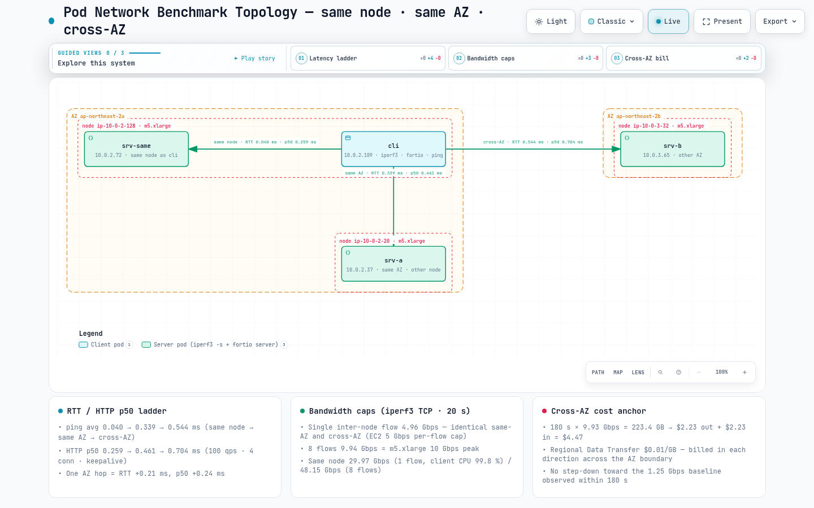
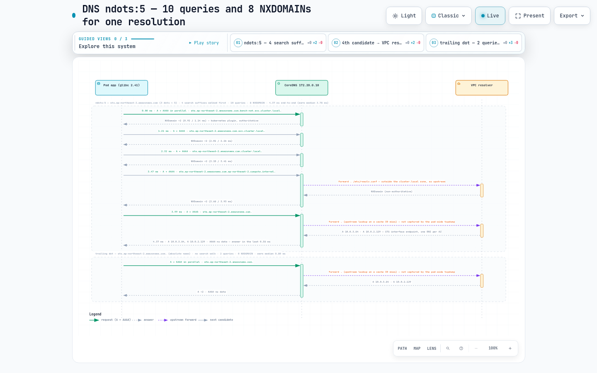

# Evaluación comparativa de redes de Pods: mismo nodo, misma AZ, entre AZ y ndots de DNS

> **Entorno de prueba registrado**: Kubernetes 1.36 (Amazon EKS), Amazon VPC CNI v1.21.1, kube-proxy en modo iptables
> **Fecha de medición**: 2 de septiembre de 2026 · **Revisión del contenido**: 12 de septiembre de 2026

Esta página conserva el informe de evaluación comparativa del 2 de septiembre de 2026 de `fsi-demo-cluster` (Seúl): RTT de Pod a Pod, latencia HTTP/gRPC, rendimiento de iperf3 y recuentos de consultas DNS. En estas ejecuciones, cruzar una AZ aumentó la latencia, mientras que las dos rutas entre nodos alcanzaron un rendimiento similar. Esto no establece una garantía de ancho de banda independiente de la AZ. El tráfico de aplicación de las mediciones 1–2 usó directamente las IP de los Pods; la medición 3 modela su costo, mientras que la medición 4 usó el ClusterIP existente de `kube-dns`. Las 10 consultas DNS informadas dependen de este resolver, la lista de búsqueda y la secuencia de respuestas; no se aplican a todos los Pods de EKS. Se conservan las versiones y mediciones históricas; la auditoría no volvió a ejecutar la evaluación comparativa de EKS ni verificó una factura.



[🔍 Ver diagrama interactivo](https://www.atomai.click/kubernetes-docs/archmaps/en-networking-06-pod-network-benchmark-0.html)

El diagrama registra esta topología de prueba. Sus +0.21 ms son una diferencia entre estas ejecuciones, y sus $4.47 corresponden al modelo histórico de costo por GB decimal explicado más abajo; no son un cargo verificado ni un costo universal por AZ.

## TL;DR: Qué medimos

1. **RTT informado**: mismo nodo **0.040 ms** → misma AZ **0.339 ms** → entre AZ **0.544 ms** (ping, promedio de 200 sondeos). Las diferencias observadas son +0.21 ms entre las dos rutas entre nodos y +0.50 ms respecto al mismo nodo.
2. **HTTP p50 / p99** (fortio, 100 qps, 4 conexiones, keepalive, 60 s): 0.259 / 0.350 ms → 0.461 / 0.667 ms → 0.704 / 0.812 ms; la misma progresión observada desde la aplicación.
3. **Ancho de banda informado**: un flujo TCP alcanzó **4.96 Gbps** en ambas rutas entre nodos; ocho flujos alcanzaron **9.94 Gbps**, cerca del pico de ráfaga de 10 Gbps de m5.xlarge. Esto concuerda con el límite habitual de 5 Gbps para un solo flujo fuera de un grupo de ubicación de clúster; otras características y rutas de las instancias pueden tener límites distintos.
4. **Pod a Pod en el mismo nodo**: **29.97 Gbps** con un flujo (CPU del proceso cliente 99.8 %, compatible con presión de CPU) y **48.15 Gbps** con ocho. En esta configuración de VPC CNI, el tráfico atraviesa los pares veth de los Pods y la pila de red del host sin usar la NIC física.
5. **Modelo de costo**: la ejecución entre AZ de 180 s envió **223.4 GB decimales**. El modelo histórico basado en la carga útil estima **$4.47** a $0.01/GB en cada extremo; no es una factura. No se observó ninguna reducción progresiva hasta la línea base de 1.25 Gbps durante los 180 s.
6. **DNS informado**: este Pod con glibc, al resolver `sts.ap-northeast-2.amazonaws.com` con `ndots:5`, envió **10 consultas** (8 NXDOMAIN); la mediana en caliente fue de **3.78 ms**. Un punto final produjo **2 consultas** / 0.80 ms; `ndots:1` produjo 2 / 0.54 ms. Estos tiempos son muestras, no garantías.
7. **Conexiones nuevas**: desactivar keepalive cambió p50 de 0.259 → 0.664, 0.461 → 1.079 y 0.704 → **1.517 ms**. El establecimiento TCP contribuye a este aumento, pero la prueba no aisló los costos del handshake, del socket y de la aplicación.

## Entorno de prueba

| Elemento | Valor |
|---|---|
| Clúster | Amazon EKS `fsi-demo-cluster`, ap-northeast-2 (Seúl), plano de control `v1.36.2-eks-bca9cf6`, se usaron dos AZ (2a, 2b) |
| Nodos | **3 × m5.xlarge** iniciados desde cero por el NodePool `system` de Karpenter para esta prueba: un nodo cliente en 2a, un nodo servidor en 2a y un nodo servidor en 2b. 4 vCPU, Intel Xeon Platinum 8175M @ 2.50GHz |
| SO de los nodos | Amazon Linux 2023.12.20260817, kernel `6.18.41-94.142.amzn2023.x86_64`, containerd 2.2.5, kubelet v1.36.3-eks-cb19647 |
| CNI | Amazon VPC CNI `v1.21.1-eksbuild.8` (+ network-policy-agent v1.3.4); `ENABLE_PREFIX_DELEGATION=false`, `ENABLE_POD_ENI=false`, `AWS_VPC_K8S_CNI_EXTERNALSNAT=false`, `NETWORK_POLICY_ENFORCING_MODE=standard`, `WARM_ENI_TARGET=1`, `WARM_IP_TARGET=3` |
| kube-proxy | `v1.35.3-eksbuild.5`, `mode: "iptables"` |
| CoreDNS | `v1.14.2-eksbuild.4`, 2 réplicas, una por AZ (`10.0.2.106` / 2a, `10.0.3.14` / 2b); Service `kube-dns` ClusterIP `172.20.0.10`; Corefile `kubernetes cluster.local … { pods insecure }`, `forward . /etc/resolv.conf`, `cache 30`, `loadbalance`; **sin NodeLocal DNSCache**, sin el plugin `autopath` |
| Pod resolv.conf (predeterminado) | `search bench-net.svc.cluster.local svc.cluster.local cluster.local ap-northeast-2.compute.internal` / `nameserver 172.20.0.10` / `options ndots:5` |
| NIC del Pod | eth0 MTU **9001** (tramas jumbo), control de congestión TCP `cubic`, iperf3 `tcp_mss_default: 8949` |
| Especificación de red EC2 | m5.xlarge «Hasta 10 Gigabit»: línea base **1.25 Gbps**, pico **10 Gbps**, 4 vCPU (a modo de comparación: m5.large, línea base 0.75 Gbps, pico 10 Gbps, 2 vCPU). Verificado con `aws ec2 describe-instance-types`; se requiere ENA |
| Precios | usagetype `APN2-DataTransfer-Regional-Bytes`, «Transferencia de datos regional: entrada/salida/entre AZ o al usar IP pública o direcciones IP elásticas», **$0.01/GB** (`aws pricing get-products --region us-east-1`, consulta de 2026-09) |
| Herramientas | `nicolaka/netshoot:v0.14` (iperf **3.19**, fortio **1.69.5**, iputils ping 20250605, tcpdump 4.99.5); cliente DNS `python:3.12-slim` (Debian 13, **glibc 2.41**, Python 3.12.14) |
| Ventana de prueba | 2026-09-02 07:58–08:40 UTC (primer Pod a las 07:58:22Z, Pods DNS a las 08:16:24Z) |

AWS describe el ancho de banda de ráfaga como de mejor esfuerzo incluso mientras haya créditos de E/S de red; el tráfico entrante y saliente tiene depósitos de crédito independientes. Una instancia nueva empieza con el máximo de créditos, pero la disponibilidad del pico y la duración de la ráfaga varían. Esta ejecución de 180 s solo establece que no se observó una reducción a la línea base durante su ventana. La línea base de 1.25 Gbps / el pico de 10 Gbps registrados para m5.xlarge también aparecen en las [especificaciones oficiales de red de M5](https://docs.aws.amazon.com/ec2/latest/instancetypes/gp.html); el comportamiento actual de los créditos se describe en la [guía de ancho de banda de EC2](https://docs.aws.amazon.com/AWSEC2/latest/UserGuide/ec2-instance-network-bandwidth.html).

Ubicación de los Pods de prueba durante la ejecución:

| Pod | IP | Nodo | Zona | Rol / solicitudes |
|---|---|---|---|---|
| `cli` | 10.0.2.109 | ip-10-0-2-128 (nodeclaim `system-76r87`) | ap-northeast-2a | cliente; 2500m / 1Gi |
| `srv-same` | 10.0.2.72 | ip-10-0-2-128, mismo nodo que `cli` (podAffinity obligatoria) | ap-northeast-2a | servidor; 200m / 256Mi |
| `srv-a` | 10.0.2.37 | ip-10-0-2-20 (nodeclaim `system-ksrbg`, podAntiAffinity respecto a `cli`) | ap-northeast-2a | servidor; 2800m / 1Gi |
| `srv-b` | 10.0.3.65 | ip-10-0-3-32 (nodeclaim `system-svdvk`) | ap-northeast-2b | servidor; 2500m / 1Gi |
| `dns-default` | 10.0.2.5 | ip-10-0-2-20 (podAffinity respecto a `srv-a`) | ap-northeast-2a | resolver glibc, `ndots:5` predeterminado |
| `dns-ndots1` | 10.0.2.143 | ip-10-0-2-20 | ap-northeast-2a | resolver glibc, `dnsConfig.options ndots=1` |

Los Pods de servidor ejecutan `sh -c "iperf3 -s -p 5201 & exec fortio server -http-port 8080 -grpc-port 8079 -tcp-port 8078"`, y cada Pod de prueba lleva `karpenter.sh/do-not-disrupt: "true"`. Inicialmente se solicitó `srv-a` como m5.large / 1500m, pero Karpenter informó `no instance type has enough resources` (la carga de DaemonSet consume 821m de los 1930m asignables de una m5.large), por lo que se cambió a m5.xlarge / 2800m.

### Manifiesto de prueba

Lo siguiente es la prueba registrada, con sus selectores, solicitudes, imágenes, comandos y anotaciones históricos intactos. No contiene objetos Service de aplicación. Sus selectores no garantizan por sí mismos que se usen nodos nuevos o aislados. Antes de una nueva ejecución, adapta una copia a un NodePool de prueba aprobado, las AZ disponibles y el presupuesto de recursos; no la despliegues a ciegas en un pool `system` compartido. Registra los digests de las imágenes y las versiones de las herramientas: las etiquetas de imagen mutables y las descargas de herramientas durante la compilación de netshoot no garantizan que se usen los binarios originales. El procedimiento revisado que aparece más abajo es independiente de este artefacto histórico.

```yaml
apiVersion: v1
kind: Namespace
metadata:
  name: bench-net
  labels:
    bench: net
---
# client: fresh m5.xlarge in ap-northeast-2a
apiVersion: v1
kind: Pod
metadata:
  name: cli
  namespace: bench-net
  labels: { app: cli, role: client }
  annotations: { karpenter.sh/do-not-disrupt: "true" }
spec:
  nodeSelector:
    topology.kubernetes.io/zone: ap-northeast-2a
    node.kubernetes.io/instance-type: m5.xlarge
    karpenter.sh/nodepool: system
  terminationGracePeriodSeconds: 5
  containers:
    - name: netshoot
      image: nicolaka/netshoot:v0.14
      command: ["sleep", "infinity"]
      resources:
        requests: { cpu: "2500m", memory: "1Gi" }
---
# same-node: co-located with cli through required podAffinity
apiVersion: v1
kind: Pod
metadata:
  name: srv-same
  namespace: bench-net
  labels: { app: srv-same, role: server, zone: a }
  annotations: { karpenter.sh/do-not-disrupt: "true" }
spec:
  affinity:
    podAffinity:
      requiredDuringSchedulingIgnoredDuringExecution:
        - labelSelector: { matchLabels: { app: cli } }
          topologyKey: kubernetes.io/hostname
  terminationGracePeriodSeconds: 5
  containers:
    - name: netshoot
      image: nicolaka/netshoot:v0.14
      command: ["sh", "-c", "iperf3 -s -p 5201 & exec fortio server -http-port 8080 -grpc-port 8079 -tcp-port 8078"]
      ports: [{ containerPort: 8080 }, { containerPort: 5201 }]
      resources:
        requests: { cpu: "200m", memory: "256Mi" }
---
# same-AZ: same AZ as cli, different node (podAntiAffinity). m5.large did not fit because of DaemonSet overhead, hence m5.xlarge
apiVersion: v1
kind: Pod
metadata:
  name: srv-a
  namespace: bench-net
  labels: { app: srv-a, role: server, zone: a }
  annotations: { karpenter.sh/do-not-disrupt: "true" }
spec:
  nodeSelector:
    topology.kubernetes.io/zone: ap-northeast-2a
    node.kubernetes.io/instance-type: m5.xlarge
    karpenter.sh/nodepool: system
  affinity:
    podAntiAffinity:
      requiredDuringSchedulingIgnoredDuringExecution:
        - labelSelector: { matchLabels: { app: cli } }
          topologyKey: kubernetes.io/hostname
  terminationGracePeriodSeconds: 5
  containers:
    - name: netshoot
      image: nicolaka/netshoot:v0.14
      command: ["sh", "-c", "iperf3 -s -p 5201 & exec fortio server -http-port 8080 -grpc-port 8079 -tcp-port 8078"]
      ports: [{ containerPort: 8080 }, { containerPort: 5201 }]
      resources:
        requests: { cpu: "2800m", memory: "1Gi" }
---
# cross-AZ: fresh m5.xlarge in ap-northeast-2b
apiVersion: v1
kind: Pod
metadata:
  name: srv-b
  namespace: bench-net
  labels: { app: srv-b, role: server, zone: b }
  annotations: { karpenter.sh/do-not-disrupt: "true" }
spec:
  nodeSelector:
    topology.kubernetes.io/zone: ap-northeast-2b
    node.kubernetes.io/instance-type: m5.xlarge
    karpenter.sh/nodepool: system
  terminationGracePeriodSeconds: 5
  containers:
    - name: netshoot
      image: nicolaka/netshoot:v0.14
      command: ["sh", "-c", "iperf3 -s -p 5201 & exec fortio server -http-port 8080 -grpc-port 8079 -tcp-port 8078"]
      ports: [{ containerPort: 8080 }, { containerPort: 5201 }]
      resources:
        requests: { cpu: "2500m", memory: "1Gi" }
```

Se informó que los dos Pods DNS estaban en el mismo nodo que `srv-a`. Se informó que la imagen `app` era Debian 13 / glibc 2.41; no se midieron musl ni otros resolvers. `sniffer` comparte el espacio de nombres de red del Pod, por lo que puede capturar los paquetes DNS correspondientes de la aplicación si el clúster permite la captura de paquetes. Para crear ambos objetos DNS a partir del ejemplo siguiente, duplícalo: cambia el segundo nombre y la etiqueta `app` a `dns-ndots1` y descomenta `dnsConfig` solo en ese segundo objeto. Mantén idénticas ambas imágenes y fija sus digests registrados en una nueva ejecución.

```yaml
apiVersion: v1
kind: Pod
metadata:
  name: dns-default          # the second Pod is name: dns-ndots1 plus the dnsConfig block below
  namespace: bench-net
  labels: { app: dns-default, role: dns }
  annotations: { karpenter.sh/do-not-disrupt: "true" }
spec:
  affinity:
    podAffinity:
      requiredDuringSchedulingIgnoredDuringExecution:
        - labelSelector: { matchLabels: { app: srv-a } }
          topologyKey: kubernetes.io/hostname
  # present only in dns-ndots1:
  # dnsConfig:
  #   options:
  #     - name: ndots
  #       value: "1"
  terminationGracePeriodSeconds: 5
  containers:
    - name: app
      image: python:3.12-slim
      command: ["sleep", "infinity"]
      resources: { requests: { cpu: "50m", memory: "64Mi" } }
    - name: sniffer
      image: nicolaka/netshoot:v0.14
      command: ["sleep", "infinity"]
      resources: { requests: { cpu: "50m", memory: "64Mi" } }
```

## Medición 1. RTT y latencia HTTP: mismo nodo → misma AZ → entre AZ

Los sondeos ICMP (`ping -c 200 -i 0.05 -q`) caracterizan la ruta en reposo, incluido el procesamiento del kernel y la planificación de los endpoints. Después se ejercitaron las mismas rutas con HTTP/1.1 y gRPC. Se indica como referencia una sola solicitud `curl` con conexión nueva, junto con los tiempos de conexión y total.

| Ruta | RTT mín. / **prom.** / máx. / mdev (ms) | Pérdida | curl, 1 solicitud en frío: conexión / total |
|---|---|---|---|
| mismo nodo → 10.0.2.72 | 0.021 / **0.040** / 0.089 / 0.007 | 0/200 | 0.194 ms / 0.497 ms |
| misma AZ → 10.0.2.37 | 0.300 / **0.339** / 0.450 / 0.017 | 0/200 | 0.497 ms / 2.333 ms |
| entre AZ → 10.0.3.65 | 0.504 / **0.544** / 0.625 / 0.015 | 0/200 | 0.694 ms / 4.038 ms |

Diferencias observadas: misma AZ − mismo nodo = +0.30 ms, entre AZ − misma AZ = **+0.21 ms**, entre AZ − mismo nodo = +0.50 ms. Los valores de mdev informados no superan 0.017 ms en esta muestra. `time_total` de curl mide la operación de transferencia, no el inicio del proceso; una sola observación no basta para caracterizar su distribución. Consulta las [definiciones de tiempos de curl](https://curl.se/docs/manpage.html).

### HTTP/1.1: 100 qps, 4 conexiones, keepalive, 60 s (6,000 solicitudes), ms

| Ruta | prom. | **p50** | p90 | p99 | p99.9 | máx. | mín. |
|---|---|---|---|---|---|---|---|
| mismo nodo | 0.260 | **0.259** | 0.299 | 0.350 | 1.267 | 2.080 | 0.111 |
| misma AZ | 0.468 | **0.461** | 0.560 | 0.667 | 0.783 | 2.823 | 0.336 |
| entre AZ | 0.706 | **0.704** | 0.782 | 0.812 | 1.150 | 4.581 | 0.551 |

### Ping gRPC: 100 qps, 4 conexiones, 30 s (3,000 solicitudes), ms

| Ruta | prom. | **p50** | p90 | p99 | p99.9 | máx. | mín. |
|---|---|---|---|---|---|---|---|
| mismo nodo | 0.410 | **0.397** | 0.449 | 0.869 | 1.187 | 1.314 | 0.241 |
| misma AZ | 0.601 | **0.592** | 0.687 | 0.889 | 1.052 | 1.105 | 0.448 |
| entre AZ | 0.878 | **0.865** | 0.967 | 1.209 | 2.582 | 2.826 | 0.692 |

El informe describe un cuerpo de eco HTTP de aproximadamente 75 bytes, una carga útil de solicitud vacía y cero errores en todas las ejecuciones. Comprueba por separado los contadores de resultados de cada protocolo: el estado HTTP 200, los resultados de Ping de gRPC y `SERVING` de la comprobación de estado gRPC son respuestas distintas; `-grpc -ping` selecciona Ping en lugar de la carga de trabajo predeterminada de comprobación de estado.

**Cómo interpretarlo.** HTTP p50 supera el promedio del ping en aproximadamente 0.22 / 0.12 / 0.16 ms, pero restar estadísticas distintas de protocolos distintos no aísla la sobrecarga del espacio de usuario. Los incrementos observados de HTTP p50 son +0.202 ms y +0.243 ms; no son costos constantes por nodo ni por AZ. gRPC p50 supera HTTP p50 en 0.138 / 0.131 / 0.161 ms en estas implementaciones, pero esto no demuestra cuánto corresponde a HTTP/2, la serialización, la planificación o el código del cliente/servidor. HTTP p99 es 0.350 → 0.667 → 0.812 ms; gRPC p99.9 es 1.187 → 1.052 → **2.582 ms**. Estas son distribuciones informadas para una ejecución por celda.

> **Comparación con la evaluación comparativa de la malla.** El [informe de sidecar de Istio frente a ambient](../service-mesh/istio/comparison/03-sidecar-vs-ambient.md) registra una diferencia de p50 de **+1.29 ms** (2.11 − 0.82 ms) para su escenario completo con sidecar, no para un proxy individual aislado. Su hardware Graviton, 200 qps, 16 conexiones y Fortio 1.69.4 difieren de esta prueba con M5 / 100 qps / cuatro conexiones. No se pueden sumar ni ordenar estas cifras como costos universales de «salto de malla» frente a «salto de AZ».

### El costo de una conexión nueva: keepalive=false, 100 qps, 4 conexiones, 30 s (3,000 solicitudes), ms

¿Qué ocurre con la latencia cuando cada solicitud abre una conexión TCP nueva (fortio `-keepalive=false`)?

| Ruta | prom. | **p50** | p90 | p99 | p99.9 | máx. | mín. | frente a p50 con keepalive |
|---|---|---|---|---|---|---|---|---|
| mismo nodo | 0.672 | **0.664** | 0.782 | 0.957 | 1.253 | 1.306 | 0.364 | **+0.405 ms** |
| misma AZ | 1.066 | **1.079** | 1.185 | 1.369 | 1.582 | 1.795 | 0.769 | **+0.618 ms** |
| entre AZ | 1.530 | **1.517** | 1.678 | 1.796 | 1.981 | 2.009 | 1.300 | **+0.813 ms** |

Los aumentos observados son **+0.405 / +0.618 / +0.813 ms**. Una conexión TCP nueva agrega trabajo de establecimiento, pero estas mediciones no demuestran una descomposición fija de «1 RTT + 0.3 ms». La reutilización de conexiones es una optimización útil que se debe medir con la carga de trabajo real; no es un requisito para que la comunicación entre AZ funcione correctamente. La creación y cierre frecuentes de conexiones también puede aumentar el estado TIME_WAIT en el endpoint que inicia el cierre, según cómo se cierren las conexiones; aquí no se midieron los sockets ni TIME_WAIT.

### qps máximos con un pool fijo de conexiones: la latencia es el rendimiento (bucle cerrado, 16 conexiones, 20 s)

Con `-qps 0` (ilimitado, bucle cerrado), la tasa máxima de solicitudes que pueden sostener 16 conexiones convierte la diferencia de latencia en una diferencia de rendimiento.

| Ruta | Solicitudes | **qps alcanzados** | prom. ms | p50 | p90 | p99 | p99.9 | máx. |
|---|---|---|---|---|---|---|---|---|
| mismo nodo | 899,827 | **44,991** | 0.355 | 0.249 | 0.733 | 1.695 | 3.389 | 13.593 |
| misma AZ | 770,156 | **38,507** | 0.415 | 0.396 | 0.537 | 0.728 | 1.147 | 4.502 |
| entre AZ | 512,060 | **25,602** | 0.624 | 0.597 | 0.770 | 0.949 | 1.293 | 4.725 |

Para un bucle cerrado estable con unas 16 solicitudes en curso y poco tiempo de espera del cliente, la ley de Little da rendimiento ≈ concurrencia / latencia media: 16 / 0.000355 = 45,070 (se informaron 44,991), 16 / 0.000415 = 38,554 (38,507) y 16 / 0.000624 = 25,641 (25,602). La tasa entre AZ informada es **33.5 % menor** que la de la misma AZ en esta prueba. Esta relación no identifica la causa exclusiva de la latencia ni predice una penalización universal por AZ. La contención de CPU compartida es una explicación plausible de la peor cola en el mismo nodo, pero aquí no se hizo ningún perfil que demostrara esa causa.

## Medición 2. Rendimiento: el límite de 5 Gbps por flujo y el límite de 10 Gbps de la instancia

iperf3 3.19, TCP, 20 s por ejecución, `-J`, cliente `cli`. Las columnas de CPU corresponden a las cifras del propio proceso de iperf3, donde 100 % = un vCPU.

| Ruta | Flujos (-P) | Envío Gbps | Recepción Gbps | Retransmisiones | Bytes enviados | CPU cliente | CPU servidor | RTT TCP medio del emisor (flujo 1) | snd_cwnd máx. |
|---|---|---|---|---|---|---|---|---|---|
| mismo nodo (cli→srv-same) | 1 | **29.97** | 29.97 | 13 | 74,921,541,632 | **99.8 %** | 80.9 % | 34 µs | 1,861,392 B |
| mismo nodo | 8 | **48.15** | 48.08 | 14,567 | 120,375,083,008 | 179.0 % | 186.9 % | 201 µs / 767 µs (flujos 1, 2) | 5,888,442 B |
| misma AZ (cli→srv-a, 2a→2a) | 1 | **4.96** | 4.96 | 4 | 12,411,731,968 | 19.5 % | 15.4 % | **5,641 µs** | 4,349,214 B |
| misma AZ | 8 | **9.94** | 9.93 | 5,874 | 24,846,139,392 | 36.3 % | 159.3 % | 2,720 µs / 1,626 µs | 1,163,370 B |
| entre AZ (cli→srv-b, 2a→2b) | 1 | **4.96** | 4.96 | 2 | 12,411,994,112 | 20.0 % | 22.5 % | **5,420 µs** | 4,304,469 B |
| entre AZ | 8 | **9.94** | 9.93 | 5,979 | 24,845,090,816 | 36.7 % | 138.2 % | 3,671 µs / 3,237 µs | 1,226,013 B |

Hay cuatro aspectos que conviene tener en cuenta.

1. **El tráfico en el mismo nodo no pasó por la NIC física.** El resultado de un solo flujo fue de 29.97 Gbps con un 99.8 % de CPU del proceso cliente; ocho flujos alcanzaron 48.15 Gbps. El enrutamiento del host, las rutas veth de ambos Pods, el procesamiento del kernel y la planificación de CPU siguen siendo relevantes. Esta es una evaluación comparativa de red con indicios de presión de CPU, no una medición de la velocidad pura de copia en memoria.
2. **Ambas ejecuciones de un solo flujo entre nodos alcanzaron 4.96 Gbps.** Esto concuerda con el límite habitual de 5 Gbps fuera de un grupo de ubicación de clúster. AWS también documenta hasta 10 Gbps para flujos dentro de un grupo de ubicación de clúster y hasta 25 Gbps con rutas ENA Express aptas en la misma AZ. Un uso bajo de CPU del proceso iperf3, por sí solo, no descarta todos los límites de procesamiento del host o de la red.
3. **Ambas ejecuciones de ocho flujos alcanzaron 9.94 Gbps.** Esto respalda que el rendimiento observado de estas rutas fue similar durante esta ventana. Hubo retransmisiones incluso con un solo flujo (4 / 2 en las rutas entre nodos), y aumentaron con ocho (5,874 / 5,979); los recuentos de retransmisiones por sí solos no permiten identificar la limitación de ENA ni dónde ocurrió la pérdida. No se recopilaron los contadores de límites permitidos de ENA.
4. **El RTT TCP bajo carga fue superior al RTT ICMP en reposo.** El emisor informó unos **5.6 / 5.4 ms** con un solo flujo y una ventana de congestión de aproximadamente 4.3 MB, frente a promedios de ping en reposo de 0.34 / 0.54 ms. La formación de colas es una explicación posible, pero difieren el protocolo, el muestreo y la carga. No se midió ni la ubicación de la cola ni un aumento garantizado de 5 ms para cada RPC multiplexada.

El MSS 8949 informado concuerda con una MTU de 9001 bytes y la sobrecarga observada de IPv4/TCP; el MSS efectivo también depende de los encabezados y de la MTU de la ruta. La columna de bytes enviados a continuación es el volumen de transferencia de la aplicación, no un uso facturable verificado de forma independiente.

> En esta ruta EC2 normal, los flujos paralelos aprovecharon más el ancho de banda de ráfaga disponible de la instancia que un solo flujo. Aumentar el paralelismo también cambia la carga de CPU, la congestión y el costo. Comprueba los límites reales de la instancia y la ruta antes de cambiar los fetchers de Kafka o la concurrencia de transferencia; las mediciones no respaldan ni «todas las conexiones están limitadas a 5 Gbps» ni «una AZ siempre duplica el ancho de banda».

### Ejecución sostenida de 3 minutos y créditos de ráfaga

La línea base informada de m5.xlarge es de 1.25 Gbps, con un pico de mejor esfuerzo de hasta 10 Gbps. La prueba histórica de cuatro flujos entre AZ se ejecutó durante 180 s, con intervalos de 10 s (`iperf3 -c 10.0.3.65 -p 5201 -t 180 -P 4 -i 10 -J`). Esa IP corresponde a la prueba registrada; obtén las IP actuales de los Pods antes de cualquier prueba nueva.

| Elemento | Valor |
|---|---|
| Gbps por intervalo de 10 s (18 intervalos) | 9.94, 9.93 ×12, 9.92, 9.93 ×4 (**mín. 9.92, máx. 9.94**) |
| Total enviado | 223,376,179,200 B = **223.4 GB** en 180.0 s (9.93 Gbps) |
| Retransmisiones | 44,842 (≈ 249/s; 2,273–2,669 por intervalo de 10 s) |
| CPU | cliente 30.7 % (sistema 30.1 %), servidor 54.2 % (sistema 52.2 %) |

**No se observó una caída hacia 1.25 Gbps durante los 180 s.** Esto no demuestra que los créditos sean ilimitados ni que el ancho de banda máximo sostenido esté garantizado. AWS documenta ráfagas variables, de mejor esfuerzo, y limitación hacia la línea base cuando se agotan los créditos. Dimensiona las copias de seguridad y los rebalances prolongados según la línea base aplicable y los requisitos medidos de la carga de trabajo, en lugar de extrapolar esta breve ejecución.

## Medición 3. Modelo del costo de transferencia de datos entre AZ

Esta sección conserva los cálculos de costos del informe como una estimación. La evaluación comparativa aportó recuentos de bytes de carga útil y un precio de lista público, no un informe de costos y uso (CUR) ni una factura.

Para transferencias directas entre AZ dentro de la misma Región mediante IP privadas de EC2, la [página de precios de EC2](https://aws.amazon.com/ec2/pricing/on-demand/) documenta $0.01/GB en cada extremo. El producto público de la API de precios informado fue `APN2-DataTransfer-Regional-Bytes`, **$0.0100000000 USD/GB**. `get-products` devuelve precios de catálogo, no una tarifa pagada específica de la cuenta. Una dirección de transferencia de carga útil puede generar cargos de «salida» en el extremo emisor y de «entrada» en el extremo receptor; no hace falta una transferencia de retorno de igual volumen. Otras rutas de servicios de AWS pueden tener reglas de cobro distintas.

| Escenario | Volumen de carga útil en el modelo histórico de GB decimales | Costo estimado (GB del modelo × $0.01 × 2) |
|---|---|---|
| La ejecución de 180 s (carga útil medida; costo estimado) | 223.4 GB | 223.4 × $0.01 ≈ **$2.23 en cada extremo, $4.47 en total** |
| Transferencias iperf3 entre AZ de la medición 2 (12.41 + 24.85 + 223.38 GB) | 260.6 GB | ≈ $2.61 en cada extremo, **≈ $5.21 en total** (se excluye otro tráfico) |
| Promedio de 1 Gbps entre AZ durante 30 días (**supuesto**) | 0.125 GB/s × 86,400 s × 30 días = 324,000 GB ≈ **324 TB** | 324,000 × $0.02 ≈ **$6,480 / mes** |
| StatefulSet RF3 distribuido en 3 AZ con ingesta del líder de 100 MiB/s (**supuesto**, solo tráfico de replicación) | dos seguidores, cada uno en otra AZ → 2 × 100 MiB/s = 209,715,200 B/s × 2,592,000 s ≈ 543,600 GB ≈ **544 TB / mes** | 543,600 × $0.02 ≈ **$10,870 / mes** |

Las cuatro filas de costos usan la **conversión decimal original, 1 GB = 10⁹ bytes de carga útil**, como supuesto de modelado. Esta auditoría no estableció que la cantidad de uso facturada por EC2 equivalga a esa conversión. Los totales brutos exactos son 223,376,179,200 B para la ejecución sostenida y 260,633,264,128 B para las tres ejecuciones iperf3 entre AZ. Concilia las unidades realmente contabilizadas, las tarifas, ambos extremos con cargos, la sobrecarga y las retransmisiones del protocolo, así como los créditos o descuentos aplicables, con los [registros de transferencia de datos del CUR](https://docs.aws.amazon.com/cur/latest/userguide/cur-data-transfers-charges.html). Las dos últimas filas también suponen tráfico continuo durante 30 días; el volumen de replicación excluye el tráfico de productores y consumidores. **$4.47 y $5.21 son estimaciones, no importes cuya facturación se haya demostrado.**

**Qué debe hacer un operador.**

- **Prefiere endpoints locales adecuados cuando sean compatibles.** La documentación actual de Kubernetes utiliza `Service.spec.trafficDistribution: PreferSameZone`; `PreferClose` es su alias obsoleto. Es una preferencia con alternativa, no una restricción estricta de zona. Comprueba el servidor de API, la versión de kube-proxy y la compatibilidad de la funcionalidad; este clúster registrado usaba kube-proxy 1.35 con un plano de control 1.36. No se midieron ni esta preferencia ni una ruta a través de un Service de aplicación, y no afectan al tráfico directo a las IP de los Pods.
- **Equilibra la localidad con la tolerancia a fallos.** Las lecturas o los clientes con conocimiento de la zona pueden reducir las transferencias evitables, pero mover todas las réplicas RF3 a una AZ sacrifica la protección frente a fallos de AZ. Conserva el diseño necesario de réplicas y conmutación por error; consulta [Operaciones de clúster zonal](../ops/15-zonal-operations-guide.md).
- **Mide ambos extremos facturados.** Haz un seguimiento de las AZ de origen/destino y del volumen contabilizado para copias de seguridad, rebalances y repeticiones. Suma los registros de uso pertinentes de «entrada» y «salida», que pueden pertenecer a cuentas distintas; no deduzcas la factura final solo a partir de los bytes de carga útil.

## Medición 4. DNS: la amplificación de consultas de ndots:5



[🔍 Ver diagrama interactivo](https://www.atomai.click/kubernetes-docs/archmaps/en-networking-06-pod-network-benchmark-1.html)

Este diagrama ilustra la secuencia de búsqueda glibc registrada. Sus 4.37 ms terminan con la respuesta A informada, no con la llamada completa a `getaddrinfo`; las flechas hacia los servidores ascendentes son explicativas, ya que la captura del Pod no observó ese tramo. «cache 30» es un límite máximo del TTL, no una garantía de acierto durante 30 segundos.

El Pod registrado tenía cuatro dominios de búsqueda y `ndots:5`; esa configuración no es universal en EKS, entre políticas DNS, sistemas operativos ni configuraciones de nodos. Para esta consulta glibc `AF_UNSPEC`, se solicitaron A y AAAA para cada candidato, y los cuatro candidatos de búsqueda devolvieron NXDOMAIN antes de que tuviera éxito el nombre absoluto de STS. La concurrencia de A/AAAA y el recuento de consultas pueden cambiar según las opciones del resolver, la familia de direcciones, los éxitos tempranos, los reintentos y la alternativa TCP. La captura histórica usó `tcpdump -i eth0 -nn udp port 53`, que solo observa DNS por UDP. El informe describe una primera consulta en el proceso, seguida de 20 repeticiones cronometradas; la primera llamada del proceso no demuestra que las cachés de CoreDNS o de los servidores ascendentes estuvieran vacías. Consulta la [configuración DNS de Pods de Kubernetes](https://kubernetes.io/docs/concepts/services-networking/dns-pod-service/).

### Consultas enviadas para una resolución y latencia en caliente (20 repeticiones), ms

| Pod / ndots | Nombre (puntos) | Consultas enviadas | Respuestas NXDOMAIN | mín. en caliente | **mediana** | p90 | máx. |
|---|---|---|---|---|---|---|---|
| predeterminado / 5 | `kubernetes.default` (1) | 4 | 2 | 0.87 | **1.71** | 1.97 | 2.61 |
| predeterminado / 5 | `kubernetes.default.svc.cluster.local` (4) | **10** | 8 | 1.53 | **3.63** | 4.45 | 6.41 |
| predeterminado / 5 | `kubernetes.default.svc.cluster.local.` (punto final) | 2 | 0 | 0.33 | **0.46** | 1.09 | 1.58 |
| predeterminado / 5 | `sts.ap-northeast-2.amazonaws.com` (3) | **10** | 8 | 3.08 | **3.78** | 4.66 | 4.84 |
| predeterminado / 5 | `sts.ap-northeast-2.amazonaws.com.` (punto final) | 2 | 0 | 0.42 | **0.80** | 1.25 | 2.17 |
| predeterminado / 5 | `www.amazon.com` (2) | **10** | 8 | 2.51 | **3.46** | 3.74 | 5.86 |
| ndots1 / 1 | `kubernetes.default` (1) | **6** | 4 | 1.16 | **2.04** | 2.80 | 4.54 |
| ndots1 / 1 | `kubernetes.default.svc.cluster.local` (4) | 2 | 0 | 0.35 | **0.97** | 1.08 | 1.35 |
| ndots1 / 1 | `kubernetes.default.svc.cluster.local.` | 2 | 0 | 0.34 | **0.40** | 0.97 | 1.17 |
| ndots1 / 1 | `sts.ap-northeast-2.amazonaws.com` (3) | 2 | 0 | 0.45 | **0.54** | 1.22 | 1.42 |
| ndots1 / 1 | `sts.ap-northeast-2.amazonaws.com.` | 2 | 0 | 0.47 | **0.75** | 1.20 | 1.30 |
| ndots1 / 1 | `www.amazon.com` (2) | 2 | 0 | 0.63 | **0.90** | 1.27 | 2.74 |

Los tiempos informados de la primera llamada del proceso fueron: predeterminado / `sts` 6.22 ms, predeterminado / `sts.` 2.87 ms, predeterminado / `www.amazon.com` 9.58 ms, predeterminado / `kubernetes.default.svc.cluster.local` 7.40 ms, ndots1 / `kubernetes.default` 10.52 ms y ndots1 / `sts` 2.84 ms. Incluyen el trabajo de inicialización del resolver y son distintos de las líneas de tiempo en la red que aparecen a continuación.

**Cómo interpretarlo.** En estas muestras, los nombres externos y el FQDN del clúster sin punto final produjeron **10 consultas / 8 NXDOMAIN**. La mediana de STS con punto final bajó de 3.78 a 0.80 ms, y la del FQDN del clúster, de 3.63 a 0.46 ms. `kubernetes.default` tuvo éxito con el segundo candidato de búsqueda, por lo que solo necesitó cuatro consultas: la expansión de búsqueda no siempre consume toda la lista. [La caché de CoreDNS](https://coredns.io/plugins/cache/) puede almacenar respuestas negativas, pero `cache 30` fija un TTL máximo; siguen aplicándose los TTL y mínimos de las respuestas, y cada réplica tiene su propia caché. El TTL predeterminado del plugin de Kubernetes es de 5 s, salvo que se configure otro. Las consultas secuenciales continúan incluso cuando hay aciertos de caché, pero esta captura no demuestra que todas las consultas en caliente evitaran el tráfico hacia servidores ascendentes.

### El recorrido: una resolución en frío de `sts.ap-northeast-2.amazonaws.com` (ndots:5, tcpdump, ms desde el primer paquete)

| t (ms) | Candidato enviado a 172.20.0.10 (A + AAAA en paralelo) | Respuesta |
|---|---|---|
| 0.00 | `sts.ap-northeast-2.amazonaws.com.bench-net.svc.cluster.local.` | NXDomain (autoritativa, plugin kubernetes de CoreDNS) a 0.92 / 1.14 |
| 1.21 | `sts.ap-northeast-2.amazonaws.com.svc.cluster.local.` | NXDomain a 2.01 / 2.26 |
| 2.32 | `sts.ap-northeast-2.amazonaws.com.cluster.local.` | NXDomain a 3.15 / 3.41 |
| 3.47 | `sts.ap-northeast-2.amazonaws.com.ap-northeast-2.compute.internal.` | NXDomain (reenviado al resolver de la VPC, no autoritativo) a 3.68 / 3.93 |
| 3.99 | `sts.ap-northeast-2.amazonaws.com.` | **A 10.0.3.84, A 10.0.2.129** a 4.37 (AAAA: sin datos) |

La tabla registra 10 consultas y 8 NXDOMAIN. Sus **4.37 ms** van desde la primera consulta hasta la respuesta A informada; no se indica cuándo terminó AAAA, por lo que no representan los 6.22 ms completos de la primera llamada del proceso. Los RTT de los candidatos no son uniformemente de 0.8–1.1 ms: el cuarto par tardó 0.21 / 0.46 ms y la A final, 0.38 ms. kube-proxy en modo iptables elige un endpoint para un flujo conntrack nuevo, no independientemente para cada paquete; las solicitudes A/AAAA pueden compartir ese flujo. Si se seleccionaran dos endpoints con la misma probabilidad, la mitad de los flujos sería una expectativa ilustrativa, **no una proporción medida de consultas DNS entre AZ**. La captura del Pod que muestra el VIP del Service `172.20.0.10` no permite identificar la AZ del backend seleccionado. El informe original atribuye las dos direcciones IP privadas de STS a ENI de endpoints de interfaz y registra un candidato reenviado de 2.2 ms / un recorrido en la red de 5.6 ms para el FQDN del clúster, frente a 0.4–0.5 ms con su punto final; son observaciones distintas.

### Qué hace `ndots:1` y cuál es su efecto secundario

- **Nombres externos en estas muestras**: 10 → **2 consultas**, medianas de aproximadamente 3.5–3.8 → **0.5–0.9 ms**. Esta mejora depende de los nombres y del comportamiento del resolver.
- **Los nombres cortos pueden generar un intento fallido adicional.** Aquí `kubernetes.default` tiene un punto, por lo que cumple `ndots:1`; glibc primero probó `kubernetes.default.`. CoreDNS lo reenvió y recibió NXDOMAIN después de los 1.6 ms informados; luego probó el sufijo del namespace y finalmente tuvo éxito con `svc.cluster.local` en `172.20.0.1`: seis consultas, cuatro NXDOMAIN y una mediana de 2.04 ms frente a 1.71 ms. Esto puede revelar nombres que parecen internos a servidores ascendentes. Antes de cambiar `ndots`, prueba cómo se nombran los Services de cada aplicación; los nombres completos de Service reducen esta ambigüedad.
- **Un punto final convierte el nombre del resolver en absoluto**, lo que evita la expansión de búsqueda en este resolver. No garantiza que haya dos consultas en la red ni una latencia fija si hay reintentos, otras configuraciones de familias de direcciones o caché.

### Cálculo de amplificación (derivado)

Con el **mismo patrón de respuestas**, sin caché DNS de aplicación y una consulta por solicitud, 1,000 resoluciones/s × 10 consultas equivale a 10,000 consultas/s, frente a 2,000 para la forma de dos consultas. De las 10,000, 8,000 (80 %) recibirían NXDOMAIN. Es un modelo de recuento de consultas, no una medición de CPU de CoreDNS ni de la proporción entre AZ. Las diferencias observadas entre medianas son 3.78 − 0.80 = 2.98 ms para STS y 3.63 − 0.46 = 3.17 ms para el FQDN del clúster; no son penalizaciones fijas por solicitud.

**Opciones que se deben probar con la aplicación real:**

- Usa nombres DNS absolutos cuando el cliente lo admita. No añadas un punto a ciegas a las URL de endpoints HTTPS o de AWS SDK: el manejo de Host, SNI, la verificación de certificados y la firma de solicitudes deben seguir funcionando.
- Evalúa `dnsConfig: {options: [{name: ndots, value: "1"}]}` junto con el comportamiento de los nombres cortos y el almacenamiento en caché DNS de la aplicación.
- Evalúa [NodeLocal DNSCache](https://kubernetes.io/docs/tasks/administer-cluster/nodelocaldns/) cuando corresponda. Los aciertos de caché permanecen en el nodo; los fallos de caché aún pueden ir a servidores ascendentes. [EKS Auto Mode](https://docs.aws.amazon.com/eks/latest/userguide/auto-networking.html) ya ejecuta CoreDNS local en los nodos como servicio del sistema; un clúster exclusivamente de Auto Mode no necesita un Deployment de CoreDNS, mientras que los nodos que no son de Auto Mode en un clúster mixto sí lo necesitan.
- [autopath de CoreDNS](https://coredns.io/plugins/autopath/) puede completar la búsqueda en el servidor, pero su integración con Kubernetes requiere `pods verified`, visibilidad de la IP del Pod de origen y las correspondientes observaciones de Pods/RBAC/memoria. La configuración registrada `pods insecure` no cumple esos requisitos. Esta optimización no se probó aquí.

## Cómo reproducir: procedimiento revisado

Usa un laboratorio aislado y aprobado, y un namespace sin uso dedicado a esta prueba. Guarda una copia adaptada de la primera prueba como `bench-net.yaml` y ambos objetos DNS como `bench-dns.yaml`; mantén coherentes los nombres de los namespaces. Antes de aplicar los manifiestos, comprueba la capacidad del NodePool, las AZ, la planificación y los permisos de captura de paquetes. No debilites los controles de admisión ni de seguridad de producción para ejecutar la prueba. Estos comandos acotados aun así pueden saturar los nodos y generar cargos.

Ejecuta todos los comandos desde el **shell Bash del operador**, sin entrar en un shell interactivo en `cli`. La auditoría comprobó la sintaxis y el comportamiento local de algunas herramientas; no desplegó esta prueba ni ejecutó estas cargas de red en EKS.

**1. Despliega la prueba adaptada y verifica la ubicación.**

```bash
set -euo pipefail
BENCH_NS=bench-net
kubectl apply -f bench-net.yaml
kubectl -n "$BENCH_NS" wait --for=condition=Ready \
  pod/cli pod/srv-same pod/srv-a pod/srv-b --timeout=300s
kubectl -n "$BENCH_NS" get pods -o wide
kubectl get nodes -L topology.kubernetes.io/zone,node.kubernetes.io/instance-type,karpenter.sh/nodepool

SAME_IP=$(kubectl -n "$BENCH_NS" get pod srv-same -o jsonpath='{.status.podIP}')
AZ_IP=$(kubectl -n "$BENCH_NS" get pod srv-a -o jsonpath='{.status.podIP}')
CROSS_IP=$(kubectl -n "$BENCH_NS" get pod srv-b -o jsonpath='{.status.podIP}')
: "${SAME_IP:?missing srv-same IP}" "${AZ_IP:?missing srv-a IP}" "${CROSS_IP:?missing srv-b IP}"
for bench_pod in srv-same srv-a srv-b; do
  kubectl -n "$BENCH_NS" logs "$bench_pod" --tail=30
  kubectl -n "$BENCH_NS" exec "$bench_pod" -- ss -lnt
done
for bench_ip in "$SAME_IP" "$AZ_IP" "$CROSS_IP"; do
  kubectl -n "$BENCH_NS" exec cli -- \
    curl --fail --silent --show-error --max-time 5 "http://$bench_ip:8080/" >/dev/null
done
```

Antes de continuar, verifica que `cli` y `srv-same` compartan un nodo, que `srv-a` use un nodo distinto de la misma AZ y que `srv-b` use otra AZ. Comprueba los listeners del servidor en 5201/8080/8079 y si hubo errores al iniciar: que el Pod esté Ready no demuestra que estos procesos estén escuchando, porque la prueba histórica no tiene comprobaciones de disponibilidad. Registra los ID de los nodos, las IP, los ID de las imágenes y las versiones reales de `iperf3 --version` / `fortio version`. Detente y actualiza las direcciones si se vuelve a crear un Pod.

**2. RTT y una solicitud HTTP de referencia.**

```bash
for bench_ip in "$SAME_IP" "$AZ_IP" "$CROSS_IP"; do
  kubectl -n "$BENCH_NS" exec cli -- ping -c 200 -i 0.05 -q "$bench_ip"
done
kubectl -n "$BENCH_NS" exec cli -- curl --fail --silent --show-error --max-time 5 \
  -o /dev/null -w 'connect=%{time_connect} total=%{time_total}\n' "http://$CROSS_IP:8080/"
```

**3. Rendimiento, con duración limitada y archivos de salida locales del operador.**

```bash
for bench_ip in "$SAME_IP" "$AZ_IP" "$CROSS_IP"; do
  kubectl -n "$BENCH_NS" exec cli -- iperf3 -c "$bench_ip" -p 5201 -t 20 -P 1 -J > "t1-$bench_ip-P1.json"
  kubectl -n "$BENCH_NS" exec cli -- iperf3 -c "$bench_ip" -p 5201 -t 20 -P 8 -J > "t1-$bench_ip-P8.json"
done
kubectl -n "$BENCH_NS" exec cli -- \
  iperf3 -c "$CROSS_IP" -p 5201 -t 180 -P 4 -i 10 -J > t1-cross-sustained180-P4.json
```

Comprueba los errores JSON además del estado de salida. Consulta `end.sum_sent.bits_per_second`, `end.sum_sent.retransmits`, `end.cpu_utilization_percent.host_total` / `remote_total` y `end.streams[].sender.mean_rtt` / `max_snd_cwnd`. En iperf3 3.19, 100 % de CPU del proceso corresponde al tiempo de una CPU durante el tiempo de pared transcurrido; varios threads pueden superar el 100 %. Los campos de RTT TCP están en microsegundos.

**4. Latencia de solicitudes. Repite para cada dirección de servidor verificada.**

```bash
for bench_ip in "$SAME_IP" "$AZ_IP" "$CROSS_IP"; do
  kubectl -n "$BENCH_NS" exec cli -- fortio load -quiet -r 0.00001 -json - \
    -qps 100 -c 4 -t 60s "http://$bench_ip:8080/" > "http-$bench_ip.json"
  kubectl -n "$BENCH_NS" exec cli -- fortio load -quiet -r 0.00001 -json - \
    -qps 100 -c 4 -t 30s -keepalive=false "http://$bench_ip:8080/" > "new-connection-$bench_ip.json"
  kubectl -n "$BENCH_NS" exec cli -- fortio load -quiet -r 0.00001 -json - \
    -qps 0 -c 16 -t 20s "http://$bench_ip:8080/" > "closed-loop-$bench_ip.json"
  kubectl -n "$BENCH_NS" exec cli -- fortio load -quiet -r 0.00001 -json - \
    -grpc -ping -qps 100 -c 4 -t 30s "$bench_ip:8079" > "grpc-$bench_ip.json"
done
```

En Fortio 1.69.5, `-r` es la resolución del intervalo más bajo del histograma, en segundos: el valor predeterminado `0.001` es 1 ms, y `0.00001` es 10 µs; los intervalos mayores pueden ampliarse. Los percentiles se interpolan dentro de los límites de los intervalos, incluidos los valores mínimo/máximo observados en los extremos. Por tanto, un único intervalo con valores **no implica p50 = 0.5 ms**. El informe descartó sus primeros percentiles obtenidos con resolución gruesa y repitió la prueba con resolución de 10 µs; conserva ese historial, pero no califiques de falsos todos los percentiles interpolados. Varios valores de cola y medianas de conexiones nuevas en las tablas superan 1 ms. Guarda el histograma completo y los contadores de errores junto con los promedios.

**5. DNS: separa la captura de una consulta de las repeticiones cronometradas.**

```bash
kubectl apply -f bench-dns.yaml
kubectl -n "$BENCH_NS" wait --for=condition=Ready pod/dns-default pod/dns-ndots1 --timeout=300s
for bench_pod in dns-default dns-ndots1; do
  kubectl -n "$BENCH_NS" exec "$bench_pod" -c app -- cat /etc/resolv.conf
  kubectl -n "$BENCH_NS" exec "$bench_pod" -c app -- ldd --version
done
```

En el terminal 1, inicia la captura antes de la consulta única. Este filtro incluye DNS normal por UDP y TCP en el puerto 53; no cubre el DNS cifrado ni el tramo ascendente de CoreDNS. Detén la captura con Ctrl-C después de esa consulta y antes de hacer las repeticiones en caliente.

```bash
kubectl -n bench-net exec -it dns-default -c sniffer -- \
  tcpdump -l -i eth0 -nn '(udp or tcp) and port 53'
```

En el terminal 2, crea este script auxiliar local y pásalo con **`kubectl exec -i`**. El primer modo realiza exactamente una llamada al resolver. El modo en caliente hace un calentamiento no medido seguido de 20 llamadas en el mismo proceso; este procedimiento revisado deja explícito el límite de la captura.

```bash
cat > dns-probe.py <<'PY'
import json
import socket
import statistics
import sys
import time

name, mode = sys.argv[1:3]
if mode not in ("first", "warm"):
    raise SystemExit("mode must be first or warm")

def one():
    started = time.perf_counter()
    socket.getaddrinfo(name, 80, socket.AF_UNSPEC, socket.SOCK_STREAM)
    return (time.perf_counter() - started) * 1000

first = one()
if mode == "first":
    print(json.dumps({"name": name, "first_process_ms": first}))
else:
    samples = [one() for _ in range(20)]
    ordered = sorted(samples)
    print(json.dumps({
        "name": name, "warmup_ms": first, "samples_ms": samples,
        "min_ms": ordered[0], "median_ms": statistics.median(ordered),
        "p90_ms": ordered[17], "max_ms": ordered[-1],
    }))
PY
BENCH_NS=bench-net
DNS_POD=dns-default
DNS_NAME=sts.ap-northeast-2.amazonaws.com
kubectl -n "$BENCH_NS" exec -i "$DNS_POD" -c app -- \
  python3 - "$DNS_NAME" first < dns-probe.py
```

Después de detener la captura:

```bash
kubectl -n "$BENCH_NS" exec -i "$DNS_POD" -c app -- \
  python3 - "$DNS_NAME" warm < dns-probe.py
```

Repite con los nombres de la tabla y `DNS_POD=dns-ndots1`, y cambia también el objetivo de la captura. Cuenta los pares de consulta/respuesta de la ventana de una sola consulta; no cuentes 21 resoluciones como si fueran una. Usa los mismos digests, versiones del resolver y configuración, pero espera diferencias en los tiempos y el estado de las cachés. Esta página no incluye los digests originales de las imágenes ni todos los artefactos de paquetes/JSON, por lo que no se garantiza una reproducción exacta.

**6. Limpia solo los recursos de esta prueba.** Si `bench-net` se creó exclusivamente para esta ejecución, elimínalo con `kubectl delete namespace bench-net` después de guardar los resultados. Verifica por separado los nodos restantes y los costos. La consolidación de Karpenter depende de su política, presupuestos y otras cargas de trabajo; eliminar el namespace no garantiza que los nodos se eliminen inmediatamente. `do-not-disrupt` no protege frente a todos los métodos de interrupción forzada.

## Advertencias

- **Los nodos eran nuevos, pero no estaban completamente aislados.** Poco después de que Karpenter iniciara los tres nodos m5.xlarge para esta prueba, la consolidación trasladó algunos Pods pequeños de otros namespaces a ellos (uno al nodo `cli`, tres al nodo `srv-b`; pequeños servicios y controladores internos que no estaban relacionados con el tráfico de la evaluación). Estaban inactivos o tenían poco tráfico durante las ejecuciones, y la carga se limitó a ráfagas de como máximo 180 s. El nodo `cli` mostró 3901m / 3920m (99 %) de CPU *solicitada*, lo cual no indica nada sobre el uso real.
- **Una sola ejecución (n = 1 por celda, un día).** No hubo repeticiones independientes para estimar la varianza. El tamaño de la muestra también limita las clasificaciones, las proporciones y las explicaciones causales; ninguna constituye un SLA.
- **No se midieron el ClusterIP de aplicación ni la distribución del tráfico.** El informe indica que la creación de Service en el namespace de evaluación comparativa falló con `failed calling webhook "mservice.elbv2.k8s.aws": … no endpoints available for service "aws-load-balancer-webhook-service"`. Un webhook con `failurePolicy: Fail` rechaza las solicitudes que coinciden; su alcance depende de sus reglas, selectores de namespace/objeto y condiciones de coincidencia. Este incidente histórico no significa que el clúster actual no pueda crear ningún Service. La evaluación comparativa no evitó el webhook. DNS siguió usando el Service `kube-dns` preexistente. Consulta el [Manual de resolución de problemas](../ops/16-troubleshooting-playbook.md).
- **No se recopilaron los contadores de límites permitidos de ENA.** `ethtool -S` debe dirigirse a la interfaz ENA real del host y requiere el acceso apropiado; la `eth0` de un Pod normalmente es una veth, y `hostNetwork` por sí solo no demuestra que el dispositivo o los permisos sean los correctos. Entre los contadores pertinentes se incluyen `bw_in_allowance_exceeded`, `bw_out_allowance_exceeded`, `pps_allowance_exceeded`, `conntrack_allowance_exceeded` y `linklocal_allowance_exceeded`. Las retransmisiones no sustituyen estas mediciones.
- **Solo se constató que no hubo agotamiento de los créditos de ráfaga durante 180 s.** En las instancias «Hasta», las transferencias sostenidas más largas pueden limitarse hacia la línea base (1.25 Gbps). No se probó nada más allá de 180 s.
- **No se controló el estado de la caché DNS.** Las consultas del primer proceso y las repetidas difieren, pero `cache 30` no garantiza un acierto durante 30 s. La selección de réplicas y el estado de los servidores ascendentes pueden afectar ambos conjuntos de tiempos; la comparación informada es observacional.
- **Es plausible que haya presión de CPU en el mismo nodo.** El 99.8 % de CPU del proceso cliente respalda esa interpretación del resultado de 29.97 Gbps; no demuestra todos los cuellos de botella ni hace que 29.97 / 48.15 Gbps sean cifras trasladables a otras instancias.
- **No se compararon otros modos de CNI ni la aplicación de políticas.** La delegación de prefijos y los Security Groups for Pods estaban desactivados; el namespace no tenía NetworkPolicies. Estos Pods simples tampoco validan la aplicación de NetworkPolicy de VPC CNI para cargas de trabajo gestionadas por controladores compatibles.

## Lecturas relacionadas

- [Amazon VPC CNI](./01-vpc-cni.md): el plano de datos subyacente a estas mediciones (Pods que reciben IP de VPC directamente, delegación de prefijos, calentamiento de ENI/IP)
- [Operaciones de clúster zonal](../ops/15-zonal-operations-guide.md): ubicación alineada con la zona y diseño de conmutación por error entre AZ que reducen la factura de la medición 3
- [Manual de resolución de problemas](../ops/16-troubleshooting-playbook.md): diagnóstico de fallos de webhook; el incidente aquí es histórico
- [Guía de selección entre sidecar y ambient](../service-mesh/istio/comparison/03-sidecar-vs-ambient.md): experimento distinto de hardware/carga de trabajo; sus +1.29 ms son una diferencia del escenario completo
- [Evaluación comparativa medida de EBS gp2 frente a gp3](../storage/01-ebs-gp2-gp3-benchmark.md): la ruta de almacenamiento del mismo clúster, medida
- [Evaluación comparativa medida de Kafka en EKS](../data-on-eks/kafka/09-kafka-benchmark.md): tráfico de replicación, límites de flujo y compromisos de disponibilidad
- [Hoja de ruta de la guía: la serie de evaluaciones comparativas medidas](../roadmap.md)
- [Cuestionario: evaluación comparativa de redes de Pods](../quizzes/networking/06-pod-network-benchmark-quiz.md)


### Referencias principales utilizadas en la revisión

- [Implementación del histograma de Fortio 1.69.5](https://github.com/fortio/fortio/blob/v1.69.5/stats/stats.go) · [Indicadores de CLI](https://github.com/fortio/fortio/blob/v1.69.5/cli/fortio_main.go)
- [Orden de búsqueda de glibc 2.41](https://github.com/bminor/glibc/blob/glibc-2.41/resolv/res_query.c) · [Transporte A/AAAA](https://github.com/bminor/glibc/blob/glibc-2.41/resolv/res_send.c)
- [Requisitos de Kubernetes / autopath de CoreDNS](https://coredns.io/plugins/kubernetes/)
- [Distribución del tráfico de Service en Kubernetes](https://kubernetes.io/docs/concepts/services-networking/service/) · [Manejo de IP virtuales](https://kubernetes.io/docs/reference/networking/virtual-ips/)
- [Métricas de red ENA de EC2](https://docs.aws.amazon.com/AWSEC2/latest/UserGuide/monitoring-network-performance-ena.html)
- [Condiciones de interrupción y limpieza de Karpenter](https://karpenter.sh/docs/concepts/disruption/)
