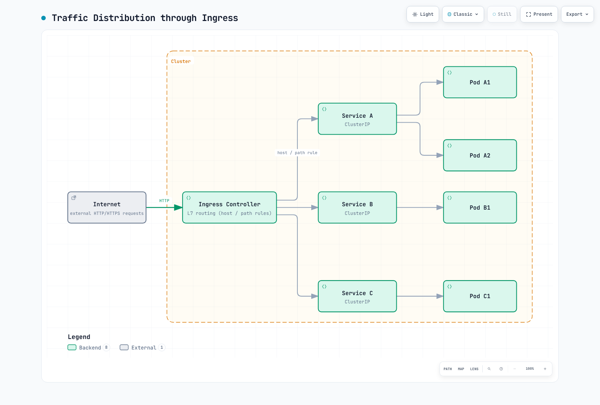

# Redes de Kubernetes

> **Última actualización**: 16 de octubre de 2026
>
> **Versiones fijadas en los ejemplos**: Cilium 1.20.3, Calico Open Source 3.32.2, Flannel 0.28.10 y AWS VPC CNI/chart de Helm upstream 1.23.2.
>
> **Información sobre las versiones actuales**: AWS enumera el complemento VPC CNI administrado por EKS `v1.23.1-eksbuild.1` para Kubernetes 1.31–1.37. Calico 3.33.0 es la versión más reciente de Open Source y se ha probado con Kubernetes 1.35–1.37. Revise sus notas de versión antes de cambiar las versiones fijadas en los ejemplos.
>
> Estas versiones no se han probado juntas como una configuración de clúster. Compruebe la matriz de compatibilidad con Kubernetes y plataformas de cada producto antes de instalarlo.

## Descripción general

Las redes de Kubernetes constituyen la capa de infraestructura que permite la comunicación entre aplicaciones en contenedores. Esta sección abarca desde los conceptos básicos hasta soluciones avanzadas de CNI (Container Network Interface) y patrones de red para entornos AWS EKS.

## Ruta de aprendizaje {#learning-path}

Después del curso para principiantes, siga la [ruta de redes para expertos](expert/README.md) para relacionar proyectos de protocolos, políticas de enrutamiento, EVPN, rendimiento de Linux, diseño en la nube y evaluación de la automatización. Revise primero el entorno, las evidencias y los criterios de recuperación de cada cuaderno de prácticas.

Si empieza con Linux o redes, comience por el [curso para principiantes](beginner/README.md). Sus ocho lecciones relacionan la CLI, el direccionamiento, DNS, SSH, los firewalls y la monitorización, y culminan en un proyecto final. La ruta siguiente amplía esa base con protocolos, el kernel e implementaciones de clúster.

Parta de los conceptos de protocolos y contraste su comportamiento con observaciones; después, relaciónelos con las responsabilidades de contenedores, clústeres y servicios en la nube. Use los requisitos previos para elegir por dónde empezar y los resultados esperados para comprobar su comprensión antes de avanzar.

| Etapa | Función | Requisitos previos | Resultado | Leer / practicar |
|---|---|---|---|---|
| Protocolos, direccionamiento, HTTP | Establecer el vocabulario | Uso básico de línea de comandos | Rastrear una solicitud y distinguir el comportamiento de direccionamiento, transporte y aplicación | Fundamentos de red [Parte 1](../basics/06-network-fundamentals-part1.md), [Parte 2](../basics/06-network-fundamentals-part2.md), [Parte 3](../basics/06-network-fundamentals-part3.md), [Parte 4](../basics/06-network-fundamentals-part4.md) |
| Sockets de Linux, VFS, rutas de paquetes | Conectar las API con el kernel | Fundamentos de TCP/IP | Distinguir FD, búferes de socket, ventanas y colas | [Pila de networking del kernel](../kernel/02-network-stack.md) |
| Diagnóstico de red de Linux | Probar hipótesis con evidencia | Conceptos de socket y ruta de paquetes | Correlacionar observaciones de socket, paquete y aplicación | [Práctica de diagnóstico](07-linux-network-diagnostics.md) · [Cuestionario](../quizzes/networking/07-linux-network-diagnostics-quiz.md) |
| Docker y networking de contenedores | Localizar límites de namespace | Rutas de paquetes de Linux y diagnóstico básico | Explicar el networking de bridge, puertos publicados y resolución de nombres de contenedores | [Tecnología de contenedores](../basics/03-container-technology.md) |
| Kubernetes Service, DNS, Ingress | Mapear abstracciones del clúster | Networking de contenedores | Rastrear un nombre a través de un Service hasta sus endpoints e identificar la función de ingress | [Services y networking](../core/03-services-networking.md) · [Laboratorio](../labs/core/03-services-networking-lab.md) |
| eBPF, CNI, políticas | Comparar responsabilidades de implementación | Rutas de Pod y Service | Distinguir reenvío de paquetes, aplicación de políticas y observabilidad | [Fundamentos de eBPF](../basics/05-ebpf-fundamentals.md) · [Cilium](cilium/README.md) · [Calico](calico/README.md) |
| Límites y rendimiento de red de AWS | Aplicar el modelo a rutas de nube | Conceptos de CNI y habilidades de medición | Identificar límites de VPC, nodo y AZ e interpretar las mediciones en contexto | [VPC CNI](01-vpc-cni.md) · [AWS Load Balancer Controller](03-aws-lb-controller.md) · [Conectividad VPC entre organizaciones](05-cross-org-vpc-connectivity.md) · [Benchmark de red de Pod](06-pod-network-benchmark.md) |

## Modelo de red de Kubernetes

El modelo actual de Kubernetes proporciona una red de Pods que permite la comunicación directa entre nodos sin traducción de direcciones ni proxies, **siempre que la segmentación de red configurada lo permita**. Los agentes del nodo, como kubelet, deben poder alcanzar los Pods de ese mismo nodo. Las políticas de red, el enrutamiento y los puertos en los que escucha la aplicación siguen determinando si una conexión concreta puede establecerse.

Los Pods normales tienen su propio namespace de red y direcciones válidas en todo el clúster; los contenedores de un mismo Pod comparten ese namespace y localhost. Los Pods con red de host comparten la red del nodo, y las configuraciones de doble pila o varias redes requieren un tratamiento más preciso de las direcciones. Al recrear un Pod puede cambiar su IP; reiniciar un contenedor dentro del mismo Pod no implica necesariamente recrear su entorno de red.

| Componente | Función |
|---|---|
| Red de Pod | Direccionamiento y conectividad entre namespaces de red de cargas de trabajo |
| Service/descubrimiento | Nombres de Service estables o direcciones virtuales sobre endpoints cambiantes |
| Implementación de Ingress/Gateway | Punto de entrada externo configurado y enrutamiento de aplicaciones |
| Motor de políticas de red | Aplica las políticas admitidas por la implementación seleccionada |

Estas funciones no representan un recorrido obligatorio de paquetes en serie. La traducción de Service, un proxy L7 y las políticas de la carga de trabajo pueden modificar el recorrido de una solicitud concreta.

### Red de Pods

La red de Pods proporciona el direccionamiento y las rutas necesarios para su comunicación. La ilustración siguiente muestra Pods IPv4 normales; sus conexiones presuponen que las políticas y los controles de red aplicables permiten el tráfico.


[🔍 Ver diagrama interactivo](https://www.atomai.click/kubernetes-docs/archmaps/en-networking-readme-1.html)

Las direcciones ilustran un caso de Pods normales. El aislamiento deliberado y las configuraciones con red de host o varias redes requieren interpretar el esquema según su propio funcionamiento.

#### Métodos de implementación de la red de Pods

| Método | Descripción | CNI de ejemplo |
|--------|-------------|-------------|
| **Red superpuesta** | Encapsula el tráfico sobre la red existente | Flannel VXLAN, Calico VXLAN/IPIP, Cilium VXLAN/Geneve |
| **Enrutamiento nativo** | Usa rutas en la red subyacente sin esa encapsulación superpuesta | AWS VPC CNI, enrutamiento/BGP de Calico, enrutamiento nativo de Cilium |
| **Encapsulación condicional** | Usa rutas directas o encapsulación según la topología configurada | Modos compatibles de Calico/Flannel/Cilium, con requisitos previos diferentes |

### Red de Services

Los Services describen un conjunto lógico de endpoints, normalmente Pods, y cómo alcanzarlos. ClusterIP proporciona una IP virtual estable de forma predeterminada; los Services headless prescinden de esa IP virtual y ExternalName utiliza un registro DNS CNAME. Un Service también puede tener endpoints administrados sin un selector de Pods.


[🔍 Ver diagrama interactivo](https://www.atomai.click/kubernetes-docs/archmaps/en-networking-readme-2.html)

Estos son mecanismos de exposición típicos, no garantías de seguridad. El rango de NodePort y las direcciones de nodo accesibles son configurables; los LoadBalancers pueden ser internos. ExternalName devuelve un alias DNS y no crea un proxy de reenvío.

#### Características de tipos de Service

Cree los Pods que coincidan con `app: my-app` en `default` y escuchen en los puertos de destino indicados. El rango de asignación predeterminado de NodePort es 30000–32767 y puede configurarse. El acceso externo depende además de las direcciones, las rutas y los controles de acceso.

El ejemplo de LoadBalancer selecciona explícitamente **AWS Load Balancer Controller**, con instancias EC2 como destinos y NodePorts asignados. Instale y configure primero el controlador, junto con sus requisitos de IAM y subredes. EKS Auto Mode utiliza otro controlador y otra clase. El puerto 443 solo especifica aquí un puerto TCP: el backend debe ofrecer TLS en 8443 o este debe configurarse por separado en el balanceador.

Estas asignaciones de puertos ilustran la API general de Kubernetes Service. AWS documenta actualmente requisitos adicionales de política de red nativa de EKS: el puerto del Service debe coincidir con el puerto del contenedor, y los Pods gestionados por controlador con `metadata.ownerReferences` ofrecen una aplicación fiable. Adapte los ejemplos a esos requisitos antes de probar esa implementación de política.

```yaml
apiVersion: v1
kind: Service
metadata:
  name: my-service
  namespace: default
spec:
  type: ClusterIP
  selector:
    app: my-app
  ports:
  - protocol: TCP
    port: 80
    targetPort: 8080
---
apiVersion: v1
kind: Service
metadata:
  name: my-nodeport-service
  namespace: default
spec:
  type: NodePort
  selector:
    app: my-app
  ports:
  - protocol: TCP
    port: 80
    targetPort: 8080
    nodePort: 30080
---
apiVersion: v1
kind: Service
metadata:
  name: my-loadbalancer-service
  annotations:
    service.beta.kubernetes.io/aws-load-balancer-scheme: internet-facing
    service.beta.kubernetes.io/aws-load-balancer-nlb-target-type: instance
  namespace: default
spec:
  type: LoadBalancer
  selector:
    app: my-app
  ports:
  - protocol: TCP
    port: 443
    targetPort: 8443
  loadBalancerClass: service.k8s.aws/nlb
  allocateLoadBalancerNodePorts: true
```

### Red de Ingress

Un recurso Ingress necesita un controlador y su plano de datos. Este ejemplo HTTP usa AWS LBC con `spec.ingressClassName: alb` y destinos IP. Los Services referenciados `api-v1`, `api-v2` y `web-frontend` deben existir en `default`, exponer el puerto 80 y tener endpoints de Pod listos y enrutables por VPC. Configure HTTPS/certificados por separado cuando sea necesario. Consulte la [guía de LBC](03-aws-lb-controller.md) para conocer sus requisitos previos de instalación y destino.

Ingress define reglas para enrutar tráfico HTTP/HTTPS a Services internos del clúster.



[🔍 Ver diagrama interactivo](https://www.atomai.click/kubernetes-docs/archmaps/en-networking-readme-3.html)

El recuadro representa la función del plano de datos de Ingress. AWS LBC configura el ALB; el tráfico de la aplicación no pasa por el proceso de reconciliación del controlador. Según el modo de destino, el plano de datos puede llegar a las IP de Pods o a NodePorts sin atravesar la IP virtual de un Service como un salto adicional.

```yaml
apiVersion: networking.k8s.io/v1
kind: Ingress
metadata:
  name: my-ingress
  annotations:
    alb.ingress.kubernetes.io/scheme: internet-facing
    alb.ingress.kubernetes.io/target-type: ip
  namespace: default
spec:
  rules:
  - host: api.example.com
    http:
      paths:
      - path: /v1
        pathType: Prefix
        backend:
          service:
            name: api-v1
            port:
              number: 80
      - path: /v2
        pathType: Prefix
        backend:
          service:
            name: api-v2
            port:
              number: 80
  - host: web.example.com
    http:
      paths:
      - path: /
        pathType: Prefix
        backend:
          service:
            name: web-frontend
            port:
              number: 80
  ingressClassName: alb
```

## CNI (Container Network Interface)

CNI estandariza la interfaz mediante la que un runtime configura la red de un contenedor. En Kubernetes actual, kubelet solicita operaciones sobre el entorno de red del Pod mediante CRI y el **runtime de contenedores administra CNI**. Las antiguas opciones de kubelet para administrar CNI directamente se eliminaron en Kubernetes 1.24.

### Responsabilidades de runtime y plugin

| Actor | Responsabilidad |
|---|---|
| kubelet | Solicita la creación/eliminación del sandbox mediante la interfaz de runtime de contenedor |
| Runtime de contenedor | Selecciona la configuración de red e invoca la cadena de plugins CNI |
| Plugin CNI | Recibe la configuración, realiza ADD/DEL y otras operaciones compatibles, y devuelve resultados |
| Implementación IPAM | Asigna/libera direcciones; puede ser un plugin delegado o parte de un agente específico del proveedor |
| Agente de nodo opcional | Mantiene rutas, políticas, grupos de IP o estado de datapath específicos del proveedor |

El runtime transmite la configuración al plugin mediante la interfaz CNI. No todos los plugins necesitan un agente independiente que permanezca en ejecución ni un binario IPAM separado. También varían los tipos de interfaz: los pares veth son frecuentes, pero existen otras implementaciones.

## Comparación de CNI

| Proyecto / ámbito | Red y políticas | Características y límites que deben distinguirse |
|---|---|---|
| **Cilium 1.20.3** | Redes basadas en eBPF; Envoy para las funciones L7 pertinentes; políticas de red de Cilium y Hubble | Plano de datos en workers Linux, con requisitos AMD64/Arm64. Disponer de una CLI para Windows no implica soporte de CNI en Windows. WireGuard/IPsec y ztunnel mTLS en fase Beta tienen ámbitos distintos. |
| **Calico Open Source 3.32.2 en los ejemplos; 3.33.0 actual** | Opciones de enrutamiento y encapsulación; planos de datos iptables, nftables y eBPF; tiers de políticas ordenados y políticas de host y cargas de trabajo | Calico 3.33.0 se ha probado con Kubernetes 1.35–1.37. Revise las notas de versión antes de actualizar. Windows tiene límites específicos: no dispone del plano de datos Linux eBPF ni de WireGuard. La observabilidad de flujos con Whisker/Goldmane está disponible como Tech Preview. Consulte la matriz de ediciones para las funciones de pago. |
| **Flannel 0.28.10** | Asignación de subredes de host y transporte entre nodos; VXLAN, host-gw y otros backends | `flanneld` no aplica NetworkPolicy por sí mismo; la opción `netpol.enabled` del chart despliega un controlador de políticas de SIGs. WireGuard es un backend documentado; IPsec es experimental. VXLAN en Windows tiene ajustes y límites específicos. |
| **AWS VPC CNI 1.23.2 upstream/Helm en los ejemplos; complemento EKS `v1.23.1-eksbuild.1`** | Asignación de direcciones VPC y ENI/prefijos EC2; políticas de red estándar y Admin de EKS en nodos EC2 Linux compatibles | AWS enumera esta versión del complemento administrado para Kubernetes 1.31–1.37; compruebe su disponibilidad regional y la versión real del clúster. EKS Auto Mode proporciona una implementación de red administrada con funciones adicionales de políticas DNS. Windows, Fargate, las redes personalizadas, la delegación de prefijos y el soporte multi-NIC tienen requisitos propios. |
| **Proyecto original Weave Net** | Implementación histórica de redes superpuestas | El repositorio original `weaveworks/weave` está archivado. No lo presente como una opción predeterminada activa y con soporte para un clúster nuevo. |

### Política, cifrado y observabilidad

- Cilium proporciona políticas basadas en HTTP/DNS mediante los componentes L7 pertinentes, además de políticas de host y de ámbito de clúster. Sus reglas de permiso y denegación siguen una semántica distinta de la API de tiers ordenados de Calico.
- Calico Open Source incluye tiers jerárquicos de políticas y políticas de host. La matriz de productos actual reserva las políticas de capa de aplicación, DNS/FQDN y Cluster Mesh para Cloud/Enterprise; distinga esas funciones de las disponibles en Open Source. El cifrado en tránsito documentado de Calico utiliza WireGuard.
- Amazon EKS ofrece controles Admin/Baseline mediante `ClusterNetworkPolicy` para Auto Mode y para instalaciones EC2/VPC-CNI compatibles. La función DNS/FQDN `ApplicationNetworkPolicy` que describe AWS corresponde a **Auto Mode**. El nombre del recurso no implica que actualmente inspeccione métodos o cuerpos HTTP.
- El controlador de políticas opcional de Flannel tiene requisitos propios; elegir un backend de red no activa por sí solo la aplicación de políticas.
- El cifrado entre nodos, la identidad autenticada de las cargas de trabajo y mTLS de las aplicaciones son controles diferentes. La visibilidad de los flujos de red también difiere del tracing de aplicaciones y del control de procesos o archivos.

### Enrutamiento y rendimiento

Calico y Cilium pueden anunciar rutas mediante BGP; eso no proporciona por sí mismo descubrimiento de Service multiclúster, sincronización de políticas ni cifrado. Flannel host-gw usa rutas directas y requiere conectividad adecuada de capa 2. Una superposición añade consideraciones de encapsulación y MTU, pero no puede inferirse una clasificación de rendimiento universal del nombre de CNI.

La antigua cifra de rendimiento de 100/98/95/85/80/75 por ciento no tenía una carga de trabajo reproducible, versiones ni fuente de medición. Use hardware, kernel, tamaños de paquete/solicitud, concurrencia, configuración de cifrado/política, rendimiento, pérdida y latencia de cola comparables. El [benchmark de Pod](06-pod-network-benchmark.md) independiente conserva su propio entorno y mediciones históricos.

## Guía de selección de CNI

Elija primero el modelo requerido de enrutamiento, política, sistema operativo y soporte; luego pruebe esa combinación.

| Necesidad | Ruta de evaluación |
|---|---|
| Direccionamiento VPC estándar de EKS y políticas de red compatibles | Evalúe las capacidades de AWS VPC CNI/EKS antes de agregar un segundo motor de políticas. |
| Niveles de política ordenados, política de host o BGP de infraestructura | Evalúe la edición/dataplane de Calico pertinente y los requisitos previos de enrutamiento. |
| Política de Cilium, Hubble o características de mesh seleccionadas | Compruebe la compatibilidad de Linux/kernel/plataforma y la [guía de mesh de Cilium](../service-mesh/cilium-service-mesh/README.md). Envoy sigue formando parte de las rutas L7 aplicables. |
| Una red pequeña con un conjunto limitado de características | Evalúe el backend y el controlador de políticas opcional de Flannel según los requisitos reales. |
| Control de procesos, llamadas al sistema o archivos | Evalúe un componente de seguridad en ejecución, como Tetragon, por separado de las políticas de red. |

### Configuración de complementos administrados de EKS

El siguiente ejemplo muestra **datos de configuración**; no indica que deba instalar Calico y el motor de políticas de VPC CNI sobre las mismas cargas de trabajo:

```json
{
  "enableNetworkPolicy": "true"
}
```

La cadena `"true"` es el tipo documentado para esta configuración. Seleccione una compilación de complemento EKS compatible para la versión de Kubernetes existente e inspeccione el esquema de configuración de esa compilación:

```bash
EKS_REGION=ap-northeast-2
KUBERNETES_MINOR=1.35  # Replace with the existing cluster's minor version
aws eks describe-addon-versions --region "$EKS_REGION" --addon-name vpc-cni \
  --kubernetes-version "$KUBERNETES_MINOR"
: "${VPC_CNI_ADDON_VERSION:?Set the compatible eksbuild version selected from metadata}"
aws eks describe-addon-configuration --region "$EKS_REGION" --addon-name vpc-cni \
  --addon-version "$VPC_CNI_ADDON_VERSION"
```

La versión upstream 1.23.2 y una versión EKS `eksbuild` son identificadores diferentes. La tabla actual de complementos de AWS enumera `v1.23.1-eksbuild.1` para Kubernetes 1.31–1.37; use `describe-addon-versions` en la región de destino para seleccionar una versión compatible. Integre los cambios con la configuración prevista del complemento administrado, preservando los valores ajenos al cambio y evitando seleccionar `latest` sin comprobarlo. Migrar desde una implementación de políticas de terceros también requiere eliminar su estado de aplicación existente y probar un plan de transición de nodos y cargas de trabajo.

## Fundamentos de red de EKS

### Arquitectura de red predeterminada de EKS

| Ubicación / componente | Responsabilidad |
|---|---|
| VPC administrada por EKS | AWS ejecuta el plano de control de Kubernetes administrado en varias Availability Zones. |
| VPC de clúster del cliente | El networking de workers, las subredes seleccionadas y los ENI entre cuentas administrados por EKS proporcionan las rutas configuradas hacia el plano de control. |
| ALB/NLB en subredes VPC seleccionadas del cliente | Proporciona el punto de entrada de aplicación público o interno elegido; un internet gateway/NAT gateway no sustituye esa configuración de enrutamiento. |
| NAT gateway o endpoints de servicio privados | Proporciona las rutas salientes concretas que requiere el diseño de la carga de trabajo. |

El esquema anterior situaba el plano de control dentro de la VPC del cliente y los balanceadores fuera. Esta tabla lo sustituye y distingue correctamente quién administra cada componente.

### DNS y networking por modo de cómputo

| Modo de cómputo | Ubicación de DNS / componente |
|---|---|
| Nodos EC2 estándar | Normalmente usan el Deployment de CoreDNS configurado y los componentes de networking instalados; los reemplazos necesitan su propia configuración compatible. |
| EKS Auto Mode puro | Las funciones de CoreDNS, VPC CNI y kube-proxy se ejecutan como servicios systemd de nodo administrados. Un Deployment/complemento de CoreDNS es innecesario para estos nodos. |
| Auto Mode mezclado con nodos que no son Auto | Mantenga el Deployment de CoreDNS para los nodos que no son Auto; no pueden usar el servicio DNS Auto Mode de otro nodo. |

La primera resolución DNS de Auto Mode se realiza en el propio nodo. El reenvío a servidores DNS upstream y la comunicación con el plano de control pueden seguir requiriendo acceso a la red; no todos los paquetes relacionados con DNS permanecen necesariamente en el nodo. AWS documenta políticas Admin y DNS para Auto Mode, mientras que las políticas Admin de VPC CNI en EC2 estándar tienen sus propios requisitos de versión y activación.

### Cómo funciona VPC CNI

AWS VPC CNI proporciona a los Pods ordinarios direcciones enrutables por VPC mediante el modo IPAM seleccionado. Las direcciones IPv4 secundarias, los prefijos delegados, los ENI de rama y las configuraciones multi-NIC difieren; los Pods de red de host comparten la red del nodo.


[🔍 Ver diagrama interactivo](https://www.atomai.click/kubernetes-docs/archmaps/en-networking-readme-9.html)

El esquema representa únicamente el modo de IP secundarias. Mantener una ENI preasignada es una estrategia configurable; no exige que cada nodo reserve siempre exactamente una. La delegación de prefijos, las redes personalizadas y las ENI de rama siguen reglas de asignación diferentes.

#### Límites de ENI e IP

| Tipo de instancia | Máx. ENI | Direcciones IPv4 por ENI | Valor histórico de arranque en modo de IP secundarias |
|---------------|----------|--------------|------------------------|
| t3.medium | 3 | 6 | 17 |
| t3.large | 3 | 12 | 35 |
| m5.large | 3 | 10 | 29 |
| m5.xlarge | 4 | 15 | 58 |
| m5.2xlarge | 4 | 15 | 58 |
| c5.4xlarge | 8 | 30 | 234 |

Estos valores se han contrastado con los límites de instancias de VPC CNI 1.23.2 y la tabla histórica de máximo de Pods. El cálculo histórico es `ENIs × (IPv4 slots per ENI − 1) + 2`; no constituye una recomendación universal actual. La delegación de prefijos, las redes personalizadas, las ENI de rama y el uso de varias tarjetas de red modifican la capacidad de direcciones. La planificación de Kubernetes también está limitada por `maxPods` de kubelet y los recursos disponibles. Los grupos de nodos administrados de EKS limitan `maxPods` a 110 en instancias con menos de 30 vCPU y a 250 en las demás; disponer de más IP no elimina ese límite.

### Consideraciones sobre las redes de EKS

#### Administración de direcciones IP

Para **Linux VPC CNI**, configure las variables de entorno documentadas mediante el mecanismo de administración de complemento/Helm/DaemonSet seleccionado. Lo siguiente es un fragmento de configuración de complemento EKS. El antiguo ConfigMap `amazon-vpc-cni` con `enable-prefix-delegation` no configura Linux IPAMD de esta manera. Conserve los demás valores previstos del complemento cuando aplique un cambio.

```json
{
  "env": {
    "ENABLE_PREFIX_DELEGATION": "true",
    "WARM_PREFIX_TARGET": "1"
  }
}
```

Como alternativa, ajuste el mínimo total de asignación y el objetivo de IP libres. Cuando se configura `MINIMUM_IP_TARGET` o `WARM_IP_TARGET`, tiene prioridad sobre `WARM_PREFIX_TARGET`; son políticas alternativas en vez de cuatro objetivos aditivos independientes. La asignación todavía se produce en unidades del tamaño de prefijo. El soporte Nitro, espacio `/28` contiguo para IPv4 y un límite de Pod kubelet adecuado son requisitos previos separados.

Windows utiliza otro procedimiento para asignar prefijos: AWS documenta `enable-windows-prefix-delegation` y las claves que determinan la reserva disponible en el ConfigMap `amazon-vpc-cni`. Use ese procedimiento específico en vez de trasladar sin cambios las variables de entorno de Linux.

```json
{
  "env": {
    "ENABLE_PREFIX_DELEGATION": "true",
    "MINIMUM_IP_TARGET": "5",
    "WARM_IP_TARGET": "2"
  }
}
```

#### Redes personalizadas

Estos ejemplos IPv4 requieren ID reales de subred/grupo de seguridad en la AZ y VPC previstas. Habilite el networking personalizado y seleccione el ENIConfig de cada nodo mediante su etiqueta de zona. Una anotación de nodo ENIConfig explícita tiene prioridad sobre esa etiqueta. Los nombres de ejemplo siguientes usan la misma región en ambos idiomas; reemplácelos con las zonas de nodo reales. Instalar objetos ENIConfig por sí solo no activa el networking personalizado.

```json
{
  "env": {
    "AWS_VPC_K8S_CNI_CUSTOM_NETWORK_CFG": "true",
    "ENI_CONFIG_LABEL_DEF": "topology.kubernetes.io/zone"
  }
}
```

```yaml
apiVersion: crd.k8s.amazonaws.com/v1alpha1
kind: ENIConfig
metadata:
  name: ap-northeast-2a
spec:
  securityGroups:
  - sg-0123456789abcdef0
  subnet: subnet-0123456789abcdef0
---
apiVersion: crd.k8s.amazonaws.com/v1alpha1
kind: ENIConfig
metadata:
  name: ap-northeast-2b
spec:
  securityGroups:
  - sg-0123456789abcdef0
  subnet: subnet-fedcba9876543210f
```

## Conceptos avanzados de networking

Los conceptos siguientes aparecen brevemente en otras partes de esta introducción. Los procedimientos completos y las mediciones se encuentran en las páginas enlazadas; aquí se explica a qué capa corresponde cada componente y qué función cumple.

### L2–L7 y la diferencia entre routers y balanceadores de carga

Los términos «router» y «balanceador de carga» suelen aparecer juntos, pero resuelven problemas distintos. Un router elige, por lo general, una ruta hacia un destino concreto; un balanceador selecciona uno de varios destinos equivalentes según un algoritmo de distribución.

| Capa | Dispositivo/función | Base de decisión | Correspondencia Kubernetes/AWS |
|---|---|---|---|
| L2 (enlace) | Switch, bridge | Dirección MAC de destino | Pares veth y bridges de Linux creados por el CNI, la NIC virtual que expone un ENI |
| L3 (red) | Router o inserción transparente de appliance | IP de destino para enrutamiento; identidad de flujo para selección de appliance | El router implícito de la VPC, TGW; GWLB encapsula paquetes IP para appliances |
| L4 (transporte) | Balanceador de carga L4 | Identidad de conexión/flujo, comúnmente la 5-tupla | NLB; kube-proxy (iptables, IPVS, nftables); implementaciones de Service eBPF independientes |
| L7 (aplicación) | Balanceador de carga/proxy inverso L7 | Host, ruta, encabezados por solicitud; consciente del protocolo | ALB, implementaciones de Ingress/Gateway API, sidecars de service mesh (Envoy) |

La diferencia clave es la **unidad de distribución**. Un balanceador de carga L4 normalmente selecciona un destino para una conexión TCP o un flujo UDP rastreado. Un proxy L7 puede seleccionar un destino para cada solicitud de aplicación compatible, incluidas las solicitudes que comparten una conexión. GWLB distribuye flujos IP encapsulados entre appliances de seguridad en lugar de analizar solicitudes de aplicación. La afinidad de flujo depende del timeout, la salud y el comportamiento de failover configurados; no es garantía de que un flujo nunca pueda reasignarse o interrumpirse.

> 📎 Las definiciones a nivel de protocolo de los conceptos L2/L3 están en [Fundamentos de red Parte 1](../basics/06-network-fundamentals-part1.md); los tipos de destino ALB/NLB y la configuración real están en [AWS Load Balancer Controller](03-aws-lb-controller.md).

### Conectividad entre cuentas/VPC: TGW, VPC Peering, GWLB, PrivateLink, Lattice

Estas cinco opciones de conectividad difieren en la capa y el modelo de tráfico. La guía de [Conectividad VPC entre organizaciones](05-cross-org-vpc-connectivity.md) recoge mediciones de latencia para TGW compartido mediante RAM, VPC Peering, PrivateLink, TGW Peering y VPC Lattice. Esta sección incorpora GWLB, ausente de aquella tabla comparativa, y organiza las cinco opciones según su capa.

| Conectividad | Capa/modelo | Características |
|---|---|---|
| VPC Peering | L3, enrutamiento IP bidireccional | No transitivo; no puede configurarse entre CIDR superpuestos |
| Transit Gateway (TGW) | L3, enrutamiento IP hub-and-spoke | Usa asociaciones y propagación de adjuntos entre una o más tablas de rutas TGW; compartido entre cuentas mediante RAM |
| Gateway Load Balancer (GWLB) | L3, inserción transparente de appliance | Encapsula el paquete original en GENEVE (UDP 6081); un modelo de servicio de endpoint VPC conecta el tráfico del consumidor con la flota de appliances del proveedor |
| PrivateLink | Conectividad de endpoint privado | Un servicio de endpoint respaldado por NLB es un modelo; también existen endpoints de recursos. Los CIDR de consumidor/proveedor pueden superponerse |
| VPC Lattice | Networking de aplicaciones y recursos | Los servicios HTTP/HTTPS admiten enrutamiento L7 y autorización IAM opcional; el paso de TLS y las configuraciones de recursos tienen capacidades diferentes |

GWLB inserta appliances de inspección, como firewalls e IDS/IPS, en una ruta IP a través de un endpoint de Gateway Load Balancer. Su afinidad de flujo predeterminada usa cinco campos; las configuraciones compatibles pueden usar en su lugar dos o tres. Valide las rutas de ida y vuelta, la salud de los appliances, la MTU de encapsulación, las NACL y los grupos de seguridad de las cargas de trabajo/appliances reales. GWLB en sí no tiene un grupo de seguridad como el de ALB, y la afinidad de flujo no sustituye las pruebas de fallos.

Para diseñar la seguridad, consulte [protección con WAF y del origen](../security/14-waf-edge-api-security.md), [NGFW de Palo Alto/Fortinet](../security/15-ngfw-paloalto-fortinet.md) y [rutas y fallos de GWLB/GENEVE](../security/16-gwlb-geneve-inspection.md). GWLBE tampoco admite grupos de seguridad. Cuando todos los destinos están en mal estado, AWS describe una selección de destino por flujo y el descarte de tráfico hasta la recuperación, sin un camino que evite directamente los appliances. Revise conjuntamente la afinidad basada en menos campos, el tráfico entre zonas, NAT y el modo appliance de TGW.

> 📎 La integración completa de EKS/VPC Lattice (Gateway API Controller, autorización IAM, enrutamiento) está en [VPC Lattice](02-vpc-lattice.md).

### Cómo se comportan realmente el resolvedor DNS y las tablas de rutas

**Resolvedor DNS:** AmazonProvidedDNS **es Route 53 Resolver**. Sus direcciones incluyen la dirección de red IPv4 principal de la VPC más dos (`10.0.0.2` para `10.0.0.0/16`) y `169.254.169.253`; resuelve zonas privadas asociadas y nombres públicos de acuerdo con las reglas de Resolver. CoreDNS normalmente sirve el dominio de clúster Kubernetes configurado, a menudo `cluster.local`; `kube-dns` es su nombre de Service, no un namespace ni una zona DNS. El reenvío externo sigue el Corefile y el archivo de resolvedor visible para el Pod DNS. Inspeccione esas configuraciones en vez de suponer que el archivo de resolvedor del nodo se usa sin cambios. En un diseño de endpoint Resolver, los endpoints de entrada aceptan consultas on-premises, mientras que los endpoints de salida y reglas asociadas reenvían consultas VPC seleccionadas al DNS on-premises. El resolvedor local al nodo de Auto Mode no elimina dependencias upstream.

**Tablas de rutas:** La evaluación de rutas de VPC generalmente usa coincidencia de prefijo más largo. AWS permite reemplazar el destino de una ruta `local` y agregar rutas de subred más específicas compatibles para enrutamiento de appliance; `local` no es incondicionalmente la ruta más específica. Para destinos idénticos, las rutas VPC estáticas tienen prioridad sobre las rutas propagadas desde un virtual private gateway. Una ruta VPC dirigida a un TGW es estática; la propagación dentro de un TGW pertenece a sus tablas de rutas independientes. Los destinos no válidos pueden dejar entradas `blackhole` que descartan tráfico, por lo que debe inspeccionar el estado de ruta además del destino. Una subred sin asociación explícita de tabla de rutas usa la tabla de rutas principal de la VPC.

> 📎 La prioridad de rutas TGW/Peering y ejemplos de configuración de rutas estáticas están en los [hallazgos operativos de Conectividad VPC entre organizaciones](05-cross-org-vpc-connectivity.md#operational-findings).

### El plano de datos del kernel: iptables, IPVS, eBPF y filtrado de paquetes

El reenvío de Service de Linux y la aplicación de políticas de red pueden usar mecanismos diferentes. Netfilter proporciona hooks de rutas de paquetes usados por iptables y nftables. Las implementaciones eBPF pueden adjuntarse a hooks XDP, tc o socket y realizar allí la selección de Service. Esto no significa que cada paquete de un clúster con eBPF habilitado evite Netfilter o el seguimiento de conexiones; la ruta depende de CNI, kernel, enrutamiento y configuración de características.

| Implementación | Dónde actúa | Características |
|---|---|---|
| iptables | Cadenas de reglas secuenciales en hooks de Netfilter | El tiempo de evaluación aumenta con el número de reglas (O(n)); ha sido durante mucho tiempo el modo predeterminado de kube-proxy |
| IPVS | Balanceador L4 nativo del kernel, como extensión de Netfilter | Búsqueda basada en hash (cercana a O(1)); el modo IPVS de kube-proxy está deprecado desde Kubernetes 1.35 |
| nftables | Marco sucesor de iptables dentro de Netfilter | Modo estable de kube-proxy desde Kubernetes 1.33; compruebe primero la compatibilidad del kernel y el CNI |
| eBPF (por ejemplo, Cilium) | Hooks XDP, tc y de sockets configurados | Puede sustituir la gestión de Services de kube-proxy; es una implementación independiente, cuyo uso de Netfilter/conntrack depende del recorrido del tráfico |

Cambiar implementaciones puede dejar reglas de kernel y conexiones activas. Siga el procedimiento de migración de la distribución/CNI, drene cargas de trabajo según sea necesario y planifique reinicios de nodo cuando la limpieza los requiera. Reemplazar kube-proxy por un CNI basado en eBPF también requiere un orden de transición compatible para que las implementaciones no compitan por el mismo tráfico de Service.

> 📎 La cronología de la obsolescencia de IPVS y la transición estable a nftables se tratan en [Introducción a Kubernetes](../basics/04-kubernetes-introduction.md); el reemplazo de kube-proxy eBPF de Cilium está en [Cilium eBPF](cilium/02-ebpf.md); el plano de datos eBPF de Calico y su procedimiento de migración están en [Calico eBPF](calico/06-ebpf-dataplane.md).

### Networking intensivo en cómputo: ENI, EFA, NVLink y transceptores ópticos

ENI, EFA y NVLink proporcionan vías de comunicación distintas. Una **ENI** es una interfaz de red virtual asociada a una instancia EC2 en una zona de disponibilidad; su tráfico IP normal puede llegar a otras AZ y VPC conectadas cuando el enrutamiento y las políticas lo permiten (consulte [VPC CNI](01-vpc-cni.md)). **EFA** proporciona un dispositivo que evita la intervención del sistema operativo y que utiliza libfabric con software MPI/NCCL compatible. **El tráfico del dispositivo EFA no es enrutable y no puede cruzar límites de VPC o AZ**; el tráfico IP normal del dispositivo ENA de una interfaz EFA-with-ENA sigue siendo enrutable. Las interfaces EFA-only carecen de dispositivo ENA y de direccionamiento IP. **NVLink** conecta GPU dentro de sistemas compatibles, incluidos dominios NVLink compatibles a escala de rack. Mida el hardware, las operaciones colectivas y la ubicación elegidos, en lugar de asumir una mejora de velocidad fija respecto a EFA.

Los **transceptores ópticos** son un concepto general de networking de centros de datos. Los cables DAC (Direct Attach Copper) de cobre son adecuados para tramos cortos; los módulos ópticos y la fibra admiten otros requisitos de alcance y ancho de banda. QSFP y OSFP describen factores de forma de módulos, no una garantía de medios ópticos. Trate esto como información general: no establece el cableado físico de una carga de trabajo AWS concreta.

> 📎 La programación consciente de topología NVLink/IMEX y los ejemplos de colocación de GPU Pod están en [Infraestructura de IA/ML](../ai-ml/06-ai-infrastructure.md); la restricción de límite VPC/AZ de EFA y las mediciones están en [Conectividad VPC entre organizaciones](05-cross-org-vpc-connectivity.md).

### Qué significan los protocolos de próxima generación para Kubernetes: HTTP/3, gRPC, QUIC

La mecánica de protocolo de HTTP/3 (RFC 9114) y su transporte QUIC (RFC 9000) se trata en [Fundamentos de red Parte 2](../basics/06-network-fundamentals-part2.md) y [Parte 3](../basics/06-network-fundamentals-part3.md). Aquí cubrimos solo lo que realmente afecta a la distribución de tráfico de Kubernetes.

- **gRPC y balanceadores de carga L4:** gRPC multiplexa solicitudes sobre conexiones HTTP/2. Un balanceador L4 normalmente mantiene una conexión TCP establecida en su endpoint seleccionado; si ese endpoint es un proxy, puede tomar decisiones de enrutamiento adicionales. Agregar Pods por sí solo no redistribuye las conexiones existentes. La distribución por RPC requiere un proxy L7 compatible o una política del lado del cliente. Un RPC de streaming sigue siendo una llamada; sus mensajes individuales no se equilibran de forma independiente.
- **GRPCRoute de Gateway API:** Ingress no tiene un recurso específico de gRPC, pero Gateway API estandariza el enrutamiento a nivel de Service/método con `GRPCRoute`. El soporte varía según la implementación (cuántas coincidencias de encabezados, políticas de reintento, etc.), por lo que debe consultar la documentación del propio controlador.
- **Hasta dónde HTTP/3/QUIC realmente llega al clúster:** El soporte de HTTP/3 entre un cliente y el edge (una CDN, un balanceador de carga) es una cuestión distinta del soporte de HTTP/3 dentro del clúster o en una conexión backend de Ingress. Muchas implementaciones de Ingress/Gateway aún hablan HTTP/1.1 o HTTP/2 con el backend, y si se admite HTTP/3 de extremo a extremo varía según la implementación y la versión; no generalice, consulte la documentación del controlador realmente en uso.

## Páginas de redes

Esta sección cubre en detalle los temas siguientes:

### [Redes de Linux desde cero](beginner/README.md) {#beginner-course}

Si empieza con Linux o redes, comience por el [curso para principiantes](beginner/README.md). Sus ocho lecciones relacionan la CLI, el direccionamiento, DNS, SSH, los firewalls y la monitorización, y culminan en un proyecto final. La ruta siguiente amplía esa base con protocolos, el kernel e implementaciones de clúster.

### [Ruta de redes para expertos](expert/README.md) {#expert-course}

Después del curso para principiantes, siga la [ruta de redes para expertos](expert/README.md) para relacionar proyectos de protocolos, políticas de enrutamiento, EVPN, rendimiento de Linux, diseño en la nube y evaluación de la automatización. Revise primero el entorno, las evidencias y los criterios de recuperación de cada cuaderno de prácticas.

### [Práctica de diagnóstico de red de Linux](07-linux-network-diagnostics.md) {#linux-network-diagnostics}

Conecte los [conceptos de socket y ruta de paquetes del kernel](../kernel/02-network-stack.md) con las observaciones antes de estudiar implementaciones CNI. Use el [cuestionario de diagnóstico](../quizzes/networking/07-linux-network-diagnostics-quiz.md) para comprobar su interpretación.

### [VPC CNI](01-vpc-cni.md)
Networking de EKS con direcciones VPC para Pods ordinarios y requisitos previos de IPAM/política específicos por modo.

### [Cilium en detalle](cilium/README.md)
Solución CNI de alto rendimiento basada en eBPF. Ofrece funciones avanzadas, como políticas de red L7, service mesh y observabilidad con Hubble.

### [Calico en detalle](calico/README.md)
Uno de los CNI más utilizados, con políticas de red potentes, soporte BGP y funciones empresariales. La guía abarca introducción, arquitectura, modos de red, BGP, políticas de red, eBPF, temas avanzados, integración con EKS y operaciones.

### [VPC Lattice](02-vpc-lattice.md)
Servicio de networking de aplicaciones administrado por AWS. Comunicación de servicio a servicio entre VPC y cuentas.

### [AWS Load Balancer Controller](03-aws-lb-controller.md)
Integra Kubernetes Services e Ingress con AWS ELB (ALB/NLB).

### [Gateway API](04-gateway-api.md)
API de ingress de Kubernetes de próxima generación. Modelo de recursos estandarizado y configuración basada en roles.

### [Benchmark de red de Pod](06-pod-network-benchmark.md)
RTT de Pod a Pod, latencia y rendimiento HTTP medidos en EKS para el mismo nodo, la misma AZ y entre AZ, además de amplificación de consultas DNS `ndots:5`.

## Solución de problemas de red

### Problemas y soluciones comunes

#### Fallo de comunicación de Pod a Pod

```bash
NAMESPACE=default
POD_NAME=iperf-client  # An existing diagnostic Pod with nslookup/curl
SERVICE_NAME=my-service
kubectl -n "$NAMESPACE" get pods -o wide
kubectl -n "$NAMESPACE" exec "$POD_NAME" -- nslookup "$SERVICE_NAME"
kubectl -n "$NAMESPACE" exec "$POD_NAME" -- \
  curl --connect-timeout 3 --max-time 5 -v "http://$SERVICE_NAME:80/"
kubectl -n kube-system logs -l k8s-app=aws-node -c aws-node --tail=100
kubectl -n kube-system logs -l k8s-app=cilium -c cilium-agent --tail=100
```

Ejecute las pruebas desde un Pod existente que incluya las herramientas indicadas. Consulte únicamente el CNI instalado en el clúster; los servicios de sistema de Auto Mode no son esos DaemonSets. La resolución DNS, el acceso TCP y la respuesta HTTP de una aplicación son comprobaciones distintas. ICMP puede estar bloqueado o requerir privilegios adicionales: un ping fallido no basta para concluir que un servicio TCP es inaccesible.

#### Service inaccesible

```bash
NAMESPACE=default
SERVICE_NAME=my-service
kubectl -n "$NAMESPACE" get service "$SERVICE_NAME" -o yaml
kubectl -n "$NAMESPACE" get endpointslices \
  -l "kubernetes.io/service-name=$SERVICE_NAME" -o yaml
kubectl -n kube-system logs -l k8s-app=kube-proxy --tail=100
```

Use EndpointSlice para diagnosticar los endpoints actuales. Compruebe los selectores del Service, los puertos de destino, el estado de disponibilidad de los endpoints, la familia de direcciones y las políticas aplicables. Consulte los logs de kube-proxy si ese componente gestiona el reenvío de Services; una implementación eBPF que lo sustituya o Auto Mode requieren sus propias herramientas de diagnóstico.

#### Depuración de política de red

```bash
kubectl get networkpolicies.networking.k8s.io -A
kubectl -n kube-system exec ds/cilium -c cilium-agent -- cilium-dbg policy get
kubectl -n kube-system exec ds/cilium -c cilium-agent -- cilium-dbg endpoint list
# For a Calico installation using its standard CRD datastore:
kubectl get networkpolicies.crd.projectcalico.org -A
kubectl get globalnetworkpolicies.crd.projectcalico.org
```

Los comandos de Cilium inspeccionan un Agent seleccionado por la referencia DaemonSet; elija el Agent del nodo afectado al rastrear un incidente. Las instalaciones de API nativa de Calico pueden exponer un grupo de API diferente, por lo que debe inspeccionar los recursos servidos por la instalación. Las políticas de extensión de Kubernetes, Calico y AWS son recursos distintos y pueden tener prioridades diferentes.

### Pruebas de rendimiento de red

Este ejercicio TCP acotado usa el índice de imagen Netshoot v0.16 fijado por el editor, que contiene imágenes Linux AMD64 y Arm64; su Dockerfile incluye `iperf3`. Cree estos Pods en un entorno de prueba donde se permita TCP 5201. Es una carga de trabajo ilustrativa, no una comparación medida de CNI.

```yaml
apiVersion: v1
kind: Pod
metadata:
  name: iperf-server
  namespace: default
  labels:
    app: iperf-server
spec:
  restartPolicy: Never
  automountServiceAccountToken: false
  nodeSelector:
    kubernetes.io/os: linux
  containers:
  - name: netshoot
    image: nicolaka/netshoot:v0.16@sha256:b09d9b21381f47a79b3cbcb30da25266dc17186ea00ae65e99fdc51396f48e70
    command:
    - iperf3
    - -s
    workingDir: /tmp
    resources:
      requests:
        cpu: 100m
        memory: 64Mi
      limits:
        cpu: 500m
        memory: 256Mi
    securityContext:
      runAsNonRoot: true
      runAsUser: 1000
      allowPrivilegeEscalation: false
      capabilities:
        drop:
        - ALL
      seccompProfile:
        type: RuntimeDefault
    ports:
    - containerPort: 5201
      protocol: TCP
---
apiVersion: v1
kind: Pod
metadata:
  name: iperf-client
  namespace: default
  labels:
    app: iperf-client
spec:
  restartPolicy: Never
  automountServiceAccountToken: false
  nodeSelector:
    kubernetes.io/os: linux
  containers:
  - name: netshoot
    image: nicolaka/netshoot:v0.16@sha256:b09d9b21381f47a79b3cbcb30da25266dc17186ea00ae65e99fdc51396f48e70
    command:
    - sleep
    - '3600'
    workingDir: /tmp
    resources:
      requests:
        cpu: 100m
        memory: 64Mi
      limits:
        cpu: 500m
        memory: 256Mi
    securityContext:
      runAsNonRoot: true
      runAsUser: 1000
      allowPrivilegeEscalation: false
      capabilities:
        drop:
        - ALL
      seccompProfile:
        type: RuntimeDefault
```

```bash
kubectl -n default wait --for=condition=Ready pod/iperf-server pod/iperf-client --timeout=120s
IPERF_SERVER_IP="$(kubectl -n default get pod iperf-server -o jsonpath='{.status.podIP}')"
test -n "$IPERF_SERVER_IP"
kubectl -n default exec iperf-client -- iperf3 -c "$IPERF_SERVER_IP" -t 10 -b 10M
```

El cliente permanece inactivo durante una hora y el comando limita el tráfico ofrecido a 10 Mbit/s durante diez segundos. La prueba comprueba la ruta elegida, sin medir su rendimiento máximo. Registre la ubicación real de Pods, nodos y AZ, los límites de recursos y las políticas antes de interpretar los resultados. Use herramientas específicas en nodos Windows y retire al terminar únicamente los recursos de prueba que haya creado.

Estos Pods de diagnóstico independientes son para pruebas de conectividad. Para las pruebas de aplicación de políticas de red nativas de EKS, use Pods administrados por Deployment/Job y los requisitos documentados de puerto de Service/contenedor.

## Prácticas recomendadas

### 1. Planificación de direcciones IP

- Diseñe bloques CIDR lo bastante grandes
- Separe la red de Pod de la red de Service
- Diseñe subredes pensando en la expansión futura

### 2. Aplicar políticas de red

Cree el namespace aislado `networking-demo` antes de usar este ejemplo. Selecciona cada Pod allí y aísla tanto el ingress como el egress bajo la semántica estándar de Kubernetes NetworkPolicy; los flujos DNS y de aplicación requeridos necesitan reglas de permiso explícitas. La aplicación requiere un motor de políticas compatible. Las API adicionales de política de clúster/admin pueden alterar la prioridad, y este manifiesto no es una arquitectura completa de confianza cero.

- Aplique políticas de denegación predeterminada (Zero Trust)
- Permita explícitamente solo el tráfico necesario
- Aísle namespaces

```yaml
apiVersion: networking.k8s.io/v1
kind: NetworkPolicy
metadata:
  name: default-deny-all
  namespace: networking-demo
spec:
  podSelector: {}
  policyTypes:
  - Ingress
  - Egress
```

### 3. Optimización de rendimiento

- Elija el CNI adecuado (según la carga de trabajo)
- Optimización de MTU
- Ajuste de parámetros del kernel

### 4. Fortalecimiento de seguridad

- Seleccione cifrado de transporte compatible y verifique qué tráfico cubre.
- Configure identidad de carga de trabajo/aplicación y mTLS cuando sea necesario; manténgalos separados de las listas de permisos basadas en DNS/IP.
- Revise regularmente los cambios de política, certificados y control de acceso.

### 5. Garantizar la observabilidad

- Recopile métricas de red
- Habilite logs de flujo
- Implemente trazas distribuidas

## Próximos pasos

Después del [curso para principiantes](beginner/README.md), continúe con la [Pila de networking del kernel](../kernel/02-network-stack.md), luego con la [Práctica de diagnóstico de red de Linux](07-linux-network-diagnostics.md) y su [cuestionario](../quizzes/networking/07-linux-network-diagnostics-quiz.md). La [ruta de aprendizaje](#learning-path) conecta estos fundamentos con contenedores y Services antes de los temas de CNI y AWS que siguen.

1. [VPC CNI](01-vpc-cni.md) - CNI predeterminado de EKS
2. [Cilium en detalle](cilium/README.md) - Redes basadas en eBPF
3. [Calico en detalle](calico/README.md) - Enrutamiento, políticas y planos de datos
4. [VPC Lattice](02-vpc-lattice.md) - Redes administradas por AWS
5. [AWS Load Balancer Controller](03-aws-lb-controller.md) - Integración con ELB
6. [Gateway API](04-gateway-api.md) - Ingress de próxima generación
7. [Conectividad VPC entre organizaciones](05-cross-org-vpc-connectivity.md) - Conexión de VPC entre AWS Organizations, verificada en un entorno real
8. [Benchmark de red de Pod](06-pod-network-benchmark.md) - Latencia y rendimiento medidos según la ubicación de los nodos y las AZ

---

## Referencias

- [Modelo de red de Kubernetes](https://kubernetes.io/docs/concepts/services-networking/)
- [Kubernetes Services](https://kubernetes.io/docs/concepts/services-networking/service/)
- [Runtime de contenedor y CNI](https://kubernetes.io/docs/concepts/extend-kubernetes/compute-storage-net/network-plugins/)
- [Kubernetes NetworkPolicy](https://kubernetes.io/docs/concepts/services-networking/network-policies/)
- [Especificación CNI](https://raw.githubusercontent.com/containernetworking/cni/main/SPEC.md)
- [Ediciones de producto Calico](https://docs.tigera.io/calico/latest/about)
- [Lanzamiento de Calico Open Source 3.33.0](https://github.com/projectcalico/calico/releases/tag/v3.33.0)
- [Niveles de política de Calico](https://docs.tigera.io/calico/latest/network-policy/policy-tiers/tiered-policy)
- [Logs de flujo Whisker de Calico](https://docs.tigera.io/calico/latest/observability/view-flow-logs)
- [Limitaciones de Calico Windows](https://docs.tigera.io/calico/latest/getting-started/kubernetes/windows-calico/limitations)
- [Networking y política de Flannel 0.28.10](https://raw.githubusercontent.com/flannel-io/flannel/v0.28.10/README.md)
- [Backends de Flannel](https://raw.githubusercontent.com/flannel-io/flannel/v0.28.10/Documentation/backends.md)
- [Estado del repositorio original Weave](https://api.github.com/repos/weaveworks/weave)
- [AWS VPC CNI 1.23.2](https://raw.githubusercontent.com/aws/amazon-vpc-cni-k8s/v1.23.2/README.md)
- [Últimas versiones del complemento VPC CNI de Amazon EKS](https://docs.aws.amazon.com/eks/latest/userguide/managing-vpc-cni.html)
- [Configuración de política de red de EKS](https://docs.aws.amazon.com/eks/latest/userguide/cni-network-policy-configure.html)
- [Políticas de red estándar y Admin de EKS](https://docs.aws.amazon.com/eks/latest/userguide/cni-network-policy.html)
- [Delegación de prefijos y maxPods de EKS](https://docs.aws.amazon.com/eks/latest/userguide/cni-increase-ip-addresses-procedure.html)
- [Modelos de implementación de políticas Admin y DNS de EKS](https://aws.amazon.com/blogs/containers/enhance-amazon-eks-network-security-posture-with-dns-and-admin-network-policies/)
- [Networking de EKS Auto Mode](https://docs.aws.amazon.com/eks/latest/userguide/auto-networking.html)
- [Requisitos de complementos de EKS](https://docs.aws.amazon.com/eks/latest/userguide/workloads-add-ons-available-eks.html)
- [Arquitectura de plano de control de EKS](https://docs.aws.amazon.com/eks/latest/best-practices/control-plane.html)
- [Metadatos de imagen Netshoot v0.16](https://hub.docker.com/v2/repositories/nicolaka/netshoot/tags/v0.16)
- [Dockerfile de Netshoot v0.16](https://raw.githubusercontent.com/nicolaka/netshoot/v0.16/Dockerfile)
- [Seguridad de runtime Tetragon](https://tetragon.io/docs/overview/)
- [Configuración NLB de AWS LBC 3.6](https://github.com/kubernetes-sigs/aws-load-balancer-controller/blob/v3.6.0/docs/guide/service/nlb.md)
- [Configuración Ingress de AWS LBC 3.6](https://github.com/kubernetes-sigs/aws-load-balancer-controller/blob/v3.6.0/docs/guide/ingress/annotations.md)
- [Conceptos de Gateway Load Balancer](https://docs.aws.amazon.com/vpc/latest/privatelink/gateway-load-balancers.html)
- [Encapsulación GENEVE (RFC 8926)](https://www.rfc-editor.org/rfc/rfc8926)
- [Resolvedor DNS de VPC](https://docs.aws.amazon.com/vpc/latest/userguide/vpc-dns.html)
- [Endpoints y reglas de Route 53 Resolver](https://docs.aws.amazon.com/Route53/latest/DeveloperGuide/resolver.html)
- [Orden de evaluación de tablas de rutas VPC](https://docs.aws.amazon.com/vpc/latest/userguide/VPC_Route_Tables.html)
- [Rutas locales y rutas de subred más específicas](https://docs.aws.amazon.com/vpc/latest/userguide/subnet-route-tables.html)
- [Prioridad de rutas estáticas y propagadas](https://docs.aws.amazon.com/vpc/latest/userguide/route-tables-priority.html)
- [Direcciones y comportamiento de AmazonProvidedDNS](https://docs.aws.amazon.com/vpc/latest/userguide/AmazonDNS-concepts.html)
- [Afinidad de flujo y failover de GWLB](https://docs.aws.amazon.com/elasticloadbalancing/latest/gateway/edit-target-group-attributes.html)
- [IP virtuales de Kubernetes Service y modos de kube-proxy](https://kubernetes.io/docs/reference/networking/virtual-ips/)
- [Nombres de Service CoreDNS y configuración de reenvío](https://kubernetes.io/docs/tasks/administer-cluster/dns-custom-nameservers/)
- [Endpoints de recursos PrivateLink](https://docs.aws.amazon.com/vpc/latest/privatelink/privatelink-access-resources.html)
- [Documentación del proyecto Netfilter/iptables](https://www.netfilter.org/documentation/index.html)
- [EC2 Elastic Fabric Adapter](https://docs.aws.amazon.com/AWSEC2/latest/UserGuide/efa.html)
- [Protocolo de transporte QUIC (RFC 9000)](https://www.rfc-editor.org/rfc/rfc9000)
- [HTTP/3 (RFC 9114)](https://www.rfc-editor.org/rfc/rfc9114)
- [gRPC sobre HTTP/2 y balanceo de carga](https://grpc.io/blog/grpc-load-balancing/)
- [Gateway API GRPCRoute](https://gateway-api.sigs.k8s.io/guides/user-guides/grpc-routing/)
