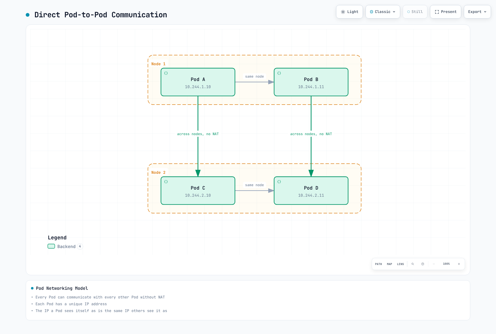
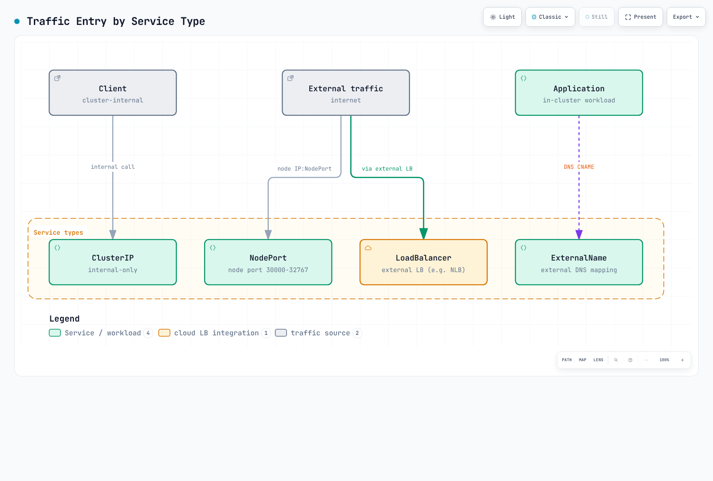
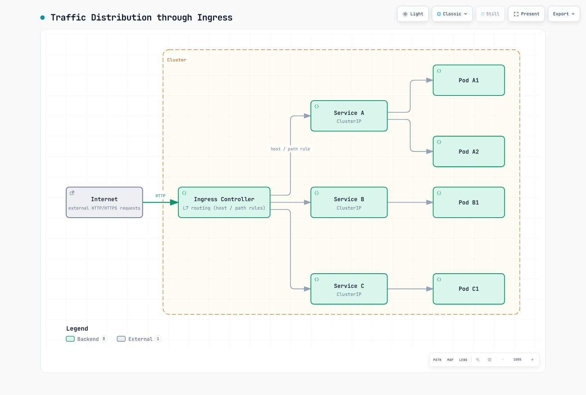
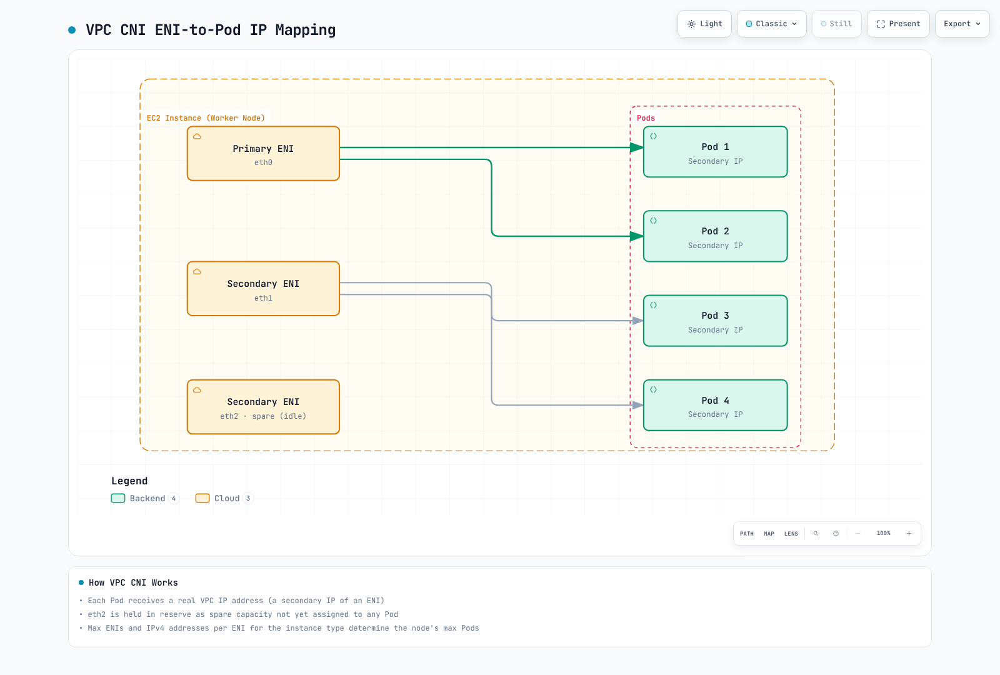

# Redes de Kubernetes

> **Última actualización**: 16 de octubre de 2026
>
> **Ejemplos fijados**: Cilium 1.20.3, Calico Open Source 3.32.2, Flannel 0.28.10 y VPC CNI/Helm chart de AWS upstream 1.23.2.
>
> **Información de versiones actuales**: AWS incluye el complemento de VPC CNI administrado por EKS `v1.23.1-eksbuild.1` para Kubernetes 1.31–1.37. Calico 3.33.0 es la versión más reciente de Open Source y se prueba en Kubernetes 1.35–1.37. Consulta sus notas de la versión antes de cambiar los ejemplos fijados.
>
> Estas versiones no constituyen una configuración de clúster probada en conjunto. Antes de la instalación, consulta la matriz de Kubernetes/plataformas de cada producto.

## Descripción general

Las redes de Kubernetes son la capa de infraestructura básica que permite la comunicación entre aplicaciones en contenedores. Esta sección abarca desde los conceptos básicos de redes de Kubernetes hasta soluciones CNI (Container Network Interface) avanzadas y patrones de red en entornos AWS EKS.

## Itinerario de aprendizaje {#learning-path}

Después del curso para principiantes, usa el [itinerario avanzado de redes](expert/README.md) para conectar proyectos de protocolos, políticas de enrutamiento, EVPN, rendimiento de Linux, diseño de nube y evaluación de automatización. Primero, comprueba el entorno, las evidencias y los criterios de recuperación de cada cuaderno de trabajo.

Si eres nuevo en Linux o en redes, empieza con el [curso para principiantes](beginner/README.md). Sus ocho lecciones conectan la CLI, el direccionamiento, DNS, SSH, firewalls, supervisión y un proyecto final. El itinerario que aparece a continuación amplía esos fundamentos con protocolos, el kernel y las implementaciones de clústeres.

Avanza desde los conceptos de protocolos hasta las observaciones y, después, relaciónalos con las responsabilidades de contenedores, clústeres y nube. Usa los requisitos previos para elegir un punto de entrada y los resultados esperados para comprobar tu comprensión antes de continuar.

| Etapa | Función | Requisitos previos | Resultado | Leer / practicar |
|---|---|---|---|---|
| Protocolos, direccionamiento, HTTP | Establecer el vocabulario | Uso básico de la línea de comandos | Seguir una solicitud y distinguir el direccionamiento, el transporte y el comportamiento de la aplicación | Fundamentos de redes [Parte 1](../basics/06-network-fundamentals-part1.md), [Parte 2](../basics/06-network-fundamentals-part2.md), [Parte 3](../basics/06-network-fundamentals-part3.md), [Parte 4](../basics/06-network-fundamentals-part4.md) |
| Dispositivos de red, LAN, WAN | Diferenciar las funciones de los dispositivos y los límites | Fundamentos de protocolos y direccionamiento | Explicar switches, routers, firewalls, balanceadores de carga, VLAN, NAT y tipos de WAN | [Fundamentos de redes, parte 5](../basics/06-network-fundamentals-part5.md) · [Cuestionario](../quizzes/basics/06-network-fundamentals-part5-quiz.md) |
| Sockets de Linux, VFS, rutas de paquetes | Relacionar las API con el kernel | Fundamentos de TCP/IP | Distinguir los FD, los búferes de socket, las ventanas y las colas | [Pila de redes del kernel](../kernel/02-network-stack.md) |
| Diagnóstico de redes en Linux | Poner a prueba hipótesis con evidencias | Conceptos de sockets y rutas de paquetes | Correlacionar observaciones de sockets, paquetes y aplicaciones | [Práctica de diagnóstico](07-linux-network-diagnostics.md) · [Cuestionario](../quizzes/networking/07-linux-network-diagnostics-quiz.md) |
| Docker y redes de contenedores | Ubicar los límites de los espacios de nombres | Rutas de paquetes de Linux y diagnóstico básico | Explicar las redes en puente, los puertos publicados y la resolución de nombres de contenedores | [Tecnología de contenedores](../basics/03-container-technology.md) |
| Service, DNS e Ingress de Kubernetes | Representar las abstracciones del clúster | Redes de contenedores | Seguir un nombre a través de un Service hasta sus endpoints e identificar la función de Ingress | [Services y redes](../core/03-services-networking.md) · [Laboratorio](../labs/core/03-services-networking-lab.md) |
| eBPF, CNI, políticas | Comparar las responsabilidades de implementación | Rutas de Pod y Service | Distinguir el reenvío de paquetes, la aplicación de políticas y la observabilidad | [Fundamentos de eBPF](../basics/05-ebpf-fundamentals.md) · [Cilium](cilium/README.md) · [Calico](calico/README.md) |
| Límites de red y rendimiento de AWS | Aplicar el modelo a las rutas de la nube | Conceptos de CNI y habilidades de medición | Identificar los límites de VPC, nodo y AZ, e interpretar las mediciones en contexto | [VPC CNI](01-vpc-cni.md) · [AWS Load Balancer Controller](03-aws-lb-controller.md) · [Conectividad de VPC entre organizaciones](05-cross-org-vpc-connectivity.md) · [Prueba comparativa de red de Pod](06-pod-network-benchmark.md) |
| WAN, entornos híbridos y edge | Diseñar rutas entre las instalaciones locales, la nube y los usuarios | Políticas de enrutamiento y límites de red de AWS | Usar evidencias para explicar las rutas híbridas y la conmutación por error, dónde responde una CDN y dónde actúan las defensas de WAF y DDoS | [WAN y conectividad híbrida](expert/07-wan-hybrid-connectivity.md) · [CDN y distribución edge](expert/08-cdn-edge-delivery.md) · [Seguridad edge](expert/09-edge-security-waf-ddos.md) |

## Modelo de redes de Kubernetes

El modelo actual de Kubernetes proporciona una red de Pod en la que los Pod pueden comunicarse directamente entre nodos sin traducción de direcciones ni proxies, **sujeto a una segmentación de red intencionada**. Los agentes de nodo, como kubelet, deben poder llegar a los Pod de su propio nodo. Las políticas de red, el enrutamiento y los listeners de las aplicaciones siguen determinando si una conexión concreta se establece correctamente.

Los Pod normales tienen su propio espacio de nombres de red y direcciones para todo el clúster; los contenedores de un mismo Pod comparten ese espacio de nombres y localhost. Los Pod que usan la red del host comparten la red del nodo, y las configuraciones dual-stack o de varias redes requieren un tratamiento más preciso de las direcciones. Al recrear un Pod se le puede asignar otra IP; reiniciar un contenedor dentro del mismo Pod no necesariamente recrea su sandbox de red.

| Componente | Función |
|---|---|
| Red de Pod | Direccionamiento y conectividad entre espacios de nombres de red de las cargas de trabajo |
| Service/detección | Nombres de servicio estables o direcciones virtuales para endpoints cambiantes |
| Implementación de Ingress/Gateway | Entrada externa configurada y enrutamiento de aplicaciones |
| Motor de políticas de red | Aplica las políticas admitidas por la implementación seleccionada |

Estas funciones no conforman una ruta de paquetes serial obligatoria. La traducción de Service, un proxy L7 y las políticas de las cargas de trabajo pueden cambiar la forma en que una solicitud concreta atraviesa la red.

### Redes de Pod

Las redes de Pod proporcionan el direccionamiento y las rutas para la comunicación entre Pod. La ilustración siguiente muestra Pod IPv4 normales; las conexiones presuponen que las políticas y los controles de red aplicables permiten el tráfico.



[🔍 Ver diagrama interactivo](https://www.atomai.click/kubernetes-docs/archmaps/en-networking-readme-1.html)

Las direcciones son direcciones ilustrativas de Pod normales. El aislamiento intencionado y las configuraciones con red del host o de varias redes requieren una interpretación propia.

#### Métodos de implementación de redes de Pod

| Método | Descripción | Ejemplo de CNI |
|--------|-------------|-------------|
| **Red superpuesta** | Encapsula el tráfico sobre la red existente | Flannel VXLAN, Calico VXLAN/IPIP, Cilium VXLAN/Geneve |
| **Enrutamiento nativo** | Usa rutas de la red subyacente sin esa encapsulación superpuesta | AWS VPC CNI, enrutamiento/BGP de Calico, enrutamiento nativo de Cilium |
| **Encapsulación condicional** | Usa rutas directas o encapsulación según la topología configurada | Modos compatibles de Calico/Flannel/Cilium, con distintos requisitos previos |

### Redes de Service

Los Service describen un conjunto lógico de endpoints, normalmente Pod, y cómo acceder a ellos. ClusterIP proporciona de forma predeterminada una IP virtual estable; los Service sin cabecera omiten esa IP virtual, y ExternalName usa una asignación DNS CNAME. Un Service también puede tener endpoints administrados sin un selector de Pod.



[🔍 Ver diagrama interactivo](https://www.atomai.click/kubernetes-docs/archmaps/en-networking-readme-2.html)

Estos son mecanismos típicos de exposición, no garantías de seguridad. El rango de NodePort y las direcciones de nodo accesibles se pueden configurar; los LoadBalancer pueden ser internos. ExternalName devuelve un alias DNS y no crea un proxy de reenvío.

#### Características de los tipos de Service

Crea en `default` Pod coincidentes con `app: my-app` que escuchen en los puertos de destino indicados. El rango de asignación predeterminado de NodePort es 30000–32767 y se puede configurar. La accesibilidad externa sigue dependiendo de las direcciones, las rutas y los controles de acceso.

El ejemplo de LoadBalancer selecciona explícitamente **AWS Load Balancer Controller**, con destinos de instancia EC2 y NodePort asignados. Primero instala/configura ese controlador y sus requisitos previos de IAM/subredes. EKS Auto Mode usa un controlador/clase diferente. El puerto 443 solo selecciona aquí un puerto TCP; TLS debe servirse desde el backend en 8443 o configurarse por separado en el balanceador de carga.

Estas asignaciones de puertos ilustran la API general de Service de Kubernetes. Actualmente, AWS documenta requisitos adicionales para las políticas de red nativas de EKS: el puerto del Service debe coincidir con el puerto del contenedor, y los Pod administrados por un controlador con `metadata.ownerReferences` permiten aplicar las políticas de forma fiable. Adapta los ejemplos a esos requisitos antes de probar esa implementación de políticas.

```yaml
apiVersion: v1
kind: Service
metadata:
  name: my-service
  namespace: default
spec:
  type: ClusterIP
  selector:
    app: my-app
  ports:
  - protocol: TCP
    port: 80
    targetPort: 8080
---
apiVersion: v1
kind: Service
metadata:
  name: my-nodeport-service
  namespace: default
spec:
  type: NodePort
  selector:
    app: my-app
  ports:
  - protocol: TCP
    port: 80
    targetPort: 8080
    nodePort: 30080
---
apiVersion: v1
kind: Service
metadata:
  name: my-loadbalancer-service
  annotations:
    service.beta.kubernetes.io/aws-load-balancer-scheme: internet-facing
    service.beta.kubernetes.io/aws-load-balancer-nlb-target-type: instance
  namespace: default
spec:
  type: LoadBalancer
  selector:
    app: my-app
  ports:
  - protocol: TCP
    port: 443
    targetPort: 8443
  loadBalancerClass: service.k8s.aws/nlb
  allocateLoadBalancerNodePorts: true
```

### Redes de Ingress

Un recurso Ingress necesita un controlador y su plano de datos. Este ejemplo HTTP usa AWS LBC con `spec.ingressClassName: alb` y destinos IP. Los Service `api-v1`, `api-v2` y `web-frontend` a los que se hace referencia deben existir en `default`, exponer el puerto 80 y tener endpoints de Pod listos y enrutables desde la VPC. Configura HTTPS/los certificados por separado cuando sea necesario. Consulta la [guía de LBC](03-aws-lb-controller.md) para ver los requisitos previos de instalación y de los destinos.

Ingress define reglas para enrutar el tráfico HTTP/HTTPS a los Service internos del clúster.



[🔍 Ver diagrama interactivo](https://www.atomai.click/kubernetes-docs/archmaps/en-networking-readme-3.html)

El recuadro representa la función del plano de datos de Ingress. AWS LBC configura ALB; el tráfico de las aplicaciones no atraviesa el proceso de conciliación del controlador. Según el modo de destino, el plano de datos puede llegar a las IP de Pod o a los NodePort, en lugar de atravesar una IP virtual de Service como salto adicional literal.

```yaml
apiVersion: networking.k8s.io/v1
kind: Ingress
metadata:
  name: my-ingress
  annotations:
    alb.ingress.kubernetes.io/scheme: internet-facing
    alb.ingress.kubernetes.io/target-type: ip
  namespace: default
spec:
  rules:
  - host: api.example.com
    http:
      paths:
      - path: /v1
        pathType: Prefix
        backend:
          service:
            name: api-v1
            port:
              number: 80
      - path: /v2
        pathType: Prefix
        backend:
          service:
            name: api-v2
            port:
              number: 80
  - host: web.example.com
    http:
      paths:
      - path: /
        pathType: Prefix
        backend:
          service:
            name: web-frontend
            port:
              number: 80
  ingressClassName: alb
```

## CNI (Container Network Interface)

CNI estandariza la interfaz mediante la cual un runtime configura una red de contenedores. En las versiones actuales de Kubernetes, kubelet solicita operaciones de sandbox de Pod mediante CRI y el **runtime de contenedores administra CNI**. Las antiguas opciones de kubelet para administrar CNI directamente se eliminaron en Kubernetes 1.24.

### Responsabilidades del runtime y de los complementos

| Actor | Responsabilidad |
|---|---|
| kubelet | Solicita la creación/eliminación de sandbox a través de la interfaz de runtime de contenedores |
| Runtime de contenedores | Selecciona la configuración de red e invoca la cadena de complementos CNI |
| Complemento CNI | Recibe la configuración, ejecuta ADD/DEL y otras operaciones compatibles, y devuelve resultados |
| Implementación de IPAM | Asigna/libera direcciones; puede ser un complemento delegado o formar parte de un agente específico del proveedor |
| Agente de nodo opcional | Mantiene rutas, políticas, grupos de IP o estado del plano de datos específicos del proveedor |

El runtime pasa la configuración al complemento a través de la interfaz CNI; no todos los complementos requieren un agente independiente de ejecución prolongada o un binario IPAM. Los tipos de interfaz también varían: los pares veth son comunes, pero no son la única implementación.

## Comparación de CNI

| Proyecto / alcance | Redes y políticas | Características y límites que conviene distinguir |
|---|---|---|
| **Cilium 1.20.3** | Redes eBPF; Envoy para las funciones L7 pertinentes; políticas de red de Cilium y Hubble | Plano de datos de nodos de trabajo Linux, con requisitos para AMD64/Arm64. La disponibilidad de la CLI en Windows no significa que CNI sea compatible con Windows. WireGuard/IPsec y mTLS Beta con ztunnel tienen alcances distintos. |
| **Ejemplos de Calico Open Source 3.32.2; 3.33.0 actual** | Opciones de enrutamiento/encapsulación; opciones de iptables, nftables y eBPF; niveles de políticas ordenados y políticas de host/carga de trabajo | Calico 3.33.0 se prueba en Kubernetes 1.35–1.37. Consulta las notas de la versión antes de actualizar. Windows tiene límites específicos, entre ellos la falta de plano de datos eBPF o WireGuard de Linux. La observabilidad de flujos de Whisker/Goldmane está disponible como Tech Preview. Consulta la matriz de ediciones para ver las funciones de pago. |
| **Flannel 0.28.10** | Asignación de subredes de host y transporte entre nodos; VXLAN, host-gw y otros backends | `flanneld` por sí solo no aplica NetworkPolicy; `netpol.enabled`, la opción del chart, implementa un controlador de políticas de SIGs. WireGuard es un backend documentado; IPsec es experimental. VXLAN en Windows tiene ajustes/límites específicos. |
| **Ejemplos upstream/Helm de AWS VPC CNI 1.23.2; complemento de EKS `v1.23.1-eksbuild.1`** | Asignación de direcciones VPC y ENI/prefijos de EC2; capacidades de políticas de red Standard y Admin de EKS en nodos EC2 Linux compatibles | AWS incluye esta compilación del complemento administrado para Kubernetes 1.31–1.37; verifica la disponibilidad regional y la versión real del clúster. EKS Auto Mode es una implementación de redes administrada con capacidades adicionales de políticas DNS. Windows, Fargate, las redes personalizadas, la delegación de prefijos y la compatibilidad con varias NIC tienen condiciones propias. |
| **Proyecto original Weave Net** | Implementación histórica de redes superpuestas | El repositorio original `weaveworks/weave` está archivado. No lo describas como una opción predeterminada activa y compatible para un clúster nuevo. |

### Políticas, cifrado y observabilidad

- Cilium proporciona políticas que reconocen HTTP/DNS mediante los componentes L7 correspondientes, así como políticas de clúster y de host. Su semántica de permitir/denegar no es la API de niveles ordenados de Calico.
- Calico Open Source incluye niveles jerárquicos de políticas y políticas de host. La matriz de productos actual asigna las políticas de capa de aplicación, las políticas DNS/FQDN y Cluster Mesh a Cloud/Enterprise; no deben atribuirse sin indicarlo a la edición de código abierto. El cifrado en tránsito documentado por Calico usa WireGuard.
- Amazon EKS proporciona controles `ClusterNetworkPolicy` Admin/Baseline para Auto Mode y para instalaciones compatibles de EC2/VPC-CNI. La función `ApplicationNetworkPolicy` de DNS/FQDN descrita por AWS es para **Auto Mode**. Su nombre no implica que inspeccione actualmente los métodos o el cuerpo HTTP.
- El controlador de políticas opcional de Flannel tiene sus propios requisitos; seleccionar únicamente un backend de red no habilita la aplicación de políticas.
- El cifrado entre nodos, la identidad autenticada de las cargas de trabajo y mTLS de aplicación son controles distintos. La visibilidad de flujos de red también es diferente del trazado de aplicaciones o de la aplicación de políticas a procesos/archivos.

### Enrutamiento y rendimiento

Calico y Cilium pueden anunciar rutas mediante BGP; eso no proporciona por sí solo detección de servicios entre clústeres, sincronización de políticas ni cifrado. Flannel host-gw usa rutas directas y requiere conectividad de capa 2 adecuada. Una red superpuesta añade consideraciones de encapsulación y MTU, pero no se puede inferir una clasificación universal del rendimiento a partir del nombre de la CNI.

La cifra anterior de rendimiento del 100/98/95/85/80/75 por ciento no tenía una carga de trabajo reproducible, versiones ni una fuente de medición. Usa hardware, kernel, tamaños de paquete/solicitud, concurrencia, ajustes de cifrado/políticas, rendimiento, pérdida y latencia de cola comparables. La [prueba comparativa de Pod](06-pod-network-benchmark.md), independiente, conserva su propio entorno y mediciones históricas.

## Guía para elegir una CNI

Primero, elige el modelo de enrutamiento, políticas, sistema operativo y soporte que necesitas; después, prueba esa combinación.

| Necesidad | Vía de evaluación |
|---|---|
| Direccionamiento VPC estándar de EKS y políticas de red compatibles | Evalúa las capacidades de AWS VPC CNI/EKS antes de añadir un segundo motor de políticas. |
| Niveles de políticas ordenados, políticas de host o BGP de infraestructura | Evalúa la edición/plano de datos pertinente de Calico y los requisitos previos de enrutamiento. |
| Políticas de Cilium, Hubble o determinadas funciones de malla | Comprueba la compatibilidad con Linux/kernel/plataforma y la [guía de malla de Cilium](../service-mesh/cilium-service-mesh/README.md). Envoy sigue formando parte de las rutas L7 correspondientes. |
| Una red pequeña con un conjunto limitado de funciones | Evalúa el backend de Flannel y el controlador de políticas opcional en función de los requisitos reales. |
| Aplicación de políticas a procesos, llamadas al sistema o archivos | Evalúa por separado un componente de seguridad en runtime, como Tetragon, en lugar de la política de red. |

### Configuración del complemento administrado de EKS

Lo siguiente es un ejemplo de **carga de configuración**, no una instrucción para instalar Calico y el motor de políticas de VPC CNI en las mismas cargas de trabajo:

```json
{
  "enableNetworkPolicy": "true"
}
```

El tipo documentado para este ajuste es la cadena `"true"`. Elige una compilación compatible del complemento de EKS para la versión de Kubernetes existente e inspecciona el Schema de configuración de esa compilación:

```bash
EKS_REGION=ap-northeast-2
KUBERNETES_MINOR=1.35  # Replace with the existing cluster's minor version
aws eks describe-addon-versions --region "$EKS_REGION" --addon-name vpc-cni \
  --kubernetes-version "$KUBERNETES_MINOR"
: "${VPC_CNI_ADDON_VERSION:?Set the compatible eksbuild version selected from metadata}"
aws eks describe-addon-configuration --region "$EKS_REGION" --addon-name vpc-cni \
  --addon-version "$VPC_CNI_ADDON_VERSION"
```

El número de versión upstream 1.23.2 y una versión `eksbuild` de EKS son identificadores diferentes. La tabla actual de complementos de AWS incluye `v1.23.1-eksbuild.1` para Kubernetes 1.31–1.37; usa `describe-addon-versions` en la Región de destino para elegir una compilación compatible. Combina los cambios con la configuración prevista del complemento administrado; no selecciones `latest` a ciegas ni reemplaces valores no relacionados. La migración desde una implementación de políticas de terceros también requiere eliminar el estado de aplicación existente y contar con un plan probado para la transición de nodos/cargas de trabajo.

## Fundamentos de redes de EKS

### Arquitectura de red predeterminada de EKS

| Ubicación / componente | Responsabilidad |
|---|---|
| VPC administrada por EKS | AWS ejecuta el plano de control de Kubernetes administrado en varias zonas de disponibilidad. |
| VPC del clúster del cliente | Las redes de los nodos de trabajo, las subredes seleccionadas y las ENI entre cuentas administradas por EKS proporcionan las rutas configuradas al plano de control. |
| ALB/NLB en subredes seleccionadas de la VPC del cliente | Proporciona el punto de entrada de aplicaciones público o interno elegido; una gateway de Internet/gateway NAT no sustituye esa configuración de enrutamiento. |
| Gateway NAT o endpoints de servicio privados | Proporciona las rutas de salida concretas que requiere el diseño de la carga de trabajo. |

La figura anterior situaba el plano de control dentro de la VPC del cliente y los balanceadores de carga fuera de ella; se ha sustituido por estos límites de propiedad.

### DNS y redes según el modo de cómputo

| Modo de cómputo | Ubicación de DNS / componentes |
|---|---|
| Nodos EC2 estándar | Normalmente usan el Deployment de CoreDNS configurado y los componentes de red instalados; los reemplazos necesitan su propia configuración compatible. |
| EKS Auto Mode puro | Las funciones de CoreDNS, VPC CNI y kube-proxy se ejecutan como servicios systemd administrados en los nodos. No se necesita un Deployment/complemento de CoreDNS para estos nodos. |
| Auto Mode combinado con nodos que no son Auto | Conserva el Deployment de CoreDNS para los nodos que no son Auto; no pueden usar el servicio DNS Auto Mode de otro nodo. |

El primer resolvedor DNS de Auto Mode es local al nodo. El reenvío ascendente y la comunicación con el plano de control aún pueden requerir acceso a la red; esto no garantiza que todos los paquetes relacionados con DNS permanezcan en el nodo. AWS documenta políticas Admin y DNS para Auto Mode, mientras que la política Admin de VPC-CNI para EC2 estándar tiene sus propios requisitos de versión y habilitación.

### Funcionamiento de VPC CNI

AWS VPC CNI proporciona a los Pod normales direcciones enrutables desde la VPC mediante el modo IPAM seleccionado. Las direcciones IPv4 secundarias, los prefijos delegados, las ENI de ramificación y las configuraciones con varias NIC difieren; los Pod que usan la red del host comparten la red del nodo.



[🔍 Ver diagrama interactivo](https://www.atomai.click/kubernetes-docs/archmaps/en-networking-readme-9.html)

Esto representa solo el modo de IP secundarias. Una ENI en espera es una estrategia de asignación configurable, no un requisito de que cada nodo reserve siempre exactamente una. La delegación de prefijos, las redes personalizadas y las ENI de ramificación tienen reglas de asignación distintas.

#### Límites de ENI e IP

| Tipo de instancia | ENI máximas | Ranuras IPv4 por ENI | Valor de arranque heredado de IP secundarias |
|---------------|----------|--------------|------------------------|
| t3.medium | 3 | 6 | 17 |
| t3.large | 3 | 12 | 35 |
| m5.large | 3 | 10 | 29 |
| m5.xlarge | 4 | 15 | 58 |
| m5.2xlarge | 4 | 15 | 58 |
| c5.4xlarge | 8 | 30 | 234 |

Estos valores se verifican con los límites de instancias de VPC CNI 1.23.2 y la tabla heredada de max-Pods. El cálculo histórico es `ENIs × (IPv4 slots per ENI − 1) + 2`; no es una recomendación universal actual. La delegación de prefijos, las redes personalizadas, las ENI de ramificación y varias tarjetas de red cambian la capacidad de direcciones. La planificación de Kubernetes también está limitada por `maxPods` de kubelet y por los recursos. Los grupos de nodos administrados de EKS limitan `maxPods` a 110 para instancias con menos de 30 vCPU y a 250 en los demás casos; el número de IP disponibles por sí solo no anula ese límite.

### Consideraciones sobre las redes de EKS

#### Administración de direcciones IP

Para **Linux VPC CNI**, configura las variables de entorno documentadas mediante el mecanismo de administración seleccionado para el complemento/Helm/DaemonSet. Lo siguiente es un fragmento de configuración de un complemento de EKS. El antiguo ConfigMap `amazon-vpc-cni` con `enable-prefix-delegation` no configura Linux IPAMD de esta manera. Conserva los demás valores previstos del complemento al aplicar un cambio.

```json
{
  "env": {
    "ENABLE_PREFIX_DELEGATION": "true",
    "WARM_PREFIX_TARGET": "1"
  }
}
```

También puedes ajustar el límite mínimo de asignación total y el objetivo de IP libres. Cuando se configura `MINIMUM_IP_TARGET` o `WARM_IP_TARGET`, tiene prioridad sobre `WARM_PREFIX_TARGET`; son políticas alternativas, no cuatro objetivos aditivos independientes. La asignación sigue realizándose en unidades del tamaño de un prefijo. La compatibilidad con Nitro, el espacio `/28` contiguo para IPv4 y un límite adecuado de Pod en kubelet son requisitos previos independientes.

La asignación de prefijos de Windows sigue otra ruta de configuración: AWS documenta `enable-windows-prefix-delegation` y sus claves de objetivo de reserva en el ConfigMap `amazon-vpc-cni`. No copies sin cambios el procedimiento de variables de entorno de Linux en Windows.

```json
{
  "env": {
    "ENABLE_PREFIX_DELEGATION": "true",
    "MINIMUM_IP_TARGET": "5",
    "WARM_IP_TARGET": "2"
  }
}
```

#### Redes personalizadas

Estos ejemplos IPv4 requieren ID reales de subred/grupo de seguridad en la AZ y la VPC previstas. Habilita las redes personalizadas y selecciona la ENIConfig de cada nodo mediante su etiqueta de zona. Una anotación de nodo ENIConfig explícita tiene prioridad sobre esa etiqueta. Los nombres de ejemplo que aparecen a continuación usan la misma Región en ambos idiomas; sustitúyelos por las zonas reales de los nodos. Instalar objetos ENIConfig por sí solo no activa las redes personalizadas.

```json
{
  "env": {
    "AWS_VPC_K8S_CNI_CUSTOM_NETWORK_CFG": "true",
    "ENI_CONFIG_LABEL_DEF": "topology.kubernetes.io/zone"
  }
}
```

```yaml
apiVersion: crd.k8s.amazonaws.com/v1alpha1
kind: ENIConfig
metadata:
  name: ap-northeast-2a
spec:
  securityGroups:
  - sg-0123456789abcdef0
  subnet: subnet-0123456789abcdef0
---
apiVersion: crd.k8s.amazonaws.com/v1alpha1
kind: ENIConfig
metadata:
  name: ap-northeast-2b
spec:
  securityGroups:
  - sg-0123456789abcdef0
  subnet: subnet-fedcba9876543210f
```

## Conceptos avanzados de redes

Los temas siguientes se mencionan de pasada en otros lugares de esta descripción general. Los procedimientos completos de configuración y las cifras medidas se encuentran en las páginas detalladas enlazadas; esta sección organiza las diferencias entre capas y dónde encaja cada elemento.

### L2–L7 y la diferencia entre routers y balanceadores de carga

«Router» y «balanceador de carga» suelen aparecer en la misma oración, pero responden a preguntas diferentes. Un router elige (por lo general) una ruta hacia un único destino; un balanceador de carga elige un destino entre varios candidatos equivalentes mediante un algoritmo de distribución.

| Capa | Dispositivo/función | Base de la decisión | Correspondencia en Kubernetes/AWS |
|---|---|---|---|
| L2 (enlace) | Switch, puente | Dirección MAC de destino | Pares veth y puentes Linux creados por la CNI, la NIC virtual que expone una ENI |
| L3 (red) | Router o inserción transparente de dispositivos | IP de destino para el enrutamiento; identidad del flujo para seleccionar el dispositivo | El router implícito de la VPC, TGW; GWLB encapsula paquetes IP para los dispositivos |
| L4 (transporte) | Balanceador de carga L4 | Identidad de conexión/flujo, normalmente la tupla de 5 elementos | NLB; kube-proxy (iptables, IPVS, nftables); implementaciones de Service eBPF independientes |
| L7 (aplicación) | Balanceador de carga L7/proxy inverso | Host, ruta y encabezados por solicitud; conocimiento del protocolo | ALB, implementaciones de Ingress/Gateway API, sidecars de malla de servicios (Envoy) |

La diferencia clave es la **unidad de distribución**. Un balanceador de carga L4 normalmente selecciona un destino para una conexión TCP o un flujo UDP rastreado. Un proxy L7 puede seleccionar un destino para cada solicitud de aplicación compatible, incluidas las solicitudes que comparten una conexión. GWLB distribuye flujos IP encapsulados entre dispositivos de seguridad en lugar de analizar las solicitudes de aplicación. La persistencia del flujo depende del tiempo de espera, el estado de salud y el comportamiento de conmutación por error configurados; no garantiza que un flujo nunca se reasigne ni se interrumpa.

> 📎 Las definiciones de protocolo de los conceptos L2/L3 se encuentran en [Fundamentos de redes, parte 1](../basics/06-network-fundamentals-part1.md); los tipos de destino de ALB/NLB y la configuración real, en [AWS Load Balancer Controller](03-aws-lb-controller.md).

### Conectividad entre cuentas/VPC: TGW, VPC Peering, GWLB, PrivateLink, Lattice

Estas cinco opciones de conectividad difieren en la capa y el modelo de tráfico. Las latencias medidas para el uso compartido de TGW RAM, VPC Peering, PrivateLink, TGW Peering y VPC Lattice están en [Conectividad de VPC entre organizaciones](05-cross-org-vpc-connectivity.md). Esta sección añade GWLB, que no aparece en esa tabla comparativa, y vuelve a organizar las cinco opciones por capa.

| Conectividad | Capa/modelo | Características |
|---|---|---|
| VPC Peering | L3, enrutamiento IP bidireccional | No es transitivo; no se puede configurar con CIDR superpuestos |
| Transit Gateway (TGW) | L3, enrutamiento IP en estrella | Usa asociaciones y propagación de adjuntos en una o más tablas de rutas de TGW; se comparte entre cuentas mediante RAM |
| Gateway Load Balancer (GWLB) | L3, inserción transparente de dispositivos | Encapsula el paquete original en GENEVE (UDP 6081); un modelo de servicio de endpoint de VPC conecta el tráfico de los consumidores a la flota de dispositivos del proveedor |
| PrivateLink | Conectividad de endpoints privados | Un modelo es el servicio de endpoint respaldado por un NLB; también existen endpoints de recursos. Los CIDR de consumidor/proveedor pueden superponerse |
| VPC Lattice | Redes de aplicaciones y recursos | Los servicios HTTP/HTTPS admiten enrutamiento L7 y autorización IAM opcional; la transferencia directa de TLS y las configuraciones de recursos tienen capacidades distintas |

GWLB inserta dispositivos de inspección, como firewalls e IDS/IPS, en una ruta IP mediante un endpoint de Gateway Load Balancer. De forma predeterminada, la persistencia del flujo usa cinco campos; las configuraciones compatibles pueden usar dos o tres. Valida las rutas de ida y retorno, el estado de salud de los dispositivos, la MTU de encapsulación, las NACL y los grupos de seguridad de las cargas de trabajo/dispositivos reales. GWLB no tiene un grupo de seguridad como ALB, y la persistencia del flujo no sustituye las pruebas de fallos.

Para el diseño de seguridad, consulta [Protección de WAF/origen](../security/14-waf-edge-api-security.md), [NGFW de Palo Alto/Fortinet](../security/15-ngfw-paloalto-fortinet.md) y [Rutas y fallos de GWLB/GENEVE](../security/16-gwlb-geneve-inspection.md). GWLBE tampoco admite SG. Para los destinos que no estén en estado saludable, AWS describe una selección de destino por flujo y el descarte de tráfico hasta la recuperación, sin omitir directamente el dispositivo. Revisa conjuntamente la persistencia con tuplas reducidas, la disponibilidad entre zonas, NAT y el modo de dispositivo de TGW.

> 📎 La integración completa de EKS/VPC Lattice (Gateway API Controller, autorización IAM y enrutamiento) se encuentra en [VPC Lattice](02-vpc-lattice.md).

### Comportamiento real del resolvedor DNS y de las tablas de rutas

**Resolvedor DNS:** AmazonProvidedDNS **es Route 53 Resolver**. Sus direcciones incluyen la dirección de red IPv4 principal de la VPC más dos (`10.0.0.2` para `10.0.0.0/16`) y `169.254.169.253`; resuelve las zonas privadas asociadas y los nombres públicos según las reglas de Resolver. CoreDNS normalmente sirve el dominio de clúster de Kubernetes configurado, a menudo `cluster.local`; `kube-dns` es el nombre de su Service, no un espacio de nombres ni una zona DNS. El reenvío externo sigue el Corefile y el archivo del resolvedor visibles para el Pod DNS. Inspecciona esos ajustes en lugar de suponer que se usa sin cambios el archivo del resolvedor del nodo. En un diseño con endpoints de Resolver, los endpoints de entrada reciben consultas de las instalaciones locales, mientras que los endpoints de salida y las reglas asociadas reenvían consultas seleccionadas de la VPC al DNS local. El resolvedor local del nodo de Auto Mode no elimina las dependencias ascendentes.

**Tablas de rutas:** La evaluación de rutas de VPC generalmente usa la coincidencia de prefijo más largo. AWS permite reemplazar el destino de una ruta `local` y añadir rutas de subred más específicas compatibles para el enrutamiento a través de dispositivos; `local` no es siempre la ruta más específica. Para destinos idénticos, las rutas estáticas de VPC tienen prioridad sobre las rutas propagadas desde una gateway privada virtual. Una ruta de VPC cuyo destino es una TGW es estática; la propagación dentro de una TGW pertenece a sus tablas de rutas independientes. Los destinos no válidos pueden dejar entradas `blackhole` que descartan el tráfico, así que inspecciona el estado de las rutas además del destino. Una subred sin asociación explícita a una tabla de rutas usa la tabla de rutas principal de la VPC.

> 📎 La prioridad de rutas de TGW/Peering y los ejemplos de configuración de rutas estáticas están en los [resultados operativos de Conectividad de VPC entre organizaciones](05-cross-org-vpc-connectivity.md#operational-findings).

### El plano de datos del kernel: iptables, IPVS, eBPF y filtrado de paquetes

El reenvío de Service de Linux y la aplicación de políticas de red pueden usar mecanismos distintos. Netfilter proporciona los hooks de la ruta de paquetes que usan iptables y nftables. Las implementaciones eBPF pueden asociarse a hooks XDP, tc o de socket y realizar allí la selección de Service. Esto no significa que todos los paquetes de un clúster con eBPF omitan Netfilter o el seguimiento de conexiones; la ruta depende de la CNI, el kernel, el enrutamiento y la configuración de funciones.

| Implementación | Ubicación | Características |
|---|---|---|
| iptables | Cadenas de reglas secuenciales en hooks de netfilter | El tiempo de evaluación aumenta con el número de reglas (O(n)); el modo predeterminado de kube-proxy desde hace mucho tiempo |
| IPVS | Balanceador de carga L4 nativo del kernel, una extensión de netfilter | Búsqueda basada en hash (casi O(1)); obsoleto como modo de kube-proxy a partir de Kubernetes 1.35 |
| nftables | Framework sucesor de netfilter para iptables | Modo estable de kube-proxy desde 1.33; comprueba primero la compatibilidad del kernel/CNI |
| eBPF (p. ej., Cilium) | Hooks XDP, tc y de socket configurados | Puede sustituir la gestión de Service de kube-proxy; es una implementación independiente, con comportamiento de Netfilter/seguimiento de conexiones específico de cada ruta |

Cambiar de implementación puede dejar reglas del kernel y conexiones activas. Sigue el procedimiento de migración de la distribución/CNI, drena las cargas de trabajo cuando sea necesario y planifica reiniciar los nodos si la limpieza lo requiere. Sustituir kube-proxy por una CNI basada en eBPF también requiere un orden de transición compatible para evitar que las implementaciones compitan por el mismo tráfico de Service.

> 📎 El calendario de obsolescencia de IPVS y la transición estable a nftables se tratan en [Introducción a Kubernetes](../basics/04-kubernetes-introduction.md); el reemplazo de kube-proxy con eBPF de Cilium está en [eBPF de Cilium](cilium/02-ebpf.md); el plano de datos eBPF de Calico y su procedimiento de migración están en [eBPF de Calico](calico/06-ebpf-dataplane.md).

### Redes de alto rendimiento de cómputo: ENI, EFA, NVLink y transceptores ópticos

ENI, EFA y NVLink sirven para rutas diferentes. Una **ENI** es una interfaz de red virtual conectada a una instancia EC2 en una zona de disponibilidad; su tráfico IP normal puede llegar a otras AZ y VPC conectadas cuando el enrutamiento y las políticas lo permiten (consulta [VPC CNI](01-vpc-cni.md)). **EFA** proporciona un dispositivo de omisión del sistema operativo que usan mediante libfabric los programas MPI/NCCL compatibles. **El tráfico de dispositivos EFA no es enrutable y no puede cruzar los límites de VPC/AZ**; el tráfico IP normal a través del dispositivo ENA de una interfaz EFA con ENA sigue siendo enrutable. Las interfaces solo EFA no tienen dispositivo ENA ni direccionamiento IP. **NVLink** conecta GPU en sistemas compatibles, incluidos los dominios NVLink de escala de rack compatibles. Mide el hardware, las operaciones colectivas y la ubicación seleccionados en lugar de suponer una aceleración fija respecto de EFA.

Los **transceptores ópticos** son un concepto general de redes de centros de datos. Los cables DAC de cobre (Direct Attach Copper) son adecuados para distancias cortas; los módulos ópticos y la fibra satisfacen otros requisitos de alcance y ancho de banda. QSFP y OSFP describen factores de forma de módulos, no garantizan el uso de medios ópticos. Considera esto información general: no determina el cableado físico de una carga de trabajo concreta de AWS.

> 📎 La planificación del reconocimiento de topología de NVLink/IMEX y los ejemplos de ubicación de Pod de GPU están en [Infraestructura de IA/ML](../ai-ml/06-ai-infrastructure.md); los límites VPC/AZ y las mediciones de EFA están en [Conectividad de VPC entre organizaciones](05-cross-org-vpc-connectivity.md).

### Qué significan para Kubernetes los protocolos de próxima generación: HTTP/3, gRPC y QUIC

Los mecanismos de protocolo de HTTP/3 (RFC 9114) y su transporte QUIC (RFC 9000) se tratan en [Fundamentos de redes, parte 2](../basics/06-network-fundamentals-part2.md) y [parte 3](../basics/06-network-fundamentals-part3.md). Aquí abordamos únicamente lo que afecta realmente a la distribución del tráfico de Kubernetes.

- **gRPC y los balanceadores de carga L4:** gRPC multiplexa solicitudes sobre conexiones HTTP/2. Un balanceador L4 normalmente mantiene una conexión TCP establecida en el endpoint seleccionado; si ese endpoint es un proxy, puede tomar otras decisiones de enrutamiento. Añadir Pod por sí solo no redistribuye las conexiones existentes. La distribución por RPC requiere un proxy L7 compatible o una política del lado del cliente. Una RPC de streaming sigue siendo una llamada; sus mensajes individuales no se balancean por separado.
- **GRPCRoute de Gateway API:** Ingress no tiene un recurso específico para gRPC, pero Gateway API estandariza el enrutamiento por servicio/método con `GRPCRoute`. La compatibilidad varía según la implementación (cantidad de coincidencias de encabezados, políticas de reintentos, etc.), así que consulta la documentación del propio controlador.
- **Hasta dónde llega realmente HTTP/3/QUIC dentro del clúster:** La compatibilidad con HTTP/3 entre un cliente y el edge (una CDN, un balanceador de carga) es una cuestión distinta de la compatibilidad con HTTP/3 dentro del clúster o en la conexión backend de un Ingress. Muchas implementaciones de Ingress/Gateway siguen comunicándose con el backend mediante HTTP/1.1 o HTTP/2, y la compatibilidad con HTTP/3 de extremo a extremo varía según la implementación y la versión, así que no generalices; consulta la documentación del controlador que realmente se usa.

## Subpáginas de redes

Esta sección trata en detalle los temas siguientes:

### [Redes de Linux desde cero](beginner/README.md) {#beginner-course}

Si eres nuevo en Linux o en redes, empieza con el [curso para principiantes](beginner/README.md). Sus ocho lecciones conectan la CLI, el direccionamiento, DNS, SSH, firewalls, supervisión y un proyecto final. El itinerario que aparece a continuación amplía esos fundamentos con protocolos, el kernel y las implementaciones de clústeres.

### [Itinerario avanzado de redes](expert/README.md) {#expert-course}

Después del curso para principiantes, usa el [itinerario avanzado de redes](expert/README.md) para conectar proyectos de protocolos, políticas de enrutamiento, EVPN, rendimiento de Linux, diseño de nube y evaluación de automatización. Primero, comprueba el entorno, las evidencias y los criterios de recuperación de cada cuaderno de trabajo.

### [Práctica de diagnóstico de redes en Linux](07-linux-network-diagnostics.md) {#linux-network-diagnostics}

Relaciona los [conceptos de sockets del kernel y rutas de paquetes](../kernel/02-network-stack.md) con observaciones antes de estudiar las implementaciones de CNI. Usa el [cuestionario de diagnóstico](../quizzes/networking/07-linux-network-diagnostics-quiz.md) para comprobar tu interpretación.

### [VPC CNI](01-vpc-cni.md)
Redes de EKS con direcciones VPC para Pod normales y requisitos previos de IPAM/políticas específicos de cada modo.

### [Análisis en profundidad de Cilium](cilium/README.md)
Solución CNI de alto rendimiento basada en eBPF. Proporciona funciones avanzadas como NetworkPolicy L7, malla de servicios y observabilidad (Hubble).

### [Análisis en profundidad de Calico](calico/README.md)
Una de las CNI más utilizadas. Potentes NetworkPolicy, compatibilidad con BGP y funciones empresariales. Abarca la introducción, la arquitectura, los modos de red, el análisis detallado de BGP, NetworkPolicy, eBPF, temas avanzados, la integración con EKS y una guía de operaciones.

### [VPC Lattice](02-vpc-lattice.md)
Servicio administrado de redes de aplicaciones de AWS. Comunicación entre servicios de distintas VPC y cuentas.

### [AWS Load Balancer Controller](03-aws-lb-controller.md)
Integra los Service e Ingress de Kubernetes con AWS ELB (ALB/NLB).

### [Gateway API](04-gateway-api.md)
API de entrada de próxima generación para Kubernetes. Modelo de recursos estandarizado y configuración basada en funciones.

### [Prueba comparativa de red de Pod](06-pod-network-benchmark.md)
RTT entre Pod, latencia HTTP y rendimiento medidos en EKS para el mismo nodo, la misma AZ y entre AZ, además de la amplificación de consultas DNS `ndots:5`.

## Solución de problemas de redes

### Problemas comunes y soluciones

#### Fallo de comunicación entre Pod

```bash
NAMESPACE=default
POD_NAME=iperf-client  # An existing diagnostic Pod with nslookup/curl
SERVICE_NAME=my-service
kubectl -n "$NAMESPACE" get pods -o wide
kubectl -n "$NAMESPACE" exec "$POD_NAME" -- nslookup "$SERVICE_NAME"
kubectl -n "$NAMESPACE" exec "$POD_NAME" -- \
  curl --connect-timeout 3 --max-time 5 -v "http://$SERVICE_NAME:80/"
kubectl -n kube-system logs -l k8s-app=aws-node -c aws-node --tail=100
kubectl -n kube-system logs -l k8s-app=cilium -c cilium-agent --tail=100
```

Ejecuta el diagnóstico desde un Pod existente que tenga las herramientas indicadas. Consulta únicamente la CNI instalada en el clúster; los servicios systemd de Auto Mode no son esos DaemonSet. La resolución DNS, la conectividad TCP y una respuesta HTTP de la aplicación son comprobaciones distintas. ICMP puede estar bloqueado o requerir privilegios adicionales, por lo que un ping fallido por sí solo no demuestra que un servicio TCP sea inaccesible.

#### Service inaccesible

```bash
NAMESPACE=default
SERVICE_NAME=my-service
kubectl -n "$NAMESPACE" get service "$SERVICE_NAME" -o yaml
kubectl -n "$NAMESPACE" get endpointslices \
  -l "kubernetes.io/service-name=$SERVICE_NAME" -o yaml
kubectl -n kube-system logs -l k8s-app=kube-proxy --tail=100
```

Usa EndpointSlice para diagnosticar los endpoints actuales. Comprueba los selectores del Service, los puertos de destino, la disponibilidad de los endpoints, la familia de direcciones y las políticas aplicables. Inspecciona los logs de kube-proxy solo si ese componente se encarga realmente del reenvío de Service; un reemplazo eBPF o Auto Mode requiere sus propios diagnósticos.

#### Depuración de NetworkPolicy

```bash
kubectl get networkpolicies.networking.k8s.io -A
kubectl -n kube-system exec ds/cilium -c cilium-agent -- cilium-dbg policy get
kubectl -n kube-system exec ds/cilium -c cilium-agent -- cilium-dbg endpoint list
# For a Calico installation using its standard CRD datastore:
kubectl get networkpolicies.crd.projectcalico.org -A
kubectl get globalnetworkpolicies.crd.projectcalico.org
```

Los comandos de Cilium inspeccionan un Agent seleccionado mediante la referencia al DaemonSet; al investigar un incidente, elige el Agent del nodo afectado. Las instalaciones de Calico con la API nativa pueden exponer otro grupo de API, así que inspecciona los recursos que ofrece la instalación. Las políticas de Kubernetes, Calico y las extensiones de AWS son recursos distintos y pueden tener precedencias diferentes.

### Pruebas de rendimiento de red

Este ejercicio TCP acotado usa el índice de imagen Netshoot v0.16 fijado por el editor, que contiene imágenes Linux AMD64 y Arm64; su Dockerfile incluye `iperf3`. Crea estos Pod en un entorno de prueba donde se permita TCP 5201. Es una carga de trabajo ilustrativa, no una comparación de CNI basada en mediciones.

```yaml
apiVersion: v1
kind: Pod
metadata:
  name: iperf-server
  namespace: default
  labels:
    app: iperf-server
spec:
  restartPolicy: Never
  automountServiceAccountToken: false
  nodeSelector:
    kubernetes.io/os: linux
  containers:
  - name: netshoot
    image: nicolaka/netshoot:v0.16@sha256:b09d9b21381f47a79b3cbcb30da25266dc17186ea00ae65e99fdc51396f48e70
    command:
    - iperf3
    - -s
    workingDir: /tmp
    resources:
      requests:
        cpu: 100m
        memory: 64Mi
      limits:
        cpu: 500m
        memory: 256Mi
    securityContext:
      runAsNonRoot: true
      runAsUser: 1000
      allowPrivilegeEscalation: false
      capabilities:
        drop:
        - ALL
      seccompProfile:
        type: RuntimeDefault
    ports:
    - containerPort: 5201
      protocol: TCP
---
apiVersion: v1
kind: Pod
metadata:
  name: iperf-client
  namespace: default
  labels:
    app: iperf-client
spec:
  restartPolicy: Never
  automountServiceAccountToken: false
  nodeSelector:
    kubernetes.io/os: linux
  containers:
  - name: netshoot
    image: nicolaka/netshoot:v0.16@sha256:b09d9b21381f47a79b3cbcb30da25266dc17186ea00ae65e99fdc51396f48e70
    command:
    - sleep
    - '3600'
    workingDir: /tmp
    resources:
      requests:
        cpu: 100m
        memory: 64Mi
      limits:
        cpu: 500m
        memory: 256Mi
    securityContext:
      runAsNonRoot: true
      runAsUser: 1000
      allowPrivilegeEscalation: false
      capabilities:
        drop:
        - ALL
      seccompProfile:
        type: RuntimeDefault
```

```bash
kubectl -n default wait --for=condition=Ready pod/iperf-server pod/iperf-client --timeout=120s
IPERF_SERVER_IP="$(kubectl -n default get pod iperf-server -o jsonpath='{.status.podIP}')"
test -n "$IPERF_SERVER_IP"
kubectl -n default exec iperf-client -- iperf3 -c "$IPERF_SERVER_IP" -t 10 -b 10M
```

El cliente duerme durante una hora y el comando limita el tráfico ofrecido a 10 Mbit/s durante diez segundos. Esto prueba la ruta seleccionada, no el rendimiento máximo. Antes de interpretar los resultados, registra la ubicación real del Pod/nodo/AZ, los límites de recursos y las políticas. Elige herramientas específicas de Windows para los nodos Windows. Al terminar, elimina únicamente los recursos de prueba que hayas creado.

Estos Pod de diagnóstico independientes sirven para probar la conectividad. Para probar la aplicación de políticas de red nativas de EKS, usa Pod administrados por Deployment/Job y cumple los requisitos documentados para Service/puertos de contenedor.

## Prácticas recomendadas

### 1. Planificación de direcciones IP

- Diseña bloques CIDR con espacio suficiente
- Separa la red de Pod de la red de Service
- Diseña las subredes teniendo en cuenta futuras ampliaciones

### 2. Aplicación de políticas de red

Crea el espacio de nombres aislado `networking-demo` antes de usar este ejemplo. Selecciona todos los Pod que contiene y aísla tanto el tráfico de entrada como el de salida conforme a la semántica estándar de NetworkPolicy de Kubernetes; los flujos DNS y de aplicaciones necesarios requieren reglas de permiso explícitas. Para aplicar las políticas se necesita un motor compatible. Las API adicionales de políticas de clúster/administración pueden alterar la precedencia, y este manifiesto por sí solo no constituye una arquitectura completa de confianza cero.

- Aplica políticas de denegación predeterminada (confianza cero)
- Permite explícitamente solo el tráfico necesario
- Aísla los espacios de nombres

```yaml
apiVersion: networking.k8s.io/v1
kind: NetworkPolicy
metadata:
  name: default-deny-all
  namespace: networking-demo
spec:
  podSelector: {}
  policyTypes:
  - Ingress
  - Egress
```

### 3. Optimización del rendimiento

- Elige una CNI adecuada (acorde con la carga de trabajo)
- Optimiza la MTU
- Ajusta los parámetros del kernel

### 4. Refuerzo de la seguridad

- Selecciona un cifrado de transporte compatible y verifica qué tráfico cubre.
- Configura la identidad de cargas de trabajo/aplicaciones y mTLS cuando sea necesario; mantenlos separados de las listas de permitidos basadas en DNS/IP.
- Revisa periódicamente los cambios de políticas, certificados y controles de acceso.

### 5. Garantía de observabilidad

- Recopila métricas de red
- Habilita logs de flujo
- Implementa trazas distribuidas

## Próximos pasos

Después del [curso para principiantes](beginner/README.md), continúa con la [Pila de redes del kernel](../kernel/02-network-stack.md) y luego con la [Práctica de diagnóstico de redes en Linux](07-linux-network-diagnostics.md) y su [cuestionario](../quizzes/networking/07-linux-network-diagnostics-quiz.md). El [itinerario de aprendizaje](#learning-path) conecta estos fundamentos con los contenedores y los Service antes de los temas de CNI y AWS que aparecen a continuación.

1. [VPC CNI](01-vpc-cni.md) - CNI predeterminada de EKS
2. [Análisis en profundidad de Cilium](cilium/README.md) - Redes basadas en eBPF
3. [Análisis en profundidad de Calico](calico/README.md) - Enrutamiento, políticas y planos de datos
4. [VPC Lattice](02-vpc-lattice.md) - Redes administradas de AWS
5. [AWS Load Balancer Controller](03-aws-lb-controller.md) - Integración de ELB
6. [Gateway API](04-gateway-api.md) - Entrada de próxima generación
7. [Conectividad de VPC entre organizaciones](05-cross-org-vpc-connectivity.md) - Conexión de VPC entre AWS Organizations (verificada en campo)
8. [Prueba comparativa de red de Pod](06-pod-network-benchmark.md) - Latencia y rendimiento medidos para cada límite de nodo/AZ

---

## Referencias

- [Modelo de red de Kubernetes](https://kubernetes.io/docs/concepts/services-networking/)
- [Services de Kubernetes](https://kubernetes.io/docs/concepts/services-networking/service/)
- [Runtime de contenedores y CNI](https://kubernetes.io/docs/concepts/extend-kubernetes/compute-storage-net/network-plugins/)
- [NetworkPolicy de Kubernetes](https://kubernetes.io/docs/concepts/services-networking/network-policies/)
- [Especificación de CNI](https://raw.githubusercontent.com/containernetworking/cni/main/SPEC.md)
- [Ediciones de productos de Calico](https://docs.tigera.io/calico/latest/about)
- [Versión Calico Open Source 3.33.0](https://github.com/projectcalico/calico/releases/tag/v3.33.0)
- [Niveles de políticas de Calico](https://docs.tigera.io/calico/latest/network-policy/policy-tiers/tiered-policy)
- [Logs de flujo de Whisker de Calico](https://docs.tigera.io/calico/latest/observability/view-flow-logs)
- [Limitaciones de Calico en Windows](https://docs.tigera.io/calico/latest/getting-started/kubernetes/windows-calico/limitations)
- [Redes y políticas de Flannel 0.28.10](https://raw.githubusercontent.com/flannel-io/flannel/v0.28.10/README.md)
- [Backends de Flannel](https://raw.githubusercontent.com/flannel-io/flannel/v0.28.10/Documentation/backends.md)
- [Estado del repositorio original de Weave](https://api.github.com/repos/weaveworks/weave)
- [AWS VPC CNI 1.23.2](https://raw.githubusercontent.com/aws/amazon-vpc-cni-k8s/v1.23.2/README.md)
- [Versiones más recientes del complemento VPC CNI de Amazon EKS](https://docs.aws.amazon.com/eks/latest/userguide/managing-vpc-cni.html)
- [Configuración de políticas de red de EKS](https://docs.aws.amazon.com/eks/latest/userguide/cni-network-policy-configure.html)
- [Políticas de red Standard y Admin de EKS](https://docs.aws.amazon.com/eks/latest/userguide/cni-network-policy.html)
- [Delegación de prefijos y maxPods de EKS](https://docs.aws.amazon.com/eks/latest/userguide/cni-increase-ip-addresses-procedure.html)
- [Modelos de implementación de políticas Admin y DNS de EKS](https://aws.amazon.com/blogs/containers/enhance-amazon-eks-network-security-posture-with-dns-and-admin-network-policies/)
- [Redes de EKS Auto Mode](https://docs.aws.amazon.com/eks/latest/userguide/auto-networking.html)
- [Requisitos de los complementos de EKS](https://docs.aws.amazon.com/eks/latest/userguide/workloads-add-ons-available-eks.html)
- [Arquitectura del plano de control de EKS](https://docs.aws.amazon.com/eks/latest/best-practices/control-plane.html)
- [Metadatos de la imagen Netshoot v0.16](https://hub.docker.com/v2/repositories/nicolaka/netshoot/tags/v0.16)
- [Dockerfile de Netshoot v0.16](https://raw.githubusercontent.com/nicolaka/netshoot/v0.16/Dockerfile)
- [Seguridad en runtime de Tetragon](https://tetragon.io/docs/overview/)
- [Configuración de NLB de AWS LBC 3.6](https://github.com/kubernetes-sigs/aws-load-balancer-controller/blob/v3.6.0/docs/guide/service/nlb.md)
- [Configuración de Ingress de AWS LBC 3.6](https://github.com/kubernetes-sigs/aws-load-balancer-controller/blob/v3.6.0/docs/guide/ingress/annotations.md)
- [Conceptos de Gateway Load Balancer](https://docs.aws.amazon.com/vpc/latest/privatelink/gateway-load-balancers.html)
- [Encapsulación GENEVE (RFC 8926)](https://www.rfc-editor.org/rfc/rfc8926)
- [Resolvedor DNS de VPC](https://docs.aws.amazon.com/vpc/latest/userguide/vpc-dns.html)
- [Endpoints y reglas de Route 53 Resolver](https://docs.aws.amazon.com/Route53/latest/DeveloperGuide/resolver.html)
- [Orden de evaluación de la tabla de rutas de VPC](https://docs.aws.amazon.com/vpc/latest/userguide/VPC_Route_Tables.html)
- [Rutas locales y rutas de subred más específicas](https://docs.aws.amazon.com/vpc/latest/userguide/subnet-route-tables.html)
- [Prioridad de rutas estáticas y propagadas](https://docs.aws.amazon.com/vpc/latest/userguide/route-tables-priority.html)
- [Direcciones y comportamiento de AmazonProvidedDNS](https://docs.aws.amazon.com/vpc/latest/userguide/AmazonDNS-concepts.html)
- [Persistencia de flujo y conmutación por error de GWLB](https://docs.aws.amazon.com/elasticloadbalancing/latest/gateway/edit-target-group-attributes.html)
- [IP virtuales de Service de Kubernetes y modos de kube-proxy](https://kubernetes.io/docs/reference/networking/virtual-ips/)
- [Nombres de Service de CoreDNS y configuración de reenvío](https://kubernetes.io/docs/tasks/administer-cluster/dns-custom-nameservers/)
- [Endpoints de recursos de PrivateLink](https://docs.aws.amazon.com/vpc/latest/privatelink/privatelink-access-resources.html)
- [Documentación del proyecto Netfilter/iptables](https://www.netfilter.org/documentation/index.html)
- [Elastic Fabric Adapter de EC2](https://docs.aws.amazon.com/AWSEC2/latest/UserGuide/efa.html)
- [Protocolo de transporte QUIC (RFC 9000)](https://www.rfc-editor.org/rfc/rfc9000)
- [HTTP/3 (RFC 9114)](https://www.rfc-editor.org/rfc/rfc9114)
- [gRPC sobre HTTP/2 y balanceo de carga](https://grpc.io/blog/grpc-load-balancing/)
- [GRPCRoute de Gateway API](https://gateway-api.sigs.k8s.io/guides/user-guides/grpc-routing/)
