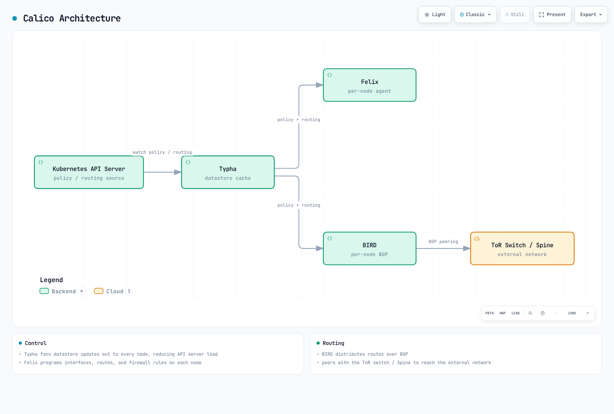
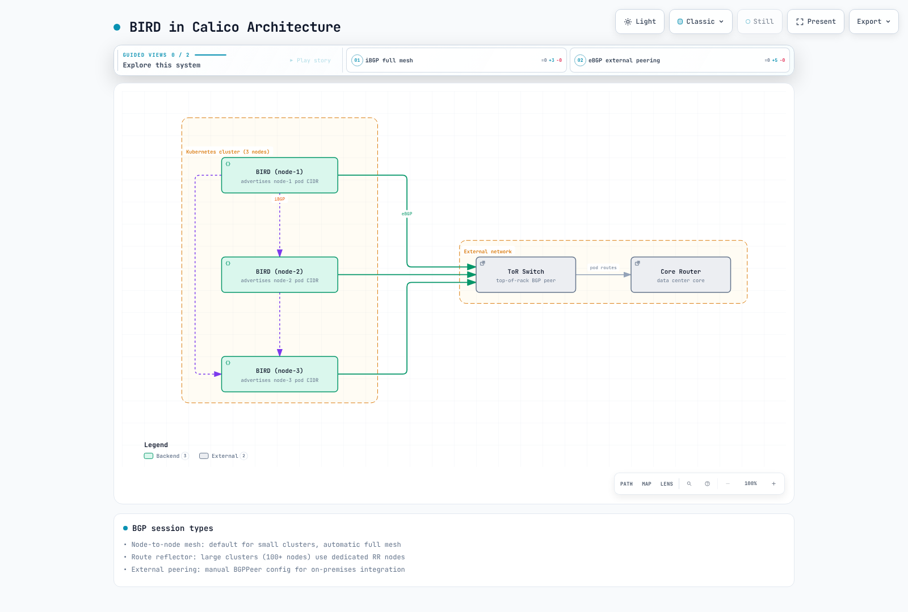
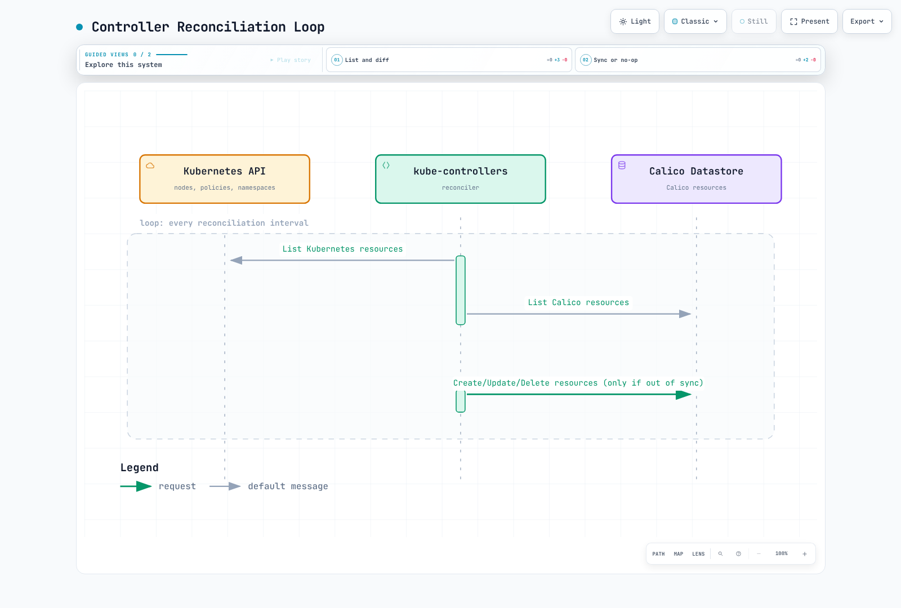
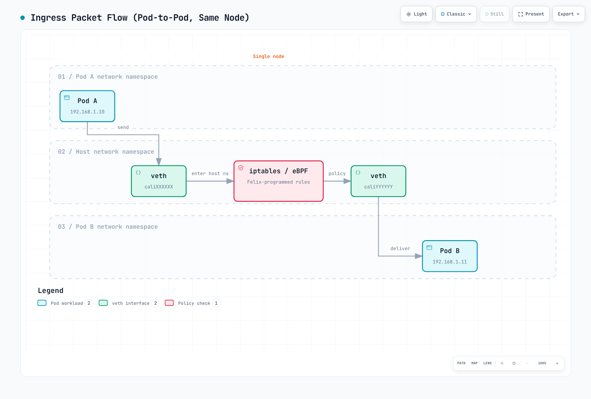

# Parte 2: Arquitectura

> **Base de revisión**: Calico Open Source 3.32.2 / operator 1.42.6; Calico 3.32 se prueba con Kubernetes 1.34–1.36.
> **Última actualización**: 12 de septiembre de 2026. Los ejemplos son referencias de configuración, no validación en un clúster real.

## Descripción general

Esta sección profundiza en la arquitectura de Calico. Comprender el funcionamiento y la interacción de sus componentes es esencial para desplegarlo, diagnosticarlo y optimizarlo eficazmente en producción.

## Diagrama de arquitectura completa



[🔍 Ver diagrama interactivo](https://www.atomai.click/kubernetes-docs/archmaps/en-networking-calico-02-architecture-0.html)

Es un esquema simplificado del estado de control. La conexión BIRD omite confd, que genera su configuración; Typha no es una API directa de configuración BIRD. La presencia de BIRD/confd y Typha depende del modo, y no se muestran todos los componentes de control.

## Felix: el agente de Calico

Felix se ejecuta como agente de Calico en los nodos seleccionados que alojan cargas de trabajo y programa en el kernel las rutas, interfaces y políticas que correspondan. En la ruta de red completa de Linux, el entorno de ejecución del contenedor invoca la cadena CNI, y los plugins CNI/IPAM crean interfaces y asignan direcciones. Felix observa de forma asíncrona los cambios en los endpoints; no atiende directamente una llamada CNI ADD. Los componentes exactos dependen del operador, plataforma y modo.

### Responsabilidades de Felix

En Linux, CNI/IPAM crea las interfaces y asigna las direcciones de los Pods. Felix reconcilia el estado de los endpoints y las políticas del kernel. Exponer el endpoint HTTP de salud e informar del estado al almacén de datos son funciones distintas.

### Funciones principales

1. **Programación de rutas**: Reconcilia rutas de cargas de trabajo y túneles; en BGP, el protocolo kernel de BIRD también instala rutas aprendidas
2. **Aplicación de ACL**: Programa reglas de iptables/nftables/eBPF para las políticas de red
3. **Gestión de interfaces**: Reconcilia el estado de los endpoints y los ajustes pertinentes del kernel; la creación de interfaces veth en Linux corresponde a la ruta de CNI
4. **Informes de salud**: Informa al almacén de datos sobre el estado de los nodos y endpoints
5. **Reconciliación de endpoints**: Observa el estado de las cargas de trabajo y programa las políticas y rutas que correspondan; los plugins CNI/IPAM asignan direcciones y crean las interfaces de los Pods en Linux

### Opciones del plano de datos de Felix

Felix admite varios backends:

| Plano de datos | Descripción | Uso apropiado |
| ------------ | -------------------------- | ------------------------------------------- |
| **iptables** | Firewall Linux tradicional | Compatibilidad y despliegues maduros |
| **nftables** | Implementación nativa | Comprobar kernel, plataforma y funciones compatibles |
| **eBPF** | Programable dentro del kernel | Gestión opcional de Service; requiere una migración coordinada y compatibilidad de funciones |

### Recurso FelixConfiguration

```yaml
apiVersion: projectcalico.org/v3
kind: FelixConfiguration
metadata:
  name: default
spec:
  logSeverityScreen: Info
  healthEnabled: true
  healthPort: 9099
  prometheusMetricsEnabled: true
  prometheusMetricsPort: 9091
  reportingInterval: 30s
  reportingTTL: 90s
```

Este ejemplo mínimo usa campos aceptados por Calico 3.32.2. Aplique los cambios mediante el componente propietario; no es una migración del plano de datos ni una receta de ajuste del rendimiento. De forma predeterminada, el endpoint de salud de Felix escucha en localhost. Activar las métricas no configura su recolección por Prometheus ni justifica exponerlas públicamente.

| Aspecto | Propietario / interpretación correcta |
|---|---|
| Plano de datos de Linux | `Installation.spec.calicoNetwork.linuxDataplane` del operador selecciona `Iptables`, `Nftables` o `BPF` para la configuración compatible |
| `bpfEnabled` | Ajuste de bajo nivel; coordine la transición, la compatibilidad con kube-proxy y el acceso a la API; no lo cambie de forma aislada |
| `iptablesBackend: NFT` | Selecciona las herramientas iptables-nft, no el plano de datos nativo de Calico basado en nftables |
| Balanceo al conectar | Campo actual `bpfConnectTimeLoadBalancing: TCP`, `Enabled` o `Disabled`; el booleano `bpfConnectTimeLoadBalancingEnabled` sigue aceptado pero obsoleto |
| Detección de direcciones | `calicoNetwork.nodeAddressAutodetectionV4` / `V6` del operador, o el entorno de arranque en una instalación por manifiestos; no son campos de Felix como `ipAutoDetectionMethod` o `ipv6AutoDetectionMethod` |
| Visibilidad de flujos | Use la configuración compatible de Goldmane/Whisker; Open Source no acepta los campos de registro en archivos de Enterprise del ejemplo anterior |
| MTU y túneles | Derivar de la red subyacente, la encapsulación y el cifrado; coordinarlo con la configuración de Installation/IPPool, sin fijar arbitrariamente 1440/1410/1420 ni habilitar todos los túneles |
| Puertos failsafe de host | Revisar los puertos de acceso administrativo, a la API, BGP y etcd antes de sustituir las listas; las listas antiguas y reducidas podían eliminar excepciones necesarias |
| Duraciones | Use nombres actuales como `reportingInterval`, `reportingTTL`, `iptablesPostWriteCheckInterval` e `iptablesLockProbeInterval`; no añada `Secs` o `Millis` mecánicamente |

El esquema rechaza los antiguos `iptablesLockFilePath`, `iptablesLockTimeoutSecs`, `iptablesLockProbeIntervalMillis`, `iptablesPostWriteCheckIntervalSecs`, `reportingIntervalSecs` y `reportingTTLSecs`. Consulte [Felix](https://docs.tigera.io/calico/latest/reference/resources/felixconfig) y la [API del operador](https://docs.tigera.io/calico/latest/reference/installation/api). Los cambios de direcciones o del plano de datos requieren sus propias comprobaciones del despliegue.

### Estructura de reglas iptables de Felix

Estos son algunos prefijos de las [definiciones publicadas](https://github.com/projectcalico/calico/blob/v3.32.2/felix/rules/rule_defs.go), no se trata del grafo completo. Describen iptables; inspeccione las reglas reales del modo instalado.

| Cadena/prefijo | Función |
|---|---|
| `cali-FORWARD` | Punto de enlace de reenvío de Calico |
| `cali-from-wl-dispatch` | Distribución desde las interfaces de las cargas de trabajo |
| `cali-to-wl-dispatch` | Distribución hacia las interfaces de las cargas de trabajo |
| `cali-fw-…` / `cali-tw-…` | Cadenas por carga y dirección |
| `cali-pi-…` / `cali-po-…` | Cadenas de política entrante/saliente |

### Flujo de datos de Felix

Al crear un Pod, el entorno de ejecución invoca la cadena CNI/IPAM, que configura la red y registra el estado del endpoint. Felix observa cambios y programa políticas/rutas; BGP sigue su propia ruta mediante confd/BIRD cuando está habilitado. Que el Pod esté en estado `Running` no demuestra que las rutas o políticas hayan convergido.

## BIRD: demonio de enrutamiento BGP

BIRD (BIRD Internet Routing Daemon) intercambia rutas BGP cuando está habilitado el backend BGP de Calico. BIRD/confd no son obligatorios en instalaciones que solo aplican políticas o usan VXLAN sin BGP. Las topologías siguientes necesitan un clúster BGP diseñado adecuadamente; no se añaden al laboratorio kind introductorio con BGP desactivado.

### BIRD en Calico



[🔍 Ver diagrama interactivo](https://www.atomai.click/kubernetes-docs/archmaps/en-networking-calico-02-architecture-3.html)

Las líneas son sesiones BGP, no tránsito de paquetes de aplicación por BIRD. Las cifras de tamaño son orientativas; no son requisitos del protocolo ni umbrales fijos para usar reflectores.

### Tipos de sesión BGP

| Tipo | Uso | Configuración |
| --------------------- | --------------------------- | ---------------------- |
| **Malla entre nodos** | Predeterminada en clústeres pequeños | Automática y completa |
| **Reflector de rutas** | Reducir las sesiones de la malla según lo requiera la topología | Configurar y verificar primero los pares de reemplazo |
| **Peering externo** | Integración local | Configuración BGP manual |

### Ejemplos BGP

#### Malla entre nodos (predeterminada)

```yaml
apiVersion: projectcalico.org/v3
kind: BGPConfiguration
metadata:
  name: default
spec:
  logSeverityScreen: Info
  nodeToNodeMeshEnabled: true
  asNumber: 64512
```

#### Reflectores de rutas

Siga la [transición BGP oficial](https://docs.tigera.io/calico/latest/networking/configuring/bgp). Asignar a un nodo un ID de clúster de reflector lo elimina inmediatamente de la malla existente y puede interrumpir cargas de trabajo. Prepare nodos dedicados sin cargas de trabajo de aplicaciones o planifique una migración de mantenimiento explícita. No sustituya un recurso Calico Node existente por un objeto parcial que omita sus demás ajustes.

En una instalación que usa el almacén de datos de la API de Kubernetes, la anotación documentada conserva los campos existentes. Sustituya los nombres por los nodos preparados:

```bash
# Existing, prepared RR nodes with no application workloads.
kubectl get nodes rr-1 rr-2 -o yaml > rr-nodes-before.yaml
kubectl get bgpconfiguration.projectcalico.org default -o yaml > bgp-before.yaml
kubectl annotate node rr-1 projectcalico.org/RouteReflectorClusterID=244.0.0.1 --overwrite
kubectl annotate node rr-2 projectcalico.org/RouteReflectorClusterID=244.0.0.2 --overwrite
kubectl label nodes rr-1 rr-2 route-reflector=true --overwrite
kubectl apply -f - <<'YAML'
apiVersion: projectcalico.org/v3
kind: BGPPeer
metadata:
  name: nodes-to-route-reflectors
spec:
  nodeSelector: all()
  peerSelector: route-reflector == 'true'
YAML
```

El selector `all()` aplicado al selector de reflectores abarca los clientes y las sesiones entre reflectores; verifique ambos reflectores y las rutas de los clientes. Espere sesiones establecidas y confirme conectividad antes de desactivar la malla antigua. Una sesión en estado `Established`, por sí sola, no demuestra que se hayan aceptado las rutas necesarias.

```bash
# Only after replacement sessions, routes and test traffic have been verified.
kubectl patch bgpconfiguration.projectcalico.org default --type merge \
  -p '{"spec":{"nodeToNodeMeshEnabled":false}}'
```

Se trata de una transición ordenada: no aplique todos los bloques a la vez ni lo tome como garantía de que no habrá interrupciones. Conserve la configuración y una ruta de recuperación probada. Direcciones, ASN y números de AS reutilizados en la red externa necesitan políticas y manejo de bucles deliberados.

#### Peering BGP externo

Sustituya la dirección del par, los ASN y el selector del rack por los valores de la topología prevista. La referencia a la contraseña requiere un Secret y una clave coincidentes en el espacio de nombres del componente de nodo, además de una configuración compatible en el router. Autentica la sesión BGP, no los datos de la carga.

```yaml
apiVersion: projectcalico.org/v3
kind: BGPPeer
metadata:
  name: tor-switch-peer
spec:
  peerIP: 10.0.0.1
  asNumber: 65001
  nodeSelector: rack == 'rack-1'
  password:
    secretKeyRef:
      name: bgp-passwords
      key: tor-password
  sourceAddress: UseNodeIP
  keepOriginalNextHop: false
```

### Propagación de rutas


[🔍 Ver diagrama interactivo](https://www.atomai.click/kubernetes-docs/archmaps/en-networking-calico-02-architecture-4.html)

Es una vía de información. El protocolo kernel de BIRD también instala rutas aprendidas, y confd/IPAM contribuye a la configuración generada. Los filtros BGP son política de rutas, no aplicación de Kubernetes NetworkPolicy.

### Comandos de estado BIRD

Seleccione un nodo con BIRD activo. El [script de arranque publicado](https://github.com/projectcalico/calico/blob/v3.32.2/node/filesystem/etc/service/available/bird/run) configura el socket de control IPv4 en la ruta indicada. Las instalaciones gestionadas mediante manifiestos pueden usar otro espacio de nombres.

```bash
CALICO_NODE=worker-node-name
CALICO_POD=$(kubectl -n calico-system get pods -l k8s-app=calico-node \
  --field-selector "spec.nodeName=$CALICO_NODE" -o jsonpath='{.items[0].metadata.name}')
: "${CALICO_POD:?No Calico Pod on the selected node}"
kubectl -n calico-system exec "$CALICO_POD" -c calico-node -- \
  birdcl -s /var/run/calico/bird.ctl show protocols
kubectl -n calico-system exec "$CALICO_POD" -c calico-node -- \
  birdcl -s /var/run/calico/bird.ctl show route
```

Use nombres y prefijos reales para consultas detalladas. Los comandos y la salida de consola son elementos distintos: los antiguos prompts `birdcl>` no eran comandos Bash. Estas comprobaciones de lectura no configuran rutas.

## confd: gestión de configuración

confd es una herramienta ligera que observa el almacén de datos de Calico y genera archivos de configuración de BIRD.

### Flujo de confd

Observa la configuración BGP, renderiza la plantilla, valida la configuración candidata y solicita a BIRD que la recargue.

### Procesamiento de plantillas

Use la [plantilla publicada](https://github.com/projectcalico/calico/blob/v3.32.2/confd/etc/calico/confd/templates/bird.cfg.template), no una estructura inventada `.NodeIP` / `.BGPPeers`. Este extracto ilustra sincronización con el kernel; los filtros y contexto se definen aparte, por lo que no es un `bird.cfg` completo.

```text
protocol kernel {
  learn;
  persist;
  scan time 2;
  import all;
  export filter calico_kernel_programming;
  graceful restart;
  merge paths on;
}
```

La [definición de configuración de confd](https://github.com/projectcalico/calico/blob/v3.32.2/confd/etc/calico/confd/conf.d/bird.toml) escribe `/etc/calico/confd/config/bird.cfg`, valida con `bird -p -c {{.src}}` y recarga mediante `sv hup bird || true`. BIRD también puede exportar al kernel determinadas rutas aprendidas; no se limita a recibir todas las rutas de Felix. La recarga y el comportamiento de reinicio con mantenimiento de rutas (`graceful restart`) requieren comprobar el estado y el tráfico. Gestione BGP mediante el propietario API, no editando el archivo generado.

## Typha: componente de distribución y escalado

Typha actúa como proxy de distribución entre la API de Kubernetes y los agentes Felix. Reduce la carga de la API al almacenar en caché y distribuir los cambios del almacén de datos.

### ¿Por qué Typha?

La caché de estado y la transmisión de cambios a varios clientes reducen el procesamiento repetido de actualizaciones. Además del número de nodos, también importan el componente que gestiona la instalación, TLS y la lógica real de escalado.

### Escalado de Typha en operator 1.42.6

El operador despliega y escala Typha; no existe la regla universal «solo por encima de 50 nodos». La [implementación fijada](https://github.com/tigera/operator/blob/v1.42.6/pkg/controller/installation/typha_autoscaler.go) cuenta los nodos que no están marcados como no programables (`unschedulable`), excluye los nodos virtuales de AKS y comprueba por separado que haya suficientes nodos Linux para ubicar las réplicas deseadas. Las taints y las demás restricciones de ubicación también influyen.

La [función real](https://github.com/tigera/operator/blob/v1.42.6/pkg/common/autoscale.go), no su comentario abreviado, devuelve:

- 1 réplica para 1–2 nodos contados.
- 2 réplicas para 3–4 nodos contados.
- `max(3, floor(N / 200) + 2)` para 5 o más.

| Nodos contados | Réplicas deseadas en esta versión |
|---|---|
| 50 | 3 |
| 200 | 3 |
| 500 | 4 |
| 1,000 | 7 |
| 2,000 | 12 |

Es un número deseado específico de versión, no capacidad garantizada por réplica ni recomendación universal. El modo `non-cluster-host` cuenta por separado los recursos `HostEndpoint` que cumplen los requisitos. La antigua tabla `max(3, ceil(N / 200))` no describía este operador.

### Configuración Typha administrada

Mantenga bajo la misma gestión el Deployment, ServiceAccount/RBAC, Service, presupuesto de interrupciones y configuración TLS. El antiguo Deployment manual omitía dependencias esenciales y podía sobrescribir ajustes administrados. TLS Felix–Typha usa CA fiable, certificado/clave del servidor e identidad esperada del cliente Felix. 5473 es el puerto de sincronización, no un proxy de tráfico de usuario.

```bash
# Change the operator's supported setting through its API.
kubectl patch installation.operator.tigera.io default --type merge \
  -p '{"spec":{"typhaMetricsPort":9093}}'
kubectl -n calico-system get deployment calico-typha -o yaml
kubectl -n calico-system get service calico-typha -o yaml
kubectl -n calico-system get pdb
```

El endpoint de salud de Typha escucha en localhost:9098 de forma predeterminada. Este operador calcula el puerto de salud restando uno al puerto de salud configurado para Felix y configura las sondas en consecuencia. Un Deployment que use la red del Pod no podrá alcanzar un proceso que solo escuche en localhost si la sonda apunta a la IP del Pod; no es seguro copiar las sondas sin sus ajustes de red y dirección de escucha. El código fuente del operador proporciona montajes TLS y ajustes de identidad del cliente ausentes en el antiguo ejemplo independiente.

### Arquitectura de distribución de Typha

Cada instancia de Typha mantiene en caché el estado de los flujos de sus clientes. Los grupos de clientes del dibujo no especifican capacidad fija por instancia.

## kube-controllers: integración con Kubernetes

calico-kube-controllers ejecuta funciones de reconciliación seleccionadas. Los controladores que se ejecutan dependen del almacén de datos, la edición y la configuración de instalación. La proyección de políticas/espacios de nombres/cuentas de servicio a un almacén de datos etcd es distinta del tratamiento del almacén de datos de la API de Kubernetes.

### Roles disponibles

| Controlador | Propósito |
| ------------------------------- | ------------------------------------------------- |
| **Node Controller** | Sincroniza nodos Kubernetes y recursos Calico |
| **Policy Controller** | Sincroniza NetworkPolicy y políticas Calico |
| **Namespace Controller** | Sincroniza las etiquetas de los espacios de nombres para gestionar perfiles |
| **ServiceAccount Controller** | Proyecta etiquetas de cuentas de servicio a perfiles; no concede permisos RBAC de Kubernetes |
| **WorkloadEndpoint Controller** | Actualiza metadatos del endpoint de la carga de trabajo, como las etiquetas del Pod, en la ruta correspondiente del almacén de datos |

### Bucle de reconciliación



[🔍 Ver diagrama interactivo](https://www.atomai.click/kubernetes-docs/archmaps/en-networking-calico-02-architecture-8.html)

Es un esquema lógico entre estado deseado y observado, no una traza que demuestre dos LIST remotos por intervalo. Los controladores reales usan observadores (`watches`) y cachés; los roles habilitados dependen del almacén de datos y de la instalación.

### Configuración de kube-controllers

En una instalación con el operador, configure la [API KubeControllersConfiguration](https://docs.tigera.io/calico/latest/reference/resources/kubecontrollersconfig). El Deployment de esta guía no consume cualquier ConfigMap llamado `calico-kube-controllers-config`.

```bash
kubectl get kubecontrollersconfiguration.projectcalico.org default -o yaml
kubectl patch kubecontrollersconfiguration.projectcalico.org default --type merge \
  -p '{"spec":{"logSeverityScreen":"Info","healthChecks":"Enabled","prometheusMetricsPort":9094}}'
```

Este parche de fusión conserva la configuración existente de `controllers`. Si GitOps gestiona el recurso, realice en su lugar el cambio equivalente en su estado deseado. Un manifiesto de sustitución con objetos de controlador vacíos puede alterar ajustes existentes de reconciliación o asignación.

Operator 1.42.6 selecciona `ENABLED_CONTROLLERS=node,loadbalancer` en Open Source estándar. La lista más amplia anterior describe los roles disponibles, no significa que cinco controladores estén necesariamente activos con cada almacén de datos. Su [renderer](https://github.com/tigera/operator/blob/v1.42.6/pkg/render/kubecontrollers/kube-controllers.go) indica una réplica y `Recreate`; la antigua afirmación de elección de líder no estaba respaldada. Mantenga esta carga bajo la gestión del propietario de la instalación; no la reemplace ni la escale manualmente.

## Opciones de almacén de datos

Los ejemplos del operador usan el almacén de datos de la API de Kubernetes. El estado de Calico puede incluir CRD de Calico y objetos nativos de Kubernetes; no todos los recursos lógicos de Calico corresponden a un CRD independiente. El servidor de API agregado habitual expone `projectcalico.org/v3` sobre la representación interna. Los CRD v3 nativos son una vista previa técnica separada de 3.32 con migración propia.

Typha distribuye actualizaciones de lectura y de observación; no es un proxy general de escritura para Felix. Los componentes que actualizan estados o recursos utilizan su propio acceso al almacén de datos. Kubernetes persiste el estado de su API en el almacén de datos subyacente, pero en este modo los usuarios de Calico no necesitan un clúster etcd independiente para Calico.

El acceso directo a etcdv3 es una opción de instalación distinta, con compatibilidad y límites de funciones explícitos. No dé por hecho que es más rápido, que carece de límites o que sea necesario al superar los 5,000 nodos. El plano de datos eBPF requiere el almacén de datos de la API de Kubernetes. Una instalación con etcd directo también necesita gestionar su propia confianza TLS, credenciales, disponibilidad y un diseño coherente de copias de seguridad y restauración.

| Aspecto | Almacén de datos de la API de Kubernetes | etcdv3 directo |
|---|---|---|
| Control de acceso | Autenticación/RBAC de Kubernetes y la ruta de API de Calico adecuada | Autenticación/TLS y controles de acceso de etcd |
| Operaciones | Reutilizar la API del clúster; seguir el procedimiento de copias de seguridad del proveedor | Operar y respaldar la instalación etcd seleccionada |
| Hosts/VM | Comprobar instalación y edición | Comprobar instalación y edición |
| Selección | Usado en esta guía | Diseño validado aparte, no atajo por número de nodos |

En Kubernetes administrado, «copia de seguridad de Kubernetes» no significa que el usuario pueda tomar instantáneas directamente del etcd del plano de control. Respalde los recursos compatibles mediante el procedimiento de la plataforma.

## Secuencia entre componentes

Kubelet solicita crear el sandbox del Pod mediante el entorno de ejecución del contenedor, que invoca CNI/IPAM. Los datos de endpoints y políticas llegan a Felix por la ruta seleccionada del almacén de datos y de observación. En BGP, confd/BIRD configuran rutas por separado. La convergencia es asíncrona: verifique conectividad y aplicación reales.

## Análisis del flujo de paquetes

### Entrada entre Pods del mismo nodo



[🔍 Ver diagrama interactivo](https://www.atomai.click/kubernetes-docs/archmaps/en-networking-calico-02-architecture-12.html)

El recuadro de política resume las comprobaciones de salida del origen y de entrada del destino que realiza el kernel. Los veth pertenecen a las rutas de ambos Pods; no se envían paquetes a través del proceso Felix.

### Salida entre Pods de distintos nodos con IPIP


[🔍 Ver diagrama interactivo](https://www.atomai.click/kubernetes-docs/archmaps/en-networking-calico-02-architecture-13.html)

Las dos rutas son alternativas. «Felix/iptables» son reglas del kernel programadas por Felix, no reenvío del demonio. BIRD aporta control de rutas BGP y no transporta paquetes de aplicación.

### Comparación de estructura de paquetes

```
Original Pod-to-Pod Packet:
┌─────────────────────────────────────────────────────────────┐
│ Ethernet │   IP Header    │   TCP/UDP   │     Payload      │
│  Header  │ Src: 192.168.1.10 │   Header    │                  │
│          │ Dst: 192.168.2.10 │             │                  │
└─────────────────────────────────────────────────────────────┘

IPIP Encapsulated Packet:
┌───────────────────────────────────────────────────────────────────────────────┐
│ Ethernet │   Outer IP     │   Inner IP     │   TCP/UDP   │     Payload      │
│  Header  │ Src: 10.0.1.10 │ Src: 192.168.1.10 │   Header    │                  │
│          │ Dst: 10.0.1.11 │ Dst: 192.168.2.10 │             │                  │
│          │ Proto: 4 (IPIP)│                │             │                  │
└───────────────────────────────────────────────────────────────────────────────┘
```

## Resumen

La arquitectura de Calico está diseñada para ofrecer escalabilidad, rendimiento y sencillez operativa:

1. **Felix**: Agente principal en cada nodo, que programa rutas y ACL
2. **BIRD**: Distribuye rutas mediante BGP para integrarse con el enrutamiento nativo
3. **confd**: Conecta el almacén de datos con la configuración de BIRD
4. **Typha**: Escala reduciendo la carga de la API de Kubernetes
5. **kube-controllers**: Mantiene Kubernetes y Calico sincronizados
6. **Almacén de datos**: API de Kubernetes (recomendada) o etcd para almacenar la configuración

Comprender estos componentes y sus interacciones es esencial para:

* Diagnosticar problemas de conectividad
* Optimizar el rendimiento a escala
* Planificar capacidad y arquitectura
* Integrar Calico con la infraestructura de red existente

[Anterior: Parte 1 - Introducción a Calico](01-introduction.md)

[Siguiente: Parte 3 - Modos de red](03-networking-modes.md)

[Volver a la descripción general de Calico](./README.md)

## Cuestionario

Compruebe lo aprendido con el [cuestionario de arquitectura](../../quizzes/networking/calico/02-architecture-quiz.md).
