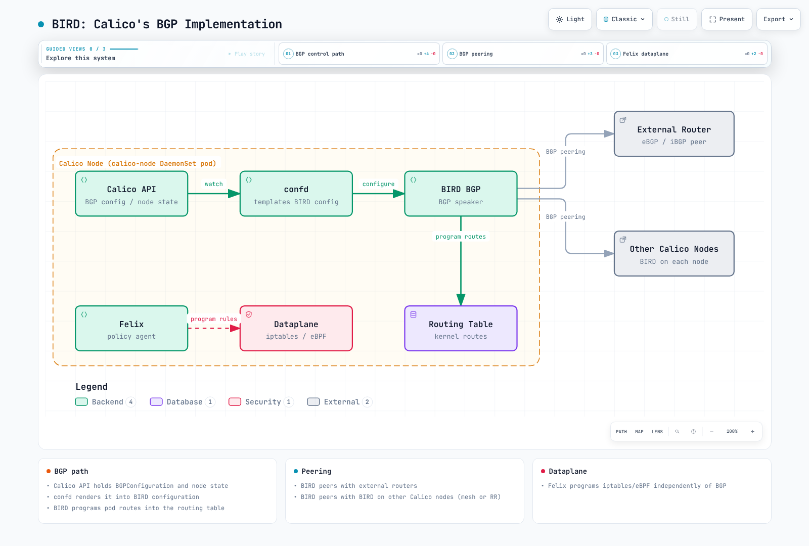
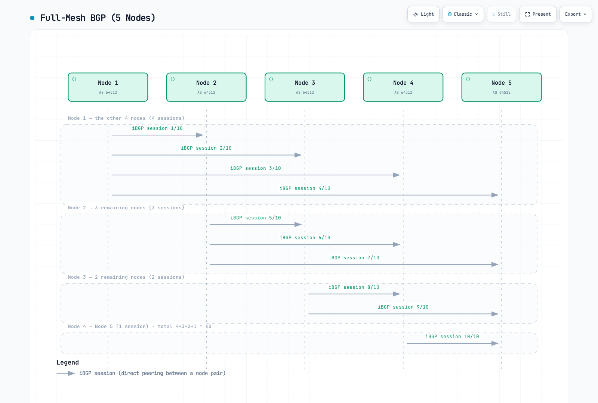
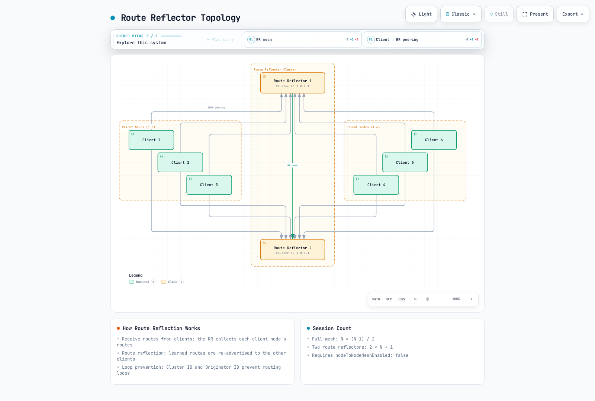
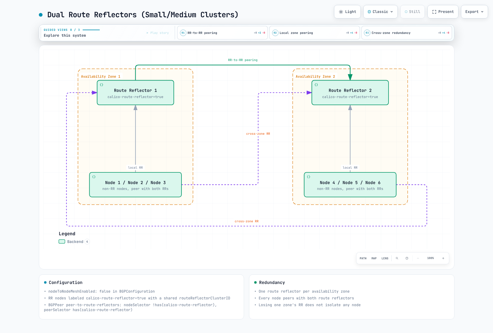
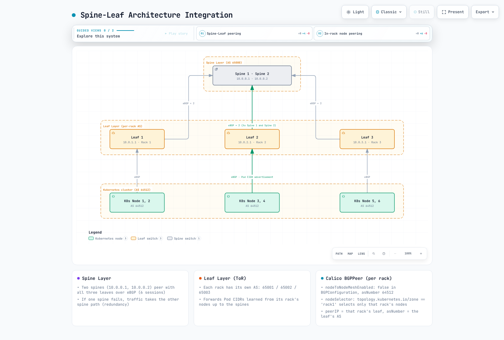
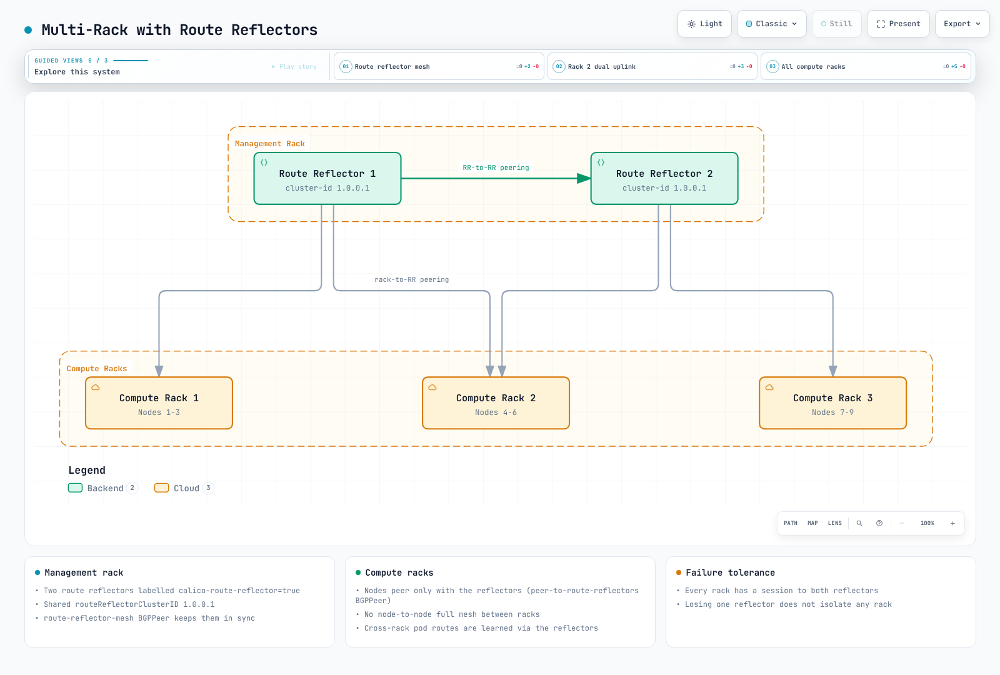
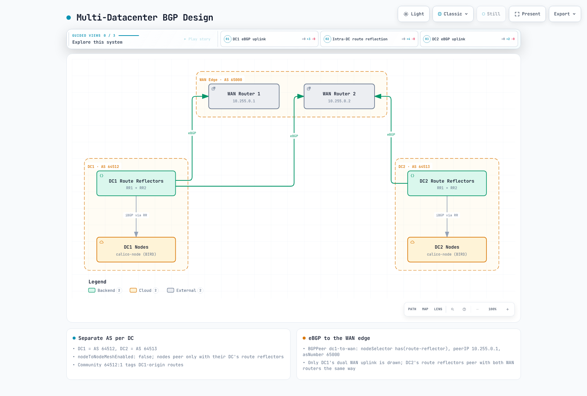

# Parte 4: BGP en profundidad

> **Base de revisión**: Calico 3.32.2; Calico 3.32 se probó con Kubernetes 1.34–1.36. **Última actualización**: 12 de septiembre de 2026.
>
> Los ejemplos de configuración presuponen un clúster Calico sobre Linux, con BGP habilitado y el servidor de API estándar de Calico (`projectcalico.org/v3`) instalado. Muestran topologías alternativas; no se deben aplicar en secuencia como un único manifiesto. Mantenga la configuración bajo la gestión del operador/GitOps de la instalación e integre solo los campos deseados en la configuración existente. La [guía de instalación](01-introduction.md) cubre los requisitos de API; la [guía de modos de red](03-networking-modes.md), las alternativas de enrutamiento sin BGP. Las direcciones de los routers, los ASN y los CIDR deben corresponder a una red bajo su control. En esta revisión no se probó una infraestructura de red real ni la conmutación por error del clúster.

## Introducción

Border Gateway Protocol (BGP) intercambia información sobre las rutas alcanzables. Calico puede usarlo para distribuir rutas de cargas de trabajo e integrarse con una infraestructura de enrutamiento existente. BGP es un protocolo del plano de control: puede usarse tanto con enrutamiento sin encapsulación como con IP-in-IP, pero por sí solo no garantiza un mejor rendimiento. Calico 3.32 también permite a Felix gestionar el enrutamiento del clúster sin BGP; para anunciar rutas por BGP fuera del clúster sigue haciendo falta un participante BGP.

Esta guía profundiza en los fundamentos de BGP, las opciones de arquitectura BGP de Calico, los recursos de configuración y los patrones avanzados de implementación en entornos empresariales.

***

## Fundamentos de BGP

### ¿Qué es BGP?

BGP (Border Gateway Protocol) es un protocolo de enrutamiento de vector de rutas diseñado para intercambiar información de enrutamiento entre sistemas autónomos. En Calico, distribuye rutas IP de pods entre los nodos del clúster y, de forma opcional, hacia la infraestructura de red externa.

### Conceptos principales

| Concepto | Descripción |
| -------------------------- | -------------------------------------------------------------------- |
| **Sistema autónomo (AS)** | Conjunto de redes IP bajo un dominio administrativo |
| **Número AS (ASN)** | Identificador de 16 o 32 bits; la asignación excluye rangos especiales o reservados |
| **iBGP** | BGP interno: sesiones entre routers del mismo AS |
| **eBGP** | BGP externo: sesiones entre AS distintos |
| **NLRI** | Network Layer Reachability Information: rutas anunciadas |
| **Participante BGP** | Router o software que participa en BGP |

### Rangos privados de ASN

IANA reserva los siguientes rangos de ASN para uso interno de las organizaciones:

```
16-bit Private ASN Range: 64512 - 65534
32-bit Private ASN Range: 4200000000 - 4294967294
```

El ASN predeterminado del clúster Calico es `64512`. Los ASN privados deben eliminarse de la ruta AS_PATH antes de que esas rutas lleguen a Internet global; son identificadores, no direcciones IP inherentemente no enrutables. Otros rangos especiales incluyen los ASN reservados para documentación `64496–64511` y `65536–65551`, además de `23456` (AS_TRANS). Consulte el [registro de IANA](https://www.iana.org/assignments/as-numbers/as-numbers.xhtml); no suponga que cualquier otro entero es un ASN público asignado.

### Selección de rutas

Compare la implementación y la política de enrutamiento reales. Cisco `Weight` y las distancias administrativas 20/200 no son propiedades universales de BGP ni valores predeterminados de BIRD en Calico.

Calico 3.32.2 fija la versión de BIRD bifurcada por Calico en `v0.3.3-211-g9111ec3c`. Al comparar rutas BGP elegibles equivalentes, la función de selección comprueba, en este orden, LOCAL_PREF más alto, AS_PATH más corto (si está habilitado), ORIGIN más bajo, MED más bajo según la política aplicable del AS vecino, eBGP antes que iBGP y una métrica IGP más baja. Para desempatar usa router/ORIGINATOR_ID, la longitud de CLUSTER_LIST y la IP del peer; la preferencia opcional por rutas más antiguas modifica ese desempate. También influyen la supresión, que el siguiente salto sea alcanzable, el tratamiento de rutas obsoletas y la preferencia de rutas de BIRD. No es una secuencia universal de once pasos.

Calico 3.32 traduce sus prioridades de ruta a LOCAL_PREF y métricas del kernel. Por ello, no suponga que todas las rutas locales exportadas conservan el LOCAL_PREF predeterminado de 100 de BIRD upstream.

### Comportamiento iBGP y eBGP

| Atributo | iBGP | eBGP |
| --- | --- | --- |
| Relación AS | Mismo AS | AS distintos |
| AS_PATH | Normalmente conservado | Normalmente antepone el AS local |
| Propagación | Una ruta iBGP normalmente no pasa a otro peer iBGP; RR es excepción | Depende de política y prevención de bucles |
| Siguiente salto | Suele conservarse, pero debe seguir siendo alcanzable | Suele cambiar; depende de `nextHopMode` y de la topología |
| TTL y distancia administrativa | Dependen de implementación/configuración | Dependen de implementación/configuración |

Las rutas originadas localmente o aprendidas por eBGP pueden anunciarse a peers iBGP. La configuración generada para peers externos usa multihop de BIRD; no la diagnostique con una tabla genérica que suponga «TTL 1 para eBGP». Inspeccione la configuración generada y el estado negociado de la sesión.

***

## Arquitectura BGP de Calico

### BIRD: implementación BGP de Calico

Cuando BGP está habilitado, Calico ejecuta una versión de BIRD bifurcada por Calico en `calico-node` y confd genera su configuración. BIRD no hace falta en una instalación con BGP deshabilitado. Las funciones de enrutamiento de BIRD y Felix dependen del modo elegido.



[🔍 Ver diagrama interactivo](https://www.atomai.click/kubernetes-docs/archmaps/en-networking-calico-04-bgp-deep-dive-1.html)

> El diagrama es esquemático: el servidor de API de Calico es un componente independiente, no un proceso dentro de cada pod calico-node. Felix también gestiona las rutas locales de las cargas de trabajo y, según el modo elegido, las rutas del clúster. BIRD solo está presente cuando se habilita.

### Opciones de topología

Las opciones internas habituales son:

1. **Malla completa entre nodos** - Predeterminada
2. **Reflectores de rutas** - Recomendados para clústeres mayores

***

## Topología de malla completa

### Funcionamiento

Con BGP y la malla predeterminada habilitados, los nodos participantes que no son RR establecen sesiones entre sí. Los nodos designados como reflectores de rutas quedan excluidos de la malla automática.



[🔍 Ver diagrama interactivo](https://www.atomai.click/kubernetes-docs/archmaps/en-networking-calico-04-bgp-deep-dive-3.html)

> Las flechas representan sesiones bidireccionales, no tráfico en un solo sentido. El recuento considera una sesión por cada par de nodos para la familia de direcciones indicada.

### Fórmula de sesiones

El número de sesiones BGP en una topología de malla completa crece de forma cuadrática:

```
Sessions = N × (N - 1) / 2

Examples:
- 10 nodes:   10 × 9 / 2 = 45 sessions
- 50 nodes:   50 × 49 / 2 = 1,225 sessions
- 100 nodes:  100 × 99 / 2 = 4,950 sessions
- 500 nodes:  500 × 499 / 2 = 124,750 sessions
```

### Escalado y transición

La fórmula supone una sesión por cada par de nodos para la familia de direcciones contabilizada. Cada nodo tiene `N−1` peers. El uso de CPU y memoria depende del número de rutas, la frecuencia de cambios, las políticas, el hardware y los objetivos de convergencia; la tabla antigua de memoria por nodo y los límites fijos de 50/200 nodos no representaban límites de capacidad medidos.

Compruebe la configuración:

```bash
kubectl get bgpconfiguration.projectcalico.org default -o yaml
```

Si no existe el recurso `default`, es posible que estén en uso los valores predeterminados. Prepare y valide las sesiones de reemplazo con los RR o la infraestructura de red antes de desactivar la malla automática. Siga el orden de transición indicado a continuación: crear una etiqueta RR, por sí solo, no proporciona una topología de reemplazo operativa.

***

## Topología con reflectores

### Conceptos

Los reflectores de rutas (RR) resuelven el problema de escalabilidad de iBGP al permitir que un subconjunto de nodos refleje rutas hacia otros nodos. Así se elimina la necesidad de una malla completa.



[🔍 Ver diagrama interactivo](https://www.atomai.click/kubernetes-docs/archmaps/en-networking-calico-04-bgp-deep-dive-4.html)

> Este dibujo contiene seis clientes y dos RR: 13 sesiones. En la expresión 2N+1 de la figura, N cuenta los clientes; en el cálculo de la malla completa, N cuenta todos los nodos. Deshabilite la malla automática solo después de verificar la topología explícita que la reemplazará.

### Atributos principales

| Atributo | Descripción |
| -------------------- | ------------------------------------------------------------- |
| **Cluster ID** | Identifica un conjunto de RR que atiende a los mismos clientes |
| **Originator ID** | Evita bucles; se establece con el router ID del originador |
| **Reflexión de rutas** | El RR vuelve a anunciar a otros clientes las rutas que aprendió de sus clientes |

### Número de sesiones con RR

Sea `T` el número total de nodos, `R` el número de reflectores y `C=T−R` el número de clientes. Si cada cliente establece una sesión con cada RR y los RR establecen sesiones entre sí:

```text
RR sessions = C×R + R×(R−1)/2
T=100, R=2: 98×2 + 1 = 197 (full mesh of the same 100 nodes: 4,950)
T=500, R=2: 498×2 + 1 = 997 (full mesh of the same 500 nodes: 124,750)
```

Si por «100 nodos» se entienden 100 clientes más dos RR adicionales, el total es de 201 sesiones, pero la topología tiene 102 nodos. No mezcle ambas interpretaciones.

### Configurar nodos RR

Para esta transición, utilice nodos RR preparados y sin cargas de trabajo. Al establecer un ID de clúster, el nodo sale de inmediato de la malla automática; cambiar un nodo ocupado en el mismo lugar puede interrumpir la conectividad. Este ejemplo con el almacén de datos de Kubernetes conserva las IP de los nodos y los demás campos existentes.

**1. Etiquetar y anotar los RR preparados**

```bash
kubectl label node rr-node-1 rr-node-2 route-reflector=true
kubectl annotate node rr-node-1 rr-node-2   projectcalico.org/RouteReflectorClusterID=244.0.0.1
```

El ID compartido identifica este grupo redundante de RR, no el clúster de Kubernetes. Diseñe deliberadamente los ID de cualquier otro grupo de RR o nivel jerárquico.

**2. Establecer sesiones de peering explícitas**

```yaml
apiVersion: projectcalico.org/v3
kind: BGPPeer
metadata:
  name: peer-to-rr
spec:
  nodeSelector: "!has(route-reflector)"
  peerSelector: "has(route-reflector)"
---
apiVersion: projectcalico.org/v3
kind: BGPPeer
metadata:
  name: rr-mesh
spec:
  nodeSelector: "has(route-reflector)"
  peerSelector: "has(route-reflector)"
```

`peerSelector` selecciona nodos Calico como peers. El peering inverso se configura automáticamente, salvo que se elija `reversePeering: Manual`. No detecta routers externos arbitrarios.

**3. Verificar antes de retirar la ruta antigua**

Compruebe que las sesiones estén en estado Established en ambos RR y sus clientes; que se anuncien y reciban los prefijos de cargas de trabajo esperados; que los siguientes saltos sean alcanzables; y que haya tráfico representativo entre nodos. Confirme que el reenvío siga funcionando ante la pérdida prevista de cualquiera de los RR. Las sesiones de malla normales entre clientes pueden mantenerse durante esta transición.

**4. Desactivar la malla automática solo después**

Actualice el manifiesto de `BGPConfiguration/default` bajo la gestión de su propietario y conserve el ASN, las comunidades y los demás ajustes. El parche de combinación equivalente para un recurso existente es:

```bash
kubectl patch bgpconfiguration.projectcalico.org default --type=merge   -p '{"spec":{"nodeToNodeMeshEnabled":false}}'
```

Si `default` no existe, créelo bajo la gestión de configuración de la instalación después de realizar las mismas comprobaciones. Tras el cambio, vuelva a comprobar las rutas y el tráfico; mantenga un plan para revertir a la topología original.

### Patrones de redundancia

**Patrón 1: dos reflectores, clústeres pequeños/medianos**



[🔍 Ver diagrama interactivo](https://www.atomai.click/kubernetes-docs/archmaps/en-networking-calico-04-bgp-deep-dive-11.html)

> Si se pierde un RR, los clientes que siguen operativos disponen de una vía redundante para recibir rutas, siempre que el transporte, el reenvío y la capacidad restante funcionen correctamente. Esto no conserva las cargas de trabajo que estaban en una zona fallida.

**Patrón 2: reflectores jerárquicos**

Los RR de cada rack pueden establecer sesiones con RR globales para reducir el número de sesiones que mantiene cada nodo. Aun así, el total de sesiones crece con el número de clientes y de racks. Un único RR por rack sigue siendo un punto de fallo aunque los RR globales sean redundantes; antes de adoptar una jerarquía, evalúe la redundancia, los ID de clúster, las reglas de reflexión, la conectividad y la convergencia de cada nivel.

***

## Recurso BGPPeer

El recurso `BGPPeer` define las relaciones de peering BGP entre los nodos Calico y los participantes BGP externos.

### Ámbitos de BGPPeer

| Tipo | Descripción | Uso |
| ----------------- | -------------------- | ----------------------- |
| **Global** | Todos los nodos | Routers externos |
| **Por selector de nodo** | Usa nodeSelector | Peering local por rack |
| **Por nodo** | Nodo específico | Configuraciones especiales |

### BGPPeer global

Establezca sesiones entre todos los nodos y los switches ToR externos:

```yaml
apiVersion: projectcalico.org/v3
kind: BGPPeer
metadata:
  name: peer-to-tor-switches
spec:
  peerIP: 10.0.0.1
  asNumber: 65001
  # No nodeSelector means all nodes peer with this address
```

### BGPPeer con selección de nodos

Establezca sesiones entre los nodos de racks concretos y su switch ToR local:

```yaml
apiVersion: projectcalico.org/v3
kind: BGPPeer
metadata:
  name: rack1-tor-peer
spec:
  nodeSelector: rack == 'rack1'
  peerIP: 10.0.1.1
  asNumber: 65001
---
apiVersion: projectcalico.org/v3
kind: BGPPeer
metadata:
  name: rack2-tor-peer
spec:
  nodeSelector: rack == 'rack2'
  peerIP: 10.0.2.1
  asNumber: 65002
```

### BGPPeer con peerSelector

Use `peerSelector` para seleccionar dinámicamente los nodos Calico que serán peers:

```yaml
apiVersion: projectcalico.org/v3
kind: BGPPeer
metadata:
  name: client-to-rr-peering
spec:
  nodeSelector: "!has(route-reflector)"
  peerSelector: has(route-reflector)
```

### Configuración avanzada

Primero, cree el Secret y el BGPFilter `tor-policy` mencionados en la sección de seguridad. Este ejemplo presupone un peer conectado directamente y parámetros de GTSM y autenticación coincidentes.

```yaml
apiVersion: projectcalico.org/v3
kind: BGPPeer
metadata:
  name: advanced-peer
spec:
  node: specific-node-name
  peerIP: 192.168.1.1
  asNumber: 65100
  password:
    secretKeyRef:
      name: bgp-secrets
      key: datacenter-password
  keepaliveTime: 30s
  maxRestartTime: 120s
  sourceAddress: UseNodeIP
  nextHopMode: Auto
  ttlSecurity: 1
  filters:
    - tor-policy
```

| Campo | Significado en Calico 3.32.2 |
| --- | --- |
| `keepaliveTime` | Cadena que expresa una duración; la `a` minúscula es significativa. Verificado con el CRD publicado y el generador de configuración. |
| `maxRestartTime` | Tiempo de Graceful Restart que se anuncia al vecino; no es un intervalo para reintentar la conexión. |
| `sourceAddress` | `UseNodeIP` o `None`; no acepta una dirección IP literal. |
| `filters` | Nombres de recursos `BGPFilter` existentes, no reglas incrustadas. |
| `ttlSecurity` | Longitud de la ruta GTSM, medida en saltos; `1` indica un peer conectado directamente. |
| `numAllowedLocalASNumbers` | Número permitido de apariciones del ASN local en el AS_PATH recibido; relaja la prevención de bucles, pero no configura multihop. Déjelo sin configurar salvo que el diseño de enrutamiento lo requiera. |

La API actual de `BGPPeer` no incluye los campos `holdTime`, `keepAliveTime` ni `restartTime`. `nextHopMode` acepta `Auto`, `Self` o `Keep`; el campo anterior `keepOriginalNextHop` está obsoleto, pero no se ha eliminado.

***

## Recurso BGPConfiguration

El recurso `BGPConfiguration` define los ajustes de BGP para todo el clúster.

### Configuración básica

```yaml
apiVersion: projectcalico.org/v3
kind: BGPConfiguration
metadata:
  name: default
spec:
  # Cluster AS number
  asNumber: 64512

  # Set topology separately after validating its peerings.
  # Log level for BIRD
  logSeverityScreen: Info
```

### Anuncio de direcciones IP de Service

Calico puede anunciar las direcciones IP de recursos Service existentes a una red con enrutamiento autorizada. El anuncio no asigna la dirección IP, no crea un equilibrador de carga en la nube ni garantiza una ruta de retorno alcanzable. Los CIDR siguientes son ejemplos: integre solo los rangos necesarios en la configuración existente y conserve los demás ajustes.

```yaml
apiVersion: projectcalico.org/v3
kind: BGPConfiguration
metadata:
  name: default
spec:
  asNumber: 64512

  # Advertise Service ClusterIPs
  serviceClusterIPs:
    - cidr: 10.96.0.0/12

  # Advertise Service ExternalIPs
  serviceExternalIPs:
    - cidr: 203.0.113.0/24

  # Advertise Service LoadBalancerIPs
  serviceLoadBalancerIPs:
    - cidr: 198.51.100.0/24
```

### Comunidades BGP

`prefixAdvertisements` añade comunidades a las rutas existentes que coinciden, incluidas las rutas de Pods en la configuración que genera la versión actual. **No** origina el prefijo indicado ni agrega todos los bloques de Pods en ese prefijo. Las comunidades con nombre solo tienen efecto cuando se referencian; ni sus nombres ni sus valores arbitrarios implementan por sí mismos una política de enrutamiento.

```yaml
apiVersion: projectcalico.org/v3
kind: BGPConfiguration
metadata:
  name: default
spec:
  asNumber: 64512

  # Community tagging for pod networks
  prefixAdvertisements:
    - cidr: 10.244.0.0/16
      communities:
        - "64512:100"  # Standard community
        - "64512:200"
    - cidr: 10.96.0.0/12
      communities:
        - "64512:300"  # Service IPs community

  # Named aliases, referenced by prefixAdvertisements in this configuration
  communities:
    - name: pod-networks
      value: "64512:100"
    - name: service-networks
      value: "64512:300"
    - name: no-export
      value: "65535:65281"  # Well-known NO_EXPORT
```

### ASN por nodo

Si utiliza el almacén de datos de Kubernetes, anote el nodo existente para conservar sus direcciones y los demás campos. Cambiar el ASN reinicia las sesiones de peering afectadas; coordine ambos extremos y la topología de enrutamiento.

```bash
kubectl annotate node border-node-1 projectcalico.org/ASNumber=65001
```

Si la anotación ya existe, revise su valor actual y actualícela mediante el mecanismo propietario de la configuración. Los demás almacenes de datos usan la API Node de Calico; no reemplace un recurso Node existente por un ejemplo parcial con direcciones inventadas.

***

## Anuncio de IP de Service

### Tipos de anuncio y reenvío

| Tipo | Propietario y requisito |
| --- | --- |
| ClusterIP | Kubernetes asigna la dirección; anunciar el CIDR de Service expone una ruta hacia la red de servicios. |
| ExternalIP | El operador ya debe ser propietario de la dirección asignada y enrutarla. `spec.externalIPs` está obsoleto desde Kubernetes 1.36, pero sigue siendo compatible y no se ha eliminado. |
| IP de LoadBalancer | La asigna un controlador compatible. Calico puede asignar sus propias VIP o interoperar con un asignador elegido explícitamente. El nombre de host de un LB en la nube no es un prefijo IP. |

Con la agregación predeterminada, los Services en modo Cluster usan los anuncios agregados configurados; los Services en modo Local usan rutas de host (`/32` o `/128`) anunciadas desde los nodos que tengan endpoints locales listos. Los rangos explícitos de prefijos de host y el ajuste `serviceLoadBalancerAggregation` de Calico 3.32 pueden modificar las rutas anunciadas. Inspeccione la RIB y la exportación reales en lugar de deducir las rutas solo por el tipo de Service. Valide los endpoints, el plano de datos del Service, el ECMP ascendente y las rutas de retorno. Este comportamiento es distinto del anuncio de bloques IPAM de Pods.

### IPAM LoadBalancer nativo

Calico 3.32 incluye un controlador LoadBalancer en `calico-kube-controllers`. Requiere un IPPool con `allowedUses: [LoadBalancer]`; el grupo de Pods estándar no proporciona esas direcciones automáticamente. Confirme que el controlador esté habilitado. Este ejemplo independiente para bare metal también presupone que ya existen el espacio de nombres `calico-demo` y endpoints listos `app=my-app` que atienden en el puerto indicado. Reemplace el rango reservado para documentación por un rango propio y enrutable.

```yaml
apiVersion: projectcalico.org/v3
kind: IPPool
metadata:
  name: service-lb-pool
spec:
  cidr: 198.51.100.0/24
  allowedUses:
    - LoadBalancer
  assignmentMode: Automatic
---
apiVersion: projectcalico.org/v3
kind: BGPConfiguration
metadata:
  name: default
spec:
  serviceLoadBalancerIPs:
    - cidr: 198.51.100.0/24
---
apiVersion: v1
kind: Service
metadata:
  name: my-lb-service
  namespace: calico-demo
  annotations:
    projectcalico.org/loadBalancerIPs: '["198.51.100.50"]'
spec:
  type: LoadBalancer
  loadBalancerClass: calico
  externalTrafficPolicy: Local
  selector:
    app: my-app
  ports:
    - port: 443
      targetPort: 8443
```

La dirección solicitada explícitamente mediante `projectcalico.org/loadBalancerIPs` debe pertenecer a un grupo elegible y estar disponible; si no puede asignarse, Calico no recurre a otra dirección. La asignación y el anuncio por BGP son procesos independientes. Antes de cambiarlo, revise el modo `assignIPs` del controlador: `RequestedServicesOnly` puede desasignar IP de Services existentes que no tengan anotación. Mantenga intacta la gestión de los grupos y del controlador existentes.

MetalLB es un asignador alternativo; su anotación actual para solicitar una IP es `metallb.io/loadBalancerIPs`. Decida deliberadamente quién asigna las IP y quién las anuncia por BGP. No ejecute asignadores ni participantes BGP que compitan por la misma VIP. No anuncie direcciones de equilibradores de carga gestionados por AWS como si fueran un grupo de direcciones de su propiedad local.

### Anuncio selectivo

Calico no documenta ninguna anotación de Service llamada `projectcalico.org/bgp-advertise` para excluir un servicio de los anuncios. Seleccione los rangos anunciados en `BGPConfiguration` y, cuando sea necesario, aplique BGPFilters específicos para cada peer. La etiqueta de nodo compatible `node.kubernetes.io/exclude-from-external-load-balancers=true` excluye un nodo; no permite excluir un Service individual.

Rechazar una ruta `/32` no vuelve inalcanzable una dirección si todavía se anuncia un agregado que la cubre. Para mantener un Service interno, compruebe que ningún rango anunciado incluya su dirección y aplique controles de acceso por separado; el filtrado de rutas no sustituye la autorización.

***

## Integración con la red física

### Políticas ToR y adaptación al fabricante

Configure como un único diseño el ASN del router, los peers de los nodos, la familia de direcciones, la autenticación, las políticas de importación/exportación y la alcanzabilidad de los siguientes saltos. Decida si los nodos usarán una ruta por defecto preexistente de la red subyacente o una que reciban por BGP. `network` origina una ruta coincidente que ya existe; no es una instrucción para aceptar rutas de un peer. Un `redistribute connected` demasiado amplio puede filtrar redes no relacionadas.

| Plataforma | Adaptación necesaria |
| --- | --- |
| Cisco IOS XE / NX-OS | Use la sintaxis exacta de la plataforma y versión. Los peers dinámicos de IOS XE requieren un peer group y `bgp listen range`; no mezcle las jerarquías de comandos de IOS y NX-OS. Defina todos los route maps y prefix lists referenciados. |
| Arista EOS | Use la configuración de peer group, familia de direcciones, secretos y políticas correspondiente a la versión instalada. El antiguo bloque de comandos de EOS, que no se había verificado, no es una receta lista para ejecutar. |
| Junos | Una coincidencia con una prefix-list simple es exacta. Si desea incluir rutas más específicas, use un tipo explícito de coincidencia route-filter. |

Por ejemplo, este **fragmento de política de Junos**, asociado como política de importación al grupo BGP del ToR destinado a los nodos, acepta las rutas previstas de Pods `/26`–`/32` y de LoadBalancer `/32`, y luego rechaza todas las demás:

```text
policy-options {
    policy-statement K8S-IMPORT {
        term approved {
            from {
                route-filter 10.244.0.0/16 prefix-length-range /26-/32;
                route-filter 198.51.100.0/24 prefix-length-range /32-/32;
            }
            then accept;
        }
        term reject-rest {
            then reject;
        }
    }
}
```

La longitud mínima supone bloques IPAM `/26`; ajústela al grupo de IP y al inventario de rutas reales. Las direcciones prestadas y algunos casos de movilidad pueden requerir rutas `/32`, por lo que `le 26` no es un filtro seguro para todas las rutas de Pods. Este fragmento no crea peers ni anuncia una ruta por defecto. Aquí no se probaron en ejecución la configuración de los equipos de red ni la conmutación por error; antes de desplegar, complete y valide la política de exportación, los límites y el siguiente salto en la versión exacta del router.

### Integración spine-leaf



[🔍 Ver diagrama interactivo](https://www.atomai.click/kubernetes-docs/archmaps/en-networking-calico-04-bgp-deep-dive-5.html)

> Los cuadros agrupan varias sesiones. Compartir el ASN de los nodos exige diseñar explícitamente cómo gestionar los bucles de AS y el AS override; tener dos spines no proporciona por sí solo redundancia de switches leaf ni de los enlaces ascendentes de los nodos. Las direcciones y los ASN son ilustrativos, no constituyen una configuración completa lista para implementar.

A continuación se muestran fragmentos de configuración de peers Calico para un diseño spine-leaf. Antes de usarlos, confirme las etiquetas de los nodos, que el siguiente salto sea alcanzable por una ruta directa o recursiva, las políticas de exportación y la ruta de retorno. Si varios nodos de distintos racks reutilizan el ASN 64512, una ruta puede rechazarse cuando su AS_PATH contiene el ASN del nodo que la recibe. Diseñe ASN únicos o una política validada de AS override y prevención de bucles en la red. No intente sortear este problema aumentando a ciegas `numAllowedLocalASNumbers`. Valide la ruta de reemplazo antes de eliminar las sesiones de malla.

```yaml
# Final topology alternative: establish fabric peerings before removing mesh.
apiVersion: projectcalico.org/v3
kind: BGPConfiguration
metadata:
  name: default
spec:
  asNumber: 64512

---
# Peer nodes with their local leaf switch
apiVersion: projectcalico.org/v3
kind: BGPPeer
metadata:
  name: rack1-leaf-peer
spec:
  nodeSelector: topology.kubernetes.io/zone == 'rack1'
  peerIP: 10.0.1.1
  asNumber: 65001

---
apiVersion: projectcalico.org/v3
kind: BGPPeer
metadata:
  name: rack2-leaf-peer
spec:
  nodeSelector: topology.kubernetes.io/zone == 'rack2'
  peerIP: 10.0.2.1
  asNumber: 65002

---
apiVersion: projectcalico.org/v3
kind: BGPPeer
metadata:
  name: rack3-leaf-peer
spec:
  nodeSelector: topology.kubernetes.io/zone == 'rack3'
  peerIP: 10.0.3.1
  asNumber: 65003
```

***

## Estrategia de comunidades BGP

### Patrones de diseño

Los valores privados siguientes son una convención local que requiere una política en el router; no son controles de prioridad incorporados. Las comunidades estándar contienen dos valores de 16 bits. Las comunidades grandes contienen tres valores de 32 bits y permiten representar un ASN de cuatro bytes sin comprimirlo en el formato estándar.

| Comunidad | Significado | Acción |
| ------------- | -------------- | -------------------------------- |
| `64512:100` | Redes Pod | Aceptar, rutas normales |
| `64512:200` | IP de Services | Aceptar, posible política especial |
| `64512:300` | Infraestructura | Enrutamiento de mayor prioridad |
| `65535:65281` | NO\_EXPORT | No anunciar fuera de la confederación AS, o del AS si no hay confederación |
| `65535:65282` | NO\_ADVERTISE | No anunciar a ningún peer |

### Ingeniería de tráfico por comunidades

```yaml
apiVersion: projectcalico.org/v3
kind: BGPConfiguration
metadata:
  name: default
spec:
  asNumber: 64512

  communities:
    - name: production
      value: "64512:100"
    - name: staging
      value: "64512:200"
    - name: local-only
      value: "65535:65281"  # NO_EXPORT

  prefixAdvertisements:
    # Tag existing production routes; actual propagation follows routing policy
    - cidr: 10.244.0.0/17
      communities:
        - production

    # Add NO_EXPORT to existing staging routes
    - cidr: 10.244.128.0/17
      communities:
        - staging
        - local-only

    # Service IPs
    - cidr: 10.96.0.0/12
      communities:
        - production
```

***

## Seguridad BGP

### Autenticación MD5

Calico admite la firma TCP MD5 para sesiones BGP. Autentica el tráfico entre peers que comparten el secreto; no cifra ese tráfico ni verifica que sean legítimas las rutas anunciadas por un peer autenticado.

Cree y administre el Secret `bgp-secrets` mediante el proceso de gestión de secretos, en el espacio de nombres donde se ejecuta `calico-node` (`calico-system` para la instalación con operador utilizada aquí; las instalaciones basadas en manifiestos pueden usar `kube-system`). Este ejemplo requiere la clave `datacenter-password`. Otros ejemplos que hacen referencia a `mesh-password` o a claves específicas de rack o leaf también requieren esas claves. Configure credenciales coincidentes en los routers correspondientes y confirme que la cuenta de servicio de Calico pueda leer el Secret.

```yaml
apiVersion: projectcalico.org/v3
kind: BGPPeer
metadata:
  name: secure-peer
spec:
  peerIP: 192.168.1.1
  asNumber: 65100
  password:
    secretKeyRef:
      name: bgp-secrets
      key: datacenter-password
```

### Filtrado de prefijos

Las reglas se evalúan en orden y la primera coincidencia se aplica de inmediato. De forma predeterminada, las rutas que no coinciden con ninguna regla se aceptan (**Accept**); para crear una lista de permitidas, añada al final un Reject incondicional. `Equal 0.0.0.0/0` solo coincide con la ruta por defecto; `In 0.0.0.0/0` coincide con todas las rutas IPv4 y `NotIn 0.0.0.0/0` no coincide con ninguna.

En el siguiente ejemplo, al importar desde un peer externo solo se aceptan una ruta por defecto y la red subyacente prevista `10.0.0.0/16`. Al exportar, se permiten las rutas reales de Pods `/26`–`/32` y de LoadBalancer `/32`. Adapte los CIDR y sus longitudes al inventario real de rutas; no asocie esta política externa indiscriminadamente a sesiones entre RR y clientes.

```yaml
apiVersion: projectcalico.org/v3
kind: BGPFilter
metadata:
  name: tor-policy
spec:
  importV4:
    - action: Accept
      matchOperator: Equal
      cidr: 0.0.0.0/0
    - action: Accept
      matchOperator: In
      cidr: 10.0.0.0/16
    - action: Reject
  exportV4:
    - action: Accept
      matchOperator: In
      cidr: 10.244.0.0/16
      prefixLength:
        min: 26
        max: 32
      operations:
        - addCommunity:
            value: "64512:100"
    - action: Accept
      matchOperator: In
      cidr: 198.51.100.0/24
      prefixLength:
        min: 32
        max: 32
    - action: Reject
---
apiVersion: projectcalico.org/v3
kind: BGPPeer
metadata:
  name: filtered-peer
spec:
  peerIP: 192.168.1.1
  asNumber: 65100
  filters:
    - tor-policy
```

`prefixLength` es un objeto con `min` y `max`, no una cadena que represente un rango. Calico 3.32 admite operaciones como `addCommunity`. Un Accept explícito de exportación finaliza el procesamiento antes de la lógica incorporada de exportación, agregación y `prefixAdvertisements`; por ello, puede exportar rutas más específicas de la RIB. El ejemplo añade la etiqueta Pod en la propia regla. Antes de aplicar el filtro a la infraestructura de red, revise `show route export`. BGPFilter no crea las rutas que faltan.

### GTSM (seguridad TTL)

GTSM rechaza valores TTL inferiores al umbral esperado. Reduce la suplantación de direcciones desde fuera de la ruta, pero no autentica al peer ni detiene a un atacante en el mismo enlace. Configure ambos extremos de forma coherente.

```yaml
apiVersion: projectcalico.org/v3
kind: BGPPeer
metadata:
  name: gtsm-enabled-peer
spec:
  peerIP: 192.168.1.1
  asNumber: 65100
  ttlSecurity: 1
```

La versión fijada de BIRD envía TTL 255 y exige un valor de al menos `256−hops`. Por ello, `ttlSecurity: 1` exige 255, no 254; para dos saltos, exige al menos 254. Verifique la ruta real antes de habilitarlo. Este ajuste no está relacionado con el número de ASN locales permitidos en AS_PATH.

***

## Ajuste de rendimiento

### Temporizadores BGP

```yaml
apiVersion: projectcalico.org/v3
kind: BGPPeer
metadata:
  name: tuned-peer
spec:
  peerIP: 192.168.1.1
  asNumber: 65100
  keepaliveTime: 20s
  maxRestartTime: 120s
```

La versión fijada de BIRD propone un Hold Time predeterminado de 240 segundos y negocia con el vecino el valor menor. Si no se configura el intervalo keepalive, usa un tercio del Hold Time negociado. Un valor explícito de `keepaliveTime` sustituye ese intervalo; **no** hace que el Hold Time pase automáticamente a ser tres veces mayor. Inspeccione los temporizadores realmente negociados y elija un intervalo que se ajuste a ellos.

`BGPPeer` no expone el campo `holdTime`. Las recomendaciones anteriores de 60/180, 10/30 y 3/9 no son valores predeterminados verificados de Calico ni garantizan esos tiempos de detección. Que BIRD independiente admita BFD no significa que Calico ofrezca un CRD o campo BFD compatible. Pruebe por separado cualquier integración con la versión exacta del despliegue; no invente campos.

### Agregación de rutas

Calico normalmente agrega las direcciones IPAM locales en bloques asignados; la plantilla actual también permite rutas más específicas y de mayor prioridad. Las direcciones prestadas y la movilidad pueden requerir rutas de host. `prefixAdvertisements` solo etiqueta rutas existentes: no convierte cada `/26` en un `/16` originado.

Los bloques más grandes reducen el número de rutas, a costa de granularidad y aprovechamiento de IP. El `blockSize` de un IPPool existente es inmutable; si necesita otro tamaño, use la [migración de grupos](03-networking-modes.md). No cambie el tamaño del grupo predeterminado existente ni anuncie un agregado desde un router que no pueda alcanzar todas las direcciones que cubre.

### Reinicio ordenado

La plantilla BIRD habilita Graceful Restart. Su beneficio requiere capacidad negociada y reenvío todavía operativo; de otro modo las rutas obsoletas retenidas pueden descartar tráfico. No garantiza actualizaciones sin interrupción.

En los peers explícitos, `BGPPeer.maxRestartTime` establece el tiempo que se anuncia al vecino. El ajuste siguiente corresponde a las sesiones de **malla automática entre nodos**, no a todos los peers:

```yaml
apiVersion: projectcalico.org/v3
kind: BGPConfiguration
metadata:
  name: default
spec:
  nodeMeshMaxRestartTime: 120s
```

Es una duración expresada como cadena, no un entero ni un interruptor. Cambie este valor mediante el propietario de la configuración y valide la capacidad y la recuperación reales.

***

## Diagnóstico BGP

### Inspeccionar BIRD desde el nodo correcto

Elija un nodo y un espacio de nombres reales. Estos comandos de solo lectura consultan el socket IPv4 desde la consola del operador. Para IPv6, use `birdcl6` y `/var/run/calico/bird6.ctl`. Si BGP está deshabilitado, ninguno de estos demonios es obligatorio.

```bash
CALICO_NAMESPACE=calico-system
CALICO_NODE=worker-1
CALICO_POD="$(kubectl -n "$CALICO_NAMESPACE" get pods -l k8s-app=calico-node \
  --field-selector "spec.nodeName=$CALICO_NODE" -o jsonpath='{.items[0].metadata.name}')"
test -n "$CALICO_POD"
kubectl -n "$CALICO_NAMESPACE" exec "$CALICO_POD" -c calico-node -- \
  birdcl -s /var/run/calico/bird.ctl show protocols all
kubectl -n "$CALICO_NAMESPACE" exec "$CALICO_POD" -c calico-node -- \
  birdcl -s /var/run/calico/bird.ctl show route
```

```bash
CALICO_BGP_PROTOCOL=Global_192_168_1_1
kubectl -n "$CALICO_NAMESPACE" exec "$CALICO_POD" -c calico-node -- \
  birdcl -s /var/run/calico/bird.ctl show protocols all "$CALICO_BGP_PROTOCOL"
kubectl -n "$CALICO_NAMESPACE" exec "$CALICO_POD" -c calico-node -- \
  birdcl -s /var/run/calico/bird.ctl show route export "$CALICO_BGP_PROTOCOL"
kubectl -n "$CALICO_NAMESPACE" exec "$CALICO_POD" -c calico-node -- \
  birdcl -s /var/run/calico/bird.ctl show route protocol "$CALICO_BGP_PROTOCOL"
kubectl -n "$CALICO_NAMESPACE" exec "$CALICO_POD" -c calico-node -- \
  birdcl -s /var/run/calico/bird.ctl 'show route where net ~ [10.244.0.0/16+]'
```

```bash
kubectl get bgpconfiguration.projectcalico.org default -o yaml
kubectl get bgppeers.projectcalico.org -o wide
kubectl get bgpfilters.projectcalico.org -o yaml
kubectl -n "$CALICO_NAMESPACE" logs "$CALICO_POD" -c calico-node --tail=200
```

Sustituya `CALICO_BGP_PROTOCOL` por un nombre que aparezca en `show protocols`, como `Mesh_…`, `Global_…` o `Node_…`; no hay un prefijo universal `bgp*`. Ponga las expresiones entre comillas para evitar que el shell las expanda localmente. `show protocols all` también muestra protocolos que no son BGP.

Los registros pueden mostrar errores de arranque o de confd, pero no encontrar errores en los registros no demuestra que BIRD esté sano. Revise el destino de los registros y el estado de las sesiones. `calicoctl node status` requiere el entorno local del nodo; el kubeconfig de una estación de trabajo no basta. Inspeccione también `ip route` desde el nodo y el espacio de nombres de red correctos.

| Síntoma | Comprobaciones |
| --- | --- |
| La sesión permanece en Active | Dirección y ASN, listener TCP y firewall, dirección de origen, MD5/GTSM y conectividad |
| La sesión está Established, pero no hay rutas útiles | Filtros, roles RR, endpoints/IPAM, siguiente salto y rechazo por bucles de AS |
| La sesión oscila o se restablece | Pérdida de transporte, MTU, autenticación, temporizadores y cambios del controlador |
| Hay una ruta, pero falla el tráfico | Kernel/FIB, ruta de retorno, Service, controles de acceso y agregados que cubren el destino |

Que una sesión BGP esté Established no demuestra que haya conectividad para las cargas de trabajo.

***

## Diseño multirrack y multicentro de datos

### Varios racks con RR



[🔍 Ver diagrama interactivo](https://www.atomai.click/kubernetes-docs/archmaps/en-networking-calico-04-bgp-deep-dive-7.html)

> Un RR que sobreviva solo podrá seguir distribuyendo rutas si el transporte y la capacidad necesarios siguen disponibles. Si ambos RR están en el mismo rack de gestión, comparten el riesgo de que falle ese rack; para resistir fallos de rack, ubíquelos en dominios de fallo separados.

### Diseño BGP multicentro



[🔍 Ver diagrama interactivo](https://www.atomai.click/kubernetes-docs/archmaps/en-networking-calico-04-bgp-deep-dive-8.html)

> La WAN representa un tránsito que debe configurarse por separado; los enlaces dibujados no demuestran que exista conectividad completa. Para etiquetar las rutas originadas en DC1, también hay que referenciar prefixAdvertisements, como se explica en el texto.

A continuación se muestran fragmentos de configuración para DC1. Se presupone que su CIDR propio de cargas de trabajo es `10.244.0.0/16` y que su topología local de RR ya funciona. Para etiquetar las rutas coincidentes, también hay que referenciar la comunidad con nombre mediante `prefixAdvertisements`. DC2 necesita sus propios CIDR no superpuestos, ASN y definiciones de peers; la WAN requiere una configuración explícita del enrutamiento de tránsito y de las rutas de retorno. Estos fragmentos no constituyen un despliegue completo de dos centros de datos.

```yaml
# DC1 Configuration
apiVersion: projectcalico.org/v3
kind: BGPConfiguration
metadata:
  name: default
spec:
  asNumber: 64512

  communities:
    - name: dc1-origin
      value: "64512:1"
  prefixAdvertisements:
    - cidr: 10.244.0.0/16
      communities:
        - dc1-origin

---
# Peer DC1 RRs with WAN routers
apiVersion: projectcalico.org/v3
kind: BGPPeer
metadata:
  name: dc1-to-wan
spec:
  nodeSelector: has(route-reflector)
  peerIP: 10.255.0.1  # WAN Router
  asNumber: 65000
```

***

## Resumen de buenas prácticas

### Recomendaciones de diseño

1. Dimensione malla/RR mediante rutas, cambios y convergencia medidos.
2. Separe RR redundantes entre dominios de fallo y verifique capacidad/transporte supervivientes.
3. Use etiquetas de rack y un plan documentado de ASN, CIDR y next hop.
4. Añada jerarquía solo comprendiendo reflexión/bucles y redundancia de cada nivel.
5. Diseñe varios centros como red y seguridad completas, no solo dos BGPPeer.

### Recomendaciones de seguridad

1. Active siempre MD5 para peers externos
2. Filtre prefijos para impedir inyección de rutas
3. Use GTSM donde sea compatible
4. Configure límites de prefijos compatibles en los routers externos; no invente un campo de BGPPeer.
5. Supervise las anomalías de las sesiones

### Recomendaciones operativas

1. Etiquete los nodos de acuerdo con la topología
2. Documente la asignación de ASN
3. Implemente la supervisión y las alertas de BGP
4. Pruebe periódicamente la conmutación por error
5. Inspeccione los temporizadores negociados y la recuperación; reducir el keepalive no garantiza un Hold Time menor.

***

## Referencias

* [Documentación BGP de Calico](https://docs.tigera.io/calico/latest/networking/configuring/bgp)
* [Demonio de enrutamiento de Internet BIRD](https://bird.network.cz/)
* [RFC 4271: BGP-4](https://www.rfc-editor.org/rfc/rfc4271)
* [RFC 4456: reflexión de rutas BGP](https://www.rfc-editor.org/rfc/rfc4456)
* [RFC 5082: GTSM](https://www.rfc-editor.org/rfc/rfc5082)

* [API Calico BGPPeer](https://docs.tigera.io/calico/latest/reference/resources/bgppeer)
* [API Calico BGPConfiguration](https://docs.tigera.io/calico/latest/reference/resources/bgpconfig)
* [API Calico BGPFilter](https://docs.tigera.io/calico/latest/reference/resources/bgpfilter)
* [Anuncio de direcciones IP de Service](https://docs.tigera.io/calico/latest/networking/configuring/advertise-service-ips)
* [IPAM LoadBalancer de Calico](https://docs.tigera.io/calico/latest/networking/ipam/service-loadbalancer)
* [Procesamiento BIRD en Calico 3.32.2](https://github.com/projectcalico/calico/blob/v3.32.2/confd/pkg/backends/calico/bgp_processor.go)
* [Plantilla BIRD de Calico 3.32.2](https://github.com/projectcalico/calico/blob/v3.32.2/confd/etc/calico/confd/templates/bird.cfg.template)
* [Implementación fijada de mejor ruta BIRD](https://github.com/projectcalico/bird/blob/9111ec3c3ff3e769727a5940d3d829a0be8b5201/proto/bgp/attrs.c)
* [Temporizadores y GTSM en la versión fijada de BIRD](https://github.com/projectcalico/bird/blob/9111ec3c3ff3e769727a5940d3d829a0be8b5201/proto/bgp/bgp.c)
* [Vecinos dinámicos Cisco IOS XE](https://www.cisco.com/c/en/us/td/docs/routers/ios/config/17-x/ip-routing/b-ip-routing/m_irg-bgp-dynamic-neighbors.html)
* [Tipos de coincidencia route-filter Junos](https://www.juniper.net/documentation/en_US/junos/topics/usage-guidelines/policy-configuring-route-lists-for-use-in-routing-policy-match-conditions.html)
* [API Service y obsolescencia de externalIPs](https://kubernetes.io/docs/concepts/services-networking/service/)
* [Generación de rutas Service en Calico 3.32.2](https://github.com/projectcalico/calico/blob/v3.32.2/confd/pkg/backends/calico/routes.go)
