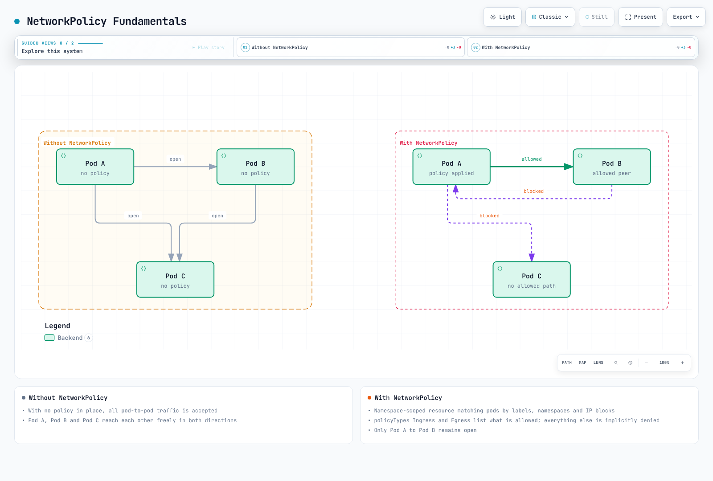

# Parte 5: Política de red

> **Base de revisión**: Calico 3.32.2; Kubernetes 1.34–1.36 es el rango probado de Calico 3.32. **Última actualización**: 12 de septiembre de 2026.
>
> Los ejemplos presuponen el servidor de API estándar de Calico (`projectcalico.org/v3`), el almacén de datos de Kubernetes y un plano de datos compatible que aplique las políticas. Use un espacio de nombres dedicado `calico-demo` con etiquetas de cargas de trabajo conocidas, endpoints listos y una configuración base funcional antes de aplicar políticas. Las secciones son patrones independientes, no un único conjunto de manifiestos. Las políticas existentes de mayor prioridad, la implementación de DNS, la NAT de Service, la política de host y el comportamiento de las aplicaciones afectan los resultados. Para esta revisión no se ejecutó ninguna prueba de clúster de producción, servidor de admisión ni reenvío de paquetes.

## Introducción

Las políticas de red controlan las conexiones permitidas entre cargas de trabajo y otros endpoints. Calico añade políticas ordenadas, acciones explícitas, alcance global y controles de HostEndpoint a la API estándar de Kubernetes. La disponibilidad de las funciones depende del producto y de la ruta de aplicación: la política basada en nombres de dominio DNS es una extensión comercial, mientras que la política HTTP de Open Source requiere la integración documentada con Istio/Dikastes.

Este análisis exhaustivo abarca tanto las políticas estándar de Kubernetes como las capacidades ampliadas de Calico, y ofrece patrones y ejemplos para los requisitos de seguridad empresariales.

***

## NetworkPolicy estándar de Kubernetes

### Fundamentos de NetworkPolicy

NetworkPolicy de Kubernetes es un recurso con ámbito de espacio de nombres que selecciona Pods. El aislamiento de ingreso y egreso es independiente; el tráfico permitido para cada dirección aislada es la unión de las políticas de Kubernetes coincidentes. Si ambos extremos están aislados, el egreso del origen y el ingreso del destino deben permitir una conexión nueva. Las respuestas a una conexión permitida no necesitan una regla de permiso independiente en la dirección inversa.

Las entradas de una lista `from`/`to` son alternativas **OR**. Un `namespaceSelector` y un `podSelector` en la misma entrada son condiciones **AND**. Un selector de Pod sin selector de espacio de nombres hace referencia al espacio de nombres de la política.

Si no hay ninguna política de Kubernetes aplicable, esa API no impone aislamiento para esa dirección; esto no anula los firewalls de host, las políticas de Calico ni otros controles. Los cambios de política y las conexiones existentes dependen de la implementación, así que valide con conexiones nuevas. La dirección `ipBlock` observada antes o después de la NAT de Service o del balanceador de carga también depende de la implementación.



[🔍 Ver diagrama interactivo](https://www.atomai.click/kubernetes-docs/archmaps/en-networking-calico-05-network-policy-0.html)

> Las flechas representan conexiones nuevas según las políticas ilustradas, no los paquetes de respuesta de una conexión permitida. El ejemplo presupone que no hay otras restricciones de políticas, firewalls o rutas; el mero hecho de que haya cualquier NetworkPolicy no aísla todos los Pods ni todas las direcciones.

### Estructura básica de NetworkPolicy

```yaml
apiVersion: networking.k8s.io/v1
kind: NetworkPolicy
metadata:
  name: example-policy
  namespace: calico-demo
spec:
  # Which pods this policy applies to
  podSelector:
    matchLabels:
      app: web

  # Policy types: Ingress, Egress, or both
  policyTypes:
    - Ingress
    - Egress

  # Ingress rules (who can connect TO these pods)
  ingress:
    - from:
        - podSelector:
            matchLabels:
              app: frontend
        - namespaceSelector:
            matchLabels:
              purpose: monitoring
        - ipBlock:
            cidr: 10.0.0.0/8
            except:
              - 10.0.1.0/24
      ports:
        - protocol: TCP
          port: 8080

  # Egress rules (where these pods can connect TO)
  egress:
    - to:
        - podSelector:
            matchLabels:
              app: database
      ports:
        - protocol: TCP
          port: 5432
```

### Limitaciones de NetworkPolicy de Kubernetes

| Capacidad | NetworkPolicy de Kubernetes | Extensión o requisito previo de Calico |
| --- | --- | --- |
| Alcance | Política de Pod con ámbito de espacio de nombres | GlobalNetworkPolicy puede seleccionar cargas de trabajo de distintos espacios de nombres y HostEndpoints |
| Orden y acciones | Reglas de permiso aditivas; sin orden de políticas definido por el usuario | Tier/orden y Allow, Deny, Log, Pass |
| Puertos | TCP/UDP/SCTP, puertos con nombre, rangos numéricos mediante `endPort` (estable desde 1.25; requiere compatibilidad del complemento) | Sintaxis de rangos de puertos de Calico y coincidencias adicionales de protocolo IP/ICMP |
| Métodos/rutas HTTP | No forman parte de esta API | Las reglas `http` de Open Source requieren la aplicación en la capa de aplicación mediante la integración configurada con Istio/Dikastes |
| Nombres de dominio DNS | No forman parte de esta API | Por ejemplo, la capacidad de política de dominios de Calico Enterprise; `domains` no está presente en la CRD de Open Source 3.32 |
| Interfaces de host | No es un firewall general de nodos | Política de HostEndpoint con semánticas separadas para tráfico local, reenviado y failsafe |

El alcance del objeto NetworkPolicy estándar es distinto del de las API de políticas de clúster más recientes de Kubernetes; no dé por sentado que todas las API de seguridad de red de Kubernetes tienen únicamente ámbito de espacio de nombres. Compruebe la compatibilidad con protocolos y el registro del plano de datos elegido en lugar de equiparar la aceptación del esquema con la aplicación efectiva.

***

## Extensiones de NetworkPolicy de Calico

### Compatibilidad ampliada con protocolos

Los ejemplos de SCTP requieren un plano de datos clásico compatible: eBPF de Calico 3.32 no admite políticas ni Services SCTP.

Calico admite protocolos adicionales a TCP y UDP:

```yaml
apiVersion: projectcalico.org/v3
kind: NetworkPolicy
metadata:
  name: extended-protocols
  namespace: calico-demo
spec:
  selector: app == 'network-tools'

  ingress:
    # ICMP ping
    - action: Allow
      protocol: ICMP
      icmp:
        type: 8  # Echo Request
        code: 0

    # ICMPv6
    - action: Allow
      protocol: ICMPv6
      icmp:
        type: 128  # Echo Request

    # SCTP
    - action: Allow
      protocol: SCTP
      destination:
        ports:
          - 3868  # Diameter

    # UDP with port range
    - action: Allow
      protocol: UDP
      destination:
        ports:
          - "5000:6000"  # Port range
```

### Rangos de puertos y puertos con nombre

```yaml
apiVersion: projectcalico.org/v3
kind: NetworkPolicy
metadata:
  name: port-examples
  namespace: calico-demo
spec:
  selector: app == 'multi-port-app'

  ingress:
    # Port range
    - action: Allow
      protocol: TCP
      destination:
        ports:
          - "8080:8090"

    # Named ports (from pod spec)
    - action: Allow
      protocol: TCP
      destination:
        ports:
          - http      # References containerPort name
          - metrics   # References containerPort name

    # Mix of specific ports and ranges
    - action: Allow
      protocol: TCP
      destination:
        ports:
          - 22
          - 80
          - 443
          - "3000:3100"
```

### Sintaxis ampliada de selectores

Calico utiliza selectores de expresiones. Las siguientes reglas ilustran alternativas: combinar todos los Allow amplios en una sola política amplía el conjunto permitido. `app != 'untrusted'` también coincide con recursos que no tienen la etiqueta; no demuestra que sean de confianza.

`selector: !has(x)` coincide con recursos conocidos dentro del ámbito que carecen de la etiqueta. `notSelector: has(x)` niega la coincidencia del paquete y también puede coincidir con direcciones externas que no estén presentes en ese selector. El `selector: all()` de una regla no coincide con todos los paquetes; omita las condiciones del selector de endpoints para coincidir con todos los paquetes.

```yaml
apiVersion: projectcalico.org/v3
kind: NetworkPolicy
metadata:
  name: selector-examples
  namespace: calico-demo
spec:
  # Label equality
  selector: app == 'web'

  ingress:
    # Set membership
    - action: Allow
      source:
        selector: app in {'frontend', 'api-gateway', 'monitoring'}

    # Negation
    - action: Allow
      source:
        selector: app != 'untrusted'

    # Label existence
    - action: Allow
      source:
        selector: has(security-cleared)

    # Combining conditions (AND)
    - action: Allow
      source:
        selector: app == 'backend' && tier == 'internal'

    # OR inside one selector expression
    - action: Allow
      source:
        selector: (app == 'frontend') || (app == 'api')

    # Namespace selector
    - action: Allow
      source:
        namespaceSelector: environment == 'production'
        selector: app == 'authorized-client'
```

***

## GlobalNetworkPolicy

GlobalNetworkPolicy no tiene ámbito de espacio de nombres y puede seleccionar endpoints de cargas de trabajo de distintos espacios de nombres o HostEndpoints. `selector: all()` por sí solo no significa «solo todos los Pods de aplicaciones». Estos ejemplos limitan explícitamente las cargas de trabajo seleccionadas al espacio de nombres de demostración para preservar el tráfico del sistema y del host.

### Denegación predeterminada con excepciones explícitas

La política vacía selecciona ambas direcciones. Al omitir `order`, queda después de las políticas ordenadas explícitamente; 10,000 no es un valor especial de «prioridad más baja». Las reglas vacías no anulan un Allow terminal anterior. Use un Tier anterior, controlado por separado, para las restricciones que las políticas de aplicaciones no deban poder anular.

```yaml
apiVersion: projectcalico.org/v3
kind: GlobalNetworkPolicy
metadata:
  name: default.demo-default-deny
spec:
  tier: default
  namespaceSelector: kubernetes.io/metadata.name == 'calico-demo'
  types: [Ingress, Egress]
  ingress: []
  egress: []
---
apiVersion: projectcalico.org/v3
kind: GlobalNetworkPolicy
metadata:
  name: default.demo-essential-egress
spec:
  tier: default
  order: 100
  namespaceSelector: kubernetes.io/metadata.name == 'calico-demo'
  selector: needs-platform == 'true'
  types: [Egress]
  egress:
    - action: Allow
      protocol: UDP
      destination:
        namespaceSelector: kubernetes.io/metadata.name == 'kube-system'
        selector: k8s-app == 'kube-dns'
        ports: [53]
    - action: Allow
      protocol: TCP
      destination:
        namespaceSelector: kubernetes.io/metadata.name == 'kube-system'
        selector: k8s-app == 'kube-dns'
        ports: [53]
    - action: Allow
      destination:
        services:
          name: kubernetes
          namespace: default
```

Este ejemplo concede egreso hacia la plataforma solo a las cargas de trabajo etiquetadas como `needs-platform=true`. La coincidencia de Service sigue los endpoints y puertos reales de `kubernetes/default` en el **almacén de datos de Kubernetes**; se ignora si se usa un almacén de datos etcd. No combine esa coincidencia de Service con puertos de destino, CIDR o selectores. El acceso de red a la API es distinto de la autenticación/RBAC de la API.

Confirme la implementación real de DNS. Los selectores de espacio de nombres y Pod impiden que un Pod no relacionado etiquetado como `kube-dns` se convierta en un resolver de confianza. DNS local al nodo requiere una coincidencia distinta que refleje la ruta real. Crear una política vacía en `kube-system` antes de enumerar las dependencias del sistema puede interrumpir el clúster; pruebe ese patrón en un espacio de nombres de pruebas independiente.

### Una barrera de protección anterior para el egreso

Este ejemplo independiente bloquea la dirección IPv4 de metadatos para las cargas de trabajo de demostración seleccionadas y, al final de su Tier, delega el resto del tráfico. No afirma que ofrezca protección completa contra SSRF, que proteja procesos con privilegios o que usen la red del host, ni que cubra todos los endpoints de metadatos de la plataforma.

```yaml
apiVersion: projectcalico.org/v3
kind: Tier
metadata:
  name: egress-guardrail
spec:
  order: 50
  defaultAction: Pass
---
apiVersion: projectcalico.org/v3
kind: GlobalNetworkPolicy
metadata:
  name: egress-guardrail.block-imds-v4
spec:
  tier: egress-guardrail
  order: 10
  namespaceSelector: kubernetes.io/metadata.name == 'calico-demo'
  types: [Egress]
  egress:
    - action: Deny
      destination:
        nets: [169.254.169.254/32]
```

No coloque un Pass incondicional antes de restricciones posteriores del mismo Tier. Preserve las rutas de identidad/DNS que la plataforma necesite y revise el comportamiento real de aplicación de políticas entre cargas de trabajo y host.

***

## NetworkSet y GlobalNetworkSet

NetworkSet etiqueta grupos reutilizables de IP/CIDR; los selectores de políticas hacen referencia a sus etiquetas, no a los nombres de sus objetos. Los ejemplos de direcciones siguientes son ilustrativos y no constituyen una fuente real de países o amenazas. Un selector de etiquetas también puede coincidir con endpoints que tengan las mismas etiquetas, así que use etiquetas controladas y el ámbito previsto, ya sea de espacio de nombres o global.

Use `namespaceSelector: global()` en la coincidencia de entidades de una política con ámbito de espacio de nombres para seleccionar un GlobalNetworkSet. Los NetworkSet con ámbito de espacio de nombres permanecen en el espacio de nombres seleccionado. Si se solapan los rangos de confianza y los bloqueados, evalúe primero la denegación; un Allow anterior es terminal.

### NetworkSet (con ámbito de espacio de nombres)

```yaml
apiVersion: projectcalico.org/v3
kind: NetworkSet
metadata:
  name: corporate-networks
  namespace: calico-demo
  labels:
    network-type: corporate
spec:
  nets:
    - 10.0.0.0/8
    - 172.16.0.0/12
    - 192.168.0.0/16

---
# Reference in policy
apiVersion: projectcalico.org/v3
kind: NetworkPolicy
metadata:
  name: allow-corporate
  namespace: calico-demo
spec:
  selector: app == 'internal-app'

  ingress:
    - action: Allow
      source:
        selector: network-type == 'corporate'  # References NetworkSet by label
```

### GlobalNetworkSet (con ámbito de clúster)

```yaml
apiVersion: projectcalico.org/v3
kind: GlobalNetworkSet
metadata:
  name: external-trusted-ips
  labels:
    network-group: external-trusted
spec:
  nets:
    - 203.0.113.0/24     # Partner network
    - 198.51.100.0/24    # CDN network
    - 192.0.2.50/32      # Specific trusted IP

---
apiVersion: projectcalico.org/v3
kind: GlobalNetworkSet
metadata:
  name: demo-blocked-networks
  labels:
    network-group: blocked
spec:
  nets:
    # Illustrative test ranges, not geolocation or threat intelligence
    - 192.0.2.128/25
    - 203.0.113.128/25

---
# Reference in GlobalNetworkPolicy
apiVersion: projectcalico.org/v3
kind: GlobalNetworkPolicy
metadata:
  name: external-access-control
spec:
  namespaceSelector: kubernetes.io/metadata.name == 'calico-demo'
  selector: has(external-facing)
  order: 200
  types:
    - Ingress

  ingress:
    # Deny overlaps before considering trusted ranges.
    - action: Deny
      source:
        namespaceSelector: global()
        selector: network-group == 'blocked'
    - action: Allow
      source:
        namespaceSelector: global()
        selector: network-group == 'external-trusted'
```

***

## Políticas por Tiers

Los Tiers están disponibles en Calico Open Source 3.32. Agrupan políticas de Calico con ámbito de espacio de nombres y global; no constituyen una progresión desde NetworkPolicy de Kubernetes hasta GlobalNetworkPolicy.

### Evaluación y valores predeterminados

Para las políticas normales de endpoint, evalúe los Tiers en orden creciente de `order` y, después, las políticas de cada Tier también en orden creciente de `order`. Si no se define el orden de una política, esta va después de las políticas ordenadas explícitamente. Tenga en cuenta el endpoint seleccionado **y la dirección del tráfico**.

| Situación | Resultado |
| --- | --- |
| Ninguna política del Tier selecciona ese endpoint/dirección | Se omite el Tier |
| Una regla permite o deniega | Finaliza la decisión de políticas para este endpoint/dirección |
| Una regla registra | Se continúa con la regla siguiente |
| Una regla pasa | Se omiten las políticas restantes de este Tier y se prueba el siguiente Tier aplicable |
| Un Tier aplicable no encuentra una regla terminal | Se aplica su `defaultAction`, que de forma predeterminada es Deny |
| El último Tier aplicable pasa | Se evalúan los Profiles del endpoint; si ningún Profile permite el tráfico, se deniega |

No es cierto que «si ninguna regla coincide, siempre se pasa al siguiente Tier». Además, un Allow en un endpoint no omite la política del otro endpoint. Las políticas Pre-DNAT y las políticas de host sin seguimiento tienen comportamientos distintos de continuación, que se explican a continuación.

El Tier integrado `default` tiene un orden fijo de **1.000.000**, no de 1.000 ni de infinito. NetworkPolicy de Kubernetes y las políticas de Calico sin un Tier explícito pertenecen a ese Tier. Los Tiers actuales `kube-admin` y `kube-baseline` usan los órdenes 1.000 y 10.000.000, con valores predeterminados Pass para la integración correspondiente de políticas de clúster de Kubernetes; por tanto, `default` no es siempre el último Tier posible.

### Decisiones separadas para seguridad, plataforma y aplicaciones

Estos Tiers de ejemplo usan Pass al final del Tier para seguridad y plataforma, de modo que se comprueben todas sus reglas aplicables antes de delegar. La creación y reordenación de Tiers requieren privilegios controlados de forma centralizada.

```yaml
apiVersion: projectcalico.org/v3
kind: Tier
metadata:
  name: security
spec:
  order: 100
  defaultAction: Pass
---
apiVersion: projectcalico.org/v3
kind: Tier
metadata:
  name: platform
spec:
  order: 200
  defaultAction: Pass
---
apiVersion: projectcalico.org/v3
kind: Tier
metadata:
  name: application
spec:
  order: 500
  defaultAction: Deny
```

El siguiente ejemplo usa una dirección de amenazas reservada para documentación y, luego, una regla independiente para datos restringidos. Un Pass al final de la primera política de seguridad omitiría la segunda. Delegar al **final del Tier** evita esa elusión. Las etiquetas de datos restringidos ilustran la segmentación, no el cumplimiento completo de PCI DSS.

```yaml
apiVersion: projectcalico.org/v3
kind: GlobalNetworkSet
metadata:
  name: demo-threats
  labels:
    network-group: demo-threat
spec:
  nets:
    - 192.0.2.100/32
---
apiVersion: projectcalico.org/v3
kind: GlobalNetworkPolicy
metadata:
  name: security.block-threats
spec:
  tier: security
  order: 10
  namespaceSelector: kubernetes.io/metadata.name == 'calico-demo'
  types: [Ingress, Egress]
  ingress:
    - action: Deny
      source:
        namespaceSelector: global()
        selector: network-group == 'demo-threat'
  egress:
    - action: Deny
      destination:
        namespaceSelector: global()
        selector: network-group == 'demo-threat'
---
apiVersion: projectcalico.org/v3
kind: GlobalNetworkPolicy
metadata:
  name: security.restricted-data
spec:
  tier: security
  order: 20
  namespaceSelector: kubernetes.io/metadata.name == 'calico-demo'
  selector: data-scope == 'restricted'
  types: [Ingress]
  ingress:
    - action: Deny
      source:
        notSelector: data-scope == 'restricted'
---
apiVersion: projectcalico.org/v3
kind: GlobalNetworkPolicy
metadata:
  name: platform.dns
spec:
  tier: platform
  order: 10
  namespaceSelector: kubernetes.io/metadata.name == 'calico-demo'
  types: [Egress]
  egress:
    - action: Allow
      protocol: UDP
      destination:
        namespaceSelector: kubernetes.io/metadata.name == 'kube-system'
        selector: k8s-app == 'kube-dns'
        ports: [53]
    - action: Allow
      protocol: TCP
      destination:
        namespaceSelector: kubernetes.io/metadata.name == 'kube-system'
        selector: k8s-app == 'kube-dns'
        ports: [53]
---
apiVersion: projectcalico.org/v3
kind: NetworkPolicy
metadata:
  name: application.frontend
  namespace: calico-demo
spec:
  tier: application
  order: 10
  selector: app == 'frontend'
  types: [Ingress, Egress]
  ingress:
    - action: Allow
      protocol: TCP
      source:
        selector: app == 'gateway'
      destination:
        ports: [8080]
  egress:
    - action: Allow
      protocol: TCP
      destination:
        selector: app == 'backend'
        ports: [8080]
```

`namespaceSelector: global()` junto con un selector de etiquetas separado selecciona el GlobalNetworkSet. `global(label == 'value')` no es sintaxis válida. El Allow de DNS de la plataforma es una excepción terminal intencionada para el egreso de la carga de trabajo seleccionada; las reglas del Tier de aplicaciones no pueden restringirla posteriormente. La política de aplicaciones solo rige el frontend seleccionado, no todas las cargas de trabajo del espacio de nombres.

El ejemplo de DNS presupone Pods de CoreDNS convencionales con espacio de nombres y etiquetas verificados. NodeLocal DNSCache o el DNS local al nodo de EKS Auto Mode requieren reglas para la ruta real del resolver, no un selector de Pod copiado sin cambios. Mantenga el acceso al resolver requerido y valide las consultas UDP y TCP.

### Integración de RBAC para Tiers

El RBAC de Tiers de Calico utiliza los pseudorrecursos `tier.networkpolicies` y `tier.globalnetworkpolicies`, además de `get` en el Tier de destino. El autorizador de Calico comprueba explícitamente nombres sintéticos, como `application.*`. Esto no es un comodín general de Kubernetes `resourceNames` para los `networkpolicies` ordinarios.

El siguiente ejemplo completo de binding concede a una cuenta de servicio permisos para editar políticas con ámbito de espacio de nombres en el Tier de aplicaciones. No concede permiso para crear o reordenar Tiers, ni para administrar políticas globales.

```yaml
apiVersion: v1
kind: ServiceAccount
metadata:
  name: policy-editor
  namespace: calico-demo
---
apiVersion: rbac.authorization.k8s.io/v1
kind: ClusterRole
metadata:
  name: demo-get-application-tier
rules:
  - apiGroups: ["projectcalico.org"]
    resources: ["tiers"]
    resourceNames: ["application"]
    verbs: ["get"]
---
apiVersion: rbac.authorization.k8s.io/v1
kind: ClusterRoleBinding
metadata:
  name: demo-get-application-tier
subjects:
  - kind: ServiceAccount
    name: policy-editor
    namespace: calico-demo
roleRef:
  apiGroup: rbac.authorization.k8s.io
  kind: ClusterRole
  name: demo-get-application-tier
---
apiVersion: rbac.authorization.k8s.io/v1
kind: Role
metadata:
  name: demo-edit-application-policies
  namespace: calico-demo
rules:
  - apiGroups: ["projectcalico.org"]
    resources: ["tier.networkpolicies"]
    resourceNames: ["application.*"]
    verbs: ["get", "list", "watch", "create", "update", "patch", "delete"]
---
apiVersion: rbac.authorization.k8s.io/v1
kind: RoleBinding
metadata:
  name: demo-edit-application-policies
  namespace: calico-demo
subjects:
  - kind: ServiceAccount
    name: policy-editor
    namespace: calico-demo
roleRef:
  apiGroup: rbac.authorization.k8s.io
  kind: Role
  name: demo-edit-application-policies
```

La edición de políticas globales utiliza `tier.globalnetworkpolicies` en un ClusterRole/ClusterRoleBinding con un alcance deliberadamente limitado. Mantenga `get` en el Tier previsto separado de los permisos para modificar el orden del Tier.

El ejemplo presupone el servidor de API agregado estándar de Calico. Las CRD v3 nativas utilizan un webhook de admisión para la autorización por Tier de las operaciones create/update/delete; ese webhook no puede restringir GET/LIST/WATCH. No afirme que el aislamiento de lectura sea idéntico en ambos modos. Un `kubectl auth can-i` simple no valida las comprobaciones combinadas de Tiers de Calico: pruebe solicitudes permitidas y prohibidas en un entorno aislado con un principal que no tenga bindings más amplios. El RBAC de Kubernetes es aditivo, así que un permiso amplio existente puede frustrar la restricción prevista.

***

## Política de egreso basada en FQDN

La CRD de Open Source 3.32 no tiene el campo `destination.domains` ni el campo de Felix `dnsTrustedServers`. Establecer `policySyncPathPrefix` habilita la ruta de sincronización de políticas que utilizan las integraciones de capa de aplicación; no añade políticas de dominios DNS a Open Source.

Calico Enterprise 3.23 documenta coincidencias de dominios DNS en reglas **egress Allow**. El controlador aprende las respuestas A/AAAA/CNAME de servidores DNS de confianza y permite las IP de destino coincidentes. La aplicación se basa en IP, no en la autenticación del nombre de host HTTPS, por lo que siguen siendo importantes las IP de destino compartidas y la identidad de la aplicación. Para los servicios del clúster, use selectores de cargas de trabajo/Service.

El siguiente ejemplo comercial presupone que la función está habilitada, que se ha verificado el resolver de confianza y que ningún Allow terminal anterior la elude. Cada regla tiene un único mapa `destination`; repetir esa clave YAML podría descartar silenciosamente la restricción de dominio.

```yaml
# Calico Enterprise 3.23 example; NOT an Open Source 3.32 resource.
apiVersion: projectcalico.org/v3
kind: NetworkPolicy
metadata:
  name: allow-approved-domains
  namespace: calico-demo
spec:
  selector: app == 'external-api-client'
  types: [Egress]
  egress:
    - action: Allow
      protocol: UDP
      destination:
        namespaceSelector: kubernetes.io/metadata.name == 'kube-system'
        selector: k8s-app == 'kube-dns'
        ports: [53]
    - action: Allow
      protocol: TCP
      destination:
        namespaceSelector: kubernetes.io/metadata.name == 'kube-system'
        selector: k8s-app == 'kube-dns'
        ports: [53]
    - action: Allow
      protocol: TCP
      destination:
        domains:
          - api.github.com
          - "*.example.com"
        ports: [443]
```

Sustituya el dominio reservado para documentación por un dominio real aprobado. `*.example.com` coincide con `api.example.com` y `deep.api.example.com`, pero no con el dominio base `example.com`. El comodín debe ocupar un componente completo y solo se admite uno. El modo de política DNS integrada admite comodines de prefijo; los patrones de comodín que no sean de prefijo requieren un modo documentado adecuado. Un sufijo amplio como `*.amazonaws.com` no constituye un límite de cuenta de AWS ni de IAM.

Mantenga el resolver real accesible por UDP y TCP, y haga coincidir sus IP con la configuración DNS de confianza. Los resolvers locales al nodo requieren un tratamiento específico de la implementación. La guía comercial excluye la política de dominios en el hook de egreso de los Pods de egress-gateway porque su caché DNS de todo el nodo puede hacer que las coincidencias no aparezcan o sean intermitentes.

En Open Source, use un proxy/gateway de egreso explícito con su propia autorización de aplicación, o NetworkSets de IP/CIDR mantenidos cuando resulte apropiado. No sustituya una política de dominios aplicada continuamente por una consulta DNS puntual.

***

## Filtrado de métodos HTTP (capa 7)

Calico Open Source 3.32 admite políticas HTTP mediante la integración documentada de **Istio + Dikastes**. Instalar cualquier proxy Envoy o añadir un campo `http` a una política CNI normal no habilita por sí solo la aplicación en la capa 7.

Entre los requisitos previos se incluyen la API Policy Sync de Felix, el montaje del socket CSI de Calico, la inyección de Dikastes y la autorización externa de Envoy en la ruta de tráfico pertinente. La guía de integración actual describe la inyección de Istio con sidecars nativos de Kubernetes y recomienda Istio 1.28.1; esa afirmación no es una promesa general de compatibilidad con todas las versiones más recientes de Istio. Consulte la [guía de instalación de Istio](../../service-mesh/istio/01-installation.md) mantenida, los periodos de soporte de ambos proyectos y la integración real antes de elegir una combinación para producción. Aquí no se implementó dicha integración.

Estos ejemplos son reglas **ingress Allow** para una carga de trabajo que ya tiene la integración. Los métodos/rutas HTTPS requieren que el proxy de aplicación vea la solicitud HTTP después de la terminación TLS. Las etiquetas de Pod de origen identifican cargas de trabajo, no usuarios finales autenticados; configure la ruta de identidad de cargas de trabajo/mTLS de confianza de la integración y conserve el acceso de red necesario para DNS y el plano de control de Istio. Valide las solicitudes permitidas y denegadas, incluido el comportamiento ante fallos del proxy/servicio de autorización, antes de confiar en la política.

### Reglas de coincidencia HTTP

```yaml
apiVersion: projectcalico.org/v3
kind: GlobalNetworkPolicy
metadata:
  name: l7-http-policy
spec:
  namespaceSelector: kubernetes.io/metadata.name == 'calico-demo'
  selector: app == 'api-server'
  order: 300
  types:
    - Ingress

  ingress:
    # Allow only GET and HEAD for read-only clients
    - action: Allow
      source:
        selector: role == 'reader'
      http:
        methods:
          - GET
          - HEAD
        paths:
          - prefix: /api/v1/

    # Allow the listed methods for admin-labeled workloads
    - action: Allow
      source:
        selector: role == 'admin'
      http:
        methods:
          - GET
          - POST
          - PUT
          - DELETE
          - PATCH

    # Allow health checks
    - action: Allow
      http:
        methods:
          - GET
        paths:
          - exact: /health
          - exact: /ready
```

### Filtrado basado en rutas

```yaml
apiVersion: projectcalico.org/v3
kind: NetworkPolicy
metadata:
  name: path-based-policy
  namespace: calico-demo
spec:
  selector: app == 'web-app'

  ingress:
    # Public endpoints
    - action: Allow
      http:
        paths:
          - prefix: /public/
          - exact: /

    # Admin endpoints - restricted
    - action: Allow
      source:
        selector: role == 'admin'
      http:
        paths:
          - prefix: /admin/

    # API endpoints - authenticated only
    - action: Allow
      source:
        selector: has(api-access)
      http:
        paths:
          - prefix: /api/
```

***

## Protección de HostEndpoint

HostEndpoint representa una interfaz de un nodo que administra Calico. Crear uno puede cambiar de inmediato la conectividad del host. `defaultEndpointToHostAction` controla el comportamiento entre las cargas de trabajo y el host local; no crea HostEndpoints. `Installation.calicoNetwork.hostPorts` controla la compatibilidad con hostPort, no la protección automática del host.

### HostEndpoint manual y política

El siguiente **ejemplo de campos no es un firewall de host completo**. Presupone un worker de pruebas autoadministrado `demo-worker` en `10.0.1.10`, un bastión `10.0.0.100`, un origen del plano de control `10.0.1.5` y la interfaz `eth0`. Sustitúyalos por identidades/direcciones verificadas y prepare todas las reglas necesarias de administración, DNS, DHCP, BGP, API, estado y egreso antes de crear el HostEndpoint. No modela un nodo del plano de control administrado por EKS.

```yaml
apiVersion: projectcalico.org/v3
kind: GlobalNetworkPolicy
metadata:
  name: default.demo-worker-ingress
spec:
  order: 100
  selector: host-demo == 'true' && !has(projectcalico.org/namespace)
  types: [Ingress]
  ingress:
    - action: Allow
      protocol: TCP
      source:
        nets: [10.0.0.100/32]
      destination:
        ports: [22]
    - action: Allow
      protocol: TCP
      source:
        nets: [10.0.1.5/32]
      destination:
        ports: [10250]
---
apiVersion: projectcalico.org/v3
kind: HostEndpoint
metadata:
  name: demo-worker-eth0
  labels:
    host-demo: "true"
spec:
  node: demo-worker
  interfaceName: eth0
  expectedIPs: [10.0.1.10]
```

La regla de kubelet se dirige al endpoint 10250 autenticado del worker. No abra el puerto de solo lectura obsoleto y no autenticado 10255 como requisito predeterminado. El ejemplo solo define ingreso; un HostEndpoint creado manualmente, sin una política/perfil de egreso, puede denegar el tráfico originado por el host. Complete primero la configuración base real.

Los failsafes predeterminados de Calico incluyen el TCP 22 de entrada y otros puertos de conectividad. Eluden la intención restrictiva de la regla SSH anterior, por lo que esta regla por sí sola **no** limita SSH al bastión. Revise la lista de failsafes y una ruta de recuperación probada antes de modificarla; no vacíe las listas a ciegas.

### HostEndpoints automáticos

`KubeControllersConfiguration.spec.controllers.node.hostEndpoint.autoCreate` del controlador de nodos controla la creación automática. Use un parche merge para conservar otros ajustes del controlador:

```bash
kubectl get kubecontrollersconfiguration.projectcalico.org default -o yaml
# Apply only after reviewing existing host endpoints and global policies.
kubectl patch kubecontrollersconfiguration.projectcalico.org default --type=merge \
  -p '{"spec":{"controllers":{"node":{"hostEndpoint":{"autoCreate":"Enabled"}}}}}'
```

Esto puede afectar a todos los nodos aptos. Los endpoints automáticos suelen tener un perfil de permiso predeterminado; ese perfil no anula una política Deny coincidente. Las plantillas personalizadas y `createDefaultHostEndpoint` pueden acotar el conjunto de endpoints generados, pero modificarlos en una implementación existente requiere revisar primero los endpoints y las políticas actuales.

### Tráfico local y reenviado

De forma predeterminada, la política normal de host establece `applyOnForward` en false. Si se establece en true, también se aplica al tráfico reenviado, que igualmente debe superar la política pertinente de la carga de trabajo. Si ninguna política de reenvío selecciona el endpoint/la dirección, el tráfico reenviado se permite de forma predeterminada; una política de reenvío seleccionada que no tenga ninguna regla de permiso lo deniega. El tráfico de host terminado localmente tiene un comportamiento de denegación predeterminada distinto (sujeto a Profiles/failsafes).

## Políticas DoNotTrack y PreDNAT

Estos son patrones de política de host para Linux. Se aplican a HostEndpoints; no sirven para desactivar el seguimiento en Pods seleccionados normales. Confirme la compatibilidad del plano de datos elegido. `doNotTrack` y `preDNAT` no pueden ser true a la vez, y cualquiera de los dos requiere `applyOnForward: true`.

### DoNotTrack

Un Allow sin seguimiento omite el seguimiento de conexiones para el tráfico coincidente. No es una mejora universal del rendimiento y puede entrar en conflicto con una ruta de Service/NAT que requiera conntrack. Las solicitudes y respuestas requieren reglas explícitas; este ejemplo presupone que hay un proceso DNS en el host de pruebas que atiende directamente la subred del cliente de confianza.

```yaml
apiVersion: projectcalico.org/v3
kind: GlobalNetworkPolicy
metadata:
  name: default.demo-untracked-dns
spec:
  selector: host-demo == 'true' && !has(projectcalico.org/namespace)
  order: 10
  types: [Ingress, Egress]
  doNotTrack: true
  applyOnForward: true
  ingress:
    - action: Allow
      protocol: UDP
      source:
        nets: [10.0.0.0/24]
      destination:
        ports: [53]
    - action: Allow
      protocol: TCP
      source:
        nets: [10.0.0.0/24]
      destination:
        ports: [53]
  egress:
    - action: Allow
      protocol: UDP
      source:
        ports: [53]
      destination:
        nets: [10.0.0.0/24]
    - action: Allow
      protocol: TCP
      source:
        ports: [53]
      destination:
        nets: [10.0.0.0/24]
```

A diferencia de la política normal de endpoint, si no hay coincidencia en la etapa sin seguimiento no se impone una denegación predeterminada al final del Tier; la política posterior con seguimiento aún puede aplicarse. Esto no es un firewall del host con una denegación total implícita.

### PreDNAT

La política Pre-DNAT ve la IP/puerto de destino original antes de DNAT. Solo se aplica al ingreso y utiliza el seguimiento normal de conexiones para el tráfico de retorno permitido. Este ejemplo protege el NodePort TCP 30080 específico en la ruta seleccionada del host:

```yaml
apiVersion: projectcalico.org/v3
kind: GlobalNetworkPolicy
metadata:
  name: default.demo-nodeport
spec:
  selector: host-demo == 'true' && !has(projectcalico.org/namespace)
  order: 20
  types: [Ingress]
  preDNAT: true
  applyOnForward: true
  ingress:
    - action: Allow
      protocol: TCP
      source:
        nets: [10.0.0.0/24]
      destination:
        ports: [30080]
    - action: Deny
      protocol: TCP
      destination:
        ports: [30080]
```

No hay una denegación predeterminada en la etapa Pre-DNAT. El tráfico que no coincide continúa hacia las políticas posteriores de host/carga de trabajo. La segunda regla explícita rechaza el tráfico no confiable a este NodePort; los demás puertos quedan fuera de este ejemplo. Una ruta que vaya directamente a un Pod sin atravesar este NodePort del host no está cubierta por la regla.

***

## Depuración de políticas

Inspeccione las etiquetas reales, los espacios de nombres, los endpoints de Service, todos los Tiers aplicables y ambas direcciones. En el servidor de API estándar de Calico, un listado sin selector de Tier puede usar de forma predeterminada el Tier `default`; `-A` significa todos los espacios de nombres, no todos los Tiers automáticamente.

```bash
kubectl get networkpolicies.networking.k8s.io -n calico-demo -o yaml
kubectl get tiers.projectcalico.org -o yaml
for CALICO_TIER in $(kubectl get tiers.projectcalico.org -o jsonpath='{.items[*].metadata.name}'); do
  kubectl get networkpolicies.projectcalico.org -n calico-demo \
    -l "projectcalico.org/tier=$CALICO_TIER" -o yaml
  kubectl get globalnetworkpolicies.projectcalico.org \
    -l "projectcalico.org/tier=$CALICO_TIER" -o yaml
done
calicoctl get workloadendpoint -n calico-demo \
  --selector="app == 'frontend'" -o yaml
```

```bash
CALICO_NAMESPACE=calico-system
CALICO_NODE=demo-worker
CALICO_POD="$(kubectl -n "$CALICO_NAMESPACE" get pods -l k8s-app=calico-node \
  --field-selector "spec.nodeName=$CALICO_NODE" -o jsonpath='{.items[0].metadata.name}')"
test -n "$CALICO_POD"
kubectl -n "$CALICO_NAMESPACE" logs "$CALICO_POD" -c calico-node --tail=200
kubectl -n "$CALICO_NAMESPACE" exec "$CALICO_POD" -c calico-node -- \
  calico-node -felix-ready
```

```bash
# Assumes named, ready test Pods and an nc binary in the client image.
TARGET_POD=backend-test
TARGET_IP="$(kubectl -n calico-demo get pod "$TARGET_POD" -o jsonpath='{.status.podIP}')"
test -n "$TARGET_IP"
kubectl -n calico-demo exec frontend-client -- nc -z -w 3 "$TARGET_IP" 8080
```

El comando `calico-node -felix-ready` comprueba la disponibilidad. No es un seguimiento de políticas ni una medición del tiempo de evaluación por paquete. La versión publicada de Open Source `calicoctl` no proporciona el antiguo comando `policy-trace`. Enumerar un endpoint o buscar texto en las políticas tampoco calcula la política efectiva completa.

Pruebe un cliente permitido, uno no confiable, un puerto incorrecto, un cliente de otro espacio de nombres y el acceso al resolver mediante conexiones **nuevas**. Compruebe el puerto de destino del objetivo, no el puerto de origen efímero del cliente. Pruebe por separado las direcciones directas de Pod y de Service para distinguir problemas de política de los de endpoint/NAT/reenvío; por tanto, kube-proxy o su sustituto pueden ser relevantes.

En el plano de datos iptables, inspeccione las cadenas `cali-` reales en el nodo/espacio de nombres de red correcto; un hash de marcador de posición no es un nombre de cadena real. Las acciones Log de iptables escriben en el registro del kernel del host, mientras que stdout de Felix contiene principalmente diagnósticos de componentes/controladores. Ni la ausencia de un mensaje en stdout ni un contador en cero demuestran que una política no se utilice en todas las rutas. eBPF/nftables requieren sus propios diagnósticos de backend; `tc filter show` por sí solo no explica una decisión de política efectiva.

### Preparar antes de aplicar

Open Source 3.32 proporciona `StagedNetworkPolicy`, `StagedGlobalNetworkPolicy` y `StagedKubernetesNetworkPolicy`. Los recursos preparados no aplican decisiones a los paquetes. Con la canalización de registros de flujo/Whisker configurada, inspeccione `policies.pending` para obtener una vista previa de los efectos observados.

```yaml
apiVersion: projectcalico.org/v3
kind: StagedNetworkPolicy
metadata:
  name: default.preview-backend-egress
  namespace: calico-demo
spec:
  tier: default
  order: 100
  selector: app == 'frontend'
  types: [Egress]
  egress:
    - action: Allow
      protocol: TCP
      destination:
        selector: app == 'backend'
        ports: [8080]
```

Esta vista previa solo incluye intencionadamente la conexión al backend. Antes de crear una política aplicada equivalente, compruebe si se denegarían los flujos de DNS requeridos o cualquier otro flujo. La ausencia de tráfico observado no demuestra que una dependencia sea innecesaria. `action: Log` por sí solo no constituye un modo universal de auditoría sin aplicación: la evaluación continúa y aun así puede terminar en una denegación.

***

## Biblioteca de patrones de políticas habituales

### Frontend → Backend → Base de datos

La demostración presupone cargas de trabajo listas con las etiquetas y los listeners indicados. Cada puerto de servidor es un puerto de **destino**; una coincidencia con `source.ports: [8080]` normalmente rechazaría a clientes que usen puertos de origen efímeros. Todas las reglas de puertos numéricos especifican TCP. El gateway de demostración es un componente de prueba de aplicación; no se presupone que una etiqueta concreta pertenezca a un controlador de ingreso específico.

```yaml
apiVersion: projectcalico.org/v3
kind: NetworkPolicy
metadata:
  name: default.frontend
  namespace: calico-demo
spec:
  order: 100
  selector: app == 'frontend'
  types: [Ingress, Egress]
  ingress:
    - action: Allow
      protocol: TCP
      source:
        selector: app == 'gateway'
      destination:
        ports: [8080]
  egress:
    - action: Allow
      protocol: TCP
      destination:
        selector: app == 'backend'
        ports: [8080]
---
apiVersion: projectcalico.org/v3
kind: NetworkPolicy
metadata:
  name: default.backend
  namespace: calico-demo
spec:
  order: 100
  selector: app == 'backend'
  types: [Ingress, Egress]
  ingress:
    - action: Allow
      protocol: TCP
      source:
        selector: app == 'frontend'
      destination:
        ports: [8080]
  egress:
    - action: Allow
      protocol: TCP
      destination:
        selector: app == 'database'
        ports: [5432]
---
apiVersion: projectcalico.org/v3
kind: NetworkPolicy
metadata:
  name: default.database
  namespace: calico-demo
spec:
  order: 100
  selector: app == 'database'
  types: [Ingress, Egress]
  ingress:
    - action: Allow
      protocol: TCP
      source:
        selector: app == 'backend'
      destination:
        ports: [5432]
  egress: []
```

Permita DNS por separado para los clientes que lo necesiten mediante el patrón de egreso esencial con ámbito limitado y su etiqueta requerida. En este patrón simplificado, la base de datos no inicia nuevas conexiones de egreso; las respuestas con seguimiento de estado siguen funcionando. Las copias de seguridad, la replicación y las dependencias externas necesitan sus propias reglas revisadas.

### Aislamiento de tenants

Calico no interpola `$(namespace.tenant)`, `${namespace.labels.tenant}` ni `${namespace.name}` dentro de los selectores. Genere una política por cada valor explícito de tenant o use una política con ámbito de espacio de nombres para aislar dentro de un mismo espacio de nombres.

```yaml
apiVersion: projectcalico.org/v3
kind: GlobalNetworkPolicy
metadata:
  name: default.team-a-isolation
spec:
  order: 500
  namespaceSelector: tenant == 'team-a'
  types: [Ingress, Egress]
  ingress:
    - action: Allow
      source:
        namespaceSelector: tenant == 'team-a'
  egress:
    - action: Allow
      destination:
        namespaceSelector: tenant == 'team-a'
    - action: Allow
      protocol: UDP
      destination:
        namespaceSelector: kubernetes.io/metadata.name == 'kube-system'
        selector: k8s-app == 'kube-dns'
        ports: [53]
    - action: Allow
      protocol: TCP
      destination:
        namespaceSelector: kubernetes.io/metadata.name == 'kube-system'
        selector: k8s-app == 'kube-dns'
        ports: [53]
```

Esto permite todo el tráfico dentro de team-a, incluido el que cruza espacios de nombres etiquetados así. Deben controlarse la administración de etiquetas de espacios de nombres y los permisos para editar políticas; los Allow anteriores pueden anular el aislamiento previsto. Pruebe los casos entre tenants y los espacios de nombres sin etiqueta.

### Mismo espacio de nombres y servicios compartidos

En esta política con ámbito de espacio de nombres, los selectores de entidades sin selector de espacio de nombres permanecen dentro de `calico-demo`. Esta es una alternativa al patrón restrictivo de microservicios, no una política adicional que deba superponerse a él.

```yaml
apiVersion: projectcalico.org/v3
kind: NetworkPolicy
metadata:
  name: default.namespace-and-shared
  namespace: calico-demo
spec:
  order: 200
  selector: all()
  types: [Ingress, Egress]
  ingress:
    - action: Allow
      source:
        selector: all()
  egress:
    - action: Allow
      destination:
        selector: all()
    - action: Allow
      protocol: TCP
      destination:
        namespaceSelector: kubernetes.io/metadata.name == 'logging'
        selector: app == 'log-receiver'
        ports: [24224]
    - action: Allow
      protocol: TCP
      destination:
        namespaceSelector: kubernetes.io/metadata.name == 'auth'
        selector: app == 'identity-provider'
        ports: [8080]
```

Añada por separado la regla del resolver necesaria y asegúrese de que la política del lado del destino permita al cliente. Un puerto de registro o una etiqueta de proveedor de identidad son supuestos explícitos de la demostración; verifique el protocolo/puerto real del receptor y la autenticación de la aplicación.

### Control de egreso con Open Source

Mantenga las direcciones aprobadas en un NetworkSet cuando el servicio tenga un contrato de direcciones. La IP del ejemplo está reservada para documentación; no es un endpoint de API real ni una resolución DNS permanente.

```yaml
apiVersion: projectcalico.org/v3
kind: NetworkSet
metadata:
  name: approved-api-ips
  namespace: calico-demo
  labels:
    destination-group: approved-api
spec:
  nets: [203.0.113.10/32]
---
apiVersion: projectcalico.org/v3
kind: NetworkPolicy
metadata:
  name: default.approved-api-egress
  namespace: calico-demo
spec:
  order: 100
  selector: app == 'external-api-client'
  types: [Egress]
  egress:
    - action: Allow
      protocol: TCP
      destination:
        selector: destination-group == 'approved-api'
        ports: [443]
```

Use la regla DNS anterior si la aplicación resuelve nombres. Para servicios externos dinámicos, use un proxy con autorización adecuada o la política de dominios comercial documentada por separado. Permitir todo el espacio RFC1918 no significa «solo este clúster» y puede conceder acceso a redes privadas no relacionadas.

### Denegación predeterminada como parte de un diseño de seguridad

Combine una configuración base de denegación predeterminada con ámbito limitado, las conexiones requeridas explícitamente, una gestión controlada de etiquetas/RBAC y la autenticación de aplicaciones. Esto es segmentación de red, no una implementación completa de confianza cero o de cumplimiento normativo. Prepare las políticas y pruebe las rutas negativas antes de aplicarlas.

***

## Impacto de rendimiento de las políticas

La cantidad de políticas por sí sola no es un parámetro de capacidad. El coste depende del número de endpoints, los cambios en los selectores, la estructura de las reglas, los flujos activos, la frecuencia de actualización y el plano de datos elegido. Las afirmaciones anteriores de que «1.000 políticas son muy lentas» y de que el coste es lineal no incluían un entorno medido ni resultados sin procesar.

Los selectores de igualdad, pertenencia a conjuntos y existencia de etiquetas pueden beneficiarse de las optimizaciones de selectores de Calico. No combine políticas de forma que amplíe el acceso solo para reducir el número de objetos. Reutilice NetworkSets mantenidos, limite el volumen de registros y mida la convergencia bajo cambios representativos.

Las comprobaciones de disponibilidad, la búsqueda de «Policy sync» y el recuento de líneas de `iptables -L` no miden la latencia de evaluación de reglas. Habilite y recopile las métricas documentadas de Felix, inspeccione los tipos, la documentación HELP y las unidades de las métricas, y luego correlacione las mediciones de programación/actualización con una carga de trabajo controlada:

```bash
# After enabling the documented Felix metrics endpoint through its config owner:
kubectl -n "$CALICO_NAMESPACE" port-forward "pod/$CALICO_POD" 9091:9091
```

```bash
# In another terminal while the localhost port-forward remains active:
curl --fail --silent --show-error http://127.0.0.1:9091/metrics
```

Las métricas de Felix están deshabilitadas de forma predeterminada; primero habilite `prometheusMetricsEnabled` mediante el responsable de configuración. El endpoint debe ser accesible en el nodo seleccionado. Esto sirve para descubrir métricas, no es un resultado de rendimiento publicado. Pruebe las rutas de tráfico positivas y negativas mientras cambia las políticas, y conserve las versiones exactas de Calico/Kubernetes/kernel, el plano de datos, la topología, la carga y las mediciones.

## Principios operativos

1. Empiece en un espacio de nombres aislado, inventaríe las conexiones necesarias y, a continuación, prepare y aplique reglas explícitas.
2. Considere las etiquetas, las etiquetas de espacios de nombres y el RBAC para editar políticas como parte del límite de autorización.
3. Revise los efectos de Allow/Pass terminales siempre que cambien los Tiers o su orden.
4. Mantenga los requisitos de administración/failsafe del host y los requisitos de Service/DNS separados de las reglas de aplicaciones.
5. Combine la segmentación de red con la autenticación de cargas de trabajo/usuarios finales; no afirme que una regla de IP por sí sola evita todos los casos de SSRF o incumplimiento normativo.

***

## Referencias

* [API de NetworkPolicy de Calico](https://docs.tigera.io/calico/latest/reference/resources/networkpolicy)
* [API de GlobalNetworkPolicy](https://docs.tigera.io/calico/latest/reference/resources/globalnetworkpolicy)
* [Evaluación de Tiers](https://docs.tigera.io/calico/latest/reference/resources/tier)
* [RBAC de Tiers](https://docs.tigera.io/calico/latest/network-policy/policy-tiers/rbac-tiered-policies)
* [NetworkPolicy de Kubernetes](https://kubernetes.io/docs/concepts/services-networking/network-policies/)
* [RBAC de Kubernetes](https://kubernetes.io/docs/reference/access-authn-authz/rbac/)
* [Política de aplicación de Istio/Dikastes de Open Source](https://docs.tigera.io/calico/latest/network-policy/istio/app-layer-policy)
* [Política de dominios de Enterprise](https://docs.tigera.io/calico-enterprise/latest/network-policy/domain-based-policy)
* [Políticas preparadas](https://docs.tigera.io/calico/latest/network-policy/staged-network-policies)
* [Failsafes de host](https://docs.tigera.io/calico/latest/reference/host-endpoints/failsafe)
* [Pre-DNAT](https://docs.tigera.io/calico/latest/reference/host-endpoints/pre-dnat)
* [Tráfico de host reenviado](https://docs.tigera.io/calico/latest/reference/host-endpoints/forwarded)
* [KubeControllersConfiguration](https://docs.tigera.io/calico/latest/reference/resources/kubecontrollersconfig)
* [Registro de políticas](https://docs.tigera.io/calico/latest/network-policy/policy-rules/log-rules)
* [Métricas de componentes](https://docs.tigera.io/calico/latest/operations/monitor/monitor-component-metrics)

* [Compatibilidad de protocolos de eBPF de Calico](https://docs.tigera.io/calico/latest/operations/ebpf/install)
