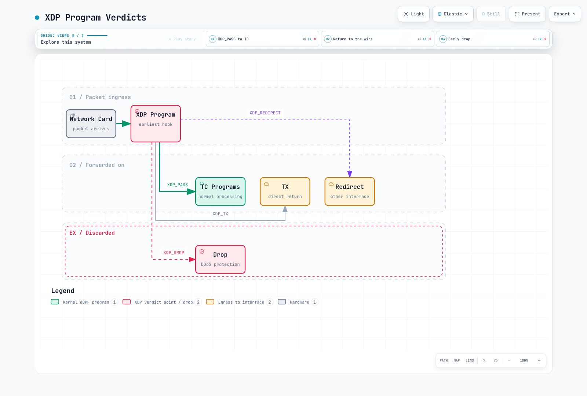

# Parte 6: Dataplane eBPF

> **Versiones de referencia revisadas**: Calico 3.32.2; Calico 3.32 se prueba con Kubernetes 1.34–1.36. **Última actualización**: 12 de septiembre de 2026.
>
> Los ejemplos suponen un clúster Linux con Calico ya instalado y compatible, junto con el servidor de API estándar de Calico. Use el procedimiento de quien administra la instalación: los fragmentos muestran opciones alternativas, no pasos que deban aplicarse a todos los clústeres. Esta revisión no cargó programas BPF, ni migró un clúster ni reprodujo los resultados de rendimiento citados.

## Introducción

El dataplane eBPF de Calico utiliza programas y mapas BPF para las redes de las cargas de trabajo, las políticas y el manejo de Services de Kubernetes. Puede reducir la sobrecarga en rutas adecuadas, pero el rendimiento depende de la carga y la configuración. Calico también ofrece dataplanes Linux clásicos y Windows HNS; eBPF no supone una mejora universal para todas las plataformas.

Este capítulo profundiza en los fundamentos de eBPF aplicados a las redes, la arquitectura eBPF de Calico, las estrategias de migración y la optimización del rendimiento.

***

## Fundamentos de eBPF

### ¿Qué es eBPF?

eBPF (extended Berkeley Packet Filter) es una tecnología revolucionaria que permite ejecutar programas aislados dentro del kernel de Linux sin modificar su código fuente ni cargar módulos del kernel.


[🔍 Ver diagrama interactivo](https://www.atomai.click/kubernetes-docs/archmaps/en-networking-calico-06-ebpf-dataplane-1.html)

> La máquina virtual describe un modelo abstracto de instrucciones. Con JIT, el programa cargado se ejecuta como código nativo en su hook, sin una máquina virtual invitada adicional. El diagrama no enumera exactamente todos los hooks de Calico.

### Conceptos clave de eBPF para redes

| Concepto | Descripción | Uso en Calico |
| ------------ | ---------------------------------------- | ----------------------------------- |
| **Programas** | Bytecode ejecutado en hooks del kernel | Filtrado de paquetes y enrutamiento |
| **Mapas** | Almacenes clave-valor compartidos entre programas | Tablas de rutas y reglas de políticas |
| **Hooks** | Puntos de conexión en el kernel | XDP, TC y socket |
| **Helpers** | Funciones del kernel invocables desde eBPF | Manipulación de paquetes y operaciones con mapas |
| **BTF** | Información de tipos para mapas y programas | Información de depuración y CO-RE |

### eBPF frente a iptables

Tanto iptables como los programas eBPF procesan paquetes en el kernel. Recorrer una regla de iptables normalmente no requiere pasar al espacio de usuario. kube-proxy es un proceso del plano de control que configura las reglas de los Services; en modo iptables, los paquetes no atraviesan ese proceso.

Las búsquedas en mapas hash, las coincidencias de prefijo más largo, las políticas compiladas, las llamadas de cola y el seguimiento de conexiones tienen costos distintos. No es válido concluir que «todas las políticas eBPF son O(1)» o que «la memoria es constante sin importar las reglas o flujos». iptables también puede utilizar conjuntos de IP indexados. Normalmente selecciona la regla NAT con el primer paquete de una conexión y aplica las traducciones ya establecidas mediante conntrack a los siguientes paquetes.

## Arquitectura eBPF de Calico

| Mecanismo | Función y alcance |
| --- | --- |
| Hooks de paquetes TC | Políticas, enrutamiento, estado de conexiones y manejo de Services por paquete; la entrada/salida de una interfaz no equivale necesariamente a la entrada/salida de la carga |
| Hooks de direcciones de socket en cgroup | Traducción del destino de un Service al conectar; el cargador de la versión publicada conecta hooks de connect y, cuando se habilita UDP, de sendmsg/recvmsg |
| XDP | Procesamiento temprano donde exista soporte y esté configurado; la aceleración XDP del dataplane clásico y las conexiones XDP del dataplane eBPF completo son mecanismos distintos |
| Mapas de programas, conjuntos de IP y contadores | Apoyo a los programas compilados y su estado; una política no se reduce a un mapa universal de tuplas a acciones |

Son contextos de ejecución distintos, no una secuencia obligatoria XDP → TC → sockops → sk_msg → TC. El balanceo al conectar de Calico no inspecciona métodos HTTP mediante sk_msg. Las políticas de aplicación utilizan la [integración independiente de Istio/Dikastes](05-network-policy.md).

## Estructuras de mapas BPF

Los siguientes diseños IPv4 corresponden **específicamente a Calico 3.32.2**. No son una ABI pública estable ni instrucciones para escribir directamente en mapas del kernel:

| Familia de mapas | Tipo | Bytes de clave / valor | Propósito |
| --- | --- | --- | --- |
| Rutas | LPM trie | 8 / 8 | Prefijo de destino, flags y unión de siguiente salto o interfaz |
| Frontend NAT | LPM trie | 16 / 20 | Coincidencia de Service/prefijo de origen, grupo y cantidad de backends, afinidad y flags |
| Backend NAT | Hash | 8 / 8 | Grupo/ordinal de backend → dirección y puerto |
| Formato conntrack v4 | LRU hash | 16 / 88 | Protocolo, par de direcciones, puertos, estado y metadatos NAT |
| Afinidad | LRU hash | Depende de la versión | Selección de backend por cliente almacenada en caché |

En la clave de ruta IPv4, los primeros cuatro bytes contienen la longitud del prefijo en orden little-endian y después vienen los bytes de la dirección IPv4. El valor incluye flags y una unión de cuatro bytes para siguiente salto o índice de interfaz, no una dirección MAC. Conntrack utiliza un campo de protocolo de 32 bits seguido de direcciones y puertos; la antigua estructura simplificada de cinco campos no representaba su diseño real. IPv6 utiliza otros diseños.

Las políticas se compilan en instrucciones BPF con apoyo de mapas; un mapa de contadores de reglas no es la política en sí. Decodifique los mapas con la herramienta de depuración de la misma versión de Calico y compruebe su tipo, capacidad y versión antes de interpretar bytes sin procesar.

## Direct Server Return (DSR)


[🔍 Ver diagrama interactivo](https://www.atomai.click/kubernetes-docs/archmaps/en-networking-calico-06-ebpf-dataplane-6.html)

> El frontend puede ser un NodePort u otra dirección de Service. Calico traduce la dirección de origen de la respuesta. El diagrama omite el balanceador de carga externo de la nube, cuyas restricciones de retorno siguen aplicándose.

Aquí, «nodo balanceador» es el nodo de Kubernetes que reenvía el tráfico del Service. DSR permite que la respuesta evite ese nodo, pero no evita automáticamente un balanceador externo de la nube. Calico traduce el origen de la respuesta; el Pod de la aplicación no tiene que vincularse a una VIP.

| `bpfExternalServiceMode` | Ruta hacia un backend remoto |
| --- | --- |
| `Tunnel` (predeterminado) | La solicitud y la respuesta pasan por el nodo de entrada y el túnel |
| `DSR` | La solicitud llega por túnel al nodo remoto y la respuesta va directamente hacia el cliente |

Este campo no acepta `Disabled` ni `IPIP`. Calico utiliza VXLAN para este reenvío de Services, por lo que ambos modos deben cumplir los requisitos de MTU y de la red subyacente. DSR exige además que la red permita a un nodo enviar tráfico con la dirección de origen del frontend o nodo de entrada original. La guía de Calico para AWS requiere nodos en la misma subred y la desactivación de las comprobaciones de origen/destino. Estas condiciones no habilitan cualquier despliegue entre subredes.

La guía actual de solución de problemas de Calico excluye las rutas de retorno de balanceadores externos de AWS/GCP que exigen pasar por el destino original. Cumplir los requisitos de subred y comprobación de origen no basta para habilitar DSR en ese tráfico.

En una ruta eBPF compatible que ya funciona, la opción se configura así:

```yaml
apiVersion: projectcalico.org/v3
kind: FelixConfiguration
metadata:
  name: default
spec:
  bpfExternalServiceMode: DSR
```

Integre el cambio mediante quien administra la configuración y pruebe el enrutamiento de retorno, la validación de origen y las conexiones activas. Cambiar el modo puede interrumpir conexiones. DSR y el balanceo al conectar son optimizaciones independientes.

## Balanceo de carga al establecer la conexión


[🔍 Ver diagrama interactivo](https://www.atomai.click/kubernetes-docs/archmaps/en-networking-calico-06-ebpf-dataplane-7.html)

> kube-proxy configura reglas del kernel; no transporta los paquetes. Tras la selección inicial de reglas, las conexiones iptables existentes utilizan conntrack. CTLB evita esa ruta DNAT del Service, no todo el procesamiento de paquetes.

El diagrama es conceptual. kube-proxy configura el estado del kernel y los paquetes posteriores utilizan conntrack en lugar de seleccionar de nuevo un backend recorriendo toda la lista de reglas del Service. El balanceo al conectar traduce el destino de Service de un socket compatible antes de procesar paquetes. No elimina todo el enrutamiento, las políticas, el seguimiento de conexiones ni cualquier otro NAT.

El campo actual admite `bpfConnectTimeLoadBalancing: TCP` (predeterminado), `Enabled` o `Disabled`. La antigua opción booleana `bpfConnectTimeLoadBalancingEnabled` está obsoleta, aunque se sigue aceptando. Revise y elimine los valores antiguos mediante quien administra la configuración, en lugar de configurar ambas formas sin comprobar su efecto.

```yaml
apiVersion: projectcalico.org/v3
kind: FelixConfiguration
metadata:
  name: default
spec:
  bpfConnectTimeLoadBalancing: TCP
  bpfHostNetworkedNATWithoutCTLB: Enabled
```

`Enabled` puede incluir sockets UDP; `TCP` limita CTLB a TCP. `bpfHostNetworkedNATWithoutCTLB` controla una ruta NAT complementaria para la red del host, no el soporte general de ClusterIP. Un service mesh que necesite conservar las direcciones originales de los Services puede exigir desactivar CTLB. Siga la integración probada para ese caso; la reescritura de sockets no siempre es compatible.

## Aceleración XDP



[🔍 Ver diagrama interactivo](https://www.atomai.click/kubernetes-docs/archmaps/en-networking-calico-06-ebpf-dataplane-3.html)

> Son acciones del framework. La ejecución nativa, genérica y descargada al hardware tiene requisitos distintos. El diagrama no garantiza que Calico exponga todas las acciones o funciones del hardware.

Las acciones XDP del diagrama son generales; no garantizan que Calico ofrezca todas las funciones de descarga al hardware o limitación de tasa. XDP nativo en el driver puede actuar antes de asignar un skb, mientras que XDP genérico actúa después, con un skb ya creado. La descarga al hardware depende de la NIC, el driver y el programa. El nombre del modo no establece una clasificación universal de velocidad.

El campo Felix `xdpEnabled` es **booleano** y acelera determinados rechazos de entrada sin seguimiento de conexiones en el dataplane clásico de iptables. `genericXDPEnabled` vale false de forma predeterminada; el uso de XDP genérico como alternativa no está garantizado. Estas opciones son distintas de los programas XDP internos del dataplane eBPF completo.

```yaml
# Separate classic iptables-dataplane acceleration example.
apiVersion: projectcalico.org/v3
kind: FelixConfiguration
metadata:
  name: default
spec:
  xdpEnabled: true
  genericXDPEnabled: false
```

Compruebe el soporte del driver y los programas conectados realmente a la interfaz prevista. `xdpEnabled: Enabled`, `Offload` y `BestEffort` no son modos enumerados válidos.

***

## Requisitos del modo eBPF

Consulte los requisitos de la versión elegida, en lugar de basarse en un mínimo histórico:

| Requisito | Alcance de eBPF en Calico 3.32 |
| --- | --- |
| Kernel Linux base | 5.10 o posterior; excepción documentada: RHEL 8.4 con kernel 4.18.0-305 o posterior |
| Arquitectura | x86-64 o arm64 little-endian |
| Datastore | Kubernetes; este modo no admite el datastore etcd |
| Funciones adicionales | Las reglas Log eBPF requieren kernel 5.16; los controles de ancho de banda QoS documentados requieren 6.6/TCX |
| Red subyacente | Debe permitir el tráfico VXLAN configurado entre nodos, incluido el reenvío de NodePort aunque los pools de Pods no usen encapsulación |
| Entorno de ejecución | Capacidades BPF/cgroup, privilegios y montajes escribibles necesarios; las variantes de SO inmutables necesitan un `CgroupV2Path` adecuado |

BTF aporta información de tipos para CO-RE y las herramientas, pero no es el verificador ni garantiza compatibilidad con todos los kernels. El cargador de Calico selecciona variantes de objetos CO-RE o sin CO-RE donde existe soporte. Comprobar `/sys/kernel/btf/vmlinux` no basta para declarar que un nodo está preparado. Verifique los requisitos de la versión, la configuración del nodo y los diagnósticos de carga reales. Los objetos fijados en bpffs sobreviven al proceso que los creó, pero no a un reinicio del host como lo harían datos persistentes en disco.

### Límites de las plataformas

La guía actual de Calico incluye clústeres autoadministrados/kubeadm, kOps, OpenShift, EKS, MKE y determinadas configuraciones de AKS/RKE. Excluye expresamente GKE, los clústeres que mantienen eBPF junto con el dataplane estándar o Windows y las políticas/Services SCTP. Documenta IPv6 y el funcionamiento exclusivamente IPv6; cambiar a dual-stack no es una solución general a una supuesta falta de soporte IPv6.

AKS con Azure CNI no permite desactivar su kube-proxy administrado. La guía considera AKS con redes Calico como una configuración independiente todavía en pruebas. Un nombre de SO, una imagen Ubuntu o una versión de kernel no demuestran por sí solos que una plataforma esté admitida. En EKS, el modo de nodos, la combinación CNI y la variante del SO deben seguir el procedimiento específico Calico/EKS. No extrapole el soporte a modos de red administrados ni a entornos que no puedan ejecutar los componentes privilegiados de nodo necesarios.

Windows utiliza el dataplane Windows HNS, no iptables de Linux. Evite un canary eBPF permanente por nodo mezclado con nodos Windows o del dataplane estándar. Valide en un clúster representativo independiente y después siga la transición coordinada documentada.

### Inventario de solo lectura

```bash
kubectl get nodes -o wide
kubectl -n kube-system get daemonset kube-proxy -o yaml
kubectl get installation.operator.tigera.io default -o yaml
kubectl get felixconfiguration.projectcalico.org default -o yaml
```

Utilice el namespace de la instalación y consulte las versiones reales de las imágenes de Calico y del operador. En cada nodo, examine `uname -r`, BTF, bpffs y los montajes cgroup desde el namespace de montajes del host. La vista del sistema de archivos de un contenedor de depuración no coincide necesariamente con la del host. Para cambiar el dataplane, conserve los valores de la release de Helm existente y compruebe su nombre real antes de actualizarla.

## Migración de iptables a eBPF

### Arranque automático del operador: requisitos específicos

Esta opción corresponde a un clúster autoadministrado basado en kubeadm e instalado con Tigera Operator. kube-proxy debe estar en `kube-system` y **no administrado por Helm, Argo CD ni otro reconciliador**; el operador debe poder leer el Service de Kubernetes y sus endpoints.

```bash
kubectl get installation.operator.tigera.io default -o yaml
# Only when every automatic-bootstrap prerequisite above is met:
kubectl patch installation.operator.tigera.io default --type=merge \
  -p '{"spec":{"calicoNetwork":{"linuxDataplane":"BPF","bpfNetworkBootstrap":"Enabled","kubeProxyManagement":"Enabled"}}}'
```

El operador configura el acceso directo a la API y administra kube-proxy durante la transición. Las actualizaciones progresivas dejan temporalmente nodos en modos distintos, y la guía oficial advierte de posibles interrupciones de NodePort. La migración no garantiza la ausencia de interrupciones.

### Preparación manual y administración de los componentes

En otras instalaciones admitidas, establezca primero un acceso **directo** y estable al servidor de API que no dependa del mecanismo de Services que se va a sustituir. Use el hostname o la dirección y el puerto reales del balanceador de API. En EKS corresponde al hostname del endpoint de API del clúster, normalmente en el puerto 443. El ejemplo siguiente contiene un endpoint de API autoadministrado que debe reemplazar.

```yaml
apiVersion: v1
kind: ConfigMap
metadata:
  name: kubernetes-services-endpoint
  namespace: tigera-operator
data:
  KUBERNETES_SERVICE_HOST: api.internal.example.com
  KUBERNETES_SERVICE_PORT: "6443"
```

Utilice `tigera-operator` en una instalación con operador y `kube-system` en el procedimiento con manifiestos independientes. El nombre es **`kubernetes-services-endpoint`**, en plural. Antes de cambiar el dataplane de Services, confirme que Calico ha recibido el endpoint y puede resolverlo y conectarse a él. El arranque de DNS, las reglas de seguridad y la conectividad siguen dependiendo de la plataforma.

Si kube-proxy utiliza IPVS, la migración oficial exige cambiarlo antes a modo iptables y efectuar un reinicio de nodos planificado. Trate ese paso como un cambio controlado independiente.

Coordine kube-proxy con quien lo administra. Si debe seguir en ejecución, como en el caso documentado de AKS con Azure CNI, integre estos campos en la configuración Felix existente:

```yaml
apiVersion: projectcalico.org/v3
kind: FelixConfiguration
metadata:
  name: default
spec:
  bpfKubeProxyIptablesCleanupEnabled: false
  bpfKubeProxyHealthzPort: 0
```

La opción de limpieza por sí sola no habilita el manejo de Services. Ejecutar kube-proxy con la limpieza activada hace que los dos componentes compitan por iptables. Mantener ambos servidores de salud en el puerto 10256 también produce un conflicto. Conserve el resto de la configuración Felix al integrar los campos.

Habilite el dataplane mediante **una sola** opción de administración:

```bash
# Operator installation:
kubectl patch installation.operator.tigera.io default --type=merge \
  -p '{"spec":{"calicoNetwork":{"linuxDataplane":"BPF"}}}'
```

```bash
# Alternative: standalone manifest installation, without operator ownership:
kubectl patch felixconfiguration.projectcalico.org default --type=merge \
  -p '{"spec":{"bpfEnabled":true}}'
```

Cuando la instalación requiera desactivar kube-proxy manualmente, siga la secuencia documentada de la plataforma durante la ventana de transición prevista. Guarde antes su configuración deseada. Si usa un nodeSelector temporal, elija una clave no utilizada, compruebe que no coincide con ningún nodo y retire después únicamente esa clave. Conserve el mapa de selectores existente. Eliminar un DaemonSet o escalar un Deployment kube-proxy inexistente no es un procedimiento general de migración.

### Validar el tráfico, además de los programas cargados

Revise el estado del despliegue y los programas y mapas BPF reales de los nodos previstos. Pruebe conexiones nuevas entre Pods, DNS, ClusterIP, NodePort/accesos externos, rechazos por políticas y las conexiones necesarias desde la red del host entre nodos. Un listado de programas o pocas líneas de iptables no demuestran que esas rutas funcionen.

La API de Kubernetes normalmente utiliza HTTPS, no `http://kubernetes.default.svc`. Pruebe el transporte con la confianza TLS y la identidad adecuadas; distinga los fallos de autenticación de los de red. Para verificar conectividad, prefiera un Service de aplicación controlado a una solicitud sin autenticación a la API.

### Reversión

Revierta el cambio de modo mediante quien administra la misma configuración:

```bash
# Operator installation: use its owner/GitOps source for the same change.
kubectl patch installation.operator.tigera.io default --type=merge \
  -p '{"spec":{"calicoNetwork":{"linuxDataplane":"Iptables"}}}'
```

```bash
# Alternative for standalone manifest installations:
kubectl patch felixconfiguration.projectcalico.org default --type=merge \
  -p '{"spec":{"bpfEnabled":false}}'
```

Con el arranque automático, el operador puede restaurar kube-proxy. Si lo desactivó manualmente, revierta solo el cambio temporal mediante su administrador, conservando los selectores y las demás opciones originales. Vuelva a comprobar las reglas de Services y el tráfico. Desactivar eBPF o cambiar el modo de Service externo puede interrumpir conexiones existentes. Reiniciar un nodo no garantiza que todo el estado de las aplicaciones quede limpio.

***

## Registros de rendimiento citados

Las guías anteriores en inglés y coreano contenían **registros distintos que no se verificaron**. Las tablas siguientes conservan sus cifras originales; no son mediciones de esta revisión ni garantías para Calico 3.32.2. Ningún registro incluye la salida original, la fecha de prueba, las versiones exactas de Calico/Kubernetes/kernel, la topología, los detalles de NIC/CPU, el estado inicial de las conexiones ni un método de prueba completo.

### Registro A: guía anterior en inglés

| Latencia citada | iptables | eBPF | Reducción original redondeada |
| --- | --- | --- | --- |
| Pod en el mismo nodo | 45 μs | 25 μs | 44% |
| Pod entre nodos | 120 μs | 80 μs | 33% |
| ClusterIP | 150 μs | 60 μs | 60% |
| NodePort | 180 μs | 70 μs | 61% |

| Rendimiento citado | iptables | eBPF | Aumento original redondeado |
| --- | --- | --- | --- |
| Un flujo TCP | 15 Gbps | 23 Gbps | 53% |
| Varios flujos TCP | 35 Gbps | 48 Gbps | 37% |
| Un flujo UDP | 8 Gbps | 18 Gbps | 125% |
| Paquetes de 64 bytes | 2M pps | 5M pps | 150% |

| Cantidad de reglas citada | Conexiones/s con iptables | Conexiones/s con eBPF |
| --- | --- | --- |
| 1,000 | 50,000 | 120,000 |
| 5,000 | 35,000 | 115,000 |
| 10,000 | 20,000 | 110,000 |


No se especifica el percentil de latencia. Las conexiones por segundo no miden directamente la utilización de CPU. Estos tres puntos tampoco demuestran un costo constante de las políticas a cualquier escala.

### Registro B: guía anterior en coreano

| Métrica citada | iptables | eBPF | Cambio original redondeado |
| --- | --- | --- | --- |
| Rendimiento | 1.2M pps | 2.0M pps | +67% |
| Latencia | 120 μs | 75 μs | −38% |
| CPU con 1,000 Services | 70% | 30% | −57% |
| Establecimiento de conexión | Sin valor absoluto | Sin valor absoluto | Reducción citada del 50% |


El registro B corresponde a otro experimento distinto del A. Sus afirmaciones sobre memoria y complejidad no eran datos medidos, y el porcentaje de reducción del tiempo de conexión no incluye las duraciones originales. Mantenga los registros separados y evite presentar una «mejora del 20–40%» fija como resultado esperado.

### Comparación reproducible

Use imágenes de prueba de cliente y servidor equivalentes, los mismos nodos, la misma ruta de tráfico, asignación de CPU/NIC, MTU y carga. Registre el dataplane, el kernel, las versiones de software, la duración, la cantidad de muestras, el calentamiento, la concurrencia, el estado de conntrack y las opciones de logging. Pruebe un Service de aplicación por separado del acceso directo a IP de Pods.

```bash
# Requires ready test Pods with netperf/netserver and an appropriate test policy.
CLIENT_POD=netperf-client
SERVER_POD=netperf-server
SERVER_IP="$(kubectl -n calico-demo get pod "$SERVER_POD" -o jsonpath='{.status.podIP}')"
test -n "$SERVER_IP"
kubectl -n calico-demo exec "$CLIENT_POD" -- \
  netperf -H "$SERVER_IP" -t TCP_RR -l 30
kubectl -n calico-demo exec "$CLIENT_POD" -- \
  netperf -H "$SERVER_IP" -t TCP_STREAM -l 30
```

`TCP_RR` normalmente informa **transacciones por segundo**, no un percentil de latencia. Bajo los supuestos pertinentes, su inverso puede expresar el tiempo medio de transacción; no es la latencia de red p99. netperf utiliza conexiones de control y de datos, que deben permitirse en el entorno de prueba aislado. Instalar netperf en la estación de trabajo del operador no lo instala en el Pod cliente. Esta revisión no ejecutó el procedimiento en un clúster Calico.

***

## Depuración de eBPF

La imagen de nodo de Calico incluye la herramienta de depuración mediante **`calico-node -bpf`**. También existe un punto de entrada independiente `calico-bpf` en el código fuente, pero no debe suponerse que haya un binario separado instalado en la imagen. La herramienta integrada utiliza `help`; el wrapper puede procesar `--help` antes de que llegue al subcomando BPF.

```bash
CALICO_NAMESPACE=calico-system
CALICO_NODE=demo-worker
CALICO_POD="$(kubectl -n "$CALICO_NAMESPACE" get pods -l k8s-app=calico-node \
  --field-selector "spec.nodeName=$CALICO_NODE" -o jsonpath='{.items[0].metadata.name}')"
test -n "$CALICO_POD"
kubectl -n "$CALICO_NAMESPACE" exec "$CALICO_POD" -c calico-node -- \
  calico-node -bpf help
kubectl -n "$CALICO_NAMESPACE" exec "$CALICO_POD" -c calico-node -- \
  calico-node -bpf routes dump
kubectl -n "$CALICO_NAMESPACE" exec "$CALICO_POD" -c calico-node -- \
  calico-node -bpf conntrack dump
kubectl -n "$CALICO_NAMESPACE" exec "$CALICO_POD" -c calico-node -- \
  calico-node -bpf nat dump
kubectl -n "$CALICO_NAMESPACE" exec "$CALICO_POD" -c calico-node -- \
  calico-node -bpf counters dump
```

```bash
# Choose an interface actually attached on this node.
BPF_INTERFACE=eth0
kubectl -n "$CALICO_NAMESPACE" exec "$CALICO_POD" -c calico-node -- \
  calico-node -bpf policy dump "$BPF_INTERFACE" all
# IPv6, when enabled: put the debug-tool flag after its subcommand.
kubectl -n "$CALICO_NAMESPACE" exec "$CALICO_POD" -c calico-node -- \
  calico-node -bpf routes dump --ipv6
```

```bash
kubectl -n "$CALICO_NAMESPACE" exec "$CALICO_POD" -c calico-node -- bpftool prog show
kubectl -n "$CALICO_NAMESPACE" exec "$CALICO_POD" -c calico-node -- bpftool map show
kubectl -n "$CALICO_NAMESPACE" exec "$CALICO_POD" -c calico-node -- bpftool net show
kubectl -n "$CALICO_NAMESPACE" exec "$CALICO_POD" -c calico-node -- \
  tc filter show dev "$BPF_INTERFACE" ingress
kubectl -n "$CALICO_NAMESPACE" exec "$CALICO_POD" -c calico-node -- \
  tc filter show dev "$BPF_INTERFACE" egress
```

`policy dump` requiere una interfaz y un hook: `ingress`, `egress`, `xdp` o `all`. Debe existir información de depuración de políticas; `bpfPolicyDebugEnabled` vale true de forma predeterminada. La entrada a una carga se conecta al hook TC/TCX de **salida** del veth del lado del host; la entrada al host utiliza el hook de entrada de su interfaz. La palabra que describe el hook no determina por sí sola la dirección respecto de la carga.

`nat dump` acepta cero argumentos o una terna IP/puerto/protocolo. La CLI revisada no incluye `nat frontend list`. Consulte los ID reales de programas y mapas antes de usar comandos de bpftool por ID. Las claves para consultar un mapa dependen de su diseño completo y de su versión: cuatro bytes de IPv4 no constituyen una clave de mapa de rutas.

Use el valor real de `max_entries` y los tamaños que informa bpftool. `/proc/sys/kernel/bpf_map_max_entries` no es un control general de capacidad de mapas de Linux. Los contadores de ejecución, como `run_cnt` y `run_time_ns`, requieren habilitar estadísticas y no miden la latencia de solicitudes de extremo a extremo. Para conexiones TCX puede ser necesario examinar los enlaces y puntos de conexión de bpftool, además de `tc filter show`.

### Logs y capturas

`bpfLogLevel` admite **Off, Info o Debug**, no Warn/Warning. Los logs de programas van al trace pipe de BPF; los logs del componente Felix van a stdout del contenedor. Use la herramienta de trazado y el nodo adecuados para revisar los logs de programas y políticas. Un despliegue de Pods correcto no demuestra que una ruta de paquetes esté permitida.

Calico puede redirigir directamente al extremo de la carga. Por ello, una captura en el veth del lado del host puede omitir tráfico que evita ese hook. Capture en la ruta real y correlacione las políticas, las rutas, conntrack y los backends de Services.

## Reemplazo del manejo de Services de Kubernetes y sus límites

Calico eBPF reenvía tráfico de Services, pero no aprovisiona balanceadores externos de la nube. Mantenga separadas las responsabilidades de los controladores de AWS o de la nube. La implementación actual incluye mapas NAT IPv4/IPv6, flags de tráfico local y afinidad. La antigua tabla que indicaba falta de soporte para IPv6/Local no refleja las funciones actuales. Verifique el comportamiento de cada opción de kube-proxy antes de considerarla equivalente.

Las pruebas funcionales de WireGuard de la versión publicada incluyen modo BPF y configuraciones IPv4/IPv6. Por tanto, WireGuard **no es incompatible en todos los casos** con eBPF. Verifique el CNI, el tipo de tráfico, el kernel, la MTU y la ruta de cifrado reales. La guía general de cifrado contiene restricciones y ejemplos antiguos que no deben aplicarse automáticamente a un SO actual.

Para cargas que usan la red del host, revise por separado las opciones CTLB/NAT del host y las políticas HostEndpoint. La guía eBPF actual sigue excluyendo SCTP y clústeres que mantienen una mezcla de eBPF, dataplane estándar o Windows. Windows necesita la arquitectura HNS admitida.

Para rutas de balanceadores de AWS/GCP, la guía actual de solución de problemas de Calico advierte expresamente que DSR no funciona correctamente cuando el balanceador externo exige una respuesta a través del destino original. Use el modo admitido documentado y valide la ruta completa. Los requisitos de misma subred y comprobación de origen no bastan para establecer compatibilidad con un balanceador de la nube.

## Configuración y observabilidad

Conserve los valores predeterminados de la versión mientras las mediciones no justifiquen un cambio. Estos campos ilustran nombres y valores actuales para una instalación con eBPF ya habilitado. Intégrelos mediante quien administra la configuración:

```yaml
apiVersion: projectcalico.org/v3
kind: FelixConfiguration
metadata:
  name: default
spec:
  bpfLogLevel: "Off"
  bpfExternalServiceMode: Tunnel
  bpfConnectTimeLoadBalancing: TCP
  bpfHostNetworkedNATWithoutCTLB: Enabled
```

Conserve un `bpfDataIfacePattern` que cubra las interfaces reales, en lugar de sustituirlo por un `eth*` arbitrario o una expresión demasiado estrecha. Es una expresión regular que debe incluir las interfaces de red subyacente y Services, excluyendo las de cargas y los dispositivos especiales de Calico. El nombre de una interfaz no demuestra soporte de descarga XDP al hardware.

`bpfKubeProxyEndpointSlicesEnabled` no es un campo Felix actual. La antigua opción booleana CTLB está obsoleta, no eliminada. Entre las claves actuales de timeout de conntrack figuran `tcpEstablished`, `tcpFinsSeen`, `tcpResetSeen`, `udpTimeout`, `genericTimeout` e `icmpTimeout`; `tcpClosing`, `udp` e `icmp` no corresponden a esas claves. Mida la ocupación y la memoria de los mapas antes de asignar un millón de entradas a cualquier despliegue.

El administrador de endpoints de la versión publicada registra estos indicadores reales de tipo gauge:

| Métrica | Significado |
| --- | --- |
| `felix_bpf_dataplane_endpoints` | Endpoints BPF administrados |
| `felix_bpf_dirty_dataplane_endpoints` | Endpoints que siguen pendientes de actualizar después de un fallo |
| `felix_bpf_happy_dataplane_endpoints` | Endpoints programados correctamente |

Habilite el endpoint de métricas Felix documentado mediante quien lo administra. Examine el scrape real y las declaraciones HELP/TYPE. No se verificó que la antigua lista `calico_bpf_*` correspondiera a métricas exportadas. Los gauges de endpoints no sustituyen directamente a la ocupación de mapas, los contadores de paquetes rechazados ni la latencia de la aplicación.

Seleccione el dataplane según la compatibilidad actual de la plataforma, las funciones necesarias de Services, políticas y cifrado, y el comportamiento medido de la carga. Ensaye tanto la transición como la reversión. eBPF e iptables pueden ser adecuados según el clúster; ninguno es siempre la opción correcta.

***

## Referencias

* [Requisitos de instalación eBPF de Calico 3.32](https://docs.tigera.io/calico/latest/operations/ebpf/install)
* [Migración y reversión eBPF de Calico](https://docs.tigera.io/calico/latest/operations/ebpf/enabling-ebpf)
* [Solución de problemas y CLI eBPF de Calico](https://docs.tigera.io/calico/latest/operations/ebpf/troubleshoot-ebpf)
* [Configuración Felix](https://docs.tigera.io/calico/latest/reference/resources/felixconfig)
* [API de instalación del operador](https://docs.tigera.io/calico/latest/reference/installation/api)
* [BTF del kernel](https://docs.kernel.org/bpf/btf.html)
* [libbpf y CO-RE](https://docs.kernel.org/bpf/libbpf/libbpf_overview.html)
* [Diseño del mapa de rutas de Calico 3.32.2](https://raw.githubusercontent.com/projectcalico/calico/v3.32.2/felix/bpf/routes/map.go)
* [Mapas NAT de Calico 3.32.2](https://raw.githubusercontent.com/projectcalico/calico/v3.32.2/felix/bpf/nat/maps.go)
* [Diseño de conntrack v4 de Calico 3.32.2](https://raw.githubusercontent.com/projectcalico/calico/v3.32.2/felix/bpf/conntrack/v4/map.go)
* [Cargador de balanceo al conectar de Calico 3.32.2](https://raw.githubusercontent.com/projectcalico/calico/v3.32.2/felix/bpf/nat/connecttime.go)
* [Pruebas funcionales de WireGuard de Calico 3.32.2](https://raw.githubusercontent.com/projectcalico/calico/v3.32.2/felix/fv/wireguard_test.go)
* [Referencia de programas de bpftool](https://raw.githubusercontent.com/libbpf/bpftool/main/docs/bpftool-prog.rst)
* [Referencia de mapas de bpftool](https://raw.githubusercontent.com/libbpf/bpftool/main/docs/bpftool-map.rst)
