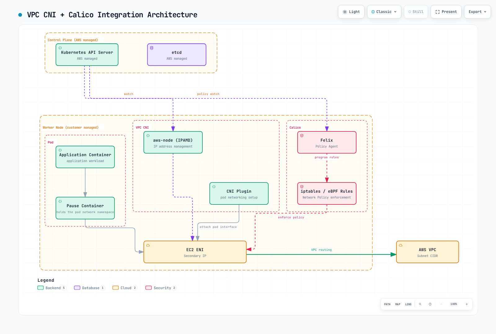

# Parte 8: Integración de EKS

> **Línea base revisada**: Calico 3.32.2 / Tigera Operator 1.42.6 / Kubernetes 1.34–1.36 probado por Calico. **Última actualización**: October 12, 2026

## Descripción general

Esta guía utiliza Calico para aplicar políticas en **nodos de trabajo EC2 Linux comunes con Amazon VPC CNI**. VPC CNI asigna IP de Pod y configura las redes de VPC; Calico programa las políticas en el dataplane del nodo. La instalación siguiente mantiene el dataplane Iptables y kube-proxy. Las redes de Calico y eBPF son opciones de despliegue independientes con requisitos previos adicionales.

En el momento de esta revisión, EKS incluye 1.34–1.37 en soporte estándar y 1.31–1.33 en soporte extendido ([ciclo de vida de versiones de Kubernetes de EKS](https://docs.aws.amazon.com/eks/latest/userguide/kubernetes-versions.html)). El rango de pruebas de Kubernetes publicado para Calico 3.32 es 1.34–1.36. La disponibilidad de EKS, los lanzamientos de Kubernetes upstream y la compatibilidad de Calico son comprobaciones independientes; que EKS ofrezca 1.37 no incorpora 1.37 a la matriz probada de Calico 3.32. Confirme las versiones de EKS y de complementos de la Region objetivo antes de la instalación.

## Arquitectura de VPC CNI + Calico



[🔍 Ver diagrama interactivo](https://www.atomai.click/kubernetes-docs/archmaps/en-networking-calico-08-eks-integration-0.html)

La figura resume las responsabilidades de los componentes. Un paquete no atraviesa el contenedor pause ni el proceso Felix como proxy de reenvío. Felix programa reglas que evalúa el kernel Linux. Su etiqueta `iptables / eBPF` representa dataplanes alternativos; esta guía instala Iptables. Typha y kube-controllers se ejecutan en capacidad de trabajo del cliente, no dentro del plano de control EKS administrado por AWS.

| Componente | Responsabilidad en esta configuración |
| --- | --- |
| `aws-node` / IPAMD y complemento VPC CNI | Administrar ENI/asignación de IP y configurar la conectividad de Pod |
| Felix en `calico-node` | Programar reglas de política para endpoints locales |
| Typha | Distribuir actualizaciones del almacén de datos a Felix; el operador administra el escalado |
| kube-controllers | Conciliar datos de Calico con recursos de Kubernetes |
| kube-proxy | Proporcionar reenvío de Kubernetes Service en esta línea base |

Para tráfico entre nodos, el kernel evalúa la política aplicable y utiliza la ruta de VPC. El tráfico en el mismo nodo puede permanecer en el host. Un paquete descartado se elimina; una denegación por política no devuelve el paquete al remitente. Los controles aplicables de salida del origen y de entrada del destino deben permitir ambos la conexión.

## Elegir un motor de políticas y método de instalación

| Opción | Qué instala | Ciclo de vida y alcance |
| --- | --- | --- |
| Política de red de Amazon VPC CNI | Implementación de políticas de AWS | Configurar el complemento `vpc-cni` compatible; esto no instala Calico |
| Manifiestos de Tigera Operator | Operador y recursos personalizados de Calico | Fijar la versión, administrar CRD y después conciliar la Installation |
| Helm chart de Tigera Operator | El mismo operador, con configuración administrada por Helm | Renderizar y revisar valores; utilizar la versión existente para actualizaciones |
| Manifiestos directos de Calico | Componentes de Calico sin el operador | Conservar la personalización de la plataforma y asumir el procedimiento de actualización |

Los complementos de EKS no se actualizan automáticamente cuando se publica una nueva versión del complemento o cambia la versión menor del clúster. Los complementos de AWS, Marketplace y la comunidad también tienen propietarios de soporte distintos. No suponga que existe un complemento llamado `calico` ni que un producto de Marketplace sea igual que esta instalación OSS; inspeccione el catálogo, editor, versión, licencia y compatibilidad de cómputo reales.

**Utilice un motor de políticas de red para los mismos endpoints.** La guía de Calico para EKS requiere que la política de red de AWS VPC CNI esté deshabilitada. Una migración necesita una transición revisada de políticas, estado de nodos y disponibilidad; simplemente alternar un indicador mientras se ejecutan ambos motores no es un procedimiento de migración. AWS advierte que las reglas pueden permanecer tras eliminar un agente de políticas y recomienda reemplazar los nodos afectados al migrar desde un motor de terceros. Consulte las [consideraciones sobre políticas de AWS](https://docs.aws.amazon.com/eks/latest/userguide/cni-network-policy.html) y el [procedimiento para deshabilitar](https://docs.aws.amazon.com/eks/latest/userguide/network-policy-disable.html).

## Preparar la instalación existente de VPC CNI

Los comandos siguientes inspeccionan un complemento administrado `vpc-cni` existente. Utilice la Region y el nombre de clúster reales; una instalación de VPC CNI autoadministrada debe cambiarse mediante su propio manifiesto o propietario de Helm.

```bash
EKS_CLUSTER=my-cluster
EKS_REGION=us-east-1
EKS_VERSION=$(aws eks describe-cluster --name "$EKS_CLUSTER" \
  --region "$EKS_REGION" --query cluster.version --output text)

aws eks describe-addon-versions --addon-name vpc-cni \
  --kubernetes-version "$EKS_VERSION" --region "$EKS_REGION" \
  --query 'addons[0].addonVersions[].{version:addonVersion,compatibility:compatibilities,compute:computeTypes}'

aws eks describe-addon --cluster-name "$EKS_CLUSTER" \
  --addon-name vpc-cni --region "$EKS_REGION" > vpc-cni-current.json

VPC_CNI_VERSION=$(jq -r '.addon.addonVersion' vpc-cni-current.json)
aws eks describe-addon-configuration --addon-name vpc-cni \
  --addon-version "$VPC_CNI_VERSION" --region "$EKS_REGION" \
  --query configurationSchema --output text > vpc-cni-schema.json
```

Calico requiere `ANNOTATE_POD_IP=true` para que VPC CNI publique con prontitud `vpc.amazonaws.com/pod-ips`. El ServiceAccount `aws-node` necesita permiso para aplicar parches a Pods. La documentación actual de VPC CNI indica que el complemento de EKS actualiza este permiso automáticamente; verifíquelo en lugar de sobrescribir el ClusterRole existente:

```bash
kubectl auth can-i patch pods --all-namespaces \
  --as=system:serviceaccount:kube-system:aws-node
```

Esta comprobación de autorización requiere permiso para suplantar ese ServiceAccount. Si el permiso está ausente, una vinculación independiente puede agregar la regla necesaria sin reemplazar reglas existentes. Para una instalación no estándar, use su nombre real de ServiceAccount.

```yaml
apiVersion: rbac.authorization.k8s.io/v1
kind: ClusterRole
metadata:
  name: calico-vpc-pod-annotations
rules:
  - apiGroups: [""]
    resources: ["pods"]
    verbs: ["patch"]
---
apiVersion: rbac.authorization.k8s.io/v1
kind: ClusterRoleBinding
metadata:
  name: calico-vpc-pod-annotations
roleRef:
  apiGroup: rbac.authorization.k8s.io
  kind: ClusterRole
  name: calico-vpc-pod-annotations
subjects:
  - kind: ServiceAccount
    name: aws-node
    namespace: kube-system
```

Para la **configuración nueva o ya solo de políticas** revisada, prepare el candidato siguiente y conserve la configuración actual del complemento:

```bash
jq '(.addon.configurationValues // "") as $current
  | (if $current == "" then {} else ($current | fromjson) end)
  | .enableNetworkPolicy = "false"
  | .env.ANNOTATE_POD_IP = "true"
  | del(.env.NETWORK_POLICY_ENFORCING_MODE)' \
  vpc-cni-current.json > vpc-cni-calico.json
```

Este comando espera valores de configuración JSON; si los valores existentes son YAML, analícelos y conviértalos sin eliminar campos antes de preparar el candidato. Deténgase ante un error de análisis. Valide el candidato frente al esquema de compilación de EKS recuperado y revise la diferencia. La variable `NETWORK_POLICY_ENFORCING_MODE` pertenece al agente de políticas de AWS; dejarla configurada cuando ese agente está ausente puede impedir la creación de Pods. Si la política de AWS está activa actualmente, complete el plan de migración antes de usar este candidato. Aplique la configuración aprobada mediante el propietario del complemento:

```bash
aws eks update-addon --cluster-name "$EKS_CLUSTER" \
  --addon-name vpc-cni --region "$EKS_REGION" \
  --configuration-values file://vpc-cni-calico.json \
  --resolve-conflicts PRESERVE
```

Inspeccione el estado de actualización devuelto y el DaemonSet resultante. Un conflicto conservado puede impedir que el campo deseado surta efecto. No considere el análisis correcto de JSON ni una solicitud de actualización aceptada como prueba de aplicación de políticas.

## Instalar Calico con el operador

Elija **una** de las rutas de manifiestos o Helm siguientes para una instalación nueva. No instale un segundo operador sobre una versión existente. Estos ejemplos suponen trabajadores EC2 Linux comunes, API/DNS de Kubernetes accesible, VPC CNI compatible y ningún motor de políticas en competencia.

### Ruta de manifiestos del operador

Calico 3.32 separa los CRD de Calico del manifiesto del operador:

```bash
kubectl create -f https://raw.githubusercontent.com/projectcalico/calico/v3.32.2/manifests/v1_crd_projectcalico_org.yaml
kubectl create -f https://raw.githubusercontent.com/projectcalico/calico/v3.32.2/manifests/tigera-operator.yaml
```

Guarde lo siguiente como `calico-eks-installation.yaml`:

```yaml
apiVersion: operator.tigera.io/v1
kind: Installation
metadata:
  name: default
spec:
  kubernetesProvider: EKS
  cni:
    type: AmazonVPC
  calicoNetwork:
    bgp: Disabled
    linuxDataplane: Iptables
  nodeUpdateStrategy:
    type: RollingUpdate
    rollingUpdate:
      maxUnavailable: 1
---
apiVersion: operator.tigera.io/v1
kind: APIServer
metadata:
  name: default
spec: {}
---
apiVersion: operator.tigera.io/v1
kind: Goldmane
metadata:
  name: default
spec: {}
---
apiVersion: operator.tigera.io/v1
kind: Whisker
metadata:
  name: default
spec: {}
```

```bash
kubectl apply -f calico-eks-installation.yaml
kubectl get tigerastatus
kubectl get pods -n calico-system
```

El servidor de API, el agregador de flujos Goldmane y la interfaz de usuario Whisker están disponibles en OSS. Configure su acceso y capacidad de recursos para su entorno. Establecer `cni.type: AmazonVPC` delega IPAM/redes a VPC CNI; `bgp: Disabled` por sí solo no selecciona el CNI. Deje que el operador administre las réplicas de Typha; `typhaDeployment.spec.replicas` no es una anulación de Installation compatible. Consulte los [detalles de escalado](07-advanced-topics.md).

### Ruta de Helm

Guarde esto como `calico-eks-values.yaml`. `installation` se asigna a la API Installation. El `nodeSelector` de nivel superior controla el Pod del operador, no todos los componentes de Calico. Helm puede ignorar silenciosamente valores no compatibles, por lo que debe inspeccionar los recursos renderizados.

```yaml
installation:
  enabled: true
  kubernetesProvider: EKS
  cni:
    type: AmazonVPC
  calicoNetwork:
    bgp: Disabled
    linuxDataplane: Iptables
  nodeUpdateStrategy:
    type: RollingUpdate
    rollingUpdate:
      maxUnavailable: 1
apiServer:
  enabled: true
goldmane:
  enabled: true
whisker:
  enabled: true
manageCRDs: true
```

```bash
helm repo add projectcalico https://docs.tigera.io/calico/charts
helm repo update projectcalico
helm template calico projectcalico/tigera-operator \
  --version v3.32.2 --namespace tigera-operator \
  -f calico-eks-values.yaml > calico-rendered.yaml

# After reviewing the rendered configuration for the prepared cluster:
helm install calico projectcalico/tigera-operator \
  --version v3.32.2 --namespace tigera-operator --create-namespace \
  -f calico-eks-values.yaml
```

Con `manageCRDs: true`, el operador administra los CRD necesarios después de iniciarse. Para una actualización que usa inmediatamente campos nuevos, aplique primero los CRD coincidentes mediante su propietario existente, siguiendo el [procedimiento de actualización de Calico](https://docs.tigera.io/calico/latest/operations/upgrading/kubernetes-upgrade). Un rollback de Helm por sí solo no garantiza que se revierta una migración de CRD o datos almacenados.

## Política de red nativa de AWS como alternativa

El soporte estándar de NetworkPolicy de AWS VPC CNI comenzó en **VPC CNI 1.14**, no en EKS 1.14. La guía actual de AWS requiere VPC CNI **1.21+ tanto para políticas estándar como de administración**, versiones compatibles de EKS/plataforma y kernel Linux 5.10+. Utilice la guía de compatibilidad actual en lugar de ejemplos antiguos de versiones de lanzamiento.

AWS ahora documenta `networking.k8s.aws/v1alpha1` **ClusterNetworkPolicy**, incluidos niveles Admin y Baseline, junto con NetworkPolicy `networking.k8s.io/v1` con ámbito de namespace. Es una API distinta de GlobalNetworkPolicy de Calico y de los niveles configurables de Calico. No describa la política nativa como limitada permanentemente a reglas con ámbito de namespace.

| Capacidad | Implementación nativa de AWS | Calico OSS en esta guía |
| --- | --- | --- |
| Kubernetes NetworkPolicy | Compatible en nodos EC2 Linux elegibles | Compatible en endpoints administrados |
| Política de clúster | AWS ClusterNetworkPolicy, con sus propias reglas y requisitos previos | Calico GlobalNetworkPolicy y Tier |
| Observabilidad de políticas | Métricas/registros de eventos del agente; configurar por separado cualquier entrega a CloudWatch | Métricas de Felix/Typha, Goldmane y observabilidad de flujos de Whisker |
| Política de capa de aplicación | No la infiera de la política de red L3/L4 | Integración independiente de Dikastes/Istio; no habilitada por esta instalación |
| Política DNS/FQDN en Calico | No es una implementación de API de Calico | La función documentada de política basada en dominios requiere una edición comercial de Calico |

Para la alternativa nativa, configure `enableNetworkPolicy` mediante los ajustes compatibles del complemento/Helm de VPC CNI. Establecer una variable de entorno `ENABLE_NETWORK_POLICY` inventada en `aws-node` es insuficiente. El modo de inicio nativo `standard` permite inicialmente el tráfico mientras se programa la política; `strict` comienza con denegación y requiere las rutas necesarias, incluido DNS. Estos ajustes de AWS no configuran el comportamiento de inicio de Calico.

La aplicación nativa tiene límites documentados: solo EC2 Linux, solo interfaz primaria de Pod, restricciones de familias de IP y funcionamiento fiable con Pods controlados por controladores. Revise los límites de puertos/protocolos y los requisitos de puertos de Service. Mantenga los recursos PolicyEndpoint administrados por AWS bajo control del controlador. Utilice la [guía de VPC CNI mantenida](../01-vpc-cni.md) para conocer la configuración completa y los detalles de migración.

## Tipos de nodos y perfiles de red

| Perfil | Aplicabilidad |
| --- | --- |
| Nodos EC2 Linux comunes administrados o autoadministrados + VPC CNI | Instalación base solo de políticas anterior; el modelo de administración por sí solo no decide la capacidad de Calico |
| Nodos EC2 + CNI Calico completo | Diseño independiente documentado por Tigera; cambian el direccionamiento de Pod, la accesibilidad del plano de control, la propiedad de CNI y los límites de soporte |
| EKS Fargate | Ni el agente de nodo de Calico ni la política de red nativa de VPC CNI se ejecutan en estos Pods; los grupos de seguridad para Pods son un control compatible independiente |
| EKS Auto Mode | Redes/política de AWS integradas; los complementos alternativos de CNI y políticas de red no son compatibles |
| EKS Hybrid Nodes | VPC CNI es incompatible; la guía especializada de CNI lista compilaciones de Cilium 1.17/1.18 mantenidas por AWS; consulte la cualificación de soporte siguiente |
| Nodos Windows | Procedimiento independiente de Windows/VPC CNI y Calico HNS; sin dataplane eBPF de Calico; consulte las [limitaciones de Windows](07-advanced-topics.md) |

La guía especializada de CNI Hybrid lista compilaciones de Cilium mantenidas por AWS y enlaza ejemplos de Calico en otros lugares, mientras que la [página general de CNI alternativo](https://docs.aws.amazon.com/eks/latest/userguide/alternate-cni-plugins.html) sigue describiendo el soporte de Cilium/Calico central para Hybrid Nodes. No infiera la finalización del soporte de Calico a partir del cambio de ejemplo ni trate versiones upstream arbitrarias como compatibles con AWS. Confirme el límite de soporte de distribución/capacidad específico.

Una política de Calico en un endpoint EC2 puede restringir el tráfico de ese endpoint que involucra a un par Fargate; esto no significa que la política se aplique dentro de Fargate. Los clústeres de cómputo mixto necesitan límites explícitos de programación y aplicación, en lugar de etiquetar a cada trabajador como «compatibilidad completa con Calico».

El CNI Calico completo no se habilita estableciendo `enableNetworkPolicy` de VPC CNI en false. El procedimiento de Tigera para clústeres nuevos elimina el CNI en competencia antes de añadir trabajadores. No elimine `aws-node` de un clúster de producción existente como atajo de conversión. El diseño de superposición documentado también necesita una consideración especial para el tráfico de API-server-a-Pod, como los webhooks de admisión; los componentes `hostNetwork` de confianza son una solución alternativa documentada. Revise los CIDR de Pod, las rutas de retorno, MTU, las comprobaciones de IAM/origen-destino de nodos cuando corresponda y el límite de soporte AWS/Tigera antes de adoptar ese perfil.

Para Auto Mode, las variables de entorno de VPC CNI y los ajustes ENIConfig no configuran el servicio de redes administrado. Use NodeClass. Auto Mode ejecuta CoreDNS como servicio de sistema de nodo; un clúster Auto Mode puro no necesita el Deployment CoreDNS tradicional, mientras que los nodos mixtos que no son Auto aún lo requieren. Las consultas DNS iniciales pueden ser locales mientras el reenvío upstream aún sale del nodo.

## IAM, IRSA y Pod Identity

La instalación básica de Calico solo de políticas utiliza RBAC de Kubernetes; no requiere un rol IAM amplio de detección de EC2 o CloudWatch en `calico-node`. VPC CNI necesita sus propios permisos de AWS documentados. Un exportador de registros independiente o una integración comercial de nube puede requerir permisos adicionales en el ServiceAccount **de ese componente**.

IRSA utiliza el proveedor OIDC del clúster y una política de confianza con el alcance adecuado para obtener credenciales de AWS para un ServiceAccount. EKS Pod Identity es otra opción donde el componente, SDK y tipo de cómputo lo admiten. Ni una política IAM ni un valor `Installation.spec.nodeMetadata` inventado conectan credenciales a una carga de trabajo. Siga la configuración del componente propietario y evite competir con ServiceAccounts administrados por el operador. Consulte la [configuración de IAM de VPC CNI](https://docs.aws.amazon.com/eks/latest/userguide/cni-iam-role.html).

## Grupos de seguridad y política de Calico


[🔍 Ver diagrama interactivo](https://www.atomai.click/kubernetes-docs/archmaps/en-networking-calico-08-eks-integration-3.html)

La figura es un diagrama conceptual de capas, no un orden de evaluación fijo. Calico evalúa políticas por nivel/orden y semántica de reglas; NetworkPolicy no siempre precede a GlobalNetworkPolicy. CloudTrail registra actividad de API de AWS, no decisiones de paquetes. VPC Flow Logs y las herramientas de registro de políticas configuradas proporcionan evidencia de tráfico diferente. mTLS/autorización de aplicaciones debe desplegarse por separado.

Los grupos de seguridad se adjuntan a ENI. **Los grupos de seguridad para Pods** pueden seleccionar cargas de trabajo mediante una SecurityGroupPolicy, por lo que «los grupos de seguridad solo seleccionan instancias» es incorrecto. Para combinar SG-for-Pods con la política de Calico, AWS requiere VPC CNI 1.11+ y `POD_SECURITY_GROUP_ENFORCING_MODE=standard`; en modo strict, el tráfico de esos Pods no está sujeto a la aplicación de Calico. Compruebe el soporte de ENI de rama/instancia y vuelva a crear los Pods afectados después de cambiar el modo. SG-for-Pods no es compatible con Windows ni Auto Mode.

En modo estándar con el SNAT externo habitual de VPC CNI habilitado (`AWS_VPC_K8S_CNI_EXTERNALSNAT=false`), el tráfico que sale de la VPC utiliza la IP de ENI principal y los grupos de seguridad del nodo. No suponga que las reglas de salida del grupo de seguridad de Pod cubren todas las rutas. Consulte las [condiciones exactas de AWS](https://docs.aws.amazon.com/eks/latest/userguide/security-groups-for-pods.html).

### Una política de aplicación con ámbito de namespace

Este ejemplo selecciona solo Pods `app=frontend` en un namespace `calico-eks-demo` preparado. Permite a un **Pod de gateway dentro del clúster** en el mismo namespace acceder a TCP 8080 y permite la salida de frontend a Pods backend del mismo namespace en TCP 8080. El ejemplo supone Pods CoreDNS comunes con `k8s-app=kube-dns`; NodeLocal DNS u otro resolvedor necesita destinos distintos. Otras políticas/niveles pueden cambiar el resultado, por lo que debe inspeccionar todo el conjunto de políticas efectivas.

```yaml
apiVersion: projectcalico.org/v3
kind: NetworkPolicy
metadata:
  name: frontend-policy
  namespace: calico-eks-demo
spec:
  selector: app == 'frontend'
  types: [Ingress, Egress]
  ingress:
    - action: Allow
      protocol: TCP
      source:
        selector: app == 'gateway'
      destination:
        ports: [8080]
  egress:
    - action: Allow
      protocol: TCP
      destination:
        selector: app == 'backend'
        ports: [8080]
    - action: Allow
      protocol: UDP
      destination:
        namespaceSelector: projectcalico.org/name == 'kube-system'
        selector: k8s-app == 'kube-dns'
        ports: [53]
    - action: Allow
      protocol: TCP
      destination:
        namespaceSelector: projectcalico.org/name == 'kube-system'
        selector: k8s-app == 'kube-dns'
        ports: [53]
```

Mantenga el selector de destino y el puerto bajo la **misma** asignación `destination`. Las claves YAML duplicadas pueden eliminar silenciosamente el selector y permitir TCP 8080 a endpoints no deseados. Un ALB/NLB no es un Pod de Kubernetes con `app=load-balancer`; tenga en cuenta por separado el modo de destino, las comprobaciones de estado y las direcciones de origen observadas mediante la [guía de balanceador de carga](../03-aws-lb-controller.md).

Una GlobalNetworkPolicy vacía para todo el clúster que selecciona `all()` puede interrumpir DNS, la API, la monitorización y el tráfico de aplicaciones. Construya primero el comportamiento de denegación predeterminada dentro de un namespace de prueba seleccionado, con permisos explícitos para dependencias; consulte [política de red](05-network-policy.md).

## Actualización y recuperación

1. Haga inventario de las versiones de plano de control EKS, SO de nodo/kubelet, VPC CNI, kube-proxy, Calico/operador/CRD y calicoctl. Exporte la configuración y las políticas administradas.
2. Elija una versión de Calico compatible con **ambos lados de la transición planificada**. No hay una regla universal de «actualice siempre Calico primero/al final». Siga el procedimiento específico de la instalación y las notas de migración de CRD.
3. Revise las recomendaciones de actualización de EKS, las API eliminadas y toda la compatibilidad de complementos. Actualice el plano de control EKS una versión menor a la vez y, después, lleve los nodos y complementos aplicables a versiones compatibles.
4. Verifique el comportamiento de la política y Service durante la transición gradual, incluidos los casos negativos y los Pods recién creados. Mantenga explícita la propiedad de la configuración y los requisitos previos de rollback.

```bash
aws eks describe-cluster --name "$EKS_CLUSTER" --region "$EKS_REGION" \
  --query 'cluster.{version:version,platform:platformVersion,status:status}'
kubectl get nodes -o wide
kubectl get daemonset calico-node -n calico-system -o wide
kubectl get tigerastatus
helm get values calico -n tigera-operator -o yaml
```

EKS actual admite **rollback condicional a la versión menor anterior dentro de los siete días de una actualización in situ**. El clúster debe cumplir los requisitos documentados de elegibilidad y preparación; el plazo no es una capacidad general de degradación. Los nodos comunes administrados/autoadministrados/híbridos y los complementos incompatibles necesitan preparación antes del plano de control. Auto Mode controla su rollback de nodo; Fargate necesita su propio tratamiento de cargas de trabajo. Los complementos de Calico y EKS no se revierten automáticamente, y conservar datos de etcd no hace seguros los recursos incompatibles. Siga el [procedimiento de rollback actual](https://docs.aws.amazon.com/eks/latest/userguide/rollback-cluster.html), sin utilizar `--force` para ocultar problemas de compatibilidad sin resolver. Fuera del plazo elegible, planifique la migración a otro clúster compatible.

Aplicar un manifiesto de operador más antiguo o ejecutar `helm rollback` no prueba una degradación segura de Calico. Compruebe el soporte y los cambios de esquema/datos de la versión específica antes de elegir los pasos de recuperación. `calicoctl node status` informa el estado BGP local del nodo y no es una prueba de aceptación de EKS solo de políticas.

## Coste y rendimiento

| Factor | Qué evaluar |
| --- | --- |
| Recursos de trabajo | Mida Felix, Typha, controladores y agregación de flujos bajo la fluctuación real de políticas/endpoints; las solicitudes de CPU no constituyen una tarifa de AWS independiente |
| Capacidad de IP de VPC | La delegación de prefijos afecta la asignación y densidad de direcciones, no un descuento automático por adjuntar ENI |
| Registros/métricas | La retención, ingesta, consultas y entrega del exportador tienen costes independientes; las métricas no son registros de flujo |
| Tráfico entre AZ | Evalúe las rutas reales de origen/destino y los precios de servicio; la localidad también afecta la disponibilidad |
| Ciclo de vida de EKS | El soporte extendido puede añadir un cargo por clúster; use el calendario de soporte actual |

Las estimaciones previas de dólares por componente carecían de Region, precios de instancias y supuestos de asignación. No son un modelo de costes utilizable. Utilice la demanda de recursos observada y los precios de AWS pertinentes en lugar de afirmar ahorros mensuales fijos a partir de límites de recursos arbitrarios.

### Delegación de prefijos

Para nodos VPC CNI comunes, configure `ENABLE_PREFIX_DELEGATION`, `WARM_PREFIX_TARGET`, `MINIMUM_IP_TARGET` y `WARM_IP_TARGET` en los ajustes **`env`** del complemento o en su configuración propietaria de DaemonSet/Helm. Las entradas en minúsculas `enable-prefix-delegation` de un ConfigMap no configuran IPAMD.

Comience con una estrategia de asignación documentada. `WARM_IP_TARGET` y `MINIMUM_IP_TARGET` anulan `WARM_PREFIX_TARGET`; establecerlos todos no acumula sus efectos. Los prefijos IPv4 necesitan espacio de subred `/28` contiguo e instancias adecuadas. Verifique la fragmentación de subred, las reservas, la configuración de max-Pods/kubelet y el plan de despliegue. Consulte el [procedimiento de prefijos de AWS](https://docs.aws.amazon.com/eks/latest/userguide/cni-increase-ip-addresses-procedure.html).

### Calico eBPF en EKS

Calico documenta EKS y redes VPC CNI compatibles para su dataplane eBPF, pero esto cambia el manejo de Service y necesita una migración independiente. Siga la [Parte 6](06-ebpf-dataplane.md): las comprobaciones de kernel/plataforma, el acceso FQDN directo a API-server y el DNS de arranque, la propiedad de kube-proxy, los puertos de estado y el estado de rollback son importantes.

VPC CNI **no** requiere universalmente que kube-proxy permanezca en ejecución. Si kube-proxy debe coexistir, Calico exige `bpfKubeProxyIptablesCleanupEnabled: false` y `bpfKubeProxyHealthzPort: 0` para evitar los conflictos documentados. Un parche genérico de selector de DaemonSet puede ser conciliado por su propietario y no debe sobrescribir selectores no relacionados. DSR no es una optimización predeterminada de EKS: las comprobaciones de subred/dirección de origen de AWS y las limitaciones de balanceadores de carga externos requieren validación independiente. Esta línea base mantiene Iptables y kube-proxy.

Los preajustes sysctl genéricos, reducir la memoria a un mínimo arbitrario o acortar las duraciones de conntrack no establecen un mejor rendimiento. Evalúe comparativamente la carga de trabajo real y conserve las rutas de retorno, conexiones establecidas y recuperación ante fallos.

## Ejemplo de planificación de clúster con eksctl

Este es un **ejemplo de planificación para nodos Linux administrados comunes**, no una receta probada en producción ni una conversión de Auto Mode. Confirme las compilaciones de complementos compatibles mediante `describe-addon-versions` y fije las compilaciones aprobadas en la configuración antes del aprovisionamiento. Omitir una versión de complemento selecciona un valor predeterminado compatible; no constituye una aprobación de cada versión futura. El acceso privado a API requiere una ruta de administración hacia la VPC. NAT, registros, capacidad de trabajo y rangos de direcciones requieren un diseño específico del entorno.

```yaml
apiVersion: eksctl.io/v1alpha5
kind: ClusterConfig
metadata:
  name: calico-eks-demo
  region: us-east-1
  version: "1.36"
iam:
  withOIDC: true
vpc:
  cidr: 10.0.0.0/16
  clusterEndpoints:
    publicAccess: false
    privateAccess: true
managedNodeGroups:
  - name: linux-workers
    instanceType: m5.large
    amiFamily: AmazonLinux2023
    desiredCapacity: 3
    minSize: 3
    maxSize: 6
    privateNetworking: true
    volumeType: gp3
    volumeSize: 100
addons:
  - name: vpc-cni
    attachPolicyARNs:
      - arn:aws:iam::aws:policy/AmazonEKS_CNI_Policy
    configurationValues: |
      enableNetworkPolicy: "false"
      env:
        ANNOTATE_POD_IP: "true"
  - name: coredns
  - name: kube-proxy
cloudWatch:
  clusterLogging:
    enableTypes: [api, audit, authenticator, controllerManager, scheduler]
```

La política de IPv4 CNI pertenece a la identidad de VPC CNI, no a Calico. Revise IAM para otras familias de IP y métodos de identidad. Después de que exista el clúster aprobado, realice las comprobaciones de anotación/RBAC y **una** ruta de instalación de Calico anterior.

## Validar el resultado

```bash
kubectl get tigerastatus
kubectl rollout status daemonset/calico-node -n calico-system --timeout=300s
kubectl get pods -n calico-system -o wide
kubectl get pods -n calico-eks-demo -o json \
  | jq '.items[] | {name: .metadata.name, ip: .status.podIP,
      annotatedIPs: .metadata.annotations["vpc.amazonaws.com/pod-ips"]}'
kubectl get networkpolicies.projectcalico.org -n calico-eks-demo
```

Utilice cargas de trabajo de prueba administradas por controladores y compruebe conexiones permitidas y denegadas en el mismo nodo, entre nodos/AZ, después de recrear Pod y durante actualizaciones. Incluya DNS, endpoints de API/identidad necesarios para la aplicación, tráfico de Service y comprobaciones de estado de balanceadores de carga. Un Pod Running o nodo Ready no verifica ni la denegación deseada ni la ausencia de una brecha de política durante el inicio. Pruebe IPv6 por separado: la guía actual de EKS de Calico excluye la aplicación de políticas para Pods IPv6 con `ENABLE_V4_EGRESS=true`.

Los ejemplos de este documento se comprobaron con esquemas publicados y charts renderizados; no se crearon clústeres EKS, recursos IAM ni tráfico de producción para validarlos.

## Referencias

- [Calico en EKS](https://docs.tigera.io/calico/latest/getting-started/kubernetes/managed-public-cloud/eks)
- [Requisitos de Calico](https://docs.tigera.io/calico/latest/getting-started/kubernetes/requirements)
- [Instalación de Calico con Helm](https://docs.tigera.io/calico/latest/getting-started/kubernetes/helm)
- [Actualizaciones de Calico](https://docs.tigera.io/calico/latest/operations/upgrading/kubernetes-upgrade)
- [Referencia de configuración de VPC CNI 1.23](https://github.com/aws/amazon-vpc-cni-k8s/blob/v1.23.0/README.md)
- [Política de red nativa de EKS](https://docs.aws.amazon.com/eks/latest/userguide/cni-network-policy.html)
- [Actualizaciones de complementos de EKS](https://docs.aws.amazon.com/eks/latest/userguide/updating-an-add-on.html)
- [Ciclo de vida de versiones de EKS](https://docs.aws.amazon.com/eks/latest/userguide/kubernetes-versions.html)
- [Redes de EKS Auto Mode](https://docs.aws.amazon.com/eks/latest/userguide/auto-networking.html)
- [CNI de EKS Hybrid Nodes](https://docs.aws.amazon.com/eks/latest/userguide/hybrid-nodes-cni.html)

## Siguientes pasos y cuestionario

Continúe con [operaciones](09-operations.md), revise [temas avanzados](07-advanced-topics.md) o el [glosario](glossary.md), y pruebe sus conocimientos con el [cuestionario de integración de EKS](../../quizzes/networking/calico/08-eks-integration-quiz.md).