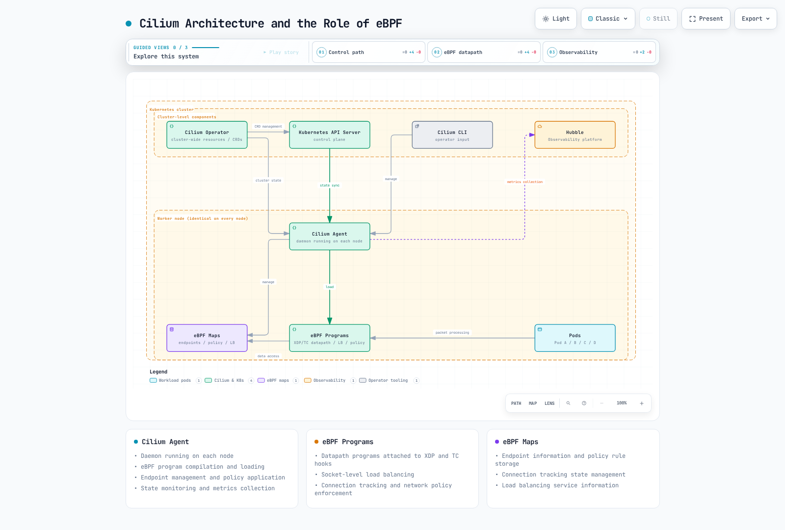

# Análisis profundo de la tecnología eBPF

> **Referencia de revisión**: Cilium 1.20.2, Linux 5.10+ o un backport equivalente documentado (por ejemplo, el kernel 4.18 de RHEL 8.10), probado con Kubernetes 1.33–1.36. Las características individuales de BPF tienen requisitos distintos.
> **Última actualización**: October 15, 2026

## Configuración del entorno de laboratorio

Use una VM de desarrollo Linux desechable con una distribución mantenida, los tracepoints usados a continuación y permiso para cargar programas de tracing. Esto es independiente de instalar Cilium; no cargue programas experimentales en nodos del clúster. Linux 6.12 es la referencia fuente para el análisis del verificador, no una afirmación de que todas las distribuciones 6.12 habiliten cada característica.

Las herramientas necesarias son Clang con el backend BPF, encabezados UAPI de arquitectura de destino, encabezados/bibliotecas de desarrollo de libbpf 1.x, libelf, zlib, un compilador C y bpftool. BCC y bpftrace son alternativas opcionales. Los nombres de paquetes en Debian/Ubuntu suelen incluir `clang`, `libbpf-dev`, `libelf-dev`, `zlib1g-dev`, `build-essential` y `pkg-config`; el empaquetado de bpftool depende de la distribución/kernel. No suponga que `linux-tools-generic` esté disponible o sea apropiado en todos los sistemas Debian. Cilium documenta hosts AMD64/AArch64; ejecutar Cilium de forma nativa fuera de su imagen de contenedor requiere además Clang/LLVM 18.1+, lo que es un requisito distinto de este pequeño laboratorio de tracing.

```bash
uname -r
clang --version
clang --print-targets
pkg-config --modversion libbpf
bpftool version
test -r /sys/kernel/tracing/events/syscalls/sys_enter_execve/format
test -r /sys/kernel/tracing/events/sched/sched_process_exec/format
# Active feature probing: run only on the prepared lab VM.
sudo bpftool feature probe kernel
```

Tracefs debe estar montado y ser accesible; algunos sistemas lo exponen bajo `/sys/kernel/debug/tracing`. La configuración del kernel, las capacidades, la política de lockdown/LSM y las restricciones de contenedores pueden impedir la carga o la vinculación incluso como root del contenedor. `CAP_BPF` por sí solo no es un permiso universal de tracing; los requisitos dependen del kernel, el tipo de programa y la delegación mediante token BPF.

**Límite de validación:** estos ejemplos superaron comprobaciones de sintaxis C del host con libbpf 1.7, enlazado de userspace y simulaciones deterministas de helpers. La compilación de Clang para el destino BPF, el verificador del kernel en ejecución y la vinculación de tracepoints en vivo aún requieren validación en la VM preparada. No son recetas de tracing probadas en producción ni sin pérdidas.

## Introducción a la tecnología eBPF y antecedentes históricos

eBPF permite que programas aprobados se ejecuten en hooks compatibles de Linux para observar o influir en el comportamiento del kernel. La verificación restringe el acceso a memoria y la ejecución, pero los errores del kernel, verificador, JIT y helpers siguen siendo posibles. La aceptación no demuestra que un host no pueda fallar ni que el programa implemente la política pretendida.

### De BPF a eBPF: historia de la evolución

El preprint de McCanne y Jacobson, *The BSD Packet Filter: A New Architecture for User-level Packet Capture*, tiene fecha del 19 de diciembre de 1992 e identifica su presentación en Winter USENIX, del 25 al 29 de enero de 1993. Conserve esta distinción al citar el año. El BPF clásico usa los registros A/X de 32 bits y memoria temporal para el filtrado, evitando copias innecesarias de paquetes a userspace. Su conjunto de instrucciones restringido no significa que no pueda ejecutarse en CPU modernas.

Extended BPF añadió un conjunto de instrucciones de 64 bits con once registros R0–R10 (R10 es el puntero de marco de solo lectura), una pila comúnmente limitada a 512 bytes, maps y más tipos de programa. No se trata de un cambio histórico de diez a once registros de propósito general. Las combinaciones de funciones/tail calls pueden imponer límites adicionales de pila.

### Evolución técnica de eBPF: características clave por versión del kernel

Estos hitos upstream seleccionados se comprobaron con código fuente versionado. No son una matriz de soporte de distribuciones; los backports, las opciones de compilación, las arquitecturas y los helpers difieren.

| Kernel | Hito seleccionado |
|---|---|
| [3.15](https://github.com/torvalds/linux/blob/v3.15/include/linux/filter.h) | Conjunto de instrucciones extendido; traducción interna de BPF clásico |
| [3.16](https://github.com/torvalds/linux/blob/v3.16/arch/x86/net/bpf_jit_comp.c) | JIT de BPF extendido para x86 |
| [3.18](https://github.com/torvalds/linux/blob/v3.18/include/uapi/linux/bpf.h) | Infraestructura de syscall/verificación BPF; aún no hay tipos de map HASH/ARRAY utilizables |
| [3.19](https://github.com/torvalds/linux/blob/v3.19/include/uapi/linux/bpf.h) | Maps HASH/ARRAY y tipo de programa de filtro de socket |
| [4.1](https://github.com/torvalds/linux/blob/v4.1/include/uapi/linux/bpf.h) | KPROBE y TC SCHED_CLS/SCHED_ACT |
| [4.2](https://github.com/torvalds/linux/blob/v4.2/include/uapi/linux/bpf.h) | PROG_ARRAY y tail calls |
| [4.8](https://github.com/torvalds/linux/blob/v4.8/include/uapi/linux/bpf.h) | Tipo de programa XDP |
| [4.10](https://github.com/torvalds/linux/blob/v4.10/include/uapi/linux/bpf.h) | Maps hash LRU |
| [4.16](https://github.com/torvalds/linux/blob/v4.16/include/uapi/linux/bpf.h) | Llamadas de función BPF a BPF |
| [4.17](https://github.com/torvalds/linux/blob/v4.17/include/uapi/linux/bpf.h) | Tracepoints sin procesar |
| [4.18](https://github.com/torvalds/linux/blob/v4.18/include/uapi/linux/bpf.h) | API de carga BTF |
| [5.2](https://github.com/torvalds/linux/blob/v5.2/include/uapi/linux/bpf.h) | Acceso directo a valores de map usado para datos globales |
| [5.7](https://github.com/torvalds/linux/blob/v5.7/include/uapi/linux/bpf.h) | API BPF link y BPF LSM |
| [5.8](https://github.com/torvalds/linux/blob/v5.8/include/uapi/linux/bpf.h) | Buffer circular BPF |
| [5.10](https://github.com/torvalds/linux/blob/v5.10/include/uapi/linux/bpf.h) | Programas sleepable para tipos de vinculación compatibles |
| [5.15](https://github.com/torvalds/linux/blob/v5.15/include/uapi/linux/bpf.h) | Helpers de temporizador BPF |
| [5.19](https://github.com/torvalds/linux/blob/v5.19/include/uapi/linux/bpf.h) | Helpers de puntero dinámico |
| [6.2](https://github.com/torvalds/linux/blob/v6.2/kernel/bpf/helpers.c) | kfuncs de asignación de objetos tipados, no malloc sin restricciones |

Los bucles acotados llegaron en Linux 5.3; el [cambio upstream del verificador](https://github.com/torvalds/linux/commit/2589726d12a1b12eaaa93c7f1ea64287e383c7a5) explica el análisis de bucles y la poda de estados. Un antiguo párrafo que afirma «loops are not implemented» y permanece en las FAQ de diseño no es una guía actual de características. Los bucles acotados aún pueden exceder los límites de complejidad del verificador.

### Crecimiento y áreas de aplicación

El repositorio público de Cilium se creó en diciembre de 2015; «project started in 2017» es incorrecto. La creación del repositorio no es una fecha exacta de lanzamiento del producto ni prueba del estatus de «primer proyecto importante».

| Área | Ejemplos y límites |
|---|---|
| Redes | Datapaths de Cilium/Calico, balanceo de carga Katran y filtrado XDP |
| Seguridad de runtime | Falco, Tracee y Tetragon usan eventos del kernel; la aplicación depende del producto y los hooks |
| Tracing | BCC (incluidos frontends Python/Lua), bpftrace, tracing de almacenamiento y block-I/O |
| Observabilidad de red | Eventos de flujo/proxy de Hubble; los gráficos de flujo no son tracing distribuido de spans de aplicación |
| Service mesh | Cilium combina reenvío del kernel con proxies de userspace para características L7 compatibles |
| Comunidad | La eBPF Foundation apoya el ecosistema; la financiación y madurez del proyecto no son criterios de compatibilidad |

`seccomp-bpf` usa la interfaz de filtros BPF clásica para decisiones de system call. Linux puede traducir internamente filtros clásicos, pero esta no es la API general de programas/maps/helpers de eBPF.

### eBPF frente a módulos tradicionales del kernel: cambio de paradigma

| Característica | eBPF | Módulo del kernel |
|---|---|---|
| Seguridad | Restringido por el verificador; permanecen errores de implementación y riesgo operativo | Acceso nativo más amplio al kernel; los errores pueden desestabilizar el host |
| Despliegue | Los programas compatibles pueden cargarse/vincularse sin reinicio | Muchos módulos también pueden cargarse/descargarse sin reinicio cuando lo permiten las dependencias y el uso |
| Compatibilidad | ABI de instrucciones/helpers y requisitos de características; CO-RE puede reubicar accesos a tipos compatibles | ABI de kernel/módulo, configuración y soporte de distribución |
| Rendimiento | A menudo compilado con JIT; el hook, programa y carga de trabajo determinan la sobrecarga | La ejecución nativa también tiene costos dependientes de la carga de trabajo |
| Desarrollo | Contexto restringido, helpers/kfuncs y límites del verificador | API del kernel y restricciones habituales del desarrollo del kernel |
| Permisos | Privilegios apropiados o delegación para carga/vinculación | Carga privilegiada; firma/lockdown pueden restringirla |

Ambos requieren pruebas operativas. Los módulos no se limitan a implementaciones de proveedores, y eBPF no hace intrínsecamente seguro un despliegue en producción.

## Análisis en profundidad de la arquitectura eBPF dentro del kernel

### Descripción detallada de los componentes de la arquitectura eBPF

En userspace, Clang compila C a BPF ELF; Rust usa su propio ecosistema de compilador/toolchain. libbpf gestiona secciones ELF, maps, reubicaciones, carga y API de vinculación compatibles. BCC proporciona API de más alto nivel; bpftrace proporciona un lenguaje de tracing.

CO-RE usa BTF y reubicaciones para adaptar accesos compatibles a tipos/campos. No proporciona helpers, tipos de programa o configuración del kernel ausentes, ni garantiza compatibilidad arbitraria entre arquitecturas/kernels. Las estructuras internas del kernel, los formatos de tracepoint y las kfuncs no son una ABI estable solo porque un programa use BTF.

En el kernel, el verificador comprueba un programa según su tipo, contexto, helpers y permisos. JIT puede traducir BPF aceptado a instrucciones nativas; un intérprete es otro mecanismo de ejecución cuando se admite. La salida de JIT no atraviesa luego una segunda etapa obligatoria de VM. La vinculación conecta el programa cargado a un hook; cargarlo por sí solo no se suscribe a tracepoints.

### Análisis detallado del ciclo de vida de un programa eBPF

1. **Desarrollar:** seleccione el hook/contexto y defina metadatos de maps/licencia. No todos los programas requieren compatibilidad GPL, pero los helpers solo GPL y ciertos tipos/kfuncs imponen restricciones. Estas muestras de tracing usan metadatos GPL para sus helpers.
2. **Compilar:** cree BPF ELF e información requerida de depuración/BTF con el toolchain y encabezados de destino.
3. **Abrir/cargar:** analice ELF, cree o reutilice explícitamente maps, reubique e invoque la API de carga BPF. La verificación y el JIT opcional ocurren durante la carga.
4. **Vincular:** use la API apropiada. libbpf puede inferir estos tracepoints desde `SEC("tracepoint/...")`. Mantenga vivo el link/la vinculación.
5. **Ejecutar/observar:** los eventos invocan el programa; userspace lee maps/buffers. Los límites de muestreo y capacidad pueden perder observaciones.
6. **Actualizar/descargar:** conserve maps/links/pins compatibles solo deliberadamente. Destruya el link de este laboratorio y cierre su objeto para liberar recursos.

En Linux 6.12, la longitud de programa se limita a hasta 1.000.000 de instrucciones para la ruta de carga compatible con BPF y a 4.096 para la ruta sin privilegios. El verificador tiene por separado un límite de **complejidad de análisis** de 1.000.000 de instrucciones. Los programas más pequeños pueden fallar la verificación. BPF sin privilegios a menudo está deshabilitado; aún se aplican comprobaciones de token/capacidad y tipo de programa.

### Tipos de programa eBPF y características

| Hook / tipo de programa | Propósito y límite de valor de retorno |
|---|---|
| XDP / `BPF_PROG_TYPE_XDP` | XDP de driver nativo se ejecuta antes de la asignación de skb; los modos genérico/offloaded difieren. `XDP_DROP`, `PASS`, `TX`, `REDIRECT` son acciones, no garantías de throughput |
| TC / `SCHED_CLS`, `SCHED_ACT` | Clasificación/acciones de paquetes de entrada/salida. La semántica `TC_ACT_*` del clasificador requiere configuración direct-action apropiada |
| Filtro de socket / `SOCKET_FILTER` | Entrega de paquetes al socket: cero descarta, una longitud positiva de captura puede truncar. Las políticas de creación/conexión usan otros hooks |
| kprobe/uprobe / `KPROBE` | Probes de kernel/userspace; no existe un `BPF_PROG_TYPE_UPROBE` separado. El inlining, las listas negras y disponibilidad de símbolos restringen la vinculación |
| Tracepoint / `TRACEPOINT` | Contexto de evento declarado estáticamente; inspeccione el formato de destino. No es una ABI de kernel estable garantizada |
| Evento perf / `PERF_EVENT` | Muestreo de rendimiento; el comportamiento de retorno depende de su integración con perf-event |
| cgroup / `CGROUP_SKB`, `CGROUP_SOCK`, `CGROUP_SOCK_ADDR`, etc. | Control de red/socket; el contexto y las convenciones permitir/denegar varían |
| LSM / `LSM` | Los programas estilo MAC normalmente conservan errores previos y devuelven cero/error; cgroup-LSM tiene semántica de concesión distinta |
| Operaciones de socket / `SOCK_OPS` | Callbacks TCP; importan la operación, campos de respuesta y soporte de helpers |
| fentry/fexit / `TRACING` | Tracing de funciones basado en BTF cuando se admite; permanecen restricciones de destino y vinculación |

Seleccione hooks según las necesidades de visibilidad/control. XDP carece de parte del contexto de capas posteriores; TC gestiona tráfico respaldado por skb; observar tracepoints/probes no aplica automáticamente la política de red. No copie structs de contexto ni códigos de retorno entre tipos de programa.

### Maps eBPF: núcleo de intercambio de datos y almacenamiento de estado

Los maps viven mientras permanezcan referencias, como FD, programas cargados o pins bpffs explícitos. Los pins no son persistencia en disco y no conservan el contenido de maps tras reiniciar. Recargar no reutiliza automáticamente el map anterior.

| Tipo | Uso y restricción |
|---|---|
| `HASH` | Tabla acotada de clave/valor; la inserción puede fallar si está llena. La búsqueda esperada de tiempo constante no garantiza latencia |
| `ARRAY` | Valores preasignados e inicializados a cero en índices válidos; cero no es una entrada hash ausente |
| `LRU_HASH` | Caché acotada con expulsión estilo LRU, no un contador acumulativo sin pérdidas |
| `RINGBUF` | Múltiples productores/un consumidor entre CPU; tamaños de clave/valor cero, capacidad en bytes potencia de dos; las reservas fallidas no bloquean |
| `PERF_EVENT_ARRAY` | Canales perf por CPU; userspace debe aprovisionar/consumir eventos y registrar registros perdidos |
| `PROG_ARRAY` | Referencias a programas de tail-call; se aplican destinos compatibles y límites de llamadas |
| `PERCPU_HASH` / `PERCPU_ARRAY` | Menor contención entre CPU, no universalmente libre de carreras. Userspace lee todas las ranuras de CPU posibles con el padding requerido |
| `SOCKMAP` / `SOCKHASH` | Referencias de socket para redirección/programas compatibles, no hooks arbitrarios de operación de socket |

libbpf 1.x eliminó `struct bpf_map_def SEC("maps")`. Estas definiciones de estilo BTF ilustran ocho categorías de map usando tipos reales. Combine los maps necesarios con un programa adecuado; solo las declaraciones no constituyen un pipeline de eventos.

**`map_types.bpf.c`**

```c
#include <linux/bpf.h>
#include <bpf/bpf_helpers.h>

/* Definitions only; combine the needed maps with a suitable program. */
struct {
    __uint(type, BPF_MAP_TYPE_HASH);
    __uint(max_entries, 1024);
    __type(key, __u32);
    __type(value, __u64);
} hash_counts SEC(".maps");

struct {
    __uint(type, BPF_MAP_TYPE_ARRAY);
    __uint(max_entries, 1);
    __type(key, __u32);
    __type(value, __u64);
} total SEC(".maps");

struct {
    __uint(type, BPF_MAP_TYPE_LRU_HASH);
    __uint(max_entries, 1024);
    __type(key, __u32);
    __type(value, __u64);
} cache SEC(".maps");

struct {
    __uint(type, BPF_MAP_TYPE_RINGBUF);
    __uint(max_entries, 256 * 1024);
} events SEC(".maps");

struct {
    __uint(type, BPF_MAP_TYPE_PERF_EVENT_ARRAY);
    __type(key, __u32);
    __type(value, __u32);
    /* libbpf determines max_entries from the number of possible CPUs. */
} perf_events SEC(".maps");

struct {
    __uint(type, BPF_MAP_TYPE_PROG_ARRAY);
    __uint(max_entries, 10);
    __type(key, __u32);
    __type(value, __u32);
} jump_table SEC(".maps");

struct {
    __uint(type, BPF_MAP_TYPE_PERCPU_ARRAY);
    __uint(max_entries, 1);
    __type(key, __u32);
    __type(value, __u64);
} cpu_counts SEC(".maps");

struct {
    __uint(type, BPF_MAP_TYPE_SOCKMAP);
    __uint(max_entries, 1024);
    __type(key, __u32);
    __type(value, __u32);
} sockets SEC(".maps");
```

Los contadores compartidos necesitan incrementos atómicos. Las claves hash nuevas necesitan inserción `BPF_NOEXIST` seguida de búsqueda/incremento de la entrada ganadora; la inicialización `BPF_ANY` puede sobrescribir el recuento de otra CPU. Las entradas de array ya existen en índices válidos.

## Uso de eBPF en Cilium: innovación en redes de contenedores

### Arquitectura de Cilium y el papel de eBPF



[🔍 Ver diagrama interactivo](https://www.atomai.click/kubernetes-docs/archmaps/en-networking-cilium-02-ebpf-1.html)

El diagrama muestra responsabilidades lógicas, no ubicaciones obligatorias ni un único pipeline de compilación. La CLI puede ejecutarse fuera del clúster; los agentes se ejecutan en nodos gestionados aptos. Los detalles de compilación/carga de programas varían por versión/característica. Hubble Relay agrega flujos; las métricas de Prometheus usan endpoints separados.

El agente reconcilia endpoints, identidades, políticas y estado del datapath. El Operator gestiona tareas configuradas de todo el clúster, como el ciclo de vida de identidad/IPAM; no forma parte de la ruta de reenvío de paquetes. Hubble combina información de flujo BPF con eventos de proxy de userspace.

### Análisis detallado del datapath eBPF de Cilium

Estas son funciones cooperantes, no un orden fijo para cada paquete:

1. **Entrada:** los hooks de socket pueden resolver backends de Service antes de que exista un paquete; TC gestiona rutas de paquetes; la aceleración XDP opcional gestiona tráfico externo compatible.
2. **Identidad/política:** la política de IP/identidad y endpoint controla el acceso L3/L4. La política HTTP/gRPC compatible usa Envoy y la política DNS usa el proxy DNS; el análisis/aplicación L7 no es enteramente BPF.
3. **Estado/traducción:** los maps de conntrack, Service/backend, reverse-NAT y afinidad tienen roles diferentes. No todos los paquetes repiten la selección de backend.
4. **Reenvío:** el enrutamiento nativo o el overlay configurado transporta el tráfico. Las rutas de despacho/retorno DSR requieren los prerrequisitos de red del modo seleccionado.
5. **Observación:** los contadores/eventos del datapath y eventos del proxy tienen límites de configuración y pérdida de recolección.

La disponibilidad de backend procede del estado del control plane y mecanismos de salud aplicables, no de una sonda de aplicación BPF universal. Maglev, afinidad, DSR y aceleración son opciones de características, no valores predeterminados universales.

### Descripción detallada de los principales programas eBPF de Cilium

| Código fuente de Cilium 1.20.2 | Función |
|---|---|
| `bpf/bpf_lxc.c` | Ruta de paquetes de endpoint, política, conntrack y reenvío |
| `bpf/bpf_overlay.c` | Ruta de paquetes de overlay |
| `bpf/bpf_host.c` | Ruta de host/dispositivo y procesamiento compatible de host-firewall |
| `bpf/bpf_xdp.c` | Ruta XDP, incluida la aceleración de balanceador de carga configurada |
| `bpf/bpf_sock.c` | Hooks de dirección de socket cgroup (IPv4 e IPv6): connect, sendmsg, recvmsg, getpeername, bind/post_bind y sock_release, usados para la traducción de Service a nivel de socket |
| `bpf/bpf_wireguard.c` | Programas del dispositivo `cilium_wg0` (`cil_from_wireguard`/`cil_to_wireguard`) que marcan tráfico descifrado de WireGuard |
| `bpf/bpf_sock_term.c` | Iteradores BPF (TCP/UDP) que destruyen sockets conectados a backends de Service eliminados |
| `bpf/bpf_probes.c`, `bpf/bpf_alignchecker.c` | No son programas de datapath: las sondas de características del kernel se ejecutan al iniciar el agente, y hay una comprobación de diseño de structs C/Go |
| `bpf/lib/lb.h` | Helpers compartidos de balanceo de carga |
| `bpf/lib/policy.h` | Helpers compartidos de política |

Para el cargador, puntos de vinculación, tail calls y recorridos por programa, consulte [internos del datapath eBPF](08-ebpf-datapath-internals.md).

No hay archivos de nivel superior `bpf_lb.c` ni `bpf_network.c` en esta versión. Los nombres de funciones y feature gates cambian; inspeccione la versión exacta en lugar de tratar nombres conceptuales como archivos fuente.

### Uso de maps eBPF de Cilium

Estos ejemplos no son una API de diseño de map estable:

| Nombre / familia | Clave y función |
|---|---|
| `cilium_lxc` | Dirección/familia → metadatos de reenvío de endpoint; no es simplemente ID de endpoint |
| `cilium_ipcache_v2` | Prefijo, familia de dirección, contexto de clúster → metadatos de identidad/túnel |
| `cilium_policy_v3_<endpoint>` | Identidad, dirección, protocolo, puerto de destino y prefijo → entrada de política |
| `cilium_ct4_global`, `cilium_ct6_global`, `cilium_ct_any4_global`, etc. | Estado de tupla de conexión; los maps reales dependen de protocolo/familia/configuración |
| `cilium_lb4_services_v2` / `cilium_lb6_services_v2` | Dirección/puerto, protocolo, ámbito y ranura de backend → metadatos de Service/referencia de backend; los registros de backend son maps separados |
| `cilium_metrics` | Clave de razón, dirección y ubicación fuente → contadores de paquetes/bytes |

`cilium-dbg map get` muestra contenido en caché de userspace, no necesariamente un volcado reciente del kernel. Use decodificadores coincidentes `cilium-dbg bpf ...` o bpftool para sus vistas de kernel compatibles. No escriba bytes sin procesar en maps de Cilium como atajo de troubleshooting.

### Características basadas en eBPF y sus límites

- **Política:** Kubernetes NetworkPolicy tiene semántica L3/L4; los recursos de Cilium añaden capacidades compatibles. Un allow L4 sin restricciones puede omitir un allow superpuesto restringido a L7; inspeccione la política combinada.
- **Cifrado:** en modos WireGuard/IPsec, BPF dirige el tráfico a esas facilidades del kernel; la criptografía no son únicamente instrucciones BPF. Configure claves, puertos, MTU y cobertura de tráfico para el modo elegido. Las operaciones de claves IPsec y WireGuard difieren.
- **Service mesh:** los proxies de userspace proporcionan procesamiento L7 compatible. La política Kafka L7 se eliminó. El workload mTLS/ztunnel beta tiene prerrequisitos independientes y no está implícito por el cifrado de nodo.
- **Ancho de banda:** EDT/bandwidth-manager y el control de congestión no garantizan QoS ni throughput de extremo a extremo.
- **Multi-cluster:** Cluster Mesh requiere conectividad, identidades, direccionamiento y configuración compatible; no sincroniza automáticamente cada objeto de política ni resuelve el enrutamiento.

## Laboratorio: desarrollo y depuración de programas eBPF

### 1. Desarrollo básico de programas eBPF

Guarde los archivos indicados en un directorio de laboratorio nuevo. Este programa registra **intentos** de `execve`, incluidos fallos posteriores. `execveat` tiene un tracepoint de entrada de system call distinto. La impresión de depuración es compartida/ruidosa y no es un transporte de eventos de producción. `SEC()` proporciona el tipo/hook previsto; los metadatos GPL son adecuados para el helper usado aquí.

**`hello.bpf.c`**

```c
#include <linux/bpf.h>
#include <bpf/bpf_helpers.h>

SEC("tracepoint/syscalls/sys_enter_execve")
int hello_execve(void *ctx)
{
    (void)ctx;
    char message[] = "execve attempt\n";
    bpf_trace_printk(message, sizeof(message));
    return 0;
}

char LICENSE[] SEC("license") = "GPL";
```

### 2. Programa eBPF avanzado con maps

`sched_process_exec` se emite tras una transición de ejecución correcta en el kernel de referencia. Cuenta por `comm`, un nombre corto de tarea de como máximo 16 bytes incluida la terminación, no una ruta ejecutable/identidad de proceso única. Los nombres pueden colisionar/cambiar. Esto observa el host, no automáticamente un Pod.

El map almacena como máximo 1.024 nombres. `lost_events[0]` cuenta fallos de lectura de nombre y `[1]` eventos sin una entrada de contador utilizable, incluido el agotamiento de capacidad. Estos no cubren todos los posibles fallos de recolección; los contadores de 64 bits pueden desbordarse. El laboratorio no elimina entradas mientras cuenta.

**`exec_shared.h`**

```c
#ifndef EXEC_SHARED_H
#define EXEC_SHARED_H
#define COMM_BYTES 16
#define MAX_COMMANDS 1024
struct comm_key {
    char comm[COMM_BYTES];
};
#endif
```

**`exec_count.bpf.c`**

```c
#include <linux/bpf.h>
#include <bpf/bpf_helpers.h>
#include "exec_shared.h"

struct {
    __uint(type, BPF_MAP_TYPE_HASH);
    __uint(max_entries, MAX_COMMANDS);
    __type(key, struct comm_key);
    __type(value, __u64);
} exec_counts SEC(".maps");

struct {
    __uint(type, BPF_MAP_TYPE_ARRAY);
    __uint(max_entries, 2);
    __type(key, __u32);
    __type(value, __u64);
} lost_events SEC(".maps");

static __always_inline void record_loss(__u32 reason)
{
    __u64 *lost = bpf_map_lookup_elem(&lost_events, &reason);
    if (lost)
        __sync_fetch_and_add(lost, 1);
}

SEC("tracepoint/sched/sched_process_exec")
int count_exec(void *ctx)
{
    (void)ctx;
    struct comm_key key = {};
    __u64 zero = 0;
    if (bpf_get_current_comm(key.comm, sizeof(key.comm)) != 0) {
        record_loss(0);
        return 0;
    }

    __u64 *count = bpf_map_lookup_elem(&exec_counts, &key);
    if (!count) {
        /* A competing CPU may insert first; never overwrite its count. */
        bpf_map_update_elem(&exec_counts, &key, &zero, BPF_NOEXIST);
        count = bpf_map_lookup_elem(&exec_counts, &key);
    }
    if (count)
        __sync_fetch_and_add(count, 1);
    else
        record_loss(1);
    return 0;
}

char LICENSE[] SEC("license") = "GPL";
```

#### Aplicación de userspace y duración de la vinculación

Este cargador acepta cualquiera de los objetos de muestra, carga exactamente un programa, lo vincula y conserva el link hasta Ctrl-C/SIGTERM. Lee los FD de map de contador desde el mismo objeto en lugar de asumir que existen pins. La iteración comienza con NULL y produce una muestra viva acotada y no atómica.

**`run_bpf.c`**

```c
#define _POSIX_C_SOURCE 200809L
#include <errno.h>
#include <inttypes.h>
#include <signal.h>
#include <stdio.h>
#include <stdint.h>
#include <unistd.h>
#include <bpf/bpf.h>
#include <bpf/libbpf.h>
#include "exec_shared.h"

static volatile sig_atomic_t stopping;

static void stop(int signal_number)
{
    (void)signal_number;
    stopping = 1;
}

static int dump_counts(int map_fd, int lost_fd)
{
    struct comm_key current, next;
    const struct comm_key *previous = NULL;
    unsigned int seen = 0;

    while (seen < MAX_COMMANDS) {
        if (bpf_map_get_next_key(map_fd, previous, &next) != 0) {
            if (errno == ENOENT)
                break;
            perror("get next key");
            return -1;
        }
        __u64 value;
        if (bpf_map_lookup_elem(map_fd, &next, &value) == 0)
            printf("%.*s: %" PRIu64 "\n", COMM_BYTES, next.comm,
                   (uint64_t)value);
        else if (errno != ENOENT) {
            perror("lookup count");
            return -1;
        }
        current = next;
        previous = &current;
        seen++;
    }
    for (__u32 reason = 0; reason < 2; reason++) {
        __u64 value;
        if (bpf_map_lookup_elem(lost_fd, &reason, &value) != 0) {
            perror("lookup loss");
            return -1;
        }
        printf("lost[%u]: %" PRIu64 "\n", reason, (uint64_t)value);
    }
    if (fflush(stdout) != 0) {
        perror("flush output");
        return -1;
    }
    return 0;
}

int main(int argc, char **argv)
{
    struct bpf_object *object = NULL;
    struct bpf_link *link = NULL;
    int result = 1;
    if (argc != 2) {
        fprintf(stderr, "usage: %s OBJECT.bpf.o\n", argv[0]);
        return 2;
    }
    struct sigaction action = {.sa_handler = stop};
    sigemptyset(&action.sa_mask);
    if (sigaction(SIGINT, &action, NULL) || sigaction(SIGTERM, &action, NULL)) {
        perror("sigaction");
        return 1;
    }
    object = bpf_object__open_file(argv[1], NULL);
    if (!object) {
        perror("open BPF object");
        return 1;
    }
    struct bpf_program *program = bpf_object__next_program(object, NULL);
    if (!program || bpf_object__next_program(object, program)) {
        fprintf(stderr, "expected exactly one program\n");
        goto cleanup;
    }
    if (bpf_object__load(object) != 0) {
        fprintf(stderr, "load failed; inspect libbpf/verifier diagnostics\n");
        goto cleanup;
    }
    int counts = bpf_object__find_map_fd_by_name(object, "exec_counts");
    int losses = bpf_object__find_map_fd_by_name(object, "lost_events");
    if (counts >= 0 && losses < 0) {
        fprintf(stderr, "counter object is missing lost_events\n");
        goto cleanup;
    }
    link = bpf_program__attach(program);
    if (!link) {
        perror("attach tracepoint");
        goto cleanup;
    }
    fprintf(stderr, "Attached; Ctrl-C detaches. Counts are live samples.\n");
    result = 0;
    while (!stopping) {
        if (counts >= 0 && dump_counts(counts, losses) != 0) {
            result = 1;
            break;
        }
        sleep(2);
    }
cleanup:
    bpf_link__destroy(link);
    bpf_object__close(object);
    return result;
}
```

#### Compilar y ejecutar

En instalaciones multiarch de Debian/Ubuntu, el directorio multiarch de GCC proporciona encabezados UAPI `asm/`; ajuste las rutas para otras distribuciones. `-g` proporciona BTF para `.maps`. Compile e inicie el cargador en la terminal A de la VM preparada:

```bash
MULTIARCH=$(gcc -print-multiarch)
test -n "$MULTIARCH"
clang -O2 -g -target bpf -I"/usr/include/$MULTIARCH" \
  -c hello.bpf.c -o hello.bpf.o
clang -O2 -g -target bpf -I"/usr/include/$MULTIARCH" \
  -c exec_count.bpf.c -o exec_count.bpf.o
cc -O2 -Wall -Wextra run_bpf.c -o run_bpf \
  $(pkg-config --cflags --libs libbpf)
sudo ./run_bpf hello.bpf.o
```

En la terminal B lea `sudo cat /sys/kernel/tracing/trace_pipe`; ejecute un ejecutable externo como `/usr/bin/true` en la terminal C. Detenga el cargador hello con Ctrl-C y después ejecute `sudo ./run_bpf exec_count.bpf.o`. Observe pares cambiantes nombre/recuento mientras ejecuta comandos en otra terminal. El observador y otra actividad del host también generan eventos, por lo que no se promete un total/PID fijo. Los intentos fallidos de `execve` pueden aparecer en la salida hello, pero no deberían emitir `sched_process_exec`.

`bpftool prog load OBJECT PIN` por sí solo no vincula este tracepoint. El ejemplo posee deliberadamente un link. El pinning/reutilización explícito es una decisión de ciclo de vida independiente: `pinmaps` y `map ... pinned ...` no son sintaxis intercambiable. Cerrar este cargador libera sus recursos sin pin.

### 3. Exploración y depuración de programas eBPF de Cilium

Use un clúster ya preparado y el contexto kubeconfig correcto. Seleccione el agente del nodo del Pod afectado; los ID de endpoint son locales al nodo. Reemplace los marcadores de posición explícitos:

```bash
kubectl config current-context
kubectl -n kube-system get pods -l k8s-app=cilium -o wide
export CILIUM_POD=cilium-REPLACE-WITH-ACTUAL-POD
export ENDPOINT_ID=REPLACE-WITH-NODE-LOCAL-ID
kubectl -n kube-system exec "$CILIUM_POD" -c cilium-agent -- cilium-dbg status --verbose
kubectl -n kube-system exec "$CILIUM_POD" -c cilium-agent -- cilium-dbg endpoint list
kubectl -n kube-system exec "$CILIUM_POD" -c cilium-agent -- cilium-dbg endpoint get "$ENDPOINT_ID"
kubectl -n kube-system exec "$CILIUM_POD" -c cilium-agent -- cilium-dbg map list
kubectl -n kube-system exec "$CILIUM_POD" -c cilium-agent -- cilium-dbg service list
kubectl -n kube-system exec "$CILIUM_POD" -c cilium-agent -- cilium-dbg bpf lb list --frontends
kubectl -n kube-system exec "$CILIUM_POD" -c cilium-agent -- cilium-dbg bpf lb list --backends
```

Inspeccione las políticas deseadas con `kubectl get networkpolicy,ciliumnetworkpolicy -n YOUR_NAMESPACE` y las políticas aplicables de todo el clúster por separado. Compare el estado realizado del endpoint con los flujos reales. Los comandos eliminados `policy trace` y obsoleto `policy get` no son sustitutos.

Ejecute un monitor cada vez, deteniéndolo con Ctrl-C:

```bash
kubectl -n kube-system exec "$CILIUM_POD" -c cilium-agent --   cilium-dbg monitor --related-to "$ENDPOINT_ID" --type drop
```

Use `--type policy-verdict` para decisiones de política emitidas o `--type l7` para eventos de proxy disponibles. La visibilidad depende de la configuración. Un rechazo HTTP puede ser HTTP 403 en lugar de un veredicto de red DROPPED.

Para Hubble Relay habilitado, mantenga `cilium hubble port-forward` en ejecución y después use:

```bash
hubble status
hubble observe --namespace default --last 20
hubble observe --protocol http --last 20
hubble observe --namespace default --last 20 --output json
```

El JSON canalizado a `jq` no es un gráfico de dependencias de Service. La UI Hubble habilitada proporciona un mapa de servicios (`cilium hubble ui`). La visibilidad HTTP necesita una ruta proxy/L7 compatible; el contenido de aplicación cifrado no se descifra automáticamente.

### 4. Análisis y optimización del rendimiento

En un nodo controlado con permisos/soporte de profiling, inspeccione los ID de programa reales. Estos comandos se dirigen al estado local del kernel y no fueron ejecutados por esta auditoría:

```bash
sudo bpftool prog show
export PROG_ID=REPLACE-WITH-ACTUAL-ID
sudo bpftool prog show id "$PROG_ID"
sudo bpftool prog dump xlated id "$PROG_ID"
sudo bpftool prog profile id "$PROG_ID" duration 10 cycles instructions
```

El profiling necesita nombres de métricas y soporte adecuado de kernel/PMU. `bpftool -p map dump ...` formatea el contenido, no la latencia de búsqueda. `perf`/bpftrace pueden perfilar cargas de trabajo, pero verifique símbolos de destino, disponibilidad de probes y argumentos. Un kretprobe no expone de forma fiable el `arg0` de entrada sin correlación explícita.

Registre protocolo, tamaño de paquete, concurrencia, política, cifrado, proxy y enrutamiento al medir la carga de trabajo completa. Inspeccione los valores Helm instalados y `cilium-dbg status --verbose` antes de cambiar XDP/enrutamiento nativo. Un hook más rápido o resultado sintético no demuestra menor latencia de aplicación.

### 5. Consejos de troubleshooting

| Síntoma | Comprobación |
|---|---|
| La compilación C falla | Encabezados UAPI/libbpf correctos, destino del compilador BPF, `__u32`/`__u64`, `-g` para BTF |
| Rechazo del verificador | stderr del cargador/log del verificador, límites, inicialización de pila, helpers, licencia y complejidad |
| Cargado pero sin eventos | Duración de vinculación/link, tracepoint exacto, desencadenante y permisos |
| Datos de map ausentes | Misma instancia de map, errores/capacidad de inserción, significado de clave, duración de referencia/pin |
| Flujo Cilium incorrecto | Nodo/endpoint correctos, política deseada/realizada combinada, estado de ruta/backend, comportamiento de proxy L7 |
| Registros Hubble ausentes | Relay, filtros, visibilidad configurada e informe de eventos perdidos |

`trace_pipe` contiene salida de trace, no diagnósticos del verificador. Para una prueba de carga intencional en la VM aislada, `-d` de bpftool proporciona diagnósticos de cargador/verificador; la carga aún no prueba la vinculación ni el comportamiento. No deshabilite la política, amplíe privilegios de producción ni reescriba maps para hacer que una prueba pase.

## Fuentes

- [Artículo BPF original](https://www.tcpdump.org/papers/bpf-usenix93.pdf), [preguntas y respuestas de diseño BPF de Linux](https://docs.kernel.org/bpf/bpf_design_QA.html), [verificador](https://docs.kernel.org/bpf/verifier.html), [ring buffer](https://docs.kernel.org/bpf/ringbuf.html), [licencias](https://docs.kernel.org/bpf/bpf_licensing.html), [seccomp](https://docs.kernel.org/userspace-api/seccomp_filter.html)
- [Carga BPF de Linux 6.12](https://github.com/torvalds/linux/blob/v6.12/kernel/bpf/syscall.c), [ubicación de evento exec](https://github.com/torvalds/linux/blob/v6.12/fs/exec.c), [libbpf 1.7](https://github.com/libbpf/libbpf/tree/v1.7.0), [bpftool 7.7](https://github.com/libbpf/bpftool/releases/tag/v7.7.0)
- [Código fuente BPF de Cilium 1.20.2](https://github.com/cilium/cilium/tree/v1.20.2/bpf), [maps](https://github.com/cilium/cilium/tree/v1.20.2/pkg/maps), [maps de balanceador de carga](https://github.com/cilium/cilium/tree/v1.20.2/pkg/loadbalancer/maps), [referencia de comandos](https://github.com/cilium/cilium/tree/v1.20.2/Documentation/cmdref)
- [Requisitos del sistema Cilium](https://docs.cilium.io/en/v1.20/operations/system_requirements/), [compatibilidad de Kubernetes](https://docs.cilium.io/en/v1.20/network/kubernetes/compatibility/), [reemplazo kube-proxy](https://docs.cilium.io/en/v1.20/network/kubernetes/kubeproxy-free/), [cifrado](https://docs.cilium.io/en/v1.20/security/network/encryption/)

## Cuestionario

[Compruebe su comprensión](../../quizzes/networking/cilium/02-ebpf-quiz.md).