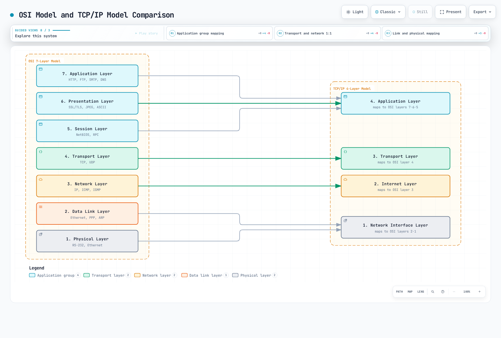
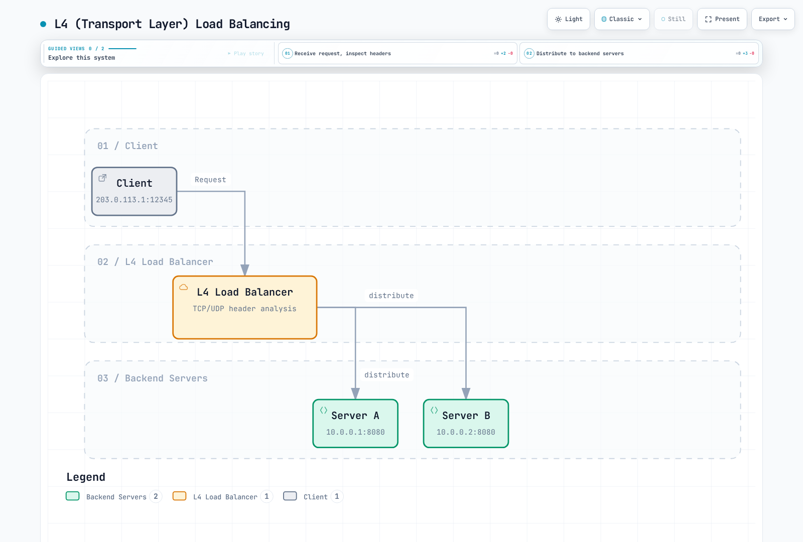
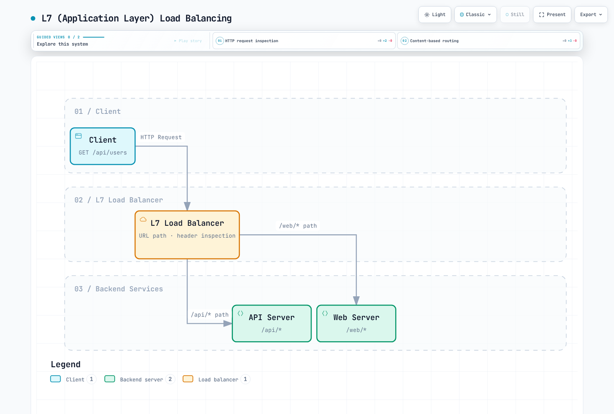

# Conceptos de redes en profundidad

> **Versión de referencia**: Cilium 1.20.3.
> **Última revisión**: 16 de octubre de 2026.

Este documento explica en detalle los conceptos de redes necesarios para entender Cilium: redes de contenedores, redes superpuestas, NAT, enrutamiento, DNS, balanceo de carga y políticas. Los ejemplos son conceptuales o configuraciones parciales de Helm y de API para entornos de prueba preparados; no constituyen procedimientos completos de instalación o migración. Compruebe los requisitos de plataforma y versión en [la introducción a Cilium](README.md), ya que las plataformas administradas no permiten todas las mismas funciones de CNI.

## Objetivos de aprendizaje

Al estudiar este documento, comprenderá:
- La estructura básica de los modelos OSI y TCP/IP y la función de cada capa
- Los principios básicos y las formas de implementar las redes de contenedores
- Las diferencias entre las redes overlay y underlay
- Cómo utiliza Cilium conceptos como NAT, enrutamiento y DNS

## Índice

1. [Modelo OSI y pila TCP/IP](#osi-model-and-tcp-ip-stack)
2. [Fundamentos de redes de contenedores](#container-networking-basics)
3. [Redes overlay](#overlay-networks)
4. [Traducción de direcciones de red (NAT)](#network-address-translation-nat)
5. [Protocolos de enrutamiento](#routing-protocols)
6. [DNS y descubrimiento de servicios](#dns-and-service-discovery)
7. [Conceptos de balanceo de carga](#load-balancing-concepts)
8. [Fundamentos de seguridad de red](#network-security-basics)

## Modelo OSI y pila TCP/IP {#osi-model-and-tcp-ip-stack}

> **Concepto clave**: El modelo OSI clasifica la comunicación de red en siete capas abstractas para facilitar la comprensión de procesos de red complejos.

El modelo OSI (Open Systems Interconnection) es un marco conceptual que clasifica la comunicación de red en siete capas abstractas. Cada capa cumple funciones específicas y permite descomponer los procesos complejos para entenderlos mejor.

### Comparación de los modelos OSI y TCP/IP



[🔍 Ver diagrama interactivo](https://www.atomai.click/kubernetes-docs/archmaps/en-networking-cilium-networking-concepts-0.html)

Esta correspondencia es una aproximación didáctica, no una especificación para implementar protocolos. La etiqueta SSL de la figura es heredada; en los sistemas actuales, use versiones de TLS compatibles.

### Modelo OSI de siete capas

1. **Capa física**
   - Convierte secuencias de bits en señales eléctricas, ópticas o inalámbricas
   - Incluye cables, transceptores y señalización física; un switch también realiza funciones de capas superiores
   - Unidad de datos: bit

2. **Capa de enlace de datos**
   - Transfiere datos entre nodos de una red física
   - Identifica dispositivos mediante direcciones MAC (Media Access Control)
   - Detecta errores y permite recuperarse de ellos cuando el protocolo de enlace lo contempla; la detección de errores de Ethernet no corrige por sí sola las tramas dañadas
   - Unidad de datos: trama
   - En esta capa operan protocolos como Ethernet y Wi-Fi

3. **Capa de red**
   - Enruta paquetes entre redes diferentes
   - Utiliza direcciones lógicas, como las direcciones IP
   - Determina rutas y reenvía paquetes
   - Unidad de datos: paquete
   - IP (Internet Protocol) es el protocolo principal de esta capa

4. **Capa de transporte**
   - Controla la comunicación de extremo a extremo
   - Segmenta y reensambla los datos
   - TCP ofrece control de flujo y retransmisión; UDP no ofrece esas garantías
   - Unidad de datos: segmento TCP o datagrama UDP
   - TCP (Transmission Control Protocol) y UDP (User Datagram Protocol) son los principales protocolos de esta capa

5. **Capa de sesión**
   - Establece, mantiene y termina sesiones de comunicación
   - Gestiona la sincronización y el diálogo
   - Establece puntos de control y permite la recuperación
   - La gestión de sesiones puede describirse en esta capa; las implementaciones reales de RPC no se corresponden necesariamente con una única capa OSI

6. **Capa de presentación**
   - Convierte formatos de datos y realiza funciones de cifrado
   - Gestiona codificación de caracteres, compresión y cifrado/descifrado
   - La codificación y la compresión ilustran esta función; TLS es un protocolo de Internet, no una implementación literal de la capa de presentación OSI

7. **Capa de aplicación**
   - Proporciona los servicios de red que utilizan las aplicaciones, sin requerir una interfaz gráfica de usuario
   - Incluye servicios como correo electrónico, transferencia de archivos y navegación web
   - HTTP, FTP, SMTP y DNS son ejemplos de esta capa

### Relación entre Cilium y el modelo OSI

Cilium opera en varias capas OSI:

| Capa OSI | Función de Cilium | Ejemplo |
|-----------|----------------|---------|
| L2 (enlace de datos) | Conectividad de enlace; L2 Announcements opcional | Respuestas ARP/NDP para las VIP de Service configuradas |
| L3 (red) | Enrutamiento IP y políticas basadas en CIDR | Enrutamiento IP entre Pods |
| L4 (transporte) | Filtrado por puertos y seguimiento de conexiones | Control de acceso a puertos de Service |
| L7 (aplicación) | Reglas compatibles de proxy HTTP/gRPC y DNS | Políticas de rutas HTTP o de consultas DNS |

L2 Announcements sigue en fase Beta en esta versión y requiere configurar su controlador y los dispositivos. No constituye una interfaz general de políticas de seguridad basadas en direcciones MAC.

### Pila TCP/IP

La pila TCP/IP reúne los protocolos que forman la base de Internet. Su arquitectura suele describirse mediante cuatro capas y compararse con OSI, pero no es una implementación directa del modelo de siete capas.

1. **Capa de interfaz de red**
   - Se corresponde con las capas física y de enlace de datos del modelo OSI
   - Proporciona la interfaz con el medio físico de red
   - Incluye protocolos como Ethernet y Wi-Fi

2. **Capa de Internet**
   - Se corresponde con la capa de red del modelo OSI
   - Enruta paquetes mediante IP (Internet Protocol)
   - Incluye ICMP (Internet Control Message Protocol); ARP resuelve las direcciones de enlace del siguiente salto IPv4 en el límite de la capa de enlace, mientras que IPv6 utiliza Neighbor Discovery

3. **Capa de transporte**
   - Se corresponde con la capa de transporte del modelo OSI
   - Incluye los protocolos TCP y UDP
   - Proporciona comunicación orientada a conexión (TCP) y sin conexión (UDP)

4. **Capa de aplicación**
   - Integra las capas de sesión, presentación y aplicación del modelo OSI
   - Incluye protocolos como HTTP, SMTP, FTP y DNS
   - Proporciona la interfaz entre las aplicaciones del usuario y la red

### Funciones de Cilium por capa

Cilium proporciona funciones en varias capas de red:

- **L2 (enlace de datos)**: Conectividad de enlace y anuncios opcionales de Service en L2; no proporciona una API general de NetworkPolicy por direcciones MAC ni protección universal contra la suplantación ARP
- **L3 (red)**: Enrutamiento y filtrado por direcciones IP, e IPAM
- **L4 (transporte)**: Filtrado por puertos, balanceo de carga y seguimiento de conexiones
- **L7 (aplicación)**: Funciones de proxy HTTP/gRPC y políticas DNS configuradas; la antigua API de políticas Kafka L7 se ha eliminado

## Fundamentos de redes de contenedores {#container-networking-basics}

Las redes de contenedores permiten que las aplicaciones en contenedores se comuniquen entre sí y con el exterior. Las plataformas de orquestación como Kubernetes utilizan diversos modelos y soluciones de red.

### Container Network Interface (CNI)

CNI (Container Network Interface) define una interfaz estándar entre los entornos de ejecución de contenedores y los plugins de red. Kubernetes utiliza actualmente un entorno de ejecución CRI para invocar los plugins CNI. Esta interfaz permite distintas implementaciones de red; la especificación CNI no exige que todos los plugins implementen Kubernetes NetworkPolicy.

#### Componentes principales de CNI:

1. **Plugins**: Ejecutables que crean y configuran interfaces de red
2. **Archivos de configuración**: Archivos JSON que definen el comportamiento del plugin
3. **IPAM (IP Address Management)**: Módulo que asigna y gestiona direcciones IP

#### Responsabilidades principales de los plugins CNI:

- Añadir y eliminar interfaces en los espacios de nombres de red de los contenedores
- Asignar y liberar direcciones IP
- Configurar tablas de enrutamiento
- Una implementación de red puede proporcionar por separado controladores de políticas y su aplicación en el plano de datos; aplicar políticas no es una operación obligatoria de la ejecución de CNI

### Modelos de redes de contenedores

Existen varios modelos de redes de contenedores, adecuados para distintas necesidades y casos de uso.

#### 1. Redes bridge

- Crean un puente virtual en el host para conectar contenedores
- Cada contenedor se conecta al puente mediante un par de interfaces Ethernet virtuales (veth)
- Permiten comunicación eficiente entre contenedores del mismo host
- El puente predeterminado es un ejemplo de Docker independiente sobre Linux; no representa el modelo de red de Kubernetes ni de Cilium


[🔍 Ver diagrama interactivo](https://www.atomai.click/kubernetes-docs/archmaps/en-networking-cilium-networking-concepts-1.html)

Este ejemplo de puente Docker sobre Linux utiliza direcciones ilustrativas. La ruta de enrutamiento y NAT del host está simplificada; no representa la topología bridge predeterminada de Cilium.

#### 2. Redes host

- El contenedor utiliza directamente el espacio de nombres de red del host
- No existe un aislamiento de red independiente
- Se evita un espacio de nombres de red propio del contenedor; el rendimiento sigue dependiendo de la carga y de la ruta real
- Puede haber conflictos de puertos


[🔍 Ver diagrama interactivo](https://www.atomai.click/kubernetes-docs/archmaps/en-networking-cilium-networking-concepts-2.html)

Aquí, «sin aislamiento» significa que se comparte el espacio de nombres de red. No significa que desaparezcan todos los límites de aislamiento de procesos, sistemas de archivos u otros recursos del contenedor.

#### 3. Redes overlay

- Permiten la comunicación entre contenedores de distintos hosts
- Utilizan protocolos de encapsulación como VXLAN y GENEVE
- Son adecuadas para clústeres grandes
- Las admiten Cilium, Calico y Flannel, entre otros


[🔍 Ver diagrama interactivo](https://www.atomai.click/kubernetes-docs/archmaps/en-networking-cilium-networking-concepts-3.html)

Este esquema genérico de VXLAN utiliza el puerto UDP estándar 4789 y una subred L2 compartida. El puerto VXLAN predeterminado de Cilium es 8472; las asignaciones de CIDR de los Pods deben seguir el modo IPAM elegido, en lugar de copiar el dibujo.

#### 4. Redes underlay (enrutamiento directo)

- Utilizan directamente la infraestructura física de red
- No añaden sobrecarga de encapsulación
- Requieren control sobre la infraestructura de red
- Pueden integrarse con protocolos de enrutamiento como BGP


[🔍 Ver diagrama interactivo](https://www.atomai.click/kubernetes-docs/archmaps/en-networking-cilium-networking-concepts-4.html)

Las entradas ilustran rutas de host. Un despliegue real sigue necesitando siguientes saltos accesibles y rutas válidas de ida y retorno para las direcciones de sus Pods.

### Modelo de red de Kubernetes

El modelo de Kubernetes proporciona conectividad directa entre Pods, **salvo cuando existe una segmentación de red intencionada**:

1. Los Pods pueden comunicarse entre sí sin que la red de Pods requiera obligatoriamente un proxy o NAT.
2. Los agentes de un nodo deben poder comunicarse con los Pods **de ese nodo**. Esto no exige que todos los hosts puedan llegar a todos los Pods.
3. La conectividad externa sigue las políticas de enrutamiento y seguridad del clúster; no requiere acceso ilimitado a Internet.

La aplicación de NetworkPolicy depende de una implementación de red que la admita. La API puede existir aunque el plugin instalado no aplique sus políticas.

#### Componentes de red de Kubernetes:

1. **Red de Pods**: Conecta los Pods del clúster
2. **Red de Services**: Proporciona puntos de acceso estables para conjuntos de Pods
3. **DNS del clúster**: Proporciona resolución DNS para descubrir servicios
4. **Ingress/Egress**: Gestiona la comunicación con el exterior del clúster

### Redes de contenedores con Cilium

Cilium utiliza eBPF para proporcionar una solución de redes de contenedores escalable y de alto rendimiento:

1. **Plano de datos basado en eBPF**: Procesa paquetes directamente en el kernel
2. **Varios modos de red**: Overlay (VXLAN, Geneve) y enrutamiento nativo; Helm utiliza de forma genérica túneles VXLAN por defecto, salvo las configuraciones específicas de cada plataforma
3. **Balanceo de carga avanzado**: Permite reemplazar kube-proxy
4. **Políticas de red**: Aplica políticas detalladas en las capas L3-L7
5. **IPAM integrado**: Admite diversas estrategias de asignación de direcciones IP

Una instalación genérica de Helm sin ajustes de plataforma utiliza por defecto IPAM cluster-pool: el operador asigna CIDR a los nodos y los agentes asignan IP a los Pods desde el conjunto de su nodo. `ipam.mode: kubernetes` utiliza `spec.podCIDR`/`spec.podCIDRs` del objeto Node. El modo ENI utiliza interfaces EC2 y direcciones de la VPC; no es una recomendación universal para todos los tipos de cómputo de EKS. Consulte [IPAM y políticas](04-ipam-policy.md).

## Redes overlay {#overlay-networks}

Las redes overlay crean una capa de red virtual sobre la infraestructura existente. Esto permite definir topologías virtuales independientes de la topología física. En entornos de contenedores, suelen utilizarse para comunicar contenedores de diferentes hosts.

### Funcionamiento de las redes overlay

Las redes overlay utilizan encapsulación: los paquetes originales se introducen en otros paquetes que se transmiten por la red física.

1. **Encapsulación**: El paquete original, o paquete interno, recibe nuevas cabeceras y, en algunos casos, nuevos campos finales.
2. **Túnel**: Los paquetes encapsulados atraviesan la red física hasta el host de destino.
3. **Desencapsulación**: El host de destino elimina la cabecera externa y extrae el paquete original.
4. **Reenvío**: El paquete original se entrega al contenedor de destino.

### Principales protocolos de redes overlay

#### VXLAN (Virtual Extensible LAN)

VXLAN es uno de los protocolos overlay más utilizados en las redes de contenedores.

- **VXLAN Tunnel Endpoint (VTEP)**: Encapsula y desencapsula paquetes
- **VXLAN Network Identifier (VNI)**: Campo de 24 bits con 16.777.216 valores posibles; esta cifra no representa la capacidad admitida de tenants o endpoints de Cilium
- **Encapsulación UDP**: VXLAN estándar utiliza UDP 4789; el puerto de túnel VXLAN predeterminado de Cilium es UDP 8472
- **Encapsulación MAC-in-UDP**: Introduce las tramas L2 originales en paquetes UDP

Estructura de un paquete VXLAN:


[🔍 Ver diagrama interactivo](https://www.atomai.click/kubernetes-docs/archmaps/en-networking-cilium-networking-concepts-5.html)

Este es el formato genérico de VXLAN en la red. UDP 4789 y el VNI de 24 bits pertenecen al estándar; Cilium utiliza UDP 8472 por defecto y metadatos overlay para representar la identidad. El tamaño del campo no garantiza una determinada capacidad del clúster.

#### GENEVE (Generic Network Virtualization Encapsulation)

GENEVE es un protocolo overlay más flexible, diseñado para superar las limitaciones de VXLAN.

- **Cabeceras de opciones extensibles**: Admiten diversos metadatos
- **Independencia del protocolo**: Permite utilizar diferentes tecnologías de virtualización
- **Encapsulación UDP**: Transmite a través del puerto UDP 6081
- **Túneles flexibles**: Adapta la encapsulación a distintas necesidades de virtualización de red

#### IPsec

IPsec es un conjunto de protocolos que proporciona servicios de seguridad a nivel de paquetes IP.

- **Autenticación y cifrado**: Proporciona mecanismos de integridad y autenticación y, con el modo adecuado, confidencialidad
- **Modos de transporte y túnel**: Admite diferentes escenarios de despliegue
- **Security Association (SA)**: Define los parámetros de seguridad entre las partes que se comunican
- **Internet Key Exchange (IKE)**: Mecanismo general de negociación de IPsec. La configuración IPsec de Cilium utiliza, en cambio, un Secret de claves proporcionado por el administrador y el procedimiento de rotación documentado

### Ventajas y desventajas de las redes overlay

#### Ventajas:

- **Flexibilidad**: Permiten configurar redes virtuales independientes de la topología física
- **Escalabilidad**: Admiten segmentos de red grandes y numerosos endpoints
- **Aislamiento**: Los segmentos lógicos pueden separar el tráfico si están bien configurados; la encapsulación por sí sola no proporciona autenticación, cifrado ni un límite completo de políticas
- **Compatibilidad**: Pueden funcionar sobre la infraestructura de red existente

#### Desventajas:

- **Sobrecarga**: La encapsulación aumenta el tamaño del paquete y el trabajo de procesamiento
- **MTU**: La encapsulación reduce la unidad máxima de transmisión disponible para el paquete interno
- **Complejidad**: Puede dificultar el diagnóstico y la depuración
- **Latencia**: La encapsulación añade procesamiento; mida su efecto real con la implementación y las funciones de descarga de procesamiento elegidas

### Redes overlay en Cilium

Cilium admite protocolos overlay como VXLAN y Geneve y utiliza eBPF para procesar paquetes de forma eficiente.

- **Procesamiento de VXLAN con eBPF**: Los programas BPF no construyen directamente la cabecera VXLAN. Configuran los metadatos del túnel (`bpf_skb_set_tunnel_key`) y redirigen al dispositivo `cilium_vxlan` o `cilium_geneve`, que funciona por flujos; el controlador VXLAN/Geneve del kernel encapsula y desencapsula los paquetes. Consulte [Overlay y enrutamiento nativo](09-overlay-native-routing.md)
- **Enrutamiento eficiente**: Reenvío de paquetes por rutas optimizadas
- **Opciones de cifrado**: Overlay cifrado con IPsec o WireGuard
- **Selección de modo**: Elija un modo de enrutamiento compatible. La combinación de rutas directas automáticas entre nodos y modo túnel se rechaza; no es un mecanismo de respaldo

#### Ejemplo de configuración VXLAN de Cilium:

Valores de Helm para una **instalación IPv4 de prueba nueva y preparada**. Elija CIDR de Pods que no se solapen. No es un procedimiento de migración de IPAM en uso ni un ConfigMap de reemplazo.

```yaml
# vxlan-values.yaml
routingMode: tunnel
tunnelProtocol: vxlan
tunnelPort: 8472
autoDirectNodeRoutes: false
ipv4:
  enabled: true
ipv6:
  enabled: false
ipam:
  mode: cluster-pool
  operator:
    clusterPoolIPv4PodCIDRList:
    - 10.244.0.0/16
    clusterPoolIPv4MaskSize: 24
```

## Traducción de direcciones de red (NAT) {#network-address-translation-nat}

Network Address Translation (NAT) modifica las direcciones de origen o destino de paquetes IP. Se utiliza principalmente para que los dispositivos de redes privadas se comuniquen con Internet o para comunicar redes cuyos espacios de direcciones se solapan.

### Principales tipos de NAT

#### 1. Source NAT (SNAT)

Source NAT modifica la dirección IP de origen de los paquetes. Suele utilizarse cuando los dispositivos de redes privadas acceden a Internet.

- **Funcionamiento**: Reescribe una dirección de origen y, en ocasiones, su puerto; la traducción de una dirección privada a una pública es un uso habitual
- **Casos de uso**: Acceso a Internet y conexiones salientes
- **Seguimiento**: Guarda el estado de las conexiones en la tabla NAT


[🔍 Ver diagrama interactivo](https://www.atomai.click/kubernetes-docs/archmaps/en-networking-cilium-networking-concepts-6.html)

Las direcciones reservadas para documentación ilustran un caso de SNAT de una red privada a una pública. SNAT significa traducción del origen; la dirección de reemplazo no tiene que ser siempre pública.

#### 2. Destination NAT (DNAT)

Destination NAT modifica la dirección IP de destino de los paquetes. Suele utilizarse para acceder desde Internet a servicios de redes privadas.

- **Funcionamiento**: Reescribe una dirección o un puerto de destino; el reenvío de una dirección pública a una privada es un ejemplo
- **Casos de uso**: Reenvío de puertos, balanceo de carga y conexiones entrantes
- **Configuración**: Define correspondencias para puertos o rangos de puertos concretos


[🔍 Ver diagrama interactivo](https://www.atomai.click/kubernetes-docs/archmaps/en-networking-cilium-networking-concepts-7.html)

Este ejemplo utiliza direcciones de documentación para mostrar DNAT de una dirección pública a una privada. DNAT traduce el destino y también se utiliza entre otros espacios de direcciones.

#### 3. Port Address Translation (PAT)

PAT modifica tanto las direcciones IP como los números de puerto. Así, varios hosts internos pueden compartir una única dirección IP pública.

- **Funcionamiento**: Traduce las combinaciones IP:puerto de hosts internos a distintos puertos de una única IP pública
- **Casos de uso**: Conservación de direcciones IP y conectividad para numerosos hosts internos
- **Límites**: Los puertos y los recursos para guardar estado son finitos; los flujos simultáneos también dependen del protocolo, las tuplas de destino y la reutilización de correspondencias, por lo que no existe un límite universal de 65.000 conexiones


[🔍 Ver diagrama interactivo](https://www.atomai.click/kubernetes-docs/archmaps/en-networking-cilium-networking-concepts-8.html)

El ejemplo utiliza puertos traducidos distintos para el mismo servidor remoto. El espacio de unos 65.000 puertos no constituye un límite universal para todas las conexiones NAT: influyen el protocolo, la tupla de destino, el comportamiento de las correspondencias y la capacidad para guardar estado.

#### 4. Twice NAT y NAT bidireccional

**Twice NAT** modifica tanto el origen como el destino cuando el tráfico atraviesa espacios de direcciones, y puede ayudar a comunicar espacios solapados. Las correspondencias de direcciones, los supuestos de DNS y de la aplicación y la ruta de retorno deben diseñarse conjuntamente.

En cambio, **NAT bidireccional**, según RFC 2663, permite iniciar sesiones desde cualquiera de los dos espacios. Su definición no implica modificar ambas direcciones de cada paquete.

### Ventajas y desventajas de NAT

#### Ventajas:

- **Conservación de direcciones IP**: Permite conectar numerosos hosts internos con pocas direcciones IP públicas
- **Ocultación de direcciones**: Puede ocultar direcciones internas, pero no reemplaza las políticas de firewall ni la autenticación
- **Conexión de espacios de direcciones**: Una traducción adecuada puede comunicar espacios solapados, sin proporcionar por sí sola aislamiento
- **Flexibilidad del diseño de red**: Permite cambiar de proveedor de Internet sin reconfigurar la red interna

#### Desventajas:

- **Sobrecarga del seguimiento de conexiones**: Mantener las tablas de estado requiere recursos
- **Problemas con ciertos protocolos**: Algunos protocolos pueden ser incompatibles con NAT
- **Pérdida de conectividad de extremo a extremo**: Dificulta la comunicación directa entre pares
- **Diagnóstico complejo**: Depurar problemas relacionados con NAT puede resultar complicado

### NAT en Kubernetes y Cilium

#### NAT en Kubernetes

Kubernetes utiliza NAT en distintos escenarios:

1. **Comunicación con el exterior del clúster**: Puede utilizar SNAT según la accesibilidad de las direcciones, las exclusiones de masquerading y el plano de datos elegido
2. **Implementación de Service**: Las implementaciones que procesan paquetes pueden traducir el destino de un Service; el balanceo a nivel de socket puede seleccionar un backend antes de que exista ese paquete
3. **Services NodePort**: La implementación reenvía el tráfico dirigido a la IP:puerto de un nodo hacia los backends elegidos; la ruta de retorno depende de SNAT/DSR y de la política de tráfico
4. **Services LoadBalancer**: El comportamiento varía según el proveedor y el controlador; no tiene por qué consistir en un único paso DNAT de una dirección pública a un Pod

#### NAT en Cilium

Cilium utiliza eBPF para implementar NAT de forma eficiente:

1. **NAT basado en eBPF**: Realiza la traducción directamente en el kernel
2. **Seguimiento de conexiones de alto rendimiento**: Guarda el estado en mapas BPF optimizados
3. **Controles de NAT**: Las exclusiones de masquerading, el reenvío de Services y Egress Gateway tienen configuraciones y requisitos diferentes
4. **Masquerading**: Traduce el origen de forma condicional en las rutas y dispositivos configurados; las exclusiones de CIDR y los modos compatibles afectan al resultado

Egress Gateway es una función independiente que dirige el tráfico saliente coincidente a nodos seleccionados y aplica SNAT para usar las direcciones configuradas del gateway. Cambia la IP de origen original; hay que preparar las interfaces, las direcciones y las rutas de retorno. Los Pods nuevos pueden enviar tráfico antes de que converja la política, de modo que no garantiza inmediatamente una IP de origen mediante un comportamiento fail-closed.

#### Ejemplo de configuración NAT de Cilium:

Este fragmento de Helm supone un entorno preparado con reemplazo de kube-proxy, masquerading BPF y un endpoint de API accesible. Revise primero los dispositivos conectados y las rutas reales. Excluir un CIDR de SNAT no crea una ruta de retorno; el tamaño de NAT es ilustrativo, no una capacidad recomendada para todos los entornos.

```yaml
# masquerade-values.yaml
enableIPv4Masquerade: true
kubeProxyReplacement: true
bpf:
  masquerade: true
  natMax: 262144
ipMasqAgent:
  enabled: true
  config:
    nonMasqueradeCIDRs:
    - 10.0.0.0/8
    - 172.16.0.0/12
    - 192.168.0.0/16
    masqLinkLocal: false
```

## Protocolos de enrutamiento {#routing-protocols}

Los protocolos de enrutamiento definen las reglas y los procedimientos para determinar la ruta óptima de los paquetes entre el origen y el destino de una red. Permiten adaptarse a cambios de topología, reenviar tráfico de forma eficiente y buscar rutas alternativas ante fallos de red.

### Clasificación de los protocolos de enrutamiento

#### 1. Interior Gateway Protocols (IGP)

Los protocolos IGP intercambian información de enrutamiento dentro de un único sistema autónomo (AS).

##### Protocolos de vector de distancia

- **RIP (Routing Information Protocol)**
  - Utiliza el número de saltos como métrica
  - Las métricas válidas llegan hasta 15 saltos; la métrica 16 indica un destino inaccesible
  - Su implementación es sencilla y adecuada para redes pequeñas
  - Envía actualizaciones periódicas aproximadamente cada 30 segundos, con temporizadores aleatorizados y actualizaciones desencadenadas por cambios

- **EIGRP (Enhanced Interior Gateway Routing Protocol)**
  - Utiliza una métrica compuesta configurable; los coeficientes predeterminados consideran capacidad/ancho de banda y retardo, no carga ni fiabilidad
  - Envía únicamente actualizaciones parciales
  - Converge rápidamente
  - Es un protocolo originado en Cisco y documentado en el RFC informativo 7868; esa publicación no lo convierte en un estándar del IETF

##### Protocolos de estado de enlace

- **OSPF (Open Shortest Path First)**
  - Calcula la ruta más corta mediante el algoritmo de Dijkstra
  - Organiza la red en una jerarquía de áreas
  - Converge rápidamente
  - Admite redes grandes
  - Intercambia información de topología mediante Link State Advertisements (LSA)

- **IS-IS (Intermediate System to Intermediate System)**
  - Es un protocolo de estado de enlace similar a OSPF
  - Se utiliza ampliamente en las grandes redes de proveedores de servicios
  - Admite varias capas de red
  - Actualiza las rutas de forma eficiente

#### 2. Exterior Gateway Protocols (EGP)

Los protocolos EGP intercambian información de enrutamiento entre distintos sistemas autónomos.

- **BGP (Border Gateway Protocol)**
  - Es el principal protocolo de enrutamiento de Internet
  - Utiliza un vector de rutas
  - Toma decisiones basadas en políticas
  - Mantiene sesiones fiables sobre TCP
  - Selecciona rutas mediante atributos como AS path y local preference
  - Incluye las variantes iBGP (BGP interno) y eBGP (BGP externo)

### Protocolos de enrutamiento en redes de contenedores

Los entornos de contenedores combinan protocolos tradicionales con mecanismos de enrutamiento específicos para contenedores.

#### 1. Redes de contenedores con BGP

BGP se utiliza cada vez más en las redes de contenedores por estas razones:

- **Anuncio de accesibilidad**: Anuncia prefijos de Pods o Services a los routers; la implementación local de reenvío sigue determinando cómo circula el tráfico
- **Escalabilidad**: Admite clústeres grandes y entornos multiclúster
- **Integración con redes existentes**: Se integra con la infraestructura de red del centro de datos
- **Disponibilidad**: Las rutas múltiples y la convergencia dependen de las políticas del router, los temporizadores y un plano de datos funcional; una sesión por sí sola no garantiza una conmutación rápida

#### 2. Mecanismos de enrutamiento de redes de contenedores

- **Enrutamiento basado en hosts**: Los hosts mantienen rutas de Pods y pueden participar en un mecanismo de anuncio de rutas configurado por separado
- **Enrutamiento centralizado**: Un controlador gestiona las decisiones de enrutamiento
- **Enrutamiento distribuido**: Los nodos intercambian directamente información de rutas
- **Enrutamiento basado en políticas**: Las características del tráfico determinan las decisiones de enrutamiento

### Enrutamiento en Cilium

Cilium implementa el enrutamiento con eBPF y admite distintos modos del plano de datos. **El enrutamiento dentro del host se configura por separado**: BPF host routing optimiza el reenvío en el nodo y puede evitar partes de la pila del host y de netfilter. Requiere un reemplazo de kube-proxy y masquerading BPF compatibles, y tiene restricciones de integración. No equivale a elegir enrutamiento nativo en lugar de túneles entre nodos.

#### 1. Enrutamiento nativo (directo)

En modo nativo, Cilium enruta directamente las IP de los Pods sin encapsulación overlay.

- **Funcionamiento**: El tráfico de Pods utiliza rutas underlay sin encapsulación overlay; activar el modo nativo no activa BGP automáticamente
- **Ventajas**: Evita la sobrecarga de encapsulación overlay; el rendimiento real debe medirse
- **Requisitos**: Rutas válidas para las direcciones de Pods correspondientes y su tráfico de retorno, además de la conectividad entre IP de nodos
- **Casos de uso**: Cargas sensibles al rendimiento y clústeres de una única subred

El enrutamiento nativo necesita rutas válidas para los Pods, pero seleccionar `routingMode: native` no las anuncia automáticamente mediante BGP. Prepare las rutas underlay y de retorno, o configure un mecanismo adecuado para distribuirlas. El esquema anterior de rutas de host ilustra el principio de reenvío.

#### 2. Enrutamiento BGP

Cilium admite BGP para integrar las IP de los Pods con la infraestructura física de red.

- **Funcionamiento**: Cilium anuncia los CIDR de Pods mediante sesiones BGP con sus pares
- **Ventajas**: Integración con la infraestructura existente y alta disponibilidad
- **Componentes**: Sesiones con pares BGP, filtrado de rutas y atributos de comunidad
- **Casos de uso**: Integración con redes de centros de datos y entornos multiclúster

#### 3. Enrutamiento overlay

Cilium puede enrutar tráfico de Pods entre nodos mediante protocolos overlay como VXLAN o Geneve.

- **Funcionamiento**: Encapsula los paquetes de Pods para transmitirlos entre nodos
- **Ventajas**: Reduce los requisitos de infraestructura de red y facilita despliegues flexibles
- **Casos de uso**: Entornos de nube y topologías de red complejas

#### 4. Enrutamiento híbrido

No dé por hecho que Cilium utiliza automáticamente rutas nativas si están disponibles y recurre a un overlay en caso contrario. El modo túnel actual no puede combinarse con `autoDirectNodeRoutes: true`; el agente rechaza esa configuración. Elija un plano de datos compatible y prepare su red underlay.

El modo válido de balanceo llamado `hybrid` es otra función: TCP utiliza DSR y UDP utiliza SNAT. No es un mecanismo de respaldo entre enrutamiento overlay y nativo.

### Ejemplos de configuración del enrutamiento de Cilium

#### Configuración de enrutamiento nativo:

Este fragmento supone que el CIDR de Pods es el previsto y que los nodos son accesibles en una red L2 compartida para instalar rutas directas automáticas. Otras topologías necesitan un mecanismo de enrutamiento apropiado. No lo combine con el modo túnel como respaldo automático.

```yaml
# native-values.yaml
routingMode: native
autoDirectNodeRoutes: true
ipv4NativeRoutingCIDR: 10.244.0.0/16
```

#### Configuración de enrutamiento BGP:

La opción siguiente es solo uno de los requisitos. Configure los recursos actuales `CiliumBGPClusterConfig`, `CiliumBGPPeerConfig` y `CiliumBGPAdvertisement`, junto con el router externo, según se explica en [Temas avanzados](07-advanced-topics.md). El anuncio BGP y el modo de enrutamiento del plano de datos son decisiones independientes.

```yaml
# bgp-values.yaml
bgpControlPlane:
  enabled: true
```

#### Configuración de enrutamiento overlay:

Utilice el ejemplo completo de valores VXLAN anterior. Compruebe el modo y el puerto en el estado del agente; no sobrescriba los ajustes de instalación con un ConfigMap reducido.

## DNS y descubrimiento de servicios {#dns-and-service-discovery}

DNS (Domain Name System) y el descubrimiento de servicios son fundamentales para las aplicaciones de red actuales, especialmente en entornos dinámicos de contenedores. Permiten abstraer la ubicación de los servicios y adaptar las aplicaciones a los cambios de topología.

### DNS (Domain Name System)

DNS es un sistema distribuido que convierte nombres de dominio legibles en direcciones IP.

#### Funcionamiento de DNS

1. **Espacio de nombres jerárquico**: Los nombres se organizan en una jerarquía separada por puntos, como www.example.com
2. **Base de datos distribuida**: Los servidores DNS forman una red distribuida por todo el mundo
3. **Consultas iterativas y recursivas**: Son las dos formas principales de procesar solicitudes
4. **Caché**: Guarda temporalmente los resultados para mejorar el rendimiento

#### Tipos de registros DNS

- **A**: Relaciona un nombre de dominio con una dirección IPv4
- **AAAA**: Relaciona un nombre de dominio con una dirección IPv6
- **CNAME**: Define un alias para un nombre de dominio canónico
- **MX**: Identifica el servidor de correo
- **SRV**: Identifica el servidor de un servicio concreto
- **TXT**: Guarda texto, principalmente para verificaciones y políticas
- **PTR**: Relaciona una dirección IP con un nombre de dominio (DNS inverso)

#### Proceso de resolución DNS

Una consulta habitual sin resultados en caché distingue entre el resolvedor local de la aplicación y el resolvedor recursivo:

| Paso | Consulta/respuesta |
| --- | --- |
| 1 | El resolvedor local consulta a su resolvedor recursivo configurado por `www.example.com`. |
| 2 | El resolvedor recursivo consulta a un servidor raíz y recibe una referencia a los servidores `.com`. |
| 3 | Consulta a un servidor `.com` y recibe una referencia a los servidores autoritativos de `example.com`. |
| 4 | Consulta al servidor autoritativo y obtiene la respuesta correspondiente. |
| 5 | Guarda el resultado en caché según su TTL y devuelve la respuesta al resolvedor local. |

Normalmente, los servidores autoritativos no se reenvían entre sí las consultas de esta secuencia. Las cachés, los alias y los reenviadores configurados pueden modificar los intercambios concretos.

### Descubrimiento de servicios en entornos de contenedores

El descubrimiento de servicios detecta automáticamente los servicios disponibles y su ubicación en la red. Resulta especialmente útil para gestionar servicios que se crean y eliminan dinámicamente en entornos de contenedores.

#### Métodos de descubrimiento de servicios

1. **Descubrimiento mediante DNS**
   - Crea registros DNS cuando se registran servicios
   - Los clientes descubren servicios mediante consultas DNS estándar
   - Es sencillo y ampliamente compatible
   - Ejemplos: DNS de Kubernetes y CoreDNS

2. **Descubrimiento mediante almacenes de clave-valor**
   - Guarda información de servicios en almacenes centralizados de clave-valor
   - Los clientes consultan el almacén para descubrir servicios
   - Admite metadatos detallados
   - Ejemplos: etcd, Consul y ZooKeeper

3. **Descubrimiento mediante API**
   - Proporciona información de servicios mediante API específicas
   - Los clientes invocan las API para descubrir servicios
   - Admite consultas y filtros complejos
   - Ejemplo: servidor de API de Kubernetes

4. **Descubrimiento mediante mesh**
   - La infraestructura service mesh gestiona el descubrimiento
   - Admite balanceo y enrutamiento del lado del cliente
   - Proporciona funciones avanzadas de gestión del tráfico
   - Ejemplos: Istio y Linkerd

### DNS y descubrimiento de servicios en Kubernetes

Kubernetes incluye mecanismos para descubrir servicios dentro del clúster.

#### Services de Kubernetes

Los Services de Kubernetes proporcionan puntos de acceso estables para conjuntos de Pods:

- **ClusterIP**: IP virtual de Service, utilizada normalmente dentro del clúster; su accesibilidad externa requiere un diseño de red explícito y no constituye un límite de seguridad inherente
- **NodePort**: Puerto de nodo expuesto en las direcciones de nodos que correspondan, sujeto a políticas de tráfico, enrutamiento y reglas de firewall
- **LoadBalancer**: Solicita una implementación de un proveedor o controlador, que puede ser pública o interna
- **ExternalName**: Alias DNS de un servicio externo

#### DNS de Kubernetes

Kubernetes ejecuta un servicio DNS de clúster, normalmente CoreDNS, para descubrir servicios:

- **DNS de Service**: `<service-name>.<namespace>.svc.<cluster-domain>`; `cluster.local` es un dominio configurado habitual, no una constante universal
- **DNS de Pod**: La antigua forma basada en direcciones `pod.<cluster-domain>` depende de la implementación y es heredada. Los nombres estables de Pods suelen utilizar hostname/subdomain con un Service headless correspondiente
- **Services headless**: DNS puede devolver direcciones de endpoints en lugar de una VIP; readiness y `publishNotReadyAddresses` influyen en los registros publicados

La consulta DNS y el reenvío de Service son procesos distintos:

| Fase | Responsabilidad |
| --- | --- |
| Consulta DNS | CoreDNS resuelve el nombre de un Service ordinario a su ClusterIP a partir del estado de los objetos Kubernetes. No elige el backend de la aplicación para esa conexión. |
| Conexión | El cliente envía tráfico a la dirección de Service devuelta. |
| Reenvío | La implementación de Service, como el plano de datos de Cilium, elige un backend apto a partir de su estado derivado de Service/EndpointSlice. |
| Service headless | DNS devuelve direcciones de endpoints en lugar de una VIP de Service; el comportamiento del cliente determina la dirección utilizada. |

Los watches de objetos y las actualizaciones del plano de datos son asíncronos; una respuesta DNS no comprueba la salud del backend.

#### Mecanismos de descubrimiento de servicios de Kubernetes

1. **Variables de entorno**: Service links puede reflejar los Services existentes cuando se crea el Pod; no proporciona un flujo de descubrimiento actualizado continuamente y puede deshabilitarse
2. **DNS**: Resuelve los nombres de servicios mediante el DNS del clúster
3. **Servidor de API**: Obtiene información de servicios consultando directamente la API de Kubernetes
4. **Objetos EndpointSlice**: Proporcionan direcciones, puertos y datos de readiness de los backends a las implementaciones de Service

### DNS y descubrimiento de servicios en Cilium

Cilium se integra con los mecanismos de descubrimiento de Kubernetes y añade otras funciones.

#### Políticas de Cilium basadas en DNS

Cilium permite definir políticas de red basadas en nombres DNS:

- **Filtrado por nombre DNS**: Controla el acceso a dominios concretos
- **Comodines**: `*.example.com` coincide con un nivel de subdominio; `**.example.com` admite varios niveles en esta versión. Ninguno incluye el dominio raíz sin una coincidencia explícita
- **Políticas FQDN**: Utilizan nombres de dominio completos (Fully Qualified Domain Names)

Este ejemplo define únicamente una política y requiere que existan el espacio de nombres, la carga etiquetada y una ruta de resolución comprobada. La observación DNS y los permisos para destinos TCP 443 son independientes. El comodín DNS `*` permite consultar cualquier nombre; toFQDNs no autentica nombres de host.

```yaml
# dns-policy.yaml
apiVersion: cilium.io/v2
kind: CiliumNetworkPolicy
metadata:
  name: dns-policy
  namespace: cilium-fqdn-demo
spec:
  endpointSelector:
    matchLabels:
      app: myapp
  egress:
  - toEndpoints:
    - matchLabels:
        k8s:io.kubernetes.pod.namespace: kube-system
        k8s:k8s-app: kube-dns
    toPorts:
    - ports:
      - port: '53'
        protocol: UDP
      - port: '53'
        protocol: TCP
      rules:
        dns:
        - matchPattern: '*'
  - toFQDNs:
    - matchName: api.example.com
    - matchPattern: '*.api.example.com'
    toPorts:
    - ports:
      - port: '443'
        protocol: TCP
```

#### Mejoras de Cilium para descubrir servicios

Cilium amplía el descubrimiento de servicios de Kubernetes con varias funciones:

1. **Implementación de Service con eBPF**:
   - Reemplazo de kube-proxy
   - Balanceo de servicios directamente en el kernel
   - Mejoras de rendimiento y funcionalidad

2. **Services globales**:
   - Descubrimiento de servicios entre clústeres
   - Balanceo de carga entre clústeres
   - Nombres y espacios de nombres de Service coincidentes, junto con configuración explícita de uso compartido y ClusterMesh

3. **Afinidad de Service**:
   - Compatibilidad con afinidad de sesión
   - La afinidad ClientIP es independiente del algoritmo de balanceo; las rutas a nivel de socket pueden utilizar una cookie del espacio de nombres de red
   - Compatibilidad con conexiones con estado

4. **Integración de comprobaciones de salud**:
   - El estado de los backends refleja la información de readiness/EndpointSlice de Kubernetes y las comprobaciones del proxy configuradas
   - Los cambios se propagan de forma asíncrona
   - No dé por hecho que todos los Services de Cilium realizan sondeos activos de aplicaciones ni conmutan de forma instantánea ante fallos

#### Ejemplo de configuración de Service con Cilium:

La afinidad de sesión se configura en el Service. Los Services globales utilizan una anotación y necesitan un ClusterMesh funcional. Los Services de los otros clústeres deben tener el mismo nombre y espacio de nombres. Este ejemplo no crea la aplicación, ClusterMesh ni un balanceador externo.

```yaml
# global-service.yaml
apiVersion: v1
kind: Service
metadata:
  name: api
  namespace: cilium-service-demo
  annotations:
    service.cilium.io/global: 'true'
spec:
  type: ClusterIP
  selector:
    app: api
  ports:
  - name: http
    port: 80
    targetPort: 8080
  sessionAffinity: ClientIP
  sessionAffinityConfig:
    clientIP:
      timeoutSeconds: 10800
```

## Conceptos de balanceo de carga {#load-balancing-concepts}

El balanceo de carga distribuye tráfico entre varios servidores o servicios backend para optimizar el uso de recursos y ayudar a cumplir los objetivos de capacidad, latencia y disponibilidad, junto con capacidad suficiente y una gestión adecuada de la salud de los backends. En entornos de contenedores, resulta especialmente importante repartir el tráfico entre instancias que cambian dinámicamente.

### Tipos de balanceo de carga

#### 1. Balanceo L4 (capa de transporte)

El balanceo L4 distribuye tráfico según información de la capa de transporte, como las direcciones IP y los puertos.

- **Funcionamiento**: Toma decisiones a partir de las cabeceras TCP/UDP
- **Ventajas**: Procesamiento rápido, poca sobrecarga y capacidad para transportar tráfico cifrado
- **Desventajas**: No permite enrutamiento avanzado basado en información de la capa de aplicación
- **Casos de uso**: Servicios TCP/UDP y necesidades de alto rendimiento



[🔍 Ver diagrama interactivo](https://www.atomai.click/kubernetes-docs/archmaps/en-networking-cilium-networking-concepts-12.html)

Las ramas representan alternativas de backend, no el envío de una misma conexión a ambos servidores. El reenvío L4 puede transportar TLS sin inspeccionar el contenido HTTP cifrado.

#### 2. Balanceo L7 (capa de aplicación)

El balanceo L7 distribuye tráfico a partir de información de aplicación, como cabeceras HTTP, URL y cookies.

- **Funcionamiento**: Inspecciona el contenido de las solicitudes HTTP/HTTPS para decidir la ruta
- **Ventajas**: Enrutamiento por contenido, gestión avanzada del tráfico y funciones de seguridad
- **Desventajas**: Coste de procesamiento del proxy; inspeccionar el contenido HTTP de HTTPS requiere una terminación TLS adecuada
- **Casos de uso**: Aplicaciones web, microservicios y gateways de API



[🔍 Ver diagrama interactivo](https://www.atomai.click/kubernetes-docs/archmaps/en-networking-cilium-networking-concepts-13.html)

La ruta elegida depende de los atributos de la solicitud. Enrutar por contenido HTTP sobre HTTPS requiere una ruta adecuada de terminación o inspección TLS.

### Algoritmos de balanceo de carga

Los algoritmos determinan cómo se distribuye el tráfico entre los servidores backend.

#### 1. Round Robin

- **Funcionamiento**: Distribuye solicitudes entre los servidores de forma secuencial
- **Ventajas**: Secuencia sencilla; recibir la misma cantidad de solicitudes no implica realizar la misma cantidad de trabajo
- **Desventajas**: No considera las diferencias de capacidad ni la carga actual de los servidores
- **Variantes**: Weighted Round Robin, que aplica pesos según la capacidad

#### 2. Least Connections

- **Funcionamiento**: Envía las solicitudes nuevas al servidor con menos conexiones activas
- **Ventajas**: Tiene en cuenta la carga y resulta útil para conexiones largas
- **Desventajas**: La cantidad de conexiones no siempre refleja con precisión la carga
- **Variantes**: Weighted Least Connections, que aplica pesos según la capacidad

#### 3. IP Hash

- **Funcionamiento**: Calcula un hash de la IP del cliente para seleccionar un backend de forma consistente
- **Ventajas**: Puede mantener una selección estable mientras no cambien las entradas ni el conjunto de backends; no almacena sesiones de forma permanente
- **Desventajas**: Puede distribuir la carga de manera desigual y sobrecargar ciertos servidores
- **Variantes**: Source-Destination IP Hash, que considera tanto la IP de origen como la de destino

#### 4. Least Response Time

- **Funcionamiento**: Envía solicitudes al servidor con menor tiempo de respuesta
- **Ventajas**: Considera rendimiento y disponibilidad; resulta adecuado para aplicaciones sensibles a la latencia
- **Desventajas**: Medir los tiempos añade sobrecarga y la variabilidad de la red influye en los resultados
- **Variantes**: Weighted Response Time, que combina capacidad y tiempo de respuesta

#### 5. Selección aleatoria

- **Funcionamiento**: Elige un servidor backend al azar
- **Ventajas**: Implementación sencilla, sin seguimiento especial de estado
- **Desventajas**: Puede distribuir la carga de manera desigual
- **Variantes**: Selección aleatoria ponderada, que ajusta la probabilidad según la capacidad

### Modelos de despliegue de balanceadores

#### 1. Balanceadores de hardware

- **Características**: Equipos físicos dedicados
- **Ventajas**: Alto rendimiento, fiabilidad y aceleración por hardware
- **Desventajas**: Coste, escalabilidad limitada y menor flexibilidad
- **Ejemplos**: Equipos Application Delivery Controller; algunas familias también incluyen versiones virtuales o de software

#### 2. Balanceadores de software

- **Características**: Software ejecutado en servidores de propósito general
- **Ventajas**: Flexibilidad, eficiencia de costes y capacidad de programación
- **Desventajas**: La capacidad depende de la implementación, el hardware y la carga; un balanceador de software no es necesariamente más lento que cualquier equipo dedicado
- **Ejemplos**: NGINX, HAProxy y Envoy

#### 3. Balanceadores de nube

- **Características**: Servicios administrados por proveedores de nube
- **Ventajas**: Menor trabajo de administración, escalado automático y alta disponibilidad
- **Desventajas**: Dependencia del proveedor y personalización limitada
- **Ejemplos**: AWS ELB/ALB/NLB, Google Cloud Load Balancing y Azure Load Balancer

#### 4. Balanceadores nativos de contenedores

- **Características**: Balanceo optimizado para entornos de contenedores
- **Ventajas**: Integración con la orquestación y descubrimiento dinámico de servicios
- **Desventajas**: Especialización en entornos de contenedores
- **Ejemplos**: Services de Kubernetes, Istio y Cilium

### Balanceo de carga en Kubernetes

Kubernetes proporciona varios niveles de balanceo:

#### 1. Balanceo mediante Service

- **ClusterIP**: Balanceo dentro del clúster
- **NodePort**: Acceso externo por puertos de los nodos
- **LoadBalancer**: Aprovisionamiento de un balanceador externo
- **ExternalName**: Alias DNS de servicios externos

#### 2. Controladores Ingress

- Balanceo y enrutamiento L7
- Enrutamiento por URL y terminación TLS; la autenticación depende del controlador y de su configuración
- Entre las implementaciones se encuentran controladores basados en Traefik, HAProxy e Istio. El proyecto comunitario `ingress-nginx` se retiró en marzo de 2026; sus artefactos restantes no constituyen una recomendación de instalación mantenida

#### 3. Service Mesh

- Gestión avanzada del tráfico entre microservicios
- Enrutamiento detallado, reparto de tráfico e inyección de fallos
- Ejemplos: Istio, Linkerd y Consul service mesh; sus funciones de gestión del tráfico y seguridad difieren

### Balanceo de carga en Cilium

Cilium implementa balanceo eficiente mediante eBPF:

#### 1. Balanceo basado en eBPF

- **Reemplazo de kube-proxy**: Balanceo de servicios directamente en el kernel
- **Rendimiento**: Las rutas BPF compatibles pueden evitar partes de la pila convencional; mida el resultado con la carga real
- **Escalabilidad**: Admite Services y endpoints a gran escala
- **Optimización del seguimiento de conexiones**: Gestiona el estado de forma eficiente


[🔍 Ver diagrama interactivo](https://www.atomai.click/kubernetes-docs/archmaps/en-networking-cilium-networking-concepts-14.html)

El esquema representa la traducción de Service en la ruta de paquetes. El balanceo a nivel de socket puede seleccionar el backend antes de que exista un paquete destinado a la IP de Service. Las mejoras de latencia deben medirse en la ruta real.

#### 2. Algoritmos de balanceo

Los algoritmos BPF de Service son **random** (predeterminado) y **Maglev**. Maglev aplica un hash a la información del flujo; no equivale simplemente a afinidad por IP de origen. La selección ordinaria entre servicios internos a nivel de socket utiliza una ruta distinta de las rutas de paquetes externos donde se aplica Maglev.

La afinidad de sesión `ClientIP` se configura por separado en un Service. Su tiempo de espera no es un «tiempo de espera de Maglev»: Maglev no tiene un temporizador que redistribuya periódicamente las sesiones. Los cambios del conjunto de backends, la semilla o la tabla pueden modificar la selección; un backend eliminado no puede seguir atendiendo una conexión solo porque el hash sea consistente.

#### 3. Balanceo L7

Cilium también admite balanceo L7, en la capa de aplicación:

- **Enrutamiento por cabeceras HTTP**: Utiliza valores concretos de cabeceras
- **Enrutamiento por rutas URL**: Distribuye tráfico según patrones de URL
- **Enrutamiento gRPC**: Utiliza métodos y metadatos gRPC
- **Kafka**: Cilium actual no proporciona la antigua función de políticas o enrutamiento L7 por temas Kafka; utilice controles adecuados para el broker

#### 4. Balanceo de Services globales

Cilium admite balanceo entre varios clústeres:

- **Balanceo entre clústeres**: Distribuye tráfico entre backends de distintos clústeres
- **Preferencia de ubicación**: La afinidad local/remota configurada no mide automáticamente la latencia de la red
- **Gestión de fallos**: Depende del estado de endpoints y de la caché remota; el TTL de caché predeterminado de cero puede conservar estado remoto obsoleto, por lo que debe probarse la conmutación de la aplicación

#### Ejemplo de configuración del balanceo de Cilium:

Estos valores de Helm requieren una instalación preparada. La semilla mostrada es un **valor ilustrativo válido de 12 bytes en base64**. Para desplegar, genere y conserve una semilla aleatoria común para los nodos participantes; trate los cambios de semilla o tabla como operaciones que pueden afectar a las conexiones. Consulte el [perfil de balanceo preparado](05-l2-l7-networking.md).

```yaml
# load-balancing-values.yaml
kubeProxyReplacement: true
loadBalancer:
  algorithm: maglev
maglev:
  tableSize: 16381
  hashSeed: AAECAwQFBgcICQoL
```

## Fundamentos de seguridad de red {#network-security-basics}

La seguridad de red protege la infraestructura, las aplicaciones y los datos frente al acceso no autorizado, el uso indebido, los fallos y las modificaciones. En los entornos de contenedores cobra especial importancia por su naturaleza dinámica y distribuida.

### Conceptos principales de seguridad de red

#### 1. Defensa en profundidad

La defensa en profundidad combina controles para reducir el impacto de un fallo individual. Las dependencias compartidas o una configuración incorrecta común aún pueden afectar a varias capas.

- **Múltiples capas de seguridad**: Protección a nivel de red, host, aplicación y datos
- **Controles redundantes**: Combinación de distintos mecanismos de seguridad
- **Aislamiento de fallos**: Diseñe y pruebe los límites; la independencia entre fallos no es automática
- **Detección y respuesta a amenazas**: Supervisión y respuesta en cada capa

#### 2. Principio de privilegio mínimo

El principio de privilegio mínimo concede a usuarios, procesos o aplicaciones únicamente los permisos necesarios para realizar sus tareas.

- **Control de acceso detallado**: Restringe el acceso a los recursos necesarios
- **Separación de privilegios**: Separa los permisos de las distintas funciones
- **Denegación predeterminada**: Deniega lo que no esté permitido explícitamente
- **Revisión periódica**: Audita y ajusta los permisos regularmente

#### 3. Segmentación de red

La segmentación divide una red en segmentos o zonas menores para reforzar la seguridad y limitar el movimiento lateral de las amenazas.

- **Zonas de seguridad**: Agrupan sistemas con requisitos de seguridad similares
- **Microsegmentación**: Control detallado a nivel de carga de trabajo
- **Protección del perímetro**: Control y supervisión del tráfico entre zonas
- **Aislamiento de amenazas**: Limita el impacto de una intrusión

#### 4. Cifrado

El cifrado transforma los datos para que no puedan leerlos personas no autorizadas.

- **Cifrado en tránsito**: Protege datos que circulan por la red, por ejemplo mediante TLS compatible
- **Cifrado en reposo**: Protege datos guardados en discos o bases de datos
- **Cifrado de extremo a extremo**: Protege los datos a lo largo de toda la ruta de comunicación
- **Gestión de claves**: Genera, almacena y rota claves de forma segura

### Amenazas de seguridad en redes de contenedores

Los entornos de contenedores plantean desafíos de seguridad específicos:

#### 1. Ataques de red

- **DDoS (denegación de servicio distribuida)**: Grandes volúmenes de tráfico que interrumpen la disponibilidad
- **Escaneo de puertos**: Búsqueda de puertos abiertos y vulnerabilidades
- **Suplantación ARP**: Manipulación de Address Resolution Protocol para interceptar tráfico
- **Envenenamiento DNS**: Redirección de consultas DNS hacia destinos maliciosos

#### 2. Ataques de capa de aplicación

- **Inyección SQL**: Introducción de código SQL malicioso
- **XSS (Cross-Site Scripting)**: Introducción de scripts del lado del cliente
- **CSRF (Cross-Site Request Forgery)**: Acciones maliciosas realizadas mediante usuarios autenticados
- **Inyección de comandos**: Entradas maliciosas que permiten ejecutar comandos del sistema

#### 3. Amenazas específicas de contenedores

- **Vulnerabilidades de imágenes**: Componentes vulnerables en las imágenes de contenedores
- **Escalada de privilegios**: Obtención de permisos dentro de un límite o al atravesarlo; no siempre equivale a escapar de un contenedor
- **Movimiento lateral**: Acceso no autorizado de un contenedor a otro
- **Explotación de volúmenes montados**: Acceso a rutas sensibles del host

### Controles de seguridad de red

#### 1. Firewalls

Los firewalls filtran el tráfico de red según reglas de seguridad definidas.

- **Filtrado de paquetes**: Utiliza direcciones IP, puertos y protocolos
- **Inspección con estado**: Toma decisiones contextuales mediante el seguimiento de conexiones
- **Filtrado de aplicación**: Interpreta e inspecciona protocolos de aplicación
- **Firewalls de próxima generación (NGFW)**: Incluyen funciones avanzadas de detección y prevención de amenazas

#### 2. Sistemas de detección y prevención de intrusiones (IDS/IPS)

Los sistemas IDS/IPS supervisan el tráfico y detectan o bloquean actividades maliciosas.

- **Detección por firmas**: Identifica patrones de ataques conocidos
- **Detección de anomalías**: Identifica actividades que se apartan del comportamiento normal
- **Supervisión del comportamiento**: Analiza patrones de actividad sospechosos
- **Respuesta automática**: Responde en tiempo real a las amenazas detectadas

#### 3. Políticas de red

Las políticas de red definen mediante reglas la comunicación permitida.

- **Control de entrada**: Restringe el tráfico entrante
- **Control de salida**: Restringe el tráfico saliente
- **Políticas detalladas**: Controlan la comunicación a nivel de carga de trabajo
- **Políticas por etiquetas**: Se aplican de forma flexible en entornos dinámicos

#### 4. Protocolos de cifrado

Los protocolos de cifrado permiten comunicarse de forma segura por la red.

- **TLS**: Protege el tráfico web y la comunicación con API; los protocolos SSL están obsoletos
- **IPsec**: Cifra en la capa de red
- **WireGuard**: Protocolo VPN moderno y eficiente
- **mTLS (TLS mutuo)**: Autentica tanto al cliente como al servidor

### Seguridad de red en Kubernetes

Kubernetes proporciona varios mecanismos para proteger las redes de aplicaciones en contenedores:

#### 1. Políticas de red

Kubernetes NetworkPolicy especifica los permisos L3/L4 de los Pods seleccionados. Necesita una implementación de red que los aplique. Los permisos de las políticas aplicables se combinan, y las rutas de conexiones existentes o de red del host tienen su propia semántica.

- **Selectores de Pods**: Seleccionan mediante etiquetas los Pods a los que se aplica la política
- **Reglas de entrada**: Controlan el tráfico entrante
- **Reglas de salida**: Controlan el tráfico saliente
- **Reglas CIDR**: Filtran según rangos de direcciones IP

Este ejemplo L4 utiliza su propio espacio de nombres y supone que existen las cargas frontend/API/base de datos coincidentes y las etiquetas CoreDNS indicadas. Incluye salida DNS. Manténgalo separado del ejemplo L7 posterior: un permiso L4 amplio puede permitir tráfico que una restricción L7 solapada pretendía limitar.

```yaml
# api-l4-policy.yaml
apiVersion: networking.k8s.io/v1
kind: NetworkPolicy
metadata:
  name: api-allow
  namespace: cilium-policy-l4-demo
spec:
  podSelector:
    matchLabels:
      app: api
  policyTypes:
  - Ingress
  - Egress
  ingress:
  - from:
    - podSelector:
        matchLabels:
          app: frontend
    ports:
    - protocol: TCP
      port: 8080
  egress:
  - to:
    - podSelector:
        matchLabels:
          app: database
    ports:
    - protocol: TCP
      port: 5432
  - to:
    - namespaceSelector:
        matchLabels:
          kubernetes.io/metadata.name: kube-system
      podSelector:
        matchLabels:
          k8s-app: kube-dns
    ports:
    - protocol: UDP
      port: 53
    - protocol: TCP
      port: 53
```

#### 2. Seguridad de service mesh

Una service mesh es una capa de infraestructura que gestiona y protege la comunicación entre microservicios.

- **mTLS**: Cifra la comunicación entre servicios
- **Autenticación y autorización**: Verifica identidades de servicio y controla el acceso
- **Políticas de tráfico**: Proporcionan enrutamiento y control de acceso detallados
- **Observabilidad**: Permite observar la comunicación entre servicios

#### 3. Contextos de seguridad

Los contextos de seguridad definen los privilegios y ajustes de control de acceso de Pods y contenedores.

- **Restricción de privilegios**: Ejecución con un usuario no root
- **Restricción de capacidades**: Concesión exclusiva de las capabilities de Linux necesarias
- **Sistema de archivos raíz de solo lectura**: Restringe las escrituras en el sistema raíz del contenedor; los volúmenes montados pueden seguir admitiendo escrituras
- **seccomp y AppArmor**: Restringen las llamadas al sistema y el comportamiento de la aplicación

### Funciones de seguridad de red de Cilium

Cilium utiliza eBPF para proporcionar funciones avanzadas de seguridad de red:

#### 1. Seguridad basada en identidad

Cilium admite políticas de identidad de cargas derivadas de etiquetas relevantes para la seguridad, junto con controles explícitos por CIDR o IP cuando se configuran.

- **Políticas por etiquetas**: Seguridad consistente en entornos dinámicos
- **Políticas por ServiceAccount**: Control de acceso basado en las cuentas de servicio de Kubernetes
- **Políticas por DNS**: Control de salida basado en FQDN
- **Seguridad consciente de API**: Filtrado por métodos y rutas HTTP

`toCIDR` selecciona rangos de destino, pero sus selectores no coinciden por defecto con los Pods y nodos administrados dentro del clúster; esta versión ofrece una opción Beta explícita para esos casos. La entidad `world` abarca endpoints externos, no todas las identidades conocidas del clúster o de ClusterMesh. Utilice el ámbito adecuado de identidad o entidad; no interprete `world` como permiso para todos los clústeres.

#### 2. Cifrado transparente

Cilium puede cifrar las rutas compatibles sin modificar las aplicaciones. Los túneles entre nodos no cubren el tráfico del mismo nodo ni todos los destinos externos. El handshake independiente de autenticación mutua SPIRE no cifra por sí mismo el tráfico de aplicación; el mTLS de cargas con ztunnel, en fase Beta, tiene sus propios requisitos.

- **IPsec**: Cifrado de red para tráfico entre nodos
- **WireGuard**: Protocolo de cifrado moderno y eficiente
- **Integración transparente**: Cifra sin modificar la aplicación
- **Rotación de claves**: Siga el ciclo de vida del modo elegido; IPsec de Cilium necesita claves previamente proporcionadas y el procedimiento documentado de rotación del Secret

#### 3. Detección de amenazas y visibilidad

Cilium/Hubble proporciona observaciones de red útiles para investigar incidentes. Un IDS/WAF completo, la aplicación de controles en tiempo de ejecución o los flujos de alerta y respuesta requieren configuraciones o integraciones adicionales.

- **Hubble**: Supervisa y analiza flujos de red
- **Registros de flujo**: Registran detalles de las comunicaciones entre Pods
- **Detección de anomalías**: Las reglas externas pueden analizar los patrones observados; Hubble no clasifica automáticamente todos los ataques
- **Alertas de seguridad**: Configure una integración de alertas o SIEM y tenga en cuenta la pérdida de eventos, el ruido y las observaciones incompletas

#### 4. Aplicación de políticas L3-L7

Cilium permite aplicar políticas desde la capa de red hasta la de aplicación.

- **Políticas L3/L4**: Filtrado por IP y puertos
- **Filtrado HTTP L7**: Control por URL, métodos y cabeceras
- **Filtrado gRPC L7**: Control por métodos y metadatos gRPC
- **Políticas DNS**: Filtrado de consultas y observación DNS para reglas FQDN; no existen actualmente políticas L7 por temas Kafka

#### Ejemplo de configuración de seguridad de red de Cilium:

Esta alternativa L7 utiliza un espacio de nombres diferente del ejemplo L4. Requiere HTTP visible en texto plano o una ruta adecuada de inspección TLS, dependencias reales etiquetadas y un resolvedor accesible. El nombre externo `.example` es un marcador; no se aprovisiona ningún servicio externo funcional.

```yaml
# api-l7-policy.yaml
apiVersion: cilium.io/v2
kind: CiliumNetworkPolicy
metadata:
  name: secure-api
  namespace: cilium-policy-l7-demo
spec:
  endpointSelector:
    matchLabels:
      app: api
  ingress:
  - fromEndpoints:
    - matchLabels:
        k8s:io.kubernetes.pod.namespace: cilium-policy-l7-demo
        k8s:app: frontend
    toPorts:
    - ports:
      - port: '8080'
        protocol: TCP
      rules:
        http:
        - method: GET
          path: /api/v1/products
  egress:
  - toEndpoints:
    - matchLabels:
        k8s:io.kubernetes.pod.namespace: kube-system
        k8s:k8s-app: kube-dns
    toPorts:
    - ports:
      - port: '53'
        protocol: UDP
      - port: '53'
        protocol: TCP
      rules:
        dns:
        - matchPattern: '*'
  - toEndpoints:
    - matchLabels:
        k8s:io.kubernetes.pod.namespace: cilium-policy-l7-demo
        k8s:app: database
    toPorts:
    - ports:
      - port: '5432'
        protocol: TCP
  - toFQDNs:
    - matchName: api.external-service.example
    toPorts:
    - ports:
      - port: '443'
        protocol: TCP
```

### Buenas prácticas de seguridad de red

#### 1. Política de denegación predeterminada

- Aplique una política que permita únicamente el tráfico autorizado de forma explícita
- Abra solo las rutas de comunicación necesarias
- Revise regularmente las políticas y elimine reglas innecesarias
- Conserve un registro de auditoría de los cambios

#### 2. Defensa en profundidad

- Implemente varias capas de seguridad
- Combine protección de red, host y aplicación
- Utilice distintos mecanismos de seguridad con controles redundantes
- Elimine los puntos únicos de fallo

#### 3. Redes con privilegio mínimo

- Permita únicamente el acceso mínimo necesario
- Defina políticas detalladas por servicio
- Bloquee puertos y protocolos innecesarios
- Revise y ajuste el acceso regularmente

#### 4. Supervisión y auditoría continuas

- Supervise el tráfico y las infracciones de políticas
- Detecte anomalías y amenazas potenciales
- Configure alertas y respuestas a eventos de seguridad
- Realice auditorías de seguridad y evaluaciones de vulnerabilidades periódicas

## Referencias primarias

- [Enrutamiento de Cilium](https://raw.githubusercontent.com/cilium/cilium/v1.20.3/Documentation/network/concepts/routing.rst)
- [Valores del chart de Cilium](https://raw.githubusercontent.com/cilium/cilium/v1.20.3/install/kubernetes/cilium/values.yaml)
- [Reemplazo de kube-proxy](https://raw.githubusercontent.com/cilium/cilium/v1.20.3/Documentation/network/kubernetes/kubeproxy-free.rst)
- [Masquerading](https://raw.githubusercontent.com/cilium/cilium/v1.20.3/Documentation/network/concepts/masquerading.rst)
- [Plano de control BGP](https://raw.githubusercontent.com/cilium/cilium/v1.20.3/Documentation/network/bgp-control-plane/bgp-control-plane.rst)
- [Services globales](https://raw.githubusercontent.com/cilium/cilium/v1.20.3/Documentation/network/clustermesh/global-services.rst)
- [Lenguaje de políticas](https://raw.githubusercontent.com/cilium/cilium/v1.20.3/Documentation/security/policy/layer3.rst)
- [Políticas DNS](https://raw.githubusercontent.com/cilium/cilium/v1.20.3/Documentation/security/dns.rst)
- [IPsec](https://raw.githubusercontent.com/cilium/cilium/v1.20.3/Documentation/security/network/encryption-ipsec.rst)
- [WireGuard](https://raw.githubusercontent.com/cilium/cilium/v1.20.3/Documentation/security/network/encryption-wireguard.rst)
- [Modelo de red de Kubernetes](https://kubernetes.io/docs/concepts/services-networking/)
- [Services](https://kubernetes.io/docs/concepts/services-networking/service/)
- [DNS de Services y Pods](https://kubernetes.io/docs/concepts/services-networking/dns-pod-service/)
- [NetworkPolicy](https://kubernetes.io/docs/concepts/services-networking/network-policies/)
- [Especificación CNI](https://raw.githubusercontent.com/containernetworking/cni/main/SPEC.md)
- [Redes bridge de Docker](https://docs.docker.com/engine/network/drivers/bridge/)
- [Redes host de Docker](https://docs.docker.com/engine/network/drivers/host/)
- [Retirada de Ingress NGINX](https://kubernetes.io/blog/2025/11/11/ingress-nginx-retirement/)
- [Arquitectura de Internet / RFC 1122](https://www.rfc-editor.org/rfc/rfc1122.txt)
- [DNS / RFC 1034](https://www.rfc-editor.org/rfc/rfc1034.txt)
- [Terminología NAT / RFC 2663](https://www.rfc-editor.org/rfc/rfc2663.txt)
- [Correspondencias NAT / RFC 4787](https://www.rfc-editor.org/rfc/rfc4787.txt)
- [RIP v2 / RFC 2453](https://www.rfc-editor.org/rfc/rfc2453.txt)
- [EIGRP / RFC 7868](https://www.rfc-editor.org/rfc/rfc7868.txt)

## Cuestionario

Para comprobar lo aprendido en este capítulo, realice el [cuestionario del tema](../../quizzes/networking/cilium/networking-concepts-quiz.md).
