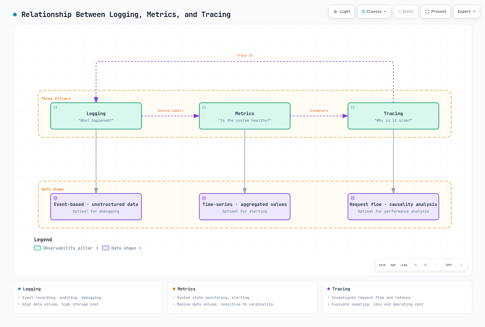
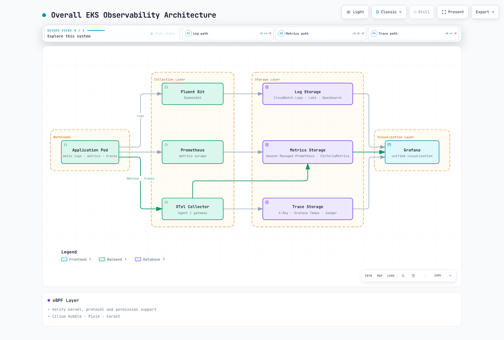
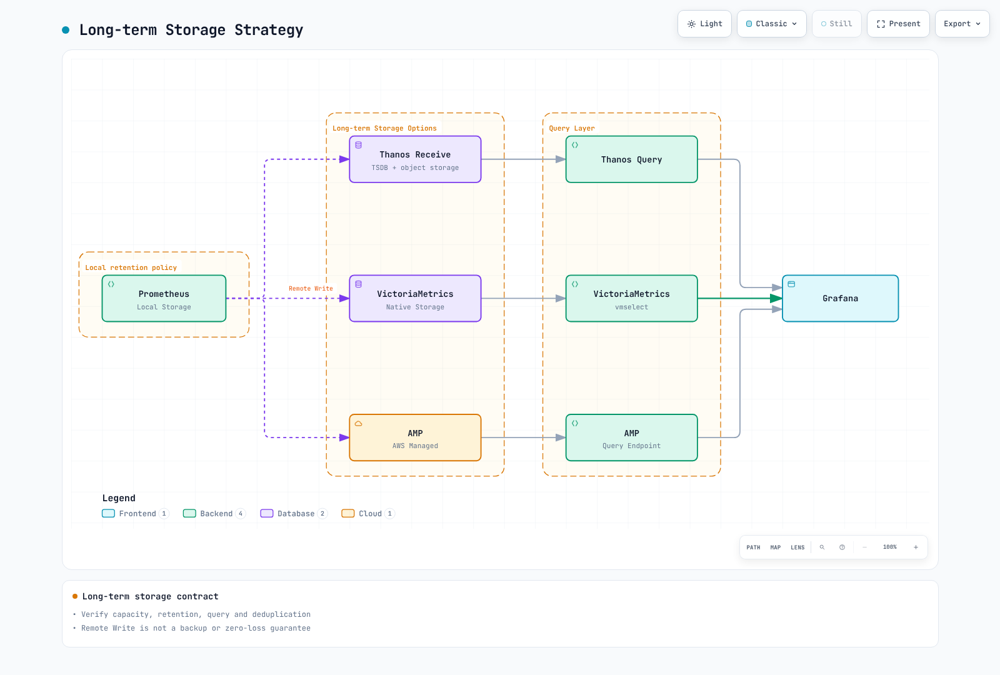
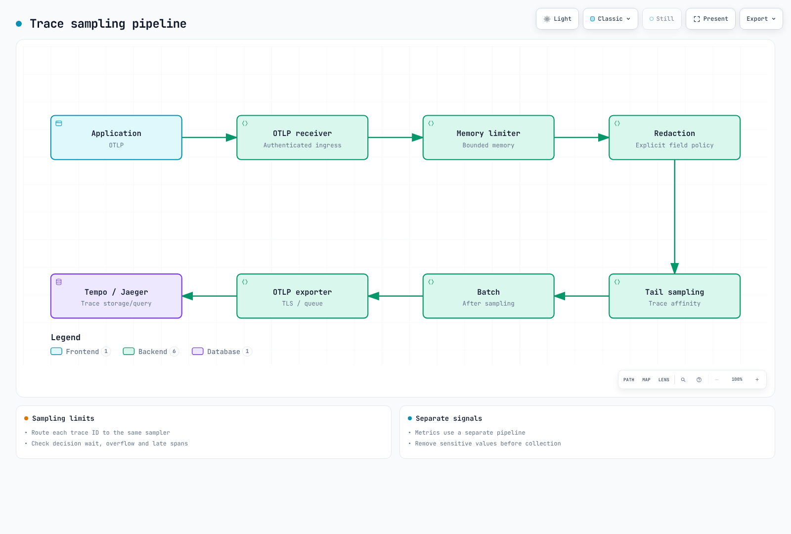
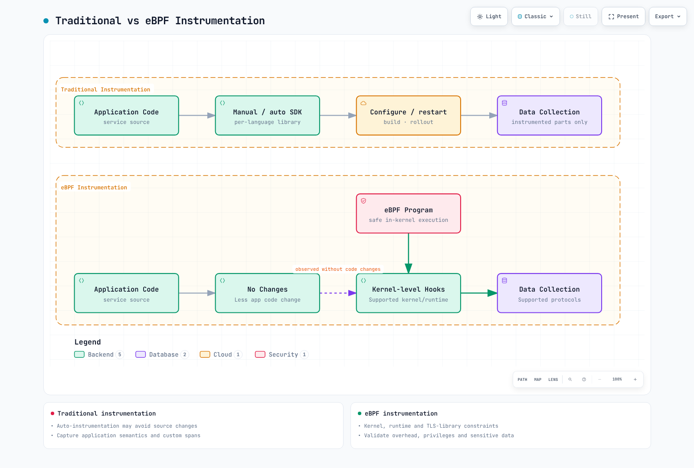
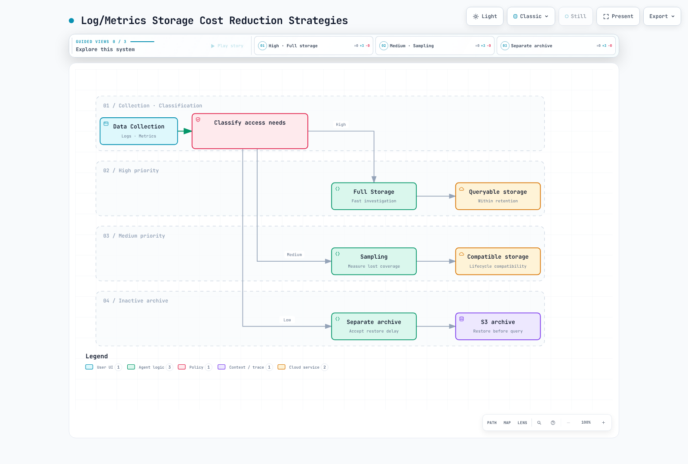
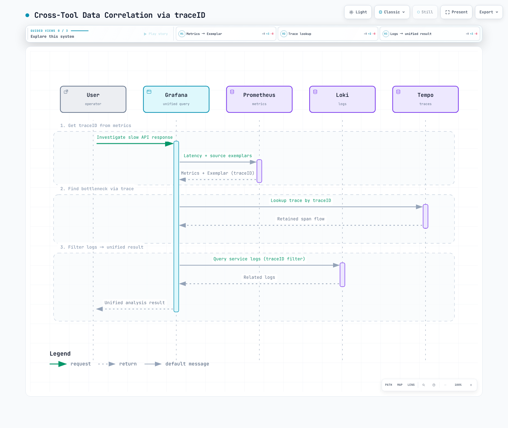
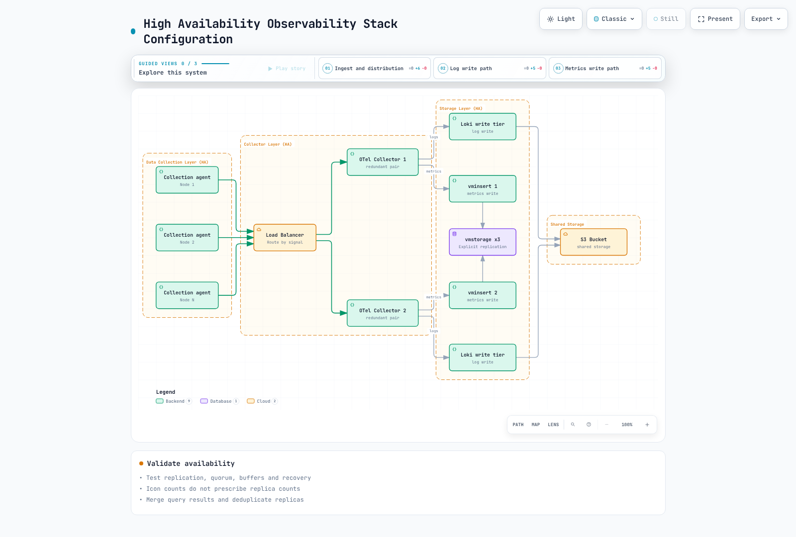
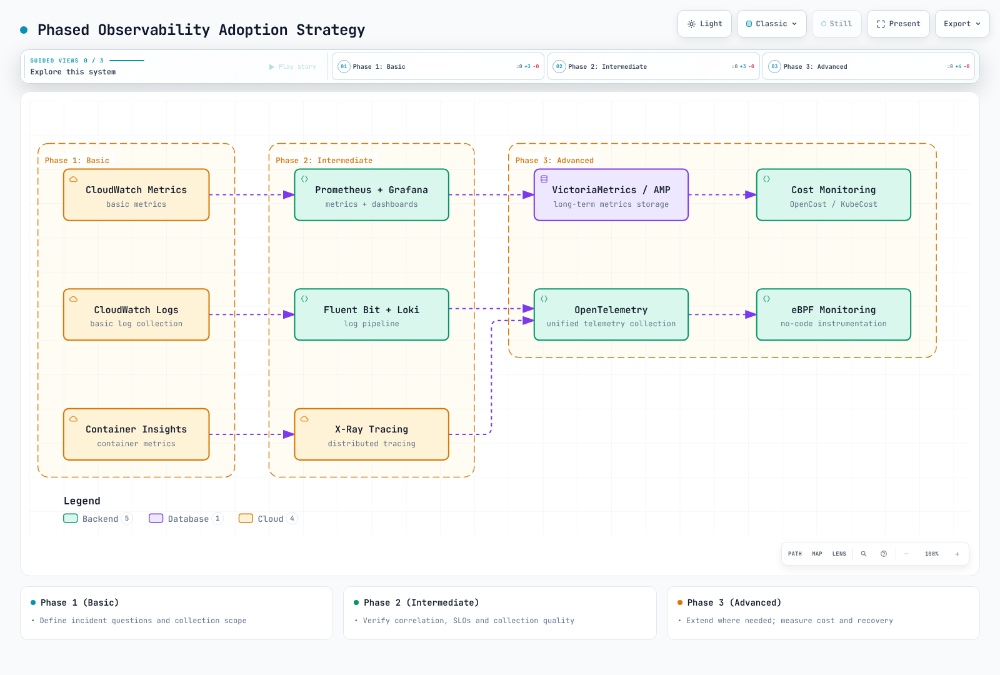

# Guía de optimización de observabilidad de EKS

> **Versiones de ejemplo validadas**: Prometheus 3.14.0 · OTel Collector Contrib 0.160.0 · Alertmanager 0.34.0 · OpenCost 1.121.2/chart 2.5.31

> **Última actualización**: 13 de septiembre de 2026

Oriente la observabilidad a las preguntas que surgen durante los incidentes, la calidad de la recopilación y los costos medidos. El número de nodos, por sí solo, no permite predecir el volumen de ingesta, la carga de consultas, el costo de retención ni las necesidades de personal. Este capítulo incluye [ejemplos completos de configuración](https://github.com/Atom-oh/kubernetes-docs/tree/main/examples/observability/optimization) y remite a las guías de despliegue para instalar el clúster. Las pruebas nativas usan datos sintéticos; no son pruebas de capacidad en producción.

<span id="table-of-contents"></span>

## Contenido

- [1. Descripción general de los tres pilares de la observabilidad](#1-overview-of-the-three-pillars-of-observability)
- [2. Comparación de soluciones de registro](#2-logging-solution-comparison)
- [3. Recopilación y almacenamiento de métricas](#3-metrics-collection-and-storage)
- [4. Trazado distribuido](#4-distributed-tracing)
- [5. Monitoreo sin código basado en eBPF](#5-ebpf-based-no-code-monitoring)
- [6. Monitoreo de costos](#6-cost-monitoring)
- [7. Panel unificado de observabilidad](#7-unified-observability-dashboard)
- [8. Desafíos operativos y soluciones](#8-operational-challenges-and-solutions)
- [9. Prácticas recomendadas y próximos pasos](#9-best-practices-and-next-steps)

<span id="_1-1-relationship-between-logging-metrics-and-tracing"></span>

<span id="_1-2-role-of-each-pillar-and-selection-criteria"></span>

<span id="_1-3-overall-eks-observability-architecture"></span>

<span id="1-overview-of-the-three-pillars-of-observability"></span>

## 1. Descripción general de los tres pilares de la observabilidad

Los registros describen eventos, las métricas resumen el comportamiento a lo largo del tiempo y las trazas representan rutas de solicitud instrumentadas. La ausencia de una traza o la falta de actividad en un panel no demuestra que un servicio esté en buen estado. Incluya en una misma vista operativa los registros que se pierden en el recopilador, las colas, las exportaciones fallidas y el estado de la recolección de métricas.



[🔍 Ver diagrama interactivo](https://www.atomai.click/kubernetes-docs/archmaps/en-observability-09-observability-optimization-0.html)

Use etiquetas de servicio/ruta/estado con cardinalidad acotada para las métricas y registre los ID de solicitud de alta cardinalidad en registros y trazas bajo controles adecuados. Una traza puede estar incompleta: depende de la instrumentación, la propagación, el muestreo y la retención.



[🔍 Ver diagrama interactivo](https://www.atomai.click/kubernetes-docs/archmaps/en-observability-09-observability-optimization-1.html)

Los agentes y las puertas de enlace tienen responsabilidades distintas. Los agentes de nodo leen los registros locales; las puertas de enlace pueden aplicar políticas centralizadas. El muestreo de cola requiere afinidad por traza: no se garantiza colocando réplicas arbitrarias de DaemonSet detrás de un balanceador que distribuye el tráfico al azar.

<span id="_2-1-log-storage-comparison"></span>

<span id="_2-2-log-agent-comparison"></span>

<span id="_2-3-fluent-bit-loki-configuration-example-for-eks"></span>

<span id="2-logging-solution-comparison"></span>

## 2. Comparación de soluciones de registro

| Sistema | Características útiles | Costos y límites operativos |
|---|---|---|
| CloudWatch Logs | Ingesta administrada, retención y Logs Insights | Región, clase de log, ingesta, almacenamiento, escaneo de consultas y cuotas |
| OpenSearch | Búsqueda y análisis indexados | Capacidad aprovisionada/serverless, indexación, réplicas, almacenamiento y carga de consultas |
| Loki | Registros indexados por etiquetas, LogQL y almacenamiento de objetos | Cómputo, caché, solicitudes de objetos, retención, distribución de consultas y operación |
| ClickHouse | Análisis SQL, opciones de esquema y compresión | Cómputo, almacenamiento, replicación, esquema de ingesta y ajuste de consultas |

No hay una opción que siempre sea la más rápida o económica. Compare el mismo volumen de entrada, la compresión, la retención, la disponibilidad, la latencia de consulta y el alcance del soporte. El precio del almacenamiento de objetos, por sí solo, no representa el costo total de Loki o Tempo. Los servicios administrados también tienen cuotas.

### Agentes y formato de los registros de contenedor

Fluent Bit, Fluentd y Vector difieren en sus complementos, lenguajes, almacenamiento temporal en búfer y modelos de despliegue. Las afirmaciones fijas, como “15 MB” o “200K mensajes/segundo”, requieren una carga de trabajo, una versión y un hardware reproducibles. Mida el tamaño de los registros, el costo del análisis sintáctico, los reintentos y la contrapresión.

Los registros modernos de containerd en EKS usan el formato CRI. No aplique a ciegas un analizador JSON de Docker ni suponga que existe `/var/lib/docker/containers`. Use el analizador compatible con contenedores/CRI, gestione los mensajes de varias líneas, monte los registros del host como solo lectura y guarde los desplazamientos y búferes en otra ubicación con permisos de escritura. El enriquecimiento con metadatos de Kubernetes requiere la ServiceAccount/RBAC correspondiente. Un ConfigMap por sí solo no despliega ningún recopilador.

Limite las etiquetas de Loki a dimensiones estables, como cluster, namespace y service. Copiar automáticamente todas las etiquetas de Pod puede multiplicar de forma explosiva los flujos de registros. Consulte la [guía de recopiladores](./logging/05-collectors.md) y la [guía de Loki](./logging/01-loki.md) para ver los perfiles completos vigentes; antes de instalar, confirme el servicio de destino, el esquema, el almacenamiento, IAM y los controles de red.

### El filtrado no equivale al muestreo porcentual

Después de analizar el JSON y obtener el campo `level`, un filtro de Fluent Bit puede excluir los niveles DEBUG/TRACE exactos:

```ini
[FILTER]
    Name     grep
    Match    application.*
    Exclude  level ^(DEBUG|TRACE)$
```

Este fragmento requiere una canalización de entrada/analizador/salida compatible. No descarte registros solo porque el texto arbitrario de un mensaje contenga “DEBUG”. `Rate` y `Window` del limitador de tasa de Fluent Bit aplican un límite en una ventana móvil; no son un muestreador probabilístico del 10 %. Antes de filtrar, mida cuántos registros se descartan y respete los requisitos de incidentes y auditoría.

Para CloudWatch, use las opciones documentadas de `cloudwatch_logs`. `log_format json` y el fragmento antiguo de `max_batch_size`/`max_batch_put_limit` no son una configuración genérica válida para la salida JSON ni para agrupar registros en lotes. El complemento gestiona los lotes; revise las opciones de la versión fijada. El parámetro `log_retention_days`, al crear un grupo, no establece la retención de todos los grupos existentes.

<span id="_3-1-metrics-storage-comparison"></span>

<span id="_3-2-cardinality-management-strategy"></span>

<span id="_3-3-improving-query-performance-with-recording-rules"></span>

<span id="_3-4-long-term-storage-strategy"></span>

<span id="3-metrics-collection-and-storage"></span>

## 3. Recopilación y almacenamiento de métricas

Prometheus usa almacenamiento TSDB local; el particionado horizontal, la escritura remota y una capa de consulta/agregación amplían sus opciones de despliegue. Los productos de VictoriaMetrics de nodo único y de clúster tienen distintas propiedades de disponibilidad y replicación. AMP es un servicio administrado, pero tiene cuotas de espacio de trabajo y retención configurable. Nada de esto implica retención ilimitada, replicación automática a partir de “tres Pods de almacenamiento” ni semántica idéntica para todas las consultas ampliadas.

### Cardinalidad sin descartar métricas no relacionadas

El ejemplo `prometheus.yaml` descarta solo algunos buckets seleccionados de un histograma conocido. Conserva las métricas que no son histogramas, `_sum`, `_count`, el bucket de SLO `le="0.5"` y `+Inf`.

```yaml
- source_labels:
  - __name__
  - le
  regex: lab_http_request_duration_seconds_bucket;(0\.005|0\.01|0\.025|0\.05|0\.25)
  action: drop
```

Una `action: keep` que solo coincide con `.*_bucket;...` también elimina todas las métricas que no coinciden y, a menudo, `+Inf`. Cambiar los buckets de un histograma afecta la precisión de los cuantiles; cuando sea posible, prefiera el esquema de instrumentación y conserve el bucket que necesita el SLO. Prometheus 3 normaliza los valores `le` de los histogramas clásicos; por ejemplo, `1` se convierte en `1.0`. Haga coincidir las etiquetas que realmente se ingieren.

`relabel_configs` modifica los destinos descubiertos antes de la extracción; `metric_relabel_configs` modifica las muestras recopiladas. Eliminar etiquetas no agrega muestras y puede crear series duplicadas. Las etiquetas `__meta_*` del descubrimiento no se convierten automáticamente en etiquetas persistentes de las muestras. Reduzca las etiquetas en el origen y compruebe que el conjunto restante sea único.

### Reglas de grabación y retención

Use reglas de grabación para los cálculos repetidos, con claves coherentes de `service`, `cluster` y namespace. Node-exporter suele identificar los destinos mediante `instance`; no agrupe por una etiqueta `node` que nunca se haya añadido. No descarte a ciegas, junto con todas las familias `go_.*` o `promhttp_.*`, las métricas que necesita para diagnosticar el propio recopilador.



[🔍 Ver diagrama interactivo](https://www.atomai.click/kubernetes-docs/archmaps/en-observability-09-observability-optimization-2.html)

Una cola de escritura remota no es una copia de seguridad ni garantiza una entrega sin pérdidas. Planifique la capacidad de WAL y de la cola, los reintentos, la autenticación, las interrupciones de red y los límites del receptor. La arquitectura de sidecar y carga de bloques de Thanos difiere de la ruta de Thanos Receive que se muestra aquí.

En Prometheus Operator, `replicas: 2` y `shards: 3` significan seis Pods de Prometheus. Asigne PVC y memoria para los seis, configure los selectores y proporcione una capa de consulta que combine los fragmentos y deduplique las réplicas de alta disponibilidad. Dos réplicas conectadas a un receptor de escritura remota sin deduplicación pueden contar los datos dos veces. Compruebe que los campos de CRD y la configuración de consulta dedicada sean compatibles con la versión fijada del Operator; no añada argumentos genéricos que entren en conflicto.

<span id="_4-1-opentelemetry-overview-and-architecture"></span>

<span id="_4-2-tracing-backend-comparison"></span>

<span id="_4-3-sampling-strategies"></span>

<span id="_4-4-otel-collector-daemonset-configuration-for-eks"></span>

<span id="4-distributed-tracing"></span>

## 4. Trazado distribuido

Tempo admite TraceQL, además de la búsqueda por ID de traza. Jaeger 2 usa una arquitectura basada en OTel cuyo almacenamiento se selecciona explícitamente. X-Ray es un servicio de AWS; siga la guía vigente de integración de OTel/ADOT en lugar de asumir que una versión antigua del SDK es aplicable en todos los casos. Considere la ingesta, las consultas, el almacenamiento y la operación; no compare solo los precios por traza y de S3.



[🔍 Ver diagrama interactivo](https://www.atomai.click/kubernetes-docs/archmaps/en-observability-09-observability-optimization-3.html)

### Muestreo y afinidad

El muestreo de cabecera decide antes de conocer el resultado completo de la solicitud. El muestreo probabilístico del Collector también ocurre después de que la telemetría llega al recopilador y no equivale a una decisión de muestreo de cabecera del SDK. El muestreo de cola no puede recuperar los spans que ya se descartaron en etapas anteriores.

En la estrategia predeterminada `trace-complete`, `decision_wait` determina cuándo se toman decisiones basadas en un temporizador sobre los spans recibidos; no demuestra que hayan llegado todos los spans ni que la traza haya finalizado. Envíe todos los spans de un mismo ID de traza al mismo muestreador. Dimensione el búfer según la tasa de llegada multiplicada por el tiempo de espera, más margen para ráfagas y el tamaño de los spans. El desbordamiento de capacidad, las trazas demasiado grandes, los reinicios y los spans tardíos pueden impedir que se cumpla la promesa de conservar todas las trazas con errores.

El archivo `collector-tail-local.yaml`, limitado a loopback, es una demostración sintética, no un manifiesto de EKS. Usa un búfer de 1,000 trazas, una espera de decisión de dos segundos y un ajuste del limitador de memoria de 192 MiB; determine los valores de producción a partir de trazas medidas y del margen de memoria del contenedor. Sus políticas son:

```yaml
decision_wait: 2s
num_traces: 1000
maximum_trace_size_bytes: 1048576
policies:
- name: errors
  type: status_code
  status_code:
    status_codes:
    - ERROR
- name: slow
  type: latency
  latency:
    threshold_ms: 1000
- name: baseline
  type: probabilistic
  probabilistic:
    sampling_percentage: 10
```

Con estas políticas positivas, se conservan las trazas de error o lentas que coinciden; las demás son elegibles para la política probabilística. Esto no implica una reducción general del volumen del 90 %. Las políticas drop/composite/inverted tienen semánticas de decisión distintas; no generalice la regla de que “gana la primera coincidencia”. El ejemplo elimina únicamente el atributo de span llamado `sensitive_data`. Antes de exportar, depure los nombres de span, los eventos, los atributos de recursos y los registros de aplicaciones conforme a una política explícita de tratamiento de datos.

Para desplegar en un clúster, consulte la [guía de OTel](./tracing/03-opentelemetry.md) y el [laboratorio del stack de observabilidad](../labs/observability/02-observability-stack-lab.md). Las anotaciones de inyección requieren el Operator, el recurso `Instrumentation` correspondiente, una imagen de entorno de ejecución compatible y reiniciar la carga de trabajo. Asegúrese de que coincidan OTLP HTTP/4318 o gRPC/4317, TLS y la autenticación; una anotación por sí sola no instala la instrumentación.

<span id="_5-1-why-ebpf-monitoring"></span>

<span id="_5-2-coroot-automatic-service-maps-and-latency-analysis"></span>

<span id="_5-3-pixie-now-new-relic-kubernetes-specific-observability"></span>

<span id="_5-4-cilium-hubble-network-flow-observation"></span>

<span id="_5-5-kepler-energy-consumption-monitoring"></span>

<span id="5-ebpf-based-no-code-monitoring"></span>

## 5. Monitoreo sin código basado en eBPF



[🔍 Ver diagrama interactivo](https://www.atomai.click/kubernetes-docs/archmaps/en-observability-09-observability-optimization-4.html)

eBPF puede reducir los cambios en el código fuente cuando se usan protocolos, núcleos y entornos de ejecución compatibles. No captura automáticamente la semántica de negocio, todos los lenguajes y bibliotecas ni todo el tráfico TLS. Los uprobes pueden observar texto sin cifrar en los límites de bibliotecas compatibles; eso no equivale a descifrar TLS de forma general. Evalúe los privilegios necesarios, la captura de cargas útiles sensibles, la compatibilidad del núcleo y la sobrecarga medida. La instrumentación automática del SDK también puede evitar cambios en el código fuente de la aplicación, aunque quizá requiera reinicios o configuración.

| Herramienta | Consideraciones actuales de despliegue |
|---|---|
| Coroot | El chart antiguo `coroot/coroot` está obsoleto. Siga el flujo documentado con Operator/Coroot CR; el chart del Operator 0.9.10 y el chart CE 0.3.3 son componentes independientes. Revise los privilegios del agente, el almacenamiento y la autenticación. |
| Pixie | Proyecto de código abierto con requisitos de núcleo y protocolo, y varias opciones de plano de control. El almacenamiento dentro del clúster no impide exportar consultas o resultados; revise el acceso real y las rutas de datos. |
| Cilium Hubble | Requiere una implementación compatible de Cilium. La visibilidad del tráfico, la cobertura de políticas y proxy L7, y las métricas habilitadas varían; no sustituye el trazado distribuido de toda la aplicación. |
| Kepler | La versión 0.10+ reescribió la arquitectura anterior de 0.7. Las métricas actuales y los requisitos de despliegue son distintos; no copie el antiguo DaemonSet privilegiado/BPF. |

Kepler 0.11.4 documenta métricas de CPU como `kepler_pod_cpu_watts` y `kepler_pod_cpu_joules_total`, con `pod_namespace`/`pod_name`. El acceso a las mediciones de energía del hardware y su atribución deben funcionar en el host real; no se garantiza que los nodos virtuales habituales de EKS expongan datos RAPL del host. Antes de afirmar que la medición es precisa, consulte la documentación de despliegue y de compatibilidad de hardware de esa versión.

```promql
# A watts gauge already measures power.
sum by (pod_namespace) (kepler_pod_cpu_watts)

# J/s = W; multiplying by 1000 would give milliwatts.
rate(kepler_pod_cpu_joules_total[5m])
```

Que el sistema esté disponible o que un exportador esté en ejecución no demuestra que las mediciones de hardware sean correctas. EKS Auto Mode y Fargate tienen distintas restricciones de acceso al host; compruebe qué instrumentación es compatible en vez de aplicar un agente de nodo privilegiado en todas partes. Mantenga privadas las interfaces de Hubble/Coroot/OpenCost hasta configurar la autenticación y el acceso de red.

<span id="_6-1-kubecost-opencost-installation-and-configuration"></span>

<span id="_6-2-cost-allocation-by-namespace-team"></span>

<span id="_6-3-cloudwatch-cost-optimization"></span>

<span id="_6-4-log-metrics-storage-cost-reduction-strategies"></span>

<span id="6-cost-monitoring"></span>

## 6. Monitoreo de costos

### OpenCost y asignación

`opencost-values.yaml` fija el chart en 2.5.31 y la aplicación en 1.121.2, selecciona un Prometheus existente y deshabilita la ingesta de costos de la nube. Sustituya el endpoint por uno que exponga las métricas necesarias para OpenCost, incluidos los datos de cargas de trabajo, recursos y costos; la mera conectividad no basta. Configure un método aprobado de autenticación y gestión de CA para los endpoints protegidos de Prometheus.

```bash
helm repo add opencost https://opencost.github.io/opencost-helm-chart
helm repo update opencost
helm upgrade --install opencost opencost/opencost --version 2.5.31   -n opencost --create-namespace -f opencost-values.yaml
kubectl -n opencost port-forward service/opencost 9003:9003 --address 127.0.0.1
# In another terminal:
curl --fail --get http://127.0.0.1:9003/allocation/compute   --data-urlencode 'window=7d' --data-urlencode 'aggregate=namespace'
```

Para solicitar datos de siete días se necesita suficiente historial de entrada. Las estimaciones de asignación no equivalen a la factura de AWS. Estandarice las etiquetas `team`, `cost-center`, cluster y namespace; defina cómo asignar los costos inactivos y compartidos, y compare los resultados con CUR/Data Exports, créditos, descuentos y amortización. La conciliación de costos de AWS requiere el formato compatible de `cloudIntegrationSecret`, los requisitos previos de CUR/Athena/S3 y permisos de identidad con el alcance adecuado. Los valores no compatibles, como el fragmento antiguo `exporter.aws.athenaProjectID`, no habilitan esa integración. Nunca incluya claves de acceso de AWS en archivos de valores.

### Retención y archivado seguros

Haga un inventario de los grupos de registros antes de cambiar la retención:

```bash
aws logs describe-log-groups --log-group-name-prefix /eks/production/   --query 'logGroups[].{name:logGroupName,retention:retentionInDays,storedBytes:storedBytes}'   --output json
```

Aplique mediante la configuración de infraestructura una política de retención aprobada solo a los grupos seleccionados explícitamente. `storedBytes == 0` no significa que un grupo de registros esté en desuso: las suscripciones, los productores, los requisitos de auditoría y las escrituras futuras aún pueden depender de él. No elimine en bloque los grupos “vacíos” ni interprete la salida de CLI separada por tabuladores como si cada línea contuviera un nombre de grupo.



[🔍 Ver diagrama interactivo](https://www.atomai.click/kubernetes-docs/archmaps/en-observability-09-observability-optimization-5.html)

No mueva a ciegas bloques activos de Loki/Tempo a Glacier: el sistema de almacenamiento puede necesitar leerlos de inmediato y quizá no pueda restaurar objetos archivados bajo demanda. Coordine la retención y compactación del sistema con las reglas del ciclo de vida de los objetos, y pruebe su recuperación. Los ahorros por compresión, filtrado y retención se superponen; no sume sus porcentajes como si fueran independientes.

<span id="_7-1-grafana-based-unified-dashboard-configuration"></span>

<span id="_7-2-log-metrics-trace-correlation-exemplars"></span>

<span id="_7-3-alerting-strategy-preventing-alert-fatigue"></span>

<span id="_7-4-slo-sli-based-monitoring"></span>

<span id="7-unified-observability-dashboard"></span>

## 7. Panel unificado de observabilidad

Consulte la [guía de Grafana](./grafana/README.md) para configurar el aprovisionamiento con versiones fijadas, UID coincidentes de `prometheus`, `loki` y `tempo`, la opción vigente `tracesToLogsV2` y endpoints HTTP/TLS reales. Las variables de entorno no crean una fuente de datos por sí solas. Los nombres de etiquetas de los ejemplares y los campos JSON de las trazas deben coincidir con la aplicación instrumentada.

Las opciones de funciones de Prometheus se configuran en la línea de comandos o en el campo `enableFeatures` compatible del Operator, no en `global.enable_features` de `prometheus.yml`. El ejemplo usa `storage.exemplars.max_exemplars`; para habilitar el almacenamiento de ejemplares, use también la opción de función correspondiente a la versión. La aplicación debe registrar los recopiladores y exponer OpenMetrics. En la instrumentación de ejemplares, evite rutas de solicitud sin procesar e ID de traza no muestreados o no válidos.

### SLO de solicitudes, tasa de consumo del presupuesto y saldo restante

Para un SLO de disponibilidad del 99.9 % basado en solicitudes, el número permitido de solicitudes fallidas es `total requests × 0.001` durante el intervalo definido. Esto no equivale automáticamente a 43 minutos de inactividad: los SLI basados en tiempo y en solicitudes tienen denominadores distintos.

`slo-rules.yaml` separa las tasas de error de ventanas cortas de una tasa ponderada por solicitudes para 30 días:

```promql
# Recent burn rate:
service:http_5xx:ratio_5m / 0.001

# Remaining 30-day request budget:
1 - service:http_5xx:ratio_30d / 0.001
```

La tasa de 30 días usa `increase(counter[30d])` tanto para el numerador como para el denominador, no la tasa más reciente de cinco minutos. Exija suficiente historial y vigile las interrupciones en la recopilación. El presupuesto agotado puede ser negativo; si no hay tráfico o es cero, el resultado queda sin definir, en vez de indicar una disponibilidad perfecta. El bucket `le="0.5"` dividido por el recuento del histograma representa la fracción de solicitudes completadas en 500 ms o menos, no “la fracción de valores p99 por debajo de 500 ms”.

El ejemplo combina umbrales de consumo del presupuesto de error de 14.4 para ventanas de 1 h/5 min y de 6 para ventanas de 6 h/30 min. Para un objetivo de 30 días, son políticas ilustrativas de consumo rápido y sostenido, no niveles de gravedad universales. Ajuste con los responsables del servicio las ventanas de evaluación, la confianza en los datos de tráfico y la política de respuesta. No suspenda automáticamente un despliegue solo porque una estimación de ventana corta supere un umbral.

### Enrutamiento de alertas

`alertmanager.yaml` define los matchers actuales, el horario no laborable de Asia/Seúl y una regla de inhibición protegida por etiquetas cluster/node no vacías. Si faltan etiquetas, se consideran iguales y podrían silenciarse alertas que no están relacionadas. El receptor `review-only` no tiene ninguna integración a propósito: permite validar el enrutamiento sin enviar nada. Antes de usarlo en operaciones, añada contactos aprobados, claves de webhook/enrutamiento almacenadas en Secret y políticas explícitas para los receptores; después, pruebe la entrega y la inhibición. La evaluación, la agrupación, el intervalo entre repeticiones, el tiempo de espera y los horarios de silenciamiento cumplen funciones distintas.

<span id="_8-1-responding-to-exploding-log-metrics-storage-costs"></span>

<span id="_8-2-eks-auto-mode-node-monitoring"></span>

<span id="_8-3-cross-tool-data-correlation-analysis"></span>

<span id="_8-4-maintaining-monitoring-system-performance-at-large-scale"></span>

<span id="_8-5-high-availability-observability-stack-configuration"></span>

<span id="8-operational-challenges-and-solutions"></span>

## 8. Desafíos operativos y soluciones



[🔍 Ver diagrama interactivo](https://www.atomai.click/kubernetes-docs/archmaps/en-observability-09-observability-optimization-6.html)

Una serie p99 calculada no conserva por sí misma los metadatos de los ejemplares. Consulte los ejemplares de la serie instrumentada original y compruebe después la retención de trazas y los campos de los registros. Si un enlace de traza no muestra datos, puede haber un desajuste entre el muestreo y la retención, en vez de un fallo de la interfaz.

EKS Auto Mode incluye un agente de monitoreo de nodos que publica eventos de Kubernetes y condiciones de los nodos. Consulte esas señales y el estado de los nodos junto con las métricas de las cargas de trabajo. Un PodMonitor selecciona Pods y puertos de contenedor con nombre; seleccionar una etiqueta de nodo no expone automáticamente sus métricas. El complemento u Operator de CloudWatch Observability instala agentes y requiere permisos y configuración; un ConfigMap independiente no habilita Container Insights.



[🔍 Ver diagrama interactivo](https://www.atomai.click/kubernetes-docs/archmaps/en-observability-09-observability-optimization-7.html)

Pruebe fallos en las capas de recopilación, cola, receptor, almacenamiento y consulta. Los PDB limitan las interrupciones voluntarias cuando se respetan, pero no garantizan la disponibilidad si se pierden nodos. Los factores de replicación, el quórum, la ubicación en zonas de disponibilidad (AZ), el almacenamiento con estado y la agregación de la ruta de lectura son requisitos independientes. Siga los modos de despliegue vigentes de Loki/Tempo en vez de mezclar en un stack actual ejemplos retirados de los ingesters de Simple Scalable o Tempo 2.

<span id="_9-1-phased-adoption-strategy"></span>

<span id="_9-2-cost-benefit-analysis"></span>

<span id="_9-3-checklist"></span>

<span id="_9-4-related-documents-and-quizzes"></span>

<span id="9-best-practices-and-next-steps"></span>

## 9. Prácticas recomendadas y próximos pasos



[🔍 Ver diagrama interactivo](https://www.atomai.click/kubernetes-docs/archmaps/en-observability-09-observability-optimization-8.html)

Establezca una línea base: bytes por día y señal, series activas, aparición de series nuevas, muestras por segundo, spans por segundo, retención de muestras, volumen de datos examinados por consulta, retención, pérdidas del búfer, tiempo de recuperación y esfuerzo operativo. Use los precios vigentes de cada región y las condiciones negociadas. Si la línea base hipotética es de $5,000 al mes y el objetivo es de $2,500, identifique primero las categorías de costo reales antes de estimar ahorros. Ningún cambio de herramienta garantiza un ahorro del 50 %.

Implemente un cambio medible a la vez. Compare antes y después el éxito de las investigaciones de incidentes, la cobertura de los SLO, los datos descartados y la factura. Conserve suficientes datos para revertir un filtro perjudicial y recuperar la capacidad de diagnóstico. La duración del despliegue depende de los permisos, la experiencia del equipo, la validación y la migración; los plazos fijos de “uno o dos días” no son compromisos.

### Validación y límites

Las comprobaciones nativas abarcaron la configuración de Prometheus y nueve reglas; el cambio selectivo de etiquetas de buckets frente a una extracción sintética real; siete aserciones de SLO, incluido un presupuesto de solicitudes a 30 días; una canalización real de muestreo de cola en Collector; la configuración de Alertmanager; y el renderizado del chart de Helm fijado de OpenCost. No se probaron cargas de trabajo de producción, conciliación de facturación, instalación de Kubernetes/eBPF ni notificaciones externas. Las comprobaciones del diagrama y del navegador se documentan por separado en el informe de revisión.

### Lecturas relacionadas

- [Guía de Prometheus](./metrics/01-prometheus.md)
- [Paneles de Grafana](./grafana/README.md)
- [Cuestionario de optimización de observabilidad](../quizzes/observability/09-observability-optimization-quiz.md)

## Referencias

- [Muestreo de cola de Collector v0.160.0](https://github.com/open-telemetry/opentelemetry-collector-contrib/tree/v0.160.0/processor/tailsamplingprocessor)
- [Configuración de Prometheus](https://prometheus.io/docs/prometheus/latest/configuration/configuration/)
- [Configuración de alertas de Prometheus](https://prometheus.io/docs/alerting/latest/configuration/)
- [Configuración de retención del espacio de trabajo de AMP](https://docs.aws.amazon.com/prometheus/latest/APIReference/API_UpdateWorkspaceConfiguration.html)
- [Solución de problemas de EKS Auto Mode](https://docs.aws.amazon.com/eks/latest/userguide/auto-troubleshoot.html)
- [Complemento de CloudWatch Observability](https://docs.aws.amazon.com/eks/latest/userguide/cloudwatch.html)
- [Kepler v0.11.4](https://github.com/sustainable-computing-io/kepler/tree/v0.11.4)
- [Charts de Helm de Coroot](https://github.com/coroot/helm-charts/tree/main/charts)
- [Chart de Helm de OpenCost](https://github.com/opencost/opencost-helm-chart/tree/main/charts/opencost)
- [Pixie](https://github.com/pixie-io/pixie)
