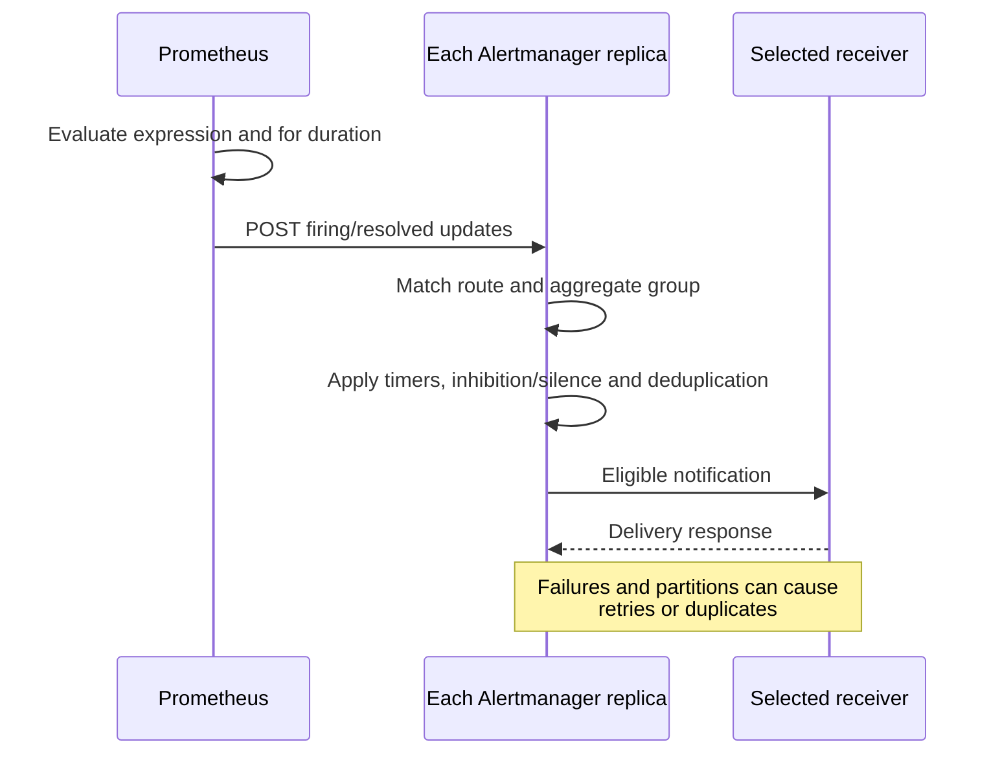
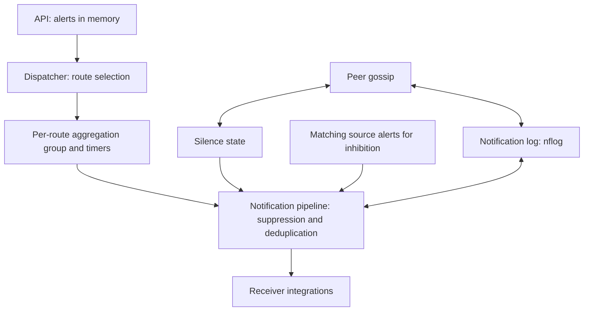
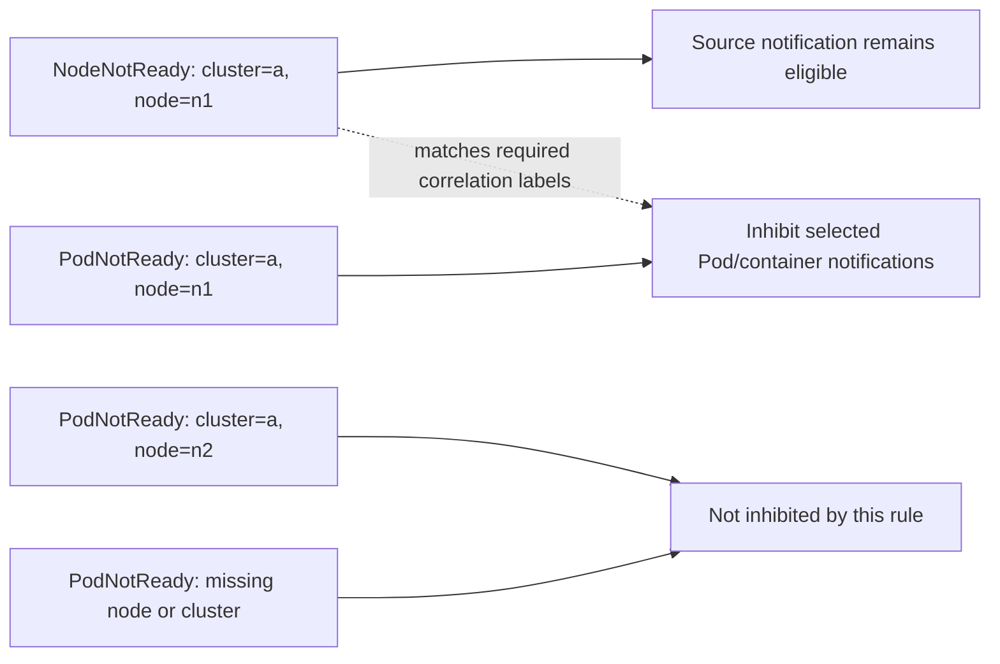
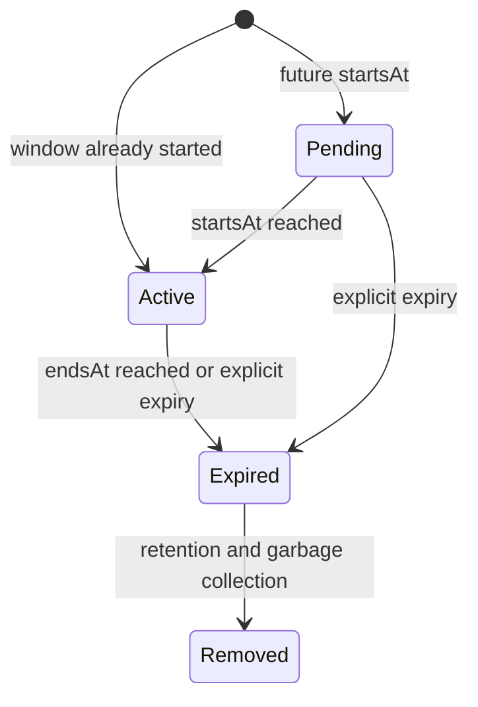

# Prometheus Alertmanager

> **Base de revisión**: Alertmanager 0.34.0; kube-prometheus-stack 90.0.0 / Operator 0.93.1; chart independiente 1.43.1
> **Última actualización**: 13 de septiembre de 2026

## Tabla de contenidos

- [Descripción general de Alertmanager](#alertmanager-overview)
- [Arquitectura](#architecture)
- [Instalación y configuración](#installation-and-configuration)
- [Definición de reglas de alertas](#defining-alert-rules)
- [Configuración del enrutamiento](#routing-configuration)
- [Configuración de receptores](#receiver-configuration)
- [Reglas de inhibición](#inhibition-rules)
- [Silenciamientos](#silencing)
- [Personalización de plantillas](#template-customization)
- [Configuración de alta disponibilidad](#high-availability-configuration)
- [CRD AlertmanagerConfig](#alertmanagerconfig-crd)
- [Ejemplos de reglas de alertas para producción](#production-alert-rule-examples)
- [Solución de problemas](#troubleshooting)

---

## Descripción general de Alertmanager {#alertmanager-overview}

Prometheus Alertmanager es un componente que procesa las alertas enviadas por los servidores Prometheus. Ofrece funciones como deduplicación, agrupación, enrutamiento, inhibición y silenciamiento de alertas.

### Funciones principales

1. **La agrupación** combina las alertas de una ruta o grupo en notificaciones.
2. **La inhibición y los silenciamientos** suprimen notificaciones sin cambiar la condición de la regla subyacente de Prometheus.
3. **El enrutamiento** selecciona los receptores; un receptor puede contener varias integraciones.
4. **La alta disponibilidad** comparte los silenciamientos y el estado del registro de notificaciones con consistencia eventual. Durante las particiones, prefiere entregar notificaciones duplicadas antes que suprimirlas; no garantiza una entrega exactamente una vez.

### Flujo de alertas de Prometheus

Prometheus evalúa las reglas; Alertmanager procesa las notificaciones. Esta secuencia resume las responsabilidades; no garantiza una latencia de entrega determinada.



## Arquitectura {#architecture}

### Estructura interna de Alertmanager

El dispatcher crea grupos **después de seleccionar la ruta**. La inhibición, las comprobaciones de silenciamiento y tiempo, y la deduplicación del registro de notificaciones se ejecutan en la canalización de notificaciones; no forman una cadena fija previa a la agrupación. El protocolo gossip no sustituye el envío de alertas de Prometheus a todas las réplicas. Las alertas en sí no se conservan como los silenciamientos o nflog.



### Descripción de los componentes

| Componente | Función |
|-----------|------|
| **Dispatcher** | Enruta las alertas a los receptores adecuados según el árbol de enrutamiento |
| **Inhibitor** | Suprime alertas relacionadas según las reglas de inhibición |
| **Silencer** | Filtra las alertas que coinciden con reglas de silenciamiento |
| **Grupo de agregación** | Agrupa las alertas del mismo grupo para procesarlas |
| **Canalización de notificaciones** | Gestiona el envío efectivo de alertas |
| **nflog** | Registra las alertas enviadas (para deduplicarlas) |

---

## Instalación y configuración {#installation-and-configuration}

Estos son ejemplos alternativos para una base de referencia con Kubernetes 1.35 y nodos de trabajo Linux. Los dos Helm Chart y el StatefulSet manual tienen **distintos responsables de instalación**; elija uno. Se generaron los manifiestos de los charts, se ejecutaron localmente la configuración, las plantillas y reglas sintéticas, pero no se realizó ninguna instalación de Kubernetes, aplicación de CNI en vivo, entrega a SaaS ni prueba de capacidad en producción. Las instalaciones existentes necesitan una combinación de valores y un plan de actualización revisados por el responsable, no un reemplazo a ciegas por este tutorial.

Prepare el espacio de nombres `monitoring`, tres nodos aptos para la programación que permitan la antiafinidad estricta, un StorageClass RWO predeterminado adecuado, las credenciales de notificación y las rutas de red aprobadas. EKS Fargate, Auto Mode y las métricas del plano de control administrado tienen distintas restricciones de recopilación y almacenamiento. En particular, el etcd administrado por EKS no es un endpoint de scraping para los clientes. Este perfil deshabilita Grafana y el ServiceMonitor de etcd para centrarse en el ejemplo; no indica que deban deshabilitarse componentes de una pila existente.

### Instalación mediante Helm (kube-prometheus-stack)

Use el perfil de stack con versión fijada que aparece a continuación para una **nueva instalación de Helm (release)**. La versión 90.0.0 incluye Operator 0.93.1 y Alertmanager 0.34.0. Es una base comprobada, no una afirmación de que no exista un chart más reciente. Revise los RBAC del clúster, las CRD, los PVC, los espacios de nombres y la configuración del responsable antes de la instalación.

```bash
helm repo add prometheus-community https://prometheus-community.github.io/helm-charts
helm repo update
helm template prometheus prometheus-community/kube-prometheus-stack   --version 90.0.0 --namespace monitoring --kube-version 1.35.0   -f kube-prometheus-stack-values.yaml > stack-rendered.yaml
# After reviewing the prerequisites and rendered resources:
helm install prometheus prometheus-community/kube-prometheus-stack   --version 90.0.0 --namespace monitoring --create-namespace   -f kube-prometheus-stack-values.yaml --wait --timeout 10m
```

### Helm Chart independiente de Alertmanager

Esta es la **alternativa independiente**, no un paso de instalación adicional para el stack. Usa `replicaCount`, `resources`, `persistence` y `config` de nivel superior; el stack usa `alertmanager.alertmanagerSpec` para las réplicas, los recursos y el almacenamiento. La combinación anterior de valores no configuraba ninguno de los charts como se describía.

```bash
helm template alertmanager prometheus-community/alertmanager   --version 1.43.1 --namespace monitoring --kube-version 1.35.0   -f alertmanager-values.yaml > alertmanager-rendered.yaml
helm install alertmanager prometheus-community/alertmanager   --version 1.43.1 --namespace monitoring --create-namespace   -f alertmanager-values.yaml --wait --timeout 10m
```

### Ejemplo de values.yaml

La configuración principal es `alertmanager.yaml`, que aparece a continuación. Las credenciales de sus receptores son referencias a archivos, no valores de tokens. Cree `notification-credentials` y `alertmanager-templates` antes de iniciar la carga de trabajo seleccionada. Que Helm genere correctamente los manifiestos no resuelve la falta de un archivo, el uso del canal equivocado ni una credencial de proveedor no válida.

Cree **dos URL distintas de webhook entrante de Slack**, cada una ya configurada en Slack para el canal correspondiente: `slack-normal-webhook-url` para `#alerts` y `slack-critical-webhook-url` para `#critical-alerts`. Un webhook entrante no puede cambiar el canal configurado mediante un campo `channel`. Ambos archivos son claves de `notification-credentials` y se montan en los perfiles del stack, independiente y manual. La configuración de la relación entre URL y canal es un requisito previo del proveedor; el análisis local no verifica la entrega a Slack.

**Perfil del stack (`kube-prometheus-stack-values.yaml`):**

```yaml
grafana:
  enabled: false
alertmanager:
  enabled: true
  config:
    global:
      resolve_timeout: 5m
    route:
      receiver: default-receiver
      group_by:
      - cluster
      - alertname
      - namespace
      group_wait: 30s
      group_interval: 5m
      repeat_interval: 4h
      routes:
      - matchers:
        - severity="critical"
        receiver: critical-receiver
    receivers:
    - name: default-receiver
      slack_configs:
      - api_url_file: /etc/alertmanager/secrets/notification-credentials/slack-normal-webhook-url
        send_resolved: true
        title: '{{ template "slack.custom.title" . }}'
        text: '{{ template "slack.custom.text" . }}'
        color: '{{ template "slack.custom.color" . }}'
    - name: critical-receiver
      slack_configs:
      - api_url_file: /etc/alertmanager/secrets/notification-credentials/slack-critical-webhook-url
        send_resolved: true
        title: '{{ template "slack.custom.title" . }}'
        text: '{{ template "slack.custom.text" . }}'
        color: '{{ template "slack.custom.color" . }}'
      pagerduty_configs:
      - routing_key_file: /etc/alertmanager/secrets/notification-credentials/pagerduty-routing-key
        send_resolved: true
        severity: '{{ if eq .CommonLabels.severity "critical" }}critical{{ else if
          eq .CommonLabels.severity "warning" }}warning{{ else }}info{{ end }}'
        description: '{{ .CommonLabels.alertname }}'
        client: Alertmanager
        client_url: https://alertmanager.example.com
        details:
          cluster: '{{ .CommonLabels.cluster }}'
          namespace: '{{ .CommonLabels.namespace }}'
    inhibit_rules:
    - source_matchers:
      - severity="critical"
      - cluster=~".+"
      - namespace=~".+"
      - alertname=~".+"
      target_matchers:
      - severity="warning"
      - cluster=~".+"
      - namespace=~".+"
      - alertname=~".+"
      equal:
      - cluster
      - namespace
      - alertname
    templates:
    - /etc/alertmanager/configmaps/alertmanager-templates/*.tmpl
  podDisruptionBudget:
    enabled: true
    minAvailable: 2
  alertmanagerSpec:
    replicas: 3
    retention: 120h
    resources:
      requests:
        cpu: 100m
        memory: 256Mi
      limits:
        cpu: 500m
        memory: 512Mi
    podAntiAffinity: hard
    secrets:
    - notification-credentials
    configMaps:
    - alertmanager-templates
    storage:
      volumeClaimTemplate:
        spec:
          accessModes:
          - ReadWriteOnce
          resources:
            requests:
              storage: 10Gi
    automountServiceAccountToken: false
  serviceAccount:
    automountServiceAccountToken: false
prometheus:
  prometheusSpec:
    externalLabels:
      cluster: example-cluster
    ruleSelectorNilUsesHelmValues: false
    ruleSelector:
      matchLabels:
        release: prometheus
    ruleNamespaceSelector:
      matchLabels:
        kubernetes.io/metadata.name: monitoring
kubeEtcd:
  enabled: false
```

**Perfil independiente (`alertmanager-values.yaml`):**

```yaml
replicaCount: 3
automountServiceAccountToken: false
resources:
  requests:
    cpu: 100m
    memory: 256Mi
  limits:
    cpu: 500m
    memory: 512Mi
podAntiAffinity: hard
podDisruptionBudget:
  minAvailable: 2
persistence:
  enabled: true
  size: 10Gi
config:
  global:
    resolve_timeout: 5m
  route:
    receiver: default-receiver
    group_by:
    - cluster
    - alertname
    - namespace
    group_wait: 30s
    group_interval: 5m
    repeat_interval: 4h
    routes:
    - matchers:
      - severity="critical"
      receiver: critical-receiver
  receivers:
  - name: default-receiver
    slack_configs:
    - api_url_file: /etc/alertmanager/secrets/notification-credentials/slack-normal-webhook-url
      send_resolved: true
      title: '{{ template "slack.custom.title" . }}'
      text: '{{ template "slack.custom.text" . }}'
      color: '{{ template "slack.custom.color" . }}'
  - name: critical-receiver
    slack_configs:
    - api_url_file: /etc/alertmanager/secrets/notification-credentials/slack-critical-webhook-url
      send_resolved: true
      title: '{{ template "slack.custom.title" . }}'
      text: '{{ template "slack.custom.text" . }}'
      color: '{{ template "slack.custom.color" . }}'
    pagerduty_configs:
    - routing_key_file: /etc/alertmanager/secrets/notification-credentials/pagerduty-routing-key
      send_resolved: true
      severity: '{{ if eq .CommonLabels.severity "critical" }}critical{{ else if eq
        .CommonLabels.severity "warning" }}warning{{ else }}info{{ end }}'
      description: '{{ .CommonLabels.alertname }}'
      client: Alertmanager
      client_url: https://alertmanager.example.com
      details:
        cluster: '{{ .CommonLabels.cluster }}'
        namespace: '{{ .CommonLabels.namespace }}'
  inhibit_rules:
  - source_matchers:
    - severity="critical"
    - cluster=~".+"
    - namespace=~".+"
    - alertname=~".+"
    target_matchers:
    - severity="warning"
    - cluster=~".+"
    - namespace=~".+"
    - alertname=~".+"
    equal:
    - cluster
    - namespace
    - alertname
  templates:
  - /etc/alertmanager/configmaps/alertmanager-templates/*.tmpl
  enabled: true
extraSecretMounts:
- name: notification-credentials
  secretName: notification-credentials
  mountPath: /etc/alertmanager/secrets/notification-credentials
  readOnly: true
extraVolumes:
- name: alertmanager-templates
  configMap:
    name: alertmanager-templates
extraVolumeMounts:
- name: alertmanager-templates
  mountPath: /etc/alertmanager/configmaps/alertmanager-templates
  readOnly: true
hostUsers: true
```

`hostUsers: true` mantiene el perfil independiente en el espacio de nombres de usuario tradicional; habilitar espacios de nombres de usuario de Pod requiere comprobaciones adicionales de la plataforma y el entorno de ejecución. Las solicitudes y los límites de recursos, así como los PVC de 10Gi, son valores ilustrativos, no una afirmación de capacidad comprobada. La antiafinidad estricta requiere tres nodos aptos. Los PDB limitan las interrupciones voluntarias, no todos los tipos de fallo.

### Configuración directa mediante ConfigMap

La configuración básica completa que aparece a continuación también está incluida en los perfiles de los charts. Para el despliegue manual, guárdela como `alertmanager.yaml` y coloque su contenido en la clave `alertmanager.yml` del ConfigMap. El ConfigMap contiene rutas y metadatos de enrutamiento, **no credenciales**. No combine este responsable manual con el Secret generado por Operator.

```yaml
global:
  resolve_timeout: 5m
route:
  receiver: default-receiver
  group_by:
  - cluster
  - alertname
  - namespace
  group_wait: 30s
  group_interval: 5m
  repeat_interval: 4h
  routes:
  - matchers:
    - severity="critical"
    receiver: critical-receiver
receivers:
- name: default-receiver
  slack_configs:
  - api_url_file: /etc/alertmanager/secrets/notification-credentials/slack-normal-webhook-url
    send_resolved: true
    title: '{{ template "slack.custom.title" . }}'
    text: '{{ template "slack.custom.text" . }}'
    color: '{{ template "slack.custom.color" . }}'
- name: critical-receiver
  slack_configs:
  - api_url_file: /etc/alertmanager/secrets/notification-credentials/slack-critical-webhook-url
    send_resolved: true
    title: '{{ template "slack.custom.title" . }}'
    text: '{{ template "slack.custom.text" . }}'
    color: '{{ template "slack.custom.color" . }}'
  pagerduty_configs:
  - routing_key_file: /etc/alertmanager/secrets/notification-credentials/pagerduty-routing-key
    send_resolved: true
    severity: '{{ if eq .CommonLabels.severity "critical" }}critical{{ else if eq
      .CommonLabels.severity "warning" }}warning{{ else }}info{{ end }}'
    description: '{{ .CommonLabels.alertname }}'
    client: Alertmanager
    client_url: https://alertmanager.example.com
    details:
      cluster: '{{ .CommonLabels.cluster }}'
      namespace: '{{ .CommonLabels.namespace }}'
inhibit_rules:
- source_matchers:
  - severity="critical"
  - cluster=~".+"
  - namespace=~".+"
  - alertname=~".+"
  target_matchers:
  - severity="warning"
  - cluster=~".+"
  - namespace=~".+"
  - alertname=~".+"
  equal:
  - cluster
  - namespace
  - alertname
templates:
- /etc/alertmanager/configmaps/alertmanager-templates/*.tmpl
```

```bash
# The directory/files must already contain approved credentials; do not commit them.
credential_dir="$PWD/private-notification-credentials"
chmod 700 "$credential_dir"
chmod 600 "$credential_dir"/*
kubectl -n monitoring create secret generic notification-credentials \
  --from-file=slack-normal-webhook-url="$credential_dir/slack-normal-webhook-url" \
  --from-file=slack-critical-webhook-url="$credential_dir/slack-critical-webhook-url" \
  --from-file=pagerduty-routing-key="$credential_dir/pagerduty-routing-key"
# Optional integrations need their own additional files; rotate existing Secrets separately.
```

```bash
kubectl -n monitoring create configmap alertmanager-config   --from-file=alertmanager.yml=alertmanager.yaml
```

Proteja los permisos de lectura y ejecución del Secret, así como el contenido de las notificaciones. Añada únicamente los archivos de credenciales que requieran las integraciones habilitadas. La proyección de ConfigMap no recarga Alertmanager automáticamente: use el mecanismo de recarga o actualización revisado del responsable de instalación seleccionado; si la recarga no es válida, debe seguir ejecutándose la última configuración correcta.

## Definición de reglas de alertas {#defining-alert-rules}

### CRD PrometheusRule

Una PrometheusRule debe coincidir con los **selectores de etiquetas de reglas y de espacio de nombres** de la instancia de Prometheus. Estos ejemplos usan `release: prometheus` en `monitoring`, de acuerdo con los valores explícitos del stack. Instalar una CR por sí solo no demuestra que se haya seleccionado ni cargado correctamente. Compare las reglas activas y las etiquetas de scraping después del despliegue. Evite alertas duplicadas con el conjunto de reglas existente del stack.

```yaml
apiVersion: monitoring.coreos.com/v1
kind: PrometheusRule
metadata:
  name: kubernetes-alerts
  namespace: monitoring
  labels:
    release: prometheus
spec:
  groups:
  - name: kubernetes.rules
    interval: 30s
    rules:
    - alert: NodeNotReady
      expr: max by (node) (kube_node_status_condition{condition="Ready",status="true"})
        == 0
      for: 5m
      labels:
        severity: critical
        team: sre
      annotations:
        summary: Node {{ $labels.node }} is not ready
        description: Node {{ $labels.node }} has been not ready for more than 5 minutes.
        runbook_url: https://runbooks.example.com/node-not-ready
```

### Componentes de las reglas de alertas

`alert` y `expr` identifican la regla y su expresión. Un vector de resultados no vacío identifica instancias de alertas activas, incluso cuando su valor de muestra es cero. `for` se comprueba entre evaluaciones de reglas; no es el intervalo de scraping ni el plazo de notificación. `labels` afecta la identidad y el enrutamiento de las alertas; coloque los valores que cambian en `annotations`, no en las etiquetas. El parámetro opcional `keep_firing_for` mantiene el estado Firing durante un período después de que la condición deje de cumplirse. Compruebe que sea compatible con las versiones desplegadas de Prometheus y Operator.

### Estados de las alertas

Ilustración de los estados de Prometheus para una duración positiva de `for` con `keep_firing_for` sin configurar; las reglas con `for` igual a cero pueden activarse en cuanto coincida la evaluación.


[Diagrama interactivo](https://www.atomai.click/kubernetes-docs/archmaps/en-observability-alerting-01-alertmanager-2.html)

## Configuración del enrutamiento {#routing-configuration}

### Estructura del árbol de enrutamiento

La siguiente **configuración de prueba de enrutamiento** declara todos los nombres de receptores, pero deja vacías sus integraciones. No entregará notificaciones hasta que se asocie una integración aprobada. Normalmente, el primer elemento hermano que coincide detiene el recorrido de los hermanos; los elementos secundarios pueden seleccionar un receptor más específico.

```yaml
route:
  receiver: default-receiver
  group_by:
  - cluster
  - alertname
  - namespace
  group_wait: 30s
  group_interval: 5m
  repeat_interval: 4h
  routes:
  - matchers:
    - severity="critical"
    receiver: critical-receiver
    group_wait: 10s
  - matchers:
    - service=~"foo|bar"
    receiver: service-team
    routes:
    - matchers:
      - owner="team-a"
      receiver: team-a
receivers:
- name: default-receiver
- name: critical-receiver
- name: service-team
- name: team-a
```

### Flujo de enrutamiento

Enrutamiento solo por etiquetas con `continue=false`. El diagrama usa la notación heredada `match`/`match_re`; la configuración equivalente comprobada usa `matchers`. La elegibilidad según los intervalos de tiempo se evalúa por separado.


[Diagrama interactivo](https://www.atomai.click/kubernetes-docs/archmaps/en-observability-alerting-01-alertmanager-3.html)

### Matchers

Use cadenas de matcher entre comillas con `=`, `!=`, `=~` o `!~`. Los matchers de una ruta se combinan con AND; la semántica de las expresiones regulares está anclada por completo. Las etiquetas vacías o ausentes son importantes. En esta versión todavía se aceptan los campos antiguos `match`/`match_re`, pero están obsoletos. Los temporizadores de grupo se heredan de las rutas principales; los intervalos de actividad y silenciamiento no.

```yaml
# Alternative child-route fragments; attach to a complete configuration.
routes:
  - matchers: ['severity="critical"', 'namespace="production"']
    receiver: prod-critical
  - matchers: ['service=~"(api|web|worker).*"', 'environment=~"prod.*"']
    receiver: prod-team
```

### Ejemplo avanzado de enrutamiento

Divida el intervalo nocturno a medianoche y especifique la zona horaria en **cada** entrada del intervalo. El rango antiguo `18:00→09:00` no supera la validación nativa. Este ejemplo plano aplica las restricciones horarias a las rutas de receptores correspondientes. La ruta crítica fuera del horario laboral usa `continue: true`: una ruta inactiva sigue coincidiendo con las etiquetas y, de otro modo, detendría las rutas hermanas posteriores, por lo que no debe ocultar la ruta del horario laboral. Aquí las integraciones vacías de receptores son stubs de prueba intencionados.

```yaml
route:
  receiver: 'null'
  group_by:
  - cluster
  - alertname
  - namespace
  group_wait: 30s
  group_interval: 5m
  repeat_interval: 4h
  routes:
  - matchers:
    - severity="critical"
    receiver: oncall
    active_time_intervals:
    - offhours
    continue: true
  - matchers:
    - team="infra"
    receiver: infra-team
    active_time_intervals:
    - business-hours
  - matchers:
    - team="dev"
    receiver: dev-team
    active_time_intervals:
    - business-hours
  - receiver: team-slack
    active_time_intervals:
    - business-hours
receivers:
- name: 'null'
- name: oncall
- name: infra-team
- name: dev-team
- name: team-slack
time_intervals:
- name: business-hours
  time_intervals:
  - weekdays:
    - monday:friday
    times:
    - start_time: 09:00
      end_time: '18:00'
    location: Asia/Seoul
- name: offhours
  time_intervals:
  - weekdays:
    - monday:friday
    times:
    - start_time: 00:00
      end_time: 09:00
    - start_time: '18:00'
      end_time: '24:00'
    location: Asia/Seoul
  - weekdays:
    - saturday
    - sunday
    location: Asia/Seoul
```

Las pruebas nativas de rutas por etiquetas no evalúan el calendario. El calendario se comprobó por separado con la implementación publicada de intervalos de tiempo, en los límites de apertura y cierre, los fines de semana y las diferencias entre UTC y KST. Una notificación silenciada o inactiva no se redirige automáticamente al receptor alternativo de la ruta principal.

## Configuración de receptores {#receiver-configuration}

### Receptor de Slack

Use `api_url_file` para una URL protegida de webhook entrante que ya esté asociada al canal de Slack previsto. El ejemplo normal que aparece a continuación usa `slack-normal-webhook-url`; las rutas críticas usan el archivo crítico distinto. [Slack documenta que no se admiten cambios de canal en los webhooks entrantes](https://docs.slack.dev/messaging/sending-messages-using-incoming-webhooks/). La plantilla personalizada comprobada muestra un subconjunto aprobado de campos; no vuelque todas las etiquetas y anotaciones. Pueden contener datos de usuarios o secretos, y truncarlos no los enmascara. Estos son fragmentos de receptores para una configuración completa.

```yaml
receivers:
- name: slack-notifications
  slack_configs:
  - api_url_file: /etc/alertmanager/secrets/notification-credentials/slack-normal-webhook-url
    send_resolved: true
    title: '{{ template "slack.custom.title" . }}'
    text: '{{ template "slack.custom.text" . }}'
    color: '{{ template "slack.custom.color" . }}'
```

### Receptor de PagerDuty

Use `routing_key_file` de Events API v2; la integración heredada de Prometheus usa un modo distinto de clave de servicio, no las mismas credenciales. No configure ambos. Asigne las severidades a valores admitidos por PagerDuty; las cadenas de severidad arbitrarias de Alertmanager no son válidas automáticamente. Estos son fragmentos de receptores para una configuración completa.

```yaml
receivers:
- name: pagerduty-critical
  pagerduty_configs:
  - routing_key_file: /etc/alertmanager/secrets/notification-credentials/pagerduty-routing-key
    send_resolved: true
    severity: '{{ if eq .CommonLabels.severity "critical" }}critical{{ else if eq
      .CommonLabels.severity "warning" }}warning{{ else }}info{{ end }}'
    description: '{{ .CommonLabels.alertname }}'
    client: Alertmanager
    client_url: https://alertmanager.example.com
    details:
      cluster: '{{ .CommonLabels.cluster }}'
      namespace: '{{ .CommonLabels.namespace }}'
```

### Receptor de correo electrónico

Use `auth_password_file` y exija TLS con una configuración de confianza SMTP válida. Las direcciones son marcadores de posición; revise la política del relay, la identidad del remitente y la supervisión de entregas y rebotes. Estos son fragmentos de receptores para una configuración completa.

```yaml
receivers:
- name: email-alerts
  email_configs:
  - to: team@example.com
    from: alertmanager@example.com
    smarthost: smtp.example.com:587
    auth_username: alertmanager@example.com
    auth_password_file: /etc/alertmanager/secrets/notification-credentials/smtp-password
    require_tls: true
    send_resolved: true
    headers:
      Subject: '[{{ .Status | toUpper }}] {{ .CommonLabels.alertname }}'
    html: '{{ template "email.default.html" . }}'
```

### Receptor de OpsGenie

Esta es una **referencia de migración para clientes existentes**. Las ventas de Opsgenie finalizaron el 4 de junio de 2025; el soporte y el acceso finalizan el 5 de abril de 2027, según [Atlassian](https://www.atlassian.com/licensing/opsgenie). No diseñe en torno a este servicio una dependencia nueva de larga duración. Use el formato actual de `responders` y un archivo de clave protegido. Estos son fragmentos de receptores para una configuración completa.

```yaml
receivers:
- name: opsgenie-existing
  opsgenie_configs:
  - api_key_file: /etc/alertmanager/secrets/notification-credentials/opsgenie-api-key
    api_url: https://api.opsgenie.com/
    send_resolved: true
    message: '{{ .CommonLabels.alertname }}'
    priority: '{{ if eq .CommonLabels.severity "critical" }}P1{{ else if eq .CommonLabels.severity
      "warning" }}P3{{ else }}P5{{ end }}'
    responders:
    - name: sre-team
      type: team
```

### Receptor de webhook

La autenticación básica requiere HTTPS; `insecure_skip_verify: false` no cifra una URL `http://`. Proporcione el receptor del que sea responsable, el certificado TLS y la confianza correspondientes, y los archivos de credenciales montados. Con `max_alerts: 10`, la carga útil puede omitir alertas e informar de `truncatedAlerts`; los consumidores deben gestionar ese caso. Un receptor debe implementar el contrato de webhook de Alertmanager, no limitarse a devolver una respuesta genérica de estado. Estos son fragmentos de receptores para una configuración completa.

```yaml
receivers:
- name: webhook-receiver
  webhook_configs:
  - url: https://alert-webhook.monitoring.svc:8443/alerts
    send_resolved: true
    max_alerts: 10
    http_config:
      basic_auth:
        username: alertmanager
        password_file: /etc/alertmanager/secrets/notification-credentials/webhook-password
      tls_config:
        ca_file: /etc/alertmanager/secrets/notification-credentials/webhook-ca.crt
        insecure_skip_verify: false
```

### Configuración de varios receptores

Un receptor puede notificar a varias integraciones sin `continue`. Los fallos y reintentos de los proveedores son independientes; que un proveedor tenga éxito no demuestra que todos hayan tenido éxito. Este ejemplo necesita los archivos de todos los proveedores indicados y la configuración SMTP/TLS. Estos son fragmentos de receptores para una configuración completa.

```yaml
receivers:
- name: team-all
  slack_configs:
  - api_url_file: /etc/alertmanager/secrets/notification-credentials/slack-normal-webhook-url
    send_resolved: true
    title: '{{ template "slack.custom.title" . }}'
    text: '{{ template "slack.custom.text" . }}'
    color: '{{ template "slack.custom.color" . }}'
  email_configs:
  - to: team@example.com
    from: alertmanager@example.com
    smarthost: smtp.example.com:587
    auth_username: alertmanager@example.com
    auth_password_file: /etc/alertmanager/secrets/notification-credentials/smtp-password
    require_tls: true
    send_resolved: true
    headers:
      Subject: '[{{ .Status | toUpper }}] {{ .CommonLabels.alertname }}'
    html: '{{ template "email.default.html" . }}'
  pagerduty_configs:
  - routing_key_file: /etc/alertmanager/secrets/notification-credentials/pagerduty-routing-key
    send_resolved: true
    severity: '{{ if eq .CommonLabels.severity "critical" }}critical{{ else if eq
      .CommonLabels.severity "warning" }}warning{{ else }}info{{ end }}'
    description: '{{ .CommonLabels.alertname }}'
    client: Alertmanager
    client_url: https://alertmanager.example.com
    details:
      cluster: '{{ .CommonLabels.cluster }}'
      namespace: '{{ .CommonLabels.namespace }}'
```

## Reglas de inhibición {#inhibition-rules}

### Concepto de inhibición

La inhibición suprime **notificaciones** que coinciden, no la evaluación de reglas ni la alerta almacenada. Delimite la relación mediante etiquetas no vacías. Una condición de nodo no justifica suprimir todas las alertas de servicios del clúster.



### Configuración de reglas de inhibición

La primera regla usa `NodeNotReady` con la etiqueta `node` de kube-state-metrics. Las reglas de Pod que aparecen a continuación añaden información del nodo mediante `kube_pod_info` y conservan una alerta sin enriquecer si falta esa métrica. Una etiqueta ausente se compara como si tuviera un valor vacío: exija que `cluster`/`node` no estén vacías antes de buscar coincidencias por igualdad. Las pruebas locales reprodujeron la supresión anterior de alertas no relacionadas y verificaron las protecciones.

`ClusterDown` requiere una alerta de origen entregada de forma independiente cuando el clúster supervisado no puede enviar alertas. Las reglas de bases de datos requieren un `database_id` compartido y estable, no etiquetas `instance` de scraping no relacionadas. Defina esas entradas antes de habilitar las reglas.

```yaml
route:
  receiver: 'null'
receivers:
- name: 'null'
inhibit_rules:
- source_matchers:
  - alertname="NodeNotReady"
  - cluster=~".+"
  - node=~".+"
  target_matchers:
  - alertname=~"PodNotReady|PodCrashLooping|ContainerOOMKilled"
  - cluster=~".+"
  - node=~".+"
  equal:
  - cluster
  - node
- source_matchers:
  - severity="critical"
  - cluster=~".+"
  - namespace=~".+"
  - alertname=~".+"
  target_matchers:
  - severity="warning"
  - cluster=~".+"
  - namespace=~".+"
  - alertname=~".+"
  equal:
  - cluster
  - namespace
  - alertname
- source_matchers:
  - alertname="ClusterDown"
  - cluster=~".+"
  target_matchers:
  - alertname=~"Node.*"
  - cluster=~".+"
  equal:
  - cluster
- source_matchers:
  - alertname="DatabaseDown"
  - cluster=~".+"
  - database_id=~".+"
  target_matchers:
  - alertname=~"DatabaseConnection.*|DatabaseTimeout.*"
  - cluster=~".+"
  - database_id=~".+"
  equal:
  - cluster
  - database_id
```

### Prioridad de inhibición

El orden de la lista **no constituye un sistema de prioridades**. Cualquier regla de inhibición aplicable puede suprimir un objetivo. Modele las dependencias de infraestructura→nodo→servicio con matchers de origen y destino disjuntos y etiquetas de correlación no vacías; después, pruebe con nodos y clústeres no relacionados y con etiquetas ausentes. Un `alertname=~".*"` amplio junto con un `datacenter` ausente puede silenciar incidentes no relacionados. No deduzca relaciones causales basándose únicamente en la severidad.

## Silenciamientos {#silencing}

### Creación de silenciamientos

La creación y expiración de silenciamientos cambia el comportamiento de las notificaciones. Revise el endpoint, los matchers exactos, el autor, el motivo y el intervalo finito. `--end` requiere una hora futura RFC3339 elegida deliberadamente; el intervalo fijo de 2025 anterior no puede silenciar alertas actuales. Proteja el acceso HTTP con la configuración compatible de TLS/autenticación; `amtool --http.config.file` acepta un archivo de configuración de cliente protegido.

#### Uso de la CLI de amtool

```bash
# Use an approved authenticated endpoint, or an authorized local port-forward.
: "${ALERTMANAGER_URL:?Set the reviewed Alertmanager URL}"
amtool --alertmanager.url="$ALERTMANAGER_URL" silence add   'alertname="PodCrashLooping"' 'namespace="development"'   --duration=2h --comment="Approved deployment window" --author="operator"
amtool --alertmanager.url="$ALERTMANAGER_URL" silence query
# Copy the specific UUID from the approved operation, never a blanket selection.
: "${SILENCE_ID:?Set the exact silence UUID}"
amtool --alertmanager.url="$ALERTMANAGER_URL" silence expire "$SILENCE_ID"
```

#### Creación de un silenciamiento mediante la API

Guarde la salida de este asistente como `silence.json`, revísela y envíela mediante POST al endpoint aprobado `/api/v2/silences` con la autenticación configurada. No incluya valores de credenciales en los argumentos de comandos ni comparta cargas útiles sin depurar de la API que contengan datos operativos.

```python
# Generates a payload only; it makes no API call.
import datetime
import json
now = datetime.datetime.now(datetime.timezone.utc)
print(json.dumps({
    "matchers": [
        {"name": "alertname", "value": "HighCPU", "isRegex": False, "isEqual": True},
        {"name": "namespace", "value": "development", "isRegex": False, "isEqual": True}
    ],
    "startsAt": now.isoformat(),
    "endsAt": (now + datetime.timedelta(hours=2)).isoformat(),
    "createdBy": "operator",
    "comment": "Approved maintenance window"
}, indent=2))
```

### Buenas prácticas para gestionar silenciamientos

Use el intervalo de mantenimiento o despliegue aprobado más corto y un período acotado de investigación. «Hasta que se solucione» sigue necesitando una hora de finalización finita y la revisión de un responsable; cuatro horas es un ejemplo de política de equipo, no un límite de Alertmanager. La expiración detiene la supresión, pero el registro expirado permanece hasta que se aplique la retención y la recolección de basura. Las pruebas locales de la API verificaron esta distinción. Los recordatorios de expiración requieren un flujo de trabajo independiente configurado.



## Personalización de plantillas {#template-customization}

### Conceptos básicos de las plantillas Go

Las plantillas de notificación reciben `Data`: use `.CommonLabels`, `.CommonAnnotations`, `.GroupLabels` y `.Alerts` en la raíz. Dentro de `range .Alerts`, el punto representa una alerta individual con `.Labels`, `.Annotations` y `.StartsAt`. Esto es distinto de las plantillas de anotación de reglas de Prometheus (`$labels`, `$value`). No use `safeHtml`/`safeUrl` con datos no confiables para eludir el escape. Las plantillas deben montarse e incluirse en la configuración.

### Ejemplo de plantilla de Slack

Guárdela como `slack.tmpl`. El recorte de espacios en blanco mantiene el resultado del color como una sola cadena de color válida. Solo se muestran los campos aprobados; esta plantilla no sanea valores arbitrarios y potencialmente sensibles de anotaciones.

```text
{{ define "slack.custom.title" -}}
[{{ .Status | toUpper }}{{ if eq .Status "firing" }}:{{ len .Alerts.Firing }}{{ end }}] {{ .CommonLabels.alertname }}
{{- end }}
{{ define "slack.custom.text" -}}
{{ range .Alerts -}}
*Alert:* {{ .Labels.alertname }}
*Severity:* {{ .Labels.severity }}
*Cluster:* {{ .Labels.cluster }}
*Namespace:* {{ .Labels.namespace }}
*Summary:* {{ printf "%.100s" .Annotations.summary }}
*Started:* {{ .StartsAt.Format "2006-01-02 15:04:05 MST" }}
{{ end -}}
{{- end }}
{{ define "slack.custom.color" -}}
{{ if eq .Status "firing" }}{{ if eq .CommonLabels.severity "critical" }}#ff0000{{ else }}#ff9900{{ end }}{{ else }}#36a64f{{ end }}
{{- end }}
{{ define "custom.message" -}}
{{ .CommonLabels.alertname | title }}
{{ range .Alerts -}}
{{ .Labels.namespace | toUpper }}: {{ printf "%.100s" .Annotations.description }}
{{ .StartsAt.Format "2006-01-02 15:04" }}
{{ end -}}
{{ printf "%.2f%%" 95.5 }}
{{- end }}
```

### Funciones de plantillas

Use `if`, `range`, tuberías y funciones como `toUpper`, `title`, `printf` y `date`. Las plantillas Go no tienen expresiones ternarias al estilo de JavaScript. `printf "%.100s"` limita una cadena por cantidad de caracteres Unicode; una `slice` de bytes puede dividir el UTF-8 coreano. La plantilla anterior muestra el contexto raíz frente al contexto de cada alerta, además del formato numérico.

Pruebe con datos de notificación sintéticos, no con cargas útiles de producción:

Guarde esta entrada sintética, solo para la plantilla, como `synthetic-notification.json`; sus marcas de tiempo no crean ni envían una alerta.

```json
{
  "receiver": "local-test",
  "status": "firing",
  "groupLabels": {
    "alertname": "HighCPU"
  },
  "commonLabels": {
    "alertname": "HighCPU",
    "severity": "critical"
  },
  "commonAnnotations": {},
  "externalURL": "https://alertmanager.example.com",
  "alerts": [
    {
      "status": "firing",
      "labels": {
        "alertname": "HighCPU",
        "namespace": "demo",
        "cluster": "example-cluster",
        "severity": "critical"
      },
      "annotations": {
        "summary": "Synthetic example",
        "description": "Synthetic example"
      },
      "startsAt": "2026-09-13T00:00:00Z",
      "endsAt": "2026-09-13T01:00:00Z",
      "generatorURL": "",
      "fingerprint": "synthetic"
    }
  ]
}
```

```bash
amtool template render --template.glob=slack.tmpl   --template.data=synthetic-notification.json   --template.text='{{ template "slack.custom.title" . }}'
```

### Gestión de plantillas mediante ConfigMap

El perfil del stack monta este ConfigMap mediante `alertmanagerSpec.configMaps`; el perfil independiente usa un volumen explícito. Ambos configuran `/etc/alertmanager/configmaps/alertmanager-templates/*.tmpl`. Crear un ConfigMap sin un montaje y una ruta correspondientes no sirve de nada. Recargue la configuración mediante el responsable de instalación seleccionado.

```yaml
apiVersion: v1
kind: ConfigMap
metadata:
  name: alertmanager-templates
  namespace: monitoring
data:
  slack.tmpl: '{{ define "slack.custom.title" -}}

    [{{ .Status | toUpper }}{{ if eq .Status "firing" }}:{{ len .Alerts.Firing }}{{
    end }}] {{ .CommonLabels.alertname }}

    {{- end }}

    {{ define "slack.custom.text" -}}

    {{ range .Alerts -}}

    *Alert:* {{ .Labels.alertname }}

    *Severity:* {{ .Labels.severity }}

    *Cluster:* {{ .Labels.cluster }}

    *Namespace:* {{ .Labels.namespace }}

    *Summary:* {{ printf "%.100s" .Annotations.summary }}

    *Started:* {{ .StartsAt.Format "2006-01-02 15:04:05 MST" }}

    {{ end -}}

    {{- end }}

    {{ define "slack.custom.color" -}}

    {{ if eq .Status "firing" }}{{ if eq .CommonLabels.severity "critical" }}#ff0000{{
    else }}#ff9900{{ end }}{{ else }}#36a64f{{ end }}

    {{- end }}

    {{ define "custom.message" -}}

    {{ .CommonLabels.alertname | title }}

    {{ range .Alerts -}}

    {{ .Labels.namespace | toUpper }}: {{ printf "%.100s" .Annotations.description
    }}

    {{ .StartsAt.Format "2006-01-02 15:04" }}

    {{ end -}}

    {{ printf "%.2f%%" 95.5 }}

    {{- end }}

    '
```

## Configuración de alta disponibilidad {#high-availability-configuration}

### Arquitectura del clúster

Ejemplo de alta disponibilidad en buen estado y convergente: todas las réplicas reciben las alertas. La entrega única que muestra la ilustración no es una garantía universal; las particiones o los reintentos pueden producir duplicados.


[Diagrama interactivo](https://www.atomai.click/kubernetes-docs/archmaps/en-observability-alerting-01-alertmanager-6.html)

### Configuración de StatefulSet

Esta es la **alternativa manual**, que usa el ConfigMap, las plantillas y el Secret de credenciales anteriores. Los puertos de API/interfaz de usuario y gossip son servicios internos; el hecho de que sean ClusterIP no los autentica. Aplique los controles de acceso de red adecuados y revise la [configuración de TLS/autenticación admitida](https://github.com/prometheus/alertmanager/blob/v0.34.0/docs/https.md) antes de usarla en producción. El protocolo gossip no está cifrado de forma predeterminada; su transporte experimental con TLS mutuo tiene un comportamiento distinto, solo por TCP. La base que aparece a continuación muestra gossip normal por TCP/UDP, no una topología de producción segura validada.

Se especifican explícitamente el inicio paralelo de los Pod, el DNS headless para pares que aún no están listos, ambos protocolos gossip y el estado persistente. `publishNotReadyAddresses` facilita la detección de pares; no hace que un miembro que no está listo se considere en buen estado. Las alertas en sí no se conservan; Prometheus debe volver a enviarlas. Revise la vinculación del StorageClass y la zona de disponibilidad, las interrupciones y el dimensionamiento de recursos.

```yaml
apiVersion: apps/v1
kind: StatefulSet
metadata:
  name: alertmanager-demo
  namespace: monitoring
spec:
  serviceName: alertmanager-demo
  podManagementPolicy: Parallel
  replicas: 3
  selector:
    matchLabels:
      app: alertmanager-demo
  template:
    metadata:
      labels:
        app: alertmanager-demo
    spec:
      automountServiceAccountToken: false
      securityContext:
        runAsNonRoot: true
        runAsUser: 65534
        runAsGroup: 65534
        fsGroup: 65534
        seccompProfile:
          type: RuntimeDefault
      affinity:
        podAntiAffinity:
          requiredDuringSchedulingIgnoredDuringExecution:
          - labelSelector:
              matchLabels:
                app: alertmanager-demo
            topologyKey: kubernetes.io/hostname
      containers:
      - name: alertmanager
        image: quay.io/prometheus/alertmanager:v0.34.0
        args:
        - --config.file=/etc/alertmanager/config-main/alertmanager.yml
        - --storage.path=/alertmanager
        - --data.retention=120h
        - --cluster.listen-address=0.0.0.0:9094
        - --cluster.peer=alertmanager-demo-0.alertmanager-demo.monitoring.svc:9094
        - --cluster.peer=alertmanager-demo-1.alertmanager-demo.monitoring.svc:9094
        - --cluster.peer=alertmanager-demo-2.alertmanager-demo.monitoring.svc:9094
        ports:
        - name: http
          containerPort: 9093
        - name: gossip-tcp
          containerPort: 9094
          protocol: TCP
        - name: gossip-udp
          containerPort: 9094
          protocol: UDP
        securityContext:
          allowPrivilegeEscalation: false
          readOnlyRootFilesystem: true
          capabilities:
            drop:
            - ALL
        readinessProbe:
          httpGet:
            path: /-/ready
            port: http
          periodSeconds: 5
        livenessProbe:
          httpGet:
            path: /-/healthy
            port: http
          initialDelaySeconds: 10
          periodSeconds: 10
        volumeMounts:
        - name: config
          mountPath: /etc/alertmanager/config-main
          readOnly: true
        - name: templates
          mountPath: /etc/alertmanager/configmaps/alertmanager-templates
          readOnly: true
        - name: credentials
          mountPath: /etc/alertmanager/secrets/notification-credentials
          readOnly: true
        - name: storage
          mountPath: /alertmanager
        resources:
          requests:
            cpu: 100m
            memory: 256Mi
          limits:
            cpu: 500m
            memory: 512Mi
      volumes:
      - name: config
        configMap:
          name: alertmanager-config
      - name: templates
        configMap:
          name: alertmanager-templates
      - name: credentials
        secret:
          secretName: notification-credentials
  volumeClaimTemplates:
  - metadata:
      name: storage
    spec:
      accessModes:
      - ReadWriteOnce
      resources:
        requests:
          storage: 10Gi
---
apiVersion: v1
kind: Service
metadata:
  name: alertmanager-demo
  namespace: monitoring
spec:
  clusterIP: None
  publishNotReadyAddresses: true
  selector:
    app: alertmanager-demo
  ports:
  - name: http
    port: 9093
    targetPort: http
  - name: gossip-tcp
    port: 9094
    targetPort: gossip-tcp
    protocol: TCP
  - name: gossip-udp
    port: 9094
    targetPort: gossip-udp
    protocol: UDP
---
apiVersion: policy/v1
kind: PodDisruptionBudget
metadata:
  name: alertmanager-demo
  namespace: monitoring
spec:
  minAvailable: 2
  selector:
    matchLabels:
      app: alertmanager-demo
```

### Configuración de integración con Prometheus

Combine este fragmento con la configuración completa del **responsable manual de Prometheus**. Elija el descubrimiento DNS o una lista explícita de todas las réplicas, no ambas listas duplicadas. No distribuya las notificaciones entre las réplicas mediante balanceo de carga. El stack de Operator gestiona su propio descubrimiento de Alertmanager.

Elimine `prometheus_replica` solo si es la etiqueta distintiva configurada para servidores Prometheus de alta disponibilidad que, por lo demás, son equivalentes. Conserve las etiquetas de clúster y tenant; eliminar etiquetas indiscriminadamente puede combinar alertas no relacionadas. Este ejemplo usa registros A de DNS IPv4; para IPv6, use la configuración de familia de direcciones desplegada.

```yaml
global:
  external_labels:
    cluster: example-cluster
alerting:
  alert_relabel_configs:
  - action: labeldrop
    regex: prometheus_replica
  alertmanagers:
  - dns_sd_configs:
    - names:
      - alertmanager-demo.monitoring.svc.cluster.local
      type: A
      port: 9093
```

## CRD AlertmanagerConfig {#alertmanagerconfig-crd}

### Configuración con ámbito de espacio de nombres

La CRD empaquetada de Operator 0.93.1 todavía sirve y almacena **v1alpha1**. Alinee la etiqueta del objeto con la capa de selección que aparece a continuación y seleccione explícitamente los espacios de nombres aprobados. La coincidencia predeterminada y la coincidencia con el mismo espacio de nombres restringen las rutas y reglas de inhibición importadas al espacio de nombres del objeto; no autentican las etiquetas de alerta proporcionadas por el cliente. Proteja el acceso de escritura a las CRD y los Secret, así como la recepción de alertas confiables. La configuración global `alertmanagerConfiguration` es un modo distinto y no se muestra aquí.

```yaml
apiVersion: v1
kind: Namespace
metadata:
  name: team-a
  labels:
    monitoring.example.com/alert-configs: 'true'
---
apiVersion: monitoring.coreos.com/v1alpha1
kind: AlertmanagerConfig
metadata:
  name: team-a-config
  namespace: team-a
  labels:
    alertmanagerConfig: enabled
spec:
  route:
    receiver: team-a-slack
    groupBy:
    - alertname
    - namespace
    matchers:
    - name: namespace
      value: team-a
      matchType: '='
    routes:
    - receiver: team-a-critical
      matchers:
      - name: severity
        value: critical
        matchType: '='
  receivers:
  - name: team-a-slack
    slackConfigs:
    - apiURL:
        name: slack-webhook-secret
        key: normal-webhook-url
      sendResolved: true
  - name: team-a-critical
    slackConfigs:
    - apiURL:
        name: slack-webhook-secret
        key: critical-webhook-url
      sendResolved: true
    pagerdutyConfigs:
    - routingKey:
        name: pagerduty-secret
        key: routing-key
      sendResolved: true
  inhibitRules:
  - sourceMatch:
    - name: severity
      value: critical
      matchType: '='
    - name: cluster
      value: .+
      matchType: =~
    - name: alertname
      value: .+
      matchType: =~
    targetMatch:
    - name: severity
      value: warning
      matchType: '='
    - name: cluster
      value: .+
      matchType: =~
    - name: alertname
      value: .+
      matchType: =~
    equal:
    - cluster
    - namespace
    - alertname
```

### Referencia a Secret

Para el ejemplo de team-a, cree URL distintas para `#team-a-alerts` y `#team-a-critical`. Guárdelas en `slack-webhook-secret` con las claves `normal-webhook-url` y `critical-webhook-url`, respectivamente. AlertmanagerConfig selecciona esas claves distintas; no redirige un webhook modificando un campo de canal.

Cree el espacio de nombres antes que estos Secret, y los Secret antes de que se concilie la configuración seleccionada. Sus nombres y claves deben coincidir con los de AlertmanagerConfig y residir en su espacio de nombres. Mantenga privados los archivos locales de credenciales y rote por separado los Secret existentes.

```bash
# team-a namespace is declared in team-a-alertmanagerconfig.yaml.
# Supply protected files, without exposing values in argv or committed YAML.
kubectl -n team-a create secret generic slack-webhook-secret \
  --from-file=normal-webhook-url=private-team-a/slack-normal-webhook-url \
  --from-file=critical-webhook-url=private-team-a/slack-critical-webhook-url
kubectl -n team-a create secret generic pagerduty-secret   --from-file=routing-key=private-team-a/pagerduty-routing-key
```

### Selección de AlertmanagerConfig en Alertmanager

Esta es una **capa de valores para kube-prometheus-stack**, no un objeto de la API de Alertmanager. Combínela con el perfil del stack seleccionado. La discrepancia anterior entre la etiqueta `team-a` y `enabled` impedía seleccionar cualquier configuración. La etiqueta explícita del espacio de nombres evita seleccionar todos los espacios de nombres por accidente.

```yaml
alertmanager:
  alertmanagerSpec:
    alertmanagerConfigSelector:
      matchLabels:
        alertmanagerConfig: enabled
    alertmanagerConfigNamespaceSelector:
      matchLabels:
        monitoring.example.com/alert-configs: 'true'
    alertmanagerConfigMatcherStrategy:
      type: OnNamespace
```

## Ejemplos de reglas de alertas para producción {#production-alert-rule-examples}

### Alertas de nodo

Que falle el scraping de node-exporter no demuestra que un nodo esté físicamente caído; `NodeExporterUnavailable` refleja esa distinción. El espacio disponible en el sistema de archivos no equivale a la condición DiskPressure de Kubernetes, por lo que la regla se llama `NodeFilesystemSpaceLow`. Compruebe las etiquetas reales de job, instance y dispositivo, así como los sistemas de archivos de solo lectura. Los umbrales son ejemplos de políticas, no límites universales de producción.

```yaml
apiVersion: monitoring.coreos.com/v1
kind: PrometheusRule
metadata:
  name: node-alerts
  namespace: monitoring
  labels:
    release: prometheus
spec:
  groups:
  - name: node.rules
    rules:
    - alert: NodeExporterUnavailable
      expr: up{job="node-exporter"} == 0
      for: 5m
      labels:
        severity: critical
        team: sre
      annotations:
        summary: Node-exporter scrape unavailable for {{ $labels.instance }}
        description: The node-exporter target has not been scraped successfully for
          at least 5 minutes; inspect the exporter, access and network path. Physical
          node failure is not established.
    - alert: NodeHighCPU
      expr: 100 - (avg by(instance) (rate(node_cpu_seconds_total{mode="idle"}[5m]))
        * 100) > 80
      for: 10m
      labels:
        severity: warning
        team: sre
      annotations:
        summary: High CPU usage on {{ $labels.instance }}
        description: CPU usage is {{ $value | printf "%.2f" }}%
    - alert: NodeHighMemory
      expr: (1 - (node_memory_MemAvailable_bytes / node_memory_MemTotal_bytes)) *
        100 > 90
      for: 10m
      labels:
        severity: warning
        team: sre
      annotations:
        summary: High memory usage on {{ $labels.instance }}
        description: Memory usage is {{ $value | printf "%.2f" }}%
    - alert: NodeFilesystemSpaceLow
      expr: "(100 * node_filesystem_avail_bytes{fstype!~\"tmpfs|overlay\"}\n / node_filesystem_size_bytes{fstype!~\"\
        tmpfs|overlay\"} < 15)\nand (node_filesystem_size_bytes{fstype!~\"tmpfs|overlay\"\
        } > 0)\nand (node_filesystem_readonly{fstype!~\"tmpfs|overlay\"} == 0)"
      for: 5m
      labels:
        severity: warning
        team: sre
      annotations:
        summary: Low disk space on {{ $labels.instance }}
        description: Disk {{ $labels.mountpoint }} has only {{ $value | printf "%.2f"
          }}% free
    - alert: NodeNetworkErrors
      expr: 'rate(node_network_receive_errs_total[5m]) > 10

        or

        rate(node_network_transmit_errs_total[5m]) > 10'
      for: 5m
      labels:
        severity: warning
        team: sre
      annotations:
        summary: Network errors on {{ $labels.instance }}
    interval: 30s
```

### Alertas de Pod y contenedor

Para `PodCrashLooping`, aplique `max_over_time(waiting_reason[5m])` a cada serie de métricas **antes de enriquecerla con UID/nodo** y, luego, exija que la condición de observación resultante se cumpla durante `10m`. Los intervalos entre reintentos pueden hacer desaparecer el motivo de espera instantáneo; la ventana acotada cubre los intervalos inferiores a cinco minutos. Una única muestra de espera caduca antes de que se cumpla la espera de diez minutos. Esto detecta observaciones recurrentes, no diez minutos de espera continua. El borrado puede retrasarse hasta cinco minutos después de la última observación, más la demora de scraping y evaluación.

La preparación no depende únicamente de la fase del Pod. Las reglas excluyen los Pod completados o que se están eliminando, distinguen CrashLoopBackOff de los reinicios normales y combinan un reinicio reciente con el último motivo de OOM. Las métricas de última terminación y eliminación son experimentales en kube-state-metrics 2.20.0; compruebe que estén disponibles. El enriquecimiento con el nodo se une por UID del Pod y mantiene la alerta si falta la información. Los límites de memoria deben ser positivos; el porcentaje de períodos CFS con limitación no es un porcentaje del tiempo de CPU.

```yaml
apiVersion: monitoring.coreos.com/v1
kind: PrometheusRule
metadata:
  name: pod-alerts
  namespace: monitoring
  labels:
    release: prometheus
spec:
  groups:
  - name: pod.rules
    rules:
    - alert: PodNotReady
      expr: "(((max by (namespace, pod, uid) (kube_pod_status_ready{condition=\"true\"\
        } == 0)\n and on (namespace, pod, uid)\n max by (namespace, pod, uid) (kube_pod_status_phase{phase=~\"\
        Pending|Running|Unknown\"} == 1))\n unless on (namespace, pod, uid) (kube_pod_deletion_timestamp\
        \ > 0)) * on (namespace, pod, uid) group_left (node) max by (namespace, pod,\
        \ uid, node) (kube_pod_info))\nor on (namespace, pod, uid) ((max by (namespace,\
        \ pod, uid) (kube_pod_status_ready{condition=\"true\"} == 0)\n and on (namespace,\
        \ pod, uid)\n max by (namespace, pod, uid) (kube_pod_status_phase{phase=~\"\
        Pending|Running|Unknown\"} == 1))\n unless on (namespace, pod, uid) (kube_pod_deletion_timestamp\
        \ > 0))"
      for: 15m
      labels:
        severity: warning
        team: sre
      annotations:
        summary: Pod {{ $labels.namespace }}/{{ $labels.pod }} is not ready
        description: A non-terminal, non-deleting Pod remained not ready for 15 minutes.
    - alert: PodCrashLooping
      expr: '((max by (namespace, pod, container, uid) (max_over_time(kube_pod_container_status_waiting_reason{reason="CrashLoopBackOff"}[5m]))
        == 1) * on (namespace, pod, uid) group_left (node) max by (namespace, pod,
        uid, node) (kube_pod_info))

        or on (namespace, pod, container, uid) (max by (namespace, pod, container,
        uid) (max_over_time(kube_pod_container_status_waiting_reason{reason="CrashLoopBackOff"}[5m]))
        == 1)'
      for: 10m
      labels:
        severity: warning
        team: sre
      annotations:
        summary: Recurring CrashLoopBackOff observations for {{ $labels.namespace
          }}/{{ $labels.pod }}
        description: CrashLoopBackOff was observed within each rolling 5-minute window
          for at least 10 minutes. Retry gaps are bridged; recovery can take up to
          5 minutes plus scrape/evaluation delay to clear.
    - alert: ContainerOOMKilled
      expr: "(((max by (namespace, pod, container, uid) (increase(kube_pod_container_status_restarts_total[5m]))\
        \ > 0)\n and on (namespace, pod, container, uid)\n (max by (namespace, pod,\
        \ container, uid) (kube_pod_container_status_last_terminated_reason{reason=\"\
        OOMKilled\"}) == 1)) * on (namespace, pod, uid) group_left (node) max by (namespace,\
        \ pod, uid, node) (kube_pod_info))\nor on (namespace, pod, container, uid)\
        \ ((max by (namespace, pod, container, uid) (increase(kube_pod_container_status_restarts_total[5m]))\
        \ > 0)\n and on (namespace, pod, container, uid)\n (max by (namespace, pod,\
        \ container, uid) (kube_pod_container_status_last_terminated_reason{reason=\"\
        OOMKilled\"}) == 1))"
      for: 0m
      labels:
        severity: warning
        team: sre
      annotations:
        summary: 'Recent restart with last termination reason OOMKilled: {{ $labels.namespace
          }}/{{ $labels.pod }}/{{ $labels.container }}'
        description: A five-minute restart increase plus the last reason is evidence
          of a recent OOM-related restart, not an exact OOM event counter.
    - alert: ContainerCPUThrottled
      expr: '(100 * sum by (namespace, pod, container) (rate(container_cpu_cfs_throttled_periods_total{container!="",container!="POD"}[5m]))
        / sum by (namespace, pod, container) (rate(container_cpu_cfs_periods_total{container!="",container!="POD"}[5m]))
        > 25)

        and on (namespace, pod, container) (sum by (namespace, pod, container) (rate(container_cpu_cfs_periods_total{container!="",container!="POD"}[5m]))
        > 0)'
      for: 10m
      labels:
        severity: warning
        team: sre
      annotations:
        summary: Container CPU throttling periods are high
        description: '{{ $value | printf "%.2f" }}% of measured CFS periods were throttled;
          this is not percentage of CPU time.'
    - alert: ContainerMemoryNearLimit
      expr: '(100 * max by (namespace, pod, container) (container_memory_working_set_bytes{container!="",container!="POD"})
        / max by (namespace, pod, container) (kube_pod_container_resource_limits{resource="memory",unit="byte"})
        > 90)

        and on (namespace, pod, container) (max by (namespace, pod, container) (kube_pod_container_resource_limits{resource="memory",unit="byte"})
        > 0)'
      for: 5m
      labels:
        severity: warning
        team: sre
      annotations:
        summary: Container {{ $labels.container }} memory usage is near limit
        description: Working set is {{ $value | printf "%.2f" }}% of the positive
          configured memory limit.
    interval: 30s
```

### Alertas del servidor de API

El ServiceMonitor del stack comprobado usa `job="apiserver"`; verifique las etiquetas reales de los objetivos. Que no haya scraping correcto puede deberse a un fallo de descubrimiento, RBAC, TLS o red, no necesariamente a un fallo del servidor de API. La proporción de errores completa un numerador 5xx ausente solo cuando existen solicitudes totales y excluye el tráfico nulo. Los valores porcentuales se multiplican por 100. El histograma de certificados de cliente está en estado ALPHA en el código fuente de Kubernetes 1.35 y observa certificados de solicitudes; un cuantil reciente no es un inventario completo de certificados ni un monitor de expiración de credenciales de AWS IAM.

```yaml
apiVersion: monitoring.coreos.com/v1
kind: PrometheusRule
metadata:
  name: apiserver-alerts
  namespace: monitoring
  labels:
    release: prometheus
spec:
  groups:
  - name: apiserver.rules
    rules:
    - alert: KubeAPIServerScrapeUnavailable
      expr: absent(up{job="apiserver"} == 1)
      for: 5m
      labels:
        severity: critical
        team: sre
      annotations:
        summary: No successful API server scrape is observed
        description: Missing targets, credentials, networking or endpoint failure
          require investigation; this alone does not prove the control plane is down.
    - alert: KubeAPIServerLatencyHigh
      expr: "histogram_quantile(0.99,\n  sum(rate(apiserver_request_duration_seconds_bucket{job=\"\
        apiserver\",verb!~\"WATCH|CONNECT\"}[5m]))\n  by (verb, resource, le)\n) >\
        \ 1"
      for: 10m
      labels:
        severity: warning
        team: sre
      annotations:
        summary: API server latency is high
        description: 99th percentile latency for {{ $labels.verb }} {{ $labels.resource
          }} is {{ $value | printf "%.2f" }}s
    - alert: KubeAPIServerErrors
      expr: '(100 * (sum by (job) (rate(apiserver_request_total{job="apiserver",code=~"5.."}[5m]))
        or on (job) (0 * sum by (job) (rate(apiserver_request_total{job="apiserver"}[5m]))))
        / sum by (job) (rate(apiserver_request_total{job="apiserver"}[5m])) > 1)

        and on (job) (sum by (job) (rate(apiserver_request_total{job="apiserver"}[5m]))
        > 0)'
      for: 10m
      labels:
        severity: warning
        team: sre
      annotations:
        summary: API server error rate is high
        description: Error rate is {{ $value | printf "%.2f" }}%
    - alert: KubeClientCertificateExpiration
      expr: "(histogram_quantile(0.01,\n  sum by (job, instance, le) (rate(apiserver_client_certificate_expiration_seconds_bucket{job=\"\
        apiserver\"}[5m]))\n) < 604800)\nand on (job, instance)\n(sum by (job, instance)\
        \ (rate(apiserver_client_certificate_expiration_seconds_count{job=\"apiserver\"\
        }[5m])) > 0)"
      for: 0m
      labels:
        severity: warning
        team: sre
      annotations:
        summary: Recently observed client certificate remaining lifetime is low
        description: The estimated 1st percentile of recent request certificate observations
          is below 7 days; this is not a complete certificate inventory or AWS IAM
          credential expiry check.
    interval: 30s
```

### Alertas de etcd

Estas reglas opcionales son para un despliegue de etcd **autogestionado** con scraping explícito, tres miembros previstos y `job="etcd"`. No las despliegue como comprobaciones del etcd administrado por EKS. `etcd_server_id` existe en el código fuente 3.6.5 inspeccionado; cuente los ID distintos observados y gestione la ausencia de datos, en lugar de afirmar que las cantidades de scraping demuestran el cuórum de Raft. La presión de la base de datos se calcula respecto de la cuota configurada positiva, no de un umbral fijo de 6 GB. La asignación física y el tamaño lógico en uso son distintos.

```yaml
apiVersion: monitoring.coreos.com/v1
kind: PrometheusRule
metadata:
  name: etcd-alerts
  namespace: monitoring
  labels:
    release: prometheus
spec:
  groups:
  - name: etcd.rules
    rules:
    - alert: EtcdObservedMembersMissing
      expr: 'count(count by (server_id) (etcd_server_id{job="etcd"})) < 3

        or on () absent(etcd_server_id{job="etcd"})'
      for: 5m
      labels:
        severity: critical
        team: sre
      annotations:
        summary: Fewer than the expected three etcd server IDs are observed
        description: This example assumes three configured members and job=etcd. Scrape
          loss or missing metrics is not proof of Raft membership or quorum failure.
    - alert: EtcdNoLeader
      expr: etcd_server_has_leader{job="etcd"} == 0
      for: 1m
      labels:
        severity: critical
        team: sre
      annotations:
        summary: etcd cluster has no leader
    - alert: EtcdHighCommitDuration
      expr: histogram_quantile(0.99, rate(etcd_disk_backend_commit_duration_seconds_bucket{job="etcd"}[5m]))
        > 0.25
      for: 10m
      labels:
        severity: warning
        team: sre
      annotations:
        summary: etcd commit duration is high
        description: 99th percentile commit duration is {{ $value | printf "%.3f"
          }}s
    - alert: EtcdHighFsyncDuration
      expr: histogram_quantile(0.99, rate(etcd_disk_wal_fsync_duration_seconds_bucket{job="etcd"}[5m]))
        > 0.5
      for: 10m
      labels:
        severity: warning
        team: sre
      annotations:
        summary: etcd fsync duration is high
    - alert: EtcdDatabaseSizeLarge
      expr: '(100 * etcd_mvcc_db_total_size_in_bytes{job="etcd"} / etcd_server_quota_backend_bytes{job="etcd"}
        > 80)

        and (etcd_server_quota_backend_bytes{job="etcd"} > 0)'
      for: 5m
      labels:
        severity: warning
        team: sre
      annotations:
        summary: etcd backend database allocation is near its configured quota
        description: Physical allocation is {{ $value | printf "%.2f" }}% of the positive
          backend quota. Check fragmentation and current etcd maintenance guidance.
    interval: 30s
```

## Solución de problemas {#troubleshooting}

### Problemas frecuentes y soluciones

#### No se envían las alertas

Compruebe las reglas seleccionadas y cargadas, el estado firing, el descubrimiento de Alertmanager, la configuración del receptor y sus archivos, la supresión y los fallos de entrega. No vuelque en los registros la configuración generada de Alertmanager ni el Secret: pueden contener credenciales de proveedores. Revise y enmascare los registros acotados de los componentes antes de compartirlos. Use la API autenticada configurada para inspeccionar el estado.

```bash
# Read-only checks against explicitly selected existing workloads.
: "${CONTEXT:?Set the approved kubectl context}"
kubectl --context="$CONTEXT" -n monitoring get pods,svc
: "${ALERTMANAGER_POD:?Select the actual Pod name}"
kubectl --context="$CONTEXT" -n monitoring logs "$ALERTMANAGER_POD"   -c alertmanager --tail=100 --since=10m
# Local validation of a reviewed configuration file, without printing credentials:
amtool check-config alertmanager.yaml
amtool config routes test --config.file=routing-tree.yaml   --verify.receivers=critical-receiver severity=critical service=foo owner=team-a
```

#### Alertas duplicadas

Compruebe que las réplicas de Prometheus equivalentes solo difieran en la etiqueta de réplica prevista y elimine esa etiqueta únicamente en la ruta de notificación. Inspeccione la pertenencia al clúster, nflog, las particiones, los reintentos, los cambios de grupo y los intervalos de repetición y retención. Añadir `pod` a `group_by` crea más grupos; no es una solución universal a las duplicaciones.

#### Alertas enviadas al receptor equivocado

Pruebe localmente el conjunto exacto de etiquetas y los receptores previstos; después, pruebe por separado los intervalos de tiempo y la entrega real. Compruebe el comportamiento de primera coincidencia y `continue`, los parámetros de grupo heredados y los intervalos de actividad o silenciamiento que no se heredan.

### Referencia de comandos de amtool

Las comprobaciones locales de configuración, rutas y plantillas son distintas de las lecturas de API autenticadas y las modificaciones de silenciamientos. Nunca canalice una consulta amplia directamente hacia la expiración de silenciamientos sin revisar los ID exactos.

```bash
amtool check-config alertmanager.yaml
amtool config routes test --config.file=routing-tree.yaml   --verify.receivers=team-a severity=warning service=foo owner=team-a
: "${ALERTMANAGER_URL:?Set the approved endpoint}"
amtool --alertmanager.url="$ALERTMANAGER_URL" alert query alertname=HighCPU
amtool --alertmanager.url="$ALERTMANAGER_URL" silence query
```

### Verificación de métricas

Las primeras seis descripciones se comprobaron con la salida HELP real de `/metrics` de la versión 0.34.0 mediante tráfico sintético local. Un contador es acumulativo; use una ventana de rate/increase adecuada para analizar incidentes y tenga en cuenta los reinicios. No describa las notificaciones intentadas como entregas correctas.

| Métrica | Significado |
|---|---|
| `alertmanager_alerts_received_total` | Alertas recibidas |
| `alertmanager_alerts_invalid_total` | Alertas recibidas no válidas |
| `alertmanager_notifications_total` | Notificaciones **intentadas**, no un contador de éxitos |
| `alertmanager_notifications_failed_total` | Notificaciones fallidas; inspeccione las etiquetas de integración y el comportamiento de los reintentos |
| `alertmanager_alerts` | Alertas por estado |
| `alertmanager_silences` | Silenciamientos por estado, incluidos los registros expirados cuando corresponda |
| `alertmanager_cluster_members` | Miembros del clúster cuando gossip está habilitado; no aparece en el entorno de prueba de instancia única con gossip deshabilitado |

### Consejos para depurar

Use alertas sintéticas y un receptor local o de pruebas propio antes de habilitar las rutas de proveedores. No reenvíe cargas útiles de alertas de producción a un servicio público de captura de solicitudes. Un receptor `localhost` se refiere al espacio de nombres de red del proceso de Alertmanager, no a su portátil. El registro de depuración puede exponer datos operativos; debe limitarse y revertirse mediante el responsable de la configuración.

Mantenga las solicitudes de API de shell fuera de los bloques YAML. Enviar una alerta de prueba o recargar la configuración es una modificación deliberada; hágalo únicamente contra el endpoint de prueba aprobado. Una respuesta de webhook demuestra que la solicitud llegó al entorno de prueba, no que el flujo de gestión de incidentes de producción funcione de extremo a extremo.

## Referencias

- [Configuración de Alertmanager 0.34](https://github.com/prometheus/alertmanager/blob/v0.34.0/docs/configuration.md)
- [Alta disponibilidad](https://github.com/prometheus/alertmanager/blob/v0.34.0/docs/high_availability.md)
- [Datos de las plantillas de notificación](https://github.com/prometheus/alertmanager/blob/v0.34.0/docs/notifications.md)
- [Alertas de Prometheus Operator](https://prometheus-operator.dev/docs/developer/alerting/)
- [Valores de kube-prometheus-stack 90](https://github.com/prometheus-community/helm-charts/blob/kube-prometheus-stack-90.0.0/charts/kube-prometheus-stack/values.yaml)
- [Valores de Alertmanager independiente 1.43.1](https://github.com/prometheus-community/helm-charts/blob/alertmanager-1.43.1/charts/alertmanager/values.yaml)
- [Métricas de Pod de kube-state-metrics 2.20](https://github.com/kubernetes/kube-state-metrics/blob/v2.20.0/docs/metrics/workload/pod-metrics.md)

## Cuestionario

Ponga a prueba sus conocimientos con el [cuestionario de Alertmanager](../../quizzes/observability/alerting/01-alertmanager-quiz.md).
