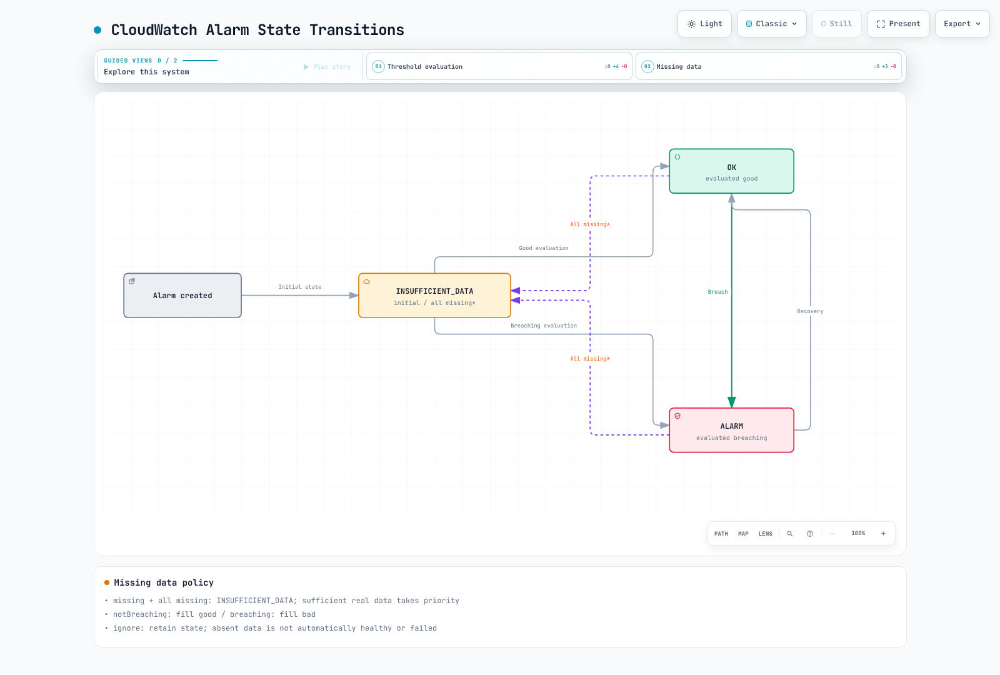
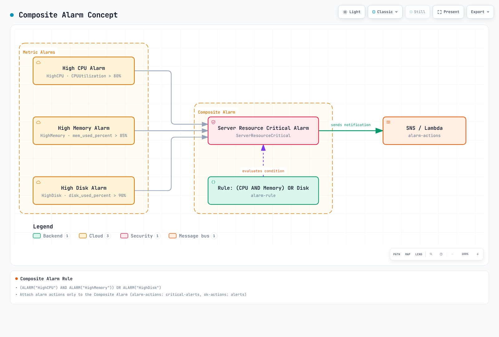
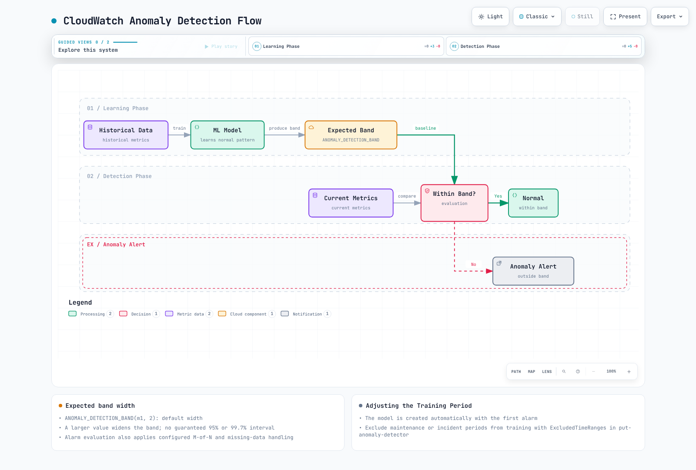
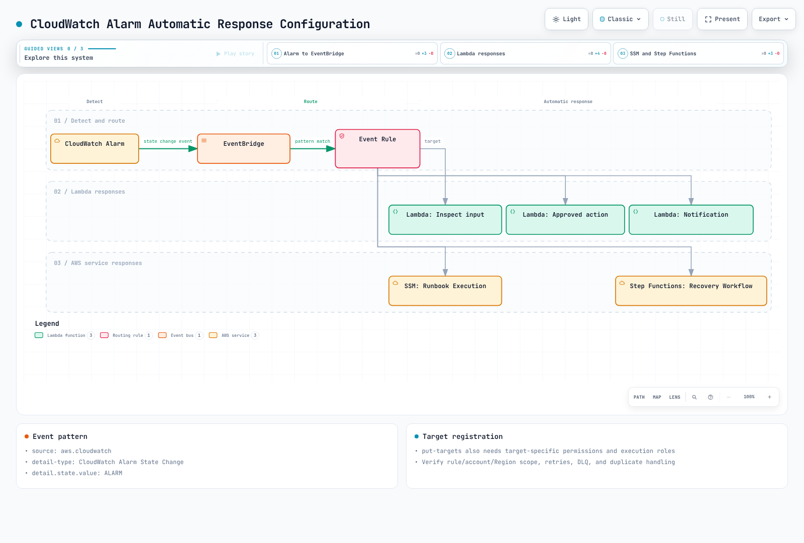
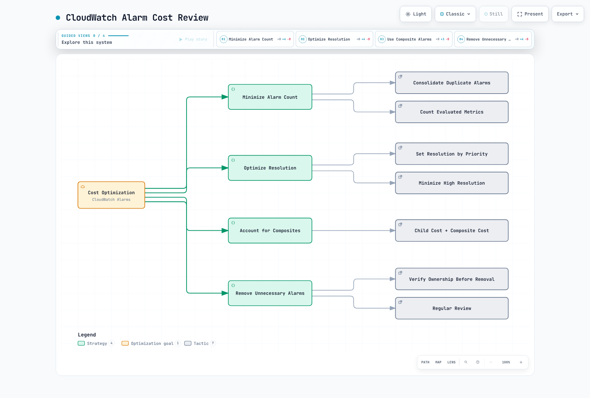

# Alarmas de CloudWatch

> **Última actualización**: 13 de septiembre de 2026

Los ejemplos de CLI y Terraform cubren las **alarmas de métricas clásicas de CloudWatch** y las alarmas compuestas. CloudWatch también admite **alarmas de PromQL** sobre métricas ingeridas mediante su endpoint OTLP y **alarmas de logs** sobre resultados de consultas de Logs Insights. Las alarmas de PromQL usan `PendingPeriod`/`RecoveryPeriod`; la configuración M-de-N y de datos faltantes siguiente no se aplica sin cambios. Los valores de cuenta, Region y recursos son ejemplos. Antes de usar comandos para crear o actualizar alarmas, verifique los destinos reales, los permisos de IAM, los costos y los destinatarios. `PutMetricAlarm`/`PutCompositeAlarm` reemplazan la configuración de una alarma existente; conserve su configuración actual antes de actualizarla.

## Tabla de contenidos

- [Descripción general de las alarmas de CloudWatch](#cloudwatch-alarms-overview)
- [Arquitectura](#architecture)
- [Alarmas de métricas](#metric-alarms)
- [Alarmas compuestas](#composite-alarms)
- [Detección de anomalías](#anomaly-detection)
- [Integración con SNS](#sns-integration)
- [Integración con EventBridge](#eventbridge-integration)
- [Alertas de Container Insights](#container-insights-alerts)
- [Acciones de alarmas de CloudWatch](#cloudwatch-alarm-actions)
- [Optimización de costos](#cost-optimization)
- [Integración de métricas de Prometheus](#prometheus-metrics-integration)
- [Ejemplos de Terraform](#terraform-examples)

---

## Descripción general de las alarmas de CloudWatch {#cloudwatch-alarms-overview}

Amazon CloudWatch Alarms es la función de alertas del servicio de monitorización nativo de AWS. Genera alertas a partir de métricas de CloudWatch y permite respuestas automatizadas mediante integraciones con SNS, Lambda, EC2 Auto Scaling y otros servicios.

### Funciones principales

1. **Alarmas de métricas**: evalúan una métrica, un cálculo de métricas o una consulta de Metrics Insights.
2. **Alarmas compuestas**: combinan varias condiciones de alarma.
3. **Detección de anomalías**: usa machine learning para detectar anomalías.
4. **Acciones de alarma**: ejecutan acciones automáticas cuando se activa una alarma.
5. **Integración con servicios de AWS**: integración nativa con EC2, ECS, EKS, Lambda, etc.

### Alarmas de CloudWatch frente a Prometheus Alertmanager

| Característica | Alarmas de CloudWatch | Prometheus Alertmanager |
|----------------|-------------------|-------------------------|
| **Tipo** | Servicio administrado de AWS | Código abierto |
| **Origen de datos** | Métricas de CloudWatch, métricas OTLP o logs, según el tipo de alarma | Alertas evaluadas por Prometheus u otros clientes |
| **Evaluación** | Cálculos de métricas, PromQL o Logs Insights, según el tipo de alarma | Prometheus evalúa PromQL; Alertmanager agrupa, inhibe y enruta alertas |
| **Costo** | Depende del tipo de alarma, las métricas evaluadas, las consultas y los contribuyentes | Sin tarifa de licencia de software; la infraestructura y las operaciones siguen teniendo costo |
| **Enrutamiento complejo** | Limitado | Compatibilidad avanzada con enrutamiento |
| **Integración con AWS** | Nativa | Requiere configuración adicional |

---

## Arquitectura {#architecture}

### Flujo de operación de las alarmas de CloudWatch


[🔍 Ver diagrama interactivo](https://www.atomai.click/kubernetes-docs/archmaps/en-observability-alerting-02-cloudwatch-alarms-0.html)

### Estados de alarma

Una alarma de métrica clásica comienza en `INSUFFICIENT_DATA` y después se evalúa como `OK` o `ALARM`. Los datos faltantes no siempre producen `INSUFFICIENT_DATA`: `missing` da ese estado cuando faltan todos los datos de evaluación, `notBreaching` completa los puntos faltantes como conformes, `breaching` los completa como infractores e `ignore` conserva el estado. Cuando hay suficientes puntos reales adicionales para evaluar, CloudWatch no usa la política de relleno de datos faltantes. Por tanto, una política general de `notBreaching` puede ocultar un heartbeat o recolector detenido. Una alarma compuesta solo puede estar en `INSUFFICIENT_DATA` inmediatamente después de su creación.



[🔍 Ver diagrama interactivo](https://www.atomai.click/kubernetes-docs/archmaps/en-observability-alerting-02-cloudwatch-alarms-1.html)

---

## Alarmas de métricas {#metric-alarms}

### Creación básica de alarmas (consola/CLI)

#### AWS CLI

```bash
# Create CPU utilization alarm
aws cloudwatch put-metric-alarm \
  --alarm-name "HighCPUUtilization" \
  --alarm-description "CPU usage exceeds 80%" \
  --metric-name CPUUtilization \
  --namespace AWS/EC2 \
  --statistic Average \
  --period 300 \
  --threshold 80 \
  --comparison-operator GreaterThanThreshold \
  --evaluation-periods 2 \
  --dimensions Name=InstanceId,Value=i-1234567890abcdef0 \
  --alarm-actions arn:aws:sns:ap-northeast-2:123456789012:alerts \
  --ok-actions arn:aws:sns:ap-northeast-2:123456789012:alerts \
  --treat-missing-data missing
```

### Componentes de configuración de alarmas

| Parámetro | Descripción | Ejemplo |
|-----------|-------------|---------|
| `metric-name` | Nombre de la métrica que se supervisa | `CPUUtilization` |
| `namespace` | Namespace de la métrica | `AWS/EC2`, `AWS/EKS` |
| `statistic` | Función estadística | `Average`, `Sum`, `Maximum`, `Minimum`, `SampleCount` |
| `period` | Período de evaluación (segundos) | `60`, `300`, `3600` |
| `threshold` | Valor del umbral | `80` |
| `comparison-operator` | Operador de comparación | `GreaterThanThreshold` |
| `evaluation-periods` | Número N de períodos de evaluación | `3` (M es `datapoints-to-alarm`) |
| `datapoints-to-alarm` | Número de puntos de datos necesarios para activar la alarma | `2` de `3` |
| `treat-missing-data` | Tratamiento de datos faltantes | `notBreaching`, `breaching`, `ignore`, `missing` |

Use `--extended-statistic p99`, no `--statistic p99`. Los M puntos infractores dentro de N no tienen que ser consecutivos; si se omite M, su valor es N. `Period` es la duración de agregación, no un intervalo de notificación. Los períodos de alarma de métrica clásica de 10, 20 o 30 segundos son de alta resolución y requieren datos de alta resolución compatibles. 60 segundos es resolución estándar. Period×N tiene un máximo de siete días, o de un día cuando Period es inferior a una hora. Normalmente, las acciones se ejecutan al cambiar el estado, con la excepción de las acciones de Auto Scaling.

### Operadores de comparación

```yaml
# Available comparison operators
comparison-operators:
  - GreaterThanThreshold           # Greater than
  - GreaterThanOrEqualToThreshold  # Greater than or equal
  - LessThanThreshold              # Less than
  - LessThanOrEqualToThreshold     # Less than or equal
  - LessThanLowerOrGreaterThanUpperThreshold  # Outside range
  - LessThanLowerThreshold         # Below lower bound
  - GreaterThanUpperThreshold      # Above upper bound
```

### Alarmas que usan Metrics Math

```bash
# Error rate calculation alarm (error count / total requests)
aws cloudwatch put-metric-alarm \
  --alarm-name "HighErrorRate" \
  --alarm-description "Error rate exceeds 5%" \
  --metrics '[
    {
      "Id": "errors",
      "MetricStat": {
        "Metric": {
          "Namespace": "AWS/ApplicationELB",
          "MetricName": "HTTPCode_Target_5XX_Count",
          "Dimensions": [
            {"Name": "LoadBalancer", "Value": "app/my-alb/1234567890"}
          ]
        },
        "Period": 300,
        "Stat": "Sum"
      },
      "ReturnData": false
    },
    {
      "Id": "requests",
      "MetricStat": {
        "Metric": {
          "Namespace": "AWS/ApplicationELB",
          "MetricName": "RequestCount",
          "Dimensions": [
            {"Name": "LoadBalancer", "Value": "app/my-alb/1234567890"}
          ]
        },
        "Period": 300,
        "Stat": "Sum"
      },
      "ReturnData": false
    },
    {
      "Id": "error_rate",
      "Expression": "IF(requests > 0, 100 * FILL(errors, 0) / requests, 0)",
      "ReturnData": true
    }
  ]' \
  --threshold 5 \
  --comparison-operator GreaterThanThreshold \
  --evaluation-periods 2 \
  --alarm-actions arn:aws:sns:ap-northeast-2:123456789012:alerts
```

Esta expresión mide las respuestas 5xx del destino entre las solicitudes que el ALB reenvía. No incluye todos los fallos visibles para los usuarios, como los errores generados por el propio ALB o los fallos anteriores a la selección de un destino. Si hay solicitudes, los puntos 5xx faltantes se completan con cero; aquí, cero solicitudes se define como 0 %. Supervise por separado la ausencia de datos de solicitudes/recopilación. Una alarma clásica de cálculo de métricas debe devolver una sola serie temporal final. `SEARCH` sirve para gráficos y no se puede usar como expresión de alarma. `RATE` puede comportarse de otra manera con métricas dispersas porque cambia el rango de evaluación.

### Funciones de Metrics Math

```yaml
# Commonly used functions
math-functions:
  # Arithmetic operations
  - "m1 + m2"           # Sum
  - "m1 - m2"           # Difference
  - "m1 * m2"           # Product
  - "m1 / m2"           # Division
  - "(m1 / m2) * 100"   # Percentage

  # Statistical functions
  - "AVG(METRICS())"    # Average
  - "SUM(METRICS())"    # Sum
  - "MIN(METRICS())"    # Minimum
  - "MAX(METRICS())"    # Maximum

  # Conditional functions
  - "IF(m1 > 100, m1, 0)"  # Conditional

  # Time-related
  - "RATE(m1)"          # Rate of change
  - "DIFF(m1)"          # Difference
  - "PERIOD(m1)"        # Period

  # Search
  - "SEARCH('{AWS/EC2,InstanceId} MetricName=\"CPUUtilization\"', 'Average', 300)"
```

---

## Alarmas compuestas {#composite-alarms}

### Concepto de alarma compuesta

Las alarmas compuestas combinan varias alarmas de métricas para definir condiciones complejas.



[🔍 Ver diagrama interactivo](https://www.atomai.click/kubernetes-docs/archmaps/en-observability-alerting-02-cloudwatch-alarms-2.html)

Las métricas de memoria y disco de `CWAgent` requieren que el agente esté instalado y que publique el conjunto de dimensiones correspondiente. Los ejemplos que solo incluyen `InstanceId` funcionan únicamente si el agente publica esa agregación. `disk_used_percent` suele incluir además `path`, `device` y `fstype`; use el **conjunto completo de dimensiones** que devuelve `list-metrics`. Las alarmas secundarias de ejemplo no tienen acciones; solo la alarma compuesta envía notificaciones.

### Creación de alarmas compuestas

```bash
# Create individual alarms
aws cloudwatch put-metric-alarm \
  --alarm-name "HighCPU" \
  --metric-name CPUUtilization \
  --namespace AWS/EC2 \
  --statistic Average \
  --period 300 \
  --threshold 80 \
  --comparison-operator GreaterThanThreshold \
  --evaluation-periods 2 \
  --dimensions Name=InstanceId,Value=i-1234567890abcdef0

aws cloudwatch put-metric-alarm \
  --alarm-name "HighMemory" \
  --metric-name mem_used_percent \
  --namespace CWAgent \
  --statistic Average \
  --period 300 \
  --threshold 85 \
  --comparison-operator GreaterThanThreshold \
  --evaluation-periods 2 \
  --dimensions Name=InstanceId,Value=i-1234567890abcdef0

aws cloudwatch put-metric-alarm \
  --alarm-name "HighDisk" \
  --metric-name disk_used_percent \
  --namespace CWAgent \
  --statistic Average \
  --period 300 \
  --threshold 90 \
  --comparison-operator GreaterThanThreshold \
  --evaluation-periods 2 \
  --dimensions Name=InstanceId,Value=i-1234567890abcdef0

# Create Composite Alarm
aws cloudwatch put-composite-alarm \
  --alarm-name "ServerResourceCritical" \
  --alarm-description "Server resources are critical" \
  --alarm-rule '(ALARM("HighCPU") AND ALARM("HighMemory")) OR ALARM("HighDisk")' \
  --alarm-actions arn:aws:sns:ap-northeast-2:123456789012:critical-alerts \
  --ok-actions arn:aws:sns:ap-northeast-2:123456789012:alerts
```

### Sintaxis de reglas de alarma

```yaml
# Composite Alarm rule syntax
rule-syntax:
  # Basic operators
  - "ALARM(alarm-name)"      # Check ALARM state
  - "OK(alarm-name)"         # Check OK state
  - "INSUFFICIENT_DATA(alarm-name)"  # Check INSUFFICIENT_DATA state

  # Logical operators
  - "AND"                    # All conditions met
  - "OR"                     # One or more conditions met
  - "NOT"                    # Negation
  - "()"                     # Grouping

examples:
  # All conditions met
  - "ALARM(A1) AND ALARM(A2) AND ALARM(A3)"

  # One or more met
  - "ALARM(A1) OR ALARM(A2)"

  # Complex condition
  - "(ALARM(A1) AND ALARM(A2)) OR ALARM(A3)"

  # Negation
  - "ALARM(A1) AND NOT ALARM(A2)"

  # M of N pattern (2 or more of 3)
  - "(ALARM(A1) AND ALARM(A2)) OR (ALARM(A1) AND ALARM(A3)) OR (ALARM(A2) AND ALARM(A3))"
```

### Patrón de supresión de alertas

`set-alarm-state` es una anulación temporal para pruebas; la alarma de métrica vuelve pronto al estado que resulte de su evaluación y no establece una ventana de mantenimiento. El ejemplo siguiente presupone que un controlador externo publica continuamente el estado de una alarma `MaintenanceMode`. `ActionsSuppressor` suprime las acciones de la alarma compuesta sin cambiar su estado evaluado. Incluya los períodos de espera/extensión al probar la ventana de mantenimiento.

```bash
aws cloudwatch put-composite-alarm  \
  --alarm-name ProductionAlerts  \
  --alarm-rule 'ALARM("HighCPU")'  \
  --actions-suppressor MaintenanceMode  \
  --actions-suppressor-wait-period 60  \
  --actions-suppressor-extension-period 60  \
  --alarm-actions arn:aws:sns:ap-northeast-2:123456789012:alerts
```

---

## Detección de anomalías {#anomaly-detection}

### Descripción general de la detección de anomalías

CloudWatch Anomaly Detection usa machine learning para aprender patrones normales de las métricas y detectar valores atípicos.



[🔍 Ver diagrama interactivo](https://www.atomai.click/kubernetes-docs/archmaps/en-observability-alerting-02-cloudwatch-alarms-3.html)

### Creación de alarmas de detección de anomalías

```bash
# Anomaly Detection model creation (automatic)
# Model is automatically created when first alarm is created

aws cloudwatch put-metric-alarm \
  --alarm-name "CPUAnomalyDetection" \
  --alarm-description "CPU usage is anomalous" \
  --metrics '[
    {
      "Id": "m1",
      "MetricStat": {
        "Metric": {
          "Namespace": "AWS/EC2",
          "MetricName": "CPUUtilization",
          "Dimensions": [
            {"Name": "InstanceId", "Value": "i-1234567890abcdef0"}
          ]
        },
        "Period": 300,
        "Stat": "Average"
      },
      "ReturnData": true
    },
    {
      "Id": "ad1",
      "Expression": "ANOMALY_DETECTION_BAND(m1, 2)",
      "ReturnData": true
    }
  ]' \
  --threshold-metric-id ad1 \
  --comparison-operator LessThanLowerOrGreaterThanUpperThreshold \
  --evaluation-periods 2 \
  --alarm-actions arn:aws:sns:ap-northeast-2:123456789012:alerts
```

### Configuración de detección de anomalías

```yaml
# ANOMALY_DETECTION_BAND function
# ANOMALY_DETECTION_BAND(metric, stddev)
# - metric: Metric to analyze
# - stddev: Standard deviation multiplier (default 2)

examples:
  # Width parameter 2: not a guaranteed 95% confidence interval
  - "ANOMALY_DETECTION_BAND(m1, 2)"

  # Width parameter 3: a wider expected band
  - "ANOMALY_DETECTION_BAND(m1, 3)"

  # More sensitive detection (1 standard deviation)
  - "ANOMALY_DETECTION_BAND(m1, 1)"
```

El parámetro controla la amplitud de la banda esperada del modelo; no es un intervalo gaussiano garantizado del 95 % ni del 99,7 %. El modelo usa hasta dos semanas de historial y puede comenzar con menos. Las fechas excluidas siguientes ilustran el formato; sustitúyalas por intervalos relevantes dentro del historial de entrenamiento del modelo.

### Ajuste del período de entrenamiento del modelo

```bash
# Add exclusion periods to existing model (maintenance, incident periods, etc.)
aws cloudwatch put-anomaly-detector \
  --namespace AWS/EC2 \
  --metric-name CPUUtilization \
  --stat Average \
  --dimensions Name=InstanceId,Value=i-1234567890abcdef0 \
  --configuration '{
    "ExcludedTimeRanges": [
      {
        "StartTime": "2025-02-15T00:00:00Z",
        "EndTime": "2025-02-15T06:00:00Z"
      }
    ]
  }'
```

---

## Integración con SNS {#sns-integration}

### Creación de un tema de SNS

```bash
# Create SNS Topic
aws sns create-topic --name eks-alerts

# Add Email subscription
aws sns subscribe \
  --topic-arn arn:aws:sns:ap-northeast-2:123456789012:eks-alerts \
  --protocol email \
  --notification-endpoint team@example.com

# Add SMS subscription
aws sns subscribe \
  --topic-arn arn:aws:sns:ap-northeast-2:123456789012:eks-alerts \
  --protocol sms \
  --notification-endpoint "$VERIFIED_SMS_NUMBER"

# Add Lambda subscription
aws sns subscribe \
  --topic-arn arn:aws:sns:ap-northeast-2:123456789012:eks-alerts \
  --protocol lambda \
  --notification-endpoint arn:aws:lambda:ap-northeast-2:123456789012:function:alert-handler
```

### Filtrado de mensajes de SNS

Las notificaciones predeterminadas de CloudWatch SNS no incluyen automáticamente los atributos de mensaje de ejemplo `severity` o `environment`. Para filtrar el `NewStateValue` del cuerpo del mensaje, establezca `FilterPolicyScope=MessageBody`. Este filtro excluye los mensajes de recuperación `OK`. El correo electrónico requiere confirmar la suscripción; para SMS hay que comprobar los números verificados, los requisitos de sandbox/Region y el costo. La suscripción de Lambda también necesita una política de recursos de Lambda que permita a `sns.amazonaws.com` actuar desde el ARN del tema específico.

```bash
aws sns set-subscription-attributes  \
  --subscription-arn "$SUBSCRIPTION_ARN"  \
  --attribute-name FilterPolicyScope  \
  --attribute-value MessageBody
aws sns set-subscription-attributes  \
  --subscription-arn "$SUBSCRIPTION_ARN"  \
  --attribute-name FilterPolicy  \
  --attribute-value '{"NewStateValue": ["ALARM"]}'
```

### Integración de SNS con Slack (Lambda)

Para las notificaciones estándar de CloudWatch, conecte el tema SNS y un canal Slack aprobado mediante **Amazon Q Developer in chat applications** (antes AWS Chatbot). Limite el rol IAM y la política de barreras de protección del canal a su finalidad de notificación.

Si necesita una Lambda personalizada, obtenga el webhook de un almacén de secretos, valide su destino, establezca tiempos de espera de conexión/lectura y compruebe el estado de la respuesta. No informe HTTP 429/5xx como éxito; configure reintentos, una ruta de dead-letter y el tratamiento de duplicados. SNS usa `Records[].Sns.Message`, no el sobre de EventBridge que aparece más adelante. La validación de este capítulo no envía mensajes reales a Slack.

---

## Integración con EventBridge {#eventbridge-integration}

### Creación de una regla de EventBridge

```bash
# Route CloudWatch Alarm state changes to EventBridge
aws events put-rule \
  --name "CloudWatchAlarmStateChange" \
  --event-pattern '{
    "source": ["aws.cloudwatch"],
    "detail-type": ["CloudWatch Alarm State Change"],
    "detail": {
      "state": {
        "value": ["ALARM"]
      }
    }
  }'

# Add Lambda target
aws events put-targets \
  --rule "CloudWatchAlarmStateChange" \
  --targets '[
    {
      "Id": "AlertHandler",
      "Arn": "arn:aws:lambda:ap-northeast-2:123456789012:function:alert-handler"
    }
  ]'
```

### Configuración de respuesta automática



[🔍 Ver diagrama interactivo](https://www.atomai.click/kubernetes-docs/archmaps/en-observability-alerting-02-cloudwatch-alarms-4.html)

### Patrón de eventos de EventBridge

```json
{
  "source": ["aws.cloudwatch"],
  "detail-type": ["CloudWatch Alarm State Change"],
  "account": ["123456789012"],
  "region": ["ap-northeast-2"],
  "resources": ["arn:aws:cloudwatch:ap-northeast-2:123456789012:alarm:EKS-Node-HighCPU"],
  "detail": {
    "alarmName": ["EKS-Node-HighCPU"],
    "state": {"value": ["ALARM"]}
  }
}
```

Si limita `previousState` a `OK`, se omite la transición `INSUFFICIENT_DATA → ALARM`. Hacer coincidir el ARN exacto de la alarma evita suposiciones sobre las formas de configuración de cálculos de métricas o alarmas compuestas. `put-targets` no concede permiso para invocar Lambda: agregue una política de recursos de Lambda para `events.amazonaws.com`, limitada al `SourceArn` de la regla, y configure los reintentos y el comportamiento dead-letter.

### Ejemplo de Lambda de recuperación automática

Un uso alto de CPU por sí solo no demuestra que reiniciar sea apropiado. Este ejemplo implementa la **etapa de inspección de entrada** de una recuperación: comprueba el estado, la cuenta, la Region y el ARN de la alarma, y luego devuelve información de la métrica. `dimensions` en EventBridge es un objeto, a diferencia de la lista de dimensiones del mensaje de alarma de SNS. También maneja una consulta que empieza con una expresión y una alarma compuesta que no contiene métricas.

Incluya el [normalizador de eventos probado y sus pruebas](https://github.com/Atom-oh/kubernetes-docs/tree/main/examples/observability/cloudwatch-alarms) en el paquete junto con el controlador de Lambda:

```python
from event_normalizer import normalize_alarm_event

def lambda_handler(event, context):
    return normalize_alarm_event(
        event,
        expected_account="123456789012",
        expected_region="ap-northeast-2",
    )
```

La función no realiza mutaciones en AWS. Las comprobaciones del payload no autentican al remitente. Toda remediación que se agregue necesita una lista explícita de destinos permitidos, comprobaciones del estado actual de la alarma/recurso, idempotencia, período de enfriamiento, mínimo privilegio y reversión.

---

## Alertas de Container Insights {#container-insights-alerts}

### Métricas de EKS Container Insights

Estos ejemplos usan la ruta clásica de métricas `ContainerInsights` de CloudWatch. No mezcle sus nombres, dimensiones y facturación con las rutas de observabilidad mejorada ni con las de OTel. Siga la [guía actual del complemento de EKS](https://docs.aws.amazon.com/AmazonCloudWatch/latest/monitoring/install-CloudWatch-Observability-EKS-addon.html), que instala CloudWatch Agent y Fluent Bit, y elija una versión del complemento compatible con la versión de Kubernetes y la Region del clúster. Si usa EKS Pod Identity, configure primero IAM y la asociación de identidad del agente.

`update-addon` actualiza una instalación existente; para la primera instalación se usa `create-addon`. Conserve la configuración y las asociaciones de Pod Identity existentes. Consulte las versiones disponibles y seleccione una en el plan de despliegue en lugar de fijar la antigua `v1.2.0` o aplicar un manifiesto `latest` de Fluentd sin revisar.

```bash
aws eks describe-addon-versions  \
  --addon-name amazon-cloudwatch-observability  \
  --kubernetes-version "$KUBERNETES_VERSION"  \
  --region "$AWS_REGION"
aws cloudwatch list-metrics  \
  --namespace ContainerInsights  \
  --metric-name pod_number_of_container_restarts  \
  --dimensions Name=ClusterName,Value=my-cluster  \
  --region "$AWS_REGION"
```

### Ejemplos de alertas de Container Insights

```bash
# Cluster aggregate CPU utilization alarm
aws cloudwatch put-metric-alarm \
  --alarm-name "EKS-Node-HighCPU" \
  --metric-name node_cpu_utilization \
  --namespace ContainerInsights \
  --dimensions Name=ClusterName,Value=my-cluster \
  --statistic Average \
  --period 300 \
  --threshold 80 \
  --comparison-operator GreaterThanThreshold \
  --evaluation-periods 2 \
  --alarm-actions arn:aws:sns:ap-northeast-2:123456789012:eks-alerts

# Pod memory utilization alarm
aws cloudwatch put-metric-alarm \
  --alarm-name "EKS-Pod-HighMemory" \
  --metric-name pod_memory_utilization_over_pod_limit \
  --namespace ContainerInsights \
  --dimensions Name=ClusterName,Value=my-cluster Name=Namespace,Value=production \
  --statistic Average \
  --period 300 \
  --threshold 85 \
  --comparison-operator GreaterThanThreshold \
  --evaluation-periods 2 \
  --alarm-actions arn:aws:sns:ap-northeast-2:123456789012:eks-alerts

# One Pod's cumulative restart count (not a five-minute increase)
aws cloudwatch put-metric-alarm \
  --alarm-name "EKS-Pod-Restarts" \
  --metric-name pod_number_of_container_restarts \
  --namespace ContainerInsights \
  --dimensions Name=ClusterName,Value=my-cluster Name=Namespace,Value=production Name=PodName,Value=my-pod \
  --statistic Maximum \
  --period 300 \
  --threshold 3 \
  --comparison-operator GreaterThanThreshold \
  --evaluation-periods 1 \
  --alarm-actions arn:aws:sns:ap-northeast-2:123456789012:eks-alerts
```

El ejemplo de CPU agrega datos a nivel de clúster. Para un nodo individual, use el conjunto completo `ClusterName`, `NodeName` e `InstanceId`. `pod_memory_utilization` divide por la **memoria del nodo**, mientras que `pod_memory_utilization_over_pod_limit` divide por el límite del Pod. Esta última métrica puede no estar presente si algún contenedor carece de límite de memoria. `pod_number_of_container_restarts` es acumulativa y usa `ClusterName`, `Namespace` y `PodName`. `Maximum > 3` significa que el recuento acumulado durante la vida útil superó tres; sumar muestras no cuenta los reinicios recientes. Tenga en cuenta el reemplazo de Pods, los restablecimientos y la reutilización de nombres. Para incrementos recientes, use `increase()` de PromQL, que tiene en cuenta los restablecimientos, o defina una métrica delta por separado.

### Métricas clave de Container Insights

| Métrica | Descripción | Dimensiones |
|--------|-------------|------------|
| `cluster_node_count` | Cantidad de nodos del clúster | ClusterName |
| `cluster_failed_node_count` | Cantidad de nodos con errores | ClusterName |
| `node_cpu_utilization` | Utilización de CPU del nodo | ClusterName, NodeName, InstanceId; o ClusterName |
| `node_memory_utilization` | Utilización de memoria del nodo | ClusterName, NodeName, InstanceId; o ClusterName |
| `node_filesystem_utilization` | Utilización del disco del nodo | ClusterName, NodeName, InstanceId; o ClusterName |
| `pod_cpu_utilization` | Utilización de CPU del Pod | ClusterName, Namespace, PodName |
| `pod_memory_utilization` | Utilización de memoria del Pod | ClusterName, Namespace, PodName |
| `pod_number_of_container_restarts` | Recuento de reinicios de contenedores | ClusterName, Namespace, PodName |
| `service_number_of_running_pods` | Pods en ejecución por Service | ClusterName, Namespace, Service |

---

## Acciones de alarmas de CloudWatch {#cloudwatch-alarm-actions}

### Acciones de EC2

Las acciones directas de EC2 son detener, terminar, reiniciar y recuperar; **no se admite iniciar**. Estos ejemplos modifican instancias: úselos solo con un destino aprobado explícitamente y después de comprobar las instancias compatibles, los permisos y el impacto de la detención/recuperación. Use `missing` para los datos faltantes y asocie acciones que mutan recursos solo al estado `ALARM`. Las alarmas de cálculos de métricas y las alarmas compuestas no pueden ejecutar directamente acciones de EC2.

```bash
# EC2 instance recovery (on system status check failure)
aws cloudwatch put-metric-alarm \
  --alarm-name "EC2-SystemCheckFailed" \
  --metric-name StatusCheckFailed_System \
  --namespace AWS/EC2 \
  --dimensions Name=InstanceId,Value=i-1234567890abcdef0 \
  --statistic Maximum \
  --period 60 \
  --threshold 1 \
  --comparison-operator GreaterThanOrEqualToThreshold \
  --evaluation-periods 2 \
  --treat-missing-data missing \
  --alarm-actions arn:aws:automate:ap-northeast-2:ec2:recover

# EC2 instance stop
aws cloudwatch put-metric-alarm \
  --alarm-name "EC2-LowUtilization-Stop" \
  --metric-name CPUUtilization \
  --namespace AWS/EC2 \
  --dimensions Name=InstanceId,Value=i-1234567890abcdef0 \
  --statistic Average \
  --period 3600 \
  --threshold 5 \
  --comparison-operator LessThanThreshold \
  --evaluation-periods 24 \
  --treat-missing-data missing \
  --alarm-actions arn:aws:automate:ap-northeast-2:ec2:stop
```

### Acciones de Auto Scaling

```bash
# Link Auto Scaling policy
aws cloudwatch put-metric-alarm \
  --alarm-name "ASG-ScaleOut" \
  --metric-name CPUUtilization \
  --namespace AWS/EC2 \
  --dimensions Name=AutoScalingGroupName,Value=my-asg \
  --statistic Average \
  --period 300 \
  --threshold 70 \
  --comparison-operator GreaterThanThreshold \
  --evaluation-periods 2 \
  --alarm-actions arn:aws:autoscaling:ap-northeast-2:123456789012:scalingPolicy:xxx:autoScalingGroupName/my-asg:policyName/scale-out

aws cloudwatch put-metric-alarm \
  --alarm-name "ASG-ScaleIn" \
  --metric-name CPUUtilization \
  --namespace AWS/EC2 \
  --dimensions Name=AutoScalingGroupName,Value=my-asg \
  --statistic Average \
  --period 300 \
  --threshold 30 \
  --comparison-operator LessThanThreshold \
  --evaluation-periods 3 \
  --alarm-actions arn:aws:autoscaling:ap-northeast-2:123456789012:scalingPolicy:xxx:autoScalingGroupName/my-asg:policyName/scale-in
```

### Acciones de Systems Manager

Un ARN `automation-definition/...` no es un destino directo de `AlarmActions` admitido para ejecutar un runbook arbitrario de SSM Automation. La integración directa con SSM usa las acciones enumeradas por la API, como OpsItems. Enrute Automation mediante un **destino SSM Automation de EventBridge** o un flujo de trabajo explícito de Lambda/Step Functions. Limite por separado el rol de ejecución del destino, `ssm:StartAutomationExecution`, los parámetros del runbook y el rol de Automation. Un umbral de disco por sí solo no debe autorizar la eliminación arbitraria de archivos.

---

## Optimización de costos {#cost-optimization}

### Factores de costo

Las cifras siguientes son **ejemplos de US East** de la página oficial de precios consultada el 2026-09-13; no son una cotización para Seúl. Consulte los precios actuales de la Region de destino. Las alarmas de métricas se cobran por las métricas evaluadas, mientras que las compuestas se cobran por alarma. La detección de anomalías incluye la métrica real y dos métricas de banda. Al agregar una alarma compuesta se mantienen los cargos de las alarmas secundarias: reduce el ruido de las notificaciones, pero no disminuye automáticamente el costo.

| Elemento | Costo |
|------|------|
| Alarma de resolución estándar (60 s) | $0.10/alarma/mes |
| Alarma de alta resolución (10 s) | $0.30/alarma/mes |
| Alarma de anomalía estándar: una métrica real más dos bandas | Ejemplo: $0.30/alarma/mes |
| Alarma compuesta | $0.50/alarma/mes |

### Estrategias de optimización de costos



[🔍 Ver diagrama interactivo](https://www.atomai.click/kubernetes-docs/archmaps/en-observability-alerting-02-cloudwatch-alarms-5.html)

### Configuración recomendada

```yaml
# Cost-effective alarm settings

# Critical: Standard Resolution (60s; only 10/20/30s is high resolution)
critical-alerts:
  period: 60  # 1 minute
  evaluation-periods: 2

# Warning: Standard Resolution
warning-alerts:
  period: 300  # 5 minutes
  evaluation-periods: 2

# Info: Standard Resolution (relaxed detection)
info-alerts:
  period: 900  # 15 minutes
  evaluation-periods: 3
```

### Script de limpieza de alarmas

Este comando solo enumera candidatos para inspeccionarlos. `INSUFFICIENT_DATA` no demuestra que una alarma no se use, y una fecha histórica fija no puede significar «hace 90 días». Antes de una eliminación autorizada por separado, revise el tiempo transcurrido desde `StateTransitionedTimestamp`, la recopilación real, la propiedad y las dependencias de alarmas compuestas. `StateUpdatedTimestamp` también puede cambiar cuando cambia el motivo del estado; no equivale al tiempo que lleva en el estado actual.

```bash
aws cloudwatch describe-alarms  \
  --alarm-types MetricAlarm  \
  --state-value INSUFFICIENT_DATA  \
  --query 'MetricAlarms[].{Name:AlarmName,StateSince:StateTransitionedTimestamp,Updated:StateUpdatedTimestamp}'  \
  --output json
```

---

## Integración de métricas de Prometheus {#prometheus-metrics-integration}

### Integración con Amazon Managed Prometheus (AMP)

Las métricas almacenadas en AMP no se copian automáticamente a las métricas clásicas de CloudWatch. Elija la ruta que corresponda al requisito.

- **Alertas dentro de AMP**: configure reglas de alerta de Prometheus en el workspace → Alertmanager administrado → un receptor compatible (SNS o PagerDuty).
- **Alarmas PromQL de CloudWatch**: evalúan métricas ingeridas por el endpoint OTLP de CloudWatch. No consultan directamente un workspace de AMP.
- **Republicación de métricas clásicas de CloudWatch**: defina solo los agregados necesarios en un exportador independiente. Firme con un único conjunto coherente y congelado de credenciales temporales, y valide tiempos de espera, estado HTTP, tipo de resultado, valores finitos, marcas de tiempo y dimensiones. No convierta resultados vacíos, NaN o errores en cero ni en éxito. Esto añade costos de consultas, métricas personalizadas y ejecución, además de retraso.

El promedio anterior del modo de CPU no representaba la utilización total de CPU; una proporción entre promedios de memoria de Pods no relacionados o sin límite no representaba la utilización del límite de cada Pod. Seleccione PromQL que conserve las etiquetas necesarias y la semántica de restablecimiento; después, pruebe la regla y valide los datos recopilados reales.

---

## Ejemplos de Terraform {#terraform-examples}

Los bloques siguientes forman un módulo de ejemplo. Configure los valores reales de los recursos y la política del tema SNS, y revise `terraform plan` antes del despliegue. La validación de ejemplo cubre el esquema/sintaxis del proveedor, no el despliegue en AWS ni la entrega real de notificaciones.

### Alarma básica

```hcl
# SNS Topic
resource "aws_sns_topic" "alerts" {
  name = "eks-alerts"
}

resource "aws_sns_topic_subscription" "email" {
  topic_arn = aws_sns_topic.alerts.arn
  protocol  = "email"
  endpoint  = "team@example.com"
}

# EC2 CPU alarm
resource "aws_cloudwatch_metric_alarm" "ec2_cpu" {
  alarm_name          = "ec2-high-cpu"
  comparison_operator = "GreaterThanThreshold"
  evaluation_periods  = 2
  metric_name         = "CPUUtilization"
  namespace           = "AWS/EC2"
  period              = 300
  statistic           = "Average"
  threshold           = 80
  alarm_description   = "EC2 CPU usage exceeds 80%"

  dimensions = {
    InstanceId = "i-1234567890abcdef0"
  }

  alarm_actions = [aws_sns_topic.alerts.arn]
  ok_actions    = [aws_sns_topic.alerts.arn]

  treat_missing_data = "missing"
}
```

### Alarma de Metrics Math

```hcl
resource "aws_cloudwatch_metric_alarm" "alb_error_rate" {
  alarm_name          = "alb-high-error-rate"
  comparison_operator = "GreaterThanThreshold"
  evaluation_periods  = 2
  threshold           = 5
  alarm_description   = "ALB error rate exceeds 5%"

  metric_query {
    id          = "errors"
    return_data = false

    metric {
      metric_name = "HTTPCode_Target_5XX_Count"
      namespace   = "AWS/ApplicationELB"
      period      = 300
      stat        = "Sum"

      dimensions = {
        LoadBalancer = "app/my-alb/1234567890"
      }
    }
  }

  metric_query {
    id          = "requests"
    return_data = false

    metric {
      metric_name = "RequestCount"
      namespace   = "AWS/ApplicationELB"
      period      = 300
      stat        = "Sum"

      dimensions = {
        LoadBalancer = "app/my-alb/1234567890"
      }
    }
  }

  metric_query {
    id          = "error_rate"
    expression  = "IF(requests > 0, 100 * FILL(errors, 0) / requests, 0)"
    label       = "Error Rate"
    return_data = true
  }

  alarm_actions = [aws_sns_topic.alerts.arn]
}
```

### Alarma compuesta

```hcl
# Individual alarms
resource "aws_cloudwatch_metric_alarm" "cpu_alarm" {
  alarm_name          = "high-cpu"
  comparison_operator = "GreaterThanThreshold"
  evaluation_periods  = 2
  metric_name         = "CPUUtilization"
  namespace           = "AWS/EC2"
  period              = 300
  statistic           = "Average"
  threshold           = 80

  dimensions = {
    InstanceId = "i-1234567890abcdef0"
  }
}

resource "aws_cloudwatch_metric_alarm" "memory_alarm" {
  alarm_name          = "high-memory"
  comparison_operator = "GreaterThanThreshold"
  evaluation_periods  = 2
  metric_name         = "mem_used_percent"
  namespace           = "CWAgent"
  period              = 300
  statistic           = "Average"
  threshold           = 85

  dimensions = {
    InstanceId = "i-1234567890abcdef0"
  }
}

# Composite Alarm
resource "aws_cloudwatch_composite_alarm" "server_critical" {
  alarm_name        = "server-critical"
  alarm_description = "Server CPU and Memory are both high"

  alarm_rule = "ALARM(${aws_cloudwatch_metric_alarm.cpu_alarm.alarm_name}) AND ALARM(${aws_cloudwatch_metric_alarm.memory_alarm.alarm_name})"

  alarm_actions = [aws_sns_topic.alerts.arn]
  ok_actions    = [aws_sns_topic.alerts.arn]
}
```

### Alarma de EKS Container Insights

```hcl
resource "aws_cloudwatch_metric_alarm" "eks_node_cpu" {
  alarm_name          = "eks-node-high-cpu"
  comparison_operator = "GreaterThanThreshold"
  evaluation_periods  = 2
  metric_name         = "node_cpu_utilization"
  namespace           = "ContainerInsights"
  period              = 300
  statistic           = "Average"
  threshold           = 80
  alarm_description   = "EKS Node CPU usage exceeds 80%"

  dimensions = {
    ClusterName = "my-eks-cluster"
  }

  alarm_actions = [aws_sns_topic.alerts.arn]
}

resource "aws_cloudwatch_metric_alarm" "eks_pod_restarts" {
  alarm_name          = "eks-pod-restarts"
  comparison_operator = "GreaterThanThreshold"
  evaluation_periods  = 1
  metric_name         = "pod_number_of_container_restarts"
  namespace           = "ContainerInsights"
  period              = 300
  statistic           = "Maximum"
  threshold           = 3
  alarm_description   = "Observed cumulative restart count exceeds 3; not a 5-minute increase"

  dimensions = {
    ClusterName = "my-eks-cluster"
    Namespace   = "production"
    PodName     = "my-pod"
  }

  alarm_actions = [aws_sns_topic.alerts.arn]
}
```

### Alarma de detección de anomalías

```hcl
resource "aws_cloudwatch_metric_alarm" "cpu_anomaly" {
  alarm_name          = "cpu-anomaly-detection"
  comparison_operator = "LessThanLowerOrGreaterThanUpperThreshold"
  evaluation_periods  = 2
  threshold_metric_id = "ad1"
  alarm_description   = "CPU usage is anomalous"

  metric_query {
    id          = "m1"
    return_data = true

    metric {
      metric_name = "CPUUtilization"
      namespace   = "AWS/EC2"
      period      = 300
      stat        = "Average"

      dimensions = {
        InstanceId = "i-1234567890abcdef0"
      }
    }
  }

  metric_query {
    id          = "ad1"
    expression  = "ANOMALY_DETECTION_BAND(m1, 2)"
    label       = "CPUUtilization (Expected)"
    return_data = true
  }

  alarm_actions = [aws_sns_topic.alerts.arn]
}
```

---

## Referencias

- [Tipos de alarmas de CloudWatch](https://docs.aws.amazon.com/AmazonCloudWatch/latest/monitoring/CloudWatch_Alarms.html)
- [API PutMetricAlarm](https://docs.aws.amazon.com/AmazonCloudWatch/latest/APIReference/API_PutMetricAlarm.html)
- [Evaluación de datos faltantes](https://docs.aws.amazon.com/AmazonCloudWatch/latest/monitoring/alarms-and-missing-data.html)
- [Alarmas compuestas y supresión de acciones](https://docs.aws.amazon.com/AmazonCloudWatch/latest/APIReference/API_PutCompositeAlarm.html)
- [Cálculos de métricas](https://docs.aws.amazon.com/AmazonCloudWatch/latest/monitoring/using-metric-math.html)
- [Detección de anomalías](https://docs.aws.amazon.com/AmazonCloudWatch/latest/monitoring/CloudWatch_Anomaly_Detection.html)
- [Esquemas de mensajes de alarma de SNS](https://docs.aws.amazon.com/AmazonCloudWatch/latest/monitoring/Notify_Users_Alarm_Changes.html)
- [Ámbito de la política de filtrado de SNS](https://docs.aws.amazon.com/sns/latest/dg/sns-message-filtering-scope.html)
- [Eventos de alarma de EventBridge](https://docs.aws.amazon.com/AmazonCloudWatch/latest/monitoring/cloudwatch-and-eventbridge.html)
- [Permisos de destino de EventBridge](https://docs.aws.amazon.com/eventbridge/latest/userguide/eb-use-resource-based.html)
- [Dimensiones de métricas de Container Insights](https://docs.aws.amazon.com/AmazonCloudWatch/latest/monitoring/Container-Insights-metrics-EKS.html)
- [Complemento CloudWatch Observability para EKS](https://docs.aws.amazon.com/AmazonCloudWatch/latest/monitoring/install-CloudWatch-Observability-EKS-addon.html)
- [Precios de CloudWatch](https://aws.amazon.com/cloudwatch/pricing/)
- [Alarmas PromQL](https://docs.aws.amazon.com/AmazonCloudWatch/latest/monitoring/alarm-promql.html)
- [Alarmas de logs](https://docs.aws.amazon.com/AmazonCloudWatch/latest/monitoring/Alarm-On-Logs.html)
- [Receptores de alertas de AMP](https://docs.aws.amazon.com/prometheus/latest/userguide/AMP-alertmanager-receiver.html)

## Cuestionario

Ponga a prueba sus conocimientos con el [cuestionario de alarmas de CloudWatch](../../quizzes/observability/alerting/02-cloudwatch-alarms-quiz.md).
