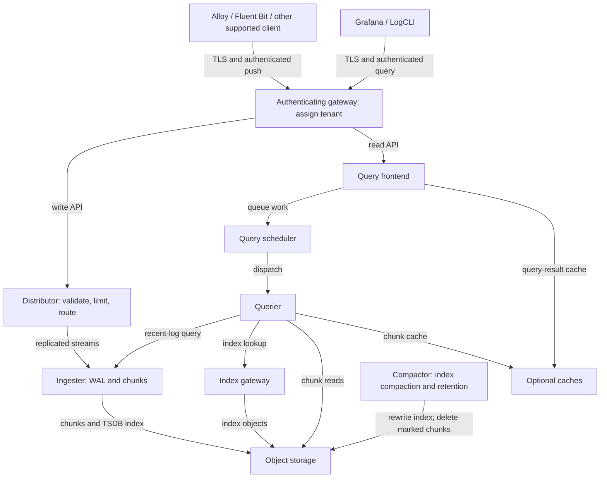

# Grafana Loki

> **Última actualización**: 13 de septiembre de 2026
> **Base del ejemplo**: Loki 3.7.7 / community Helm chart 18.12.1. Comprobaciones locales de configuración, renderizado y LogQL; no se probó una implementación en EKS, el acceso a S3, la carga ni la alta disponibilidad/conmutación por error.

Loki almacena los logs en bloques comprimidos e indexa las etiquetas de los streams. Esto puede reducir la sobrecarga del índice, pero no demuestra una ventaja universal de costo o velocidad de consulta frente a Elasticsearch/OpenSearch. Compare la ingesta, la retención, la selectividad de las consultas, las solicitudes a objetos, el cómputo, las cachés y los requisitos operativos con una carga de trabajo representativa.

## Descripción general

| Capacidad | Significado y límites |
|---|---|
| Índice de etiquetas | Selecciona los streams antes de examinar su contenido. Analizar JSON y recorrer los bloques sigue requiriendo trabajo. |
| Almacenamiento de objetos | En producción se pueden usar S3 y otros backends compatibles. El sistema de archivos local sirve para experimentos pequeños, pero no es un almacén de objetos distribuido y compartido. |
| LogQL | Admite pipelines de logs y métricas derivadas de logs. No equivale a PromQL ni a SQL. |
| Multitenencia | Los ID de tenant separan los datos y los límites. Un proxy de autenticación debe decidir a qué tenant puede acceder cada usuario. |
| Escalado y replicación | Dependen del modo de implementación, el ring, el quórum, el almacenamiento y los dominios de fallo. Las réplicas y el WAL por sí solos no garantizan una entrega sin pérdidas. |

Elasticsearch/OpenSearch usa un modelo de indexación y búsqueda distinto. Loki puede buscar texto en los logs, pero normalmente primero acota la búsqueda por etiquetas y tiempo y luego recorre los bloques coincidentes. Evite afirmar «10 veces más barato», «siempre más rápido» o hacer comparaciones de memoria sin una evaluación reproducible.

## Arquitectura

El diagrama muestra una implementación convencional con TSDB y bloques, no todos los componentes opcionales o experimentales de Loki. Las flechas de consulta apuntan al servicio solicitado; las respuestas vuelven por la misma ruta.



| Componente | Responsabilidades |
|---|---|
| Distributor | Valida los streams, aplica los límites de ingesta por tenant y por stream, y enruta las escrituras mediante el ring. Los límites de bytes por segundo no configuran streams por segundo. |
| Ingester | Almacena temporalmente los streams, escribe un WAL cuando está habilitado, crea y vacía bloques, y sirve datos recientes. El almacenamiento persistente del WAL reduce un riesgo de fallo, pero no sustituye la replicación, las copias de seguridad ni un plan de reintentos del cliente. |
| Querier | Lee los datos recientes de los ingesters y los históricos mediante el índice y el almacén de objetos; después evalúa LogQL y combina los resultados. |
| Frontend de consultas / scheduler | Divide y pone en cola el trabajo de consulta; puede usar caché de resultados y reintentos controlados. La clave de configuración de runtime es `frontend`; la clave de workload de Helm es `queryFrontend`. |
| Index gateway | Sirve las búsquedas en el índice en una implementación distribuida. Es distinto del almacén de bloques. |
| Compactor | Compacta **archivos de índice** y, cuando está habilitado, elimina referencias de índice vencidas y borra de forma asíncrona los bloques marcados. No es un compactador general de bloques pequeños de logs. |

## Modos de implementación

| Modo | Criterios de selección |
|---|---|
| Monolítico, `-target=all` | Práctico para instalaciones pequeñas y experimentos. El chart 18.12.1 denomina el modo `Monolithic`; sus valores de workload siguen bajo `singleBinary`. El valor predeterminado del chart no demuestra que sea adecuado para producción. |
| Simple Scalable (SSD) | Grupos históricos de lectura, escritura y backend. SSD está obsoleto y está previsto eliminarlo en Loki 4.0. Planifique una migración explícita en lugar de elegirlo como valor predeterminado para nuevas instalaciones de producción en EKS. |
| Microservicios, chart `Distributed` | Separa distributors, ingesters, queriers, frontend, scheduler, index gateway y compactor. La guía actual de Helm lo recomienda para escalar y lograr alta disponibilidad en producción, a costa de mayor complejidad operativa. |

Las antiguas categorías `<100GB`, `100GB–10TB` y `>10TB` no eran capacidades medidas. Dimensione según los bytes por segundo en el pico, los streams activos, la concurrencia de consultas, la retención, el aprovechamiento de bloques y la recuperación ante fallos. No convierta pautas aproximadas de dimensionamiento en garantías.

## Instalación de Helm

### Requisitos previos y propiedad

Lo siguiente es un **punto de partida de configuración para una instalación nueva**, no una plataforma de producción completa:

- El chart 18.12.1 declara Kubernetes `>=1.25.0-0`; la comprobación del manifiesto usó Kubernetes 1.36.2. Esto no prueba todas las versiones de Kubernetes/EKS ni todas las plataformas.
- Aprovisione buckets privados, un rol de IAM con permisos acotados, un proveedor OIDC de EKS para IRSA y una StorageClass `gp3` existente y adecuada. Ese nombre de clase es una suposición, no una garantía integrada de EKS. El aprovisionador de EBS CSI/Auto Mode, el sistema operativo de los nodos, la capacidad de la AZ, la vinculación de PVC y las cuotas deben coincidir con el clúster real.
- Prepare `loki-gateway-auth` con una clave `.htpasswd` y `loki-gateway-tls` con `tls.crt`/`tls.key`. Use un certificado confiable para los nombres DNS reales del gateway. Proporcione los secretos mediante su flujo de gestión de secretos; no incluya contraseñas ni claves privadas en archivos de valores.
- El gateway asigna el nombre de usuario autenticado a `X-Scope-OrgID` y sobrescribe el encabezado de tenant enviado por el cliente. Restrinja el acceso directo a los puertos de los componentes Loki mediante políticas de red/límites de seguridad y RBAC de namespace. Un encabezado de tenant no autentica; eludir el gateway también elude su autorización.
- El gateway usa HTTPS y un Service ClusterIP, con el ingreso deshabilitado. El tráfico interno entre componentes Loki sigue necesitando controles de transporte/red apropiados para el entorno. Aquí no se aprovisiona un ALB, endpoint público ni una política de red completa.

### Valores distribuidos con versiones fijadas

Guárdelos como `values-eks.yaml`. Sustituya de forma coherente las cuentas, los roles y los nombres de bucket de ejemplo. La fecha de inicio del esquema corresponde a un almacén **nuevo**; durante las actualizaciones, conserve todas las entradas de esquema existentes.

```yaml
deploymentMode: Distributed
loki:
  image:
    tag: 3.7.7
  auth_enabled: true
  analytics:
    reporting_enabled: false
  commonConfig:
    replication_factor: 3
  schemaConfig:
    configs:
    - from: '2026-09-01'
      store: tsdb
      object_store: s3
      schema: v13
      index:
        prefix: loki_index_
        period: 24h
  storage:
    type: s3
    bucketNames:
      chunks: example-loki-chunks-123456789012
      ruler: example-loki-ruler-123456789012
    s3:
      region: ap-northeast-2
  ingester:
    chunk_encoding: snappy
    wal:
      enabled: true
      dir: /var/loki/wal
  compactor:
    working_directory: /var/loki/compactor
    retention_enabled: true
    delete_request_store: s3
    retention_delete_delay: 2h
  limits_config:
    retention_period: 744h
    allow_structured_metadata: true
    ingestion_rate_strategy: global
    ingestion_rate_mb: 10
    ingestion_burst_size_mb: 20
    per_stream_rate_limit: 5MB
    per_stream_rate_limit_burst: 15MB
  runtimeConfig:
    overrides:
      development:
        retention_period: 168h
serviceAccount:
  create: true
  name: loki
  annotations:
    eks.amazonaws.com/role-arn: arn:aws:iam::123456789012:role/loki-s3
singleBinary:
  replicas: 0
read:
  replicas: 0
write:
  replicas: 0
backend:
  replicas: 0
ingester:
  replicas: 3
  zoneAwareReplication:
    enabled: false
  persistence:
    enabled: true
    claims:
    - name: data
      accessModes:
      - ReadWriteOnce
      size: 50Gi
      storageClass: gp3
distributor:
  replicas: 2
querier:
  replicas: 2
queryFrontend:
  replicas: 2
queryScheduler:
  replicas: 2
indexGateway:
  replicas: 2
compactor:
  replicas: 1
  persistence:
    enabled: true
    claims:
    - name: data
      accessModes:
      - ReadWriteOnce
      size: 20Gi
      storageClass: gp3
ruler:
  enabled: false
gateway:
  enabled: true
  replicas: 2
  service:
    type: ClusterIP
    port: 443
  ingress:
    enabled: false
  basicAuth:
    enabled: true
    existingSecret: loki-gateway-auth
  nginxConfig:
    locationSnippet: proxy_set_header X-Scope-OrgID $remote_user;
    ssl: true
    serverSnippet: |-
      ssl_certificate /etc/nginx/tls/tls.crt;
      ssl_certificate_key /etc/nginx/tls/tls.key;
      ssl_protocols TLSv1.2 TLSv1.3;
      if ($tenant_api_allowed = 0) { return 403; }
    httpSnippet: |-
      map $uri $tenant_api_allowed {
        default 0;
        / 1;
        /loki/api/v1/push 1;
        /otlp/v1/logs 1;
        /loki/api/v1/query 1;
        /loki/api/v1/query_range 1;
        /loki/api/v1/labels 1;
        ~^/loki/api/v1/label/[^/]+/values$ 1;
        /loki/api/v1/series 1;
        /loki/api/v1/tail 1;
        /loki/api/v1/index/stats 1;
        /loki/api/v1/index/volume 1;
        /loki/api/v1/index/volume_range 1;
      }
  containerPort: 8443
  metrics:
    enabled: false
  extraVolumes:
  - name: gateway-tls
    secret:
      secretName: loki-gateway-tls
  extraVolumeMounts:
  - name: gateway-tls
    mountPath: /etc/nginx/tls
    readOnly: true
  readinessProbe:
    httpGet:
      path: /
      port: http
      scheme: HTTPS
    initialDelaySeconds: 15
    timeoutSeconds: 1
chunksCache:
  enabled: false
resultsCache:
  enabled: false
sidecar:
  rules:
    enabled: false
lokiCanary:
  enabled: false
test:
  enabled: false
```

El gateway de tenant solo expone las API de datos enumeradas y el endpoint no sensible de disponibilidad `/`. Incluso con credenciales de tenant válidas, las rutas `/ingester/shutdown`, `/flush`, `/config`, ring/memberlist/status, eliminación y administración del ruler devuelven 403. Para administrar, use acceso interno autorizado por separado o un port-forward. Revise cualquier API adicional del cliente antes de ampliar la lista permitida y mantenga bloqueado el acceso directo al backend.

Los campos `loki.*` configuran la aplicación; `ingester`, `querier`, `compactor` y otros campos de nivel superior configuran los workloads de Kubernetes. El ejemplo usa deliberadamente un compactor y tres ingesters. Deshabilita la replicación con reconocimiento de zonas, por lo que **no afirma resiliencia entre AZ**. Antes de producción, añada requests/limits adecuados, anti-affinity/distribución topológica, PDB y capacidad probada; no copie la antigua tabla fija de CPU y memoria.

Aquí el ruler está deshabilitado. El bucket opcional del ruler se muestra para una configuración posterior de reglas; no es un bucket administrativo que Loki open source requiera. El bucket empresarial `admin` tampoco es necesario en este ejemplo. Las cachés y los workloads sintéticos de canary/prueba están deshabilitados para delimitar el ejemplo; planifíquelos y habilítelos por separado con capacidad y autenticación adecuadas.

```bash
helm repo add grafana-community https://grafana-community.github.io/helm-charts
helm repo update grafana-community

# Review the rendered resources before installing.
helm template loki grafana-community/loki \
  --version 18.12.1 --namespace loki \
  --values values-eks.yaml > loki-rendered.yaml

# Creates/updates resources; run only against the intended cluster.
helm upgrade --install loki grafana-community/loki \
  --version 18.12.1 --namespace loki --create-namespace \
  --values values-eks.yaml

kubectl get pods,services,pvc -n loki
```

Para una release existente, revise primero las notas de actualización intermedias de Helm/Loki, los cambios de valores, la compatibilidad del esquema y los límites de rollback. Sustituir los valores de un chart antiguo por este archivo no es un procedimiento de migración en el sitio.

## Backend S3 e identidad del workload

### IAM y ServiceAccount

Este ejemplo usa IRSA. EKS Pod Identity es otra opción si la plataforma de nodos, el agente y la cadena de credenciales del SDK de AWS de la aplicación la admiten; IRSA no es la única opción segura. No incluya claves de acceso S3 en el YAML de Loki ni herede permisos amplios del rol de nodo.

Una política ilustrativa para los buckets indicados en la misma cuenta es:

```json
{
  "Version": "2012-10-17",
  "Statement": [
    {
      "Effect": "Allow",
      "Action": [
        "s3:ListBucket",
        "s3:GetBucketLocation"
      ],
      "Resource": [
        "arn:aws:s3:::example-loki-chunks-123456789012",
        "arn:aws:s3:::example-loki-ruler-123456789012"
      ],
      "Condition": {
        "StringEquals": {
          "aws:ResourceAccount": "123456789012"
        }
      }
    },
    {
      "Effect": "Allow",
      "Action": [
        "s3:GetObject",
        "s3:PutObject",
        "s3:DeleteObject"
      ],
      "Resource": [
        "arn:aws:s3:::example-loki-chunks-123456789012/*",
        "arn:aws:s3:::example-loki-ruler-123456789012/*"
      ],
      "Condition": {
        "StringEquals": {
          "aws:ResourceAccount": "123456789012"
        }
      }
    }
  ]
}
```

El compactor necesita permiso para borrar objetos durante la retención. Usar roles separados por componente permite restringir aún más los privilegios. Con SSE-KMS, añada los permisos concretos de KMS y la política de clave que requiera la configuración de cifrado elegida; `s3:*` o un rol de confianza demasiado amplia no los sustituye.

Un rol IRSA debe confiar en el proveedor OIDC exacto del clúster, con `aud=sts.amazonaws.com` y `sub=system:serviceaccount:loki:loki`. Después de crear y revisar esa política acotada y asociar el proveedor OIDC, un administrador puede crear **solo el rol**:

```bash
eksctl create iamserviceaccount \
  --cluster="$CLUSTER_NAME" --region="$AWS_REGION" \
  --namespace=loki --name=loki \
  --role-only --role-name=loki-s3 \
  --attach-policy-arn="$LOKI_S3_POLICY_ARN" \
  --approve
```

Defina esas variables explícitamente para la cuenta y el clúster previstos. Helm administra el ServiceAccount mediante `serviceAccount.create: true`; no cree también el mismo ServiceAccount con eksctl. Si lo administra un sistema externo, use `create: false` y compruebe que coincidan su nombre, anotación y confianza del rol.

### Ejemplo de buckets privados

Este fragmento de Terraform es un ejemplo de recursos, no una ejecución apply probada ni un módulo raíz completo. Use una configuración de proveedor de AWS revisada y nombres globalmente únicos. Ambos buckets reciben cifrado y Block Public Access.

```hcl
variable "loki_buckets" {
  type = map(string)
  default = {
    chunks = "example-loki-chunks-123456789012"
    ruler  = "example-loki-ruler-123456789012"
  }
}

resource "aws_s3_bucket" "loki" {
  for_each      = var.loki_buckets
  bucket        = each.value
  force_destroy = false
}

resource "aws_s3_bucket_public_access_block" "loki" {
  for_each                = aws_s3_bucket.loki
  bucket                  = each.value.id
  block_public_acls       = true
  block_public_policy     = true
  ignore_public_acls      = true
  restrict_public_buckets = true
}

resource "aws_s3_bucket_server_side_encryption_configuration" "loki" {
  for_each = aws_s3_bucket.loki
  bucket   = each.value.id
  rule {
    apply_server_side_encryption_by_default {
      sse_algorithm = "AES256"
    }
  }
}

resource "aws_s3_bucket_versioning" "loki" {
  for_each = aws_s3_bucket.loki
  bucket   = each.value.id
  versioning_configuration {
    status = "Disabled"
  }
}
```

Un bucket nuevo no tiene versionado salvo que se configure. El proveedor de Terraform para AWS acepta `status = "Disabled"` al crear o importar un bucket sin versionado, como en este ejemplo. No permite devolver un bucket que ya esté en `Enabled` o `Suspended` al estado `Disabled`; use la transición admitida correspondiente y conserve el estado existente. Si se habilita el versionado, borrar un objeto puede dejar versiones anteriores: planifique por separado la limpieza de versiones no actuales y las retenciones legales frente a la retención de consultas de Loki.

No migre los bloques activos de Loki a clases Glacier que exijan restauración. Las consultas necesitan leer los objetos de inmediato; restaurar objetos archivados no forma parte de la ruta normal de lectura de Loki. No aplique al bucket entero una regla de vencimiento basada en antigüedad sin alcance acotado: los archivos de índice, el estado del clúster y los datos de solicitudes de eliminación/ruler tienen ciclos de vida distintos. Si usa el ciclo de vida como red de seguridad, aplíquelo a prefijos de bloques confirmados y fije el vencimiento más allá de la retención **más el retraso de eliminación**. La retención del compactor suele ser el mecanismo de borrado principal.

El chart genera la configuración de runtime de S3/TSDB. No añada `tsdb_shipper.shared_store`, `boltdb_shipper.shared_store`, `compactor.shared_store` ni `storage_config.aws.sse_encryption` heredados: Loki 3.7.7 rechaza esos campos. Consulte la referencia de almacenamiento/cifrado de la versión fijada.

## LogQL

### Selectores, filtros y parsers

Cada selector necesita un matcher que no pueda coincidir con un valor vacío. Los matchers negativos por sí solos pueden seleccionar etiquetas ausentes; incluya un matcher positivo no vacío. Estas son consultas independientes, no un programa con varias instrucciones.

```logql
{namespace="production"}

{namespace="production", app=~"nginx|apache"}

{namespace=~".+", namespace!="kube-system"}

{app=~".+", app!~"test.*"}
```

Los filtros de línea distinguen mayúsculas de minúsculas; los filtros de línea con expresiones regulares pueden coincidir con una subcadena. Coloque pronto los filtros selectivos cuando eso conserve el significado previsto. Excluir texto de comprobaciones de estado de una consulta no es lo mismo que borrar esos logs durante la ingesta.

```logql
{app="nginx"} |= "error"

{app="nginx"} != "healthcheck"

{app="nginx"} |~ "status=[45][0-9]{2}"

{app="nginx"} !~ "GET /health"

{app="nginx"} |= "error" != "timeout"

{namespace="production"} |= "OOMKilled" or "CrashLoopBackOff"
```

La última consulta busca texto recopilado; los motivos/eventos de Kubernetes no aparecen automáticamente en los logs de la aplicación. Recopile la fuente adecuada de eventos/runtime antes de depender de ellos.

```logql
{app="api"} | json

{app="api"} | json level, message, request_id

{app="api"} | logfmt

{app="nginx"} | regexp `(?P<ip>[\d.]+) - - \[(?P<timestamp>[^\]]+)\]`

{app="nginx"} | pattern `<ip> - - [<_>] "<method> <path> <_>" <status> <size>`

{app="packed"} | unpack
```

`json` admite extracción con nombre; el formato abreviado `json level, message` sigue siendo válido en 3.7.7. `unpack` requiere líneas producidas por una etapa pack compatible, no JSON arbitrario. Los parsers de pattern y regexp deben coincidir con el formato real del log; ninguno garantiza una velocidad universal.

```logql
{app="api"} | json | level="error" | __error__=""

{app="api"} | json | response_time > 1000 | __error__=""

{app="api"} | json | level="error" and request_id!="" | __error__=""

{app="nginx"} | pattern `<ip> - - <_>` | ip != ip("10.0.0.1")

{app="api"} | json | line_format "{{.level}}: {{.message}}"

{app="api"} | json | line_format `{{ if eq .level "error" }}ERROR: {{ end }}{{.message}}`

{app="api"} | json | line_format `{{ .timestamp | toDate "2006-01-02T15:04:05Z07:00" | date "15:04:05" }}`
```

Los ejemplos numéricos de `response_time` suponen milisegundos; no aplique ese umbral a segundos ni a un campo con otro nombre. El análisis/conversión de tipos puede adjuntar `__error__`. Filtrar explícitamente esos errores excluye esos registros del cálculo; supervise por separado los registros rechazados o malformados.

### Métricas derivadas de logs

```logql
rate({app="nginx"}[5m])

(sum(rate({app="api"} | json | __error__="" | level="error" [5m])) or vector(0))
/
sum(rate({app="api"} | json | __error__="" [5m]))

quantile_over_time(0.99,
  {app="api"} | json | unwrap response_time | __error__="" [5m]
) by (endpoint)

topk(10, sum by (error_type) (
  count_over_time({app="api"} | json | __error__="" | level="error" [1h])
))

avg_over_time(
  {app="nginx"} | pattern `<_> - - [<_>] "<_> <path> <_>" <_> <size>`
  | unwrap size | __error__="" [5m]
) by (path)

sum by (app) (count_over_time({namespace="production"} |= "error" [1h]))

absent_over_time({app="critical-service"}[5m])
```

La proporción de errores es la fracción de **líneas de log analizadas correctamente** que tienen `level="error"`; no equivale automáticamente a una tasa de errores de solicitudes HTTP. El valor alternativo cero del numerador cubre el caso sin líneas de error coincidentes cuando hay logs válidos. La falta de tráfico o telemetría sigue siendo una condición separada de ausencia de datos o de valores no finitos, no una prueba de buen estado. Para un SLI de HTTP, defina un evento de acceso por solicitud, códigos de estado válidos, muestreo y cobertura de recopilación.

Aplique el filtro `__error__=""` **después** de `unwrap` para excluir errores de conversión numérica. `absent_over_time` detecta ausencia en los datos seleccionados; no distingue una aplicación inactiva de un collector fallido. LogQL también admite agregaciones de vectores, como `count(...)`; eso difiere de usar una expresión de stream de logs como vector de métricas.

```logql
{app="api"} | json | response_time > 5000 | __error__="" | line_format `{{.method}} {{.path}}: {{.response_time}}ms`

{app="api"} | json | request_id="example-request" | __error__=""

{app="nginx"} | pattern `<_> - - [<_>] "<method> <path> <_>" <status> <_>`
| status >= 500 and status < 600 | __error__=""

sum by (hour) (
  count_over_time({app="api"} |= "error" | label_format hour=`{{ __timestamp__ | date "15" }}` [24h])
)

sum(count_over_time({app="api"} |= "error" [5m])) > 100
```

Agrupar por hora del día usa la marca de tiempo de cada entrada y puede combinar días distintos; elija deliberadamente el intervalo y la zona horaria, y use pasos de consulta de rango de Grafana para un gráfico cronológico. La última expresión ilustra un umbral de conteo. No detecta una implementación ni demuestra un pico estadísticamente significativo. `increase(count_over_time(...))` no es un reemplazo válido de LogQL.

## Diseño de etiquetas y collectors

Mantenga etiquetas indexadas útiles y acotadas, como clúster, namespace, servicio/aplicación y entorno. Ni siquiera los nombres de etiqueta conocidos tienen cardinalidad baja por definición: mida las combinaciones y la rotación reales. Los ID de solicitud, ID de usuario, marcas de tiempo, UID/nombres de Pod y direcciones IP de cliente suelen ser malas etiquetas de índice; conserve los valores necesarios en el contenido del log o en metadatos estructurados conforme a su política de privacidad/acceso.

| Ejemplo | Consecuencia para los streams |
|---|---|
| 2 namespaces y 3 aplicaciones, pero cada aplicación existe en un solo namespace | 3 combinaciones observadas, no necesariamente 6 |
| Cada aplicación aparece en ambos namespaces | Hasta 6 combinaciones antes de considerar otras etiquetas |
| Añadir un ID de solicitud único al conjunto de etiquetas | Puede crear un stream nuevo por solicitud |

El producto de las cardinalidades por etiqueta es un **límite superior** cuando pueden darse todas las combinaciones, no un conteo exacto de streams. El número de streams, la tasa de ingesta, el tamaño de los bloques, la selectividad de consultas, las cachés y la latencia del almacenamiento influyen en el uso de recursos. Los antiguos valores `<100,000 streams/cluster`, `<10,000/tenant` y `<1,000 values/label` no eran límites universales.

Promtail llegó al final de su vida útil el **2 de marzo de 2026**; use un cliente mantenido, como Alloy, y consulte la guía de migración. `lambda-promtail` tiene un ciclo de vida distinto. Una configuración de scrape migrada también necesita descubrimiento, RBAC, rutas/enmarcado CRI, posiciones, reintentos y autenticación de salida funcionales; las reglas de relabel por sí solas no forman un collector.

En un pipeline Alloy existente, el siguiente **fragmento de procesamiento** extrae campos antes de usarlos como etiquetas/metadatos estructurados. Supone que `loki.write.default` ya existe y que un componente anterior envía JSON simple de la aplicación a `loki.process.app.receiver`. No es una configuración completa ni un parser CRI.

```alloy
loki.process "app" {
  forward_to = [loki.write.default.receiver]

  stage.json {
    expressions = {
      level      = "level",
      request_id = "request_id",
    }
  }

  stage.labels {
    values = { level = "level" }
  }

  stage.structured_metadata {
    values = { request_id = "request_id" }
  }
}
```

El valor indexado de `level` debe pertenecer a un conjunto controlado; los datos proporcionados por la aplicación no son una identidad confiable del tenant ni del clúster. Los metadatos estructurados requieren un esquema compatible (v13 en este ejemplo) y `allow_structured_metadata`. No son una función para redactar datos privados. Las referencias a secretos del collector y los permisos de archivos deben configurarse por separado.

## Ajuste del rendimiento

Estos son **fragmentos de runtime de Loki**, no réplicas/recursos de workloads de Helm. Con este chart, colóquelos bajo `loki.structuredConfig` o use los valores correspondientes documentados de `loki.ingester`, `loki.frontend`, `loki.querier` y `loki.limits_config`. Renderice y valide la configuración final combinada.

```yaml
ingester:
  chunk_idle_period: 30m
  chunk_block_size: 262144
  chunk_target_size: 1572864
  chunk_retain_period: 1m
  max_chunk_age: 2h
  concurrent_flushes: 32
  wal:
    enabled: true
    dir: /var/loki/wal
    flush_on_shutdown: true
    replay_memory_ceiling: 512MB
querier:
  max_concurrent: 4
frontend:
  max_outstanding_per_tenant: 2048
  compress_responses: true
  log_queries_longer_than: 5s
query_scheduler:
  max_outstanding_requests_per_tenant: 2048
limits_config:
  query_timeout: 5m
  max_query_length: 744h
  max_query_lookback: 744h
  max_query_parallelism: 32
  tsdb_max_query_parallelism: 32
  split_queries_by_interval: 15m
  max_global_streams_per_user: 5000
```

- Los límites de ingesta pertenecen a `limits_config`; la tasa global del tenant se distribuye entre los distributors saludables, mientras que el comportamiento de burst y por stream es distinto. Antes de elevar los límites, inspeccione el motivo del 429 recibido y las métricas de muestras/bytes descartados.
- `chunk_idle_period` controla el vaciado cuando deja de llegar información nueva de un stream. Los bloques más pequeños pueden aumentar las solicitudes a objetos, el trabajo del índice y la sobrecarga de almacenamiento. Un límite de memoria puede provocar una terminación por OOM; no impide una demanda excesiva de memoria.
- La reproducción del WAL requiere almacenamiento persistente y memoria suficientes. `replay_memory_ceiling` no limita el RSS total del proceso. Reducir de forma planificada los ingesters requiere una terminación/vaciado ordenados y disponibilidad de datos verificada; un HPA basado solo en CPU no basta.
- El timeout de consultas, la división del trabajo, el paralelismo de TSDB y la concurrencia interactúan con el fan-out y la carga del almacenamiento. Más solicitudes en cola o réplicas pueden empeorar un backend sobrecargado.
- Las cachés de resultados/bloques de este chart usan Memcached de forma predeterminada. Un comentario que menciona un host Redis no configura una caché Redis externa. Dimensione y pruebe la caché por separado, y mantenga privados sus puertos.

## Retención

La retención no se habilita simplemente al establecer una duración. El ejemplo usa TSDB v13 con un período de índice de 24h, habilita el procesamiento de retención del compactor y proporciona `delete_request_store`. El estado de marcadores del compactor debe persistir tras reinicios; este ejemplo usa un PVC. El borrado real ocurre de forma asíncrona después de actualizar el índice y transcurrido el retraso de eliminación.

`744h` es una política ilustrativa de 31 días, **no el valor predeterminado de Loki**. Si la retención está deshabilitada o su período es cero, los logs no se conservan automáticamente durante solo 31 días. Los requisitos de copias de seguridad/versionado/retención legal son independientes.

Combine esta superposición opcional de Helm solo después de elegir la política:

```yaml
loki:
  limits_config:
    retention_period: 744h
    retention_stream:
    - selector: '{namespace="development"}'
      priority: 1
      period: 72h
  runtimeConfig:
    overrides:
      production:
        retention_period: 2160h
        retention_stream:
        - selector: '{namespace="production",level="error"}'
          priority: 2
          period: 2160h
        - selector: '{app="audit-log"}'
          priority: 1
          period: 8760h
      development:
        retention_period: 168h
```

`loki.runtimeConfig` genera el archivo de anulación de runtime y su montaje; un archivo `runtime-config.yaml` suelto no se carga automáticamente. Con la asignación de tenant por nombre de usuario del gateway, un nombre como `development` selecciona la anulación correspondiente.

Las reglas de stream del tenant tienen precedencia sobre las reglas globales; entre las reglas coincidentes de la lista pertinente, gana la prioridad mayor, y si la prioridad empata, se elige el período más corto. Después se aplican las duraciones alternativas del tenant/globales. Los selectores coinciden con **etiquetas de stream indexadas**, no con campos JSON analizados ni con metadatos estructurados. Por ejemplo, la política `level="error"` anterior requiere que `level` esté indexada durante la ingesta. Cambiar la retención no restaura logs ya eliminados; planifique el cambio según la versión fijada y pruebe la ventana de eliminación.

## Solución de problemas y supervisión

| Síntoma | Comprobaciones antes de cambiar límites |
|---|---|
| Límite de consultas pendientes | Fan-out de consultas, colas del scheduler, concurrencia del querier, almacenamiento de objetos lento e intervalos costosos. Aumentar la profundidad de la cola puede limitarse a retrasar el fallo. |
| 429 de ingesta | Distinga la tasa/burst de bytes del tenant, la tasa por stream y los límites de streams activos. Los clientes necesitan reintentos/backoff acotados y una política para la pérdida de entregas. |
| Rechazo por límite de streams | Inspeccione las combinaciones y la rotación reales de etiquetas; use el ajuste de límite local/global correcto para la implementación. No trate 10 000 como valor predeterminado universal. |
| OOM del Ingester | Streams activos, bloques, reproducción del WAL, tamaños de caché/búfer y límites del nodo/contenedor. Evite claves YAML `ingester:` duplicadas o mezclar recursos de Helm con YAML de runtime. |
| Errores de S3 | Identidad efectiva del workload, bucket/región, restricciones de cuenta/recurso, política de KMS, DNS/endpoints y disponibilidad de los objetos. No los «solucione» con buckets públicos ni claves de acceso estáticas. |
| «Ingester is shutting down» al escribir | Compruebe el estado real del ciclo de vida **y la presión de disco del WAL**: 3.7.7 puede devolver el mismo error cuando el umbral de disco lleno del WAL (predeterminado 0.9) limita las escrituras. Recupere capacidad; no deshabilite la protección a ciegas. |
| Falta el ID de organización / tenant inesperado | Autenticación del gateway, sobrescritura de encabezados y elusión directa del backend. `auth_enabled: true` requiere un ID de tenant; no valida una contraseña. |

Use una conexión LogCLI configurada de forma segura o un gateway HTTPS autenticado. Por ejemplo, guarde las credenciales en un archivo netrc protegido y use su CA de confianza en lugar de incluir una contraseña en un comando o deshabilitar la verificación del certificado:

```bash
curl --fail --silent --show-error \
  --netrc-file "$LOKI_NETRC_FILE" --cacert "$LOKI_CA_FILE" \
  --get "$LOKI_GATEWAY_URL/loki/api/v1/query_range" \
  --data-urlencode 'query={app="nginx"}' \
  --data-urlencode 'since=1h' \
  --data-urlencode 'limit=100' | jq '.data.stats'

curl --fail --silent --show-error \
  --netrc-file "$LOKI_NETRC_FILE" --cacert "$LOKI_CA_FILE" \
  --get "$LOKI_GATEWAY_URL/loki/api/v1/series" \
  --data-urlencode 'match[]={namespace="production"}' \
  --data-urlencode 'since=1h' | jq '.data | length'
```

Establezca la URL del gateway HTTPS previsto, restrinja los permisos del archivo de credenciales y limite el intervalo de consulta. `start` espera una marca de tiempo absoluta compatible; use `since=1h` para un intervalo relativo. El conteo de la API de series corresponde a las series coincidentes en el intervalo solicitado, no necesariamente al número actual de streams activos en memoria.

Para diagnósticos administrativos, seleccione el Pod real y use un port-forward local:

```bash
kubectl get pods -n loki -l app.kubernetes.io/instance=loki
kubectl port-forward -n loki pod/REPLACE_WITH_ACTUAL_POD 13100:3100

# In a second terminal; local administrative connection.
curl --fail http://127.0.0.1:13100/ready
curl --fail http://127.0.0.1:13100/metrics
```

La disponibilidad no demuestra el funcionamiento integral del almacenamiento y las consultas. Los endpoints del ring dependen del componente seleccionado. Trate la salida de `/config` como información operativa confidencial. **`POST /flush` activa el vaciado; no es un endpoint de estado**, por lo que se omite en los comandos de diagnóstico.

Estas son expresiones de Prometheus aplicadas a **métricas de Loki recopiladas**, no consultas LogQL ni un dashboard de Grafana completo e importable:

```promql
sum(rate(loki_distributor_bytes_received_total[5m]))

sum(loki_ingester_memory_streams)

histogram_quantile(0.99,
  sum by (le) (rate(loki_request_duration_seconds_bucket{route=~"loki_api_v1_query.*"}[5m]))
)
```

Los bytes del Distributor describen los datos que llegan a los distributors; por sí solos no demuestran que la ingesta sea duradera. La suma de streams de ingester también cuenta las réplicas. Confirme las etiquetas reales de las rutas antes de usar el selector de latencia y distinga la falta de muestras de una latencia igual a cero.

## Validación y referencias

La auditoría usó el binario oficial de Loki 3.7.7 y el chart 18.12.1, verificados frente a los resúmenes SHA de release, para comprobaciones locales de configuración/Helm/LogQL. Estas comprobaciones no acreditan los permisos de EKS, la validez de secretos TLS, las garantías de entrega, la ejecución de la retención de S3, la capacidad de producción ni la conmutación por error entre AZ. El fragmento de Alloy y el ejemplo de recurso Terraform requieren validación de integración en sus configuraciones completas.

- [Valores versionados del community chart](https://raw.githubusercontent.com/grafana-community/helm-charts/loki-18.12.1/charts/loki/values.yaml)
- [Instalación de Helm y recomendaciones de implementación](https://grafana.com/docs/loki/latest/setup/install/helm/)
- [Modos de implementación](https://grafana.com/docs/loki/latest/get-started/deployment-modes/) y [guía de actualización](https://grafana.com/docs/loki/latest/setup/upgrade/)
- [Componentes](https://grafana.com/docs/loki/latest/get-started/components/) y [referencia de configuración](https://grafana.com/docs/loki/latest/configure/)
- [Autenticación](https://grafana.com/docs/loki/latest/operations/authentication/) y [aislamiento de tenants](https://grafana.com/docs/loki/latest/operations/multi-tenancy/)
- [Consultas de logs](https://grafana.com/docs/loki/latest/query/log_queries/), [consultas de métricas](https://grafana.com/docs/loki/latest/query/metric_queries/) y [API HTTP](https://grafana.com/docs/loki/latest/reference/loki-http-api/)
- [Cardinalidad](https://grafana.com/docs/loki/latest/get-started/labels/cardinality/) y [metadatos estructurados](https://grafana.com/docs/loki/latest/get-started/labels/structured-metadata/)
- [Retención y ciclo de vida del almacén de objetos](https://grafana.com/docs/loki/latest/operations/storage/retention/)
- [Ciclo de vida de Promtail](https://grafana.com/docs/loki/latest/send-data/promtail/) y [migración a Alloy](https://grafana.com/docs/alloy/latest/set-up/migrate/from-promtail/)
- [IRSA](https://docs.aws.amazon.com/eks/latest/userguide/iam-roles-for-service-accounts.html) y [EKS Pod Identity](https://docs.aws.amazon.com/eks/latest/userguide/pod-identities.html)

## Cuestionario

Ponga a prueba estas distinciones con el [cuestionario de Loki](../../quizzes/observability/logging/01-loki-quiz.md).
