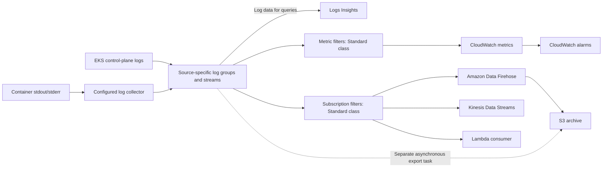

# CloudWatch Logs

> **Última actualización**: 13 de septiembre de 2026
> **Ejemplos comprobados**: proveedor AWS 6.69.1; chart opcional de Helm de CloudWatch Observability 6.6.0; AWS for Fluent Bit manual 3.4.15/Fluent Bit 5.0.9. Solo se comprobaron configuraciones locales, el SDK y cargas útiles sintéticas. No se crearon recursos de AWS ni se probaron la entrega de logs, las consultas de Insights o las alarmas.

Amazon CloudWatch Logs administra la ingesta, el almacenamiento y el análisis de logs. Aun así, debes configurar los productores, la identidad, la red, la retención, las cuotas y los consumidores posteriores. Los logs del plano de control de EKS, los logs de las cargas de trabajo y los logs de componentes administrados de EKS Auto Mode siguen rutas de recopilación separadas.

## Tabla de contenido

1. [Descripción general](#overview)
2. [Registro del plano de control de EKS](#eks-control-plane-logging)
3. [Container Insights](#container-insights)
4. [Integración de Fluent Bit](#fluentbit-integration)
5. [CloudWatch Logs Insights](#cloudwatch-logs-insights)
6. [Filtros de suscripción](#subscription-filters)
7. [Optimización de costos](#cost-optimization)

## Descripción general {#overview}

<span id="cloudwatch-logs-features"></span>

### Características y clases de logs

| Área | Qué comprobar |
|---|---|
| Servicio administrado | No hay un clúster de búsqueda que operar, pero los recolectores y las integraciones de entrega aún necesitan un responsable |
| Capacidad | Se aplican cuotas de tamaño de evento, API, suscripción y destino; la ingesta no es ilimitada |
| Seguridad | IAM, cifrado, protección de datos y conectividad privada requieren configuraciones independientes |
| Oportunidad | La entrega y las alertas son asíncronas; hay que considerar los reintentos y las entregas duplicadas o ausentes |
| Clase Standard | Admite los filtros de métricas y las suscripciones que se usan en este capítulo |
| Infrequent Access | Menor precio de ingesta y un conjunto de características distinto; no admite filtros de suscripción, filtros de métricas ni EMF |
| Clase Delivery | Opción independiente para logs de Lambda que se entregan a S3/Firehose; retención fija de dos días en CloudWatch y sin consultas de Logs Insights |

La clase de un grupo de logs no se puede cambiar después de crearlo. Infrequent Access admite actualmente, entre otras funciones, la exportación a S3, Logs Insights y la protección de datos; por tanto, son incorrectas las afirmaciones generales antiguas de que no admite ninguna de ellas. Antes de cambiar el diseño de recopilación, consulta la tabla actual de características.

<span id="terminology"></span>

### Conceptos clave



Los filtros de suscripción **no** aceptan como destino el ARN de un bucket de S3. La entrega continua a S3 mediante Firehose y una tarea de exportación asíncrona a S3 son rutas distintas. Tampoco se pueden entregar lotes de CloudWatch Logs al destino OpenSearch de Firehose; usa en su lugar la integración documentada de CloudWatch a OpenSearch. Los registros de aplicaciones enviados directamente a Firehose tienen un contrato de entrada diferente.

| Término | Significado |
|---|---|
| Grupo de logs | Límite común de retención, acceso y configuración; por ejemplo, `/aws/eks/example-eks/cluster` |
| Flujo de logs | Secuencia de eventos de log dentro de un grupo |
| Evento de log | Marca de tiempo y mensaje, sujetos a los límites del servicio |
| Retención | Período discreto de retención admitido o ausencia de vencimiento si no se establece una retención |

## Registro del plano de control de EKS {#eks-control-plane-logging}

### Tipos de logs

Los cinco tipos son `api`, `audit`, `authenticator`, `controllerManager` y `scheduler`. Corresponden, respectivamente, a diagnósticos del servidor de API, eventos de auditoría, autenticación de IAM, diagnósticos del administrador de controladores y programación. Los logs de los nodos de trabajo y de las aplicaciones se recopilan por separado.

El registro del plano de control está desactivado de forma predeterminada. Selecciona los tipos según tus necesidades de diagnóstico, seguridad y retención; la API no obliga a elegir las opciones que la tabla anterior marcaba como «obligatorias». La entrega suele tardar varios minutos y se realiza según disponibilidad. Habilitar el registro no recupera logs históricos que ya se rotaron.

<span id="enable-via-aws-cli"></span>

### Habilitar el registro y observar la actualización

Para un clúster existente, guarda lo siguiente como `control-plane-logging.json`:

```json
{
  "clusterLogging": [
    {
      "types": [
        "api",
        "audit",
        "authenticator",
        "controllerManager",
        "scheduler"
      ],
      "enabled": true
    }
  ]
}
```

```bash
DOCS_CLUSTER=example-eks
DOCS_REGION=ap-northeast-2

aws eks describe-cluster --name "$DOCS_CLUSTER" --region "$DOCS_REGION" \
  --query 'cluster.{version:version,logging:logging}'

UPDATE_ID=$(aws eks update-cluster-config \
  --name "$DOCS_CLUSTER" --region "$DOCS_REGION" \
  --logging file://control-plane-logging.json --query update.id --output text)

aws eks describe-update --name "$DOCS_CLUSTER" --region "$DOCS_REGION" \
  --update-id "$UPDATE_ID" --query 'update.{status:status,errors:errors}'
```

La actualización debe alcanzar el estado `Successful`; aceptar la solicitud no basta. Las actualizaciones del registro pueden requerir hasta cinco direcciones IP libres por subred del clúster. Para desactivar un tipo, revisa ese cambio explícitamente en lugar de copiar un segundo ejemplo que desactive en silencio logs existentes.

<span id="configure-with-terraform"></span>

### Propiedad de Terraform y retención

Para clústeres administrados con Terraform, cambia `enabled_cluster_log_types` en la **configuración propietaria del recurso de clúster existente**. No crees otro recurso `aws_eks_cluster` solo para habilitar logs ni copies el ejemplo obsoleto de creación para Kubernetes 1.29.

El siguiente archivo independiente administra los grupos de logs y la política del recolector manual:

```hcl
terraform {
  required_providers {
    aws = {
      source  = "hashicorp/aws"
      version = "6.69.1"
    }
  }
}

variable "region" {
  type    = string
  default = "ap-northeast-2"
}

variable "account_id" {
  type = string
  validation {
    condition     = can(regex("^[0-9]{12}$", var.account_id))
    error_message = "Use the owning account ID."
  }
}

variable "cluster_name" {
  type    = string
  default = "example-eks"
}

provider "aws" {
  region = var.region
}

resource "aws_cloudwatch_log_group" "application" {
  name              = "/aws/containerinsights/${var.cluster_name}/application"
  log_group_class   = "STANDARD"
  retention_in_days = 30

  lifecycle {
    prevent_destroy = true
  }
}

resource "aws_cloudwatch_log_group" "control_plane" {
  name              = "/aws/eks/${var.cluster_name}/cluster"
  log_group_class   = "STANDARD"
  retention_in_days = 30

  lifecycle {
    prevent_destroy = true
  }
}

resource "aws_iam_policy" "collector" {
  name_prefix = "fluent-bit-cloudwatch-"
  policy = jsonencode({
    Version = "2012-10-17"
    Statement = [{
      Effect   = "Allow"
      Action   = ["logs:CreateLogStream", "logs:PutLogEvents"]
      Resource = "${aws_cloudwatch_log_group.application.arn}:*"
    }]
  })
}

output "collector_policy_arn" {
  value = aws_iam_policy.collector.arn
}
```

Si el grupo ya existe, reutiliza la configuración que lo administra o impórtalo al estado previsto antes de aplicar cambios. Por ejemplo, el ID de importación del grupo del plano de control es `/aws/eks/example-eks/cluster`. No declares el mismo grupo otra vez como grupo de «auditoría»: los cinco tipos de logs del plano de control comparten ese grupo y su retención.

Los valores de 30 días son ejemplos, no requisitos legales. `prevent_destroy` bloquea que Terraform destruya el recurso, pero no evita que se reduzca la retención ni que se elimine fuera de Terraform. CloudWatch cifra los datos de logs almacenados; una clave de KMS administrada por el cliente requiere su propia política de claves y planificación operativa.

### Estructura de los grupos de logs

```text
/aws/eks/example-eks/cluster
  kube-apiserver-...          API server
  kube-apiserver-audit-...    Audit
  authenticator-...          IAM authentication
  kube-controller-manager-... Controller manager
  kube-scheduler-...         Scheduler
```

Los sufijos de los flujos rotan. El ejemplo antiguo `/aws/eks/cluster/logs` de la figura no seguía la convención real de nombres del grupo del plano de control.

## Container Insights

<span id="container-insights-overview"></span>
<span id="installation-methods"></span>
<span id="cloudwatch-agent-fluentbit-recommended"></span>
<span id="install-via-helm-chart"></span>
<span id="irsa-setup"></span>

### Opciones de instalación

Usa el **add-on de Amazon CloudWatch Observability para EKS** actual o su chart de Helm **amazon-cloudwatch-observability**. El antiguo chart del exportador ADOT y una URL de inicio rápido sin sustituir no son instalaciones equivalentes.

Para un add-on, busca versiones compatibles con el clúster real, inspecciona el esquema de configuración seleccionado y configura la asociación de IAM documentada. La versión de un chart no es la cadena de versión de un add-on de EKS.

```bash
K8S_VERSION=$(aws eks describe-cluster --name "$DOCS_CLUSTER" \
  --region "$DOCS_REGION" --query cluster.version --output text)
aws eks describe-addon-versions \
  --addon-name amazon-cloudwatch-observability \
  --kubernetes-version "$K8S_VERSION" --region "$DOCS_REGION"
```

El ejemplo opcional de Helm usa el siguiente `cloudwatch-values.yaml`. Selecciona la ruta tradicional de Container Insights y los logs de contenedores; aquí se desactivan Application Signals y el flujo independiente de OTel Container Insights.

```yaml
clusterName: example-eks
region: ap-northeast-2
containerInsights:
  enabled: true
containerLogs:
  enabled: true
applicationSignals:
  enabled: false
otelContainerInsights:
  enabled: false
  logs:
    enabled: false
```

```bash
helm repo add aws-observability https://aws-observability.github.io/helm-charts
helm repo update aws-observability
helm upgrade --install cloudwatch-observability \
  aws-observability/amazon-cloudwatch-observability \
  --version 6.6.0 --namespace amazon-cloudwatch --create-namespace \
  --values cloudwatch-values.yaml
```

Configura los permisos de IAM **antes de la instalación**. En este chart, los DaemonSets de Fluent Bit usan la cuenta de servicio `cloudwatch-agent`; su nombre y namespace deben coincidir con la asociación de Pod Identity elegida. Sigue los requisitos oficiales de asociación y confianza del rol. Un rol de IRSA para una cuenta de servicio con otro nombre no autoriza un Pod `fluent-bit` creado manualmente. No instales este chart sobre un add-on administrado por EKS ni ejecutes recolectores duplicados para los mismos logs.

<span id="collected-logs"></span>

### Logs y plataformas recopilados

| Sufijo de grupo habitual | Contenido y límites |
|---|---|
| `application` | Salida estándar y error estándar de contenedores en `/aws/containerinsights/CLUSTER/application` |
| `dataplane` | Fuentes configuradas de kubelet/runtime/VPC CNI/kube-proxy; los componentes reales varían según la plataforma |
| `host` | Archivos/journals de Linux o logs de eventos de Windows configurados; no todos los sistemas operativos tienen `/var/log/messages`, `/var/log/secure` o `/var/log/dmesg` |
| `performance` | Eventos de rendimiento, a menudo EMF; no son intercambiables con mensajes de logs de aplicaciones |

El add-on/chart compatible admite rutas para Linux y Windows, pero Application Signals no es compatible con EKS Windows. Fargate usa su enrutador de logs de plataforma, no este DaemonSet manual. Verifica Hybrid Nodes y Auto Mode por separado; no supongas que las rutas tradicionales del host de EC2 existen en todas partes.

Los logs de Karpenter, EBS CSI, el controlador del balanceador de carga e IPAM administrados por AWS en EKS Auto Mode usan una configuración independiente de **entrega de logs suministrados por el servicio**. Sus tipos son `AUTO_MODE_COMPUTE_LOGS`, `AUTO_MODE_BLOCK_STORAGE_LOGS`, `AUTO_MODE_LOAD_BALANCING_LOGS` y `AUTO_MODE_IPAM_LOGS`. El flujo documentado `PutDeliverySource` → `PutDeliveryDestination` → `CreateDelivery` puede apuntar a un grupo de logs, S3 o Firehose. Es distinto de `PutSubscriptionFilter` y de habilitar los cinco tipos de logs del plano de control.

## Integración de Fluent Bit {#fluentbit-integration}

<span id="fluentbit-configmap"></span>
<span id="fluentbit-daemonset"></span>

### Recolector manual de logs de aplicaciones

Este es un **perfil alternativo solo para logs de aplicaciones** en nodos Linux de EC2 aptos. No instala todo el flujo de métricas de Container Insights ni promete recopilar todos los logs del host o del plano de datos.

Primero crea o reutiliza el grupo de logs de aplicaciones. La política del recolector anterior permite crear flujos y escribir eventos en ese grupo; deliberadamente no crea grupos ni cambia la retención. Por eso, este perfil manual no necesita `cloudwatch:PutMetricData`, `s3:PutObject` ni permisos generales `logs:*`.

Prepara un rol de IRSA aprobado cuya relación de confianza OIDC coincida con `system:serviceaccount:logging:fluent-bit-cloudwatch` y la audiencia `sts.amazonaws.com`, y adjúntale la política generada. Un flujo de trabajo `eksctl --role-only` puede crear el rol mientras el manifiesto administra la cuenta de servicio. Sustituye de forma coherente el ARN del rol, el nombre del clúster y la región.

```yaml
apiVersion: v1
kind: Namespace
metadata:
  name: logging
---
apiVersion: v1
kind: ServiceAccount
metadata:
  name: fluent-bit-cloudwatch
  namespace: logging
  annotations:
    eks.amazonaws.com/role-arn: arn:aws:iam::123456789012:role/FluentBitCloudWatchLogsRole
---
apiVersion: rbac.authorization.k8s.io/v1
kind: ClusterRole
metadata:
  name: fluent-bit-cloudwatch-metadata
rules:
- apiGroups:
  - ''
  resources:
  - namespaces
  - pods
  verbs:
  - get
  - list
  - watch
---
apiVersion: rbac.authorization.k8s.io/v1
kind: ClusterRoleBinding
metadata:
  name: fluent-bit-cloudwatch-metadata
roleRef:
  apiGroup: rbac.authorization.k8s.io
  kind: ClusterRole
  name: fluent-bit-cloudwatch-metadata
subjects:
- kind: ServiceAccount
  name: fluent-bit-cloudwatch
  namespace: logging
---
apiVersion: v1
kind: ConfigMap
metadata:
  name: fluent-bit-cloudwatch-config
  namespace: logging
data:
  fluent-bit.conf: |
    [SERVICE]
        Flush         5
        Grace         30
        Log_Level     info
        HTTP_Server   Off
        storage.path  /buffers/storage

    [INPUT]
        Name              tail
        Tag               application.*
        Path              /var/log/containers/*.log
        Exclude_Path      /var/log/containers/fluent-bit-cloudwatch-*_logging_fluent-bit-*.log
        multiline.parser  docker, cri
        DB                /buffers/tail.db
        Mem_Buf_Limit     50MB
        Skip_Long_Lines   On
        Read_from_Head    Off
        storage.type      filesystem

    [FILTER]
        Name                kubernetes
        Match               application.*
        Kube_Tag_Prefix     application.var.log.containers.
        Use_Kubelet         Off
        Merge_Log           On
        Merge_Log_Key       log_processed
        Keep_Log            On
        Labels              Off
        Annotations         Off
        K8S-Logging.Parser  Off
        K8S-Logging.Exclude Off

    [OUTPUT]
        Name                     cloudwatch_logs
        Match                    application.*
        region                   ap-northeast-2
        log_group_name           /aws/containerinsights/example-eks/application
        log_stream_prefix        ${HOST_NAME}-
        auto_create_group        false
        Retry_Limit              5
        storage.total_limit_size 1G
---
apiVersion: apps/v1
kind: DaemonSet
metadata:
  name: fluent-bit-cloudwatch
  namespace: logging
spec:
  selector:
    matchLabels:
      app: fluent-bit-cloudwatch
  template:
    metadata:
      labels:
        app: fluent-bit-cloudwatch
    spec:
      serviceAccountName: fluent-bit-cloudwatch
      nodeSelector:
        kubernetes.io/os: linux
      tolerations:
      - operator: Exists
        effect: NoSchedule
      containers:
      - name: fluent-bit
        image: public.ecr.aws/aws-observability/aws-for-fluent-bit:3.4.15@sha256:88e1b56cedb230486afeca6eeb26c5f6bd59c48879d0054d1674d5a58838c607
        args:
        - -c
        - /fluent-bit/custom/fluent-bit.conf
        securityContext:
          runAsUser: 0
          allowPrivilegeEscalation: false
          readOnlyRootFilesystem: true
          capabilities:
            drop:
            - ALL
          seccompProfile:
            type: RuntimeDefault
        resources:
          requests:
            cpu: 100m
            memory: 128Mi
          limits:
            memory: 512Mi
        volumeMounts:
        - name: logs
          mountPath: /var/log
          readOnly: true
        - name: buffers
          mountPath: /buffers
        - name: config
          mountPath: /fluent-bit/custom
          readOnly: true
        - name: tmp
          mountPath: /tmp
        command:
        - /fluent-bit/bin/fluent-bit
        env:
        - name: HOST_NAME
          valueFrom:
            fieldRef:
              fieldPath: spec.nodeName
      volumes:
      - name: logs
        hostPath:
          path: /var/log
          type: Directory
      - name: buffers
        hostPath:
          path: /var/lib/fluent-bit-cloudwatch
          type: DirectoryOrCreate
      - name: config
        configMap:
          name: fluent-bit-cloudwatch-config
      - name: tmp
        emptyDir: {}
      terminationGracePeriodSeconds: 45
```

El plugin nativo es `cloudwatch_logs`; el plugin antiguo escrito en Go se llama `cloudwatch`. El comando predeterminado de la imagen es un script de entrada, así que el manifiesto manual inicia explícitamente el binario nativo de Fluent Bit con su configuración.

La base de datos de Tail y el búfer del sistema de archivos permiten escritura y están separados del montaje de logs de solo lectura. El período de gracia es de 30 segundos y el período de gracia de terminación del Pod es de 45 segundos, pero eso no garantiza que se entreguen todos los datos almacenados en el búfer. La pérdida de nodos, los discos llenos, las líneas largas, los reintentos finitos y los desplazamientos al reiniciar aún pueden causar pérdida de logs. `Read_from_Head Off` afecta a archivos que no se habían visto antes; los desplazamientos persistentes también importan.

El perfil consulta metadatos mediante el servidor de API, en lugar de acceder al kubelet por la red del host. Las anotaciones de las aplicaciones no pueden cambiar el análisis ni excluir logs. No configures el valor reservado `extra_user_agent: container-insights` en un recolector personalizado para dar a entender que es la instalación administrada.

### Contrato de registros y fuentes del host

Este es un ejemplo ilustrativo de un evento enriquecido que se envía a CloudWatch:

```json
{"log":"{\"level\":\"error\",\"message\":\"upstream request failed\",\"error_type\":\"upstream_timeout\",\"http\":{\"response_time_ms\":1250,\"status_code\":503}}","stream":"stderr","kubernetes":{"namespace_name":"production","pod_name":"api-example","container_name":"api"},"log_processed":{"level":"error","message":"upstream request failed","error_type":"upstream_timeout","http":{"response_time_ms":1250,"status_code":503}}}
```

Los campos de la aplicación están bajo `log_processed`, mientras que los metadatos confiables de Kubernetes están bajo `kubernetes`. La cadena `log` sin procesar duplica datos de la aplicación; redacta los campos prohibidos antes de recopilarla. Los ejemplos siguientes de consulta, suscripción y filtro de métricas usan exactamente esta estructura JSON y el valor en minúsculas `level: error`.

Si necesitas recopilar el journal de Linux, comprueba si hay journals persistentes en `/var/log/journal` o volátiles en `/run/log/journal`. Configura una entrada `systemd`, filtros de unidad adecuados, montajes de solo lectura, una base de datos de escritura independiente, un grupo de salida y permisos de IAM. No montes a ciegas la ruta antigua de Docker `/var/lib/docker/containers` ni exijas archivos de texto que no existen en nodos containerd/Bottlerocket/AL2023. El perfil manual no implementa estas configuraciones del host específicas de cada plataforma.

## CloudWatch Logs Insights

Estos ejemplos usan **Logs Insights QL**, no SQL. Selecciona el grupo de logs adecuado y un rango de tiempo acotado. La revisión local comprobó la sintaxis y los contratos publicados; no se consultó ningún servicio administrado.

### Sintaxis básica de consulta

```text
fields @timestamp, @message
| filter @message like /(?i)error/
| sort @timestamp desc
| limit 100
```

La expresión regular que ignora mayúsculas y minúsculas usa `/(?i)error/`, no el sufijo de JavaScript `/error/i`. Una coincidencia de texto puede encontrar palabras que no son un nivel de error estructurado de la aplicación.

Para la estructura JSON del recolector:

```text
fields jsonParse(@message) as record
| filter record.log_processed.level = "error"
| fields @timestamp, record.log_processed.message as message
| sort @timestamp desc
| limit 100
```

Para un campo de texto real que contiene `user_id=12345`:

```text
fields @timestamp, @message
| parse @message /user_id=(?<user_id>\d+)/
| filter user_id = "12345"
| limit 100
```

No dependas de un patrón glob que suponga un orden y espacios arbitrarios entre las claves JSON. `jsonParse` y los campos anidados explícitos hacen clara la estructura esperada del registro.

### Ejemplos de consultas de logs de EKS

Los diagnósticos del servidor de API excluyen el prefijo de flujo que se superpone con el de auditoría:

```text
fields @timestamp, @logStream, @message
| filter @logStream like /^kube-apiserver-/
| filter @logStream not like /^kube-apiserver-audit-/
| filter @message like /(?i)error/
| sort @timestamp desc
| limit 50
```

Actividad de auditoría de un nombre de usuario específico de Kubernetes:

```text
fields jsonParse(@message) as audit
| filter @logStream like /^kube-apiserver-audit-/
| filter audit.user.username = "example-user"
| fields @timestamp, audit.verb as verb, audit.objectRef as objectRef
| sort @timestamp desc
| limit 100
```

Diagnósticos de Authenticator:

```text
fields @timestamp, @message
| filter @logStream like /^authenticator-/
| filter @message like /(?i)(AccessDenied|Forbidden|unauthorized)/
| sort @timestamp desc
| limit 100
```

Eventos de auditoría de creación/eliminación de Pods:

```text
fields jsonParse(@message) as audit
| filter @logStream like /^kube-apiserver-audit-/
| filter audit.verb in ["create", "delete"]
| filter audit.objectRef.resource = "pods"
| fields @timestamp, audit.verb as verb, audit.objectRef.name as pod
| sort @timestamp desc
| limit 100
```

Estas son búsquedas de diagnóstico; no prueban que la auditoría capture todas las acciones ni que una coincidencia de texto establezca la causa raíz.

### Consultas de logs de aplicaciones

Errores por namespace:

```text
fields jsonParse(@message) as record
| filter record.log_processed.level = "error"
| stats count(*) as error_count by record.kubernetes.namespace_name as namespace
| sort error_count desc
```

Respuestas lentas que usan el campo numérico declarado en milisegundos:

```text
fields jsonParse(@message) as record
| filter record.kubernetes.container_name = "api"
| filter record.log_processed.http.response_time_ms > 1000
| fields @timestamp, record.log_processed.http.response_time_ms as response_time_ms
| sort response_time_ms desc
| limit 100
```

Recuentos de eventos por hora:

```text
stats count(*) as log_count by bin(1h) as bucket
| sort bucket asc
```

Después de `stats`, ordena por el alias del intervalo definido; el `@timestamp` original de cada evento ya no está disponible como resultado de agrupación.

Principales categorías de error:

```text
fields jsonParse(@message) as record
| filter record.log_processed.level = "error"
| stats count(*) as error_count by record.log_processed.error_type as error_type
| sort error_count desc
| limit 10
```

Una categoría acotada suele ser más fácil de interpretar que agrupar por cada mensaje completo y único. No conviertas los ID de solicitud ni mensajes arbitrarios en dimensiones de métricas sin límite.

### Consultas avanzadas

```text
fields jsonParse(@message) as record
| filter ispresent(record.log_processed.http.response_time_ms)
| stats pct(record.log_processed.http.response_time_ms, 50) as p50_ms,
        pct(record.log_processed.http.response_time_ms, 90) as p90_ms,
        pct(record.log_processed.http.response_time_ms, 99) as p99_ms
  by bin(5m) as bucket
| sort bucket asc
```

La función de agregación de QL es `pct`, no `percentile`. El productor debe emitir milisegundos numéricos; los ejemplos antiguos de nginx tenían cantidades de comodines que no coincidían y posiciones de campos inventadas.

```text
fields @timestamp, @message, @logStream
| filter @message like /Back-off restarting failed container/
| stats count(*) as backoff_log_events by @logStream
| sort backoff_log_events desc
```

Esto cuenta los **eventos de log** coincidentes, no los reinicios de contenedores. Un evento o mensaje de kubelet puede faltar, repetirse o agregarse. Si necesitas un recuento real de reinicios, usa una métrica de reinicios adecuada de Kubernetes.

`SOURCE` se admite en consultas de CLI/API, no en el editor de consultas de la consola:

```text
SOURCE logGroups(accountIdentifier:['111122223333'], namePrefix:['/aws/containerinsights/prod-', '/aws/containerinsights/stage-'])
| fields @timestamp, @message, @logStream
| filter @message like /(?i)error/
| sort @timestamp desc
| limit 100
```

`accountIdentifier` es singular. Las consultas entre cuentas requieren una configuración aprobada de cuenta de monitoreo/cuenta de origen y los permisos correspondientes; mencionar otra cuenta o grupo no otorga acceso. Omitir la selección de cuenta o prefijo puede ampliar considerablemente la consulta.

## Filtros de suscripción {#subscription-filters}

Los filtros de suscripción reenvían de forma asíncrona los nuevos eventos coincidentes. La entrega es al menos una vez, por lo que puede haber duplicados. Los fallos reintentables del destino pueden volver a intentarse durante un máximo de 24 horas; los errores no reintentables y los fallos sostenidos pueden causar pérdida de entregas. Supervisa las cuotas, `DeliveryErrors` y `DeliveryThrottling`. Las suscripciones no recuperan todos los logs históricos.

Los destinos directos de Lambda, Kinesis y Firehose de estos ejemplos pertenecen a la misma cuenta que el grupo de logs. La entrega entre cuentas usa un destino lógico compatible y su política de destino; un ARN arbitrario de Lambda en otra cuenta no lo sustituye.

<span id="export-to-s3"></span>

### Archivar en S3 mediante Firehose

Este archivo opcional usa el grupo anterior, un bucket privado de S3 existente y un rol de entrega aprobado de Firehose:

```hcl
variable "firehose_delivery_role_arn" {
  type = string
}

variable "archive_bucket_arn" {
  type = string
}

resource "aws_cloudwatch_log_group" "firehose" {
  name              = "/aws/kinesisfirehose/cloudwatch-archive"
  retention_in_days = 30
}

resource "aws_cloudwatch_log_stream" "firehose" {
  name           = "S3Delivery"
  log_group_name = aws_cloudwatch_log_group.firehose.name
}

resource "aws_kinesis_firehose_delivery_stream" "archive" {
  name        = "cloudwatch-archive"
  destination = "extended_s3"

  extended_s3_configuration {
    role_arn            = var.firehose_delivery_role_arn
    bucket_arn          = var.archive_bucket_arn
    prefix              = "cloudwatch/year=!{timestamp:yyyy}/month=!{timestamp:MM}/day=!{timestamp:dd}/"
    error_output_prefix = "errors/!{firehose:error-output-type}/year=!{timestamp:yyyy}/"
    buffering_size      = 64
    buffering_interval  = 300
    compression_format  = "UNCOMPRESSED"

    cloudwatch_logging_options {
      enabled         = true
      log_group_name  = aws_cloudwatch_log_group.firehose.name
      log_stream_name = aws_cloudwatch_log_stream.firehose.name
    }
  }
}

resource "aws_iam_role" "logs_to_firehose" {
  name_prefix = "cloudwatch-to-firehose-"
  assume_role_policy = jsonencode({
    Version = "2012-10-17"
    Statement = [{
      Effect    = "Allow"
      Principal = { Service = "logs.amazonaws.com" }
      Action    = "sts:AssumeRole"
      Condition = {
        StringEquals = { "aws:SourceAccount" = var.account_id }
        ArnLike      = { "aws:SourceArn" = "arn:aws:logs:${var.region}:${var.account_id}:*" }
      }
    }]
  })
}

resource "aws_iam_role_policy" "logs_to_firehose" {
  role = aws_iam_role.logs_to_firehose.id
  policy = jsonencode({
    Version = "2012-10-17"
    Statement = [{
      Effect   = "Allow"
      Action   = ["firehose:PutRecord", "firehose:PutRecordBatch"]
      Resource = aws_kinesis_firehose_delivery_stream.archive.arn
    }]
  })
}

resource "aws_cloudwatch_log_subscription_filter" "archive" {
  name            = "application-archive"
  log_group_name  = aws_cloudwatch_log_group.application.name
  filter_pattern  = ""
  destination_arn = aws_kinesis_firehose_delivery_stream.archive.arn
  role_arn        = aws_iam_role.logs_to_firehose.arn

  depends_on = [aws_iam_role_policy.logs_to_firehose]
}
```

El rol de entrega necesita una relación de confianza de Firehose revisada, acceso al bucket/prefijo, permisos opcionales de KMS y permisos sobre los logs de destino. El rol de CloudWatch a Firehose es independiente, y quien despliega necesita `iam:PassRole` con alcance limitado. No vuelvas a suscribir los logs de errores de entrega al mismo flujo.

Los registros de suscripción de CloudWatch ya están comprimidos con gzip. Aquí, `UNCOMPRESSED` desactiva la **compresión adicional de Firehose**; no convierte la carga útil entrante en texto sin formato ni elimina el envoltorio de CloudWatch. Los consumidores deben procesar el formato real del registro archivado.

Para obtener una salida descomprimida, configura deliberadamente la función documentada de descompresión de Firehose. La extracción opcional del mensaje elimina `owner`, `logGroup`, `logStream` y otros metadatos del envoltorio. No mezcles entradas de logs suministrados por el servicio con un flujo configurado para descomprimir suscripciones de CloudWatch ni supongas que estos ajustes hacen válida la ruta no admitida CloudWatch→Firehose→OpenSearch.

### Procesar con Lambda

El ejemplo procesa el envoltorio estructurado anterior, ignora los mensajes de control y envía un **resumen** de errores en lugar del texto sin procesar de los logs. Guárdalo como `log_processor.py`:

```python
import base64
import gzip
import hashlib
import io
import json
import os

import boto3

# Example processing limit, not an AWS service quota.
MAX_UNCOMPRESSED_BYTES = 8 * 1024 * 1024


def summarize(event):
    compressed = base64.b64decode(event["awslogs"]["data"], validate=True)
    with gzip.GzipFile(fileobj=io.BytesIO(compressed)) as stream:
        payload = stream.read(MAX_UNCOMPRESSED_BYTES + 1)
    if len(payload) > MAX_UNCOMPRESSED_BYTES:
        raise ValueError("Batch exceeds this example's processing limit")
    batch = json.loads(payload)
    if batch.get("messageType") == "CONTROL_MESSAGE":
        return None
    if batch.get("messageType") != "DATA_MESSAGE":
        raise ValueError("Unsupported subscription message type")

    errors = []
    unparsed = 0
    for item in batch["logEvents"]:
        try:
            record = json.loads(item["message"])
            application = record["log_processed"]
            if not isinstance(application, dict):
                raise ValueError("Expected an application object")
        except (ValueError, KeyError, TypeError):
            unparsed += 1
            continue
        if application.get("level") == "error":
            errors.append(item)
    if not errors:
        return None

    # Raw messages are intentionally excluded from the notification.
    event_keys = [
        hashlib.sha256(
            json.dumps([batch["owner"], batch["logGroup"], batch["logStream"], item["id"]],
                       ensure_ascii=True).encode("utf-8")
        ).hexdigest()
        for item in errors[:20]
    ]
    return {
        "errorCount": len(errors),
        "unparsedRecords": unparsed,
        "sampleEventKeys": event_keys,
    }


def lambda_handler(event, context):
    summary = summarize(event)
    if summary is None:
        return {"notified": False}
    topic_arn = os.environ["ALERT_TOPIC_ARN"]  # Non-secret destination identifier.
    message = json.dumps(summary, ensure_ascii=True)
    if len(message.encode("utf-8")) > 262144:
        raise ValueError("SNS message is too large")
    boto3.client("sns").publish(
        TopicArn=topic_arn,
        Subject="CloudWatch Logs error batch",
        Message=message,
    )
    return {"notified": True, "errorCount": summary["errorCount"]}
```

`ALERT_TOPIC_ARN` es un identificador de destino no secreto para un topic aprobado en la misma región. El rol de ejecución de Lambda necesita permiso `sns:Publish` con alcance limitado y sus propios permisos de logs, además de los permisos de KMS que correspondan. Su grupo de logs no debe alimentar recursivamente la misma suscripción.

El límite de procesamiento de 8 MiB es un valor de ejemplo elegido, no una cuota de AWS. Los envoltorios no válidos producen errores; los registros que no cumplen el esquema de aplicación esperado no se tratan como errores estructurados. Supervisa los errores de análisis, configura la gestión de fallos y prueba la reproducción antes del despliegue. Los mensajes de SNS que no son SMS tienen un límite en **bytes UTF-8**, no una regla de 1.000 caracteres; el asunto fijo también está por debajo de su límite.

Las claves de evento ayudan en la investigación; **no proporcionan deduplicación persistente**. Las invocaciones repetidas pueden enviar notificaciones repetidas. En producción, el consumidor necesita decisiones explícitas de idempotencia y de destino de fallos.

<span id="create-alerts-with-metric-filters"></span>

### Filtros de métricas y alarmas

El siguiente archivo opcional se conecta a un ARN sin calificador de una función Lambda ya desplegada y crea una métrica/alarma de recuento. Usa el mismo campo JSON que el recolector y consulta:

```hcl
variable "processor_function_arn" {
  type = string
}

variable "alerts_topic_arn" {
  type = string
}

resource "aws_lambda_permission" "cloudwatch" {
  statement_id   = "AllowOwnedCloudWatchLogGroup"
  action         = "lambda:InvokeFunction"
  function_name  = var.processor_function_arn
  principal      = "logs.${var.region}.amazonaws.com"
  source_arn     = "${aws_cloudwatch_log_group.application.arn}:*"
  source_account = var.account_id
}

resource "aws_cloudwatch_log_subscription_filter" "processor" {
  name            = "structured-errors"
  log_group_name  = aws_cloudwatch_log_group.application.name
  filter_pattern  = "{ $.log_processed.level = \"error\" }"
  destination_arn = var.processor_function_arn

  depends_on = [aws_lambda_permission.cloudwatch]
}

resource "aws_cloudwatch_log_metric_filter" "errors" {
  name           = "StructuredErrorCount"
  log_group_name = aws_cloudwatch_log_group.application.name
  pattern        = "{ $.log_processed.level = \"error\" }"

  metric_transformation {
    name          = "ErrorCount"
    namespace     = "Example/Logs"
    value         = "1"
    default_value = "0"
    unit          = "Count"
  }
}

resource "aws_cloudwatch_metric_alarm" "high_error_count" {
  alarm_name          = "ExampleHighErrorCount"
  comparison_operator = "GreaterThanThreshold"
  evaluation_periods  = 2
  datapoints_to_alarm = 2
  metric_name         = "ErrorCount"
  namespace           = "Example/Logs"
  period              = 300
  statistic           = "Sum"
  threshold           = 100
  treat_missing_data  = "missing"
  alarm_description   = "More than 100 matching error events in each of two 5-minute periods"
  alarm_actions       = [var.alerts_topic_arn]
}
```

El permiso se establece antes de la suscripción de Lambda y se limita al ARN del grupo de logs y a la cuenta de origen. El destino SNS de la alarma también requiere la política de topic adecuada. El despliegue de la función, la política del rol de ejecución, las suscripciones al topic y la notificación de extremo a extremo son requisitos independientes.

La alarma mide **un recuento de errores**, no una tasa: más de 100 eventos coincidentes en cada uno de dos períodos de cinco minutos. `default_value = 0` se aplica cuando llegan logs, pero ninguno coincide; si no llegan logs, puede haber datos faltantes. `treat_missing_data = "missing"` no interpreta el silencio como estado saludable. Los filtros de métricas no rellenan eventos históricos y los duplicados pueden afectar los recuentos.

<span id="_3-archive-to-s3"></span>

### Tareas de exportación y ciclo de vida de S3

Para una exportación histórica acotada, usa la API independiente de tareas de exportación de S3 de CloudWatch y los permisos de bucket/KMS correspondientes. La exportación puede tardar hasta 12 horas en estar disponible, no se garantiza el orden y el servicio no recomienda ejecutar tareas periódicas para archivar continuamente.

Las reglas de ciclo de vida del archivo pertenecen al único responsable de la configuración del bucket. Integra una regla revisada y acotada a un prefijo en esa configuración, en lugar de reemplazar reglas existentes con un segundo recurso de Terraform. Antes de elegir las clases Standard-IA o Glacier, considera el comportamiento de transición de objetos pequeños, las duraciones mínimas de almacenamiento, los costos de recuperación y Object Lock.

## Optimización de costos {#cost-optimization}

### Estructura de costos

Consulta los precios regionales actuales por clase y nivel para ingesta, almacenamiento retenido, análisis de consultas, entrega de logs suministrados, transformación y servicios posteriores. Firehose, S3, KMS, Lambda, las métricas personalizadas y las alarmas no son siempre gratuitos. La tabla anterior no justificaba sus tarifas de Seúl ni una ruta «Logs a S3» sin costo.

Lo siguiente es **un cálculo hipotético, no precios regionales actuales**:

| Supuesto | Cálculo mensual |
|---|---|
| Ingesta de 100 GB/día durante 30 días, a un precio supuesto de $0.50/GB | 3,000 × $0.50 = $1,500 |
| Retención estable de 30 días, fracción almacenada supuesta de 0.5 y $0.03/GB-mes | Promedio de 1,500 GB × $0.03 = $45 |
| Análisis de 200 GB diarios durante 30 días, a un precio supuesto de $0.005/GB | 6,000 × $0.005 = $30 |
| Subtotal solo bajo estos supuestos | **$1,575** |

Esto no representa la acumulación de almacenamiento del primer mes, un benchmark de compresión ni una factura completa. El total original de $1,576 mezclaba valores de consulta diarios y mensuales. Usa el promedio medido de bytes retenidos, el volumen analizado, los precios actuales y todas las demás categorías de cargos.

<span id="cost-reduction-strategies"></span>
<span id="_1-log-filtering"></span>
<span id="_2-retention-period-optimization"></span>
<span id="_4-adjust-log-levels"></span>

### Filtrado, retención y niveles de log

Filtra solo los registros que tus requisitos de diagnóstico y seguridad permitan descartar. La configuración clásica de Fluent Bit no es YAML. Con esta estructura de registros, un filtro de namespace usa un accesor de registros como `$kubernetes['namespace_name']`, no el campo plano inexistente `kubernetes_namespace_name`.

Evita filtros amplios por subcadenas que descarten errores útiles solo porque mencionan una ruta de health check. Prefiere campos explícitos, como un tipo de evento revisado, y comprueba tanto los ejemplos que se deban conservar como los que se deban descartar.

Puede convenir usar períodos de retención distintos para desarrollo, producción y auditoría, pero cambiar la retención puede eliminar datos. Todos los flujos del plano de control de un grupo comparten la política de retención del grupo. Los niveles de log de las aplicaciones forman parte del contrato de la aplicación: agregar `LOG_LEVEL: INFO` a un ConfigMap no hace nada a menos que la aplicación lo lea y lo implemente. Un aumento temporal de verbosidad requiere controles de acceso, una fecha de expiración y un presupuesto de volumen.

### Monitoreo de costos

Usa métricas de `AWS/Logs` como `IncomingBytes` e `IncomingLogEvents` con la dimensión `LogGroupName` y la estadística `Sum`. Describen la ingesta, no la factura completa. `@billedDuration` es un campo de Lambda, no una métrica de facturación por almacenamiento o ingesta de CloudWatch Logs.

```bash
aws logs describe-log-groups --region "$DOCS_REGION" \
  --log-group-name-prefix /aws/containerinsights/example-eks/ \
  --query 'logGroups[].{name:logGroupName,retention:retentionInDays,class:logGroupClass,storedBytes:storedBytes}'

# Example complete month; End is exclusive.
aws ce get-dimension-values --region us-east-1 \
  --time-period Start=2026-08-01,End=2026-09-01 \
  --dimension SERVICE --search-string CloudWatch
```

Usa el valor de servicio de facturación devuelto en un filtro de Cost Explorer e incluye los servicios relacionados al estimar el flujo completo. `storedBytes` es un atributo del grupo de logs, no una métrica garantizada de `AWS/Logs` con ese nombre. Consultar todos los logs para estimar su costo puede generar cargos por las consultas.

## Validación y referencias

La auditoría comprobó configuraciones locales de Terraform/Helm, el esquema de Kubernetes, tipos de carga útil del SDK, eventos sintéticos de Lambda, ejemplos bilingües, respuestas del cuestionario y el renderizado de Markdown. Estas comprobaciones no demuestran que IAM en vivo, la entrega del recolector, la ejecución de QL administrado, los archivos de Firehose, la entrega de alarmas o los costos reales funcionen.

- [Logs del plano de control de EKS](https://docs.aws.amazon.com/eks/latest/userguide/control-plane-logs.html)
- [Add-on de CloudWatch Observability e instalación de Helm](https://docs.aws.amazon.com/AmazonCloudWatch/latest/monitoring/install-CloudWatch-Observability-EKS-addon.html)
- [Entrega de logs de componentes administrados de Auto Mode](https://docs.aws.amazon.com/eks/latest/userguide/auto-managed-component-logs.html)
- [Clases de logs](https://docs.aws.amazon.com/AmazonCloudWatch/latest/logs/CloudWatch_Logs_Log_Classes.html) y [cuotas](https://docs.aws.amazon.com/AmazonCloudWatch/latest/logs/cloudwatch_limits_cwl.html)
- [Salida nativa de CloudWatch para Fluent Bit](https://raw.githubusercontent.com/fluent/fluent-bit-docs/master/pipeline/outputs/cloudwatch.md)
- [Filtro QL](https://docs.aws.amazon.com/AmazonCloudWatch/latest/logs/CWL_QuerySyntax-Filter.html), [stats](https://docs.aws.amazon.com/AmazonCloudWatch/latest/logs/CWL_QuerySyntax-Stats.html), [funciones](https://docs.aws.amazon.com/AmazonCloudWatch/latest/logs/CWL_QuerySyntax-operations-functions.html) y [SOURCE](https://docs.aws.amazon.com/AmazonCloudWatch/latest/logs/CWL_QuerySyntax-Source.html)
- [Ejemplos de suscripción](https://docs.aws.amazon.com/AmazonCloudWatch/latest/logs/SubscriptionFilters.html) y [API de destino](https://docs.aws.amazon.com/AmazonCloudWatchLogs/latest/APIReference/API_PutSubscriptionFilter.html)
- [Limitaciones de CloudWatch Logs a Firehose](https://docs.aws.amazon.com/firehose/latest/dev/writing-with-cloudwatch-logs.html), [descompresión](https://docs.aws.amazon.com/firehose/latest/dev/writing-with-cloudwatch-logs-decompression.html) y [extracción de mensajes](https://docs.aws.amazon.com/firehose/latest/dev/Message_extraction.html)
- [Filtros de métricas](https://docs.aws.amazon.com/AmazonCloudWatch/latest/logs/MonitoringLogData.html), [tareas de exportación a S3](https://docs.aws.amazon.com/AmazonCloudWatch/latest/logs/S3Export.html) y [métricas de servicio de CloudWatch Logs](https://docs.aws.amazon.com/AmazonCloudWatch/latest/logs/CloudWatch-Logs-Monitoring-CloudWatch-Metrics.html)
- [API Publish de SNS](https://docs.aws.amazon.com/sns/latest/api/API_Publish.html) y [precios actuales de CloudWatch](https://aws.amazon.com/cloudwatch/pricing/)

## Cuestionario

Comprueba estas distinciones con el [Cuestionario de CloudWatch Logs](../../quizzes/observability/logging/03-cloudwatch-logs-quiz.md).
