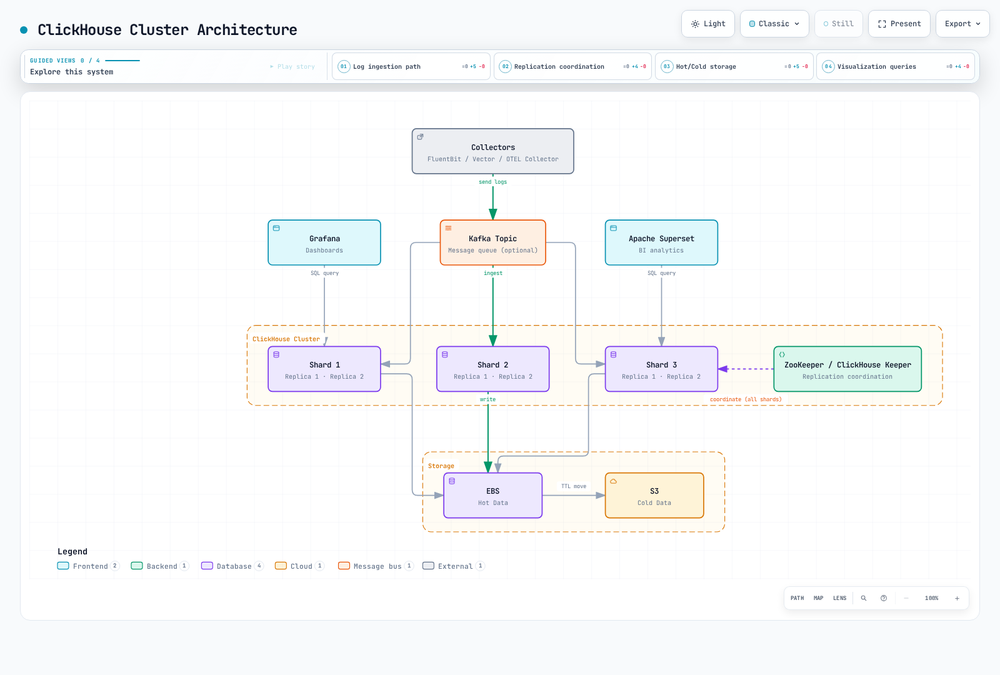
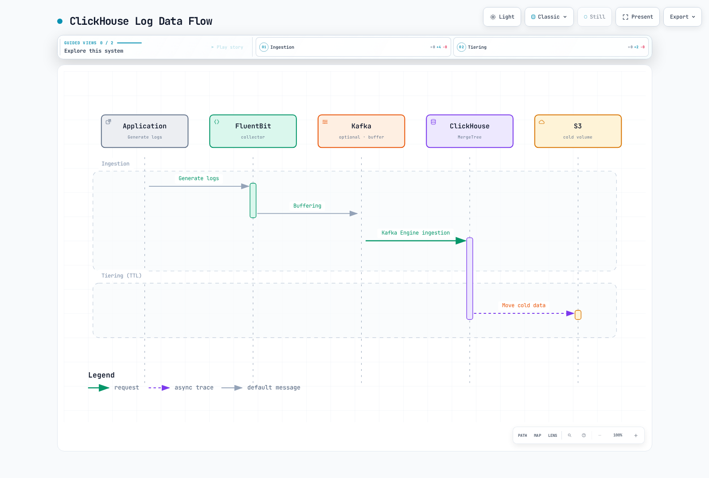

# ClickHouse

> **Última actualización**: 13 de septiembre de 2026

ClickHouse es una base de datos analítica columnar. Puede resultar adecuado para analizar registros mediante filtros, agregaciones y joins SQL, siempre que el esquema de ingesta, la retención y el modelo operativo se ajusten a la carga de trabajo.

## Índice

1. [Descripción general](#overview)
2. [Arquitectura](#architecture)
3. [Despliegue en Kubernetes](#kubernetes-deployment)
4. [Canalización de ingesta de registros](#log-ingestion-pipeline)
5. [Consultas SQL](#sql-queries)
6. [Integración con Grafana](#grafana-integration)
7. [HyperDX](#hyperdx-clickhouse-native-viewer)
8. [Optimización del rendimiento](#performance-optimization)
9. [Archivado en S3 y retención a largo plazo](#s3-archiving-and-long-term-retention)


## Descripción general {#overview}

### Características de ClickHouse

| Característica | Implicación práctica |
|---|---|
| Almacenamiento columnar | Lee las columnas seleccionadas, sin leer todos los campos de cada registro |
| Compresión y códecs | Los valores repetidos y un orden adecuado pueden reducir el almacenamiento; mida los resultados con sus propios datos |
| Analítica SQL | Utiliza funciones, agregaciones y joins SQL de ClickHouse; no sustituye directamente a todos los dialectos SQL |
| Particionado horizontal (sharding) | Distribuye las filas entre servidores; elija una clave que evite sobrecargar un shard |
| Replicación | ReplicatedMergeTree coordina las réplicas mediante Keeper/ZooKeeper |
| Ingesta por lotes | Permite controlar la frecuencia de inserción y la creación de partes de datos, en lugar de presuponer una tasa fija de filas por segundo |

### Por qué elegir ClickHouse para analizar registros

Evalúe ClickHouse cuando los registros estén estructurados y predominen las consultas analíticas repetidas. Realice pruebas con filtros, búsquedas de texto, retención, lectores concurrentes y picos de ingesta representativos. Una compresión superior a 10:1, el análisis de miles de millones de filas en segundos y los posibles ahorros de coste dependen de la carga de trabajo; esta configuración no los garantiza.

La revisión de esta guía utiliza como versiones de referencia **ClickHouse 26.3.33.24 LTS**, **Altinity Operator 0.27.3**, **Vector 0.58.0** y **Grafana ClickHouse datasource 4.21.2**. La publicación de una versión no demuestra que cualquier versión de Kubernetes/EKS, clase de almacenamiento o combinación de componentes sea adecuada para producción. Valide por separado su clúster y el proceso de actualización.

### Comparación con otras soluciones

| Sistema | Modelo de consulta y almacenamiento | Aspectos que evaluar |
|---|---|---|
| ClickHouse | SQL sobre tablas columnares | Claves de ordenación, proyecciones e índices, agregaciones e inserción y fusión de datos |
| OpenSearch / Elasticsearch | Búsqueda y analítica de documentos | Análisis de texto, mapeos, costes de indexación y requisitos de búsqueda |
| Loki | LogQL sobre flujos y bloques de registros indexados por etiquetas | Cardinalidad de etiquetas, volumen de datos examinados por las consultas, retención y modo operativo |

Evite establecer clasificaciones universales de compresión, velocidad de consulta o complejidad operativa. Cada sistema tiene varios modos de despliegue y opciones de indexación y consulta. Compare los mismos datos, consultas, réplicas y períodos de retención.


## Arquitectura {#architecture}

### Arquitectura del clúster de ClickHouse



[Ver diagrama interactivo](https://www.atomai.click/kubernetes-docs/archmaps/en-observability-logging-04-clickhouse-0.html)

El diagrama resume una topología, sin demostrar su capacidad. Cada réplica de ClickHouse necesita su **propio volumen de datos**; el símbolo de EBS no indica que las seis réplicas compartan un sistema de archivos EBS con acceso de escritura. Keeper/ZooKeeper coordina la replicación y el DDL distribuido. El iniciador de una consulta de ClickHouse y el motor `Distributed` realizan las consultas distribuidas; Keeper no enruta las consultas.

### Flujo de datos



[Ver diagrama interactivo](https://www.atomai.click/kubernetes-docs/archmaps/en-observability-logging-04-clickhouse-1.html)

Las flechas muestran el movimiento de datos. En la variante con el motor Kafka, los consumidores de ClickHouse consultan Kafka para obtener los mensajes. El diagrama no implica que Kafka envíe inserciones ni que garantice la entrega exactamente una vez. El almacenamiento de partes de tablas en S3 y los archivos Parquet independientes son mecanismos distintos.


## Despliegue en Kubernetes {#kubernetes-deployment}

### Instalar ClickHouse Operator

Utilice el chart oficial de una versión concreta, en lugar de aplicar un paquete de la rama `master`, cuyo contenido puede cambiar:

```bash
helm upgrade --install clickhouse-operator \
  https://github.com/Altinity/clickhouse-operator/releases/download/release-0.27.3/altinity-clickhouse-operator-0.27.3.tgz \
  --namespace clickhouse-operator --create-namespace

kubectl -n clickhouse-operator get deployments,pods
kubectl get crd clickhouseinstallations.clickhouse.altinity.com \
  clickhousekeeperinstallations.clickhouse-keeper.altinity.com
```

Antes de aplicarlo, inspeccione el RBAC generado, los espacios de nombres que observa el operador y el comportamiento de instalación y actualización de sus CRD. La revisión local de referencia generó los manifiestos del chart y comprobó la suma de verificación de la versión oficial. No instaló el operador ni validó su funcionamiento en un clúster.

### Definición del clúster de ClickHouse

El manifiesto siguiente es un **ejemplo de topología que requiere dependencias ya existentes**; por sí solo no constituye una instalación segura completa:

- Deben existir el espacio de nombres `clickhouse`, la ServiceAccount `clickhouse-server` y una StorageClass `gp3` adecuada respaldada por CSI. El nombre de la clase depende del entorno. EKS Auto Mode y el controlador EBS CSI convencional requieren el aprovisionador y los ajustes de topología correspondientes.
- Una ClickHouseInstallationTemplate llamada `log-security`, mantenida por el equipo responsable, debe configurar archivos de Secrets montados, cuentas, TLS, sondas y comunicación interna autenticada. Compruebe que sus ajustes y montajes también se aplican a la plantilla de pod `logs-server` que aparece más adelante.
- Debe existir una ClickHouseKeeperInstallation `logs-keeper` en buen estado, con los endpoints TLS y el quorum previstos.
- Proporcione un Service TLS interno llamado `logs-clickhouse` en el espacio de nombres `clickhouse`, con HTTPS en el puerto 8443. Su certificado debe corresponder al nombre DNS utilizado por los clientes. Compruebe los selectores y endpoints que genera el operador; el nombre de una CHI no crea por sí solo un Service con ese nombre concreto.
- Defina los dominios de fallo, los presupuestos de interrupción y los recursos según los requisitos medidos. La disposición 3×2 y los límites de 100Gi/8Gi por réplica del ejemplo son orientativos; no garantizan capacidad de procesamiento ni disponibilidad.

```yaml
apiVersion: clickhouse.altinity.com/v1
kind: ClickHouseInstallation
metadata:
  name: logs-demo
  namespace: clickhouse
spec:
  # Required site-owned template: users, TLS, probes and internal authentication.
  useTemplates:
    - name: log-security
  defaults:
    templates:
      podTemplate: logs-server
      dataVolumeClaimTemplate: logs-data
  configuration:
    zookeeper:
      keeper:
        name: logs-keeper
        serviceType: replicas
    clusters:
      - name: logscluster
        secure: "yes"
        insecure: "no"
        layout:
          shardsCount: 3
          replicasCount: 2
  templates:
    podTemplates:
      - name: logs-server
        spec:
          serviceAccountName: clickhouse-server
          containers:
            - name: clickhouse
              image: clickhouse/clickhouse-server:26.3.33.24
              resources:
                requests:
                  cpu: "2"
                  memory: 4Gi
                limits:
                  memory: 8Gi
    volumeClaimTemplates:
      - name: logs-data
        spec:
          accessModes: [ReadWriteOnce]
          storageClassName: gp3
          resources:
            requests:
              storage: 100Gi
```

Utilice identidades separadas para `log_writer`, `log_reader` y la administración. Monte los archivos de credenciales y configuración desde Secrets. No coloque contraseñas en ConfigMaps, código fuente, argumentos de comandos ni volcados generales de variables de entorno. Limite las redes de las cuentas y las NetworkPolicies a las conexiones necesarias entre colectores, clientes de consulta y réplicas. Evite copiar cuentas que permitan acceso desde `::/0`, certificados de ejemplo vencidos o configuraciones que omitan la verificación de certificados.

Exponer un puerto TLS no basta: compruebe la carga de los certificados, la validación del nombre de host y de la CA, el tráfico entre réplicas y las sondas de disponibilidad. Revise conjuntamente la plantilla de seguridad, los volúmenes y las dependencias antes de aplicar la topología. La validación local de los CRD comprueba la estructura, pero no la admisión, la planificación de pods, TLS ni el comportamiento del operador.

### Despliegue de ZooKeeper (o ClickHouse Keeper)

Para un despliegue nuevo, considere ClickHouse Keeper y el soporte de `ClickHouseKeeperInstallation` del operador. El operador de la versión fijada puede resolver una referencia CHK mediante `zookeeper.keeper.name`; durante la reconciliación, detecta los puertos seguros del Service de Keeper. Consulte la [referencia oficial de Keeper](https://github.com/Altinity/clickhouse-operator/blob/release-0.27.3/docs/keeper_reference.md) y el [ejemplo de configuración TLS](https://github.com/Altinity/clickhouse-operator/blob/release-0.27.3/docs/chk-examples/30-secure-cluster.yaml), revisando la imagen y los ajustes del ejemplo antes de reutilizarlos.

Tres miembros con derecho a voto necesitan una mayoría de dos. También debe validar el estado persistente, la conectividad entre miembros, los certificados y la distribución entre dominios de fallo. No utilice un nombre de pod como `zookeeper-0` como valor numérico de `ZOO_MY_ID` en una imagen de ZooKeeper.

```bash
kubectl -n clickhouse get chk logs-keeper
kubectl -n clickhouse get chi logs-demo
kubectl -n clickhouse get pods,pvc,services,endpointslices
kubectl -n clickhouse get events --sort-by=.metadata.creationTimestamp
```


## Canalización de ingesta de registros {#log-ingestion-pipeline}

### Diseño de 3 niveles Buffer → Store → Distributed

Estos niveles representan funciones de los motores, no tres copias duraderas independientes. `MergeTree` almacena partes de datos; `ReplicatedMergeTree` añade replicación; `Distributed` enruta lecturas e inserciones entre shards. El motor opcional `Buffer` mantiene los datos en la memoria del proceso antes de enviarlos a una tabla de destino.

Mantenga un destino coherente: `logs.application_logs` en cada shard y `logs.application_logs_distributed` para acceder a todo el clúster. Crear dos veces la misma tabla Distributed con `IF NOT EXISTS` no cambia el destino de la tabla existente. Inspeccione `SHOW CREATE TABLE` y realice una migración controlada.

Priorice la agrupación de datos en lotes en el colector. Las inserciones asíncronas de ClickHouse son otra opción: al habilitarlas, `wait_for_async_insert=1` espera a que se procese la inserción almacenada en el búfer. Confirmarla antes de vaciar el búfer reduce la información disponible sobre la entrega y los errores. Pruebe conjuntamente el motor, los ajustes de usuario y los reintentos. El ejemplo de Vector siguiente utiliza inserciones síncronas por lotes y un perfil de escritura con envío Distributed en primer plano.

Esta tabla Buffer opcional se presenta solo como comparación y apunta a la misma tabla de almacenamiento local:

```sql
CREATE TABLE logs.application_logs_buffer ON CLUSTER logscluster
AS logs.application_logs
ENGINE = Buffer(
    logs, application_logs, 4,
    1, 10,
    1000, 10000,
    1000000, 10000000);
```

`Buffer` vacía los datos cuando se alcanzan **todos los umbrales mínimos** o **cualquiera de los umbrales máximos**. Los límites se aplican a cada capa del búfer. Cuatro capas × 10,000,000 bytes dan una referencia aproximada de los umbrales, sin limitar la memoria total del proceso: los bloques de origen, las copias, las consultas y las cachés consumen memoria adicional. Un fallo puede hacer que se pierdan las filas pendientes, y el cambio de orden de los bloques puede impedir la deduplicación de inserciones replicadas. No dirija la canalización predeterminada a través de este ejemplo ni lo presente como protección duradera para la reproducción de mensajes de Kafka.

### Esquema de la tabla de registros

Ejecute el DDL del clúster con una identidad administrativa después de verificar el nombre `logscluster`, Keeper y las macros `{shard}`/`{replica}`:

```sql
CREATE DATABASE IF NOT EXISTS logs ON CLUSTER logscluster;

CREATE TABLE IF NOT EXISTS logs.application_logs ON CLUSTER logscluster
(
    timestamp DateTime64(3, 'UTC') CODEC(Delta, ZSTD(1)),
    date Date MATERIALIZED toDate(timestamp),
    level LowCardinality(String),
    namespace LowCardinality(String),
    service LowCardinality(String),
    pod_name String,
    container_name LowCardinality(String),
    node_name LowCardinality(String),
    message String CODEC(ZSTD(1)),
    trace_id String,
    raw_json String CODEC(ZSTD(1)),
    response_time_ms Nullable(Float64)
        MATERIALIZED if(
            JSONType(raw_json, 'response_time_ms') IN ('Int64', 'UInt64', 'Double'),
            JSONExtract(raw_json, 'response_time_ms', 'Nullable(Float64)'),
            NULL)
)
ENGINE = ReplicatedMergeTree(
    '/clickhouse/logs-demo/tables/{shard}/application_logs', '{replica}')
PARTITION BY date
ORDER BY (namespace, service, timestamp)
TTL toDateTime(timestamp) + INTERVAL 90 DAY DELETE;

CREATE TABLE IF NOT EXISTS logs.application_logs_distributed ON CLUSTER logscluster
AS logs.application_logs
ENGINE = Distributed(
    'logscluster', 'logs', 'application_logs',
    cityHash64(namespace, service, pod_name));
```

El colector envía las diez columnas ordinarias, y ClickHouse calcula `date` y `response_time_ms`, que admite valores nulos. Los tiempos de respuesta ausentes o no numéricos permanecen como `NULL`: así, los registros que no corresponden a solicitudes no se cuentan como solicitudes de latencia cero. `raw_json` contiene JSON válido de la aplicación, separado de los metadatos fiables de Kubernetes. Si la aplicación puede emitir secretos o datos personales, elimínelos o enmascárelos antes de la ingesta.

Las particiones diarias facilitan la gestión de la retención de este ejemplo, aunque no son óptimas para todos los casos. La ruta de Keeper es específica de esta instalación; reutilizarla en instalaciones independientes puede mezclar las identidades de replicación. `IF NOT EXISTS` no realiza una migración del esquema.

Para **cuentas gestionadas mediante SQL y ya aprovisionadas a través del proceso de secretos**, configure los permisos y perfiles en todos los servidores participantes. Las cuentas gestionadas mediante archivos necesitan permisos equivalentes configurados en esos archivos; no presuponga que `ALTER USER` puede modificarlas:

```sql
-- Users and credentials already exist through the site-owned secret configuration.
GRANT INSERT ON logs.application_logs TO log_writer;
GRANT INSERT ON logs.application_logs_distributed TO log_writer;
GRANT SELECT ON logs.application_logs TO log_reader;
GRANT SELECT ON logs.application_logs_distributed TO log_reader;

CREATE SETTINGS PROFILE logs_readonly
SETTINGS readonly = 1, max_execution_time = 60 CHANGEABLE_IN_READONLY;
ALTER USER log_reader SETTINGS PROFILE logs_readonly;

CREATE SETTINGS PROFILE logs_writer
SETTINGS distributed_foreground_insert = 1, async_insert = 0;
ALTER USER log_writer SETTINGS PROFILE logs_writer;
```

La inserción Distributed en primer plano espera a que los datos se envíen a los shards. Esto no garantiza un quorum de réplicas concreto, la deduplicación de todos los reintentos ni la protección frente a cualquier fallo de almacenamiento. Revise por separado el quorum, el comportamiento ante fallos y reintentos, y los permisos. Mantenga la cuenta lectora de Grafana en modo de solo lectura, permitiendo el ajuste del tiempo máximo de consulta que necesita.

### Ingestión mediante Vector

Este es el **archivo de configuración de Vector 0.58.0**. Debe proporcionar por separado un DaemonSet, una ServiceAccount con RBAC, acceso de solo lectura a `/var/log/pods` y acceso de escritura a `/var/lib/vector`. Obtenga el valor no secreto `VECTOR_SELF_NODE_NAME` del campo `spec.nodeName` del pod mediante la Downward API. La fuente lee directamente esa variable; no requiere interpolación global de variables de entorno.

Monte la clave `password` de un Secret en `/etc/vector/clickhouse-auth`, y la CA de confianza en `/etc/vector/clickhouse-tls/ca.crt`. Vector 0.58 utiliza el backend explícito `SECRET[backend.key]` mostrado a continuación. No presuponga que la interpolación antigua `${CLICKHOUSE_PASSWORD}` está habilitada de forma predeterminada.

```yaml
data_dir: /var/lib/vector

secret:
  clickhouse_auth:
    type: directory
    path: /etc/vector/clickhouse-auth
    remove_trailing_whitespace: true

sources:
  kubernetes:
    type: kubernetes_logs
    auto_partial_merge: true

transforms:
  project:
    type: remap
    inputs: [kubernetes]
    source: |
      raw = string(.message) ?? ""
      parsed, err = parse_json(raw)
      app = if err == null && is_object(parsed) { object!(parsed) } else { {} }
      namespace = string(.kubernetes.pod_namespace) ?? "unknown"
      service = string(.kubernetes.pod_labels."app.kubernetes.io/name") ??
        string(.kubernetes.pod_labels.app) ?? "unknown"
      pod = string(.kubernetes.pod_name) ?? "unknown"
      container = string(.kubernetes.container_name) ?? "unknown"
      node = string(.kubernetes.pod_node_name) ?? "unknown"
      event_time = if is_timestamp(.timestamp) { timestamp!(.timestamp) } else {
        parse_timestamp(string(.timestamp) ?? "", format: "%+") ?? now()
      }
      . = {
        "timestamp": event_time,
        "level": downcase(string(app.level) ?? "unknown"),
        "namespace": namespace,
        "service": service,
        "pod_name": pod,
        "container_name": container,
        "node_name": node,
        "message": string(app.message) ?? raw,
        "trace_id": string(app.trace_id) ?? "",
        "raw_json": encode_json(app)
      }

sinks:
  clickhouse:
    type: clickhouse
    inputs: [project]
    endpoint: https://logs-clickhouse.clickhouse.svc.cluster.local:8443
    database: logs
    table: application_logs_distributed
    format: json_each_row
    date_time_best_effort: true
    skip_unknown_fields: false
    auth:
      strategy: basic
      user: log_writer
      password: "SECRET[clickhouse_auth.password]"
    tls:
      ca_file: /etc/vector/clickhouse-tls/ca.crt
      verify_certificate: true
      verify_hostname: true
    batch:
      max_events: 10000
      timeout_secs: 2
    buffer:
      type: disk
      max_size: 536870912
      when_full: block
    query_settings:
      async_insert_settings:
        enabled: false
```

La transformación selecciona un esquema fijo, en lugar de combinar cualquier JSON de la aplicación con la raíz del evento. Los campos `kubernetes`/`namespace` suministrados por la aplicación no pueden sobrescribir los metadatos de Kubernetes. Si el JSON no es válido, su texto permanece legible en `message` y el objeto de aplicación analizado se convierte en `{}`. La marca de tiempo corresponde al evento del colector, no al momento declarado por una aplicación que no es de confianza.

El búfer de disco de 512MiB requiere almacenamiento persistente con acceso de escritura y una política de capacidad. La contrapresión no detiene indefinidamente la rotación de registros de kubelet. La fuente de archivos `kubernetes_logs` funciona con entrega de mejor esfuerzo y no admite confirmaciones de extremo a extremo. Un búfer de disco en el destino no garantiza entrega exactamente una vez ni ausencia de pérdidas. Este modelo de recopilación de registros del host tampoco cubre los nodos EKS Fargate.

La revisión de referencia compiló esta configuración sin comprobaciones del entorno ni del estado y ejecutó diez casos VRL sintéticos. El acceso real a Kubernetes, los montajes de Secrets, las negociaciones TLS y la entrega a ClickHouse deben validarse con el despliegue.

### Ingestión mediante FluentBit

La salida HTTP de Fluent Bit puede enviar JSON delimitado por saltos de línea a la interfaz HTTP de inserción de ClickHouse. Reutilice un colector correctamente instalado que procese el formato CRI/Docker, los metadatos de Kubernetes y el RBAC, y disponga de una base de datos y un búfer de seguimiento de archivos con acceso de escritura. El registro CRI externo no es el JSON de la aplicación.

Antes de utilizar la salida HTTP, transforme cada registro para que cumpla el mismo esquema de diez columnas y configure de forma coherente el análisis de la marca de tiempo. Un registro de Kubernetes sin normalizar, con `kubernetes` anidado, claves arbitrarias de la aplicación y un campo de tiempo incorrecto, no coincide con el esquema de la tabla. No oculte esa discrepancia descartando indiscriminadamente las columnas desconocidas.

Utilice HTTPS con verificación de certificados y una credencial de escritura gestionada por separado. Si la versión elegida de Fluent Bit requiere una contraseña en su configuración de salida HTTP, genere un archivo protegido a partir de un Secret. No publique una cabecera Base64 estática con `admin:password`. La ruta de Vector es el ejemplo completo de normalización de esta guía; esta sección no afirma haber probado una transformación o un DaemonSet de Fluent Bit que no proporciona.

### Almacenamiento intermedio con Kafka en entornos a gran escala

Kafka puede absorber picos y permitir la reproducción de mensajes dentro del período de retención configurado. Prepare la autenticación, TLS, la replicación, las confirmaciones y la capacidad de disco para el período de indisponibilidad que deba cubrir. Kafka no evita automáticamente todas las pérdidas ni los duplicados.

El motor Kafka de ClickHouse consume un tema mediante un grupo de consumidores, y una vista materializada transfiere las filas analizadas a la **misma** tabla de almacenamiento. Defina expresamente la asignación de grupos y particiones entre consumidores. Evite insertar cada mensaje en todos los shards y supervise el retraso de consumo, los errores de análisis y los mensajes rechazados. Gestione las credenciales en la configuración del servidor, sin incluirlas en los ejemplos SQL.

Las tablas del motor Kafka no admiten las columnas con valores predeterminados ordinarios utilizadas antes. Defina en ellas solo los campos entrantes y calcule los valores predeterminados o materializados en la tabla de destino o en la vista. Pruebe conjuntamente la confirmación de offsets, la confirmación de las inserciones posteriores y los reintentos. Si necesita confirmar un procesamiento duradero, evite utilizar Buffer en memoria como destino. Tampoco habilite el almacenamiento experimental de offsets en Keeper como opción predeterminada de producción sin evaluar sus limitaciones.


## Consultas SQL {#sql-queries}

### Consultas básicas

Para consultar errores recientes, se utiliza un rango temporal relativo que sigue funcionando después de la medianoche:

```sql
SELECT timestamp, namespace, service, pod_name, message
FROM logs.application_logs_distributed
WHERE timestamp >= now() - INTERVAL 1 HOUR
  AND namespace = 'production' AND level = 'error'
ORDER BY timestamp DESC LIMIT 100;
```

Cuente los eventos de registro y los nombres distintos de pods con un cálculo exacto:

```sql
SELECT toStartOfMinute(timestamp) AS minute, service,
       count() AS log_events, countIf(level = 'error') AS error_events,
       round(100.0 * error_events / nullIf(log_events, 0), 2) AS error_log_percent
FROM logs.application_logs_distributed
WHERE timestamp >= now() - INTERVAL 1 HOUR
  AND namespace = 'production'
GROUP BY minute, service ORDER BY minute, service;

SELECT namespace, service, uniqExact(pod_name) AS distinct_pods_with_logs
FROM logs.application_logs_distributed
WHERE timestamp >= now() - INTERVAL 1 HOUR
GROUP BY namespace, service ORDER BY distinct_pods_with_logs DESC;
```

`error_log_percent` es el porcentaje de **eventos de registro** marcados como error. Solo equivale a la proporción de fallos de solicitudes HTTP si el contrato de registros garantiza un evento relevante por solicitud. `uniqExact` calcula valores exactos; `uniq` utiliza una aproximación. Ambas consultas describen los registros observados, sin indicar cuántos pods están ejecutándose en ese momento.

### Consultas de analítica avanzada

```sql
SELECT service, count(response_time_ms) AS measured_events,
       quantileExact(0.95)(response_time_ms) AS p95_ms
FROM logs.application_logs_distributed
WHERE timestamp >= now() - INTERVAL 1 HOUR
  AND namespace = 'production' AND isNotNull(response_time_ms)
GROUP BY service;

SELECT extract(message, '(TimeoutException|ConnectionError|OutOfMemoryError)') AS error_type,
       count() AS log_events
FROM logs.application_logs_distributed
WHERE timestamp >= now() - INTERVAL 1 DAY AND level = 'error'
GROUP BY error_type ORDER BY log_events DESC;

SELECT timestamp, service, pod_name, message
FROM logs.application_logs_distributed
WHERE timestamp >= now() - INTERVAL 1 DAY
  AND trace_id = '0123456789abcdef0123456789abcdef'
ORDER BY timestamp;
```

Las agregaciones de latencia incluyen únicamente eventos con un tiempo de respuesta numérico. `quantileExact` permite explicar este ejemplo acotado, aunque puede consumir mucha memoria; evalúe agregaciones aproximadas para cargas mayores. Si ningún patrón coincide, `extract` devuelve una cadena vacía, que forma un grupo explícito de resultados sin coincidencia.

El ID de traza de 32 caracteres hexadecimales es un ejemplo, no una traza real. Su uso requiere propagación correcta y campos coincidentes entre servicios. Evite que el texto sensible de las consultas, las credenciales y los identificadores de clientes queden en campos de registro de acceso sin restricciones.

### Consultas para paneles actualizados en tiempo real

```sql
SELECT toStartOfHour(timestamp) AS hour, namespace,
       count() AS log_events, sum(length(message)) AS message_bytes
FROM logs.application_logs_distributed
WHERE timestamp >= now() - INTERVAL 1 DAY
GROUP BY hour, namespace ORDER BY hour;

SELECT namespace, pod_name, count() AS backoff_log_events
FROM logs.application_logs_distributed
WHERE timestamp >= now() - INTERVAL 1 DAY
  AND positionCaseInsensitive(message, 'Back-off restarting failed container') > 0
GROUP BY namespace, pod_name;
```

`message_bytes` cuenta los bytes del texto de los mensajes, sin medir el almacenamiento comprimido de la tabla ni los costes de red. La búsqueda de mensajes «Back-off» cuenta eventos de registro, no los reinicios reales de los contenedores; para estos, utilice métricas de estado de Kubernetes. Un `SELECT` SQL consulta los datos en un momento concreto. El panel se actualiza periódicamente según su intervalo de refresco; la consulta no proporciona por sí sola un flujo de datos en directo.


## Integración con Grafana {#grafana-integration}

### Configuración de la fuente de datos ClickHouse

Instale y fije la versión **4.21.2** de `grafana-clickhouse-datasource` mediante el mecanismo de despliegue de Grafana, y compruebe los requisitos de Grafana de ese plugin. La plantilla de aprovisionamiento utiliza un nombre de host sin esquema, un puerto numérico, protocolo HTTP con TLS y credenciales bajo `secureJsonData`.

```yaml
apiVersion: 1
datasources:
  - name: ClickHouse
    uid: clickhouse-logs
    type: grafana-clickhouse-datasource
    access: proxy
    jsonData:
      host: logs-clickhouse.clickhouse.svc.cluster.local
      port: 8443
      protocol: http
      secure: true
      tlsSkipVerify: false
      tlsAuthWithCACert: true
      username: log_reader
      defaultDatabase: logs
      logs:
        defaultDatabase: logs
        defaultTable: application_logs_distributed
        timeColumn: timestamp
        levelColumn: level
        messageColumn: message
    # Filled by the file-to-file renderer before provisioning.
    secureJsonData: {}
```

Complete el mapa vacío de credenciales **antes del aprovisionamiento**. El generador de archivos siguiente lee una contraseña y una CA montadas y requiere Python con PyYAML. No imprime secretos en la salida estándar y escapa los caracteres `$` literales para el aprovisionamiento de Grafana. Trate todo el archivo resultante como un Secret; evite guardarlo en un ConfigMap o registrarlo en Git.

```python
"""Render a complete Secret-backed provisioning file; requires PyYAML."""
import os
from pathlib import Path
import sys
import tempfile
import yaml

template, password_path, ca_path, output = map(Path, sys.argv[1:])
config = yaml.safe_load(template.read_text())
password = password_path.read_text().rstrip("\r\n")
ca = ca_path.read_text()
if not password or "-----BEGIN CERTIFICATE-----" not in ca:
    raise ValueError("A nonempty password and PEM CA file are required")
# Grafana provisioning expands $ variables even in quoted YAML scalars.
# Escape literal dollars; do not interpolate secrets through process environment.
config["datasources"][0]["secureJsonData"] = {
    "password": password.replace("$", "$$"),
    "tlsCACert": ca.replace("$", "$$"),
}
fd, temporary = tempfile.mkstemp(prefix=".clickhouse-", dir=output.parent)
try:
    with os.fdopen(fd, "w") as stream:
        yaml.safe_dump(config, stream, sort_keys=False)
    os.replace(temporary, output)
finally:
    if os.path.exists(temporary):
        os.unlink(temporary)
```

```bash
python3 render-grafana.py grafana-template.yaml \
  /run/secrets/clickhouse/password /run/secrets/clickhouse/ca.crt \
  /run/grafana-provisioning/clickhouse.yaml
```

El directorio de destino debe existir en un volumen protegido con acceso de escritura. Configure el propietario y los permisos de lectura para el proceso de Grafana, y monte el archivo terminado en el directorio de aprovisionamiento de fuentes de datos. Actualizar un Secret no demuestra que Grafana haya recargado la fuente de datos. Pruebe la cuenta de solo lectura, la validación de la CA y una consulta real. «Save & test» no confirma que todos los ajustes de consulta estén permitidos.

### Paneles de Grafana

Seleccione **Time series** para una consulta que devuelva tiempo y valores numéricos:

```sql
SELECT $__timeInterval(timestamp) AS time, count() AS log_events
FROM logs.application_logs_distributed
WHERE $__timeFilter(timestamp) AND namespace = 'production'
GROUP BY time ORDER BY time;
```

Para consultar registros individuales, use Logs/Explore con las columnas configuradas de tiempo, nivel y mensaje. Grafana expande sus macros antes de enviar el SQL; `$__timeFilter` no es SQL ejecutable por ClickHouse por sí solo.

### Reglas de alerta

Utilice Grafana Alerting con esta fuente de datos, en lugar de suponer que existe una métrica de Prometheus llamada `clickhouse_custom_query{query="..."}`:

```sql
SELECT countIf(level = 'error') AS value
FROM logs.application_logs_distributed
WHERE $__timeFilter(timestamp) AND namespace = 'production';
```

Seleccione el formato Table para la única fila numérica y configure Reduce/Last con un umbral, por ejemplo «above 10». Defina expresamente el intervalo de evaluación, el rango temporal, el tiempo de espera antes de activar la alerta y la política de contactos. Diez es un umbral para el ejercicio, no una recomendación de producción. Exporte el aprovisionamiento desde la versión de Grafana configurada; evite mezclar `groups/rules/expr` de Prometheus con el esquema de alertas de Grafana.

`countIf` puede devolver cero si no se ha ingerido ninguna fila. Supervise la ingesta por separado, por ejemplo con una señal sintética de actividad periódica:

```sql
SELECT $__timeInterval(timestamp) AS time, count() AS value
FROM logs.application_logs_distributed
WHERE $__timeFilter(timestamp) AND service = 'log-heartbeat'
GROUP BY time ORDER BY time;
```

La consulta no devuelve filas de series temporales si falta la señal de actividad. Configure expresamente el tratamiento de No Data y de los errores de ejecución, tenga en cuenta el retraso de ingesta y pruebe la entrega de las notificaciones.

## HyperDX (visor nativo de ClickHouse) {#hyperdx-clickhouse-native-viewer}

### Ventajas principales

HyperDX es la interfaz de observabilidad de ClickStack. Permite configurar fuentes sobre tablas de ClickHouse existentes; utilizar un esquema personalizado no implica falta de compatibilidad. Asigne expresamente los campos de tiempo, mensaje o cuerpo, gravedad, servicio y traza a su esquema. Configure la conexión y un usuario con permisos limitados, y pruebe la búsqueda con registros representativos.

La convención de nombres Buffer/Store/Distributed no implica descubrimiento automático de fuentes ni garantiza una mejora universal de velocidad de 20×. La aplicación/API de HyperDX **2.38.0** y su CLI, que tiene versiones independientes, son productos distintos. Esta guía no requiere desplegar un nuevo ClickStack sobre el clúster personalizado ni afirma haber ejecutado esa integración.

### Comparación de visores de registros

| Visor | Aspectos que evaluar |
|---|---|
| Grafana + plugin ClickHouse | SQL, paneles existentes, alertas y flujos de trabajo entre fuentes de datos |
| HyperDX / ClickStack | Búsqueda y correlación de observabilidad con fuentes y esquemas configurados expresamente |
| SigNoz | Su propio modelo de ingesta y observabilidad, y su interfaz; también utiliza ClickHouse |

Compare el esquema de ingesta, la autenticación, el flujo de consultas, las versiones compatibles y la licencia de cada componente. Una base de datos ClickHouse existente no convierte todas las interfaces de observabilidad en opciones directamente intercambiables.


## Optimización del rendimiento {#performance-optimization}

### Optimización del diseño de tabla

Elija `ORDER BY` según los filtros selectivos frecuentes y la localidad de los datos. No existe una regla universal que obligue a colocar primero todas las columnas consultadas con frecuencia. `LowCardinality(String)` puede ser útil para valores repetidos de espacio de nombres, servicio y nivel. Evalúe el tamaño del diccionario y el comportamiento de las consultas, en lugar de imponer un límite universal de valores distintos.

Defina las particiones para gestionar la retención y las fusiones de datos, sin buscar siempre la máxima granularidad. El particionado por hora durante 90 días puede conservar aproximadamente **2,160 particiones horarias**, no solo 24–48. Los eventos tardíos también pueden escribirse en particiones antiguas.

### Optimización de las partes de datos

```sql
SELECT partition, count() AS active_parts,
       sum(rows) AS rows, sum(bytes_on_disk) AS bytes_on_disk
FROM system.parts
WHERE active AND database = 'logs' AND table = 'application_logs'
GROUP BY partition ORDER BY partition;

SELECT database, table, is_readonly, is_session_expired,
       queue_size, absolute_delay
FROM system.replicas
WHERE database = 'logs';

SELECT database, table, is_blocked, error_count, last_exception
FROM system.distribution_queue WHERE database = 'logs';
```

Estas consultas a las tablas del sistema describen el servidor al que está conectado. Para operar sobre todo el clúster, inspeccione las réplicas y los shards relevantes. Supervise la creación y fusión de partes de datos, el retraso de replicación y las colas Distributed. Agrupe las inserciones pequeñas; no existe un umbral universal para el número o el tamaño de las partes. Evite ejecutar `OPTIMIZE FINAL` de forma rutinaria para compensar un exceso de inserciones pequeñas.

### Optimización de consultas

Cuando corresponda, filtre por tiempo y por las primeras columnas de la clave de ordenación. Seleccione solo las columnas necesarias e inspeccione las filas y los bytes leídos mediante `EXPLAIN` y el registro de consultas. Una etiqueta de menor cardinalidad no siempre es la mejor primera clave: pruebe las consultas reales de su carga.

La tabla principal de registros **no** define una expresión de muestreo, por lo que añadirle `SAMPLE 0.1` no es válido. Una tabla de demostración independiente puede definir una clave de muestreo determinista sin signo, incluida en su clave primaria o de ordenación:

```sql
CREATE TABLE logs.sample_demo
(
    event_id UInt64,
    message String
)
ENGINE = MergeTree
ORDER BY cityHash64(event_id)
SAMPLE BY cityHash64(event_id);

SELECT count() * 10 AS estimated_events
FROM logs.sample_demo SAMPLE 0.1;
```

La fracción define un intervalo de la clave de muestreo, sin garantizar que incluya exactamente el 10% de un conjunto finito de filas. Ajuste los recuentos aditivos cuando corresponda, pero no multiplique por diez las medias ni los percentiles. El muestreo debe ser representativo de la pregunta que se pretende responder.

### Optimización de la configuración del sistema

`max_threads` y `max_memory_usage` son ajustes de consulta o de perfil de usuario. Colóquelos en perfiles o en los ajustes de cada consulta, sin insertarlos arbitrariamente en el XML del nivel superior del servidor. Las cachés y los grupos de trabajo en segundo plano consumen recursos adicionales al límite de una consulta. Tenga en cuenta las consultas concurrentes, las fusiones y los búferes de ingesta antes de fijar el límite de memoria del pod.

Antes de cambiar los ajustes, pruebe cargas acotadas y observe la limitación de CPU, la memoria, la E/S, las fusiones pendientes y la recuperación ante fallos. Un límite bajo para una consulta no limita todo el proceso.

### Directrices de recursos

Dimensione a partir de los bytes ingeridos al día, la compresión medida, los días de retención, la replicación, las consultas concurrentes y el consumo adicional durante los picos de fusión e ingesta. Por ejemplo, una reducción medida de 5:1 sobre 1TB/día produciría unos 200GB/día comprimidos. En 90 días serían unos 18TB antes de añadir replicación y margen operativo. Dos réplicas duplican aproximadamente las copias almacenadas. Este cálculo ilustra las relaciones entre valores; no es una medición de capacidad ni una factura de AWS.

En EKS, tenga en cuenta la capacidad y el rendimiento aprovisionados de EBS, el tráfico entre zonas de disponibilidad, la arquitectura de los nodos, los dominios de fallo y la capacidad de reemplazo. Fargate no ofrece la misma topología de registros del host y volúmenes que un despliegue de colectores y ClickHouse sobre nodos.

## Archivado en S3 y retención a largo plazo {#s3-archiving-and-long-term-retention}

### Canalización de archivado

Distinga estos dos diseños:

1. **Almacenamiento en frío de tablas:** ClickHouse gestiona sus propias partes de datos y metadatos en un disco o volumen S3 configurado. Conserve los metadatos locales y utilice espacios de nombres de objetos diferentes por réplica cuando lo requiera el diseño elegido. No aplique eliminaciones manuales mediante reglas de ciclo de vida a objetos que una tabla activa de ClickHouse todavía gestiona.
2. **Archivo independiente:** exporte las filas seleccionadas a objetos Parquet versionados y registrados en un inventario. Defina por separado cómo comprobar que el archivo está completo, gestionar las llegadas tardías, controlar el acceso y probar la restauración o las consultas.

Para el almacenamiento en frío, configure la política de almacenamiento del servidor con un volumen `cold` y seleccione expresamente esa política en la tabla:

```sql
-- Separate example: the server must already define the logs_tiered policy.
CREATE TABLE logs.tiered_example
(
    timestamp DateTime,
    message String
)
ENGINE = MergeTree
ORDER BY timestamp
TTL timestamp + INTERVAL 7 DAY TO VOLUME 'cold',
    timestamp + INTERVAL 90 DAY DELETE
SETTINGS storage_policy = 'logs_tiered';
```

La política `logs_tiered` debe existir antes de crear este ejemplo. El procesamiento del TTL es asíncrono, por lo que no establece una fecha exacta de eliminación para cada fila. Una cláusula TTL no crea permisos de S3 ni la política de almacenamiento. La revisión de referencia probó una variante equivalente con disco local, sin desplegarla en S3.

Utilice la identidad AWS de la carga de trabajo del servidor y permisos limitados al bucket y al prefijo correspondientes, junto con controles de bucket privado, cifrado y los permisos KMS necesarios. Establecer `use_environment_credentials` no crea una asociación de identidad con una ServiceAccount ni demuestra que la versión elegida de ClickHouse admita el proveedor de credenciales utilizado.

### Archivado directo en S3

El **rango histórico de enero de 2025** siguiente ilustra la sintaxis; no representa una prueba de rendimiento ni afirma que esos registros sigan existiendo con un TTL de 90 días. Sustituya el bucket, el rango y `RUN_ID` por los valores del trabajo de archivado que gestione.

```sql
-- Historical January 2025 example; replace range and the unique owned export prefix.
INSERT INTO FUNCTION s3(
    'https://EXAMPLE-ARCHIVE.s3.ap-northeast-2.amazonaws.com/logs/export-RUN_ID/{_partition_id}.parquet',
    'Parquet'
)
PARTITION BY toYYYYMMDD(timestamp)
SELECT timestamp, level, namespace, service, pod_name, container_name,
       node_name, message, trace_id, raw_json
FROM logs.application_logs_distributed
WHERE timestamp >= toDateTime64('2025-01-01 00:00:00', 3, 'UTC')
  AND timestamp < toDateTime64('2025-02-01 00:00:00', 3, 'UTC')
SETTINGS s3_truncate_on_insert = 0,
         s3_create_new_file_on_insert = 0,
         output_format_parquet_compression_method = 'zstd';
```

`PARTITION BY` proporciona el valor que sustituye a `{_partition_id}`. La fuente Distributed incluye los shards previstos; exportar una sola réplica local no cubre un clúster particionado horizontalmente. Reserve un prefijo nuevo para cada ejecución, sin reutilizar un nombre de archivo compartido sin control. Los ajustes rechazan la sobrescritura y la creación automática de archivos adicionales, pero no implementan un bloqueo distribuido ni hacen atómica una exportación parcial.

Seleccione una copia válida de cada shard mediante la topología Distributed prevista. No una todas las réplicas, pues contaría los datos varias veces. Antes de declarar la exportación correcta o modificar la retención del origen, valide el número de filas, los límites temporales, el esquema, las agregaciones representativas y la lectura de los objetos exportados.

### Seguimiento del progreso mediante marcas de agua

Una marca de agua registra el progreso; por sí sola no demuestra que el archivo esté completo. Una tabla MergeTree ordinaria no impone una clave única de trabajo ni un bloqueo compare-and-swap. Para trabajos concurrentes, utilice un único responsable o un almacén transaccional externo de estado y concesiones temporales.

Registre el ID del trabajo, el clúster y la tabla de origen, la versión del esquema, el rango temporal exclusivo, los shards incluidos, el prefijo de salida, el inventario de objetos y el resultado de la validación. Marque la tarea como terminada solo después de comprobar todas las salidas esperadas. Reintente las exportaciones parciales con una política explícita de responsabilidad y elimine los duplicados al leer rangos solapados.

Determine el margen para llegadas tardías a partir de los datos reales. Suponer que los datos se fusionan al cabo de tres días no impide escribir en particiones antiguas ni garantiza que hayan llegado todos los eventos retrasados. Gestione expresamente las correcciones y reproducciones de mensajes, y conserve la última marca de agua correcta si una exportación falla.

### Consulta directa de datos archivados

```sql
SELECT namespace, service, count() AS log_events
FROM s3(
    'https://EXAMPLE-ARCHIVE.s3.ap-northeast-2.amazonaws.com/logs/export-RUN_ID/*.parquet',
    'Parquet'
)
WHERE timestamp >= toDateTime64('2025-01-01 00:00:00', 3, 'UTC')
  AND timestamp < toDateTime64('2025-02-01 00:00:00', 3, 'UTC')
GROUP BY namespace, service;
```

Consulte únicamente prefijos de exportaciones terminadas y validadas. Las clases de archivo que requieren restauración deben restaurarse antes de realizar lecturas ordinarias de S3. Estime el coste según la región, los bytes almacenados, la clase de almacenamiento, los cargos de solicitudes y recuperación, la replicación y la retención. Afirmar de forma universal «90% de compresión» o «$2.3 por TB-mes sin comprimir» ocultaría esos supuestos.

## Referencias y alcance de la validación

- [Versión LTS de ClickHouse](https://github.com/ClickHouse/ClickHouse/releases/tag/v26.3.33.24-lts)
- [Versión de Altinity Operator](https://github.com/Altinity/clickhouse-operator/releases/tag/release-0.27.3)
- [Motor Buffer y sus limitaciones](https://github.com/ClickHouse/ClickHouse/blob/v26.3.33.24-lts/docs/en/engines/table-engines/special/buffer.md)
- [Motor Kafka](https://github.com/ClickHouse/ClickHouse/blob/v26.3.33.24-lts/docs/en/engines/table-engines/integrations/kafka.md)
- [Muestreo](https://github.com/ClickHouse/ClickHouse/blob/v26.3.33.24-lts/docs/en/sql-reference/statements/select/sample.md)
- [Función de tabla S3](https://github.com/ClickHouse/ClickHouse/blob/v26.3.33.24-lts/docs/en/sql-reference/table-functions/s3.md)
- [Destino ClickHouse de Vector](https://vector.dev/docs/reference/configuration/sinks/clickhouse/)
- [Fuente Kubernetes de Vector](https://vector.dev/docs/reference/configuration/sources/kubernetes_logs/)
- [Backends de secretos de Vector](https://vector.dev/docs/reference/configuration/secrets/)
- [Configuración de ClickHouse en Grafana](https://github.com/grafana/clickhouse-datasource/blob/v4.21.2/docs/sources/configure.md)
- [Alertas de ClickHouse en Grafana](https://github.com/grafana/clickhouse-datasource/blob/v4.21.2/docs/sources/alerting.md)
- [Código fuente de HyperDX](https://github.com/hyperdxio/hyperdx)

Las comprobaciones locales de referencia cubren el análisis de SQL, pruebas sintéticas de esquema y consultas, las transformaciones de Vector, la generación de manifiestos del chart del operador y los contratos de esquema y configuración. No demuestran compatibilidad con el clúster, alta disponibilidad o recuperación ante fallos, ingesta real desde Kafka/S3, IAM, TLS ni capacidad de producción. Valide esos aspectos en el entorno desplegado antes de utilizar el diseño.

## Cuestionario

Compruebe lo aprendido con el [cuestionario de ClickHouse](../../quizzes/observability/logging/04-clickhouse-quiz.md).
