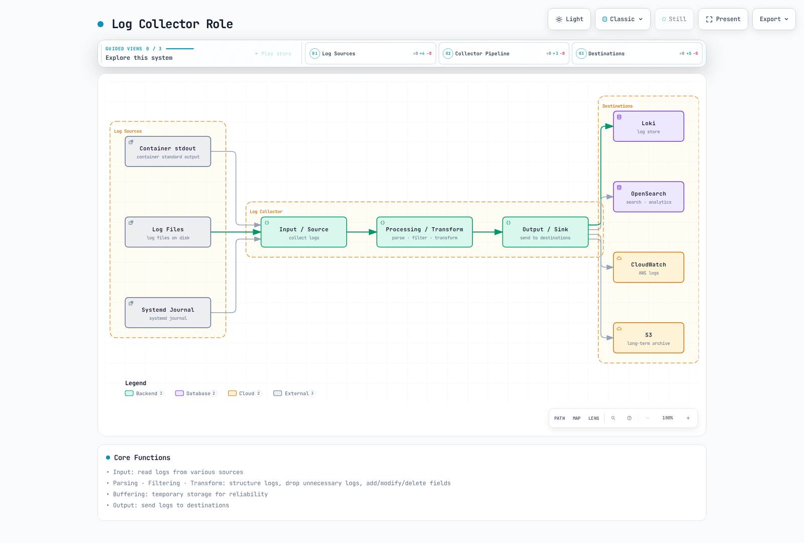
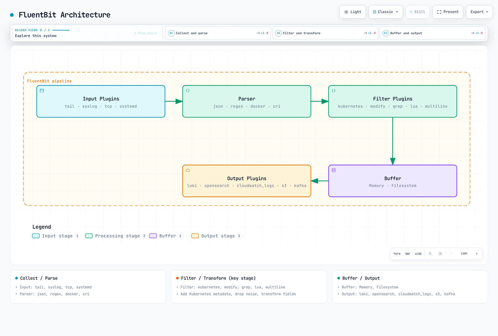
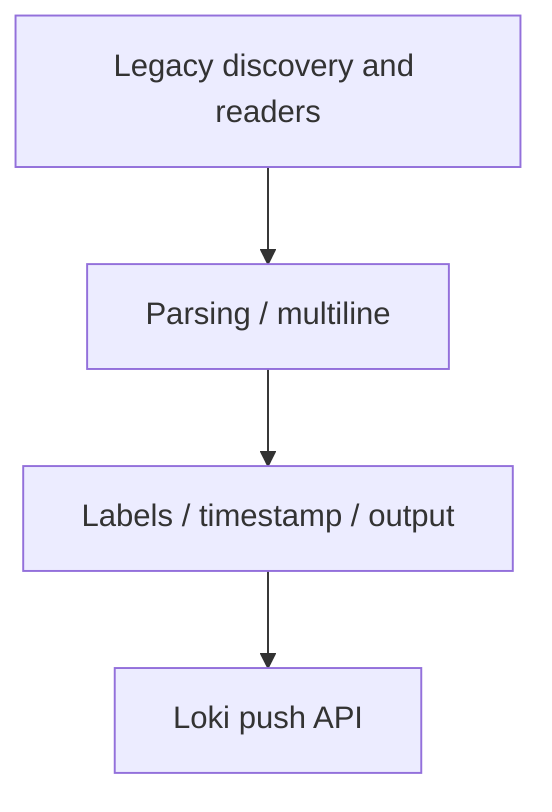
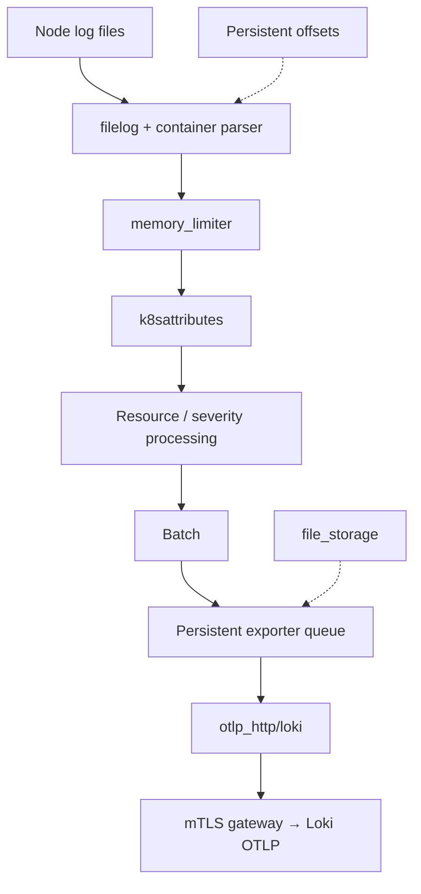
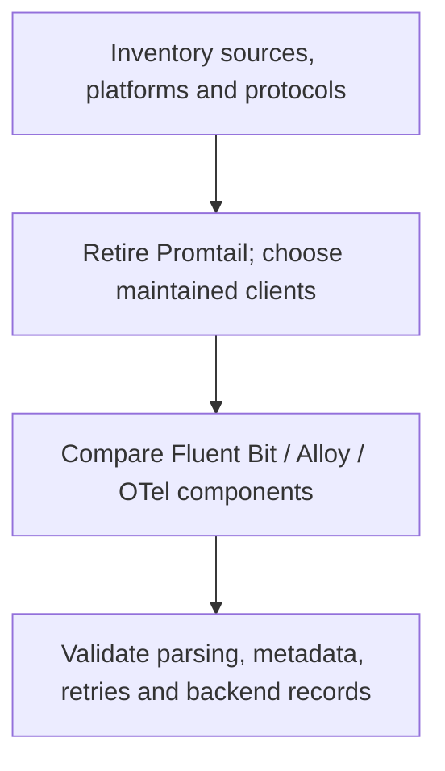

# Comparación de recolectores de logs

> **Última actualización**: 13 de septiembre de 2026

Esta guía compara Fluent Bit, Grafana Alloy y OpenTelemetry Collector, y explica cómo migrar instalaciones retiradas de Promtail. Elija un recolector según sus entradas reales, los plugins de salida, los permisos de despliegue y el comportamiento ante fallos; no se base en supuestas clasificaciones de memoria o eventos por segundo.

Las líneas base de configuración son **Fluent Bit 5.1.2**, **Alloy 1.19.2** y **OpenTelemetry Collector Contrib 0.160.0**. La versión de una distribución, los componentes que incluye y las plataformas que admite son aspectos que deben comprobarse por separado.

## Tabla de contenidos

1. [Descripción general](#overview)
2. [FluentBit](#fluentbit)
3. [Promtail](#promtail)
4. [Grafana Alloy](#grafana-alloy)
5. [OpenTelemetry Collector](#opentelemetry-collector)
6. [Comparación y guía de selección](#comparison-and-selection-guide)

## Descripción general {#overview}

### Función de un recolector de logs



[Ver diagrama interactivo](https://www.atomai.click/kubernetes-docs/archmaps/en-observability-logging-05-collectors-0.html)

La figura muestra destinos posibles. No significa que todos los recolectores admitan de forma nativa cada destino, ni que habilitar varias salidas garantice una entrega transaccional a todas ellas.

### Funciones principales

| Función | Qué verificar |
|---|---|
| Entrada | Permisos de archivos/API, rotación, posición de primera lectura y propiedad de la fuente |
| Análisis | Separar el encuadre del runtime de contenedores del JSON de aplicación o los stack traces |
| Transformación/filtrado | Qué registros y campos se modifican o descartan |
| Metadatos | Asociación correcta de Pod/namespace y cardinalidad controlada de etiquetas |
| Almacenamiento en búfer | Memoria frente a almacenamiento persistente, capacidad, reintentos y política de desbordamiento |
| Salida | Autenticación, TLS, mapeo de tenants, confirmación y límites del destino |

Use una sola ruta de recopilación intencionada por fuente. Varios agentes leyendo los mismos archivos, o lectores de archivos y de la API de Kubernetes apuntando a los mismos Pods, pueden duplicar logs. Los offsets, una cola persistente y la ingestión correcta en el backend son estados distintos.

| Plataforma | Consideraciones de recopilación |
|---|---|
| Nodos de Kubernetes Linux | Los agentes que leen archivos del host necesitan montajes de logs del nodo y un contexto de seguridad permitido; las ubicaciones del journal varían |
| Nodos Windows | Use un build/configuración de Windows admitido y rutas reales de Windows; los manifiestos de Linux que siguen no se aplican |
| EKS Fargate | No instale un DaemonSet que lea archivos del host; use el enrutador de logs administrado de Fargate o una ruta apropiada basada en API/aplicación |
| EKS Auto Mode | Compruebe las rutas de host disponibles y el soporte de add-ons; los logs emitidos por componentes administrados son distintos del stdout de la aplicación |

Los ejemplos envían los datos a un **gateway de logs privado preexistente con mTLS habilitado**. Este debe confiar en el certificado de cliente de cada agente, presentar un certificado que coincida con su nombre DNS, enrutar las rutas de Loki/OTLP y aplicar las políticas de tenants correspondientes. Los certificados, DNS, la configuración del gateway y las NetworkPolicies son requisitos previos; los fragmentos no los crean.

## FluentBit

### Descripción general

Fluent Bit es un agente de telemetría escrito en C del ecosistema graduado de Fluentd. Las versiones actuales admiten logs, métricas, trazas y plugins de OpenTelemetry; la comparación antigua que decía «sin trazas/sin OTLP» es incorrecta. Compruebe qué plugins incluye realmente la imagen seleccionada.

Fluent Bit 5.1.2 y AWS for Fluent Bit son distribuciones con versiones independientes. La etiqueta de una imagen de AWS no indica la versión de Fluent Bit que incluye. Este ejemplo fija la imagen oficial upstream y el digest de su manifiesto; las guías específicas de AWS enlazadas a continuación usan su propia línea base de imagen revisada.

### Arquitectura



[Ver diagrama interactivo](https://www.atomai.click/kubernetes-docs/archmaps/en-observability-logging-05-collectors-1.html)

Interprete el diagrama como una descripción lógica. El almacenamiento en búfer no garantiza entrega exactly-once, y el filtrado no elimina los archivos de logs originales de los contenedores. Proteja el almacenamiento del nodo y controle los datos sensibles en el límite de la aplicación.

### Ejemplo completo de configuración

Guárdelo como `fluent-bit.conf`. Recopila logs de contenedores y usa la **salida nativa `loki` escrita en C**, cuyas opciones incluyen `line_format`, `tenant_id` y `auto_kubernetes_labels`. Los nombres `LineFormat`, `TenantID`, `BatchWait` y `BatchSize` del plugin en Go, desarrollado por separado, no son intercambiables.

```ini
[SERVICE]
    Flush                     2
    Grace                     30
    Daemon                    Off
    Log_Level                 info
    HTTP_Server               On
    HTTP_Listen               0.0.0.0
    HTTP_Port                 2020
    Health_Check              On
    storage.path              /var/lib/fluent-bit/storage
    storage.sync              normal
    storage.checksum          On
    storage.backlog.mem_limit 32M

[INPUT]
    Name                      tail
    Tag                       kube.*
    Path                      /var/log/containers/*.log
    Exclude_Path              /var/log/containers/fluent-bit-*_logging_*.log
    multiline.parser          docker, cri
    DB                        /var/lib/fluent-bit/tail.db
    DB.locking                true
    Mem_Buf_Limit             32M
    Skip_Long_Lines           On
    Refresh_Interval          10
    Rotate_Wait               30
    Read_From_Head            Off
    storage.type              filesystem

[FILTER]
    Name                      kubernetes
    Match                     kube.*
    Kube_URL                  https://kubernetes.default.svc:443
    Kube_Tag_Prefix           kube.var.log.containers.
    Merge_Log                 On
    Merge_Log_Key             log_processed
    Keep_Log                  On
    K8S-Logging.Parser         Off
    K8S-Logging.Exclude        Off
    Use_Kubelet               Off
    Labels                    On
    Annotations               Off

[FILTER]
    Name                      lua
    Match                     kube.*
    script                    /fluent-bit/scripts/process.lua
    call                      process_log
    protected_mode            On

[OUTPUT]
    Name                      loki
    Match                     kube.*
    Host                      logs-gateway.logging.svc.cluster.local
    Port                      443
    tls                       On
    tls.verify                On
    tls.verify_hostname       On
    tls.ca_file               /fluent-bit/tls/ca.crt
    tls.crt_file              /fluent-bit/tls/tls.crt
    tls.key_file              /fluent-bit/tls/tls.key
    Labels                    job=fluent-bit,namespace=$kubernetes['namespace_name']
    line_format               json
    auto_kubernetes_labels    Off
    Retry_Limit               5
    storage.total_limit_size  1G
```

La base de datos de tail y los chunks del sistema de archivos usan el montaje de estado escribible, no el montaje de logs de solo lectura. La lectura se reanuda desde los offsets existentes en la base de datos; `Read_From_Head Off` omite el contenido preexistente cuando se descubre un archivo por primera vez. Elija deliberadamente una política de backfill antes de cambiarlo. `Skip_Long_Lines On`, los reintentos finitos y el almacenamiento finito pueden descartar datos; supervise estas condiciones.

La exclusión coincide con los Pods del propio recolector de este ejemplo. Ajústela si cambia el namespace o el nombre del workload, en lugar de excluir silenciosamente todas las aplicaciones de un namespace. Las anotaciones de Kubernetes no pueden anular en esta configuración la política de parser/exclusión.

El ejemplo usa el servidor de API para obtener metadatos y no requiere acceso a `nodes/proxy` del kubelet. Si habilita `Use_Kubelet`, verifique por separado la dirección del kubelet, la autorización, los certificados y el acceso de red. Un listener HTTP de métricas no autoriza a exponer públicamente el endpoint de interfaz/estado del recolector.

Para otros destinos, seleccione deliberadamente la salida adecuada y la identidad del workload:

- [CloudWatch Logs](03-cloudwatch-logs.md): use `cloudwatch_logs` nativo, un grupo de logs creado previamente y la identidad real del ServiceAccount del agente. No agregue una opción `compress` no admitida ni dé por sentados los permisos de creación/retención.
- [OpenSearch](02-opensearch.md): use la salida nativa `opensearch`, el servicio/Región correctos de SigV4, TLS y la configuración de API sin tipos adecuada al backend seleccionado.
- S3: configure el `store_dir` escribible propio de la salida `s3`, una política de claves de objeto únicas y permisos para el prefijo del bucket. Su comportamiento de almacenamiento en búfer/carga difiere de la cola genérica del sistema de archivos. Pruebe cargas parciales, recuperación tras reinicios y recuperación de datos antes de considerarlo una copia de seguridad.

Si agrega una entrada `systemd`, monte el journal que exista en el sistema operativo del nodo, mantenga escribible su base de datos de cursor y agregue una salida que coincida con su etiqueta. Una entrada `host.systemd` que solo tenga salidas `Match kube.*` no tiene ruta de entrega. Los archivos de journal/auditoría del host no son logs de auditoría de la API del plano de control de EKS.

### Configuración de parsers

Los parsers multilínea integrados `docker, cri` de la entrada tail vuelven a ensamblar fragmentos del runtime de contenedores. Esto es distinto de unir el stack trace de Java/Python/Go de una aplicación.

| Formato | Enfoque |
|---|---|
| Envoltura JSON de Docker | Analizar la envoltura del runtime antes del JSON de la aplicación |
| CRI/containerd/CRI-O | Analizar timestamp, stream y marcadores parcial/completo; volver a ensamblar registros parciales |
| Log JSON de aplicación | Analizar solo el payload de la aplicación; conservar los registros malformados/de texto plano o tratarlos explícitamente |
| Nginx/logfmt/texto personalizado | Seleccionar el parser para el formato de esa aplicación, no encadenar incondicionalmente todos los parsers |
| Stack trace de aplicación | Usar un parser multilínea probado con límites de stream, tamaño y timeout |

Al usar el **filtro** multilínea, siga las pautas de reemisión/orden: colóquelo antes de los filtros que, de otro modo, volverían a procesar los registros reemitidos. Pruebe contenedores intercalados y excepciones sin timestamp; una expresión genérica del tipo «la línea empieza con una fecha» no sirve como parser universal de stack traces.

### Ejemplo de script Lua

Guárdelo como `process.lua`. Enmascara claves seleccionadas en objetos de aplicación analizados, incluidos objetos/arrays anidados, y elimina el duplicado sin enmascarar. **No** detecta todos los secretos ni identificadores personales en texto arbitrario.

```lua
-- Redacts selected structured keys; it is not a general PII detector.
local sensitive = {
    password = true, passwd = true, token = true, secret = true,
    api_key = true, ["api-key"] = true, authorization = true
}

local function redact(value, depth)
    if type(value) ~= "table" then
        return value
    end
    if depth > 8 then
        return "[DEPTH_LIMIT]"
    end
    for key, child in pairs(value) do
        if type(key) == "string" and sensitive[string.lower(key)] then
            value[key] = "***"
        elseif type(child) == "table" then
            value[key] = redact(child, depth + 1)
        end
    end
    return value
end

function process_log(tag, timestamp, record)
    local app = record["log_processed"]
    if type(app) == "table" then
        record["log_processed"] = redact(app, 0)
        -- Do not retain an unredacted duplicate of the parsed application JSON.
        record["log"] = nil
        if type(app["level"]) == "string" then
            record["level"] = string.upper(app["level"])
        else
            record["level"] = "UNKNOWN"
        end
    else
        if type(record["log"]) ~= "string" then
            record["log"] = "[NON_STRING_LOG]"
        end
        record["level"] = "UNKNOWN"
    end
    -- 2 changes the record while retaining the original Fluent Bit timestamp.
    return 2, timestamp, record
end
```

Por ejemplo, se enmascara un campo `password`, pero un texto como `"message": "password=..."` no se reconoce automáticamente como una credencial. Los logs de texto plano siguen siendo texto plano. Esta transformación no es un límite de seguridad fail-closed; proteja los archivos de origen, el almacenamiento local y el destino, y use una lista de elementos permitidos para los logs de la aplicación cuando necesite garantías más estrictas.

`return 2` conserva el timestamp original de Fluent Bit mientras modifica el registro. Las comprobaciones de tipos evitan que un nivel booleano malformado del log haga fallar el callback. Las pruebas ejercitaron estas transformaciones con un intérprete Lua nativo; no se ejecutó el contenedor completo de Fluent Bit.

### Despliegue de DaemonSet

Guarde lo siguiente como `fluent-bit-workload.yaml`. Requiere que exista el Secret `agent-gateway-client` en `logging`, con `ca.crt`, `tls.crt` y `tls.key`. Son credenciales específicas del despliegue; no pegue una clave privada de ejemplo en Git.

```yaml
apiVersion: v1
kind: ServiceAccount
metadata:
  name: fluent-bit
  namespace: logging
---
apiVersion: rbac.authorization.k8s.io/v1
kind: ClusterRole
metadata:
  name: log-collector-fluent-bit
rules:
- apiGroups:
  - ''
  resources:
  - pods
  - namespaces
  verbs:
  - get
  - list
  - watch
---
apiVersion: rbac.authorization.k8s.io/v1
kind: ClusterRoleBinding
metadata:
  name: log-collector-fluent-bit
roleRef:
  apiGroup: rbac.authorization.k8s.io
  kind: ClusterRole
  name: log-collector-fluent-bit
subjects:
- kind: ServiceAccount
  name: fluent-bit
  namespace: logging
---
apiVersion: apps/v1
kind: DaemonSet
metadata:
  name: fluent-bit
  namespace: logging
spec:
  selector:
    matchLabels: &id001
      app.kubernetes.io/name: fluent-bit
  template:
    metadata:
      labels: *id001
    spec:
      serviceAccountName: fluent-bit
      nodeSelector:
        kubernetes.io/os: linux
      terminationGracePeriodSeconds: 45
      containers:
      - name: fluent-bit
        image: fluent/fluent-bit:5.1.2@sha256:d792375ca8e53be72fc25716c28f291f32c6fc6f4f31d12d0d14bc78cefe9226
        command:
        - /fluent-bit/bin/fluent-bit
        args:
        - -c
        - /fluent-bit/etc/fluent-bit.conf
        ports:
        - name: metrics
          containerPort: 2020
        securityContext:
          runAsUser: 0
          allowPrivilegeEscalation: false
          readOnlyRootFilesystem: true
          capabilities:
            drop:
            - ALL
        resources:
          requests:
            cpu: 100m
            memory: 128Mi
          limits:
            cpu: 500m
            memory: 512Mi
        livenessProbe:
          httpGet:
            path: /
            port: metrics
          initialDelaySeconds: 10
        readinessProbe:
          httpGet:
            path: /api/v1/health
            port: metrics
          initialDelaySeconds: 10
        volumeMounts:
        - name: logs
          mountPath: /var/log
          readOnly: true
        - name: state
          mountPath: /var/lib/fluent-bit
        - name: config
          mountPath: /fluent-bit/etc
          readOnly: true
        - name: scripts
          mountPath: /fluent-bit/scripts
          readOnly: true
        - name: tls
          mountPath: /fluent-bit/tls
          readOnly: true
        - name: tmp
          mountPath: /tmp
      volumes:
      - name: logs
        hostPath:
          path: /var/log
          type: Directory
      - name: state
        hostPath:
          path: /var/lib/fluent-bit
          type: DirectoryOrCreate
      - name: config
        configMap:
          name: fluent-bit-config
          items:
          - key: fluent-bit.conf
            path: fluent-bit.conf
      - name: scripts
        configMap:
          name: fluent-bit-config
          items:
          - key: process.lua
            path: process.lua
      - name: tls
        secret:
          secretName: agent-gateway-client
      - name: tmp
        emptyDir:
          sizeLimit: 32Mi
```

Guarde los archivos de configuración/script anteriores y cree su ConfigMap antes de iniciar el workload:

```bash
kubectl create namespace logging --dry-run=client -o yaml |
  kubectl apply -f -
kubectl -n logging create configmap fluent-bit-config \
  --from-file=fluent-bit.conf --from-file=process.lua \
  --dry-run=client -o yaml | kubectl apply -f -
kubectl apply -f fluent-bit-workload.yaml
kubectl -n logging rollout status daemonset/fluent-bit
```

El agente se ejecuta como root para leer las rutas de logs de nodo del ejemplo y escribir en su directorio de estado dedicado, sin capacidades adicionales, escalada de privilegios ni permiso de escritura en el sistema de archivos raíz. El uso de HostPath sigue requiriendo una política de admisión adecuada en el clúster. Adapte los permisos de archivos, SELinux/AppArmor, taints y almacenamiento al sistema operativo real del nodo. No conceda una PriorityClass reservada de importancia crítica del sistema solo para mantener en ejecución un agente de logs de aplicación.

El período de gracia de terminación del Pod de 45 segundos supera los 30 segundos de gracia de Fluent Bit, pero no garantiza la entrega correcta durante una interrupción prolongada. Los límites de recursos son ilustrativos. Verifique los registros reales en el backend, los offsets de tail, el estado de salud y las métricas de búfer/reintentos; que los Pods estén Ready no demuestra por sí solo que los datos se ingieran.

## Promtail

### Descripción general

**Promtail llegó al fin de su vida útil el 2 de marzo de 2026.** El soporte comercial y las futuras actualizaciones finalizaron. Migre las instalaciones existentes a Alloy u otro cliente compatible; no elija Promtail para una nueva implementación de Loki. El retiro anunciado no incluye el cliente independiente `lambda-promtail`.

### Arquitectura



Esta es una ruta de datos histórica, no una recomendación de instalación. Las [excepciones de licencia](https://github.com/grafana/loki/blob/v2.9.4/LICENSING.md) del repositorio de Loki indican que `clients/`, incluido el código fuente de Promtail, está bajo Apache-2.0; no aplique la etiqueta AGPL del servidor Loki a todos sus clientes. Compruebe las licencias del artefacto y las dependencias reales. Las posiciones registran lecturas, no una entrega confirmada al backend.

### Ejemplo completo de configuración

Use un `promtail.yaml` **existente** como entrada para la migración, en lugar de implementar la imagen obsoleta 2.9.4:

```bash
alloy convert --source-format=promtail \
  --report=conversion-report.txt \
  --output=config.alloy promtail.yaml
alloy validate config.alloy
```

Inspeccione la configuración generada y el informe de diagnóstico. No eluda los errores de conversión como paso normal del despliegue. El convertidor admite casi todas las funciones heredadas, pero esto no garantiza que el comportamiento sea idéntico en todos los casos.

La configuración heredada revisada se convirtió correctamente, pero la herramienta advirtió que el límite global de tasa de lectura se convierte en límites `stage.limit` por pipeline, que la configuración de tracing propia de Promtail puede requerir migración manual y que Alloy emite métricas propias diferentes. Actualice las alertas/dashboards y verifique los cambios con datos reales.

### Detalle de las etapas del pipeline

Son **conceptos individuales**, no una receta para ejecutar todos los parsers secuencialmente:

| YAML de Promtail | Equivalente en Alloy | Distinción importante |
|---|---|---|
| `cri` / `docker` | `stage.cri` / `stage.docker` | Elija el encuadre real del runtime |
| `json`, `regex`, `logfmt` | El `stage.*` correspondiente | Seleccione el campo de origen correcto y la política para datos malformados |
| `template`, luego `labels` | `stage.template`, luego `stage.labels` | Normalice antes de copiar valores a las etiquetas |
| `drop` | `stage.drop` | La clave YAML de Promtail es `drop`, no `stage.drop` |
| `match` | `stage.match` | Aplique una rama solo a los streams previstos |
| `metrics` | `stage.metrics` | Revise conjuntos de etiquetas, series inactivas y nombres de métricas |
| `timestamp`, `multiline` | Las etapas correspondientes | Pruebe formatos de tiempo, aislamiento de streams y esperas acotadas |
| `output` | `stage.output` | Reemplazar la línea puede descartar campos necesarios para la correlación |
| `pack` | `stage.pack` | Empaquetar la línea JSON no es la función independiente de structured metadata de Loki |

No indexe por defecto las IP de clientes, IDs de pedidos, IDs de traza ni todas las etiquetas arbitrarias de la aplicación. Las etiquetas de Pod y nombre de archivo también tienen costos de cardinalidad. Decida qué metadatos deben estar disponibles como etiquetas, structured metadata o en el cuerpo del log.

### Despliegue de DaemonSet

Reemplace el workload retirado por el recolector mantenido elegido y gestione deliberadamente la transición de fuente/estado. Un archivo de posiciones bajo `/tmp` no es persistente ni escribible en el ejemplo antiguo con raíz de solo lectura; montar `/run/promtail` no corrige una configuración que escribe en otra ruta.

Coordine la posición de parada del lector antiguo, la posición de inicio del nuevo y las verificaciones en el backend. No ejecute indefinidamente ambos lectores sobre los mismos logs. Que la conversión tenga éxito no valida los montajes de Secrets, el RBAC de Kubernetes, las rutas del journal, la migración de estado ni la entrega al backend.

## Grafana Alloy

### Descripción general

Alloy es la distribución de Grafana del OpenTelemetry Collector con componentes de Prometheus y Loki. Su lenguaje de configuración se denomina **sintaxis de configuración de Alloy**, antes River; es similar a HCL, no es un archivo de Terraform intercambiable.

### Configuración de River

Guarde lo siguiente como `config.alloy`. Este ejemplo usa **una sola ruta basada en archivos** para logs CRI de Linux. Establezca el valor no secreto `NODE_NAME` a partir de `spec.nodeName` mediante la Downward API del Pod, monte los archivos de logs del nodo y proporcione un `--storage.path` persistente y escribible.

```alloy
logging {
  level = "info"
}

discovery.kubernetes "pods" {
  role = "pod"
  selectors {
    role = "pod"
    field = "spec.nodeName=" + sys.env("NODE_NAME")
  }
}

discovery.relabel "pods" {
  targets = discovery.kubernetes.pods.targets
  rule {
    source_labels = ["__meta_kubernetes_namespace", "__meta_kubernetes_pod_label_app_kubernetes_io_name"]
    regex = "logging;alloy"
    action = "drop"
  }
  rule {
    source_labels = ["__meta_kubernetes_namespace"]
    target_label = "namespace"
  }
  rule {
    source_labels = ["__meta_kubernetes_pod_name"]
    target_label = "pod"
  }
  rule {
    source_labels = ["__meta_kubernetes_pod_container_name"]
    target_label = "container"
  }
  rule {
    source_labels = ["__meta_kubernetes_pod_label_app_kubernetes_io_name"]
    target_label = "service_name"
    regex = "(.+)"
  }
  rule {
    source_labels = ["__meta_kubernetes_pod_uid", "__meta_kubernetes_pod_container_name"]
    separator = "/"
    target_label = "__path__"
    replacement = "/var/log/pods/*$1/*.log"
  }
}

local.file_match "pods" {
  path_targets = discovery.relabel.pods.output
}

loki.source.file "pods" {
  targets = local.file_match.pods.targets
  forward_to = [loki.process.pods.receiver]
  tail_from_end = true
}

loki.process "pods" {
  forward_to = [loki.write.logs.receiver]
  stage.cri {}
  stage.json {
    expressions = {
      level = "level",
    }
    drop_malformed = false
  }
  stage.template {
    source = "level"
    template = "{{ if .Value }}{{ $v := ToUpper .Value }}{{ if or (eq $v \"TRACE\") (eq $v \"DEBUG\") (eq $v \"INFO\") (eq $v \"WARN\") (eq $v \"WARNING\") (eq $v \"ERROR\") (eq $v \"FATAL\") (eq $v \"CRITICAL\") }}{{ $v }}{{ else }}UNKNOWN{{ end }}{{ else }}UNKNOWN{{ end }}"
  }
  stage.labels {
    values = {
      level = "",
    }
  }
  stage.label_drop {
    values = ["filename"]
  }
  // Retain the application line, including its trace ID; do not assume it is safe.
}

loki.write "logs" {
  endpoint {
    url = "https://logs-gateway.logging.svc.cluster.local/loki/api/v1/push"
    batch_wait = "1s"
    batch_size = "1MiB"
    tls_config {
      ca_file = "/etc/alloy/tls/ca.crt"
      cert_file = "/etc/alloy/tls/tls.crt"
      key_file = "/etc/alloy/tls/tls.key"
      insecure_skip_verify = false
    }
  }
  external_labels = {
    cluster = "lab-cluster",
  }
}
```

Deben existir los archivos de certificado mTLS configurados. Aplique por separado los permisos de descubrimiento de Kubernetes y la política correspondiente en el gateway. Valide el archivo con el binario Alloy elegido:

```bash
alloy validate config.alloy
```

La etiqueta de severidad se limita a niveles conocidos y `UNKNOWN`, mientras que la línea de la aplicación sigue disponible para búsquedas por trace ID. Esto no es un pipeline de enmascaramiento. Se elimina la etiqueta del nombre de archivo; se conservan las etiquetas de Pod/container, que aún deben evaluarse frente a los límites de retención/cardinalidad.

Para recopilar mediante API, use `loki.source.kubernetes` **en lugar del** lector de archivos y elimine la etapa de envoltura CRI/Docker: la API de logs de Kubernetes proporciona las líneas de log de la aplicación. Un recolector basado en API puede recopilar un clúster sin montajes del host. Varias instancias requieren particionar deliberadamente los targets o configurar el clustering de Alloy con participación de componentes; añadir réplicas sin más puede duplicar la recopilación.

`env()` sigue siendo una función obsoleta en esta versión revisada; use `sys.env()` para configuración no secreta. Prefiera archivos de credenciales montados o componentes que gestionen secretos frente a exponer tokens mediante volcados de entorno.

Se pueden scrapear las métricas propias de Alloy. Para enviarlas a `/api/v1/write` de Prometheus también hace falta habilitar un receptor de remote write o usar un backend diseñado para ello; la URL por sí sola no habilita nada. Mantenga privado el acceso a las métricas/la interfaz. Configure explícitamente la telemetría/el reporting del despliegue.

### Migración desde Promtail

Preserve por separado el análisis del runtime, las etiquetas de descubrimiento, los campos de aplicación, los offsets, la política de descarte, la autenticación del cliente y las alertas sobre métricas propias. Un ejemplo de origen API con un componente de descubrimiento sin definir, o un parser `stage.docker` aplicado a logs de API ya decodificados, no constituye una migración completa.

Alloy 1.19.2 tiene un WAL opcional de Loki, pero esta función es **experimental y está deshabilitada por defecto**. El ejemplo principal no la habilita. Las posiciones persistentes de origen no son una cola duradera de confirmaciones; evalúe por separado los límites de reintentos, la rotación de la fuente y cualquier retención del WAL.

## OpenTelemetry Collector

### Descripción general

OpenTelemetry proporciona pipelines de telemetría independientes del proveedor y se convirtió en un **proyecto Graduado de la CNCF el 11 de mayo de 2026**. Use una distribución que incluya los receivers/processors/exporters necesarios; la distribución core no incluye todos los componentes de Contrib.

OTLP puede usar Protobuf o JSON. El tamaño en el cable depende de los campos reales, la agrupación de recursos, la compresión y el transporte. Filebeat/Fluentd también pueden agrupar datos en lotes. Reemplazar nombres de campos por etiquetas Protobuf no elimina cadenas arbitrarias del cuerpo JSON ni de las claves de atributos.

Como ejemplo aritmético condicional, si un pipeline almacena un evento por registro de Kafka y otro empaqueta 150 eventos por registro, 1.000 eventos requieren unos siete registros en el segundo caso. Eso no demuestra una reducción equivalente de solicitudes de red ni una mejora de rendimiento de 18×. Compare el pipeline completo con hardware, datos, destinos y ajustes de durabilidad equivalentes.

### Arquitectura



Se accede a Loki por su endpoint OTLP. El exporter `loki` retirado del Collector no está presente en Contrib 0.160.0. Los eventos de Kubernetes de todo el clúster y los receivers centralizados de Syslog/OTLP requieren un modelo propio de propiedad y despliegue; no duplique un observador de eventos en cada nodo.

### Ejemplo completo de configuración

Guárdelo como `otel.yaml`. Utiliza el operador `container` de Contrib para analizar/reensamblar el runtime y agregar metadatos de recurso a partir de la ruta del archivo. Para la asociación de Kubernetes especificada, el UID del Pod debe ser un **atributo de recurso**; extraer únicamente un `attributes.uid` normal no basta.

```yaml
extensions:
  file_storage/offsets:
    directory: /var/lib/otelcol/offsets
    create_directory: true
  file_storage/queue:
    directory: /var/lib/otelcol/queue
    create_directory: true
  health_check:
    endpoint: 0.0.0.0:13133

receivers:
  filelog:
    include: [/var/log/pods/*/*/*.log]
    exclude: [/var/log/pods/logging_otel-collector-*/*/*.log]
    start_at: end
    include_file_path: true
    storage: file_storage/offsets
    retry_on_failure:
      enabled: true
      max_elapsed_time: 5m
    operators:
      - type: container
        id: container-parser

processors:
  memory_limiter:
    check_interval: 1s
    limit_mib: 400
    spike_limit_mib: 100
  k8sattributes:
    auth_type: serviceAccount
    filter:
      node_from_env_var: NODE_NAME
    pod_association:
      - sources:
          - from: resource_attribute
            name: k8s.pod.uid
    extract:
      metadata:
        - k8s.namespace.name
        - k8s.pod.name
        - k8s.pod.uid
        - k8s.node.name
        - k8s.container.name
  resource/cluster:
    attributes:
      - key: k8s.cluster.name
        value: lab-cluster
        action: upsert
  transform/application:
    error_mode: ignore
    log_statements:
      - context: log
        statements:
          - 'set(cache["app"], ParseJSON(body)) where IsString(body) and IsMatch(body, "^\\s*\\{")'
          - 'set(severity_text, ConvertCase(cache["app"]["level"], "upper")) where IsMap(cache["app"]) and IsString(cache["app"]["level"])'
          - 'set(severity_number, SEVERITY_NUMBER_ERROR) where severity_text == "ERROR"'
          - 'set(severity_number, SEVERITY_NUMBER_WARN) where severity_text == "WARN" or severity_text == "WARNING"'
          - 'set(severity_number, SEVERITY_NUMBER_INFO) where severity_text == "INFO"'
          - 'set(severity_number, SEVERITY_NUMBER_DEBUG) where severity_text == "DEBUG"'
          - 'set(severity_number, SEVERITY_NUMBER_TRACE) where severity_text == "TRACE"'
          - 'set(severity_number, SEVERITY_NUMBER_FATAL) where severity_text == "FATAL" or severity_text == "CRITICAL"'
  batch:
    send_batch_size: 1024
    send_batch_max_size: 2048
    timeout: 2s

exporters:
  otlp_http/loki:
    endpoint: https://logs-gateway.logging.svc.cluster.local/otlp
    encoding: proto
    compression: gzip
    tls:
      ca_file: /etc/otelcol/tls/ca.crt
      cert_file: /etc/otelcol/tls/tls.crt
      key_file: /etc/otelcol/tls/tls.key
    sending_queue:
      enabled: true
      num_consumers: 2
      queue_size: 128
      storage: file_storage/queue
    retry_on_failure:
      enabled: true
      max_elapsed_time: 5m

service:
  extensions: [file_storage/offsets, file_storage/queue, health_check]
  telemetry:
    logs:
      level: info
    metrics:
      readers:
        - pull:
            exporter:
              prometheus:
                host: 0.0.0.0
                port: 8888
  pipelines:
    logs:
      receivers: [filelog]
      processors: [memory_limiter, k8sattributes, resource/cluster, transform/application, batch]
      exporters: [otlp_http/loki]
```

Proporcione el valor `NODE_NAME` de la Downward API, montajes de logs del nodo de solo lectura, un `/var/lib/otelcol` escribible, RBAC para metadatos de Kubernetes y montajes del certificado de cliente. Las extensiones de almacenamiento crean sus propios directorios dentro de ese volumen escribible. Valide con los valores del entorno desplegado:

```bash
otelcol-contrib validate --config=otel.yaml
```

El exporter añade `/v1/logs` a `/otlp`; configure en consecuencia el gateway y el soporte de OTLP/structured metadata de Loki. En esta línea base, `service.telemetry.metrics.readers` reemplaza la antigua clave `address`, que no era válida.

`memory_limiter` puede rechazar datos con un error reintentable y solicitar la recolección de basura. No es un límite de memoria del proceso ni una garantía absoluta contra OOM. Importa el comportamiento de reintentos upstream; este receptor de archivos reintenta durante un máximo de cinco minutos y, después, puede descartar un lote fallido. También hay que probar la capacidad de la cola y del disco, el apagado y los fallos del backend.

Se conserva el cuerpo de la aplicación, incluidos texto plano y JSON malformado. El análisis de severidad no elimina datos sensibles. No añada un exporter paralelo de depuración detallada que copie inadvertidamente payloads de producción sin enmascarar en los logs del recolector.

### Connector de enrutamiento

Esta **demostración independiente de enrutamiento local** define todos los componentes referenciados y una ruta de reserva. Un productor OTLP proporciona `resource.attributes["logtype"]`; un campo del cuerpo JSON de la aplicación no se convierte automáticamente en un atributo de recurso.

```yaml
receivers:
  otlp:
    protocols:
      http:
        endpoint: 127.0.0.1:4318

connectors:
  routing:
    default_pipelines: [logs/other]
    table:
      - condition: resource.attributes["logtype"] == "mysql"
        pipelines: [logs/mysql]
      - condition: resource.attributes["logtype"] == "nginx"
        pipelines: [logs/nginx]
      - condition: resource.attributes["logtype"] == "app"
        pipelines: [logs/app]

exporters:
  file/mysql:
    path: /var/lib/otelcol/routed/mysql.json
  file/nginx:
    path: /var/lib/otelcol/routed/nginx.json
  file/app:
    path: /var/lib/otelcol/routed/app.json
  file/other:
    path: /var/lib/otelcol/routed/other.json

service:
  pipelines:
    logs/ingestion:
      receivers: [otlp]
      exporters: [routing]
    logs/mysql:
      receivers: [routing]
      exporters: [file/mysql]
    logs/nginx:
      receivers: [routing]
      exporters: [file/nginx]
    logs/app:
      receivers: [routing]
      exporters: [file/app]
    logs/other:
      receivers: [routing]
      exporters: [file/other]
```

Cree el directorio de salida escribible antes de ejecutar este ejemplo. Su receptor se enlaza a loopback y sus destinos son archivos locales; no es un gateway de producción ni una implementación de ClickHouse. Sustituya las salidas locales solo después de configurar cada backend real, la autenticación y la política de almacenamiento.

El connector actual acepta `statement: route() where ...`; se verificó y no se trata erróneamente como retirado. `condition` es la forma más clara utilizada aquí. La acción predeterminada `move` elimina los datos coincidentes del enrutamiento posterior; `copy` tiene un comportamiento de fan-out diferente. Los registros que no coincidan necesitan una ruta de reserva intencionada.

Combinar topics de Kafka puede simplificar la administración solo cuando las ACL, la retención, las particiones, la propiedad de los consumidores y el aislamiento de fallos siguen siendo adecuados. La clasificación dentro del Collector no sustituye el aislamiento del broker ni hace atómico el fan-out. Un atributo de enrutamiento controlado por el productor no es un límite de autorización de tenants.

### Separación de pools por nivel de log (entornos a gran escala)

| Pool | Objetivo de ejemplo | Controles necesarios |
|---|---|---|
| Rápido: ERROR/FATAL | Entrega en menos de dos minutos | Capacidad reservada, aislamiento adecuado de cola/particiones y backlog medido |
| Común: INFO/WARN | Entrega en menos de 15 minutos | Autoescalado medido y retención/colas acotadas |
| Depuración: DEBUG/TRACE | Best effort | Política explícita de descarte/limitación y visibilidad de los datos descartados |

Son objetivos ilustrativos, no SLA medidos. Nombrar tres Deployments o asignar réplicas no enruta datos ni aísla por sí solo una cola de entrada compartida y congestionada. Dimensione las solicitudes y los límites de recursos a partir del tamaño de entrada, el procesamiento, el batching y los reintentos observados.

Use una PriorityClass propiedad del operador y adecuada al clúster, no las clases reservadas `system-cluster-critical`/`system-node-critical` como recomendación general para logs. Los nodos dedicados, las prioridades y la capacidad de reserva no garantizan disponibilidad ante todos los fallos.

## Comparación y guía de selección {#comparison-and-selection-guide}

### Tabla comparativa de funciones

| Elemento | Fluent Bit | Promtail | Alloy | OTel Collector Contrib |
|---|---|---|---|---|
| Ciclo de vida | Mantenido | EOL; migrar | Mantenido | Mantenido |
| Configuración | Configuración clásica / YAML | YAML heredado | Sintaxis de Alloy | YAML |
| Señales | Logs/métricas/trazas según el plugin | Principalmente logs de Loki | Logs/métricas/trazas | Logs/métricas/trazas según los componentes |
| Ruta a Loki | Salida nativa | Cliente push heredado | Componentes de Loki | Exporter HTTP OTLP |
| Salidas de AWS | Hay plugins nativos | No es su propósito | Compruebe los componentes incluidos/la ruta de reenvío | Compruebe los exporters de AWS incluidos |
| Extensibilidad | C/plugins, filtros Lua y otras opciones según el build | Etapas de pipeline heredadas | Componentes y pipelines | Receivers/processors/connectors/exporters |
| Persistencia | Chunks/estado de entrada y almacenamiento específico de cada salida | Posiciones de origen; almacenamiento en búfer acotado del cliente | Posiciones; WAL de Loki experimental opcional | File storage para offsets y colas compatibles de exporters |
| Uso de recursos | Mida la configuración seleccionada | Solo hay mediciones históricas | Mida la configuración seleccionada | Mida la configuración seleccionada |

La compatibilidad con un plugin nativo no equivale a reenviar OTLP a un segundo recolector. Confirme la lista real de componentes de la distribución instalada y el protocolo del backend antes de concluir que se admite o no un destino.

### Recomendaciones por caso de uso

- Evalúe Fluent Bit para integraciones de salida nativas existentes y una huella de agente de nodo adecuada a la carga de trabajo medida.
- Evalúe Alloy para flujos de trabajo de Grafana/Loki/Prometheus y la migración desde Promtail, con un único modelo deliberado de propiedad de la fuente.
- Evalúe OpenTelemetry Collector para OTLP estándar y pipelines multiproveedor que necesiten sus processors/connectors.
- Migre Promtail; mantenerlo solo porque ya está en ejecución no es una opción compatible a largo plazo.

### Flujo de decisión



## Referencias y alcance de validación

- [Código fuente y capacidades de Fluent Bit 5.1.2](https://github.com/fluent/fluent-bit/tree/v5.1.2)
- [Opciones de la salida nativa de Loki](https://github.com/fluent/fluent-bit/blob/v5.1.2/plugins/out_loki/loki.c)
- [Ciclo de vida de Promtail](https://grafana.com/docs/loki/latest/send-data/promtail/)
- [Migración a Alloy](https://grafana.com/docs/alloy/latest/set-up/migrate/from-promtail/)
- [Fuente de API de Kubernetes en Alloy](https://grafana.com/docs/alloy/latest/reference/components/loki/loki.source.kubernetes/)
- [Salida Loki/WAL de Alloy](https://grafana.com/docs/alloy/latest/reference/components/loki/loki.write/)
- [Release de Collector Contrib](https://github.com/open-telemetry/opentelemetry-collector-releases/releases/tag/v0.160.0)
- [Receptor filelog](https://github.com/open-telemetry/opentelemetry-collector-contrib/blob/v0.160.0/receiver/filelogreceiver/README.md)
- [Connector de enrutamiento](https://github.com/open-telemetry/opentelemetry-collector-contrib/blob/v0.160.0/connector/routingconnector/README.md)
- [Memory limiter](https://github.com/open-telemetry/opentelemetry-collector/blob/v0.160.0/processor/memorylimiterprocessor/README.md)
- [Estado de OpenTelemetry en la CNCF](https://www.cncf.io/projects/opentelemetry/)
- [Logging en EKS Fargate](https://docs.aws.amazon.com/eks/latest/userguide/fargate-logging.html)

La validación cubre las comprobaciones de configuración de las versiones publicadas de Alloy/Collector, el procesamiento local de logs sintéticos, las pruebas de transformación Lua, los contratos oficiales de plugins/fuentes y la estructura de manifiestos de Kubernetes. No se ejecutó una búsqueda real de metadatos de Kubernetes, el despliegue de un agente de nodo, mTLS de gateway, entrega a AWS, alta disponibilidad, carga de producción ni un benchmark de rendimiento.

## Cuestionario

Ponga a prueba su comprensión con el [cuestionario de recolectores de logs](../../quizzes/observability/logging/05-collectors-quiz.md).
