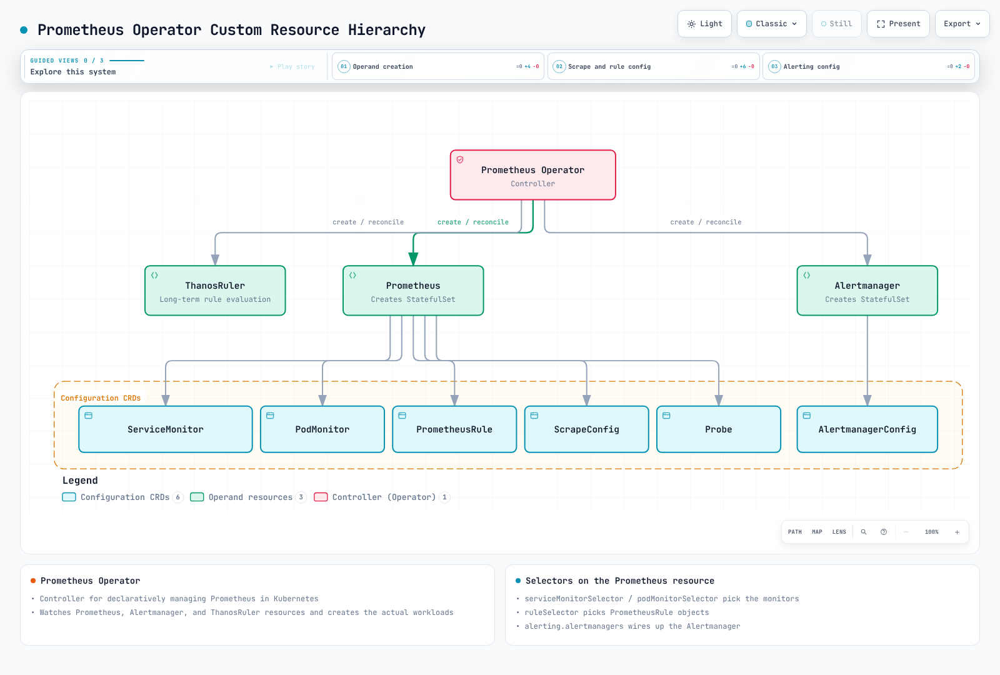

# Prometheus

> **Última actualización**: 14 de septiembre de 2026. Más adelante se describen las comprobaciones locales de configuración y consultas; no se realizó ningún despliegue en un clúster ni en la nube.

## Contenido

- [Introducción y versiones](#introduction-and-versions)
- [Arquitectura y componentes](#architecture-and-components)
- [PromQL](#promql)
- [Descubrimiento y selectores del Operator](#discovery-and-operator-selectors)
- [Instalación de kube-prometheus-stack](#kube-prometheus-stack-installation)
- [Reglas y Alertmanager](#rules-and-alertmanager)
- [Remote write y AMP](#remote-write-and-amp)
- [Rendimiento, HA y solución de problemas](#performance-ha-and-troubleshooting)

<span id="introduction-and-versions"></span>

## Introducción y versiones

Prometheus es el conjunto de herramientas de monitoreo de la CNCF desarrollado originalmente en SoundCloud. Recopila series temporales numéricas, las almacena en una TSDB local, evalúa PromQL y reglas de registro (recording) y de alerta, y envía alertas a Alertmanager. La recopilación normal usa scraping por HTTP; remote write y las integraciones por lotes opcionales añaden otras rutas de entrega. No es un registro de eventos, un almacén de trazas ni un libro contable exacto de facturación por solicitud.

La retención local es configurable y puede superar los 30 días. Elegir un almacén separado depende del periodo de retención, la capacidad, las consultas compartidas y los requisitos de recuperación ante fallos.

Este capítulo utiliza el paquete oficial **kube-prometheus-stack 90.0.0**, publicado el 6 de septiembre de 2026. Las versiones de sus componentes se revisaron como una combinación:

| Componente | Valor por defecto del paquete |
|---|---|
| Prometheus Operator | 0.93.1 |
| Prometheus | 3.14.0, imagen distroless |
| Alertmanager | 0.34.0 |
| Grafana | 13.2.1, subchart 13.2.2 |
| kube-state-metrics | 2.20.0, subchart 8.4.2 |
| node-exporter | 1.12.1, subchart 4.56.3 |

La condición `kubeVersion` del chart exige `>=1.25.0-0`. Esto no constituye una matriz completa de compatibilidad ni significa que todas las versiones de Kubernetes 1.25 o posteriores sigan teniendo soporte. Compruebe la versión real del clúster, el soporte de los componentes, la política de admisión y el controlador de almacenamiento.

El perfil está destinado a **nodos de trabajo de EKS con Linux en EC2**. Fargate no admite DaemonSets; Auto Mode, Hybrid Nodes y Windows requieren comprobar la compatibilidad de los recolectores y el almacenamiento para cada plataforma.

### Actualización de septiembre de 2026

- Según el [artículo de Kubernetes del 11 de septiembre](https://kubernetes.io/blog/2026/09/11/kubernetes-v1-37-native-histograms-beta/), la compatibilidad con [histogramas nativos de Prometheus](https://prometheus.io/docs/specs/native_histograms/) para las métricas de componentes de Kubernetes (KEP-5808) pasa a Beta y se habilita de forma predeterminada en v1.37. Los intervalos de alta resolución y baja cardinalidad sustituyen a los intervalos fijos `le`, lo que mejora la precisión de las métricas de latencia y reduce la sobrecarga de almacenamiento y recolección. Para aprovechar esta función, Prometheus también debe estar configurado para ingerir histogramas nativos; las consultas y los paneles existentes que utilizan histogramas clásicos requieren una revisión aparte.

### Actualizaciones históricas de julio de 2026

- El [artículo del 14 de julio sobre exporters de Kubernetes](https://kubernetes.io/blog/2026/07/14/custom-metrics-exporter-kubernetes/) explica la instrumentación de aplicaciones y los exporters personalizados. El uso de HPA también requiere la API/adaptador de métricas adecuado; el scraping por sí solo no conecta métricas arbitrarias con HPA.
- El [anuncio de AMP del 21 de julio](https://aws.amazon.com/about-aws/whats-new/2026/07/amazon-managed-service-prometheus-1500m-metrics-workspace/) describe hasta 1500 millones de series activas y 200 000 reglas de registro/alerta por workspace. Son límites de escalado anunciados, no cuotas por defecto concedidas automáticamente ni garantías de aprobación. Revise las cuotas actuales del workspace/cuenta previstos.

<span id="architecture-and-components"></span>

## Arquitectura y componentes


[Diagrama interactivo](https://www.atomai.click/kubernetes-docs/archmaps/en-observability-metrics-01-prometheus-0.html)

La ruta de Pushgateway es opcional para trabajos por lotes adecuados a nivel de servicio, no para cualquier Pod de corta duración. Los grupos requieren gestionar su ciclo de vida; consulte la [visión general de métricas](README.md). `up` indica el estado de la recolección, no la disponibilidad de la aplicación.

| Componente | Responsabilidad y prerrequisitos |
|---|---|
| Prometheus | Descubrimiento, scraping, TSDB local, API de consultas y evaluación de reglas |
| kube-state-metrics | Estado de los objetos de la API; necesita ServiceAccount, RBAC y un endpoint de scraping |
| node-exporter | Métricas del sistema operativo del host; requiere revisar el acceso/montajes del host y el soporte de la plataforma |
| kubelet/cAdvisor | Mediciones de contenedores; verifique los certificados de servicio, la autorización y la disponibilidad del endpoint |
| metrics-server / adaptadores | APIs de métricas de recursos/personalizadas para el autoescalado; independientes del almacenamiento histórico en TSDB |
| Alertmanager | Agrupa, deduplica, inhibe y enruta alertas a los receptores configurados |
| Grafana | Consulta/visualiza fuentes de datos; la autenticación y la base de datos/almacenamiento requieren su propia configuración |

El chart proporciona los exporters y los recursos de apoyo. Los fragmentos incompletos de Deployment/DaemonSet independientes no aportan los ServiceAccounts, RBAC y Services que falten, y no deberían crear una pila de monitoreo duplicada.

### Capas de TSDB y de configuración

Las muestras recientes se almacenan en el bloque activo y el WAL; los bloques compactados contienen segmentos de datos, un índice y metadatos. Las marcas de eliminación indican los rangos borrados. Reproducir el WAL ayuda a recuperarse de una caída, pero no sustituye a las copias de seguridad, no protege frente a la pérdida del volumen ni garantiza recuperar todos los eventos.

| Capa | Ajustes correctos |
|---|---|
| Flags del proceso | `--storage.tsdb.path`, `--storage.tsdb.retention.time`, `--storage.tsdb.retention.size` |
| Configuración de Prometheus | `global`, `scrape_configs`, `rule_files`, `remote_write` |
| `Prometheus.spec` del Operator | `retention`, `retentionSize`, `storage`, `replicas`, `shards` |
| Valores de este chart | `prometheus.prometheusSpec.retention`, `storageSpec` y los valores siguientes |

El antiguo YAML `storage.tsdb.path/retention.time/...` no es una configuración válida del proceso. En una **instalación independiente separada**, las opciones básicas de arranque son las siguientes:

```sh
prometheus --config.file=prometheus.yml \
  --storage.tsdb.path=/prometheus \
  --storage.tsdb.retention.time=15d \
  --storage.tsdb.retention.size=15GB
```

En la instalación con el Operator, configure los valores de la instalación de Helm que administra el despliegue. El tamaño de retención no es un límite estricto para todo el disco: deje espacio para el WAL, el bloque activo, los índices y la compactación. Utilice almacenamiento local o de bloques compatible; un servidor NFS arbitrario no es una alternativa admitida.

## PromQL

Los ejemplos asumen `job="example-app"` y las etiquetas de job de node-exporter/kube-state-metrics del chart. Adáptelos a los targets reales. `example_queue_depth` y `temperature_celsius` son gauges definidos por la aplicación, no métricas integradas de Kubernetes.

### Selectores, rangos y tasas

Los selectores instantáneos utilizan las reglas de búsqueda retrospectiva y obsolescencia para encontrar muestras válidas; «actual» no garantiza una observación exactamente en el instante de evaluación. Un selector de rango elige un intervalo de muestras. Una subconsulta evalúa una expresión con la resolución indicada, sin limitarse a seleccionar una de cada N muestras originales almacenadas.

| Propósito | PromQL |
|---|---|
| Selector instantáneo | `http_requests_total{job="example-app"}` |
| Filtrado positivo/por regex | `http_requests_total{job="example-app",method="GET",status=~"2[0-9]{2}"}` |
| Regex negativa | `http_requests_total{job="example-app",status!~"5[0-9]{2}"}` |
| Vector de rango | `http_requests_total{job="example-app"}[5m]` |
| Subconsulta de una hora con resolución de cinco minutos | `rate(http_requests_total{job="example-app"}[5m])[1h:5m]` |
| Ventana de tasa una hora antes | `rate(http_requests_total{job="example-app"}[5m] offset 1h)` |
| Tasa media por segundo de un contador | `rate(http_requests_total{job="example-app"}[5m])` |
| Tasa a partir de las dos últimas muestras utilizables | `irate(http_requests_total{job="example-app"}[5m])` |
| Incremento extrapolado del contador | `increase(http_requests_total{job="example-app"}[1h])` |

Los matchers negativos pueden seleccionar series que no tienen la etiqueta. `rate()` e `increase()` gestionan los reinicios observados y extrapolan; no pueden recuperar todos los incrementos perdidos. Aplique la **tasa antes de la agregación**. `irate()` es sensible a las muestras más recientes y suele ser menos adecuado para condiciones de alerta estables.

Un vector de rango es una entrada para funciones de rango, no una gráfica de consulta de rango lista para usar. Por ejemplo, use `rate(counter[5m])` cuando solicite una serie de tasa evaluada.

### Agregación, gauges y tiempo

| Propósito | PromQL |
|---|---|
| Tasa de solicitudes por método | `sum by (method) (rate(http_requests_total{job="example-app"}[5m]))` |
| Agregar eliminando instance | `sum without (instance) (rate(http_requests_total{job="example-app"}[5m]))` |
| Suma de indicadores Running deduplicados | `sum(max by (namespace,pod,uid) (kube_pod_status_phase{job="kube-state-metrics",phase="Running"}))` |
| Memoria disponible máxima | `max(node_memory_MemAvailable_bytes{job="node-exporter"})` |
| CPU de los Pods principales sin etiquetas de contenedor vacías/de infraestructura | `topk(5, sum by (namespace,pod) (rate(container_cpu_usage_seconds_total{job="kubelet",container!="",container!="POD"}[5m])))` |
| Cuantil entre los gauges actuales de profundidad de cola | `quantile(0.95, example_queue_depth{job="example-app"})` |
| Desviación estándar entre tasas | `stddev(rate(http_requests_total{job="example-app"}[5m]))` |
| Cambio extrapolado de un Gauge | `delta(temperature_celsius{job="example-app"}[1h])` |
| Pendiente del Gauge por segundo | `deriv(temperature_celsius{job="example-app"}[1h])` |
| Desviación absoluta respecto a 20 °C | `abs(temperature_celsius{job="example-app"} - 20)` |
| Redondeo hacia arriba | `ceil(example_queue_depth{job="example-app"})` |
| Acotar a un rango | `clamp(example_queue_depth{job="example-app"}, 0, 100)` |
| Raíz cuadrada | `sqrt(example_queue_depth{job="example-app"})` |
| Logaritmo natural | `ln(example_queue_depth{job="example-app"})` |
| Instante de evaluación en segundos Unix | `time()` |
| Marca de tiempo de la muestra seleccionada | `timestamp(up{job="example-app"})` |
| Hora UTC de la muestra | `hour(timestamp(up{job="example-app"}))` |

Contar las series `kube_pod_status_phase{phase="Running"}` también cuenta las que valen cero. Sumar los indicadores 0/1 después de eliminar las identidades duplicadas de los exportadores devuelve cero si solo existen indicadores con ese valor; cuando falta la telemetría, el resultado sigue estando ausente.

El ejemplo de `quantile()` con una métrica de tipo gauge compara valores entre series. No calcula el p95 de latencia de solicitudes de un histograma ni combina los valores p99 de métricas Summary. Las funciones matemáticas tienen restricciones sobre sus entradas; por ejemplo, aplicar un logaritmo a un valor no positivo requiere un tratamiento explícito. Otras funciones relacionadas son `floor`, `round`, `clamp_min` y `clamp_max`.

Este filtro de horario laboral está en **UTC**, no en la zona horaria del navegador/clúster:

```promql
sum(rate(http_requests_total{job="example-app"}[5m])) and on() (hour() >= 9 < 18)
```

### Distribuciones y previsiones

```promql
histogram_quantile(0.95, sum by (le) (rate(http_request_duration_seconds_bucket{job="example-app"}[5m])))
```

```promql
histogram_quantile(0.99, sum by (le,method) (rate(http_request_duration_seconds_bucket{job="example-app"}[5m])))
```

```promql
sum(rate(http_request_duration_seconds_sum{job="example-app"}[5m])) / sum(rate(http_request_duration_seconds_count{job="example-app"}[5m]))
```

Agregue intervalos compatibles de histogramas clásicos y conserve `le`. Los cuantiles se calculan mediante interpolación dentro de los intervalos. Los cuantiles de Summary también son aproximaciones y no pueden promediarse para obtener un percentil de todo el conjunto; sum/count sí permite calcular una media conjunta.

`predict_linear()` extrapola una tendencia ajustada de un Gauge. Una proyección negativa es un motivo para investigar, no un fallo de disco futuro garantizado:

```promql
predict_linear(node_filesystem_avail_bytes{job="node-exporter",mountpoint="/",fstype!~"tmpfs|overlay"}[6h], 86400)
```

Prometheus 3 cambió el nombre de `holt_winters` a `double_exponential_smoothing`. Se trata de **suavizado lineal de Holt, no de predicción estacional mediante suavizado exponencial triple**, y requiere muestras de tipo gauge con valores de coma flotante. Expresión opcional: `double_exponential_smoothing(example_queue_depth{job="example-app"}[1h], 0.5, 0.5)`. El servidor que la evalúa necesita `--enable-feature=promql-experimental-functions`. La auditoría local comprobó la sintaxis con el analizador; no se afirma que la evaluación de valores experimentales haya superado las pruebas.

### Ejemplos operativos

| Propósito | PromQL |
|---|---|
| Porcentaje de CPU no inactiva | `100 * (1 - avg by (instance) (rate(node_cpu_seconds_total{job="node-exporter",mode="idle"}[5m])))` |
| Proporción no reportada como MemAvailable | `100 * (1 - node_memory_MemAvailable_bytes{job="node-exporter"} / node_memory_MemTotal_bytes{job="node-exporter"})` |
| Incremento estimado de reinicios por encima de tres | `increase(kube_pod_container_status_restarts_total{job="kube-state-metrics"}[1h]) > 3` |
| Porcentaje de espacio no disponible en el sistema de archivos | `100 * (1 - node_filesystem_avail_bytes{job="node-exporter",mountpoint="/"} / node_filesystem_size_bytes{job="node-exporter",mountpoint="/"})` |
| Bytes recibidos + transmitidos por segundo | `rate(node_network_receive_bytes_total{job="node-exporter",device="eth0"}[5m]) + rate(node_network_transmit_bytes_total{job="node-exporter",device="eth0"}[5m])` |

Al calcular el porcentaje de errores, un servicio que funciona correctamente puede no tener series 5xx. El valor cero alternativo del ejemplo siguiente solo se genera para grupos que tienen tráfico total coincidente; no crea datos de servicios que carecen de telemetría.

```promql
100 * (sum by (namespace, service) (rate(http_requests_total{job="example-app",status=~"5[0-9]{2}"}[5m])) or on (namespace, service) (0 * (sum by (namespace, service) (rate(http_requests_total{job="example-app"}[5m]))))) / (sum by (namespace, service) (rate(http_requests_total{job="example-app"}[5m])))
```

El tráfico observado sin errores devuelve 0; si todo el tráfico es 5xx, devuelve 100. Un denominador cero deja el resultado indefinido. La falta de telemetría sigue siendo ausencia de datos; supervise por separado los fallos de recolección.

<span id="discovery-and-operator-selectors"></span>

## Descubrimiento y selectores del Operator



[Diagrama interactivo](https://www.atomai.click/kubernetes-docs/archmaps/en-observability-metrics-01-prometheus-1.html)

Los nodos Prometheus/Alertmanager de esta figura representan **recursos personalizados** (custom resources). El Operator los lee y reconcilia cargas de trabajo reales, como StatefulSets. Ni los objetos ni el servidor Prometheus crean StatefulSets por sí solos.

| Etapa de selección | Objeto seleccionado |
|---|---|
| Prometheus `serviceMonitorNamespaceSelector` | Namespaces que contienen objetos ServiceMonitor |
| Prometheus `serviceMonitorSelector` | Etiquetas de esos objetos ServiceMonitor |
| ServiceMonitor `namespaceSelector` / `selector` | Namespaces y etiquetas del Service de destino |
| Endpoint `port` del ServiceMonitor | **Nombre del puerto del Service**, no un número arbitrario de puerto de contenedor |
| Selector de PodMonitor / endpoint `port` | Etiquetas del Pod y nombre del puerto de contenedor declarado |

RBAC, el descubrimiento y el acceso de red/TLS son requisitos separados. Los selectores no sustituyen a la autorización. Los booleanos `*SelectorNilUsesHelmValues` de Helm afectan a los valores por defecto de los selectores de etiquetas, no a todos los namespaces de destino.

### Recolección coherente de métricas de aplicación

Suponga un Deployment instrumentado existente en `example-app`, con la etiqueta de Pod `app: example-app` y un puerto declarado llamado `metrics` que sirve `/metrics`. El Service siguiente no crea la aplicación:

```yaml
# service.yaml
apiVersion: v1
kind: Service
metadata:
  name: example-app
  namespace: example-app
  labels:
    app: example-app
    metrics-job: example-app
spec:
  selector:
    app: example-app
  ports:
  - name: http-metrics
    port: 8080
    targetPort: metrics
```

```yaml
# servicemonitor.yaml
apiVersion: monitoring.coreos.com/v1
kind: ServiceMonitor
metadata:
  name: example-app
  namespace: monitoring
  labels:
    release: kube-prom
spec:
  jobLabel: metrics-job
  selector:
    matchLabels:
      app: example-app
  namespaceSelector:
    matchNames:
    - example-app
  endpoints:
  - port: http-metrics
    path: /metrics
    interval: 30s
    scrapeTimeout: 10s
    relabelings:
    - sourceLabels:
      - __meta_kubernetes_service_name
      targetLabel: service
    - sourceLabels:
      - __meta_kubernetes_namespace
      targetLabel: namespace
    - sourceLabels:
      - __meta_kubernetes_pod_name
      targetLabel: pod
```

El `release: kube-prom` del ServiceMonitor coincide con la instalación. Su `jobLabel` lee el `metrics-job: example-app` del Service, estableciendo la etiqueta de job para las consultas de la aplicación.

PodMonitor es una **alternativa** para los mismos Pods. Elija una única ruta de recopilación prevista para un endpoint a fin de evitar la ingesta duplicada:

```yaml
# podmonitor.yaml
apiVersion: monitoring.coreos.com/v1
kind: PodMonitor
metadata:
  name: example-app-pods
  namespace: monitoring
  labels:
    release: kube-prom
spec:
  selector:
    matchLabels:
      app: example-app
  namespaceSelector:
    matchNames:
    - example-app
  podMetricsEndpoints:
  - port: metrics
    interval: 30s
    path: /metrics
    relabelings:
    - targetLabel: job
      replacement: example-app
    - targetLabel: service
      replacement: example-app
```

### Otras rutas de descubrimiento

- El descubrimiento de Pods en modo independiente/agente puede usar la [configuración de puertos con nombre de la visión general](README.md#metric-collection-models), que conserva las direcciones IPv4/IPv6 proporcionadas por el descubrimiento. Una anotación como `prometheus.io/scheme` no tiene efecto a menos que la configuración real la consuma.
- El sondeo blackbox de servicios necesita un exporter instalado, un módulo de sondeo definido, una URL/esquema de destino adecuados y una configuración `Probe`/de scraping. `up` describe el scraping del exporter; el éxito del sondeo es una señal distinta.
- El descubrimiento de nodos alcanza los endpoints de kubelet, no automáticamente node-exporter. Verifique los certificados de servicio, la CA correcta y el RBAC de métricas de nodo. La CA de la API de Kubernetes no acredita la confianza en certificados de nodo arbitrarios.
- Use etiquetas revisadas de namespace/servicio/equipo en lugar de un `labelmap` de nodo sin restricciones. Eliminar etiquetas de identidad no es una operación de agregación.

<span id="kube-prometheus-stack-installation"></span>

## Instalación de kube-prometheus-stack

Estos comandos modifican el clúster y **no se ejecutaron durante la auditoría**. Utilice el contexto previsto y una instalación de Helm que usted administre. Para instalaciones existentes, revise los valores reales, las CRD, el almacenamiento y las notas de actualización antes de instalar una segunda pila de monitorización.

Prerrequisitos de este perfil:

- Acceso autorizado a Helm/Kubernetes y recursos suficientes en los nodos Linux EC2.
- Una StorageClass/controlador CSI de almacenamiento de bloques por defecto en funcionamiento, o nombres de clase explícitos y revisados para cada PVC. No se garantiza que `gp3` exista.
- Un namespace `monitoring` existente, el controlador Secrets Store CSI y el proveedor de AWS (ASCP) en los nodos Linux EC2. Prepare `observability/grafana-admin` en AWS Secrets Manager (`ap-northeast-2`) con la clave de cadena JSON `admin-password`; no lo sincronice en un Secret de Kubernetes.
- La service account `metrics-demo-grafana` necesita un rol IRSA con alcance limitado a ese secreto. Sustituya el ARN de rol de IAM de ejemplo que aparece abajo y aplique el SecretProviderClass correspondiente. Consulte los [prerrequisitos completos de identidad, KMS, montaje y rotación](https://github.com/Atom-oh/kubernetes-docs/blob/5ff787faed758902c12a74e8429466f434bb26ae/examples/observability/secret-profiles/README.md).
- Confianza TLS de kubelet verificada. Este perfil habilita la verificación de certificados; proporcione la CA adecuada si los certificados usan otro emisor, en lugar de omitir la verificación.

El dimensionamiento es un ejemplo. Cada réplica de Prometheus tiene su propio PVC; el tamaño de retención no limita el espacio usado por el WAL, el bloque activo y la compactación. Grafana mantiene una sola réplica y una base de datos almacenada en un PVC. Aumentar el número de réplicas por sí solo no proporciona alta disponibilidad con una base de datos compartida.

```yaml
# kube-prometheus-stack 90.0.0; replace the example IRSA role ARN before use.
fullnameOverride: metrics-demo
kubeControllerManager:
  enabled: false
kubeScheduler:
  enabled: false
kubeEtcd:
  enabled: false
kubeProxy:
  enabled: false
kubelet:
  serviceMonitor:
    tlsConfig:
      insecureSkipVerify: false
prometheus:
  serviceAccount:
    create: true
    name: metrics-demo-prometheus
  prometheusSpec:
    replicas: 1
    shards: 1
    retention: 15d
    retentionSize: 15GB
    storageSpec:
      volumeClaimTemplate:
        spec:
          accessModes:
          - ReadWriteOnce
          resources:
            requests:
              storage: 20Gi
    resources:
      requests:
        cpu: 500m
        memory: 2Gi
      limits:
        memory: 4Gi
    externalLabels:
      cluster: eks-metrics-demo
    serviceMonitorSelectorNilUsesHelmValues: true
    serviceMonitorNamespaceSelector: &id001
      matchExpressions:
      - key: kubernetes.io/metadata.name
        operator: In
        values:
        - monitoring
        - example-app
    podMonitorSelectorNilUsesHelmValues: true
    podMonitorNamespaceSelector: *id001
    ruleSelectorNilUsesHelmValues: true
    ruleNamespaceSelector:
      matchLabels:
        kubernetes.io/metadata.name: monitoring
alertmanager:
  alertmanagerSpec:
    replicas: 1
    storage:
      volumeClaimTemplate:
        spec:
          accessModes:
          - ReadWriteOnce
          resources:
            requests:
              storage: 5Gi
grafana:
  fullnameOverride: metrics-demo-grafana
  replicas: 1
  persistence:
    enabled: true
    size: 10Gi
  sidecar:
    dashboards:
      searchNamespace: monitoring
      skipReload: true
      initDashboards: true
      provider:
        updateIntervalSeconds: 30
    datasources:
      searchNamespace: monitoring
      skipReload: true
      initDatasources: true
  serviceAccount:
    create: true
    name: metrics-demo-grafana
    annotations:
      eks.amazonaws.com/role-arn: arn:aws:iam::111122223333:role/metrics-grafana-secrets
  env:
    GF_SECURITY_ADMIN_USER: admin
    GF_SECURITY_ADMIN_PASSWORD: $__file{/mnt/grafana-secrets/admin-password}
  grafana.ini:
    security:
      admin_user: admin
      admin_password: $__file{/mnt/grafana-secrets/admin-password}
  extraVolumes:
  - name: grafana-secrets
    csi:
      driver: secrets-store.csi.k8s.io
      readOnly: true
      volumeAttributes:
        secretProviderClass: metrics-grafana-admin
  extraVolumeMounts:
  - name: grafana-secrets
    mountPath: /mnt/grafana-secrets
    readOnly: true
```

Este perfil de EKS deshabilita los monitores de los componentes del plano de control gestionados y de los endpoints de kube-proxy, cuya exposición no se asume aquí. No deshabilita Kubernetes en sí. Los ServiceMonitors en `monitoring`/`example-app` necesitan etiquetas de release coincidentes; las reglas se seleccionan desde `monitoring`.

Grafana recibe una **expresión literal del proveedor de ficheros**, no un valor de contraseña, en `GF_SECURITY_ADMIN_PASSWORD`. Esto suprime las referencias automáticas de entorno a credenciales del chart. Grafana 13.2.1 evalúa `$__file{...}` dentro de su configuración después de las sobrescrituras de entorno; ningún punto de entrada `__FILE` ni shell exporta el contenido del fichero. El fichero CSI de solo lectura debe ser legible por el UID/GID 472 (`fsGroup: 472`, modo `0440`), y solo el contenedor principal de Grafana lo monta. Use una contraseña sin espacios en blanco al principio o al final, ya que el proveedor de ficheros los recorta.

Los init containers de dashboards/datasources rellenan los ficheros de aprovisionamiento antes del arranque. Los sidecars siguen vigilando los ficheros, pero usan `skipReload: true`, por lo que ninguno necesita credenciales de administrador. Grafana sondea los ficheros de dashboards cada 30 segundos; **las actualizaciones de datasources requieren un reinicio controlado del Pod**. `admin_password` solo inicializa una base de datos nueva: cambiar el secreto de AWS, la rotación del CSI o un reinicio no restablecen la contraseña de administrador en un PVC/base de datos existente. Use el procedimiento aprobado de cambio de contraseña/SSO y reconcilie el secreto; conserve el PVC.

Use el [perfil reutilizable](https://github.com/Atom-oh/kubernetes-docs/blob/5ff787faed758902c12a74e8429466f434bb26ae/examples/observability/secret-profiles/README.md) completo, incluido `grafana-secret-provider.yaml`. Las pruebas/renderizados locales cubren la configuración y los montajes, no los permisos reales del CSI, el inicio de sesión ni la rotación. Contratos principales: [configuración de Grafana](https://grafana.com/docs/grafana/latest/setup-grafana/configure-grafana/) y [AWS ASCP](https://github.com/aws/secrets-store-csi-driver-provider-aws/blob/main/README.md).

Desde la raíz del repositorio, instale una sola vez tras preparar los prerrequisitos:

```sh
PROFILE=examples/observability/secret-profiles
kubectl apply -f "$PROFILE/grafana-secret-provider.yaml"
helm repo add prometheus-community https://prometheus-community.github.io/helm-charts
helm repo update prometheus-community
helm template kube-prom prometheus-community/kube-prometheus-stack \
  --version 90.0.0 --namespace monitoring -f "$PROFILE/prometheus-values.yaml" \
  > grafana-reviewed-render.yaml
# Review resources, prerequisites and ownership before this cluster-changing command.
helm upgrade --install kube-prom prometheus-community/kube-prometheus-stack \
  --version 90.0.0 --namespace monitoring -f "$PROFILE/prometheus-values.yaml" \
  --wait --timeout 15m
```

Compruebe que las CRD estén establecidas, que el Operator funcione correctamente, que los PVC estén enlazados y que los destinos reales sean accesibles. Aplique los recursos de monitorización y las reglas elegidos para la aplicación después de que sus CRD estén establecidas.

La gestión de las actualizaciones de CRD depende de la versión del chart. Lea las notas de actualización; no dé por hecho que una actualización normal de Helm cubra todas las migraciones de CRD. El chart 90 también traslada la dependencia de Grafana al repositorio de la comunidad. Valide los valores existentes de autenticación y aprovisionamiento, y conserve las copias de seguridad de la base de datos y los PVC al actualizar.

<span id="rules-and-alertmanager"></span>

## Reglas y Alertmanager

El PrometheusRule seleccionado a continuación contiene ejemplos de alerta y de registro. El registro de CPU usa `rate` y unidades de proporción de forma coherente. La expresión de error es un porcentaje, por lo que el umbral es 1 y la anotación imprime un porcentaje.

```yaml
# prometheusrule.yaml
apiVersion: monitoring.coreos.com/v1
kind: PrometheusRule
metadata:
  name: example-rules
  namespace: monitoring
  labels:
    release: kube-prom
spec:
  groups:
  - name: example-alerts
    interval: 30s
    rules:
    - alert: NodeMemoryHigh
      expr: 100 * (1 - node_memory_MemAvailable_bytes{job="node-exporter"} / node_memory_MemTotal_bytes{job="node-exporter"})
        > 90
      for: 5m
      labels:
        severity: warning
        team: infrastructure
      annotations:
        summary: Node {{ $labels.instance }} memory availability is low
        description: '{{ printf "%.2f" $value }}% is not reported as MemAvailable.'
    - alert: PodRestartingFrequently
      expr: increase(kube_pod_container_status_restarts_total{job="kube-state-metrics"}[1h]) > 5
      for: 10m
      labels:
        severity: warning
      annotations:
        summary: Pod {{ $labels.namespace }}/{{ $labels.pod }} is restarting
        description: '{{ printf "%.2f" $value }} estimated restarts in one hour.'
    - alert: ProjectedDiskExhaustion
      expr: predict_linear(node_filesystem_avail_bytes{job="node-exporter",mountpoint="/",fstype!~"tmpfs|overlay"}[6h],
        86400) < 0
      for: 1h
      labels:
        severity: warning
      annotations:
        summary: Projected disk exhaustion on {{ $labels.instance }}
        description: The fitted six-hour trend projects negative free space in 24 hours; inspect the filesystem
          and workload.
    - alert: HighErrorRate
      expr: (100 * (sum by (namespace, service) (rate(http_requests_total{job="example-app",status=~"5[0-9]{2}"}[5m]))
        or on (namespace, service) (0 * (sum by (namespace, service) (rate(http_requests_total{job="example-app"}[5m])))))
        / (sum by (namespace, service) (rate(http_requests_total{job="example-app"}[5m])))) > 1
      for: 5m
      labels:
        severity: warning
        team: backend
      annotations:
        summary: High error rate on {{ $labels.namespace }}/{{ $labels.service }}
        description: '{{ printf "%.2f" $value }}% of requests are 5xx, above the 1% threshold.'
  - name: example-recording
    rules:
    - record: instance:node_cpu_utilization:ratio_rate5m
      expr: 100 * (1 - avg by (instance) (rate(node_cpu_seconds_total{job="node-exporter",mode="idle"}[5m])))
        / 100
    - record: instance:node_memory_not_available:ratio
      expr: max by (instance) ((1 - node_memory_MemAvailable_bytes{job="node-exporter"} / node_memory_MemTotal_bytes{job="node-exporter"}))
```

`for` significa que el mismo conjunto de etiquetas de alerta debe seguir cumpliendo la expresión a lo largo de las evaluaciones antes de dispararse. La falta de datos o el cambio de etiquetas puede interrumpir el estado pendiente. No es el retardo de notificación ni el intervalo de repetición de Alertmanager. Una alerta de previsión describe una proyección, no un fallo garantizado.

### AlertmanagerConfig y límites de namespace

La CRD AlertmanagerConfig empaquetada con el Operator 0.93.1 sirve **v1alpha1**. Este ejemplo la usa como **configuración global** propiedad del administrador. Los Secrets referenciados deben existir en `monitoring`. Sustituya/apruebe las direcciones, los canales y los destinos del proveedor antes de habilitar la entrega.

La API del Operator marca `alertmanagerConfiguration` como experimental: mantenga el límite de versión y pruebe las actualizaciones. Los AlertmanagerConfigs con namespace seleccionados de forma habitual reciben normalmente matchers de namespace; una configuración en `monitoring` no recibe automáticamente alertas de aplicación de todos los namespaces. La configuración global tiene deliberadamente un límite administrativo más amplio.

```yaml
# alertmanagerconfig.yaml
apiVersion: monitoring.coreos.com/v1alpha1
kind: AlertmanagerConfig
metadata:
  name: main-config
  namespace: monitoring
spec:
  route:
    receiver: default
    groupBy:
    - alertname
    - namespace
    - severity
    groupWait: 30s
    groupInterval: 5m
    repeatInterval: 4h
    routes:
    - receiver: pagerduty-critical
      matchers:
      - name: severity
        matchType: '='
        value: critical
      groupWait: 10s
      repeatInterval: 1h
    - receiver: slack-backend
      matchers:
      - name: team
        matchType: '='
        value: backend
    - receiver: slack-warnings
      matchers:
      - name: severity
        matchType: '='
        value: warning
      groupWait: 1m
  inhibitRules:
  - sourceMatch:
    - name: severity
      matchType: '='
      value: critical
    targetMatch:
    - name: severity
      matchType: '='
      value: warning
    equal:
    - alertname
    - cluster
    - namespace
    - service
    - instance
    - pod
    - container
  receivers:
  - name: default
    emailConfigs:
    - to: alerts@example.com
      from: alertmanager@example.com
      smarthost: smtp.example.com:587
      authUsername: alertmanager
      authPassword:
        name: alertmanager-smtp
        key: password
      requireTLS: true
  - name: slack-backend
    slackConfigs:
    - apiURL:
        name: alertmanager-slack
        key: webhook-url
      channel: '#team-backend-alerts'
      sendResolved: true
  - name: slack-warnings
    slackConfigs:
    - apiURL:
        name: alertmanager-slack
        key: webhook-url
      channel: '#alerts'
      sendResolved: true
  - name: pagerduty-critical
    pagerdutyConfigs:
    - routingKey:
        name: alertmanager-pagerduty
        key: routing-key
      sendResolved: true
```

De forma predeterminada, las rutas del mismo nivel se detienen en la primera coincidencia. Las rutas críticas van primero; la ruta de backend precede a la ruta general de advertencias para que sea alcanzable. Active `continue` deliberadamente solo si pretende enviar varias notificaciones. La inhibición debe hacer coincidir la identidad del recurso y el nombre de la alerta: una alerta crítica de un servicio o nodo no debe suprimir una advertencia ajena. Elija campos de igualdad de etiquetas significativos para sus familias de alertas; las etiquetas ausentes en ambas se consideran iguales.

`groupBy` en el CR se convierte en `group_by` en la configuración nativa de Alertmanager. La agrupación controla los lotes de notificación; no es lo mismo que deduplicar alertas idénticas. `groupWait`, `groupInterval` y `repeatInterval` gobiernan los tiempos de notificación de forma independiente del `for` de un PrometheusRule.

Después de crear los Secrets referenciados y el AlertmanagerConfig, combine este fichero de valores adicional en el **mismo** release fijado:

```yaml
# alerting-values.yaml
alertmanager:
  alertmanagerSpec:
    alertmanagerConfiguration:
      name: main-config
```

```sh
helm upgrade --install kube-prom prometheus-community/kube-prometheus-stack \
  --version 90.0.0 --namespace monitoring \
  -f values.yaml -f alerting-values.yaml --wait --timeout 15m
```

La comprobación del enrutamiento nativo utilizó nombres de receptores sin enviar notificaciones. La obtención de secretos, la autenticación con el proveedor y el envío real de notificaciones requieren todavía una verificación controlada.

<span id="remote-write-and-amp"></span>

## Remote write y AMP

Remote write reenvía muestras de forma asíncrona a un backend configurado. No entrega alertas, no garantiza un almacenamiento en búfer ilimitado ni sustituye a una copia de seguridad. Monitorice el backlog, los reintentos y los límites del receptor. Conserve las distribuciones completas de los histogramas a menos que una política revisada de agregación/descarte establezca las consecuencias.

### Ingesta en AMP con alcance limitado

Los identificadores de cuenta y de workspace que aparecen abajo son **marcadores sintéticos**. Sustituya de forma coherente la Región/cuenta/workspace aprobados en el endpoint, el recurso de IAM y la anotación del rol. Un rol de ingesta solo necesita `aps:RemoteWrite` para ese workspace; los permisos de consulta corresponden al cliente de consultas adecuado, no automáticamente al recolector.

```json
{
  "Version": "2012-10-17",
  "Statement": [
    {
      "Effect": "Allow",
      "Action": "aps:RemoteWrite",
      "Resource": "arn:aws:aps:ap-northeast-2:111122223333:workspace/ws-11111111-1111-4111-8111-111111111111"
    }
  ]
}
```

Cree/gestione el rol a través del propietario de IaC existente del entorno. En el ejemplo de IRSA, su relación de confianza debe referenciar el proveedor OIDC de IAM del clúster previsto y exigir tanto la audiencia `sts.amazonaws.com` como el sujeto `system:serviceaccount:monitoring:metrics-demo-prometheus`. Una URL de emisor OIDC por sí sola no demuestra que el proveedor/la confianza de IAM existan.

Helm es propietario de la ServiceAccount y de la anotación de este perfil. Evite crear además la misma ServiceAccount mediante un segundo propietario. Si reutiliza una cuenta existente, reconcilie la propiedad y el ajuste `create` del chart. EKS Pod Identity es otro diseño de entrega de credenciales; configúrelo y verifíquelo por separado en lugar de mezclar supuestos incompatibles.

```yaml
# amp-values.yaml
prometheus:
  serviceAccount:
    create: true
    name: metrics-demo-prometheus
    annotations:
      eks.amazonaws.com/role-arn: arn:aws:iam::111122223333:role/metrics-prometheus-amp
  prometheusSpec:
    replicas: 2
    shards: 1
    podAntiAffinity: hard
    podAntiAffinityTopologyKey: kubernetes.io/hostname
    replicaExternalLabelName: __replica__
    externalLabels:
      cluster: eks-metrics-demo
    remoteWrite:
    - url: https://aps-workspaces.ap-northeast-2.amazonaws.com/workspaces/ws-11111111-1111-4111-8111-111111111111/api/v1/remote_write
      sigv4:
        region: ap-northeast-2
      queueConfig:
        capacity: 10000
        maxSamplesPerSend: 2000
        maxShards: 10
```

Combine el fichero opcional de AMP con los valores base en el mismo release tras verificar la identidad/el workspace. Dos réplicas con antiafinidad estricta de nodo necesitan al menos dos nodos adecuados y PVCs por réplica en funcionamiento.

La deduplicación de HA de AMP espera `cluster` y `__replica__`. El `replicaExternalLabelName` del Operator proporciona su identidad por Pod admitida; las etiquetas de réplica adicionales escritas a mano no son un sustituto. Inspeccione las etiquetas de métricas existentes por si colisionan con las etiquetas de HA.

Este ejemplo utiliza deliberadamente `shards: 1`. La división en fragmentos distribuye los conjuntos de destinos; la replicación copia un mismo conjunto. Si se introducen fragmentos, el grupo de réplicas de alta disponibilidad de cada uno necesita una identidad de deduplicación distinta y un diseño que permita consultar todos los datos. No envíe fragmentos independientes con una sola identidad de alta disponibilidad suponiendo que no se perderán datos.

Estas consultas describen un clúster local. Las consultas centrales/de AMP que abarcan varios clústeres deben incluir el alcance de clúster previsto o agregar explícitamente.

### Otros receptores

VictoriaMetrics de nodo único acepta habitualmente `/api/v1/write` en su puerto HTTP configurado. El endpoint vminsert de un clúster usa `/insert/<tenant>/prometheus/api/v1/write`; vmauth u otra capa de acceso aprobada debe proporcionar el enrutamiento/la autenticación previstos. Los IDs de tenant no son credenciales. Mimir y otros receptores tienen sus propias URLs, identidad y contratos de HA.

No copie la vieja regla que descartaba todos los buckets de histograma por debajo del segundo o familias enteras de latencia del plano de control sin evaluar la pérdida resultante de cuantiles/SLO. Los valores por defecto de la cola son un punto de partida, no un óptimo de producción medido.

<span id="performance-ha-and-troubleshooting"></span>

## Rendimiento, HA y solución de problemas

### Ajuste a partir de mediciones

Las series y segmentos del bloque activo, los cambios de cardinalidad, la carga de recolección y las consultas concurrentes afectan a la memoria. Reducir la retención histórica no resuelve todos los errores por falta de memoria del bloque activo o las consultas. Inspeccione el uso real y la carga de consultas antes de cambiar los límites.

Este fragmento opcional de valores ilustra los límites de consulta, no es una recomendación de dimensionamiento:

```yaml
# tuning-values.yaml
prometheus:
  prometheusSpec:
    query:
      maxConcurrency: 10
      maxSamples: 50000000
      timeout: 2m
```

Un tiempo de espera más largo o un `maxSamples` mayor pueden aumentar el consumo potencial de recursos. Examine las expresiones costosas, los rangos, la agregación y las reglas de registro antes de elevar ambos límites.

Para una configuración de scraping **independiente**, este ejemplo limita un job y descarta una familia de depuración revisada:

```yaml
# scrape-limits.yaml
scrape_configs:
- job_name: example-app
  scrape_interval: 30s
  scrape_timeout: 10s
  sample_limit: 10000
  static_configs:
  - targets:
    - example-app.example-app.svc:8080
  metric_relabel_configs:
  - source_labels:
    - __name__
    regex: example_debug_payload_total
    action: drop
```

`sample_limit` limita la aceptación de muestras después del reetiquetado de métricas. Si se supera, falla toda la recolección; el endpoint no se recorta simplemente a 10 000 muestras. Los intervalos más largos reducen la resolución y retrasan la detección, mientras que eliminar todas las métricas `go_.*`/`process_.*` suprime información de diagnóstico del entorno de ejecución.

`labeldrop` puede hacer que muestras antes distintas coincidan en una misma serie; no las suma. Conserve su unicidad y evalúe los efectos sobre el receptor y la cardinalidad antes de eliminar etiquetas de identidad. Limite las consultas de cardinalidad al conjunto de destinos previsto:

```promql
topk(10, count by (__name__) ({job="example-app"}))
```

No copie opciones TSDB no admitidas ni `additionalArgs` expresado como una cadena en un recurso personalizado del Operator. Su `additionalArgs` utiliza objetos de argumentos con nombre. Que el esquema del recurso sea válido no demuestra que una opción exista en el binario de Prometheus elegido. Evite modificar el comportamiento interno de bloques y segmentos sin pruebas específicas para esa versión.

### Límites de la HA

Los `replicas` y `shards` de Prometheus multiplican el número de Pods, pero resuelven problemas distintos. La antiafinidad necesita nodos suficientes; la resiliencia por zonas también necesita una ubicación y un almacenamiento adecuados. Consultar un solo shard no proporciona los datos de todos los targets.

La alta disponibilidad del recolector no hace que Alertmanager, Grafana, los PVC o el almacenamiento remoto también sean altamente disponibles. Las réplicas de Alertmanager necesitan conectividad entre pares y ubicaciones y almacenamiento independientes; Grafana requiere un diseño adecuado de autenticación y base de datos compartida. Mantenga coherentes las etiquetas de deduplicación del receptor y la identidad de las alertas.

### Solución de problemas desde un release propio

Verifique el contexto, la identidad del release y los nombres de recursos generados. Estos nombres corresponden al `fullnameOverride: metrics-demo` del ejemplo, no a toda instalación del chart:

```sh
kubectl config current-context
helm status kube-prom --namespace monitoring
kubectl get prometheus,alertmanager,servicemonitor,podmonitor,prometheusrule \
  --namespace monitoring
kubectl get pods,pvc --namespace monitoring
kubectl get pods --namespace monitoring -l app.kubernetes.io/name=prometheus -o wide
kubectl top pod --namespace monitoring
```

`kubectl top` requiere una API de Resource Metrics en funcionamiento. No es una medición de todas las causas de la presión de memoria de Prometheus.

Para inspeccionar la API de forma privada, enlace el port-forward a loopback y mantenga ese proceso en ejecución en una terminal separada:

```sh
kubectl port-forward --namespace monitoring --address 127.0.0.1 \
  service/metrics-demo-prometheus 9090:9090
```

```sh
curl --fail --silent --show-error --max-time 10 \
  http://127.0.0.1:9090/api/v1/targets \
  | jq '.data.activeTargets[] | select(.health != "up") | {labels, scrapeUrl, lastError}'
curl --fail --silent --show-error --max-time 10 http://127.0.0.1:9090/api/v1/status/tsdb
curl --fail --silent --show-error --max-time 10 http://127.0.0.1:9090/api/v1/status/flags
curl --fail --silent --show-error --max-time 10 http://127.0.0.1:9090/api/v1/status/runtimeinfo
curl --fail --silent --show-error --max-time 10 http://127.0.0.1:9090/api/v1/rules
curl --fail --silent --show-error --max-time 10 http://127.0.0.1:9090/api/v1/alerts
```

| Síntoma | Comprobar antes de cambiar recursos |
|---|---|
| OOMKilled | Límite del contenedor, series/churn del head, concurrencia/rangos de consultas, muestras y picos de carga |
| PVC Pending | Disponibilidad real de la StorageClass/CSI, modo de acceso, capacidad y planificación por zona |
| Target ausente | Ambos selectores del monitor, selección de namespace, etiquetas/puerto del Service, etiquetas del Pod y reconciliación del Operator |
| Target caído | URL del target, CA/SAN/autenticación, ruta de RBAC/red y respuesta del endpoint; un error no es prueba de ausencia |
| Sin notificación | Estado de la regla, estabilidad de las etiquetas, configuración seleccionada/global, aplicación del namespace, orden de rutas/inhibición, Secrets y estado del proveedor |
| Backlog remoto | Credenciales/Región/workspace, errores/cuotas del receptor, capacidad de cola/WAL y contrato de etiquetas duplicadas |

No se garantiza que la imagen distroless de Prometheus contenga una shell, `wget` o `curl`; no asuma que `kubectl exec ... wget` funcionará. Use herramientas de diagnóstico aprobadas al probar desde el contexto de red de un Pod. Trate la salida de configuración/targets/registros como datos operativos y evite publicar endpoints o credenciales sensibles.

## Validación y referencias

La auditoría local renderizó los perfiles fijados de Helm para la configuración base, las alertas y AMP; validó las estructuras de las CRD publicadas; evaluó las consultas PromQL y las reglas principales con muestras sintéticas, y comprobó el enrutamiento nativo de Alertmanager. No ejecutó el descubrimiento, la admisión/CEL, el enlace de almacenamiento, la aplicación de permisos IAM, los secretos externos ni el envío de notificaciones. Del suavizado experimental solo se verificó la sintaxis; el motor de pruebas de la versión publicada de promtool no aceptó sus datos de prueba, pese a la opción de habilitación.

- [Publicación del chart 90.0.0](https://github.com/prometheus-community/helm-charts/releases/tag/kube-prometheus-stack-90.0.0) y [notas de actualización por versión](https://github.com/prometheus-community/helm-charts/blob/kube-prometheus-stack-90.0.0/charts/kube-prometheus-stack/README.md)
- [Referencia de la API del Operator 0.93.1](https://github.com/prometheus-operator/prometheus-operator/blob/v0.93.1/Documentation/api-reference/api.md)
- [Configuración de Prometheus 3.14](https://github.com/prometheus/prometheus/blob/v3.14.0/docs/configuration/configuration.md), [funciones](https://github.com/prometheus/prometheus/blob/v3.14.0/docs/querying/functions.md) y [almacenamiento](https://github.com/prometheus/prometheus/blob/v3.14.0/docs/storage.md)
- [Ingesta en AMP](https://docs.aws.amazon.com/prometheus/latest/userguide/AMP-onboard-ingest-metrics-existing-Prometheus.html), [deduplicación de HA](https://docs.aws.amazon.com/prometheus/latest/userguide/AMP-ingest-dedupe.html) y [cuotas](https://docs.aws.amazon.com/prometheus/latest/userguide/AMP_quotas.html)
- [Visión general de métricas](README.md) y [cuestionario de Prometheus](../../quizzes/observability/metrics/01-prometheus-quiz.md)
