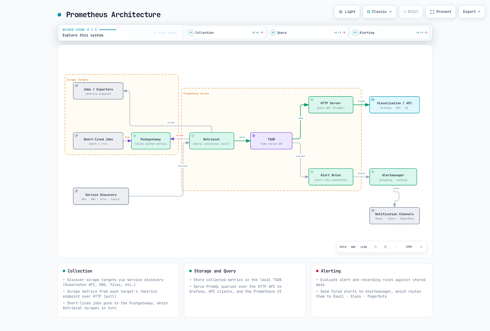
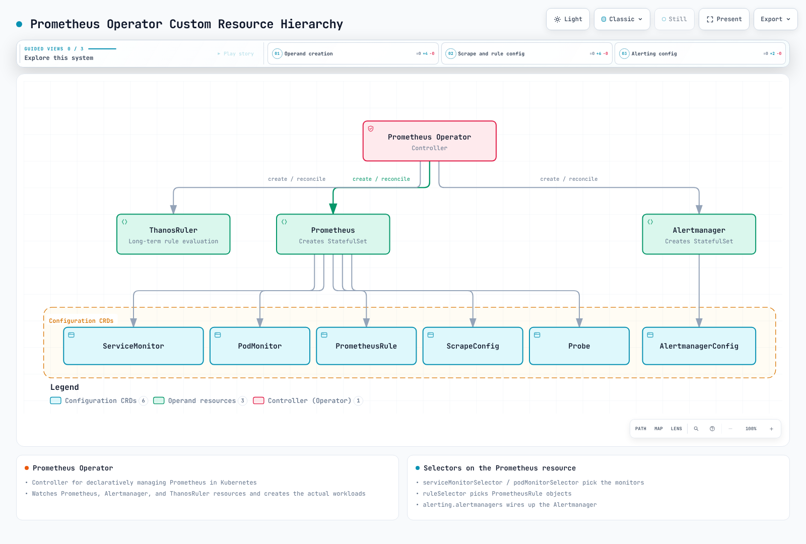

# Prometheus

> **Última actualización**: 19 de noviembre de 2026. A continuación se describen las comprobaciones locales de configuración y consultas; no se realizó ningún despliegue en clúster ni en la nube.

## Contenido

- [Introducción y versiones](#introduction-and-versions)
- [Arquitectura y componentes](#architecture-and-components)
- [PromQL](#promql)
- [Descubrimiento y selectores del Operator](#discovery-and-operator-selectors)
- [Instalación de kube-prometheus-stack](#kube-prometheus-stack-installation)
- [Reglas y Alertmanager](#rules-and-alertmanager)
- [Escritura remota y AMP](#remote-write-and-amp)
- [Rendimiento, alta disponibilidad y resolución de problemas](#performance-ha-and-troubleshooting)

## Introducción y versiones {#introduction-and-versions}

Prometheus es el conjunto de herramientas de monitorización de CNCF, desarrollado originalmente en SoundCloud. Recopila series temporales numéricas, las almacena en una TSDB local, evalúa PromQL y las reglas de grabación y alertas, y envía alertas a Alertmanager. La recopilación normal usa sondeos HTTP; la escritura remota y las integraciones por lotes opcionales añaden otras vías de entrega. No es un registro de eventos, un almacén de trazas ni un libro mayor exacto de facturación por solicitud.

La retención local se puede configurar y superar los 30 días. Usar un almacén independiente es una decisión que depende de los requisitos de retención, capacidad, consultas compartidas y tolerancia a fallos y recuperación.

Este capítulo usa el paquete oficial **kube-prometheus-stack 90.0.0**, publicado el 6 de septiembre de 2026. Las versiones de sus componentes se inspeccionaron como una combinación:

| Componente | Valor predeterminado del paquete |
|---|---|
| Prometheus Operator | 0.93.1 |
| Prometheus | 3.14.0, imagen distroless |
| Alertmanager | 0.34.0 |
| Grafana | 13.2.1, subchart 13.2.2 |
| kube-state-metrics | 2.20.0, subchart 8.4.2 |
| node-exporter | 1.12.1, subchart 4.56.3 |

La restricción `kubeVersion` del chart es `>=1.25.0-0`. Esto no constituye una matriz completa de compatibilidad ni afirma que todas las versiones de Kubernetes 1.25 o posteriores sigan teniendo soporte. Comprueba el clúster real, el soporte de los componentes, la política de admisión y el controlador de almacenamiento.

El perfil está dirigido a **nodos de trabajo EKS Linux respaldados por EC2**. Fargate no tiene DaemonSets; Auto Mode, Hybrid Nodes y Windows requieren comprobaciones específicas de la plataforma para los recopiladores y el almacenamiento.

### Actualización de noviembre de 2026

- [Prometheus 3.16.0](https://github.com/prometheus/prometheus/releases/tag/v3.16.0) se publicó el 4 de noviembre de 2026. Entre las novedades: los selectores vectoriales suavizados y anclados (de rango extendido) ahora son estables y están siempre habilitados; se incluyen la estimación experimental del coste de las consultas PromQL y los límites de ejecución configurables tras `--enable-feature=query-cost`, una función experimental `integral()` tras la marca de funciones experimentales y compatibilidad con `metadata-wal-records` en el modo Agent. Los ejemplos de este capítulo se verificaron con la versión 3.14.0 y no se han vuelto a ejecutar con la 3.16.

### Actualización de septiembre de 2026

- Según el [artículo del blog de Kubernetes del 11 de septiembre](https://kubernetes.io/blog/2026/09/11/kubernetes-v1-37-native-histograms-beta/), la compatibilidad con [histogramas nativos de Prometheus](https://prometheus.io/docs/specs/native_histograms/) para las métricas de componentes de Kubernetes (KEP-5808) pasa a Beta y se habilita de forma predeterminada en v1.37. Los buckets de alta resolución y baja cardinalidad reemplazan los buckets `le` fijos, lo que mejora la precisión de las métricas de latencia y reduce la sobrecarga de almacenamiento y sondeo. Para beneficiarse de ello, también es necesario configurar Prometheus para ingerir histogramas nativos, y revisar por separado las consultas y los paneles existentes que usan histogramas clásicos.

### Actualizaciones históricas de julio de 2026

- El [artículo sobre exportadores de Kubernetes del 14 de julio](https://kubernetes.io/blog/2026/07/14/custom-metrics-exporter-kubernetes/) explica la instrumentación de aplicaciones y los exportadores personalizados. Para usar HPA también se necesita la API o el adaptador de métricas correspondiente; el sondeo por sí solo no conecta métricas arbitrarias con HPA.
- El [anuncio de AMP del 21 de julio](https://aws.amazon.com/about-aws/whats-new/2026/07/amazon-managed-service-prometheus-1500m-metrics-workspace/) describe hasta 1.500 millones de series activas y 200.000 reglas de grabación y alertas por espacio de trabajo. Son límites de escalabilidad anunciados, no cuotas predeterminadas concedidas automáticamente ni garantías de aprobación. Comprueba las cuotas actuales de la cuenta y el espacio de trabajo previstos.

## Arquitectura y componentes {#architecture-and-components}



[Diagrama interactivo](https://www.atomai.click/kubernetes-docs/archmaps/en-observability-metrics-01-prometheus-0.html)

La rama de Pushgateway es opcional para trabajos por lotes adecuados a nivel de servicio, no para todos los Pods de corta duración. Los grupos necesitan gestión del ciclo de vida; consulta la [descripción general de métricas](README.md). `up` informa del estado del sondeo, no de la disponibilidad de la aplicación.

| Componente | Responsabilidad y requisitos previos |
|---|---|
| Prometheus | Descubrimiento, sondeo, TSDB local, API de consulta y evaluación de reglas |
| kube-state-metrics | Estado de los objetos de la API; necesita una ServiceAccount, RBAC y un endpoint de sondeo |
| node-exporter | Métricas del sistema operativo del host; hay que revisar el acceso al host, los montajes y la compatibilidad de la plataforma |
| kubelet/cAdvisor | Mediciones de contenedores; verifica los certificados del servidor, la autorización y la disponibilidad del endpoint |
| metrics-server / adaptadores | APIs de métricas de recursos/personalizadas para el escalado automático; independientes del almacenamiento histórico de TSDB |
| Alertmanager | Agrupa, deduplica, inhibe y enruta alertas a los receptores configurados |
| Grafana | Consulta y visualiza fuentes de datos; la autenticación y la base de datos/el almacenamiento requieren su propia configuración |

El chart proporciona exportadores y recursos auxiliares. Los fragmentos incompletos de Deployment/DaemonSet independientes no proporcionan las ServiceAccounts, el RBAC y los Services que faltan, y no deberían crear una pila de monitorización duplicada.

### TSDB y capas de configuración

Las muestras recientes usan head/WAL; los bloques compactados contienen chunks, un índice y metadatos. Los tombstones marcan rangos eliminados. La reproducción del WAL ayuda a recuperarse de fallos, pero no reemplaza las copias de seguridad, no sobrevive a la pérdida del volumen ni garantiza la recuperación de todos los eventos.

| Capa | Configuración correcta |
|---|---|
| Flags del proceso | `--storage.tsdb.path`, `--storage.tsdb.retention.time`, `--storage.tsdb.retention.size` |
| Configuración de Prometheus | `global`, `scrape_configs`, `rule_files`, `remote_write` |
| `Prometheus.spec` del Operator | `retention`, `retentionSize`, `storage`, `replicas`, `shards` |
| Valores de este chart | `prometheus.prometheusSpec.retention`, `storageSpec` y los valores siguientes |

El YAML antiguo `storage.tsdb.path/retention.time/...` no es una configuración válida del proceso. En una **instalación independiente**, los flags básicos tienen este aspecto:

```sh
prometheus --config.file=prometheus.yml \
  --storage.tsdb.path=/prometheus \
  --storage.tsdb.retention.time=15d \
  --storage.tsdb.retention.size=15GB
```

Para la instalación con Operator, configura los valores de Helm que la controlan. El tamaño de retención no es un límite estricto para el disco total: deja espacio para el WAL, head, los índices y la compactación. Usa almacenamiento local o de bloques compatible; NFS arbitrario no es un reemplazo compatible.

## PromQL

Los ejemplos suponen `job="example-app"` y las etiquetas de job de node-exporter/kube-state-metrics del chart. Adáptalos a los targets reales. `example_queue_depth` y `temperature_celsius` son gauges definidos por la aplicación, no métricas integradas de Kubernetes.

### Selectores, rangos y tasas

Los selectores instantáneos usan las reglas de lookback y obsolescencia para encontrar muestras válidas; “actual” no garantiza que haya una observación en el instante exacto de evaluación. Un selector de rango elige un intervalo de muestras. Una subconsulta evalúa una expresión con su resolución, en lugar de seleccionar cada N-ésima muestra sin procesar almacenada.

| Propósito | PromQL |
|---|---|
| Selector instantáneo | `http_requests_total{job="example-app"}` |
| Filtrado positivo/por expresión regular | `http_requests_total{job="example-app",method="GET",status=~"2[0-9]{2}"}` |
| Expresión regular negativa | `http_requests_total{job="example-app",status!~"5[0-9]{2}"}` |
| Vector de rango | `http_requests_total{job="example-app"}[5m]` |
| Subconsulta de una hora con resolución de cinco minutos | `rate(http_requests_total{job="example-app"}[5m])[1h:5m]` |
| Ventana de tasa de una hora antes | `rate(http_requests_total{job="example-app"}[5m] offset 1h)` |
| Tasa promedio por segundo del contador | `rate(http_requests_total{job="example-app"}[5m])` |
| Tasa calculada a partir de las dos últimas muestras utilizables | `irate(http_requests_total{job="example-app"}[5m])` |
| Incremento extrapolado del contador | `increase(http_requests_total{job="example-app"}[1h])` |

Los comparadores negativos pueden seleccionar series sin esa etiqueta. `rate()` e `increase()` gestionan los reinicios observados y extrapolan; no pueden recuperar todos los incrementos perdidos. Aplica **la tasa antes de agregar**. `irate()` es sensible a las muestras más recientes y suele ser menos adecuado para condiciones de alerta estables.

Un vector de rango es una entrada para funciones de rango, no un gráfico de consulta de rango listo para usar. Por ejemplo, usa `rate(counter[5m])` al solicitar una serie de tasas evaluada.

### Agregación, gauges y tiempo

| Propósito | PromQL |
|---|---|
| Tasa de solicitudes por método | `sum by (method) (rate(http_requests_total{job="example-app"}[5m]))` |
| Agregar eliminando instance | `sum without (instance) (rate(http_requests_total{job="example-app"}[5m]))` |
| Sumar indicadores Running deduplicados | `sum(max by (namespace,pod,uid) (kube_pod_status_phase{job="kube-state-metrics",phase="Running"}))` |
| Memoria máxima disponible | `max(node_memory_MemAvailable_bytes{job="node-exporter"})` |
| CPU de los Pods principales, sin etiquetas vacías/de infraestructura del contenedor | `topk(5, sum by (namespace,pod) (rate(container_cpu_usage_seconds_total{job="kubelet",container!="",container!="POD"}[5m])))` |
| Cuantil entre los gauges actuales de profundidad de cola | `quantile(0.95, example_queue_depth{job="example-app"})` |
| Desviación estándar de las tasas | `stddev(rate(http_requests_total{job="example-app"}[5m]))` |
| Cambio extrapolado del gauge | `delta(temperature_celsius{job="example-app"}[1h])` |
| Pendiente del gauge por segundo | `deriv(temperature_celsius{job="example-app"}[1h])` |
| Desviación absoluta respecto a 20 °C | `abs(temperature_celsius{job="example-app"} - 20)` |
| Redondear hacia arriba | `ceil(example_queue_depth{job="example-app"})` |
| Limitar a un rango | `clamp(example_queue_depth{job="example-app"}, 0, 100)` |
| Raíz cuadrada | `sqrt(example_queue_depth{job="example-app"})` |
| Logaritmo natural | `ln(example_queue_depth{job="example-app"})` |
| Hora de evaluación en segundos Unix | `time()` |
| Marca de tiempo de la muestra seleccionada | `timestamp(up{job="example-app"})` |
| Hora UTC de la muestra | `hour(timestamp(up{job="example-app"}))` |

Contar las series `kube_pod_status_phase{phase="Running"}` también cuenta los ceros. Sumar los indicadores 0/1 tras eliminar las identidades duplicadas de los exportadores da cero cuando solo existen indicadores cero, mientras que la telemetría ausente sigue estando ausente.

El ejemplo de `quantile()` para Gauge compara valores entre series. No calcula el p95 de latencia de solicitudes de un histograma ni combina valores p99 de Summary. Las funciones matemáticas tienen límites en sus dominios de entrada; por ejemplo, hay que gestionar deliberadamente un logaritmo no positivo. Entre las funciones relacionadas están `floor`, `round`, `clamp_min` y `clamp_max`.

Este filtro de horario laboral está expresado en **UTC**, no en la zona horaria del navegador o del clúster:

```promql
sum(rate(http_requests_total{job="example-app"}[5m])) and on() (hour() >= 9 < 18)
```

### Distribuciones y previsiones

```promql
histogram_quantile(0.95, sum by (le) (rate(http_request_duration_seconds_bucket{job="example-app"}[5m])))
```

```promql
histogram_quantile(0.99, sum by (le,method) (rate(http_request_duration_seconds_bucket{job="example-app"}[5m])))
```

```promql
sum(rate(http_request_duration_seconds_sum{job="example-app"}[5m])) / sum(rate(http_request_duration_seconds_count{job="example-app"}[5m]))
```

Agrega buckets clásicos compatibles y conserva `le`. Los cuantiles interpolan dentro de los buckets. Los cuantiles de Summary también son aproximaciones y no se pueden promediar para obtener un percentil de toda la flota; sum/count sí puede calcular una media de toda la flota.

`predict_linear()` extrapola una tendencia ajustada de un Gauge. Una proyección negativa es motivo para investigar, no una garantía de que vaya a producirse un fallo del disco:

```promql
predict_linear(node_filesystem_avail_bytes{job="node-exporter",mountpoint="/",fstype!~"tmpfs|overlay"}[6h], 86400)
```

Prometheus 3 cambió el nombre de `holt_winters` a `double_exponential_smoothing`. Esto es **suavizado lineal de Holt, no predicción estacional de triple exponencial**, y requiere muestras de tipo Gauge float. Expresión opcional: `double_exponential_smoothing(example_queue_depth{job="example-app"}[1h], 0.5, 0.5)`. El servidor que realiza la evaluación necesita `--enable-feature=promql-experimental-functions`. La auditoría local comprobó la sintaxis del analizador; no se afirma que la evaluación experimental de valores haya sido satisfactoria.

### Ejemplos operativos

| Propósito | PromQL |
|---|---|
| Porcentaje de CPU no inactiva | `100 * (1 - avg by (instance) (rate(node_cpu_seconds_total{job="node-exporter",mode="idle"}[5m])))` |
| Proporción no informada como MemAvailable | `100 * (1 - node_memory_MemAvailable_bytes{job="node-exporter"} / node_memory_MemTotal_bytes{job="node-exporter"})` |
| Aumento estimado de reinicios superior a tres | `increase(kube_pod_container_status_restarts_total{job="kube-state-metrics"}[1h]) > 3` |
| Porcentaje de espacio no disponible en el sistema de archivos | `100 * (1 - node_filesystem_avail_bytes{job="node-exporter",mountpoint="/"} / node_filesystem_size_bytes{job="node-exporter",mountpoint="/"})` |
| Bytes recibidos + transmitidos por segundo | `rate(node_network_receive_bytes_total{job="node-exporter",device="eth0"}[5m]) + rate(node_network_transmit_bytes_total{job="node-exporter",device="eth0"}[5m])` |

Para el porcentaje de errores, puede que un servicio en buen estado no tenga series 5xx. La alternativa a cero que aparece a continuación solo existe para grupos de tráfico total coincidentes; no inventa datos de buena salud para servicios ausentes.

```promql
100 * (sum by (namespace, service) (rate(http_requests_total{job="example-app",status=~"5[0-9]{2}"}[5m])) or on (namespace, service) (0 * (sum by (namespace, service) (rate(http_requests_total{job="example-app"}[5m]))))) / (sum by (namespace, service) (rate(http_requests_total{job="example-app"}[5m])))
```

El tráfico correcto observado da 0, el tráfico formado exclusivamente por 5xx da 100 y un denominador igual a cero sigue sin estar definido. La telemetría ausente sigue ausente; monitoriza por separado los fallos de recopilación.

## Descubrimiento y selectores del Operator {#discovery-and-operator-selectors}



[Diagrama interactivo](https://www.atomai.click/kubernetes-docs/archmaps/en-observability-metrics-01-prometheus-1.html)

Los nodos de Prometheus/Alertmanager de esta figura representan **recursos personalizados**. El Operator los lee y concilia las cargas de trabajo reales, como los StatefulSets. Ni los objetos ni el servidor Prometheus crean StatefulSets por sí solos.

| Etapa de selección | Objeto seleccionado |
|---|---|
| `serviceMonitorNamespaceSelector` de Prometheus | Namespaces que contienen objetos ServiceMonitor |
| `serviceMonitorSelector` de Prometheus | Etiquetas de esos objetos ServiceMonitor |
| `namespaceSelector` / `selector` de ServiceMonitor | Namespaces y etiquetas de los Services de destino |
| `port` del endpoint de ServiceMonitor | **Nombre del puerto del Service**, no un número de puerto arbitrario del contenedor |
| Selector de PodMonitor / `port` del endpoint | Etiquetas del Pod y nombre declarado del puerto del contenedor |

RBAC, descubrimiento y acceso de red/TLS son requisitos independientes. Los selectores no reemplazan la autorización. Los valores booleanos `*SelectorNilUsesHelmValues` de Helm afectan a los valores predeterminados del selector de etiquetas, no a todos los namespaces de destino.

### Recopilación coherente de métricas de una aplicación

Supongamos que ya existe un Deployment instrumentado en `example-app`, con la etiqueta de Pod `app: example-app` y un puerto declarado llamado `metrics` que sirve `/metrics`. El Service siguiente no crea la aplicación:

```yaml
# service.yaml
apiVersion: v1
kind: Service
metadata:
  name: example-app
  namespace: example-app
  labels:
    app: example-app
    metrics-job: example-app
spec:
  selector:
    app: example-app
  ports:
  - name: http-metrics
    port: 8080
    targetPort: metrics
```

```yaml
# servicemonitor.yaml
apiVersion: monitoring.coreos.com/v1
kind: ServiceMonitor
metadata:
  name: example-app
  namespace: monitoring
  labels:
    release: kube-prom
spec:
  jobLabel: metrics-job
  selector:
    matchLabels:
      app: example-app
  namespaceSelector:
    matchNames:
    - example-app
  endpoints:
  - port: http-metrics
    path: /metrics
    interval: 30s
    scrapeTimeout: 10s
    relabelings:
    - sourceLabels:
      - __meta_kubernetes_service_name
      targetLabel: service
    - sourceLabels:
      - __meta_kubernetes_namespace
      targetLabel: namespace
    - sourceLabels:
      - __meta_kubernetes_pod_name
      targetLabel: pod
```

El `release: kube-prom` de ServiceMonitor coincide con la instalación. Su `jobLabel` lee `metrics-job: example-app` del Service, lo que establece la etiqueta job de las consultas de la aplicación.

PodMonitor es una **alternativa** para los mismos Pods. Elige una sola vía de recopilación prevista para un endpoint para evitar la ingesta duplicada:

```yaml
# podmonitor.yaml
apiVersion: monitoring.coreos.com/v1
kind: PodMonitor
metadata:
  name: example-app-pods
  namespace: monitoring
  labels:
    release: kube-prom
spec:
  selector:
    matchLabels:
      app: example-app
  namespaceSelector:
    matchNames:
    - example-app
  podMetricsEndpoints:
  - port: metrics
    interval: 30s
    path: /metrics
    relabelings:
    - targetLabel: job
      replacement: example-app
    - targetLabel: service
      replacement: example-app
```

### Otras vías de descubrimiento

- El descubrimiento de Pods de una instalación independiente o de Agent puede usar la [configuración con nombre de puerto de la descripción general](README.md#metric-collection-models), que conserva las direcciones IPv4/IPv6 proporcionadas por el descubrimiento. Una anotación como `prometheus.io/scheme` no tiene efecto a menos que la configuración real la utilice.
- El sondeo de servicios con blackbox necesita un exportador instalado, un módulo de sondeo definido, la URL y el esquema de destino adecuados, y una configuración `Probe` o de sondeo. `up` describe el sondeo del exportador; el éxito del sondeo es una señal independiente.
- El descubrimiento de nodos llega a los endpoints de kubelet, no a node-exporter automáticamente. Verifica los certificados del servidor, la CA correcta y el RBAC para las métricas de los nodos. La CA de la API de Kubernetes no demuestra que exista confianza en certificados de nodos arbitrarios.
- Usa etiquetas revisadas de namespace/servicio/equipo en lugar de un `labelmap` irrestricto de nodos. Eliminar etiquetas de identidad no es una operación de agregación.

## Instalación de kube-prometheus-stack {#kube-prometheus-stack-installation}

Estos comandos del Operator cambian el clúster; **no se ejecutaron durante la auditoría**. Usa el contexto previsto y un release bajo control. En instalaciones existentes, revisa los valores reales, los CRD, el almacenamiento y las notas de actualización en lugar de instalar una pila duplicada.

Requisitos previos de este perfil:

- Acceso autorizado a Helm/Kubernetes y recursos suficientes en los nodos Linux EC2.
- Un controlador CSI/StorageClass de almacenamiento en bloques predeterminado que funcione, o nombres de clases revisados explícitamente para cada PVC. No se garantiza que exista `gp3`.
- Un namespace `monitoring` existente, el controlador CSI de Secrets Store y el proveedor de AWS (ASCP) en los nodos Linux EC2. Prepara `observability/grafana-admin` en AWS Secrets Manager (`ap-northeast-2`) con la clave de cadena JSON `admin-password`; no lo sincronices con un Secret de Kubernetes.
- La ServiceAccount `metrics-demo-grafana` necesita un rol IRSA con permisos acotados para ese secreto. Sustituye el ARN del rol IAM de ejemplo y aplica el SecretProviderClass correspondiente. Consulta los [requisitos previos completos de identidad, KMS, montaje y rotación](https://github.com/Atom-oh/kubernetes-docs/blob/5ff787faed758902c12a74e8429466f434bb26ae/examples/observability/secret-profiles/README.md).
- Confianza TLS de kubelet verificada. Este perfil habilita la verificación de certificados; proporciona la CA adecuada si los certificados usan otro emisor, en lugar de omitir la verificación.

El dimensionamiento es ilustrativo. Cada réplica de Prometheus obtiene su propio PVC; el tamaño de retención no limita el uso de WAL/head/compactación. Grafana sigue teniendo una sola réplica con una base de datos respaldada por PVC. Aumentar únicamente las réplicas no proporciona alta disponibilidad con una base de datos compartida.

```yaml
# kube-prometheus-stack 90.0.0; replace the example IRSA role ARN before use.
fullnameOverride: metrics-demo
kubeControllerManager:
  enabled: false
kubeScheduler:
  enabled: false
kubeEtcd:
  enabled: false
kubeProxy:
  enabled: false
kubelet:
  serviceMonitor:
    tlsConfig:
      insecureSkipVerify: false
prometheus:
  serviceAccount:
    create: true
    name: metrics-demo-prometheus
  prometheusSpec:
    replicas: 1
    shards: 1
    retention: 15d
    retentionSize: 15GB
    storageSpec:
      volumeClaimTemplate:
        spec:
          accessModes:
          - ReadWriteOnce
          resources:
            requests:
              storage: 20Gi
    resources:
      requests:
        cpu: 500m
        memory: 2Gi
      limits:
        memory: 4Gi
    externalLabels:
      cluster: eks-metrics-demo
    serviceMonitorSelectorNilUsesHelmValues: true
    serviceMonitorNamespaceSelector: &id001
      matchExpressions:
      - key: kubernetes.io/metadata.name
        operator: In
        values:
        - monitoring
        - example-app
    podMonitorSelectorNilUsesHelmValues: true
    podMonitorNamespaceSelector: *id001
    ruleSelectorNilUsesHelmValues: true
    ruleNamespaceSelector:
      matchLabels:
        kubernetes.io/metadata.name: monitoring
alertmanager:
  alertmanagerSpec:
    replicas: 1
    storage:
      volumeClaimTemplate:
        spec:
          accessModes:
          - ReadWriteOnce
          resources:
            requests:
              storage: 5Gi
grafana:
  fullnameOverride: metrics-demo-grafana
  replicas: 1
  persistence:
    enabled: true
    size: 10Gi
  sidecar:
    dashboards:
      searchNamespace: monitoring
      skipReload: true
      initDashboards: true
      provider:
        updateIntervalSeconds: 30
    datasources:
      searchNamespace: monitoring
      skipReload: true
      initDatasources: true
  serviceAccount:
    create: true
    name: metrics-demo-grafana
    annotations:
      eks.amazonaws.com/role-arn: arn:aws:iam::111122223333:role/metrics-grafana-secrets
  env:
    GF_SECURITY_ADMIN_USER: admin
    GF_SECURITY_ADMIN_PASSWORD: $__file{/mnt/grafana-secrets/admin-password}
  grafana.ini:
    security:
      admin_user: admin
      admin_password: $__file{/mnt/grafana-secrets/admin-password}
  extraVolumes:
  - name: grafana-secrets
    csi:
      driver: secrets-store.csi.k8s.io
      readOnly: true
      volumeAttributes:
        secretProviderClass: metrics-grafana-admin
  extraVolumeMounts:
  - name: grafana-secrets
    mountPath: /mnt/grafana-secrets
    readOnly: true
```

Este perfil de EKS deshabilita los monitores de los componentes del plano de control administrados y de los endpoints de kube-proxy cuya exposición no se da por supuesta aquí. No deshabilita Kubernetes. Los ServiceMonitors de `monitoring`/`example-app` necesitan etiquetas de release coincidentes; las reglas se seleccionan desde `monitoring`.

Grafana recibe en `GF_SECURITY_ADMIN_PASSWORD` una **expresión literal del proveedor de archivos**, no el valor de la contraseña. Esto suprime las referencias automáticas a credenciales del entorno del chart. Grafana 13.2.1 evalúa `$__file{...}` en su configuración después de las sustituciones de variables de entorno; ningún punto de entrada `__FILE` ni exportación del shell proporciona el contenido del archivo. El archivo CSI de solo lectura debe poder leerlo el UID/GID 472 (`fsGroup: 472`, modo `0440`), y solo el contenedor principal de Grafana lo monta. Usa una contraseña sin espacios en blanco al principio o al final, que el proveedor de archivos elimina.

Los contenedores init de dashboards y fuentes de datos rellenan los archivos de aprovisionamiento antes del arranque. Los sidecars siguen vigilando los archivos, pero usan `skipReload: true`, por lo que ninguno necesita credenciales de administrador. Grafana consulta los archivos de dashboards cada 30 segundos; **las actualizaciones de fuentes de datos requieren un reinicio controlado del Pod**. `admin_password` solo inicializa una base de datos nueva: cambiar el secreto de AWS, la rotación CSI o un reinicio no restablecen la contraseña del administrador en un PVC/base de datos existente. Usa el procedimiento aprobado para cambiar la contraseña o configurar SSO y concilia el secreto; conserva el PVC.

Usa el [perfil reutilizable completo](https://github.com/Atom-oh/kubernetes-docs/blob/5ff787faed758902c12a74e8429466f434bb26ae/examples/observability/secret-profiles/README.md), incluido `grafana-secret-provider.yaml`. La renderización y las pruebas locales cubren la configuración y los montajes, no los permisos CSI activos, el inicio de sesión ni la rotación. Referencias principales: [configuración de Grafana](https://grafana.com/docs/grafana/latest/setup-grafana/configure-grafana/) y [AWS ASCP](https://github.com/aws/secrets-store-csi-driver-provider-aws/blob/main/README.md).

Desde la raíz del repositorio, instala una sola vez después de preparar los requisitos previos:

```sh
PROFILE=examples/observability/secret-profiles
kubectl apply -f "$PROFILE/grafana-secret-provider.yaml"
helm repo add prometheus-community https://prometheus-community.github.io/helm-charts
helm repo update prometheus-community
helm template kube-prom prometheus-community/kube-prometheus-stack \
  --version 90.0.0 --namespace monitoring -f "$PROFILE/prometheus-values.yaml" \
  > grafana-reviewed-render.yaml
# Review resources, prerequisites and ownership before this cluster-changing command.
helm upgrade --install kube-prom prometheus-community/kube-prometheus-stack \
  --version 90.0.0 --namespace monitoring -f "$PROFILE/prometheus-values.yaml" \
  --wait --timeout 15m
```

Comprueba el establecimiento de los CRD, el estado del Operator, la vinculación de los PVC y los targets reales. Aplica los monitores/reglas de la aplicación que hayas elegido solo después de establecerse los CRD correspondientes.

La gestión de las actualizaciones de los CRD del chart depende de la versión. Lee las notas de actualización en lugar de suponer que una actualización normal de Helm cubre todas las migraciones de CRD. El chart 90 también cambia la dependencia de Grafana al repositorio de la comunidad; valida los valores existentes de autenticación/aprovisionamiento y conserva copias de seguridad de la base de datos y los PVC al actualizar.

## Reglas y Alertmanager {#rules-and-alertmanager}

El PrometheusRule seleccionado a continuación incluye ejemplos de alertas y grabación. La regla de grabación de CPU usa `rate` y unidades de proporción de forma coherente. La expresión de errores es un porcentaje, por lo que el umbral es 1 y la anotación muestra un porcentaje.

```yaml
# prometheusrule.yaml
apiVersion: monitoring.coreos.com/v1
kind: PrometheusRule
metadata:
  name: example-rules
  namespace: monitoring
  labels:
    release: kube-prom
spec:
  groups:
  - name: example-alerts
    interval: 30s
    rules:
    - alert: NodeMemoryHigh
      expr: 100 * (1 - node_memory_MemAvailable_bytes{job="node-exporter"} / node_memory_MemTotal_bytes{job="node-exporter"})
        > 90
      for: 5m
      labels:
        severity: warning
        team: infrastructure
      annotations:
        summary: Node {{ $labels.instance }} memory availability is low
        description: '{{ printf "%.2f" $value }}% is not reported as MemAvailable.'
    - alert: PodRestartingFrequently
      expr: increase(kube_pod_container_status_restarts_total{job="kube-state-metrics"}[1h]) > 5
      for: 10m
      labels:
        severity: warning
      annotations:
        summary: Pod {{ $labels.namespace }}/{{ $labels.pod }} is restarting
        description: '{{ printf "%.2f" $value }} estimated restarts in one hour.'
    - alert: ProjectedDiskExhaustion
      expr: predict_linear(node_filesystem_avail_bytes{job="node-exporter",mountpoint="/",fstype!~"tmpfs|overlay"}[6h],
        86400) < 0
      for: 1h
      labels:
        severity: warning
      annotations:
        summary: Projected disk exhaustion on {{ $labels.instance }}
        description: The fitted six-hour trend projects negative free space in 24 hours; inspect the filesystem
          and workload.
    - alert: HighErrorRate
      expr: (100 * (sum by (namespace, service) (rate(http_requests_total{job="example-app",status=~"5[0-9]{2}"}[5m]))
        or on (namespace, service) (0 * (sum by (namespace, service) (rate(http_requests_total{job="example-app"}[5m])))))
        / (sum by (namespace, service) (rate(http_requests_total{job="example-app"}[5m])))) > 1
      for: 5m
      labels:
        severity: warning
        team: backend
      annotations:
        summary: High error rate on {{ $labels.namespace }}/{{ $labels.service }}
        description: '{{ printf "%.2f" $value }}% of requests are 5xx, above the 1% threshold.'
  - name: example-recording
    rules:
    - record: instance:node_cpu_utilization:ratio_rate5m
      expr: 100 * (1 - avg by (instance) (rate(node_cpu_seconds_total{job="node-exporter",mode="idle"}[5m])))
        / 100
    - record: instance:node_memory_not_available:ratio
      expr: max by (instance) ((1 - node_memory_MemAvailable_bytes{job="node-exporter"} / node_memory_MemTotal_bytes{job="node-exporter"}))
```

`for` significa que el mismo conjunto de etiquetas de alerta debe seguir cumpliendo la expresión durante las evaluaciones previas a la activación. La falta de datos o los cambios en las etiquetas pueden interrumpir el estado pendiente. No es el retraso de notificación ni el intervalo de repetición de Alertmanager. Una alerta basada en una previsión describe una proyección, no un fallo garantizado.

### AlertmanagerConfig y límites entre namespaces

El CRD AlertmanagerConfig incluido en Operator 0.93.1 sirve **v1alpha1**. Este ejemplo lo utiliza como una **configuración global** propiedad del administrador. Los Secrets referenciados deben existir en `monitoring`. Sustituye y aprueba las direcciones, los canales y los destinos de los proveedores antes de habilitar la entrega.

La API del Operator marca `alertmanagerConfiguration` como experimental: conserva el límite de versión y prueba las actualizaciones. Normalmente, los AlertmanagerConfig con namespace seleccionados reciben comparadores de namespace; un config en `monitoring` no recibe automáticamente alertas de aplicaciones de todos los namespaces. La configuración global amplía deliberadamente ese límite administrativo.

```yaml
# alertmanagerconfig.yaml
apiVersion: monitoring.coreos.com/v1alpha1
kind: AlertmanagerConfig
metadata:
  name: main-config
  namespace: monitoring
spec:
  route:
    receiver: default
    groupBy:
    - alertname
    - namespace
    - severity
    groupWait: 30s
    groupInterval: 5m
    repeatInterval: 4h
    routes:
    - receiver: pagerduty-critical
      matchers:
      - name: severity
        matchType: '='
        value: critical
      groupWait: 10s
      repeatInterval: 1h
    - receiver: slack-backend
      matchers:
      - name: team
        matchType: '='
        value: backend
    - receiver: slack-warnings
      matchers:
      - name: severity
        matchType: '='
        value: warning
      groupWait: 1m
  inhibitRules:
  - sourceMatch:
    - name: severity
      matchType: '='
      value: critical
    targetMatch:
    - name: severity
      matchType: '='
      value: warning
    equal:
    - alertname
    - cluster
    - namespace
    - service
    - instance
    - pod
    - container
  receivers:
  - name: default
    emailConfigs:
    - to: alerts@example.com
      from: alertmanager@example.com
      smarthost: smtp.example.com:587
      authUsername: alertmanager
      authPassword:
        name: alertmanager-smtp
        key: password
      requireTLS: true
  - name: slack-backend
    slackConfigs:
    - apiURL:
        name: alertmanager-slack
        key: webhook-url
      channel: '#team-backend-alerts'
      sendResolved: true
  - name: slack-warnings
    slackConfigs:
    - apiURL:
        name: alertmanager-slack
        key: webhook-url
      channel: '#alerts'
      sendResolved: true
  - name: pagerduty-critical
    pagerdutyConfigs:
    - routingKey:
        name: alertmanager-pagerduty
        key: routing-key
      sendResolved: true
```

De forma predeterminada, las rutas hermanas se detienen en la primera coincidencia. Las rutas críticas van primero; la ruta del backend precede a la ruta general de advertencias, por lo que puede alcanzarse. Establece `continue` deliberadamente solo cuando se quieran varias entregas. La inhibición compara la identidad del recurso además del nombre de la alerta: una alerta crítica de un servicio/nodo no debe suprimir una advertencia sin relación. Elige campos de igualdad significativos para tus familias de alertas; las etiquetas que falten en ambas alertas se consideran iguales.

`groupBy` del CR se convierte en `group_by` en la configuración nativa de Alertmanager. La agrupación controla los lotes de notificaciones; no equivale a deduplicar alertas idénticas. `groupWait`, `groupInterval` y `repeatInterval` controlan la programación de notificaciones, independientemente de `for` en un PrometheusRule.

Después de crear los Secrets referenciados y AlertmanagerConfig, combina este archivo de valores adicional con el **mismo** release fijado:

```yaml
# alerting-values.yaml
alertmanager:
  alertmanagerSpec:
    alertmanagerConfiguration:
      name: main-config
```

```sh
helm upgrade --install kube-prom prometheus-community/kube-prometheus-stack \
  --version 90.0.0 --namespace monitoring \
  -f values.yaml -f alerting-values.yaml --wait --timeout 15m
```

La comprobación de enrutamiento nativa usó nombres de receptores sin enviar notificaciones. La recuperación de Secrets, la autenticación del proveedor y la entrega real de notificaciones todavía requieren una verificación controlada.

## Escritura remota y AMP {#remote-write-and-amp}

La escritura remota reenvía muestras de forma asíncrona a un backend configurado. No entrega alertas, no garantiza un búfer ilimitado ni reemplaza una copia de seguridad. Monitoriza la acumulación de la cola, los reintentos y los límites del receptor. Conserva distribuciones completas de histogramas, salvo que una política revisada de agregación/eliminación establezca sus consecuencias.

### Ingesta de AMP con permisos acotados

Los identificadores de cuenta y espacio de trabajo siguientes son **marcadores de posición sintéticos**. Sustituye de manera coherente la Región/cuenta/espacio de trabajo aprobados en el endpoint, el recurso IAM y la anotación del rol. Un rol de ingesta solo necesita `aps:RemoteWrite` para ese espacio de trabajo; los permisos de consulta corresponden al cliente de consulta adecuado, no automáticamente al recopilador.

```json
{
  "Version": "2012-10-17",
  "Statement": [
    {
      "Effect": "Allow",
      "Action": "aps:RemoteWrite",
      "Resource": "arn:aws:aps:ap-northeast-2:111122223333:workspace/ws-11111111-1111-4111-8111-111111111111"
    }
  ]
}
```

Crea y gestiona el rol mediante el responsable de IaC que ya tenga el entorno. Para el ejemplo de IRSA, su relación de confianza debe referirse al proveedor OIDC IAM del clúster previsto y exigir tanto la audiencia `sts.amazonaws.com` como el subject `system:serviceaccount:monitoring:metrics-demo-prometheus`. Una URL del emisor OIDC por sí sola no demuestra que existan el proveedor/la relación de confianza IAM.

Helm controla la ServiceAccount y la anotación de este perfil. Evita crear la misma ServiceAccount también con un segundo propietario. Si reutilizas una cuenta existente, reconcilia su propiedad y el ajuste `create` del chart. EKS Pod Identity es otro diseño de entrega de credenciales; configúralo y verifícalo por separado, en lugar de mezclar supuestos incompatibles.

```yaml
# amp-values.yaml
prometheus:
  serviceAccount:
    create: true
    name: metrics-demo-prometheus
    annotations:
      eks.amazonaws.com/role-arn: arn:aws:iam::111122223333:role/metrics-prometheus-amp
  prometheusSpec:
    replicas: 2
    shards: 1
    podAntiAffinity: hard
    podAntiAffinityTopologyKey: kubernetes.io/hostname
    replicaExternalLabelName: __replica__
    externalLabels:
      cluster: eks-metrics-demo
    remoteWrite:
    - url: https://aps-workspaces.ap-northeast-2.amazonaws.com/workspaces/ws-11111111-1111-4111-8111-111111111111/api/v1/remote_write
      sigv4:
        region: ap-northeast-2
      queueConfig:
        capacity: 10000
        maxSamplesPerSend: 2000
        maxShards: 10
```

Combina el archivo opcional de AMP con los valores base en el mismo release después de verificar la identidad y el espacio de trabajo. Dos réplicas con antiafinidad estricta a nivel de nodo necesitan al menos dos nodos adecuados y PVC independientes por réplica que funcionen.

La deduplicación de alta disponibilidad de AMP espera `cluster` y `__replica__`. `replicaExternalLabelName` del Operator proporciona la identidad por Pod compatible; las etiquetas de réplica adicionales escritas a mano no son un sustituto. Inspecciona las etiquetas de métricas existentes para detectar colisiones con las etiquetas de alta disponibilidad.

Este ejemplo usa deliberadamente `shards: 1`. El sharding divide los conjuntos de targets; la replicación copia un conjunto de targets. Si se introduce sharding, el grupo de réplicas de alta disponibilidad de cada shard necesita una identidad de deduplicación distinta y un diseño de consulta completa. No envíes shards independientes con una única identidad de alta disponibilidad y supongas que no se perderán datos.

Estas consultas describen un clúster local. Las consultas centrales/de AMP que abarquen varios clústeres deben incluir el ámbito del clúster previsto o agregarlo explícitamente.

### Otros receptores

VictoriaMetrics de un solo nodo suele aceptar `/api/v1/write` en su puerto HTTP configurado. El endpoint vminsert de un clúster usa `/insert/<tenant>/prometheus/api/v1/write`; vmauth u otra capa de acceso aprobada debe proporcionar el enrutamiento/autenticación previstos. Los ID de tenant no son credenciales. Mimir y otros receptores tienen sus propias URL, identidades y contratos de alta disponibilidad.

No copies la regla antigua de descartar todos los buckets de histogramas inferiores a un segundo ni familias completas de latencia del plano de control sin evaluar la pérdida resultante de cuantiles/SLO. Los valores predeterminados de la cola son un punto de partida, no un valor óptimo de producción medido.

## Rendimiento, alta disponibilidad y resolución de problemas {#performance-ha-and-troubleshooting}

### Ajustar a partir de mediciones

Las series/chunks de head, el cambio de cardinalidad, la carga de sondeo y las consultas simultáneas afectan a la memoria. Reducir la retención histórica no es una solución universal para los problemas de OOM del head activo o las consultas. Inspecciona el uso real y la carga de consultas antes de cambiar los límites.

Este fragmento opcional de valores ilustra los límites de consulta, no es una recomendación de dimensionamiento:

```yaml
# tuning-values.yaml
prometheus:
  prometheusSpec:
    query:
      maxConcurrency: 10
      maxSamples: 50000000
      timeout: 2m
```

Un timeout más largo o un `maxSamples` mayor pueden aumentar la exposición a problemas de recursos. Inspecciona las expresiones costosas, los rangos, la agregación y las reglas de grabación antes de aumentar ambos límites.

Para una configuración de sondeo **independiente**, este ejemplo limita un job y descarta una familia de depuración revisada:

```yaml
# scrape-limits.yaml
scrape_configs:
- job_name: example-app
  scrape_interval: 30s
  scrape_timeout: 10s
  sample_limit: 10000
  static_configs:
  - targets:
    - example-app.example-app.svc:8080
  metric_relabel_configs:
  - source_labels:
    - __name__
    regex: example_debug_payload_total
    action: drop
```

`sample_limit` es un límite de aceptación del sondeo que se aplica después de la reetiquetación de métricas. Si se supera, el sondeo falla; no trunca ordenadamente el endpoint a 10.000 muestras. Los intervalos más largos reducen la resolución y ralentizan la detección, mientras que eliminar todas las métricas `go_.*`/`process_.*` descarta diagnósticos del entorno de ejecución.

`labeldrop` puede hacer que muestras que antes eran distintas se conviertan en una misma serie; no las suma. Conserva la unicidad y evalúa los efectos en el receptor y la cardinalidad antes de eliminar etiquetas de identidad. Limita las consultas de cardinalidad a un job previsto:

```promql
topk(10, count by (__name__) ({job="example-app"}))
```

No copies flags de TSDB no compatibles ni `additionalArgs` con formato de cadena en un CR del Operator. `additionalArgs` usa objetos de argumentos con nombre, y que un esquema de CR sea válido no demuestra que exista una flag en el binario de Prometheus seleccionado. Evita sobrescribir el comportamiento interno de bloques/chunks sin pruebas específicas de la versión.

### Límites de la alta disponibilidad

`replicas` y `shards` de Prometheus multiplican el número de Pods, pero resuelven problemas distintos. La antiafinidad requiere suficientes nodos; la resiliencia entre zonas también requiere una colocación y un almacenamiento adecuados. Consultar un solo shard no proporciona los datos de todos los targets.

La alta disponibilidad del recopilador no hace que Alertmanager, Grafana, los PVC o el almacenamiento remoto tengan alta disponibilidad automáticamente. Las réplicas de Alertmanager necesitan conectividad entre pares funcional y ubicación/almacenamiento independientes; la alta disponibilidad de Grafana requiere un diseño adecuado de base de datos compartida/autenticación. Mantén coherentes las etiquetas de deduplicación específicas del receptor y la identidad de las alertas.

### Resolución de problemas en un release bajo control

Verifica el contexto, la identidad del release y los nombres de recursos generados. Estos nombres corresponden a `fullnameOverride: metrics-demo` del ejemplo, no a todas las instalaciones del chart:

```sh
kubectl config current-context
helm status kube-prom --namespace monitoring
kubectl get prometheus,alertmanager,servicemonitor,podmonitor,prometheusrule \
  --namespace monitoring
kubectl get pods,pvc --namespace monitoring
kubectl get pods --namespace monitoring -l app.kubernetes.io/name=prometheus -o wide
kubectl top pod --namespace monitoring
```

`kubectl top` requiere una API de métricas de recursos que funcione. No mide todas las causas posibles de presión de memoria en Prometheus.

Para inspeccionar la API privada, vincula el reenvío de puertos a loopback y mantén el proceso en ejecución en una terminal aparte:

```sh
kubectl port-forward --namespace monitoring --address 127.0.0.1 \
  service/metrics-demo-prometheus 9090:9090
```

```sh
curl --fail --silent --show-error --max-time 10 \
  http://127.0.0.1:9090/api/v1/targets \
  | jq '.data.activeTargets[] | select(.health != "up") | {labels, scrapeUrl, lastError}'
curl --fail --silent --show-error --max-time 10 http://127.0.0.1:9090/api/v1/status/tsdb
curl --fail --silent --show-error --max-time 10 http://127.0.0.1:9090/api/v1/status/flags
curl --fail --silent --show-error --max-time 10 http://127.0.0.1:9090/api/v1/status/runtimeinfo
curl --fail --silent --show-error --max-time 10 http://127.0.0.1:9090/api/v1/rules
curl --fail --silent --show-error --max-time 10 http://127.0.0.1:9090/api/v1/alerts
```

| Síntoma | Qué comprobar antes de cambiar recursos |
|---|---|
| OOMKilled | Límite del contenedor, series/cambios de head, concurrencia/rangos de consultas, muestras y picos de carga de trabajo |
| PVC Pending | Disponibilidad real de StorageClass/CSI, modo de acceso, capacidad y programación por zona |
| Target ausente | Ambos selectores de monitores, selección de namespaces, etiquetas/puerto del Service, etiquetas del Pod y conciliación del Operator |
| Target inactivo | URL de destino, CA/SAN/autenticación, RBAC/ruta de red y respuesta del endpoint; un error no demuestra que el recurso no exista |
| Sin notificaciones | Estado de la regla, estabilidad de las etiquetas, configuración seleccionada/global, aplicación de restricciones de namespace, orden de rutas/inhibición, Secrets y estado del proveedor |
| Acumulación en la cola remota | Credenciales/Región/espacio de trabajo, errores/cuotas del receptor, capacidad de cola/WAL y contrato de etiquetas duplicadas |

No se garantiza que la imagen distroless de Prometheus incluya un shell, `wget` o `curl`; no des por hecho que funcionará `kubectl exec ... wget`. Usa herramientas de diagnóstico aprobadas al hacer pruebas desde el contexto de red de un Pod. Trata la salida de configuración/targets/registros como datos operativos y evita publicar endpoints sensibles o credenciales.

## Validación y referencias

La auditoría local renderizó los perfiles base/de alertas/de AMP fijados de Helm, validó las estructuras de los CRD publicados, evaluó PromQL y las reglas principales con muestras sintéticas y comprobó el enrutamiento nativo de Alertmanager. No se ejecutaron el descubrimiento, la admisión/CEL, la vinculación de almacenamiento, la aplicación de políticas de IAM, los secretos externos ni la entrega de notificaciones. El suavizado experimental solo se verificó mediante el analizador; el motor de pruebas promtool publicado no aceptó su fixture de valores, pese a la marca de funcionalidad.

- [Versión 90.0.0 del chart](https://github.com/prometheus-community/helm-charts/releases/tag/kube-prometheus-stack-90.0.0) y [notas de actualización de la versión](https://github.com/prometheus-community/helm-charts/blob/kube-prometheus-stack-90.0.0/charts/kube-prometheus-stack/README.md)
- [Referencia de la API de Operator 0.93.1](https://github.com/prometheus-operator/prometheus-operator/blob/v0.93.1/Documentation/api-reference/api.md)
- [Configuración de Prometheus 3.14](https://github.com/prometheus/prometheus/blob/v3.14.0/docs/configuration/configuration.md), [funciones](https://github.com/prometheus/prometheus/blob/v3.14.0/docs/querying/functions.md) y [almacenamiento](https://github.com/prometheus/prometheus/blob/v3.14.0/docs/storage.md)
- [Ingesta de AMP](https://docs.aws.amazon.com/prometheus/latest/userguide/AMP-onboard-ingest-metrics-existing-Prometheus.html), [deduplicación de alta disponibilidad](https://docs.aws.amazon.com/prometheus/latest/userguide/AMP-ingest-dedupe.html) y [cuotas](https://docs.aws.amazon.com/prometheus/latest/userguide/AMP_quotas.html)
- [Descripción general de métricas](README.md) y [cuestionario de Prometheus](../../quizzes/observability/metrics/01-prometheus-quiz.md)
