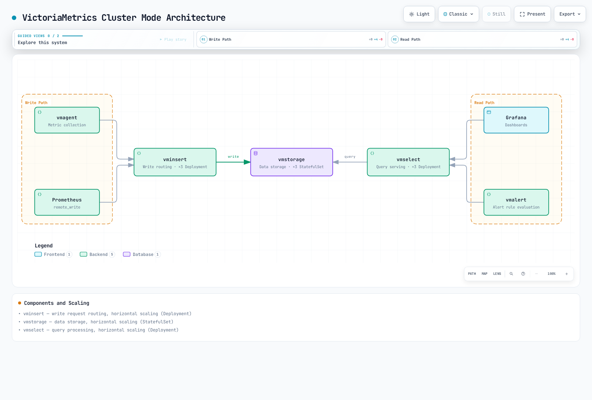

# VictoriaMetrics

> **Línea base de revisión**: VictoriaMetrics 1.151.0 · chart de stack 0.92.1
> **Última actualización**: 12 de septiembre de 2026

## Tabla de contenido

- [Introducción](#introduction)
- [Opciones de arquitectura](#architecture-options)
- [Modo de nodo único](#single-node-mode)
- [Modo clúster](#cluster-mode)
- [vmagent](#vmagent)
- [vmalert](#vmalert)
- [MetricsQL](#metricsql)
- [Instalación con Helm](#helm-installation)
- [Configuración del almacenamiento a largo plazo](#long-term-storage-configuration)
- [Reducción de resolución](#downsampling)
- [Optimización del rendimiento](#performance-optimization)
- [Buenas prácticas](#best-practices)
- [Solución de problemas](#troubleshooting)

## Introducción {#introduction}

VictoriaMetrics almacena y consulta series temporales, y ofrece herramientas separadas para la recopilación (`vmagent`) y la evaluación de reglas (`vmalert`). Acepta Prometheus remote write y ofrece endpoints de consulta compatibles con Prometheus. **MetricsQL difiere deliberadamente de PromQL**; durante una migración, compare consultas y datos reales en lugar de suponer que los resultados son idénticos o que se admite toda la API de Prometheus.

Este capítulo revisa VictoriaMetrics **1.151.0** y **victoria-metrics-k8s-stack 0.92.1**. Las pruebas nativas usan un conjunto de datos local pequeño; se inspeccionan y renderizan los manifiestos y charts. No se afirma haber desplegado nada en un EKS activo, hecho copias de seguridad en la nube, ejecutado pruebas de carga ni probado la recuperación ante fallos.

### Comparación y medición

| Dimensión | Qué comparar |
|---|---|
| Despliegue | Prometheus combina scraping, TSDB local y reglas; el almacenamiento y las consultas de VictoriaMetrics de nodo único, junto con sus agentes opcionales, pueden desplegarse por separado. El modo clúster separa insert, storage y select. |
| Compresión y velocidad | Mida el mismo conjunto de datos, tasa de ingesta, rotación de series, intervalo de consulta, estado de caché y hardware. No existe una garantía de compresión de 7×, velocidad de 20× ni ahorro del 70 % independiente de la carga. |
| Cardinalidad | Las series activas, la rotación, las etiquetas, la distribución de consultas, la RAM y el disco determinan la capacidad. Ninguno de los productos tiene un límite universal entre 10 M y 100 M de series. |
| Retención | La retención predeterminada de Prometheus no es su máximo. La retención de VictoriaMetrics es configurable, pero sigue consumiendo una cantidad finita de almacenamiento. |
| Lenguaje de consulta | MetricsQL admite muchas expresiones conocidas de PromQL, con diferencias documentadas en el comportamiento de rate/increase, NaN, escalares y nombres de métricas. |
| Inquilinos y acceso | Los ID de tenant del clúster separan espacios de nombres de datos, pero no autentican a quienes llaman. Restrinja el acceso y utilice un gateway de autenticación/autorización revisado, como vmauth. |
| Reducción de resolución | Distinga la reducción de resolución del almacenamiento Enterprise, la agregación de flujos durante la ingesta y la grabación de series derivadas adicionales. |

Las pruebas de rendimiento publicadas deben indicar las versiones reales del software, el conjunto de datos y la fecha. Las cifras comparativas sin atribución no sirven para dimensionar.

## Opciones de arquitectura {#architecture-options}

| Requisito | Decisión de diseño |
|---|---|
| La carga cabe en un solo servidor y prima la simplicidad operativa | Evalúe primero el modo de nodo único con objetivos medidos de capacidad y recuperación. |
| El almacenamiento, las lecturas y las escrituras deben escalar por separado, o se alcanzaron los límites de un servidor | Evalúe el modo clúster y tenga en cuenta la distribución de consultas, el costo de la replicación y la complejidad operativa. |
| Sobrevivir a fallos | Diseñe dominios de fallo independientes, ingesta redundante, enrutamiento de consultas, almacenamiento duradero y restauración probada. Dos procesos o un disco replicado por sí solos no establecen alta disponibilidad del servicio. |
| Se conoce el volumen de ingesta | Conviértalo a muestras por segundo, series activas, rotación, retención y carga de consultas; **100 M de muestras al día no es un umbral para elegir el modo del producto**. |

Dos instancias de nodo único independientes requieren replicación deliberada de escrituras y gestión de consultas/conmutación por error. No apunte varios procesos `vmsingle` al mismo directorio de datos como atajo de alta disponibilidad.

## Modo de nodo único {#single-node-mode}

Un único proceso de almacenamiento y consulta simplifica las operaciones, pero no implementa todas las funciones de recopilación, alertas y alta disponibilidad. La capacidad depende de la carga medida.

Los manifiestos sin procesar y el perfil de Helm que aparece más adelante son **alternativas de despliegue**, no pasos para aplicar juntos. Presuponen el espacio de nombres `monitoring`, workers Linux sobre EC2 y una StorageClass `gp3` existente, con una configuración compatible de EBS CSI, permisos adecuados y vinculación de volúmenes. El almacenamiento de EKS Auto Mode usa su propio aprovisionador; no suponga que Auto Mode, Fargate, Windows o Hybrid Nodes usan la misma clase/controlador. Las cantidades de recursos son ilustrativas. Restrinja los endpoints de Pods a clientes de confianza; ClusterIP no autentica.

### Despliegue de StatefulSet

```yaml
apiVersion: apps/v1
kind: StatefulSet
metadata:
  name: vmsingle
  namespace: monitoring
spec:
  serviceName: vmsingle
  replicas: 1
  selector:
    matchLabels:
      app: vmsingle
  template:
    metadata:
      labels:
        app: vmsingle
    spec:
      containers:
      - name: vmsingle
        image: victoriametrics/victoria-metrics:v1.151.0
        args:
        - --storageDataPath=/storage
        - --httpListenAddr=:8428
        - --retentionPeriod=1y
        - --search.latencyOffset=30s
        - --search.maxUniqueTimeseries=1000000
        - --search.maxSamplesPerQuery=1000000000
        - --memory.allowedPercent=60
        ports:
        - containerPort: 8428
          name: http
        resources:
          requests:
            cpu: 500m
            memory: 2Gi
          limits:
            cpu: 2000m
            memory: 8Gi
        volumeMounts:
        - name: storage
          mountPath: /storage
        livenessProbe:
          httpGet:
            path: /health
            port: 8428
          initialDelaySeconds: 30
          periodSeconds: 30
        readinessProbe:
          httpGet:
            path: /health
            port: 8428
          initialDelaySeconds: 5
          periodSeconds: 15
      securityContext:
        fsGroup: 65534
        runAsNonRoot: true
        runAsUser: 65534
  volumeClaimTemplates:
  - metadata:
      name: storage
    spec:
      accessModes:
      - ReadWriteOnce
      storageClassName: gp3
      resources:
        requests:
          storage: 100Gi
---
apiVersion: v1
kind: Service
metadata:
  name: vmsingle
  namespace: monitoring
spec:
  selector:
    app: vmsingle
  ports:
  - port: 8428
    targetPort: 8428
    name: http
  type: ClusterIP
```

### Endpoints principales

| Endpoint | Descripción |
|---|---|
| `/api/v1/write` | Escritura remota de Prometheus |
| `/api/v1/query` | Consulta instantánea |
| `/api/v1/query_range` | Consulta de rango |
| `/api/v1/series` | Metadatos de series |
| `/api/v1/labels` | Lista de etiquetas |
| `/api/v1/label/{name}/values` | Lista de valores de una etiqueta |
| `/vmui` | Interfaz de usuario integrada |
| `/metrics` | Métricas propias |

## Modo clúster {#cluster-mode}

Configuración de clúster escalable para entornos de gran tamaño.

### Arquitectura



[🔍 Ver diagrama interactivo](https://www.atomai.click/kubernetes-docs/archmaps/en-observability-metrics-02-victoriametrics-2.html)

### Componentes

| Componente | Función | Método de escalado |
|---|---|---|
| **vminsert** | Enrutamiento de solicitudes de escritura | Escalado horizontal (Deployment) |
| **vmstorage** | Almacenamiento de datos | Escalado horizontal (StatefulSet) |
| **vmselect** | Procesamiento de consultas | Escalado horizontal (Deployment) |

Las flechas representan **solicitudes**, no respuestas. Las tres réplicas del ejemplo sin procesar son una elección de topología, no un mínimo universal ni una garantía de disponibilidad. Cada miembro de almacenamiento tiene un PVC independiente; la anti-afinidad estricta entre nodos exige al menos tres nodos de Kubernetes aptos.

`vminsert -replicationFactor=2` solicita dos copias. Configure `vmselect` de forma coherente solo si todos los datos pertinentes se escribieron realmente con ese factor de replicación; aumentar la opción no rellena datos antiguos. `vmselect` puede devolver respuestas parciales si el almacenamiento no está disponible. `-search.denyPartialResponse` rechaza las respuestas clasificadas como parciales; el factor de replicación declarado también influye en esa clasificación. Las escrituras degradadas, los datos antiguos no replicados y los fallos múltiples requieren verificaciones separadas.

El ajuste de deduplicación `1ms` gestiona copias replicadas con las mismas marcas de tiempo y debe coincidir entre vmstorage y vmselect. Los scrapers de alta disponibilidad que recopilan en momentos diferentes requieren un intervalo deliberado y etiquetas de identificación idénticas; un intervalo de `30s` conserva una muestra por ventana discreta y puede descartar muestras legítimas de mayor resolución. No es un ajuste de compresión. Al añadir vmstorage se redistribuyen las escrituras nuevas, no todo el historial.

### Despliegue de vmstorage

```yaml
apiVersion: apps/v1
kind: StatefulSet
metadata:
  name: vmstorage
  namespace: monitoring
spec:
  serviceName: vmstorage
  replicas: 3
  selector:
    matchLabels:
      app: vmstorage
  template:
    metadata:
      labels:
        app: vmstorage
    spec:
      containers:
      - name: vmstorage
        image: victoriametrics/vmstorage:v1.151.0-cluster
        args:
        - --storageDataPath=/storage
        - --httpListenAddr=:8482
        - --vminsertAddr=:8400
        - --vmselectAddr=:8401
        - --retentionPeriod=1y
        - --dedup.minScrapeInterval=1ms
        ports:
        - containerPort: 8482
          name: http
        - containerPort: 8400
          name: vminsert
        - containerPort: 8401
          name: vmselect
        resources:
          requests:
            cpu: 500m
            memory: 2Gi
          limits:
            cpu: 2000m
            memory: 8Gi
        volumeMounts:
        - name: storage
          mountPath: /storage
        livenessProbe:
          httpGet:
            path: /health
            port: 8482
          initialDelaySeconds: 30
          periodSeconds: 30
      affinity:
        podAntiAffinity:
          requiredDuringSchedulingIgnoredDuringExecution:
          - labelSelector:
              matchLabels:
                app: vmstorage
            topologyKey: kubernetes.io/hostname
  volumeClaimTemplates:
  - metadata:
      name: storage
    spec:
      accessModes:
      - ReadWriteOnce
      storageClassName: gp3
      resources:
        requests:
          storage: 100Gi
---
apiVersion: v1
kind: Service
metadata:
  name: vmstorage
  namespace: monitoring
spec:
  selector:
    app: vmstorage
  clusterIP: None
  ports:
  - port: 8482
    name: http
  - port: 8400
    name: vminsert
  - port: 8401
    name: vmselect
```

### Despliegue de vminsert

```yaml
apiVersion: apps/v1
kind: Deployment
metadata:
  name: vminsert
  namespace: monitoring
spec:
  replicas: 3
  selector:
    matchLabels:
      app: vminsert
  template:
    metadata:
      labels:
        app: vminsert
    spec:
      containers:
      - name: vminsert
        image: victoriametrics/vminsert:v1.151.0-cluster
        args:
          - "--httpListenAddr=:8480"
          - "--storageNode=vmstorage-0.vmstorage:8400"
          - "--storageNode=vmstorage-1.vmstorage:8400"
          - "--storageNode=vmstorage-2.vmstorage:8400"
          - "--replicationFactor=2"
        ports:
        - containerPort: 8480
          name: http
        resources:
          requests:
            cpu: 200m
            memory: 256Mi
          limits:
            cpu: 1000m
            memory: 1Gi
        livenessProbe:
          httpGet:
            path: /health
            port: 8480
          initialDelaySeconds: 10
          periodSeconds: 30
---
apiVersion: v1
kind: Service
metadata:
  name: vminsert
  namespace: monitoring
spec:
  selector:
    app: vminsert
  ports:
  - port: 8480
    targetPort: 8480
    name: http
  type: ClusterIP
```

### Despliegue de vmselect

```yaml
apiVersion: apps/v1
kind: Deployment
metadata:
  name: vmselect
  namespace: monitoring
spec:
  replicas: 3
  selector:
    matchLabels:
      app: vmselect
  template:
    metadata:
      labels:
        app: vmselect
    spec:
      containers:
      - name: vmselect
        image: victoriametrics/vmselect:v1.151.0-cluster
        args:
        - --httpListenAddr=:8481
        - --storageNode=vmstorage-0.vmstorage:8401
        - --storageNode=vmstorage-1.vmstorage:8401
        - --storageNode=vmstorage-2.vmstorage:8401
        - --search.maxUniqueTimeseries=1000000
        - --search.maxSamplesPerQuery=1000000000
        - --replicationFactor=2
        - --dedup.minScrapeInterval=1ms
        - --search.denyPartialResponse
        ports:
        - containerPort: 8481
          name: http
        resources:
          requests:
            cpu: 200m
            memory: 512Mi
          limits:
            cpu: 1000m
            memory: 2Gi
        livenessProbe:
          httpGet:
            path: /health
            port: 8481
          initialDelaySeconds: 10
          periodSeconds: 30
---
apiVersion: v1
kind: Service
metadata:
  name: vmselect
  namespace: monitoring
spec:
  selector:
    app: vmselect
  ports:
  - port: 8481
    targetPort: 8481
    name: http
  type: ClusterIP
```

## vmagent

vmagent es un agente ligero para recopilar y reenviar métricas.

### Características principales

- Compatible con la configuración de scraping de Prometheus
- Admite varios destinos de Remote Write
- Almacenamiento temporal y reenvío de datos
- Bajo consumo de recursos
- Reescritura y filtrado de etiquetas

### Despliegue

```yaml
apiVersion: apps/v1
kind: Deployment
metadata:
  name: vmagent
  namespace: monitoring
spec:
  replicas: 1
  selector:
    matchLabels:
      app: vmagent
  template:
    metadata:
      labels:
        app: vmagent
    spec:
      serviceAccountName: vmagent
      containers:
      - name: vmagent
        image: victoriametrics/vmagent:v1.151.0
        args:
        - --promscrape.config=/etc/vmagent/prometheus.yml
        - --remoteWrite.url=http://vminsert:8480/insert/0/prometheus/api/v1/write
        - --remoteWrite.tmpDataPath=/tmp/vmagent-remotewrite-data
        - --remoteWrite.maxDiskUsagePerURL=1GB
        ports:
        - containerPort: 8429
          name: http
        resources:
          requests:
            cpu: 100m
            memory: 256Mi
          limits:
            cpu: 500m
            memory: 1Gi
        volumeMounts:
        - name: config
          mountPath: /etc/vmagent
        - name: tmpdata
          mountPath: /tmp/vmagent-remotewrite-data
      volumes:
      - name: config
        configMap:
          name: vmagent-config
      - name: tmpdata
        emptyDir:
          sizeLimit: 2Gi
---
apiVersion: v1
kind: ConfigMap
metadata:
  name: vmagent-config
  namespace: monitoring
data:
  prometheus.yml: "global:\n  scrape_interval: 30s\n  scrape_timeout: 10s\nscrape_configs:\n- job_name: kubernetes-pods\n  kubernetes_sd_configs:\n  - role: pod\n    namespaces:\n      names:\n      - example-app\n  relabel_configs:\n  - source_labels:\n    - __meta_kubernetes_pod_phase\n    action: keep\n    regex: Running\n  - source_labels:\n    - __meta_kubernetes_pod_container_port_protocol\n    action: keep\n    regex: TCP\n  - source_labels:\n    - __meta_kubernetes_pod_container_port_name\n    action: keep\n    regex: metrics\n  - source_labels:\n    - __meta_kubernetes_pod_annotation_prometheus_io_scrape\n    action: keep\n    regex: 'true'\n  - source_labels:\n    - __meta_kubernetes_pod_annotation_prometheus_io_path\n    action: replace\n    regex: (/.*)\n    target_label: __metrics_path__\n  - source_labels:\n    - __meta_kubernetes_namespace\n    target_label: namespace\n  - source_labels:\n    - __meta_kubernetes_pod_name\n    target_label: pod\n"
---
apiVersion: v1
kind: ServiceAccount
metadata:
  name: vmagent
  namespace: monitoring
---
apiVersion: rbac.authorization.k8s.io/v1
kind: Role
metadata:
  name: vmagent-pod-discovery
  namespace: example-app
rules:
- apiGroups:
  - ''
  resources:
  - pods
  verbs:
  - get
  - list
  - watch
---
apiVersion: rbac.authorization.k8s.io/v1
kind: RoleBinding
metadata:
  name: vmagent-pod-discovery
  namespace: example-app
roleRef:
  apiGroup: rbac.authorization.k8s.io
  kind: Role
  name: vmagent-pod-discovery
subjects:
- kind: ServiceAccount
  name: vmagent
  namespace: monitoring
```

Este agente mínimo recopila solo Pods en estado Running del espacio de nombres `example-app` existente que tengan un puerto TCP llamado `metrics` y `prometheus.io/scrape: "true"`. El descubrimiento proporciona la dirección IPv4/IPv6; no se reescribe la dirección separándola por `:`. El Role del espacio de nombres solo puede listar Pods. Para recopilar métricas de nodos/kubelet se necesita un RBAC independiente y acotado, además de certificados de servicio validados; no desactive las comprobaciones TLS ni conceda `nodes/proxy` solo para que funcione un ejemplo.

La anotación opcional `prometheus.io/path` se usa si su valor empieza por `/`; de lo contrario, la ruta de scraping sigue siendo `/metrics`.

La cola de demostración es un `emptyDir`: sobrevive al reinicio del contenedor dentro del mismo Pod, **pero no a la eliminación o sustitución del Pod**. Si se alcanza `remoteWrite.maxDiskUsagePerURL`, se descartan primero los datos más antiguos de la cola. Para un almacenamiento temporal duradero, utilice un volumen persistente/StatefulSet revisado o la configuración de un operador; dimensione la cola de cada URL y supervise los reintentos, los descartes y el espacio libre. Una cola no es una copia de seguridad ni garantiza una entrega sin pérdidas.

### Fragmentación de vmagent

Cada miembro necesita la misma configuración de descubrimiento y reescritura de etiquetas, y un ordinal estable y distinto entre `0` y `membersCount-1`. También se acepta un nombre de StatefulSet que termine en ese ordinal, como `vmagent-0`. **El nombre aleatorio de un Pod de Deployment no es un número de fragmento estable.** El manifiesto de una réplica anterior omite deliberadamente las opciones de fragmentación. Lo siguiente es una referencia de argumentos, no una segunda carga desplegable. La replicación del scraping y la replicación del almacenamiento son distintas; los flujos duplicados de scraping requieren una deduplicación compatible.

```yaml
args:
  - "--promscrape.cluster.membersCount=3"    # Total number of vmagents
  - "--promscrape.cluster.memberNum=0"       # Current instance number (0, 1, 2)
  - "--promscrape.cluster.replicationFactor=2"  # How many instances scrape each target
```

## vmalert

vmalert es un componente que evalúa reglas de alertas y genera alertas.

### Despliegue

```yaml
apiVersion: apps/v1
kind: Deployment
metadata:
  name: vmalert
  namespace: monitoring
spec:
  replicas: 1
  selector:
    matchLabels:
      app: vmalert
  template:
    metadata:
      labels:
        app: vmalert
    spec:
      containers:
      - name: vmalert
        image: victoriametrics/vmalert:v1.151.0
        args:
        - --datasource.url=http://vmselect:8481/select/0/prometheus
        - --remoteRead.url=http://vmselect:8481/select/0/prometheus
        - --remoteWrite.url=http://vminsert:8480/insert/0/prometheus
        - --notifier.url=http://alertmanager:9093
        - --rule=/etc/vmalert/rules/*.yaml
        - --evaluationInterval=30s
        - --external.url=http://vmalert:8880
        - --external.label=cluster=production
        ports:
        - containerPort: 8880
          name: http
        resources:
          requests:
            cpu: 100m
            memory: 128Mi
          limits:
            cpu: 500m
            memory: 512Mi
        volumeMounts:
        - name: rules
          mountPath: /etc/vmalert/rules
        livenessProbe:
          httpGet:
            path: /health
            port: 8880
          initialDelaySeconds: 10
          periodSeconds: 30
      volumes:
      - name: rules
        configMap:
          name: vmalert-rules
---
apiVersion: v1
kind: ConfigMap
metadata:
  name: vmalert-rules
  namespace: monitoring
data:
  kubernetes.yaml: "groups:\n- name: kubernetes\n  interval: 30s\n  rules:\n  - alert: NodeMemoryHigh\n    expr: '(node_memory_MemTotal_bytes - node_memory_MemAvailable_bytes)\n\n      / node_memory_MemTotal_bytes * 100 > 90\n\n      '\n    for: 5m\n    labels:\n      severity: warning\n    annotations:\n      summary: High memory usage on {{ $labels.instance }}\n      description: Memory usage is {{ printf \"%.2f\" $value }}%\n  - alert: PodRestartsHigh\n    expr: increase(kube_pod_container_status_restarts_total[1h]) > 5\n    for: 10m\n    labels:\n      severity: warning\n    annotations:\n      summary: 'Frequent restarts: {{ $labels.namespace }}/{{ $labels.pod }}'\n      description: Pod has restarted {{ $value }} times in the last hour\n- name: recording-rules\n  interval: 30s\n  rules:\n  - record: instance:node_cpu_utilization:ratio_rate5m\n    expr: 1 - avg by (instance) (rate(node_cpu_seconds_total{mode=\"idle\"}[5m]))\n  - record: instance:node_memory_utilization:ratio\n    expr:\
    \ '1 - node_memory_MemAvailable_bytes / node_memory_MemTotal_bytes\n\n      '\n"
```

Las reglas presuponen que ya se recopilan node-exporter y kube-state-metrics; el descubrimiento mínimo de Pods de aplicaciones anterior no los instala. Un recuento de reinicios no demuestra `CrashLoopBackOff`, por eso la alerta se llama `PodRestartsHigh`. La regla de grabación de CPU usa la tasa de un contador y almacena una proporción, no el promedio de un contador acumulativo sin procesar.

`datasource.url` y `remoteRead.url` usan la URL base de la API de consulta; `remoteWrite.url` usa la URL base de escritura para guardar las series de grabación/estado de alertas. Que una opción se llame remoteRead no significa que esté implementado todo el protocolo Prometheus Remote Read. Alertmanager debe existir y ser accesible; el enrutamiento de notificaciones es independiente. Para la alta disponibilidad del evaluador, revise las etiquetas externas, la deduplicación de notificaciones y la restauración del estado de las alertas.

## MetricsQL

MetricsQL admite sintaxis conocida de PromQL, pero tiene diferencias semánticas intencionales: `rate`/`increase` pueden tener en cuenta la muestra sin procesar anterior al inicio de la ventana de consulta y no aplican la misma extrapolación que Prometheus; se eliminan los puntos NaN, y puede diferir el tratamiento de escalares/vectores instantáneos y nombres de métricas. Al migrar, compare los paneles, las expresiones de alerta y reglas de grabación con datos de entrada conocidos. No deduzca compatibilidad total con la API de Prometheus a partir de la compatibilidad del lenguaje de consulta.

### Consultas de estilo PromQL

```promql
rate(http_requests_total[5m])
sum by (service) (rate(http_requests_total[5m]))
histogram_quantile(0.95, sum by (service, le) (rate(http_request_duration_seconds_bucket[5m])))
```

Agregue las tasas del histograma por la identidad deseada **y por `le`**, y después calcule el cuantil. El cuantil de cuantiles calculados por separado no es el cuantil global de las solicitudes.

### Extensiones de MetricsQL

Los siguientes ejemplos de funciones usan `audit_gauge` como una pequeña métrica gauge sintética, no como una métrica que un exportador proporcione automáticamente.

```promql
rate(http_requests_total)
keep_last_value(up)
missing_metric default 0
label_set(up, "env", "demo")
label_del(up, "instance")
label_copy(up, "instance", "node")
label_move(up, "instance", "node")
label_join(up, "dst", "-", "job", "instance")
label_transform(up, "job", "api", "frontend")
union(up{job="api"}, up{job="web"})
lag(audit_gauge[2m])
lifetime(audit_gauge[2m])
scrape_interval(audit_gauge[2m])
range_avg(audit_gauge)
range_max(audit_gauge)
range_min(audit_gauge)
range_sum(audit_gauge)
range_first(audit_gauge)
range_last(audit_gauge)
rollup(audit_gauge[2m])
rollup_rate(http_requests_total[5m])
rollup_delta(audit_gauge[2m])
zscore_over_time(audit_gauge[2m])
```

| Función u operador | Significado real y límite |
|---|---|
| `rate(metric)` | Si se omite la ventana, se deduce del paso de consulta y del intervalo de scraping observado. Use una ventana explícita en reglas reproducibles. |
| `keep_last_value(q)` | Rellena huecos en los puntos evaluados con un valor anterior. Puede ocultar fallos de scraping; no lo use para que una alerta de disponibilidad parezca saludable. |
| `q1 default q2` | Rellena puntos ausentes con la expresión correspondiente de la derecha. No demuestra que los datos ausentes signifiquen cero, no crea siempre las etiquetas de servicio esperadas ni hace que tengan sentido las proporciones sin tráfico. |
| `label_set/copy/move/join/transform` | Modifican las etiquetas del resultado de la consulta. No reescriben el historial almacenado. El ejemplo de expresión regular cambia una etiqueta job; no separa direcciones IPv6. |
| `label_del` | Elimina etiquetas de identificación; compruebe si las series de salida colisionan y use una agregación explícita al combinar identidades. |
| `union` | Combina resultados de consulta; no los suma numéricamente. |
| `lag(metric[2m])` | Segundos entre la muestra sin procesar más reciente de esa ventana y la marca de tiempo de evaluación; no es el intervalo entre dos muestras. |
| `lifetime(metric[2m])` | Segundos entre la primera y la última muestra sin procesar **dentro de esa ventana**; no es toda la vida almacenada de la serie. |
| `scrape_interval(metric[2m])` | Estima el espaciado entre muestras sin procesar de esa ventana; no lee la configuración de scraping. |
| `range_avg/max/min/sum/first/last(q)` | Operan sobre los puntos evaluados de cada serie de resultados en el rango de consulta seleccionado. El paso/la resolución afectan a esos puntos; no agregan todo el historial almacenado. |
| `rollup`, `rollup_rate`, `rollup_delta` | Devuelven varias variantes de rollup (por ejemplo, min/max/avg); tenga en cuenta la etiqueta `rollup` añadida y el tipo de métrica. |
| `zscore_over_time` | Puntuación z estadística para la ventana de un gauge; no es una probabilidad de anomalía calibrada ni un valor limitado a 0–1. `anomaly_score` no es una función admitida en 1.151.0. |

### Tasas de error, datos ausentes e histogramas

Primero quite la dimensión `status` de manera uniforme. El numerador pasa a cero **solo en servicios que tengan una serie denominadora**, y el denominador excluye el tráfico cero:

```promql
(sum by (service) (rate(http_requests_total{status=~"5.."}[5m])) or 0 * sum by (service) (rate(http_requests_total[5m]))) / (sum by (service) (rate(http_requests_total[5m])) > 0)
```

Este ejemplo agrupa por `service`. Si el clúster o el espacio de nombres forma parte de la identidad del servicio, incluya esas etiquetas de manera uniforme en todas las agregaciones del numerador y del denominador.

El conjunto de prueba local produce: sin errores 5xx = **0**, todo son errores 5xx = **1**, y un 10 % de errores = **0.1**. Los servicios sin tráfico o ausentes no producen un valor; supervise por separado el tráfico y la ausencia de telemetría. Si se dividen series con etiqueta de estado sin agregarlas, el numerador 5xx puede coincidir solo con el denominador 5xx correspondiente, y producir 1 en lugar de la tasa real de error del servicio. Añadir `default 0` no resuelve estos casos.

```promql
histogram_share(0.5, sum by (service, le) (rate(http_request_duration_seconds_bucket[5m])))
count(up)
count by (job) (up)
```

`histogram_share` estima la proporción de solicitudes iguales o inferiores a 500 ms durante la ventana reciente. Los buckets acumulativos sin procesar describen, en cambio, la acumulación desde que se reiniciaron los contadores. `count(up)` cuenta las series `up` seleccionadas, no la cardinalidad total de la base de datos. Para eso, use diagnósticos acotados de TSDB/cardinalidad.

## Instalación con Helm {#helm-installation}

El **victoria-metrics-k8s-stack 0.92.1**, basado en el operador, usa `vmsingle`, `vmcluster`, `vmagent` y `vmalert` en el nivel raíz. Los valores de los charts independientes `victoria-metrics-single` o `victoria-metrics-cluster` no configuran este stack. Helm puede aceptar claves que no utiliza; inspeccione los recursos personalizados renderizados.

El archivo fijado contiene el chart del operador **0.67.3 / operador 0.74.1** y configura VictoriaMetrics **1.151.0**. La condición del chart para Kubernetes `>=1.25.0-0` no es una matriz completa de compatibilidad del producto/EKS. `--kube-version 1.35.0` es un parámetro de renderizado, no una prueba del servidor de API. Compruebe la versión admitida de EKS, el aprovisionador CSI y la titularidad existente del operador/CRD antes de instalar.

```bash
helm repo add vm https://victoriametrics.github.io/helm-charts/
helm repo update vm
helm pull vm/victoria-metrics-k8s-stack --version 0.92.1 --untar --untardir ./vendor
helm template vm-demo ./vendor/victoria-metrics-k8s-stack \
  --namespace monitoring --kube-version 1.35.0 --include-crds \
  -f values-single.yaml > rendered.yaml
```

### values-single.yaml

Este perfil inicial activa el almacenamiento y un agente de una réplica que selecciona recursos `VMServiceScrape` con etiqueta de release. Deja deliberadamente desactivados los demás collectors, reglas predeterminadas, Grafana y servicios de notificación hasta que se configuren sus destinos, permisos y credenciales. No es un perfil completo de monitorización del clúster ni de alta disponibilidad en producción. Debe existir `gp3` con aprovisionamiento de almacenamiento compatible; los tamaños de recursos son ejemplos.

```yaml
fullnameOverride: vm-demo
victoria-metrics-operator:
  crds:
    cleanup:
      enabled: false
  operator:
    disable_prometheus_converter: true
grafana:
  enabled: false
defaultDashboards:
  enabled: false
defaultRules:
  enabled: false
alertmanager:
  enabled: false
vmalert:
  enabled: false
vmsingle:
  enabled: true
  spec:
    retentionPeriod: 90d
    storage:
      storageClassName: gp3
      accessModes:
      - ReadWriteOnce
      resources:
        requests:
          storage: 100Gi
    resources:
      requests:
        cpu: 500m
        memory: 2Gi
      limits:
        cpu: '2'
        memory: 8Gi
vmcluster:
  enabled: false
vmagent:
  enabled: true
  spec:
    replicaCount: 1
    selectAllByDefault: false
    serviceScrapeSelector:
      matchLabels:
        app.kubernetes.io/instance: vm-demo
    resources:
      requests:
        cpu: 100m
        memory: 256Mi
      limits:
        cpu: 500m
        memory: 1Gi
prometheus-node-exporter:
  enabled: false
kube-state-metrics:
  enabled: false
kubelet:
  enabled: false
kubeApiServer:
  enabled: false
kubeControllerManager:
  enabled: false
kubeDns:
  enabled: false
coreDns:
  enabled: false
kubeEtcd:
  enabled: false
kubeScheduler:
  enabled: false
kubeProxy:
  enabled: false
```

`serviceScrapeSelector` selecciona metadatos de **VMServiceScrape**. Después, el recurso de scraping selecciona Services/endpoints; no selecciona directamente los Pods de aplicaciones. Mantenga coherentes la selección de espacios de nombres y el RBAC del agente. Para métricas de nodos/kubelet/plano de control en EKS, active solo los endpoints disponibles para la plataforma elegida y valide TLS. Los endpoints del plano de control administrado, Auto Mode, Fargate y Windows no exponen todos los mismos destinos.

Asigne un único responsable al operador/las CRD. El perfil desactiva el hook de limpieza de CRD del chart y la conversión de recursos Prometheus; no vuelve segura la eliminación arbitraria de CRD. Si reutiliza un operador administrado por separado, configure el chart para esa titularidad en vez de instalar un controlador competidor. Revise las actualizaciones de CRD por separado de las actualizaciones del release de Helm.

Después de revisar el contexto, los objetos renderizados, los permisos y los recursos existentes, la instalación utiliza la misma versión fijada y los mismos valores:

```bash
helm upgrade --install vm-demo vm/victoria-metrics-k8s-stack \
  --version 0.92.1 --namespace monitoring --create-namespace \
  -f values-single.yaml
```

### Superposición de clúster

Para un **despliegue nuevo e independiente en modo clúster**, superponga esto al perfil inicial. No convierta un release de nodo único existente al modo clúster como si fuera una migración de datos: desactivar su CR puede eliminar el almacenamiento activo, y el PVC/historial no se copia automáticamente al clúster.

```yaml
vmsingle:
  enabled: false
vmcluster:
  enabled: true
  spec:
    retentionPeriod: 90d
    replicationFactor: 2
    vmstorage:
      replicaCount: 3
      extraArgs:
        dedup.minScrapeInterval: 1ms
      storage:
        volumeClaimTemplate:
          spec:
            storageClassName: gp3
            accessModes:
            - ReadWriteOnce
            resources:
              requests:
                storage: 100Gi
      resources:
        requests:
          cpu: 500m
          memory: 2Gi
        limits:
          cpu: '2'
          memory: 8Gi
    vmselect:
      replicaCount: 2
      extraArgs:
        dedup.minScrapeInterval: 1ms
        search.denyPartialResponse: 'true'
      resources:
        requests:
          cpu: 200m
          memory: 512Mi
        limits:
          cpu: '1'
          memory: 2Gi
      storage:
        volumeClaimTemplate:
          spec:
            storageClassName: gp3
            accessModes:
            - ReadWriteOnce
            resources:
              requests:
                storage: 2Gi
    vminsert:
      replicaCount: 2
      resources:
        requests:
          cpu: 200m
          memory: 256Mi
        limits:
          cpu: '1'
          memory: 1Gi
```

Renderice con `-f values-single.yaml -f values-cluster.yaml`. La comprobación nativa confirmó un VMCluster, factor de replicación 2, tres réplicas de almacenamiento, ajustes de deduplicación de 1 ms coincidentes y la URL de escritura del tenant 0 del clúster. La reconciliación del operador, la vinculación de PVC, la ubicación en dominios de fallo y la disponibilidad real todavía requieren una prueba en vivo. Tres miembros de almacenamiento cumplen el recuento `2*N-1` necesario para conservar N=2 copias si un miembro no está disponible, siempre que se cumplan los demás requisitos previos.

Grafana puede usar la fuente de datos Prometheus dirigida a la URL base de nodo único o `http://vmselect:8481/select/0/prometheus` para consultar el clúster directamente. Configure la autenticación, la persistencia y el acceso a la fuente de datos antes de activar el chart opcional de Grafana. Configure conjuntamente las reglas de vmalert, los destinos/receptores de Alertmanager y los exportadores; activar réplicas por sí solo no establece la entrega de alertas.

## Configuración del almacenamiento a largo plazo {#long-term-storage-configuration}

### Retención y capacidad de disco

Elija **un** argumento de retención, no varias claves `args` duplicadas ni opciones que compitan entre sí:

```yaml
args:
  - "--retentionPeriod=90d"
```

En 1.151.0, el valor predeterminado es un mes (31 días) y el mínimo es un día. Un número sin unidad se interpreta como meses; una unidad explícita deja más clara la intención. La retención no limita los bytes de almacenamiento, y reducirla no garantiza que se recupere espacio de inmediato. El binario revisado no admite la opción `storage.maxDiskSpace`. `storage.minFreeDiskSpaceBytes` deja de aceptar datos nuevos por debajo de un umbral de espacio libre; no expulsa datos para mantener un objetivo de retención por tamaño. Deje margen para fusiones, snapshots y picos temporales de carga.

### Copia de seguridad y restauración de snapshots

`vmbackup` lee un snapshot coherente del **mismo directorio de almacenamiento** que el proceso de nodo único/vmstorage. Admite destinos S3, GCS, Azure Blob, compatibles con S3 y sistemas de archivos locales. El snapshot local por sí solo no es una copia de seguridad independiente; proteja las copias remotas, las credenciales y los procedimientos de restauración.

El StatefulSet sin procesar anterior produce el PVC **`storage-vmsingle-0`** (`claim-template` + `StatefulSet` + ordinal), no `vmsingle-storage-vmsingle-0`. Los nombres creados por un operador son distintos: inspeccione los volúmenes del Pod/PVC reales. No suponga que un CronJob aleatorio puede adjuntar un volumen EBS RWO en otro nodo o leer el snapshot creado por otro Pod. Prefiera un sidecar/flujo de copia de seguridad revisado y colocado junto al proceso de almacenamiento exacto al que apunta la URL del snapshot.

```bash
# Run only in the reviewed backup container with this storage directory mounted.
vmbackup -storageDataPath=/storage \
  -snapshot.createURL=http://127.0.0.1:8428/snapshot/create \
  -dst=s3://example-vm-backup/cluster-a/vmsingle-0/2026-09-12
```

El bucket/prefijo anterior es un marcador de posición; el comando crea snapshots de almacenamiento y escribe objetos de copia de seguridad, pero **no se ejecutó en AWS**. Evite que varios escritores concurran al mismo destino. Reutilizar un destino realiza una sincronización incremental, no crea por sí solo una copia histórica inmutable; defina destinos con versionado/retención y pruebe la recuperación. En modo clúster, haga una copia de seguridad de **cada miembro de vmstorage en un prefijo diferente**, no de vminsert/vmselect ni de un miembro aleatorio detrás de un balanceador. Restaure con el flujo compatible de `vmrestore` en un almacenamiento revisado, con el proceso de la base de datos de destino detenido.

Use una identidad de carga de trabajo con privilegios mínimos para el contenedor real de copia de seguridad y el bucket/prefijo; configure también su región AWS, TLS y ruta de red. La fuente revisada usa la cadena de configuración predeterminada del SDK de AWS para Go v2. EKS Pod Identity necesita además su Agent/asociación y una plataforma Linux sobre EC2 admitida; IRSA es otra ruta de integración compatible. Ni el nombre de una ServiceAccount ni la conectividad de red con S3 conceden acceso por sí solos. Compruebe las operaciones de lectura/escritura/listado/eliminación o KMS necesarias para el flujo elegido de copias/retención. No inyecte claves de acceso AWS estáticas en el chart, CronJob o imagen.

## Reducción de resolución {#downsampling}

La reducción de resolución del almacenamiento Enterprise y la **grabación de series derivadas** en OSS no son la misma operación. Las reglas de grabación no eliminan ni compactan los datos sin procesar y pueden aumentar las series almacenadas. La agregación de flujos durante la ingesta es otra opción, con semánticas explícitas para agrupar, reiniciar y conservar/descartar la entrada; evalúelas antes de descartar muestras sin procesar.

### Grabación de series derivadas

Use este grupo **en lugar del grupo de grabación anterior** si elige intervalos de salida de cinco minutos; no active ambos con los mismos nombres de reglas.

Los segundos de CPU son contadores, por lo que primero se calcula una **tasa** de inactividad y después se deriva la utilización. La expresión de una hora promedia las observaciones de proporción registradas cada cinco minutos. Mantenga los cuantiles de histogramas en series separadas; combinar con `or` expresiones p50/p90/p99 con las mismas etiquetas conserva la primera serie coincidente y pierde las demás.

```yaml
groups:
- name: derived-series
  interval: 5m
  rules:
  - record: instance:node_cpu_utilization:ratio_rate5m
    expr: 1 - avg by (instance) (rate(node_cpu_seconds_total{mode="idle"}[5m]))
  - record: instance:node_cpu_utilization:ratio_avg1h
    expr: avg_over_time(instance:node_cpu_utilization:ratio_rate5m[1h])
  - record: service:http_request_duration_seconds:p50_5m
    expr: histogram_quantile(0.5, sum by (service, le) (rate(http_request_duration_seconds_bucket[5m])))
  - record: service:http_request_duration_seconds:p90_5m
    expr: histogram_quantile(0.9, sum by (service, le) (rate(http_request_duration_seconds_bucket[5m])))
  - record: service:http_request_duration_seconds:p99_5m
    expr: histogram_quantile(0.99, sum by (service, le) (rate(http_request_duration_seconds_bucket[5m])))
```

Estos valores p50/p90/p99 son gauges derivados y no permiten reconstruir el histograma original ni un cuantil correcto para rangos arbitrariamente largos. Conserve las tasas, los recuentos y los buckets si necesita agregarlos más adelante. Antes de adoptarlos, pruebe los umbrales de alertas, los intervalos de registro, las entradas ausentes y la semántica de consulta.

## Optimización del rendimiento {#performance-optimization}

| Control | Qué limita realmente |
|---|---|
| `memory.allowedPercent` / `memory.allowedBytes` | Cachés internas, **no el RSS total del proceso**; las consultas, la ingesta, Go y el sistema operativo necesitan margen adicional de memoria. |
| `search.maxMemoryPerQuery` | Una consulta; tenga en cuenta las solicitudes concurrentes y otras asignaciones. |
| `search.maxUniqueTimeseries`, `search.maxSamplesPerQuery` | Rechazan consultas inesperadamente grandes; no reducen la cardinalidad de ingesta. |
| `search.maxQueryDuration`, `search.maxPointsPerTimeseries` | Límites de duración de consulta/salida. Un paso de rango mayor cambia la resolución de evaluación, no las muestras almacenadas originales. |
| `storage.cacheSizeIndexDBDataBlocks`, `storage.cacheSizeIndexDBIndexBlocks` | Anulaciones avanzadas de caché. Mida los fallos de caché, CPU y E/S de disco antes de anular el dimensionamiento automático. |
| `maxLabelsPerTimeseries`, `maxLabelValueLen` | La versión revisada rechaza las series que superan los límites e incrementa `vm_rows_ignored_total`; no trunca etiquetas de forma inocua. |
| `dedup.minScrapeInterval` | Conserva un punto por intervalo discreto para el mismo conjunto de etiquetas; elija el valor deliberadamente según la replicación/el ritmo de scraping, no como compresión genérica. |

Mida las series activas y su rotación, la distribución de consultas, la retención, el crecimiento de las colas, la presión de caché y el espacio libre en disco. Un ejemplo fijo de recursos o una única prueba de rendimiento no establece una capacidad segura para producción. Proteja los endpoints administrativos y de consulta con controles de acceso de red y de aplicación.

## Buenas prácticas {#best-practices}

Defina los objetivos de fallo y recuperación antes de elegir el número de réplicas. Separe la alta disponibilidad de recopiladores, la replicación del almacenamiento, la disponibilidad de consultas y las copias de seguridad. Deje explícitas la autenticación y el enrutamiento por tenant, TLS, la identidad de carga de trabajo, la titularidad del PVC y las responsabilidades de actualización/migración. Supervise los fallos de insert, las filas rechazadas, los descartes de cola, las consultas lentas, la memoria y el disco; antes de escribir reglas, averigüe qué etiquetas expone realmente cada componente en su endpoint `/metrics`.

El endpoint `/metrics` local de la versión 1.151.0 expuso estos nombres de métricas. Después de recopilarlo, use las etiquetas job/instance reales para acotar las consultas:

```promql
vm_app_version
rate(vm_rows_inserted_total[5m])
rate(vm_slow_queries_total[5m])
process_resident_memory_bytes
```

### Guía de migración

1. Mantenga el scraper actual y añada un destino VictoriaMetrics Remote Write revisado; valide el estado de la cola y la llegada de datos.
2. Ejecute las consultas de Grafana y reglas de alerta en ambos almacenamientos con entradas conocidas, incluidos datos ausentes/tráfico cero, reinicios de contador y agregación de histogramas.
3. Si importa el historial, cree y conserve un snapshot coherente de Prometheus. Ejecute el `vmctl` proporcionado por separado hacia el destino previsto y tenga en cuenta la retención, el solapamiento/la deduplicación, los límites de tasa y los permisos.
4. Retire la ruta de escritura anterior solo después de que el scraper/agente de reemplazo recopile todos los destinos y los datos estén disponibles. **Cambiar la fuente de datos de Grafana no sustituye la recopilación de métricas.** Mantenga un período de reversión y defina quién es responsable de las copias de seguridad.

```yaml
remote_write:
  - url: http://vmsingle.monitoring.svc:8428/api/v1/write
```

```bash
vmctl prometheus --prom-snapshot=/backup/prometheus-snapshot \
  --vm-addr=http://vmsingle.monitoring.svc:8428
```

Son referencias de configuración/comandos, no una migración ejecutada en esta revisión. Los nombres de URL anteriores corresponden al manifiesto de nodo único sin procesar; para el perfil de Helm, use los Services generados realmente. Las rutas de importación/escritura/consulta del clúster difieren de las de nodo único. Para `vmctl`, proporcione la URL base de vminsert mediante `--vm-addr` y el tenant previsto mediante `--vm-account-id`; no sustituya la URL de remote write por la URL base del importador.

## Solución de problemas {#troubleshooting}

Use un Service conocido de nodo único y un port-forward local para diagnósticos de solo lectura; sustituya el nombre del Service por el del despliegue del operador/Helm:

```bash
kubectl port-forward -n monitoring svc/vmsingle 8428:8428
```

```bash
curl --fail --silent --show-error http://127.0.0.1:8428/api/v1/status/tsdb
curl --fail --silent --show-error http://127.0.0.1:8428/api/v1/status/active_queries
curl --fail --silent --show-error http://127.0.0.1:8428/api/v1/status/top_queries
curl --fail --silent --show-error http://127.0.0.1:8428/metrics
```

El estado de TSDB describe las series/la cardinalidad, **no los bytes libres del sistema de archivos ni un perfil completo de memoria**. Compruebe por separado la memoria del proceso/contenedor, las métricas de PVC/sistema de archivos, el tamaño de la cola y el estado del almacenamiento. Los endpoints de consultas en curso y de las consultas con mayor uso describen solicitudes y pueden requerir opciones de análisis de rendimiento o tiempo de recopilación para resultar útiles. Los filtros, el rango, el paso y la concurrencia de la consulta pueden afectar mucho su costo.

Un disco lleno requiere un plan de almacenamiento, retención e ingesta, no un comando de eliminación general. `delete_series`, `/snapshot/create` y `/internal/force_merge` son operaciones administrativas que modifican datos. El borrado requiere un selector válido y revisado de alcance reducido, además de aprobación de retención/copia de seguridad; los snapshots pueden retener bloques de disco, y force-merge consume E/S y necesita espacio de trabajo. Se excluyen deliberadamente de un bloque de diagnóstico de solo lectura listo para copiar y pegar. Detener la ingesta bajo presión de almacenamiento puede desbordar las colas finitas de los recopiladores; inspeccione toda la ruta de datos.

## Referencias

- [VictoriaMetrics 1.151.0](https://github.com/VictoriaMetrics/VictoriaMetrics/releases/tag/v1.151.0)
- [Nodo único](https://docs.victoriametrics.com/victoriametrics/single-server-victoriametrics/)
- [Clúster / replicación](https://docs.victoriametrics.com/victoriametrics/cluster-victoriametrics/)
- [MetricsQL](https://docs.victoriametrics.com/victoriametrics/metricsql/)
- [vmagent](https://docs.victoriametrics.com/victoriametrics/vmagent/)
- [vmalert](https://docs.victoriametrics.com/victoriametrics/vmalert/)
- [vmbackup](https://docs.victoriametrics.com/victoriametrics/vmbackup/)
- [Migración de snapshot de Prometheus](https://docs.victoriametrics.com/victoriametrics/vmctl/prometheus/)
- [Agregación de flujos](https://docs.victoriametrics.com/victoriametrics/stream-aggregation/)
- [Valores del stack 0.92.1](https://raw.githubusercontent.com/VictoriaMetrics/helm-charts/victoria-metrics-k8s-stack-0.92.1/charts/victoria-metrics-k8s-stack/values.yaml)
- [VMServiceScrape](https://docs.victoriametrics.com/operator/resources/vmservicescrape/)
- [EKS EBS CSI](https://docs.aws.amazon.com/eks/latest/userguide/ebs-csi.html)
- [Requisitos del SDK para Pod Identity](https://docs.aws.amazon.com/eks/latest/userguide/pod-id-minimum-sdk.html)
- [Implementación de copias de seguridad en S3](https://github.com/VictoriaMetrics/VictoriaMetrics/blob/v1.151.0/lib/backup/s3remote/s3.go)

## Quiz

[Cuestionario de VictoriaMetrics](../../quizzes/observability/metrics/02-victoriametrics-quiz.md)
