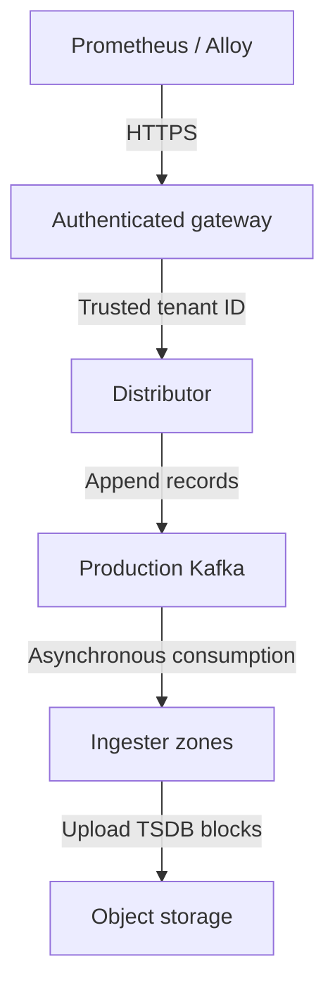
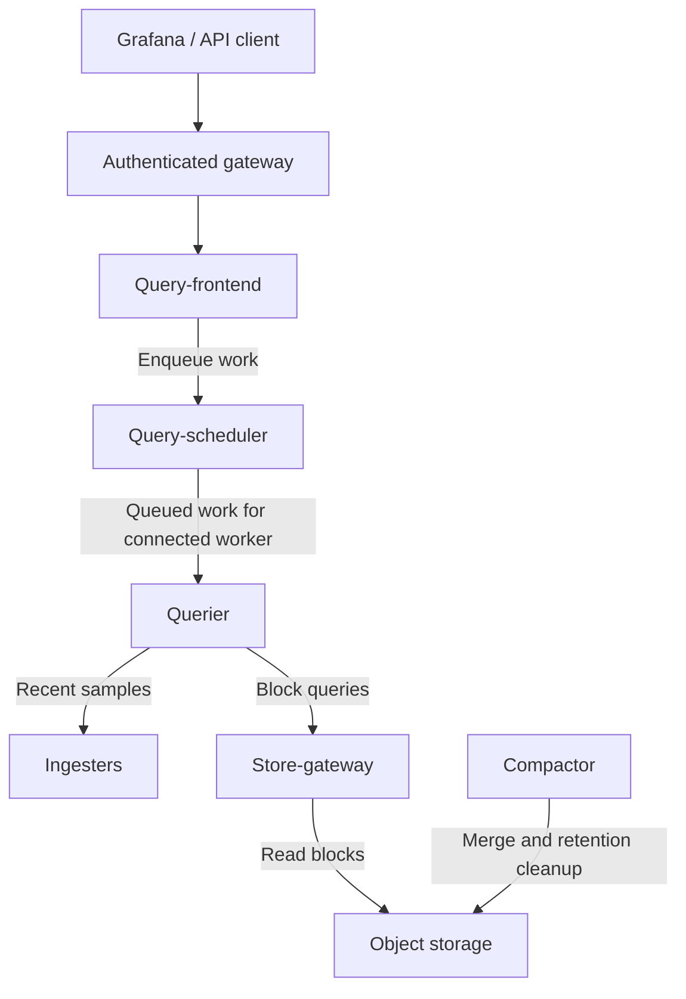

# Grafana Mimir

> **Base de revisión**: Mimir 3.2.1 / chart Helm mimir-distributed 6.2.0
> **Última actualización**: 12 de septiembre de 2026

Grafana Mimir es un backend de métricas compatible con Prometheus que admite ingesta con reconocimiento de inquilinos, consultas y almacenamiento de bloques a largo plazo. La capacidad, la compatibilidad de las consultas y el costo operativo dependen de la arquitectura, la configuración y la carga de trabajo elegidas; ni la retención ni el escalado son ilimitados.

## Mimir, Cortex y Thanos

Mimir y Cortex son proyectos distintos con orígenes relacionados. No interpretes la existencia de Mimir como un aviso de que Cortex ya no está disponible. Thanos admite tanto sidecars como un Receiver para remote write; no todas las implementaciones de Thanos requieren un sidecar.

| Proyecto | Opciones de implementación que debes comparar |
| --- | --- |
| Mimir | remote write con reconocimiento de inquilinos, almacenamiento de objetos y la arquitectura actual de almacenamiento de ingesta basada en Kafka |
| Cortex | backend multiinquilino compatible con Prometheus, como proyecto separado; consulta su propia versión y configuración de almacenamiento |
| Thanos | integración basada en sidecar o ingesta mediante Receive, con componentes compartidos de consulta y almacenamiento de objetos |

Compara la recuperación ante fallos, el comportamiento real de las consultas, el costo de almacenamiento/solicitudes/transferencia y la capacidad del equipo usando la misma carga de trabajo. Las clasificaciones no respaldadas de «rápido/medio» no son pruebas de rendimiento. Consulta [Cortex](https://cortexmetrics.io/docs/) y [Thanos Receive](https://thanos.io/tip/components/receive.md/).

## Arquitectura principal

### Almacenamiento de ingesta y ruta de escritura clásica

Desde Mimir 3.0, el almacenamiento de ingesta es estable y constituye la arquitectura preferida. Los distribuidores validan las muestras entrantes y agregan registros a Kafka. Una escritura correcta se confirma después de que la escritura en Kafka tenga éxito según las condiciones de durabilidad y replicación configuradas; esto no significa que un bloque ya se haya cargado en S3.



Cada ingester consume una partición; los ingesters de distintas zonas pueden consumir la misma partición para disponer de disponibilidad en la ruta de lectura. La asignación de particiones depende del sufijo numérico del ID de instancia del ingester. La capacidad y la retención de las particiones de Kafka deben cubrir los ordinales de ingester previstos, la acumulación pendiente y la ventana de recuperación. La replicación/ISR, la persistencia y la recuperación ante fallos del broker requieren su propia configuración.

Los ingesters mantienen una TSDB en memoria y un WAL local, crean bloques periódicamente (rangos de dos horas de forma predeterminada) y los cargan. La retención de la TSDB local les da tiempo a los queriers y store-gateways para detectar los bloques cargados; es distinta de la retención a largo plazo. Los discos persistentes ayudan a la recuperación, pero ninguna combinación de WAL y almacenamiento de objetos garantiza la recuperación ante todos los fallos o ante una acumulación de Kafka cuya retención haya vencido.

La arquitectura **clásica** envía las escrituras directamente de los distribuidores a un quórum de ingesters. El factor de replicación de los ingesters no es la configuración de replicación de escritura de Kafka. El modo clásico sigue disponible para implementaciones existentes; los valores predeterminados del binario y de Helm son distintos. El chart 6.x habilita el almacenamiento de ingesta, mientras que el valor predeterminado de `ingest_storage.enabled` del binario 3.2.1 inspeccionado es false. Sigue la [arquitectura](https://grafana.com/docs/mimir/latest/get-started/about-grafana-mimir-architecture/about-ingest-storage-architecture/) y el [procedimiento de migración](https://grafana.com/docs/mimir/latest/set-up/migrate/migrate-ingest-storage/) en lugar de cambiar una instalación activa con un solo indicador.

### Ruta de consulta y componentes



Este diagrama muestra las relaciones entre solicitudes y trabajo; los resultados de las consultas vuelven a través del frontend. El frontend divide y fragmenta el trabajo, usa cachés de resultados y combina respuestas. El scheduler pone el trabajo en cola para los queriers. Los queriers obtienen los datos necesarios de los ingesters y los store-gateways, incluso durante el solapamiento del traspaso de bloques; no son dos particiones temporales perfectamente separadas entre datos recientes e históricos.

El consumo de Kafka es asíncrono, por lo que la ruta de lectura predeterminada no garantiza consistencia de lectura inmediata tras la escritura. Un cliente puede solicitar `X-Read-Consistency: strong`; entonces los ingesters esperan a que se propaguen los offsets de partición, con las implicaciones de tiempo de espera y latencia correspondientes. Esto no es una garantía durante todos los fallos de broker o ingester.

| Componente | Responsabilidad |
| --- | --- |
| Distributor | Validar/limitar las escrituras entrantes y enviarlas a Kafka o a los ingesters en modo clásico |
| Ingester | Consumir su partición de Kafka, mantener la TSDB/WAL local, servir muestras recientes y cargar bloques |
| Store-gateway | Servir datos de bloques usando almacenamiento de objetos, encabezados de índice locales y las cachés configuradas |
| Compactor | Combinar bloques, deduplicar muestras replicadas y ejecutar la limpieza de retención cuando corresponda |
| Query-frontend / scheduler / querier | Planificar, almacenar en caché y poner en cola consultas, y ejecutar el trabajo resultante |
| Ruler / Alertmanager | Evaluación opcional de reglas y gestión de alertas; el almacenamiento, la identidad y la alta disponibilidad requieren configuración aparte |

La compactación no proporciona la opción inventada `compactor.downsampling_enabled`. Las recording rules pueden crear series derivadas, pero no reducen la resolución ni eliminan automáticamente las series sin procesar originales.

## Multi-tenancy y autenticación

`X-Scope-OrgID` identifica un inquilino; **no es autenticación**. Usa un gateway que autentique al cliente, autorice su inquilino, sobrescriba cualquier encabezado de inquilino no confiable y reenvíe solo las solicitudes permitidas. Restringe el acceso directo a los servicios de backend. Los nombres de usuario de autenticación básica se convierten en IDs de inquilino solo si un proxy de confianza implementa explícitamente esa correspondencia. El gateway de enrutamiento predeterminado del chart, por sí solo, no establece esta política.

Este ejemplo de Prometheus presupone que ya existen ese gateway HTTPS y un archivo de credenciales montado. El gateway deriva el inquilino de la identidad autenticada, por lo que aquí el cliente no elige el encabezado de inquilino.

```yaml
remote_write:
  - url: https://metrics.example.internal/api/v1/push
    authorization:
      type: Bearer
      credentials_file: /etc/prometheus/credentials/mimir-token
```

Un encabezado de inquilino proporcionado directamente solo es apropiado para una ruta de prueba que tenga confianza separada. Las claves de objetos y los límites separados por inquilino no impiden que un cliente no autenticado seleccione otro inquilino. Deshabilitar la multi-tenancy asigna las solicitudes a un inquilino compartido; no agrega protección. Consulta [autenticación y autorización](https://grafana.com/docs/mimir/latest/manage/secure/authentication-and-authorization/).

### Límites por inquilino y configuración en tiempo de ejecución

La configuración principal usa `limits` para los valores predeterminados. Las anulaciones por inquilino van en un archivo de configuración de ejecución separado, no en un bloque de nivel superior de la configuración principal de Mimir. Con este chart, usa el nivel superior `runtimeConfig.overrides`, como en el ejemplo siguiente. Los archivos de ejecución pueden anular los límites admitidos sin reiniciar el proceso; esto no significa que toda configuración de inicio pueda recargarse. Valida el acceso a la [configuración en tiempo de ejecución](https://grafana.com/docs/mimir/latest/configure/about-runtime-configuration/) y los resultados de recarga.

## Configuración de Helm en EKS

El chart **6.2.0** declara appVersion **3.2.0** y Kubernetes `^1.32.0-0`. Este ejemplo selecciona explícitamente la imagen del parche **3.2.1**, publicada el 10 de septiembre de 2026. La restricción del chart no es una matriz de soporte ni de ciclo de vida de EKS. Comprueba la versión de EKS seleccionada, el controlador CSI, la política de admisión y las dependencias del operador de despliegue; los charts semanales de desarrollo pertenecen a un flujo de versiones distinto.

### Preparar las dependencias

La siguiente configuración es **renderizable para revisión**; no es una prueba de despliegue en producción. Antes de aplicarla, prepara lo siguiente:

- Un clúster/tema externo de Kafka para producción que admita la autenticación de cliente con certificado mostrada, una replicación/retención de broker adecuada y operaciones autorizadas de productor y consumidor. Sustituye la dirección/puerto de ejemplo por el endpoint real. Otras configuraciones SASL/MSK requieren las opciones de Mimir y la configuración de identidad correspondientes.
- El Secret `mimir-kafka-client-tls` en `monitoring`, con `ca.crt`, `tls.crt` y `tls.key`. Todo proceso de Mimir que cargue esta configuración TLS compartida necesita estos archivos, incluidos los componentes que no consumen Kafka directamente.
- Tres buckets de S3 existentes y una cuenta de servicio autorizada `mimir-storage`, descritos más abajo. Mimir no crea estos buckets.
- Las etiquetas reales de AZ, una StorageClass existente adecuada y suficientes nodos planificables y capacidad de PVC. `gp3` es un nombre de clase de ejemplo. EKS Auto Mode y el complemento EBS CSI usan provisionadores distintos; selecciona la clase que corresponda al responsable del almacenamiento del clúster.
- Enrutamiento externo autenticado al distributor y al query-frontend. El ejemplo deshabilita el gateway de enrutamiento del chart sin autenticación y no crea un Ingress público sustituto.

El operador de despliegue está habilitado. Antes de la instalación o las actualizaciones, revisa sus CRD, webhooks, permisos y propiedad; `--include-crds` los incluye en la salida local siguiente. No lo deshabilites en una implementación existente sin revisar el comportamiento de despliegue con conocimiento de zonas. Una configuración de tres zonas requiere selectores de zona reales; los nombres lógicos por sí solos no crean redundancia geográfica.

### Valores y renderizado local

Guarda esto como `mimir-values.yaml`. Los anclajes YAML reutilizan los mismos montajes de certificados y definiciones de AZ. Las cantidades de réplicas, tamaños de volúmenes y límites de tasa/consulta son ejemplos que deben dimensionarse según mediciones de la carga de trabajo. La configuración renderizada de tres zonas tiene **un ingester y un store-gateway por zona**, tres de cada uno en total; un único compactor no constituye una garantía general de alta disponibilidad.

```yaml
image:
  tag: 3.2.1
serviceAccount:
  create: false
  name: mimir-storage
minio:
  enabled: false
kafka:
  enabled: false
gateway:
  enabled: false
distributor:
  replicas: 2
  extraVolumes: &kafka-volumes
  - name: kafka-client-tls
    secret:
      secretName: mimir-kafka-client-tls
  extraVolumeMounts: &kafka-mounts
  - name: kafka-client-tls
    mountPath: /etc/mimir/kafka-tls
    readOnly: true
ingester:
  replicas: 3
  persistentVolume:
    enabled: true
    storageClass: gp3
    size: 50Gi
  zoneAwareReplication:
    enabled: true
    topologyKey: kubernetes.io/hostname
    zones: &az-zones
    - name: zone-a
      nodeSelector:
        topology.kubernetes.io/zone: ap-northeast-2a
    - name: zone-b
      nodeSelector:
        topology.kubernetes.io/zone: ap-northeast-2b
    - name: zone-c
      nodeSelector:
        topology.kubernetes.io/zone: ap-northeast-2c
  extraVolumes: *kafka-volumes
  extraVolumeMounts: *kafka-mounts
store_gateway:
  replicas: 3
  persistentVolume:
    enabled: true
    storageClass: gp3
    size: 20Gi
  zoneAwareReplication:
    enabled: true
    topologyKey: kubernetes.io/hostname
    zones: *az-zones
  extraVolumes: *kafka-volumes
  extraVolumeMounts: *kafka-mounts
compactor:
  replicas: 1
  persistentVolume:
    enabled: true
    storageClass: gp3
    size: 50Gi
  extraVolumes: *kafka-volumes
  extraVolumeMounts: *kafka-mounts
querier:
  replicas: 2
  extraVolumes: *kafka-volumes
  extraVolumeMounts: *kafka-mounts
query_frontend:
  replicas: 2
  extraVolumes: *kafka-volumes
  extraVolumeMounts: *kafka-mounts
query_scheduler:
  enabled: true
  replicas: 2
  extraVolumes: *kafka-volumes
  extraVolumeMounts: *kafka-mounts
ruler:
  enabled: false
alertmanager:
  enabled: false
rollout_operator:
  enabled: true
chunks-cache:
  enabled: true
index-cache:
  enabled: true
metadata-cache:
  enabled: true
results-cache:
  enabled: true
mimir:
  structuredConfig:
    common:
      storage:
        backend: s3
        s3:
          endpoint: s3.ap-northeast-2.amazonaws.com
          region: ap-northeast-2
    blocks_storage:
      s3:
        bucket_name: example-mimir-blocks
    ruler_storage:
      s3:
        bucket_name: example-mimir-rules
    alertmanager_storage:
      s3:
        bucket_name: example-mimir-alerts
    ingest_storage:
      enabled: true
      kafka:
        address: kafka.metrics.example.internal:9093
        topic: mimir-ingest
        auto_create_topic_enabled: false
        tls_enabled: true
        tls_ca_path: /etc/mimir/kafka-tls/ca.crt
        tls_cert_path: /etc/mimir/kafka-tls/tls.crt
        tls_key_path: /etc/mimir/kafka-tls/tls.key
    frontend:
      split_queries_by_interval: 24h
    querier:
      max_concurrent: 20
      max_samples: 50000000
      timeout: 2m
    limits:
      ingestion_rate: 100000
      ingestion_burst_size: 200000
      max_global_series_per_user: 5000000
      compactor_blocks_retention_period: 365d
      max_total_query_length: 30d
      max_query_parallelism: 32
      query_sharding_total_shards: 16
      align_queries_with_step: false
runtimeConfig:
  overrides:
    tenant-1:
      ingestion_rate: 50000
      ingestion_burst_size: 100000
      max_global_series_per_user: 1000000
overrides_exporter:
  extraVolumes: *kafka-volumes
  extraVolumeMounts: *kafka-mounts
```

```bash
helm repo add grafana https://grafana.github.io/helm-charts
helm repo update grafana
helm template mimir grafana/mimir-distributed \
  --version 6.2.0 --namespace monitoring --include-crds \
  --kube-version 1.36.2 -f mimir-values.yaml > mimir-rendered.yaml
```

`--kube-version` proporciona una capacidad de renderizado sin conexión, no una actualización del clúster ni una prueba de compatibilidad en vivo. Inspecciona los Services renderizados, selectores, PVC, contexto de seguridad, CRD y configuración de las cargas de trabajo antes de aplicar. Kafka de un solo nodo y MinIO, incluidos de forma predeterminada, son para demostraciones; establecer sus valores `enabled` en false solo deshabilita esas implementaciones incluidas, no el almacenamiento de ingesta ni el backend S3 de Mimir.

Ruler y Alertmanager están deshabilitados en este ejemplo. Habilitar cualquiera de ellos requiere sus propias réplicas, almacenamiento y seguridad, además de montajes de certificados en la configuración compartida. Consulta la [configuración de producción](https://grafana.com/docs/helm-charts/mimir-distributed/latest/run-production-environment-with-helm/).

### Instalaciones clásicas existentes

El paso del chart 5.x al 6.x también cambia los requisitos del gateway y del operador de despliegue. Mantener la arquitectura clásica requiere tanto deshabilitar el almacenamiento de ingesta como permitir las llamadas Push RPC de los ingesters. Este fragmento describe esa elección; no es un plan de migración completo ni debe combinarse a ciegas con una nueva instalación basada en Kafka.

```yaml
kafka:
  enabled: false
mimir:
  structuredConfig:
    ingest_storage:
      enabled: false
    ingester:
      push_grpc_method_enabled: true
```

Usa la [guía de migración de 5.x a 6.x](https://grafana.com/docs/helm-charts/mimir-distributed/latest/migration-guides/migrate-helm-chart-5.x-to-6.0/) y una diferencia de valores revisada. No des por sentado que una actualización del chart rellena datos históricos, crea durabilidad de Kafka, conserva la disponibilidad o elimina webhooks antiguos de forma segura.

## S3 e identidad de las cargas de trabajo

### Buckets e IRSA

El ejemplo utiliza buckets separados para bloques, reglas y el estado de Alertmanager. Los bloques no pueden usar el mismo bucket **ni el mismo prefijo de almacenamiento** que el store de ruler o Alertmanager. Los destinos de almacenamiento correspondientes rechazan esa disposición conflictiva; una comprobación de inicio del distributor por sí sola no valida cada rol de almacenamiento. Otra opción es usar un `storage_prefix` admitido y claramente distinto. No des por sentado que un filtro de ciclo de vida arbitrario `blocks/` coincide con la disposición configurada.

Prepara el proveedor OIDC del clúster EKS y un rol IRSA cuya política de confianza restrinja `sub` a `system:serviceaccount:monitoring:mimir-storage` y `aud` a `sts.amazonaws.com`. `serviceAccount.create: false` y `name: mimir-storage` del chart deben coincidir con la cuenta preparada. Verifica la anotación del rol y la entrega del token proyectado. RBAC de Kubernetes no concede permisos de S3.

Una política S3 limitada a los tres buckets de ejemplo tiene esta forma; sustituye los nombres de bucket y revisa por separado los requisitos de KMS/política de clave:

```json
{
  "Version": "2012-10-17",
  "Statement": [
    {
      "Effect": "Allow",
      "Action": ["s3:ListBucket"],
      "Resource": ["arn:aws:s3:::example-mimir-blocks", "arn:aws:s3:::example-mimir-rules", "arn:aws:s3:::example-mimir-alerts"]
    },
    {
      "Effect": "Allow",
      "Action": ["s3:GetObject", "s3:PutObject", "s3:DeleteObject"],
      "Resource": ["arn:aws:s3:::example-mimir-blocks/*", "arn:aws:s3:::example-mimir-rules/*", "arn:aws:s3:::example-mimir-alerts/*"]
    }
  ]
}
```

La cadena de proveedores S3 inspeccionada admite el archivo de token de identidad web de IRSA y el ARN del rol. Este archivo de valores no contiene claves de acceso estáticas ni secretos, y no se inyectan mediante `extraEnvFrom`. Valida el acceso real a STS/S3 e impide el uso accidental de credenciales del nodo como alternativa. No equipares IRSA con EKS Pod Identity sin comprobar la compatibilidad y configuración del proveedor de credenciales elegido. Mantén habilitado S3 Block Public Access y revisa los requisitos de cifrado, control de versiones, Object Lock y copias de seguridad.

Consulta [almacenamiento de objetos de Mimir](https://grafana.com/docs/mimir/latest/configure/configure-object-storage-backend/) y [roles IAM para cuentas de servicio de EKS](https://docs.aws.amazon.com/eks/latest/userguide/associate-service-account-role.html).

### Ciclo de vida y retención

`limits.compactor_blocks_retention_period: 365d` establece la política de retención. La limpieza es asíncrona y opera por bloques: el análisis, marcado y programación de eliminación, los rangos temporales de los bloques y `compactor.deletion_delay` afectan a la eliminación física. Esto no es un plazo exacto de eliminación ni garantiza el cumplimiento normativo de forma automática. El retraso de eliminación no garantiza una copia de seguridad ni la reversión, y eliminar el objeto actual no purga todas las versiones no actuales ni las copias de seguridad.

No agregues una regla de expiración S3 conflictiva que elimine bloques activos detrás de Mimir. Una regla para limpiar cargas multipartes incompletas es una opción distinta de administración del bucket. Las transiciones entre clases de almacenamiento requieren analizar el tamaño de los objetos, la duración mínima, las solicitudes y los costos de recuperación, además de las reescrituras de compactación; una regla fija «90 días → STANDARD_IA» no es apropiada en todos los casos. Consulta las [consideraciones sobre transiciones de S3](https://docs.aws.amazon.com/AmazonS3/latest/userguide/lifecycle-transition-general-considerations.html).

## Consultas, caché y rendimiento

### Claves de configuración actuales

La configuración principal del frontend de consultas de Mimir es `frontend`, mientras que la configuración de la carga de trabajo de Helm es `query_frontend`. Son espacios de configuración distintos. Los ejemplos actuales utilizan `querier.max_samples`, `limits.max_total_query_length`, `limits.query_sharding_total_shards` y `limits.align_queries_with_step`; los ejemplos anteriores `query_frontend.query_sharding.enabled/total_shards`, `align_querier_with_step` y `max_fetched_samples_per_query` no son sustitutos válidos.

Mantén deshabilitada la alineación del intervalo cuando importen las marcas de tiempo solicitadas exactas o la conformidad con PromQL. Alinear los intervalos puede mejorar la reutilización de la caché, pero cambia la semántica. Aumentar el paralelismo de consultas, los fragmentos, las muestras o los tiempos de espera puede incrementar la memoria y la carga en los sistemas dependientes, en lugar de resolver el cuello de botella.

### Funciones de las cachés

| Caché del chart | Función en la configuración |
| --- | --- |
| `results-cache` | Resultados de consultas del frontend; los aciertos parciales aún requieren trabajo sin caché |
| `index-cache` | Información de índices/postings/series de bloques |
| `chunks-cache` | Datos de bloques almacenados en chunks |
| `metadata-cache` | Operaciones de metadatos del almacenamiento de objetos |

Los aciertos de metadatos o de la caché de índices no constituyen, por sí solos, respuestas completas a las consultas. No son tres etapas secuenciales de «acierto → devolver respuesta». Los archivos locales de encabezado de índice y los discos de TSDB/WAL también son distintos de Memcached. Verifica la tasa de aciertos, latencia, tamaño de memoria/elementos, expulsiones y comportamiento con la caché fría antes de cambiar las cachés. Consulta el [query frontend](https://grafana.com/docs/mimir/latest/references/architecture/components/query-frontend/) y el [store-gateway](https://grafana.com/docs/mimir/latest/references/architecture/components/store-gateway/).

### Capacidad y disponibilidad

Perfila las muestras/series/cardinalidad de ingesta, memoria/WAL/disco del ingester, acumulación de Kafka, colas del frontend, memoria/CPU del querier, fallos de caché del store-gateway y progreso del compactor. Los planes de dimensionamiento pequeño/grande del chart son estimaciones iniciales, no garantías de capacidad. Comprueba la forma de las consultas y los límites de inquilino antes de aumentar réplicas o concurrencia.

La durabilidad y disponibilidad requieren revisar por separado la replicación de escritura de Kafka, la cobertura de particiones/zonas de los ingesters, la ubicación de los store-gateways, la capacidad planificable, el almacenamiento de objetos, las réplicas de frontend/scheduler y el comportamiento de despliegue. La replicación de caché por sí sola no es durabilidad de datos. Los límites de tasa/cardinalidad pueden rechazar datos; no conservan ni agregan automáticamente las muestras rechazadas.

Para reducir el volumen de ingesta, usa relabeling revisado en el colector o recording rules adecuadas para los datos. Mimir también admite `limits.drop_labels`, incluidas anulaciones en tiempo de ejecución por inquilino. Esto cambia los conjuntos de etiquetas que se ingieren; por sí solo, no reduce de forma segura una cardinalidad arbitraria. Eliminar etiquetas de identidad puede combinar series que antes eran distintas, así que prueba las colisiones y la semántica de consultas/alertas antes del despliegue.

## Comparación con VictoriaMetrics

| Dimensión | Mimir | VictoriaMetrics |
| --- | --- | --- |
| Licencia de código abierto | AGPL-3.0 | Apache-2.0; distingue las funciones Enterprise |
| Implementación | Se pueden seleccionar destinos binarios; este ejemplo usa microservicios | Modos de nodo único y clúster |
| Almacenamiento | Almacenamiento de objetos para bloques en producción; existe backend de sistema de archivos para desarrollo local | Rutas de almacenamiento local en la arquitectura de nodo único/clúster revisada; rutas de copia de seguridad separadas |
| Comportamiento de consultas | API compatible con PromQL, con límites documentados de funciones/configuración | MetricsQL, con diferencias semánticas documentadas |
| Multi-tenancy | ID de inquilino más una capa de autenticación/autorización aplicada | Rutas de inquilino/cuenta más una capa de autenticación/autorización aplicada |
| Costo/rendimiento | Mide ingesta, consultas, Kafka, caché, solicitudes a objetos y operaciones | Mide la carga equivalente, replicación, discos y operaciones |

La integración con Grafana o el deseo de usar multi-tenancy no determina un ganador universal. Valida la paridad de migración/consultas, retención, recuperación ante fallos, capacidad del equipo y costo total. Consulta la [guía revisada de VictoriaMetrics](02-victoriametrics.md).

## Supervisión y solución de problemas

Usa el mixin/integración de Mimir correspondiente a la versión para supervisar la implementación. Inspecciona las métricas actuales `cortex_ingester_active_series`, `cortex_distributor_received_samples_total`, `cortex_ingest_storage_reader_last_consumed_offset` y el progreso del compactor; un contador u offset por sí solo no representa retraso, rendimiento ni un SLO. La ruta de metasupervisión obsoleta basada en Grafana Agent no debería ser una nueva opción predeterminada; la documentación actual apunta a la integración de Alloy/Kubernetes Monitoring.

Esta alerta ilustrativa del compactor usa una métrica presente en el mixin fijado. Cuenta fallos durante una ventana, no necesariamente intentos consecutivos; ajusta las etiquetas de agregación al scrape implementado y agrega por separado la supervisión de objetivos ausentes.

```yaml
groups:
  - name: mimir-example
    rules:
      - alert: MimirCompactorRepeatedFailures
        expr: sum by (cluster, namespace, pod) (increase(cortex_compactor_runs_failed_total{reason!="shutdown"}[2h])) >= 2
        for: 5m
        labels:
          severity: warning
```

Para el nombre de versión y espacio de nombres renderizados, un operador autorizado puede inspeccionar un query-frontend usando port-forwarding local:

```bash
kubectl -n monitoring get pods
kubectl -n monitoring get pvc
kubectl -n monitoring port-forward service/mimir-query-frontend 18080:8080
```

En otra terminal:

```bash
curl --fail --silent --show-error http://127.0.0.1:18080/ready
curl --fail --silent --show-error http://127.0.0.1:18080/api/v1/status/buildinfo
```

`buildinfo` devuelve metadatos de compilación, no consultas lentas. Para investigar tiempos de espera agotados, revisa las colas, las estadísticas/registros de consultas y muestras de consultas acotadas. Ante un OOM del ingester, inspecciona las series/cardinalidad reales y los búferes antes de ajustar los límites de la instancia. Ante demoras del compactor, revisa permisos de objetos, disco, fallos y acumulación antes de cambiar recursos. Protege los endpoints `/config`, `/runtime_config`, estadísticas de inquilinos, ring y métricas; no los expongas como diagnósticos públicos. Los endpoints del ring son específicos de cada componente y, con Kafka, también importa el ring de particiones.

## Validación y referencias

El ejemplo se renderizó con el chart 6.2.0 y Mimir 3.2.1 lo analizó/validó para sus ocho destinos de componentes implementados usando `-print.config`, que sale antes de inicializar los servicios. Se sustituyeron las rutas locales de certificados de prueba por las rutas preparadas de volumen del Secret. Esto verifica la estructura de configuración y el comportamiento de validación, no las conexiones Kafka/mTLS/IRSA/S3, el aprovisionamiento de PVC, las recargas en tiempo de ejecución, la alta disponibilidad ni el rendimiento bajo carga. No se crearon recursos en la nube.

- [Referencia de configuración](https://grafana.com/docs/mimir/latest/configure/configuration-parameters/)
- [Chart Helm de Mimir](https://grafana.com/docs/helm-charts/mimir-distributed/latest/)
- [Modos de despliegue de Mimir](https://grafana.com/docs/mimir/latest/references/architecture/deployment-modes/)
- [Referencia de la API HTTP](https://grafana.com/docs/mimir/latest/references/http-api/)

## Cuestionario

Comprueba este capítulo con el [cuestionario de Grafana Mimir](../../quizzes/observability/metrics/03-mimir-quiz.md).
