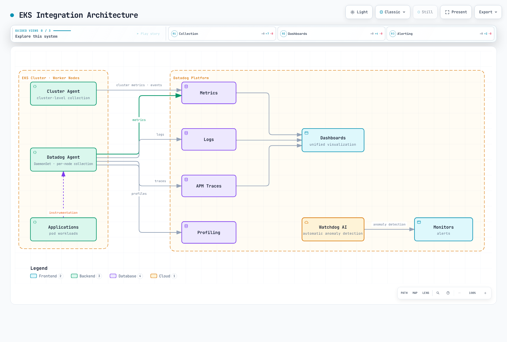

# Datadog

> **Última actualización**: 12 de octubre de 2026
> Helm chart 3.244.0; Agent y Cluster Agent de la misma versión: 7.83.1.
> A continuación se indican los límites de configuración, SDK y validación local; no se modificó ninguna organización de Datadog.

## Introducción

Datadog proporciona un backend de observabilidad SaaS. Los equipos siguen siendo responsables de los recopiladores, la identidad,
el acceso de red, la instrumentación, la divulgación de datos, la retención, los monitores y el costo.
Cada producto —Monitorización de infraestructura, APM, perfilado, registros y otros— tiene requisitos de licencia y
unidades de facturación propios; instalar un Agent no incluye todos los productos.

| Tema | Datadog | CloudWatch | Prometheus / Grafana autogestionados |
| --- | --- | --- | --- |
| Plataforma | Datadog SaaS, con disponibilidad específica del sitio | Servicios administrados por AWS | Almacenamiento, consultas y visualización autogestionados |
| Recopilación | Agent/Cluster Agent, bibliotecas y rutas OTel compatibles | Métricas de servicios de AWS, agentes/SDK/OTLP | Exportadores, scraping, agentes y escritura remota |
| APM/registros | Seleccione y configure los productos necesarios | Integraciones de Application Signals, trazas y Logs | Configure los sistemas de almacenamiento y recopiladores pertinentes |
| Operaciones | Se mantienen las responsabilidades del recopilador/configuración y de la aplicación | Se mantienen las responsabilidades de recopilación/configuración y respuesta | Se mantienen las responsabilidades del backend y la recopilación |
| Costo | Unidades de uso y retención por host y por producto | Unidades de métricas, observaciones, OTLP, registros, consultas y alertas | Infraestructura y esfuerzo operativo |

Elija el **sitio** de Datadog correcto para la organización y sus credenciales;
los endpoints de API, la residencia de datos, los productos disponibles y los términos de precios no son
intercambiables entre sitios. Use el catálogo de integraciones en lugar de afirmar un número fijo de
integraciones o una clasificación universal de “fácil/avanzado/barato”.

## Arquitectura de integración en EKS

| Componente | Responsabilidad / límite |
| --- | --- |
| Agente de nodo (Node Agent) | Comprobaciones del host y los contenedores; normalmente, un DaemonSet en nodos EC2 compatibles |
| Agente de clúster (Cluster Agent) | Metadatos y comprobaciones compartidos de Kubernetes, coordinación de eventos y funciones opcionales de admisión y métricas externas |
| Agente de trazas (Trace Agent) | Recibe datos de trazas de las aplicaciones y los reenvía |
| Recopilación de procesos / system-probe | Funciones opcionales de proceso/red/seguridad con sus propios requisitos de sistema operativo, privilegios y producto |
| Controlador de admisión (Admission Controller) | Inyecta la configuración de conexión y, si se configura, bibliotecas de cliente compatibles en los Pods nuevos |

La instrumentación de la aplicación produce trazas y perfiles; la presencia de un receptor del Agent o de una etiqueta en el Pod
no demuestra por sí sola que la aplicación esté instrumentada. El Cluster Agent no suele reenviar
los registros ni las trazas de las aplicaciones.

La instalación de este capítulo está dirigida a **nodos de EKS basados en Linux sobre EC2**. EKS Fargate
usa el modelo documentado de recopilación por Pod o sidecar, no este DaemonSet de host.
UDS es local al host y no es compatible con Windows. Windows, Bottlerocket,
Auto Mode y los entornos de cómputo mixtos requieren la configuración específica de cada distribución y función,
así como acceso al host compatible. No desactive la verificación de TLS ni suponga que todas las funciones
de eBPF o de recopilación de procesos funcionan en todos los entornos.

Datadog documenta Agent y Cluster Agent 7.67 o posterior para admitir Kubernetes 1.33 o posterior
con `AllocatedResources`, y recomienda que ambos tengan la misma versión. Estos requisitos mínimos
de versión para esas funciones no equivalen a la matriz actual de versiones de EKS compatibles.

El diagrama muestra algunas de las rutas posibles de recopilación. Las trazas y los perfiles requieren instrumentación de la aplicación y los productos correspondientes; el enrutamiento de las notificaciones de Watchdog debe configurarse por separado.



[Diagrama interactivo](https://www.atomai.click/kubernetes-docs/archmaps/en-observability-metrics-05-datadog-1.html)

## Instalación del Datadog Agent

Datadog recomienda su Operator para gestionar el ciclo de vida con una configuración de nivel superior y también
permite la instalación mediante Helm. Este ejemplo administra el Agent de nodo y el Cluster Agent con el
**chart de Helm de Datadog Agent**. El chart 3.244.0 incluye una dependencia opcional del Operator;
`datadog.operator.enabled: false` excluye ese controlador adicional de este ejemplo.
Esto no significa que el Operator esté obsoleto.

El valor predeterminado del chart es Agent/Cluster Agent 7.82.3. Este ejemplo fija ambos explícitamente en
**7.83.1** y usa los digests verificados de los índices de imágenes. Esa versión corrige la facturación de las
pruebas de red, la limpieza de instantáneas de containerd y el cierre del bloqueo de líder del Cluster Agent.
Los índices de imágenes de Agent y Cluster Agent incluyen Linux amd64 y arm64. Un renderizado correcto
de la plantilla no equivale a una implementación en Kubernetes ni demuestra compatibilidad durante la ejecución.

### Credenciales y responsabilidad sobre la instalación

Este perfil obtiene la clave de API de Datadog y el token compartido de Cluster Agent desde
AWS Secrets Manager mediante el backend nativo `aws.secrets`. No se necesita una clave de aplicación
para la ingesta básica; las métricas externas permanecen deshabilitadas.

Prepare `observability/datadog` en `ap-northeast-2` con claves de cadena JSON `api-key`
y `cluster-token`; el token debe ser criptográficamente aleatorio y tener al menos
32 caracteres. La clave de API debe coincidir con el sitio de Datadog. Ambas cuentas de servicio,
`datadog` y `datadog-cluster-agent` en el espacio de nombres `datadog`, requieren roles IRSA
con alcance limitado, conectividad regional con STS/Secrets Manager y permiso KMS si corresponde.
Sustituya los dos ARN de ejemplo por los roles correspondientes. El mecanismo alternativo de credenciales basado en los metadatos de EC2 está deshabilitado.
Consulte los [requisitos previos completos y perfiles reutilizables](https://github.com/Atom-oh/kubernetes-docs/blob/5ff787faed758902c12a74e8429466f434bb26ae/examples/observability/secret-profiles/README.md).

Use Python 3, PyYAML 6.0.3 y el postprocesador ejecutable del chart fijado, desde el directorio indicado
del repositorio. Este reemplaza exactamente siete referencias SecretKeyRef codificadas en el chart
por **referencias literales `ENC[...]`**, y conserva los consumidores del Agent de nodo, Trace Agent,
contenedores de inicialización y Cluster Agent. El backend nativo resuelve las referencias en la configuración
en memoria, no en el entorno. El script de inicialización requiere que `DD_API_KEY` no esté vacío;
eliminarlo sin un reemplazo válido impide el arranque. El Secret `must-use-secret-postrenderer`
no está presente intencionalmente; no lo cree para eludir la omisión del postprocesador.
Use el postprocesador en cada instalación y actualización, y revise cualquier cambio en el chart,
las imágenes o el contrato del perfil fijados.

Estos comandos modifican el clúster solo al instalar. Durante la auditoría no se realizó ningún despliegue.
Ejecútelos desde la raíz del repositorio, en un espacio de nombres `datadog` que ya exista y con una
instalación de Helm bajo su responsabilidad, después de preparar los requisitos previos de IAM y secretos.

```bash
PROFILE=examples/observability/secret-profiles
helm repo add datadog https://helm.datadoghq.com
helm repo update datadog
helm template datadog datadog/datadog --version 3.244.0 \
  --namespace datadog --include-crds -f "$PROFILE/datadog-values.yaml" \
  --post-renderer "$PROFILE/datadog_postrender.py" > datadog-reviewed-render.yaml
# Review resources and ownership first; retain the renderer on EVERY upgrade.
helm upgrade --install datadog datadog/datadog --version 3.244.0 \
  --namespace datadog -f "$PROFILE/datadog-values.yaml" \
  --post-renderer "$PROFILE/datadog_postrender.py"
```

### Valores revisados

Lo siguiente coincide con el `datadog-values.yaml` reutilizable. Los registros se habilitan de forma opcional mediante la
configuración del contenedor, APM/DogStatsD usan UDS y la inyección automática de bibliotecas en todo el clúster,
las métricas HPA externas, las estadísticas de red del mecanismo de descubrimiento y la recopilación opcional de procesos/red
no están habilitadas aquí.
El espacio de nombres de la aplicación debe ser distinto del espacio de nombres del Agent; SSI
no instrumenta Pods en el espacio de nombres del propio Agent.

```yaml
# datadog 3.244.0: postrenderer required; replace example IRSA role ARNs.
targetSystem: linux
registry: gcr.io/datadoghq
datadog:
  apiKeyExistingSecret: must-use-secret-postrenderer
  clusterName: my-eks-cluster
  site: datadoghq.com
  tags:
  - env:demo
  - team:platform
  logs:
    enabled: true
    containerCollectAll: false
    containerCollectUsingFiles: true
  apm:
    socketEnabled: true
    portEnabled: false
    instrumentation:
      enabled: false
  dogstatsd:
    useSocketVolume: true
    useHostPort: false
    nonLocalTraffic: false
  processAgent:
    processCollection: false
    processDiscovery: false
    containerCollection: true
  networkMonitoring:
    enabled: false
  discovery:
    enabled: false
    networkStats:
      enabled: false
  autoscaling:
    workload:
      enabled: false
  profiling:
    enabled: null
  collectEvents: true
  prometheusScrape:
    enabled: false
  kubeStateMetricsCore:
    enabled: true
    collectSecretMetrics: false
    collectConfigMaps: false
  operator:
    enabled: false
  secretBackend:
    type: aws.secrets
    config:
      aws_session:
        aws_region: ap-northeast-2
    enableGlobalPermissions: false
  env: &id001
  - name: AWS_EC2_METADATA_DISABLED
    value: 'true'
  - name: DD_SECRET_REFRESH_INTERVAL
    value: '0'
  - name: DD_SECRET_REFRESH_ON_API_KEY_FAILURE_INTERVAL
    value: '0'
clusterAgent:
  enabled: true
  replicas: 2
  image:
    tag: 7.83.1
    digest: sha256:8e420c81e68abec34ab792c72a6513b739dcba8f7682c52e1e7e276363827b1a
  metricsProvider:
    enabled: false
    useDatadogMetrics: false
  admissionController:
    enabled: true
    mutateUnlabelled: false
  tokenExistingSecret: must-use-secret-postrenderer
  rbac:
    create: true
    serviceAccountAnnotations:
      eks.amazonaws.com/role-arn: arn:aws:iam::111122223333:role/datadog-cluster-agent-secrets
  env: *id001
agents:
  image:
    tag: 7.83.1
    digest: sha256:ed0bd588e955d82f661d1b8dd1cdf179c1023e74a2817e7a812c99d52f05c319
  rbac:
    create: true
    serviceAccountAnnotations:
      eks.amazonaws.com/role-arn: arn:aws:iam::111122223333:role/datadog-agent-secrets
```

Después del postprocesamiento, los únicos valores de entorno relacionados con credenciales son
`ENC[observability/datadog;api-key]` y `ENC[observability/datadog;cluster-token]`.
`DD_SECRET_BACKEND_TYPE` y `CONFIG` contienen únicamente el tipo de backend y la región. Ningún shell
exporta un valor ya resuelto; tampoco se incluye ninguna clave real en los valores de Helm y el perfil
no necesita un Secret de credenciales de Kubernetes. Los dos contenedores init-volume solo
copian la configuración de la imagen; init-config usa la referencia a la clave de API para comprobarla
durante el arranque. La autorización real del backend nativo y la ingesta en Datadog aún deben
verificarse durante la ejecución.

La actualización programada y la actualización tras errores de la API de secretos están deshabilitadas explícitamente.
Rote las credenciales mediante un reinicio coordinado y aprobado de los Pods del Agent de nodo, Trace Agent
y Cluster Agent; mantenga válida la clave de API anterior hasta que toda la flota use la nueva. Un cambio
del token del clúster puede interrumpir la autenticación entre el Agent de nodo y el Cluster Agent durante
un despliegue con versiones mixtas. Planifique una ventana de mantenimiento o una transición validada por separado.
No se garantiza una rotación sin interrupciones. Consulte [los backends de secretos de Datadog](https://docs.datadoghq.com/agent/guide/secrets-management/).

`processAgent.enabled` está obsoleto; use las opciones de recopilación individuales.
Cuando corresponde, el chart ya monta `/etc/passwd`; no agregue volúmenes o montajes manuales duplicados para `passwd`. Las anulaciones de recursos son por componente, como
`agents.containers.agent.resources`; dimensione los contenedores realmente renderizados bajo carga.
Dos réplicas de Cluster Agent no sustituyen las pruebas de colocación, interrupción y fallos.

Las entradas originales de nivel superior `kubeStateMetricsEnabled` y `prometheus.enabled`
no configuran las integraciones que se les atribuían. La opción heredada de KSM está dentro de
`datadog`; este ejemplo usa `datadog.kubeStateMetricsCore.enabled` y evita duplicar
la recopilación heredada. Las comprobaciones explícitas de Datadog Autodiscovery son independientes
de la opción `prometheusScrape`, que descubre todas las anotaciones.

`datadog.profiling.enabled` **es válido**. Inserta `DD_PROFILING_ENABLED` en
Pods aptos y requiere bibliotecas de cliente instaladas y Cluster Agent 7.57+.
No instala un perfilador en una aplicación arbitraria sin instrumentar.
Elija deliberadamente su comportamiento `null`/`false`/`auto`/`true`. De forma similar, habilitar
métricas HPA externas requiere su clave de aplicación, permisos de API, servicio/CRDs
y disponibilidad real de métricas; la monitorización de red requiere acceso compatible a system-probe.

### La integración de la cuenta AWS es una ruta independiente

La integración SaaS de cuentas de AWS usa un rol entre cuentas autorizado y el ID externo
proporcionado por Datadog, con los permisos necesarios para las integraciones seleccionadas.
Asociar cualquier rol de IRSA a la cuenta de servicio del Agent de nodo no configura esa integración SaaS.
La recopilación habitual de Kubernetes por el Agent no requiere la amplia política de CloudWatch, EC2 y etiquetas
que se había mostrado aquí.

Use Pod Identity o IRSA únicamente para un Agent o una comprobación que realmente invoque a AWS,
con el rol, la relación de confianza y los permisos correspondientes. Compruebe el nombre de la cuenta de servicio
que realmente genera el chart; crear una asociación de IAM para una cuenta supuesta llamada `datadog-agent`
no la vincula con otra cuenta de servicio que use la instalación de Helm. Una comprobación local del llamador de STS
no demuestra qué identidad usa la carga de trabajo.

## Monitorización de infraestructura

### Compruebe el recopilador, la unidad y las etiquetas de la métrica

| Métrica / fuente | Significado |
| --- | --- |
| `system.cpu.idle` / comprobación System | **Porcentaje** de CPU inactiva; adecuado para un umbral de nodo basado en porcentaje |
| `system.mem.total`, `system.mem.used`, `system.mem.free` | Mediciones de memoria; libre no es intercambiable con memoria utilizable/reclamable |
| `kubernetes.cpu.usage.total` / Kubelet | **Nanocores**, no porcentaje; un núcleo equivale a 1,000,000,000 nanocores |
| `kubernetes.memory.usage`, `kubernetes.memory.limits` | Bytes; el uso frente al límite requiere coincidir con la misma entidad/conjunto de etiquetas |
| `kubernetes.pods.running`, `kubernetes.containers.restarts` | Métricas de tipo gauge válidas de Kubelet: Pods en ejecución y reinicios acumulados de contenedores |
| `kubernetes_state.deployment.replicas_available`, `kubernetes_state.deployment.replicas_desired` | Estado del Deployment según Kubernetes State Metrics Core |
| `kubernetes_state.pod.status_phase`, `kubernetes_state.service.count` | Inventario de fases de Pods y servicios; inspeccione las etiquetas de agrupación documentadas |
| `kubernetes_state.container.restarts` | Métrica de tipo gauge de reinicios de State Core, con etiquetas de espacio de nombres, Pod y contenedor |

La integración heredada de Kubernetes, la comprobación de Kubelet y State Core tienen
catálogos diferentes. Una métrica ausente de un catálogo no necesariamente se eliminó del
Agent. No cambie a ciegas el nombre de métricas válidas de Kubelet. La disponibilidad de los sistemas de archivos y de la red, así como las unidades de tasa, dependen del recopilador y del entorno de ejecución; consulte la definición de cada métrica.

Use la etiqueta estándar `kube_cluster_name` para esta instalación de Kubernetes e inspeccione
las etiquetas reales de las métricas antes de agrupar. Las métricas de State Core centradas en el clúster no siempre incluyen la etiqueta `host`.
`cluster_name` y `kube_cluster_name` no son intercambiables. Comparar un valor bruto en nanocores
con 80 no equivale a medir un 80 % de CPU.

### Descubrimiento de OpenMetrics

Incorpore el siguiente **fragmento de metadatos** a una carga de trabajo cuyo contenedor se llame
`app` y exponga la métrica de tipo gauge `queue_depth` en el puerto 9464. El fragmento no crea la
aplicación ni su endpoint. El identificador de contenedor de la anotación debe coincidir con el real.
Proteja el endpoint y configure TLS y autenticación cuando sea necesario.

```yaml
metadata:
  annotations:
    ad.datadoghq.com/app.checks: "{\n  \"openmetrics\": {\n    \"init_config\": {},\n\
      \    \"instances\": [\n      {\n        \"openmetrics_endpoint\": \"http://%%host%%:9464/metrics\"\
      ,\n        \"namespace\": \"my_app\",\n        \"metrics\": [\n          {\n\
      \            \"queue_depth\": \"queue_depth\"\n          }\n        ]\n    \
      \  }\n    ]\n  }\n}"
```

La comprobación actual `openmetrics` usa `openmetrics_endpoint`. Estas anotaciones de Datadog
Autodiscovery no requieren un servidor Prometheus independiente ni activar en el chart el descubrimiento amplio
`prometheusScrape`. Limite las métricas y etiquetas seleccionadas. Para contadores e histogramas,
compruebe la normalización de nombres, las series `.count` y de buckets que se emiten, y el comportamiento
de esa versión de la comprobación; no suponga que el nombre de Prometheus será también el nombre final en Datadog.

### DogStatsD: use un endpoint accesible desde la aplicación

El `localhost` de un Pod de aplicación no apunta al Agent de nodo. El ejemplo para Linux usa
el directorio UDS local del host. El modo `socket` del Admission Controller puede inyectar
`DD_DOGSTATSD_URL`, `DD_TRACE_AGENT_URL` y el volumen; de lo contrario, configure explícitamente
los montajes y permisos correspondientes. `admission.datadoghq.com/config.mode` es una **etiqueta**
del Pod, no una anotación. Monte el directorio contenedor para que el reemplazo del socket
tras reiniciar el Agent siga siendo visible.

La función auxiliar de Python se verificó con `datadog==0.53.0`. Pase a `socket_path` la ruta real
del sistema de archivos, por ejemplo `/var/run/datadog/dsd.socket`; la URL `unix://` que usan otros SDK
y algunas variables de entorno tiene un formato de argumento distinto. Llame a `emit_batch` con los conteos
reales del intervalo, incluidos los valores cero para solicitudes correctas y errores.

```python
from datadog import DogStatsd


def emit_batch(client, total, errors):
    """Report one real interval; send zeros instead of omitting counters."""
    if any(isinstance(x, bool) or not isinstance(x, int) for x in (total, errors)):
        raise ValueError("counts must be integers")
    if not 0 <= errors <= total:
        raise ValueError("require 0 <= errors <= total")
    client.increment("requests.total", total)
    client.increment("requests.error", errors)
    client.increment("requests.good", total - errors)


# Create once in an application with the Agent's UDS directory mounted.
# This construction does not mean that the socket or receiving Agent is ready.
def make_metrics_client(socket_path):
    return DogStatsd(
        socket_path=socket_path,
        namespace="my_app",
        constant_tags=["env:demo", "service:orders"],
        disable_telemetry=True,
        disable_buffering=True,
    )
```

La función auxiliar de Go usa datadog-go/v5. Cree el cliente con `WithNamespace("my_app.")`
y las mismas etiquetas `env:demo,service:orders`. Compruebe los errores al crear, usar y cerrar el cliente;
no descarte el error de `statsd.New`. La función no cierra un cliente compartido
que le haya proporcionado quien la invoca.

```go
package metrics

import (
    "fmt"

    "github.com/DataDog/datadog-go/v5/statsd"
)

// The caller creates/reuses the client, checks New's error, and closes it at shutdown.
// For the Linux UDS example, use unix:///var/run/datadog/dsd.socket.
func EmitBatch(client *statsd.Client, total, errors int64) error {
    if errors < 0 || total < errors {
        return fmt.Errorf("require 0 <= errors <= total")
    }
    for _, item := range []struct {
        name string
        value int64
    }{
        {"requests.total", total},
        {"requests.error", errors},
        {"requests.good", total - errors},
    } {
        if err := client.Count(item.name, item.value, nil, 1); err != nil {
            return err
        }
    }
    return nil
}
```

| Tipo DogStatsD | Interpretación |
| --- | --- |
| Contador (Counter) | Conteo del intervalo; Datadog puede almacenarlo como tasa. `.as_count()` reconstruye los conteos de una ventana de consulta |
| Indicador (Gauge) | Valor instantáneo, como la profundidad de la cola; sumar instantáneas no equivale a contar las solicitudes procesadas |
| Histograma (Histogram) | El Agent receptor agrega los datos; promediar los percentiles de cada host no produce un percentil global |
| Distribución (Distribution) | Admite agregaciones de distribución en el backend; revise los percentiles habilitados, las etiquetas y la facturación |
| Comprobación de servicio (Service check) | Estado de una comprobación de salud real: 0 correcto, 1 advertencia, 2 crítico y 3 desconocido |

La entrega local de datagramas no confirma que los datos lleguen al servicio SaaS. UDP puede perder paquetes;
también hay que vigilar UDS, el búfer del cliente y las colas del Agent. La función de ejemplo no habilita
la telemetría del cliente DogStatsD; elija una señal independiente para comprobar el estado de la recopilación.
Los reintentos de contadores o los envíos duplicados no forman un registro de transacciones con garantía de entrega única.

### Configuración del descubrimiento basada en archivos

Para configuración gestionada por Helm, `datadog.confd` crea y monta los archivos de comprobación.
Un ConfigMap independiente llamado `datadog-checks` no se descubre automáticamente solo
porque exista. El siguiente fragmento NGINX requiere una identidad de imagen coincidente
y un endpoint `stub_status` configurado y autorizado.

```yaml
datadog:
  confd:
    nginx.yaml: "ad_identifiers:\n  - nginx\ninit_config: {}\ninstances:\n  - nginx_status_url:\
      \ http://%%host%%:80/nginx_status\n"
```

Una comprobación Redis autenticada necesita además el puerto/TLS y la entrega de credenciales correctos.
`%%env_REDIS_PASSWORD%%` lee el entorno **del Agent**, no el entorno del Pod
de aplicación Redis. Prefiera un backend de gestión de secretos de Datadog configurado o la entrega de archivos protegidos
con los permisos específicos que necesita; no exponga contraseñas en ejemplos públicos de comprobación
ni conceda lecturas de Secret en todo el clúster solo para descubrimiento.

## APM y trazas distribuidas

### La inyección local del SDK y SSI son decisiones explícitas

La etiqueta de inclusión voluntaria del Admission Controller permite modificar el Pod e inyectar ajustes de conexión.
Para instalar una biblioteca de trazas, configure los objetivos SSI o una anotación compatible de lenguaje y versión.
La etiqueta por sí sola no demuestra que se haya instalado un SDK ni que las trazas hayan llegado a Datadog.
La inyección local de Java/Python/Node.js requiere Cluster Agent 7.40+; .NET/Ruby requiere
7.44+. Cluster Agent 7.83.1 (la versión fijada en esta guía) también excluye de la inyección a `kube-system` y a su propio espacio de nombres.

Para un ejemplo Java controlado, incorpore el siguiente **fragmento de plantilla de Pod** en
un Deployment existente de un espacio de nombres de aplicación, conservando su selector,
contenedores y configuración de seguridad. No es un Deployment completo para aplicar por sí solo.
La imagen de inicialización de Java `gcr.io/datadoghq/dd-lib-java-init:v1.66.0` se verificó para
Linux amd64 y arm64. Compruebe la compatibilidad de la JVM, el framework y la imagen concretos de la aplicación.

```yaml
spec:
  template:
    metadata:
      labels:
        admission.datadoghq.com/enabled: 'true'
        admission.datadoghq.com/config.mode: socket
        tags.datadoghq.com/env: demo
        tags.datadoghq.com/service: orders
        tags.datadoghq.com/version: 1.0.0
      annotations:
        admission.datadoghq.com/java-lib.version: v1.66.0
```

Las etiquetas `tags.datadoghq.com/*` unifican las etiquetas de servicio, entorno y versión.
No añada la etiqueta solo a los metadatos de Deployment esperando que sus Pods la hereden.
La inyección ocurre cuando se admiten **nuevos Pods**. Confirme los contenedores init insertados,
los archivos de biblioteca, montajes/permisos UDS y los ajustes de conectividad no secretos,
y después verifique el tráfico/trazas reales. Las exclusiones de espacio de nombres, los fallos de webhook,
las políticas de seguridad y las imágenes no compatibles pueden impedir la instrumentación.

SSI para todo el clúster es una alternativa que se configura mediante
`datadog.apm.instrumentation`, con objetivos de espacios de nombres y Pods y versiones de bibliotecas revisados.
Evite combinar tracers manuales e inyectados involuntariamente: una biblioteca inyectada puede
tener prioridad sobre una instalada manualmente. La habilitación del perfilador sigue requiriendo
una biblioteca de cliente compatible y sus propias condiciones de producto/tiempo de ejecución.

### Instrumentación manual en Java

Use un `dd-java-agent.jar` versionado y preparado para iniciar la JVM de la aplicación, o siga
la ruta de inyección validada anteriormente. Añadir únicamente `dd-trace-api` da acceso a la
API y sus anotaciones, pero **no** inicia la instrumentación de bytecode durante la ejecución.
La dependencia Maven siguiente y el código fuente Java son archivos independientes.

```xml
<dependency>
  <groupId>com.datadoghq</groupId>
  <artifactId>dd-trace-api</artifactId>
  <version>1.66.0</version>
</dependency>
```
```java
import java.util.function.Supplier;
import datadog.trace.api.Trace;

public final class TraceMethods {
    private TraceMethods() {}

    @Trace(operationName = "order.process", resourceName = "process_order")
    public static <T> T process(Supplier<T> handler) {
        return handler.get();
    }
}
```

La función manejadora representa código de la aplicación proporcionado por quien la invoca. Use nombres
acotados para las operaciones y los recursos. Las etiquetas con identificadores de pedido o cliente del ejemplo anterior
son innecesarias y pueden exponer datos o aumentar la cardinalidad.
Las API de spans manuales requieren el puente o la biblioteca compatible correspondiente; no agregue
importaciones OpenTracing a un proyecto que solo tiene la API de anotación.

### Instrumentación manual en Python

Use la importación actual `ddtrace.trace` para este ejemplo comprobado 4.14.0. Mantenga la
declaración de dependencia en `requirements.txt`, no dentro de un bloque de código Python.
Para instrumentar automáticamente un framework, siga la configuración elegida de `ddtrace-run` o SSI
antes de importar la aplicación; no suponga que esta función auxiliar instrumenta todo el framework.

```text
ddtrace==4.14.0
```
```python
from ddtrace.trace import tracer


def process_order(handler):
    with tracer.trace("order.process", service="orders", resource="process_order") as span:
        span.set_tag("operation.kind", "order")
        return handler()
```

El decorador equivalente `tracer.wrap` permite instrumentar métodos. Las excepciones de la función manejadora
deben propagarse; registrar un span no es un reintento de la aplicación ni garantiza que esta tenga éxito.
Use las etiquetas correctas de servicio, entorno y versión, y propague el contexto mediante integraciones HTTP
y de mensajería compatibles. Los mapas de servicios se basan en relaciones observadas e instrumentadas,
no solo en los valores arbitrarios de `DD_TAGS`.

No incluya etiquetas con identificadores sin procesar de cliente/pedido, tokens ni cuerpos de solicitud de forma predeterminada.
Revise la captura de instrumentación, los mensajes de error y las reglas de muestreo/enmascaramiento para
la aplicación real. La auto-instrumentación no garantiza la eliminación completa de PII.

## Gestión de registros

### Elija deliberadamente cómo recopilar y analizar los registros

La instalación habilita la recopilación de registros, pero deja `containerCollectAll: false`.
Incorpore estos metadatos a la plantilla del Pod para el contenedor llamado `app`.
La regla para varias líneas se aplica a **registros Java de texto sin formato que comienzan con una fecha**.
No es un analizador general de registros JSON. El encuadre que aplica el entorno de ejecución del contenedor
y el análisis del mensaje de la aplicación son etapas distintas; compruebe los registros recopilados.

```yaml
metadata:
  annotations:
    ad.datadoghq.com/app.logs: "[\n  {\n    \"source\": \"java\",\n    \"service\"\
      : \"orders\",\n    \"log_processing_rules\": [\n      {\n        \"type\": \"\
      multi_line\",\n        \"name\": \"java_timestamp_start\",\n        \"pattern\"\
      : \"^\\\\d{4}-\\\\d{2}-\\\\d{2}\"\n      }\n    ]\n  }\n]"
```

Para aplicaciones de un evento JSON por línea, use la ruta JSON compatible en lugar de
unir eventos JSON no relacionados con esta regla. El acceso a archivos, las rutas de entorno de ejecución, la coincidencia
de anotaciones, la configuración de exclusión y los filtros de pipeline de backend afectan la recopilación.
Compruebe la recopilación selectiva tanto con una aplicación coincidente como con una excluida.

### Estructura de la solicitud del pipeline

Esta solicitud usa los campos reales de API **`match_rules` y `support_rules`**.
Los antiguos campos camelCase no eran el modelo de Logs API. El mensaje de muestra define
el formato de línea esperado; use el formato/zona horaria reales de la aplicación y pruebe
casos sin coincidencia, de varias líneas y con errores. Un modelo de solicitud válido no demuestra que Grok analice los registros ni que estos se ingieran o indexen
en una organización de Datadog.

```json
{
  "name": "Java application logs",
  "is_enabled": true,
  "filter": {
    "query": "source:java service:orders"
  },
  "processors": [
    {
      "type": "grok-parser",
      "name": "Parse the documented Java line format",
      "is_enabled": true,
      "source": "message",
      "samples": [
        "2026-09-13 12:00:00,123 INFO [main] example.Service - completed"
      ],
      "grok": {
        "support_rules": "",
        "match_rules": "java_log %{date(\"yyyy-MM-dd HH:mm:ss,SSS\"):timestamp} %{word:level} \\[%{notSpace:thread}\\] %{notSpace:logger} - %{data:message}"
      }
    },
    {
      "type": "status-remapper",
      "name": "Use level as status",
      "is_enabled": true,
      "sources": [
        "level"
      ]
    },
    {
      "type": "date-remapper",
      "name": "Use parsed timestamp",
      "is_enabled": true,
      "sources": [
        "timestamp"
      ]
    }
  ]
}
```

La creación o reordenación de pipelines cambia el procesamiento de los registros que coinciden. Configúrelo
bajo el sitio correcto, permisos de API con alcance limitado y propiedad de pipeline existente.
No se envió ninguna solicitud de pipeline durante esta auditoría.

### Correlación entre trazas y registros y gestión de MDC

Use la inyección automática de registros compatible cuando sea posible y preserve los ID de traza/span
como cadenas en registros estructurados. También hacen falta etiquetas correctas de servicio, entorno y versión,
marcas de tiempo, análisis y datos de traza disponibles; dos campos de ID por sí solos no garantizan la correlación.
No hay un ID de traza activo útil cuando un proceso no se ha instrumentado.

Para aplicaciones que administran explícitamente SLF4J MDC, esta función auxiliar restaura el
**contexto anterior completo** de quien llama tanto en éxito como en fallo. El anterior `MDC.clear()` incondicional eliminaba campos no relacionados del contexto de quien invocaba.
Esta función auxiliar es síncrona: no propaga el contexto de forma asíncrona ni sustituye un filtro completo para servlets.

```java
import java.util.Map;
import java.util.function.Supplier;
import datadog.trace.api.CorrelationIdentifier;
import org.slf4j.MDC;

public final class TraceLogContext {
    private TraceLogContext() {}

    public static <T> T withTraceContext(Supplier<T> handler) {
        Map<String, String> previous = MDC.getCopyOfContextMap();
        try {
            MDC.put("dd.trace_id", CorrelationIdentifier.getTraceId());
            MDC.put("dd.span_id", CorrelationIdentifier.getSpanId());
            return handler.get();
        } finally {
            if (previous == null) {
                MDC.clear();
            } else {
                MDC.setContextMap(previous);
            }
        }
    }
}
```

Requiere `dd-trace-api` y la API/proveedor SLF4J compatible de la aplicación.
El patrón de registros o el codificador JSON debe incluir los valores MDC. No copie un ejemplo para servlets
sin la API de servlets, las importaciones y el contrato de excepciones comprobado.

## Paneles y alertas

<span id="dashboard-creation-api"></span>

### Construcción de solicitudes para paneles

Esta función auxiliar usa `datadog-api-client==2.60.0` para construir el cuerpo de una solicitud. Las consultas
usan las variables de plantilla de clúster y espacio de nombres. El widget de host usa una métrica porcentual;
el widget de Pod usa bytes de memoria y un filtro por espacio de nombres. Compruebe que los datos seleccionados
incluyan las etiquetas de agrupación requeridas.

```python
from datadog_api_client.v1.model.dashboard import Dashboard
from datadog_api_client.v1.model.dashboard_layout_type import DashboardLayoutType


def build_dashboard(cluster_name):
    return Dashboard(
        title="EKS observability example",
        layout_type=DashboardLayoutType.ORDERED,
        widgets=[
            {"definition": {
                "type": "timeseries",
                "title": "CPU idle by host (%)",
                "requests": [{"q": "avg:system.cpu.idle{$cluster} by {host}", "display_type": "line"}],
            }},
            {"definition": {
                "type": "toplist",
                "title": "Top 10 pod memory series by mean (bytes)",
                "requests": [{"q": "top(sum:kubernetes.memory.usage{$cluster,$namespace} by {pod_name,kube_namespace}, 10, 'mean', 'desc')"}],
            }},
        ],
        template_variables=[
            {"name": "cluster", "prefix": "kube_cluster_name", "default": cluster_name},
            {"name": "namespace", "prefix": "kube_namespace", "default": "*"},
        ],
    )
```

Quien invoque la función debe proporcionar un `ApiClient` bien configurado y usar `DashboardsApi`
para crear o actualizar el panel previsto. Guarde y concilie el ID devuelto; crear paneles repetidamente
por título puede generar duplicados. El sitio y las credenciales de automatización con alcance limitado
son independientes de la clave de API del Agent de nodo. Durante esta auditoría no se llamó a ninguna API de paneles.

<span id="monitor-alert-configuration"></span>

### Consultas y unidades de los monitores

Use un proveedor de Terraform para Datadog ya configurado, junto con las restricciones de versión y el archivo
de bloqueo del proyecto. Estos fragmentos de recursos no configuran por completo el proveedor ni las credenciales.
Los umbrales son ejemplos; compruebe las unidades de las métricas, sus etiquetas, las ventanas y los objetivos reales de la aplicación.
El primer monitor evalúa directamente el porcentaje de inactividad en vez de comparar nanocores
con 80 y llamar al resultado “porcentaje de CPU”.

```hcl
# Fragments for a configured, version-pinned Datadog Terraform provider.
# Replace notification destinations with approved, tested destinations.
resource "datadog_monitor" "low_cpu_idle" {
  name    = "Low CPU idle on EKS nodes"
  type    = "metric alert"
  message = "CPU idle on {{host.name}} is {{value}}%. Inspect the host and collection health."
  query   = "avg(last_5m):avg:system.cpu.idle{kube_cluster_name:my-eks-cluster} by {host} < 20"
  monitor_thresholds {
    warning  = 30
    critical = 20
  }
  require_full_window = false
  notify_no_data      = false
  tags               = ["env:demo", "team:platform"]
}

resource "datadog_monitor" "restart_total" {
  name    = "Container restart total exceeds example threshold"
  type    = "metric alert"
  message = "Inspect {{pod_name.name}} / {{kube_container_name.name}}. This is a restart total, not a count of new restarts in five minutes."
  query   = "max(last_5m):max:kubernetes_state.container.restarts{kube_cluster_name:my-eks-cluster} by {pod_name,kube_namespace,kube_container_name} > 3"
  monitor_thresholds {
    warning  = 2
    critical = 3
  }
  require_full_window = false
  notify_no_data      = false
  tags               = ["env:demo", "team:platform"]
}

resource "datadog_monitor" "request_error_rate" {
  name    = "High request error ratio"
  type    = "metric alert"
  message = "Error ratio for {{service.name}} is {{value}}%. Check traffic volume and the reporting path."
  query   = "sum(last_5m):sum:my_app.requests.error{env:demo} by {service}.as_count() / sum:my_app.requests.total{env:demo} by {service}.as_count() * 100 > 5"
  monitor_thresholds {
    warning  = 2
    critical = 5
  }
  require_full_window = false
  notify_no_data      = false
  tags               = ["env:demo", "type:application"]
}
```

La métrica de reinicios es un **total**. Sumar las muestras repetidas de esta métrica en dos ventanas no permite
contar con fiabilidad los reinicios nuevos, en especial si hay reinicios del contador, Pods de reemplazo
o intervalos de muestreo desiguales. Para alertar sobre reinicios recientes hace falta un diseño validado que trate
las diferencias y los reinicios del contador. Este ejemplo genera una alerta explícitamente sobre el total.

El monitor de errores usa los tres contadores que emite `emit_batch`, incluidos los valores cero explícitos
para solicitudes correctas y errores. Al evaluar `.as_count()`, la agregación temporal se hace **antes de dividir**:
sum(errors)/sum(total), en lugar de sumar las proporciones de cada intervalo. Use la agregación sum en esta ruta.

Tráfico cero, telemetría ausente y tráfico realmente libre de errores son diferentes.
Defina condiciones mínimas de tráfico/estado de recopilación y valide el comportamiento de
ausencia de datos del monitor. `notify_no_data: false` no confirma que el sistema esté sano; únicamente evita avisar cuando faltan datos en estos fragmentos.

Para las métricas APM integradas, use los nombres y las etiquetas reales `trace.<operation>.hits/errors`
que genere la integración elegida. No todas las integraciones de Java, Python y otros lenguajes emiten
`trace.http.request.*`. El análisis de trazas, las métricas derivadas de trazas y las métricas personalizadas de DogStatsD
son fuentes distintas.

<span id="watchdog-ai"></span>

### Watchdog y entrega de notificaciones

Watchdog puede detectar anomalías y presentar hallazgos sin que haya que fijar manualmente cada umbral.
Un hallazgo no demuestra que se haya entregado una notificación. Use el flujo de trabajo admitido de Watchdog
y monitores, y compruebe la fuente del evento, la disponibilidad del producto y el enrutamiento de notificaciones
en el sitio previsto.

El siguiente fragmento de monitor de eventos presupone que en la organización existen eventos reales que coinciden
con `source:watchdog`. No inventa una etiqueta de agrupación `story_category` ni garantiza que todos los resultados
de Watchdog aparezcan en este flujo. Valide el filtro con eventos reales antes de activar las notificaciones.

```hcl
resource "datadog_monitor" "watchdog_events" {
  name    = "Review matching Watchdog events"
  type    = "event-v2 alert"
  message = "Review the matching Watchdog event and affected services. Add an approved notification destination."
  query   = "events(\"source:watchdog\").rollup(\"count\").last(\"5m\") > 0"
  tags    = ["env:demo", "type:watchdog"]
}
```

<span id="_3-slo-configuration"></span>

### Construcción de solicitudes para SLO

Los SLO basados en métricas requieren conteos bien definidos de solicitudes correctas y totales. La función auxiliar
siguiente usa los contadores explícitos anteriores. La definición de «correcta» debe ajustarse a la política SLI
de la aplicación; contar solo las respuestas HTTP 2xx no define universalmente la disponibilidad. Compruebe qué ocurre
cuando no hay tráfico o faltan datos; no interprete la ausencia como un 100 % de éxito.

```python
from datadog_api_client.v1.model.service_level_objective_request import ServiceLevelObjectiveRequest


def build_success_slo():
    return ServiceLevelObjectiveRequest(
        name="Orders successful-request SLO",
        type="metric",
        description="Successful requests divided by all reported requests",
        query={
            "numerator": "sum:my_app.requests.good{env:demo,service:orders}.as_count()",
            "denominator": "sum:my_app.requests.total{env:demo,service:orders}.as_count()",
        },
        thresholds=[{"timeframe": "30d", "target": 99.9, "warning": 99.95}],
        tags=["env:demo", "service:orders"],
    )
```

Esto construye una solicitud, no crea un SLO activo. Una vez comprobados la propiedad, los datos y los permisos,
la aplicación que invoque la función puede pasarla a `ServiceLevelObjectivesApi.create_slo`. Datadog también admite
SLO basados en monitores y en intervalos de tiempo; elija el modelo que corresponda al SLI, en lugar de convertir
un total de una métrica de tipo gauge o de reinicios en un conteo de eventos correctos.

## Estructura de costos

<span id="pricing-overview"></span>

### Use las unidades reales del producto y del contrato

| Componente | Entradas para estimar |
| --- | --- |
| Infraestructura | Hosts o contenedores facturables, o el modelo de plataforma aplicable, el plan y los términos del compromiso |
| APM | Hosts APM facturables, plan o modelo elegido, asignaciones incluidas y spans ingeridos e indexados |
| Registros (Logs) | Volumen ingerido y opciones de indexación, retención, búsqueda y archivo |
| Métricas personalizadas y distribuciones | Combinaciones únicas de métricas y etiquetas, agregaciones habilitadas y volúmenes incluidos aplicables |
| Otros productos | Cargos por perfilado, redes y seguridad, informática sin servidor y otros productos habilitados |

No agrupe todos los productos en una tabla universal de planes Free/Pro/Enterprise. La página de precios
distingue productos, tarifas anuales o bajo demanda y ofertas vinculadas a otros productos frente a productos independientes.
La retención de métricas de infraestructura, trazas consultables y registros indexados no comparte una
configuración común de «15 meses».

<span id="cost-calculation-example"></span>

En el ejemplo anterior de 100 nodos, **50 servicios no implican 50 hosts APM**. En un contrato con precio
por host, determine primero cuántos hosts son facturables en Infraestructura y APM. Si se ingieren 100 GB
al día durante 30 días, el volumen de ingesta de registros es de 3.000 GB, pero la ingesta por sí sola
no representa el costo total de los registros.

```text
Estimated cost =
  billable infrastructure units × applicable rate
  + billable APM units × applicable rate
  + ingested/indexed span overages under the contract
  + 3,000 GB × applicable log-ingestion rate
  + indexed events/retention/search/archive charges
  + custom-metric and other enabled-product charges
```

El total anterior, de unos 3.350 USD, combinaba unidades APM incompatibles y omitía componentes facturables.
No era una factura medida en producción. Use la cotización actual para el sitio y los productos, junto con
el consumo medido; no trate esa estimación como un presupuesto garantizado.

<span id="cost-optimization-strategies"></span>

### Los controles de métricas, registros y trazas cumplen funciones distintas

<span id="_1-metric-optimization"></span>

- `dogstatsd.nonLocalTraffic` controla la accesibilidad del receptor; no es una cuota de métricas
  personalizadas. Cerrar un receptor puede simplemente perder telemetría.
- `ignoreAutoConfig` deshabilita comprobaciones automáticas seleccionadas. Los filtros de exclusión de contenedor
  seleccionan contenedores; ninguno es un limitador general de cardinalidad de etiquetas.
- Revise qué métricas y valores de etiquetas permite el componente responsable de recopilarlas. Cambiar la cardinalidad
  de las etiquetas de origen puede cambiar las etiquetas disponibles para agrupar; vuelva a comprobar los monitores y SLO.
<span id="_2-log-optimization"></span>

- Excluir registros en el origen evita enviar los registros seleccionados. La exclusión del índice se aplica después
  y no elimina el costo de ingesta. Conserve la evidencia de incidentes y los fallos; no descarte todas las líneas
  de comprobación de estado sin tener en cuenta el resultado.
<span id="_3-apm-sampling"></span>

- El muestreo es independiente de la indexación y la retención. `DD_TRACE_SAMPLE_RATE` y las reglas de muestreo
  dependen de la biblioteca, la versión y el alcance de la configuración. El `DD_TRACE_RATE_LIMIT` documentado para Python
  se aplica por proceso y junto con las reglas o la tasa de muestreo configuradas; no establece un límite para todo
  el clúster ni un tope de gasto. Muestrear el 10 % de las trazas no implica reducir en un 90 % la factura total de Datadog.

## Buenas prácticas

<span id="_1-tagging-strategy"></span>

Use etiquetas coherentes para servicio, entorno y versión, y mantenga acotados los valores de las etiquetas.
Separe los permisos de ingesta de la clave de API de los permisos de automatización de la clave de aplicación.
Antes de recopilar todos los registros, argumentos de procesos o perfiles, revise qué datos captura la aplicación
y cómo se enmascaran los secretos. Vigile las colas y pérdidas del recopilador y compruebe los datos reales
después de cambiar los filtros.

<span id="_2-alert-layering"></span>

Acuerde con el equipo de operaciones la gravedad de las alertas, quién es responsable y cuáles son los objetivos de respuesta.
Las categorías P1/P2 de una guía operativa son una política del equipo, no definiciones independientes de recursos de Datadog.
Pruebe los destinos de notificación, el comportamiento ante datos faltantes y los avisos de recuperación.
Use un SLI/SLO documentado y tenga en cuenta el tráfico; no elija umbrales solo porque aparecen en un ejemplo.

<span id="common-issues"></span>

## Solución de problemas

<span id="_1-agent-not-sending-metrics"></span>

Empiece por identificar quién administra la instalación, los nombres reales de los Pods y contenedores, y el sitio previsto.
Compruebe las referencias literales del backend nativo, IRSA para Secrets Manager, el postprocesador requerido,
el estado del Agent y el Cluster Agent, el acceso a Kubelet/RBAC, la configuración de scraping
y la telemetría en cola o descartada. El Pod del Agent de nodo generado por esta versión
tiene contenedores `agent` y `trace-agent`; el selector antiguo `app=datadog`
no es un sustituto fiable de inspeccionar las etiquetas actuales.

<span id="debugging-commands"></span>

```bash
kubectl get pods -n datadog \
  -l app.kubernetes.io/instance=datadog,app.kubernetes.io/component=agent -o wide

# Select the actual node Agent pod after inspecting the list.
: "${DD_AGENT_POD:?Set the node Agent pod name}"
kubectl exec -n datadog "$DD_AGENT_POD" -c agent -- agent status
kubectl logs -n datadog "$DD_AGENT_POD" -c agent --tail=100
kubectl logs -n datadog "$DD_AGENT_POD" -c trace-agent --tail=100

# Check new application pods without dumping credentials/environment values.
: "${APP_NAMESPACE:?Set the application namespace}"
: "${APP_POD:?Set the application pod name}"
kubectl get pod -n "$APP_NAMESPACE" "$APP_POD" \
  -o jsonpath='{.spec.initContainers[*].image}'
kubectl get pod -n "$APP_NAMESPACE" "$APP_POD" \
  -o jsonpath='{range .spec.containers[*]}{.name}{": "}{.env[*].name}{"\n"}{end}'

# Create a local diagnostic archive only; review it before any authorized sharing.
kubectl exec -n datadog "$DD_AGENT_POD" -c agent -- agent flare --local
```

<span id="_2-missing-apm-traces"></span>

Para trazas, verifique la inyección/inicio real de biblioteca, el socket o endpoint de host,
los permisos y etiquetas consistentes. Una comprobación TCP exitosa no valida una ruta UDS ni prueba
datos de traza aceptados. No use `env | grep DD_`: puede divulgar
claves de API/aplicación o credenciales de proxy.

<span id="_3-logs-not-collected"></span>

Para registros, inspeccione el identificador real de anotación/contenedor y el acceso a archivos, luego
las exclusiones de recopilación, el análisis y los filtros de índice. `agent configcheck`, status,
registros y archivos pueden exponer datos de configuración o aplicación; inspeccione/enmascare
las salidas antes de compartirlas.

`agent flare --local` crea un bundle local para inspección. Cargar un flare o recopilarlo de forma remota requiere una autorización de soporte independiente.
El enmascaramiento integrado es útil, pero no sustituye la revisión del archivo para comprobar qué datos
de la aplicación contiene.

## Alcance de la validación

La auditoría incluyó el renderizado del chart y la inspección de los esquemas y fuentes oficiales; datagramas Unix locales
de DogStatsD; spans manuales con ddtrace 4.14.0 en Python 3.12, con exportación y telemetría deshabilitadas;
compilación de dd-trace-api 1.66.0 para Java 17 y pruebas síncronas de MDC; y modelos y serialización de solicitudes
con el cliente API 2.60.0. Estas comprobaciones no contactaron con ninguna organización de Datadog, no instalaron nada
en EKS, no ejecutaron un webhook de admisión, no enviaron trazas ni registros al servicio SaaS, no crearon paneles,
monitores o SLO, y no midieron costos.

El significado de las consultas de los monitores se contrastó con las unidades de métricas documentadas y
las reglas de agregación; no se consultó el motor de Datadog ni se ejecutó un plan del proveedor de Terraform.
El esquema de una solicitud Grok no equivale al análisis de registros en vivo. La aplicación, las credenciales,
el tráfico, la compatibilidad del entorno de ejecución y la responsabilidad sobre el destino siguen siendo requisitos
previos para el despliegue.

## Referencias

- [Instalación de Kubernetes y requisitos previos de versión](https://docs.datadoghq.com/containers/kubernetes/installation.md)
- [Helm chart 3.244.0](https://github.com/DataDog/helm-charts/releases/tag/datadog-3.244.0)
- [Versión Agent 7.83.1](https://github.com/DataDog/datadog-agent/releases/tag/7.83.1)
- [Distribuciones Kubernetes](https://docs.datadoghq.com/containers/kubernetes/distributions.md)
- [Métricas Kubelet](https://docs.datadoghq.com/integrations/kubelet.md)
- [Kubernetes State Metrics Core](https://docs.datadoghq.com/integrations/kubernetes_state_core.md)
- [Métricas System](https://docs.datadoghq.com/integrations/system.md)
- [Integración de cuenta AWS](https://docs.datadoghq.com/integrations/amazon-web-services.md)
- [Admission Controller](https://docs.datadoghq.com/containers/cluster_agent/admission_controller.md)
- [Inyección SDK local](https://docs.datadoghq.com/tracing/guide/local_sdk_injection.md)
- [OpenMetrics en Kubernetes](https://docs.datadoghq.com/containers/kubernetes/prometheus.md)
- [DogStatsD UDS](https://docs.datadoghq.com/extend/dogstatsd/unix_socket.md)
- [Configuración de trazas para Python](https://docs.datadoghq.com/tracing/trace_collection/library_config/python.md)
- [Instrumentación personalizada](https://docs.datadoghq.com/tracing/trace_collection/custom_instrumentation/server-side.md)
- [Análisis de registros](https://docs.datadoghq.com/logs/log_configuration/parsing.md)
- [Evaluación de monitor as_count](https://docs.datadoghq.com/monitors/guide/as-count-in-monitor-evaluations.md)
- [SLO basados en métricas](https://docs.datadoghq.com/service_level_objectives/metric.md)
- [Preguntas frecuentes sobre precios y facturación de Datadog](https://www.datadoghq.com/pricing/)
- [Gestión de Agent flare](https://docs.datadoghq.com/agent/troubleshooting/send_a_flare.md)

<span id="quiz"></span>

[Cuestionario](../../quizzes/observability/metrics/05-datadog-quiz.md)
