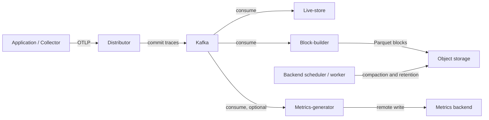
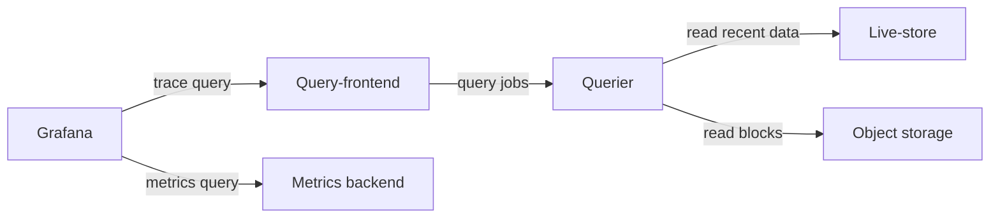

# Grafana Tempo

> **Versiones de referencia revisadas**: Tempo 3.0.3; chart `tempo-distributed` 3.6.0 (appVersion 3.0.3)
> **Última actualización**: 13 de septiembre de 2026

## Introducción

Grafana Tempo almacena y consulta trazas distribuidas mediante almacenamiento de objetos, bloques Parquet y TraceQL. Un TraceID permite encontrar **los datos que se ingirieron correctamente y siguen retenidos**; no recupera spans perdidos por muestreo, fallos de exportación o vencimiento de la retención. Tempo prescinde de una base de datos de búsqueda general independiente, aunque las columnas dedicadas, los metadatos, las cachés, el cómputo y las solicitudes al almacenamiento de objetos también generan costos.

Este capítulo presenta por separado un ejemplo monolítico local y una configuración distribuida de referencia para EKS. Se comprobaron el binario local, el compilador de consultas, el renderizado de Helm y el análisis de la configuración. **No** se probaron el despliegue en EKS, la autenticación de Kafka, la autorización de S3, la alta disponibilidad ni el dimensionamiento para producción.

## Características principales

| Característica | Alcance |
|---------|-------|
| Almacenamiento de objetos | S3, GCS y Azure Blob; almacenamiento local para un ejemplo de desarrollo acotado |
| TraceQL | Consultas de atributos, duración, estado y estructura; las funciones de métricas se distinguen de las agregaciones por traza |
| Protocolos | OTLP y receptores opcionales, como Jaeger y Zipkin; deben habilitarse los puertos correspondientes del chart |
| Correlación | Grafana vincula trazas, logs, métricas y exemplars cuando coinciden los identificadores y los UID de las fuentes de datos |
| Modos de despliegue | Modo monolítico con `target: all`, o microservicios con una cola de ingesta compatible con Kafka |
| Generación de métricas | Métricas de spans y grafos de servicios opcionales; requieren procesadores habilitados y un destino funcional para remote write |

## Arquitectura

**Los microservicios de Tempo 3 requieren Kafka; el modo monolítico no.** El distributor confirma la ingesta una vez que los datos quedan confirmados en Kafka. Los live-stores, block-builders y metrics-generators consumen esos datos de forma independiente. Los live-stores atienden consultas sobre datos recientes y los block-builders escriben los bloques de almacenamiento a largo plazo. Los query-frontends dividen el trabajo, mientras que los queriers consultan los almacenes recientes o el almacenamiento de objetos.



Ruta de lectura, con los mismos componentes de almacenamiento y métricas:



Las flechas representan solicitudes y flujos de datos; omiten algunas respuestas y conexiones del plano de control. Grafana **consulta** el backend de métricas. El metrics-generator no almacena métricas en Grafana.

### Detalles de componentes

| Componente | Responsabilidad en Tempo 3 | Aspectos operativos |
|-----------|-------------------------|---------------------------|
| Distributor | Validar las trazas y enviarlas a particiones de Kafka | Presión de retorno (backpressure), bytes y spans aceptados o rechazados |
| Live-store | Consultar trazas recientes y mantener un WAL local | Retraso de los consumidores, capacidad local y asignación de particiones |
| Block-builder | Consumir datos de Kafka y escribir bloques Parquet | Asignación de particiones y rendimiento del almacenamiento de objetos |
| Query-frontend / querier | Dividir, programar y ejecutar consultas | Colas, bytes examinados, concurrencia y cachés |
| Backend scheduler / worker | Compactación, retención y tareas en segundo plano | Coordinación del planificador, recursos de los workers y tareas fallidas |
| Metrics-generator | Generar métricas de spans y grafos de servicios | Cardinalidad, activación de procesadores y funcionamiento de remote write |

La configuración de `ingester` y `compactor` de Tempo 2 no sirve como guía de instalación de Tempo 3. Una migración distribuida de **2→3 requiere instalaciones en paralelo**, bloques existentes compatibles (`vParquet4` o posteriores), una nueva ruta de ingesta y un cambio de tráfico controlado. La reversión de 3→2 no está admitida. Evite que dos instalaciones compitan por escribir en los mismos datos; siga el [procedimiento oficial de migración](https://grafana.com/docs/tempo/latest/set-up-for-tracing/setup-tempo/upgrade/).

La durabilidad de la ruta de escritura depende de la replicación de Kafka, las réplicas sincronizadas, la retención y la capacidad de disco. El número de réplicas de Tempo no determina la durabilidad de Kafka ni garantiza que no haya pérdidas. En el chart 3.6.0, los volúmenes de datos de live-store y block-builder son `emptyDir`: tres réplicas no equivalen a tres PVC persistentes.

## Instalación con Helm (modo distribuido)

### 1. Agregar repositorio de Helm

Use el chart comunitario mantenido y una versión explícita:

```bash
helm repo add grafana-community https://grafana-community.github.io/helm-charts
helm repo update grafana-community
helm show chart grafana-community/tempo-distributed --version 3.6.0
helm show values grafana-community/tempo-distributed --version 3.6.0 > tempo-defaults.yaml
```

El chart declara la restricción Kubernetes `^1.25.0-0`. **No** equivale a una matriz de pruebas que cubra todas las versiones de Kubernetes/EKS y combinaciones de add-ons.

### 2. Configuración de values.yaml

Guarde el siguiente contenido como `tempo-distributed-values.yaml`. Es una **configuración inicial para renderizar y revisar**, con nombres de cuenta y bucket que debe reemplazar y una dirección de Kafka destinada a pruebas aisladas.

```yaml
# Render-only baseline. Read the Kafka security/deployment gates first.
fullnameOverride: tempo
reportingEnabled: false
serviceAccount:
  create: true
  name: tempo
  annotations:
    eks.amazonaws.com/role-arn: arn:aws:iam::123456789012:role/tempo-s3
traces:
  otlp:
    grpc:
      enabled: true
    http:
      enabled: true
ingest:
  kafka:
    address: kafka-bootstrap.kafka.svc.cluster.local:9092
    topic: tempo-traces
    auto_create_topic_enabled: false
storage:
  trace:
    backend: s3
    s3:
      bucket: replace-with-owned-tempo-bucket
      region: ap-northeast-2
      endpoint: s3.ap-northeast-2.amazonaws.com
      insecure: false
backendScheduler:
  config:
    provider:
      compaction:
        compaction:
          block_retention: 336h
metricsGenerator:
  enabled: false
gateway:
  enabled: false
ingress:
  enabled: false
metaMonitoring:
  serviceMonitor:
    enabled: false
tempo:
  structuredConfig:
    distributor:
      receivers:
        otlp:
          protocols:
            grpc:
              max_recv_msg_size_mib: 16
    overrides:
      defaults:
        ingestion:
          rate_limit_bytes: 15000000
          burst_size_bytes: 20000000
```

Antes de desplegar, resuelva estos requisitos:

- Aprovisione y administre el topic de Kafka por separado. Las tres réplicas predeterminadas de live-store/block-builder, junto con `partitions_per_instance: 1`, requieren un diseño de particiones coherente. Aumentar los Pods no redistribuye por sí solo todas las asignaciones de los block-builders.
- Verifique de extremo a extremo el transporte y la autenticación de Kafka. El cliente Kafka de Tempo **3.0.3 ofrece SASL/PLAIN, pero no opciones para TLS de Kafka, SCRAM ni MSK IAM**. PLAIN no cifra el tráfico. Este ejemplo no constituye una configuración segura de MSK lista para desplegar. Una solución de red o proxy debe cubrir todos los endpoints anunciados por los brokers, incluido bootstrap, y probarse por separado antes de usarla en producción.
- Proporcione el bucket de S3 y el rol de la siguiente sección. Configure el nombre exacto del ServiceAccount y la anotación del rol; crear otro ServiceAccount no asigna esa identidad a los Pods.
- Restrinja los accesos OTLP, de consultas, memberlist y RPC de los componentes mediante los controles de red del clúster y un transporte autenticado. Un balanceador interno o el encabezado `X-Scope-OrgID` por sí solos no autentican a quien accede.
- Defina recursos, planificación, presupuestos de interrupción y políticas de almacenamiento y recuperación acordes con la carga. Un PodDisruptionBudget limita los desalojos voluntarios y la antiafinidad controla la ubicación; ninguno demuestra por sí solo la disponibilidad.

El límite de tamaño de recepción se expresa en **MiB**, mientras que los campos de tasa y ráfaga de ingesta se expresan en **bytes**. Los valores de 16 MiB y 15/20 MB ilustran límites de configuración; no representan capacidad medida.

La generación opcional de métricas requiere habilitar los procesadores y disponer de un receptor autenticado. Combine el segundo archivo solo después de crear el Secret `tempo-metrics-client` con los tres archivos de certificado indicados y sustituir la URL:

```yaml
metricsGenerator:
  enabled: true
  config:
    storage:
      remote_write:
        - url: https://metrics-write.example.org/api/v1/write
          send_exemplars: true
          tls_config:
            ca_file: /etc/metrics-tls/ca.crt
            cert_file: /etc/metrics-tls/tls.crt
            key_file: /etc/metrics-tls/tls.key
  extraVolumes:
    - name: metrics-tls
      secret:
        secretName: tempo-metrics-client
  extraVolumeMounts:
    - name: metrics-tls
      mountPath: /etc/metrics-tls
      readOnly: true
overrides:
  defaults:
    metrics_generator:
      processors: [span-metrics, service-graphs]
      generate_native_histograms: both
```

El receptor debe admitir Prometheus remote write. El destino también debe admitir exemplars e histogramas nativos si se utilizan. El WAL del generador es efímero de forma predeterminada en este chart. Verifique por separado la reproducción del WAL, las colas y el almacenamiento: `send_exemplars: true` no garantiza la entrega.

### 3. Configuración de IRSA

El ejemplo utiliza la identidad exacta `system:serviceaccount:monitoring:tempo`. La política de confianza del rol exige los valores OIDC `sub` y `aud`, y el rol solo permite acceder al bucket de Tempo administrado para esta instalación. Evite claves de acceso estáticas en variables de entorno o valores de Helm.

Aquí se muestra una configuración concreta con IRSA; EKS dispone de otras opciones de identidad para las cargas de trabajo. Antes de elegir Pod Identity, compruebe su compatibilidad con el proveedor de credenciales de la imagen de Tempo fijada. Verifique además la conectividad con STS, las políticas del bucket, los endpoints de VPC y, si corresponde, la política de la clave KMS. Renderizar correctamente el YAML no comprueba estos requisitos.

### 4. Ejecutar la instalación

Primero renderice e inspeccione sin contactar un clúster:

```bash
helm template tempo grafana-community/tempo-distributed \
  --version 3.6.0 --namespace monitoring --kube-version 1.36.2 \
  -f tempo-distributed-values.yaml > tempo-rendered.yaml
```

`--kube-version` selecciona las capacidades usadas durante el renderizado; no certifica compatibilidad con EKS 1.36.2. Revise los puertos de los Services, las identidades de los Pods, los ConfigMaps, los recursos y la configuración opcional del generador. Extraiga el archivo `tempo.yaml` renderizado y valídelo con el binario de la **misma versión**:

```bash
tempo -config.file=tempo.yaml -config.verify=true
```

La validación termina antes de inicializar el servicio. No se conecta a Kafka ni a S3, ni prueba por completo cualquier configuración de receptores. **Instale con Helm una vez resueltos los requisitos de despliegue anteriores.** Utilice entonces los valores revisados y una release y un namespace bajo su administración, siguiendo un proceso que incluya un plan de reversión o migración.

Para una comprobación local de un solo proceso, guarde este archivo separado como `tempo-local.yaml` y use el binario oficial verificado de Tempo 3.0.3 para su SO/arquitectura:

```yaml
target: all
stream_over_http_enabled: true
server:
  http_listen_address: 127.0.0.1
  http_listen_port: 3200
  grpc_listen_address: 127.0.0.1
  grpc_listen_port: 9095
distributor:
  receivers:
    otlp:
      protocols:
        grpc:
          endpoint: 127.0.0.1:4317
        http:
          endpoint: 127.0.0.1:4318
storage:
  trace:
    backend: local
    wal:
      path: ./tempo-data/wal
    local:
      path: ./tempo-data/blocks
live_store:
  wal:
    path: ./tempo-data/live-store/traces
  shutdown_marker_dir: ./tempo-data/live-store/shutdown-marker
  ring:
    instance_addr: 127.0.0.1
    instance_interface_names: [lo]
metrics_generator:
  storage:
    path: ./tempo-data/generator/wal
backend_scheduler:
  local_work_path: ./tempo-data/scheduler
memberlist:
  bind_addr: [127.0.0.1]
  advertise_addr: 127.0.0.1
usage_report:
  reporting_enabled: false
```

```bash
tempo -config.file=tempo-local.yaml -config.verify=true
tempo -config.file=tempo-local.yaml
# In a second terminal:
curl --fail http://127.0.0.1:3200/ready
```

La instancia escucha solo en loopback, desactiva los informes de uso y escribe en `./tempo-data`. Deténgala con Ctrl-C. Es una instancia local sin Kafka, S3 ni gateway de autenticación; el ejemplo no demuestra alta disponibilidad.

## Consultas TraceQL

### Sintaxis básica

Para buscar una traza directamente, use el modo TraceID de Grafana Explore o un ID completo de 32 caracteres hexadecimales en una expresión intrínseca de TraceQL:

```traceql
{ trace:id = "4bf92f3577b34da6a3ce929d0e0e4736" }
{ resource.service.name = "payment-service" }
{ span.http.response.status_code >= 400 }
{ duration > 1s }
{ status = error }
```

Cada línea es una consulta independiente. El estado `error` de un span no equivale a cualquier código HTTP ≥400. Los nombres de atributos dependen de la versión de las convenciones semánticas del SDK que los emite. Los datos antiguos de `http.status_code` y `db.system` conservan sus nombres al consultarlos: Tempo no renombra automáticamente los atributos almacenados.

### Ejemplos de consultas avanzadas

```traceql
{ span.db.system.name = "postgresql" && duration > 100ms }
{ span.http.route = "/api/payment" && status = error }
{ resource.service.name = "api-gateway" } >> { resource.service.name = "payment-service" }
{ resource.service.name = "order-service" } > { span.db.system.name = "postgresql" }
{ resource.service.name = "order-service" } ~ { resource.service.name = "inventory-service" }
{ trace:rootService = "api-gateway" } | count() > 50
{ duration > 2s } | by(resource.service.name) | avg(duration) > 2s
{ status = error } | rate() by (resource.service.name)
{ } | avg_over_time(duration) by (resource.service.name)
```

- `A >> B` devuelve los **descendientes B** de A que cumplen la consulta; `A > B` devuelve los hijos directos B que la cumplen. Para obtener los padres, use la relación inversa correspondiente.
- `A ~ B` identifica spans hermanos; no demuestra una llamada de red A→B.
- `count()` cuenta los spans del **spanset actual**. Si primero filtra los errores, contará spans con error y no todos los spans de la traza. `traceSpanCount` no es una expresión intrínseca válida.
- Esta versión acepta `nestedSetParent`, pero representa el padre en el conjunto anidado interno; no mide la profundidad de anidamiento.
- `by(...) | avg(...) > ...` filtra spansets dentro de cada traza. En cambio, `rate()` y `avg_over_time(...)` producen series temporales. El primero calcula una tasa de spans con error, **no una proporción de errores**. Seleccione el intervalo temporal en Grafana o en la API de consultas; filtrar por duración no fija el período de búsqueda.

Una consulta como `{ span.user.id = "synthetic-user-123" }` necesita que ese atributo se haya emitido explícitamente. Use identificadores sintéticos o seudónimos aprobados, sin exigir datos personales para obtener trazas. Prefiera `http.route` de baja cardinalidad a URL concretas que incluyan identificadores de usuarios o parámetros de consulta.

### Uso de TraceQL en Grafana

Cree la fuente de datos de Tempo con la URL de query-frontend en el puerto **3200** y después seleccione Explore → Tempo → Search/TraceQL. El UID de `tempo` debe coincidir con los enlaces de logs y los destinos de ejemplares. Acorte el rango de tiempo antes de aumentar la concurrencia o los límites de consultas.

## Configuración del backend S3

### Configuración del bucket S3

Use un bucket dedicado con Block Public Access, cifrado y el modo de propiedad bucket-owner-enforced. Adminístrelo desde un único estado de infraestructura; evite crear el mismo bucket tanto mediante un fragmento de CLI como mediante Terraform.

En Tempo, `block_retention: 336h` fija un objetivo de retención que las tareas en segundo plano aplican de forma asíncrona; no establece una hora exacta de eliminación. Una política general de S3 que elimine todos los objetos a los 30 días puede interferir con la compactación y los metadatos. Añádala solo si existe un diseño de ciclo de vida documentado que contemple el funcionamiento del backend. Con el versionado habilitado, eliminar la versión actual de un objeto puede dejar versiones anteriores y cargos de almacenamiento. Defina por separado la retención y la recuperación de esas versiones.

### Configuración de S3 e IRSA con Terraform

Este ejemplo usa el proveedor de AWS **6.69.1**, SSE-S3 y un proveedor OIDC **existente** del clúster. Sustituya la cuenta, el nombre de bucket globalmente único y los datos del emisor. El ejemplo no crea un clúster EKS, Kafka ni una clave KMS.

```hcl
terraform {
  required_version = ">= 1.6.0"
  required_providers {
    aws = {
      source  = "hashicorp/aws"
      version = "6.69.1"
    }
  }
}

variable "region" {
  type    = string
  default = "ap-northeast-2"
}
variable "account_id" {
  type = string
  validation {
    condition     = can(regex("^[0-9]{12}$", var.account_id))
    error_message = "Supply the bucket and role owner account ID."
  }
}
variable "bucket_name" { type = string }
variable "oidc_provider_arn" { type = string }
variable "oidc_issuer_hostpath" {
  type        = string
  description = "Existing cluster OIDC issuer without https://."
}
provider "aws" { region = var.region }

resource "aws_s3_bucket" "tempo" {
  bucket        = var.bucket_name
  force_destroy = false
  lifecycle { prevent_destroy = true }
}
resource "aws_s3_bucket_public_access_block" "tempo" {
  bucket                  = aws_s3_bucket.tempo.id
  block_public_acls       = true
  block_public_policy     = true
  ignore_public_acls      = true
  restrict_public_buckets = true
}
resource "aws_s3_bucket_ownership_controls" "tempo" {
  bucket = aws_s3_bucket.tempo.id
  rule { object_ownership = "BucketOwnerEnforced" }
}
resource "aws_s3_bucket_server_side_encryption_configuration" "tempo" {
  bucket = aws_s3_bucket.tempo.id
  rule {
    apply_server_side_encryption_by_default { sse_algorithm = "AES256" }
  }
}
resource "aws_s3_bucket_policy" "tempo" {
  bucket = aws_s3_bucket.tempo.id
  policy = jsonencode({
    Version = "2012-10-17"
    Statement = [{
      Sid       = "DenyInsecureTransport"
      Effect    = "Deny"
      Principal = "*"
      Action    = "s3:*"
      Resource  = [aws_s3_bucket.tempo.arn, "${aws_s3_bucket.tempo.arn}/*"]
      Condition = { Bool = { "aws:SecureTransport" = "false" } }
    }]
  })
}
resource "aws_iam_role" "tempo" {
  name = "tempo-s3"
  assume_role_policy = jsonencode({
    Version = "2012-10-17"
    Statement = [{
      Effect    = "Allow"
      Principal = { Federated = var.oidc_provider_arn }
      Action    = "sts:AssumeRoleWithWebIdentity"
      Condition = {
        StringEquals = {
          "${var.oidc_issuer_hostpath}:aud" = "sts.amazonaws.com"
          "${var.oidc_issuer_hostpath}:sub" = "system:serviceaccount:monitoring:tempo"
        }
      }
    }]
  })
}
resource "aws_iam_role_policy" "tempo" {
  role = aws_iam_role.tempo.id
  policy = jsonencode({
    Version = "2012-10-17"
    Statement = [
      {
        Effect    = "Allow"
        Action    = ["s3:ListBucket", "s3:GetBucketLocation"]
        Resource  = aws_s3_bucket.tempo.arn
        Condition = { StringEquals = { "aws:ResourceAccount" = var.account_id } }
      },
      {
        Effect    = "Allow"
        Action    = ["s3:GetObject", "s3:PutObject", "s3:DeleteObject", "s3:AbortMultipartUpload"]
        Resource  = "${aws_s3_bucket.tempo.arn}/*"
        Condition = { StringEquals = { "aws:ResourceAccount" = var.account_id } }
      }
    ]
  })
}
output "tempo_role_arn" { value = aws_iam_role.tempo.arn }
output "tempo_bucket" { value = aws_s3_bucket.tempo.id }
```

Asigne `tempo_role_arn` y `tempo_bucket` a los valores de Helm. Antes de generar un plan, revise el formato y el esquema de Terraform; antes de aplicarlo, revise el plan real y quién administra los recursos. Para SSE-KMS, proporcione una clave administrada para esta instalación, opciones compatibles en el bucket y Tempo, permisos limitados para `kms:GenerateDataKey` y `kms:Decrypt`, y una política de clave que autorice a la carga de trabajo. Referenciar un `aws_kms_key` que no se ha definido deja la configuración incompleta.

## Correlación de trazas a logs (integración de Loki)

### Configuración de la fuente de datos de Grafana

Este es un **archivo de aprovisionamiento de Grafana**, no un `values.yaml` específico de un chart. Móntelo mediante el mecanismo que admita el chart de Grafana utilizado. Sustituya las tres URL internas por las de servicios existentes cuyo acceso esté controlado:

```yaml
apiVersion: 1
datasources:
  - name: Tempo
    uid: tempo
    type: tempo
    access: proxy
    url: http://tempo-query-frontend.monitoring.svc.cluster.local:3200
    jsonData:
      tracesToLogsV2:
        datasourceUid: loki
        spanStartTimeShift: '-1m'
        spanEndTimeShift: '1m'
        tags: [{key: service.name, value: service_name}]
        filterByTraceID: true
        filterBySpanID: false
        customQuery: false
      tracesToMetrics:
        datasourceUid: prometheus
        tags: [{key: service.name, value: service}]
        queries:
          - name: Span request rate
            query: 'sum(rate(traces_spanmetrics_calls_total{$$__tags}[5m]))'
          - name: Span error ratio
            query: '(sum(rate(traces_spanmetrics_calls_total{$$__tags,status_code="STATUS_CODE_ERROR"}[5m])) or (0 * sum(rate(traces_spanmetrics_calls_total{$$__tags}[5m])))) / (sum(rate(traces_spanmetrics_calls_total{$$__tags}[5m])) > 0)'
      serviceMap:
        datasourceUid: prometheus
      nodeGraph:
        enabled: true
  - name: Loki
    uid: loki
    type: loki
    access: proxy
    url: http://loki-gateway.logging.svc.cluster.local
    jsonData:
      derivedFields:
        - name: TraceID
          matcherRegex: '"traceId"\s*:\s*"([0-9a-f]{32})"'
          datasourceUid: tempo
          url: '$${__value.raw}'
  - name: Prometheus
    uid: prometheus
    type: prometheus
    access: proxy
    url: http://prometheus-operated.monitoring.svc.cluster.local:9090
    jsonData:
      httpMethod: POST
      exemplarTraceIdDestinations:
        - name: traceID
          datasourceUid: tempo
```

`tracesToLogsV2` de Tempo enlaza **Trace→Logs**, mientras que `derivedFields` de Loki enlaza **Logs→Trace**. El ejemplo asigna el atributo OTel `service.name` a la etiqueta `service_name` existente en Loki. Compruebe el mapeo de su collector: el enlace no crea etiquetas ni registros de log. Se desactiva el filtro por span porque no todos los logs incluyen un ID de span.

En el YAML de aprovisionamiento, `$$` conserva un `$` literal para las macros que Grafana evalúa en ejecución. `__tags` se expande a un conjunto de selectores de etiquetas, por lo que no debe usarse como valor de `service="..."`. El cálculo de la proporción de errores completa una serie de errores ausente a partir de la serie total y solo divide cuando la tasa total es positiva. Sin tráfico o sin telemetría, el resultado permanece vacío.

La etiqueta `service` de las métricas de spans y el estado `STATUS_CODE_ERROR` deben coincidir con las series que se generan realmente. Los exemplars utilizan el nombre de etiqueta observado: `traceID` en la configuración de generador del ejemplo; otros productores pueden utilizar `trace_id`. Debido al muestreo, estas métricas pueden diferir del total de solicitudes de la aplicación.

### Registro de aplicaciones

Con la API de OpenTelemetry 1.44 para Python, compruebe si el contexto es válido en lugar de consultar `span.is_recording()`. Un span válido puede correlacionar logs aunque no esté grabando datos:

```python
import datetime
import json
import logging
from opentelemetry import trace


class TraceJsonFormatter(logging.Formatter):
    def format(self, record):
        payload = {
            "timestamp": datetime.datetime.fromtimestamp(
                record.created, datetime.timezone.utc
            ).isoformat(),
            "level": record.levelname,
            "message": record.getMessage(),
        }
        context = trace.get_current_span().get_span_context()
        if context.is_valid:
            payload["traceId"] = f"{context.trace_id:032x}"
            payload["spanId"] = f"{context.span_id:016x}"
        if record.exc_info:
            payload["exception"] = self.formatException(record.exc_info)
        return json.dumps(payload, ensure_ascii=False)


logger = logging.getLogger("payment")
logger.setLevel(logging.INFO)
logger.propagate = False
# Configure once at application startup.
if not logger.handlers:
    handler = logging.StreamHandler()
    handler.setFormatter(TraceJsonFormatter())
    logger.addHandler(handler)
```

El formateador conserva las marcas temporales UTC, el formato del mensaje y las excepciones. Omite los ID no válidos en lugar de crear identificadores de traza compuestos por ceros. Configure el handler una sola vez, propague el contexto OTel entre operaciones asíncronas y elimine los datos sensibles de mensajes y excepciones en el origen.

Para Java, utilice el [helper de MDC con ámbito delimitado de la introducción al tracing](README.md#linking-logs-via-traceid): valide el `SpanContext` actual, asigne los ID para ese ámbito de logging y restaure los valores anteriores de MDC en `finally`. Añadir únicamente `MDC.put` puede dejar los ID de una solicitud anterior en un hilo reutilizado. Se comprobó el contrato de la API de Java; este capítulo no incluyó la ejecución de una aplicación Java.

## Ajuste de rendimiento

### Optimización de la tasa de ingesta

Mida los bytes y spans aceptados o rechazados, los reintentos de los exporters, los errores de producción en Kafka y el retraso de los consumidores. Aumentar el tamaño admitido por el receptor, los límites de ingesta o las réplicas sin suficiente memoria y capacidad de cola puede desplazar el cuello de botella. Tenga en cuenta el muestreo aplicado antes de Tempo al interpretar las métricas generadas.

Configure los límites por tenant mediante `overrides.defaults.ingestion` y el tamaño máximo de los mensajes gRPC mediante `max_recv_msg_size_mib` del receptor. Los antiguos bloques `distributor.rate_limit` y de ajuste del `ingester` de Tempo 2 no configuran Tempo 3.

### Optimización de compactación

Configure la retención con `backendScheduler.config.provider.compaction.compaction` en el chart y las opciones correspondientes del backend-worker. Observe la antigüedad y los fallos de las tareas, las solicitudes al almacenamiento de objetos y el espacio temporal disponible. Aumentar la concurrencia de compactación puede elevar el tráfico al almacenamiento y el consumo de memoria. La regla de «un compactor por clúster» de la arquitectura anterior no es universal.

### Optimización del rendimiento de consultas

Reduzca primero el intervalo temporal y acote la búsqueda; luego examine los bytes leídos, las colas, la concurrencia de los queriers y la función de cada caché. Use las opciones de la versión fijada del chart y la configuración, en lugar de copiar estructuras `cache:` eliminadas. El envío de solicitudes redundantes al almacenamiento de objetos (hedging) puede reducir la latencia de las consultas más lentas a costa de más solicitudes. Evalúe esa relación mediante mediciones.

En Tempo 3, `fail_on_high_lag` de live-store vale true de forma predeterminada y `query_end_cutoff` de query-frontend vale 30s. Las búsquedas pueden mostrar datos muy recientes más tarde que una consulta directa por TraceID. Mantenga estas protecciones; desactivarlas para que un dashboard vacío parezca funcionar no resuelve la causa.

### Recomendaciones de recursos

Dimensione los distributors según la ingesta; los live-stores, según el volumen de trazas recientes y el retraso; los block-builders, según las particiones asignadas y el tamaño de los bloques; los queriers, según la concurrencia de consultas; y los generadores, según las series activas. La antigua tabla de CPU y disco para Ingester/Compactor de Tempo 2 carece de mediciones y no sirve para dimensionar Tempo 3. Mida CPU, RSS, uso local y del WAL, retraso de Kafka, costo de solicitudes y saturación con tráfico representativo.

## Solución de problemas

### Problemas y soluciones comunes

#### 1. Los datos de trazas no se muestran

Revise los errores de exportación del SDK, el muestreo, la propagación del contexto, las colas del collector, el transporte OTLP, el enrutamiento por tenant y la retención. Un GET a `/v1/traces` no comprueba la ingesta: envíe un POST OTLP válido y consulte después el TraceID sintético conocido. Que `/ready` responda correctamente no demuestra que funcionen todas las etapas.

#### 2. Errores de permisos de S3

Revise el ServiceAccount exacto, la política de confianza del rol, la política del bucket, el acceso a los endpoints y, si corresponde, la política KMS. Evite volcar las variables de entorno o los tokens proyectados de los Pods. Compruebe las herramientas de la imagen de Tempo antes de intentar usar AWS CLI o un shell.

```bash
kubectl get serviceaccount tempo -n monitoring -o yaml
kubectl get pods -n monitoring -l app.kubernetes.io/instance=tempo \
  -o custom-columns=NAME:.metadata.name,SA:.spec.serviceAccountName
kubectl logs -n monitoring -l app.kubernetes.io/component=block-builder --tail=100
```

Restrinja el acceso a la salida de diagnóstico: los logs pueden contener metadatos operativos o atributos de aplicación.

#### 3. Tiempos de espera de consultas

Revise los logs de query-frontend/querier, el intervalo de búsqueda, el retraso de Kafka, las particiones disponibles de live-store y la limitación de solicitudes de S3. Aumente la concurrencia después de medir la memoria y los límites del backend. Distinga un resultado vacío de un timeout y de la ausencia de telemetría.

#### 4. Presión de memoria de live-store

En Tempo 3, examine la memoria de live-store, las ventanas de datos recientes, la rotación de bloques y la asignación de particiones. Si todavía opera un despliegue de Tempo 2, consulte la documentación de su versión de ingester durante la migración. Copiar `ingester.max_block_duration: 30m` en Tempo 3 no modifica el comportamiento de live-store.

### Comandos de depuración útiles

Use un port-forward autorizado para inspeccionar el query-frontend real:

```bash
kubectl port-forward -n monitoring service/tempo-query-frontend 3200:3200
# In a second terminal:
curl --fail http://127.0.0.1:3200/ready
curl --fail http://127.0.0.1:3200/metrics
curl --fail http://127.0.0.1:3200/api/traces/4bf92f3577b34da6a3ce929d0e0e4736
```

El ID de la última consulta debe existir en ese despliegue. Los endpoints de ring/status de solo lectura dependen del componente; verifique la API de la versión fijada antes de usarlos. Las rutas eliminadas `/ingester/ring` y `/compactor/ring`, junto con los comandos de vaciado forzado eliminados, no constituyen herramientas generales de diagnóstico de Tempo 3.

### Dashboard de monitorización

Use las series reales emitidas por su despliegue y agregue sus etiquetas de destino:

```promql
sum(rate(tempo_distributor_spans_received_total[5m]))
sum(process_resident_memory_bytes{job=~"tempo.*"})
histogram_quantile(0.99, sum by (le) (rate(tempo_request_duration_seconds_bucket{route="api_search"}[5m])))
```

Estos paneles muestran **spans recibidos por segundo**, **memoria RSS del proceso en bytes** y **latencia p99 de las solicitudes HTTP de búsqueda en segundos**. El selector de memoria depende del nombre de los jobs de scrape: compruebe primero las etiquetas. Un contador de bytes escritos no mide memoria y un recuento de spans no equivale a un recuento de trazas. El histograma y la ruta de solicitudes se observaron en la prueba local de funcionamiento de Tempo 3.0.3; no miden la latencia de extremo a extremo de un despliegue distribuido.

## Referencias

- [Lanzamiento de Tempo 3.0.3](https://github.com/grafana/tempo/releases/tag/v3.0.3), [valores del chart 3.6.0](https://github.com/grafana-community/helm-charts/blob/tempo-distributed-3.6.0/charts/tempo-distributed/values.yaml)
- [Arquitectura de Tempo](https://grafana.com/docs/tempo/latest/introduction/architecture/), [implementación del cliente Kafka](https://github.com/grafana/tempo/blob/v3.0.3/pkg/ingest/writer_client.go)
- [Sintaxis de TraceQL](https://grafana.com/docs/tempo/latest/traceql/construct-traceql-queries/), [aprovisionamiento de Grafana](https://grafana.com/docs/grafana/latest/datasources/tempo/configure-tempo-data-source/provision/)
- [Asociación de IRSA en EKS](https://docs.aws.amazon.com/eks/latest/userguide/associate-service-account-role.html), [S3 Block Public Access](https://docs.aws.amazon.com/AmazonS3/latest/userguide/access-control-block-public-access.html)

## Cuestionario

Pruebe este capítulo con el [cuestionario de Tempo](../../quizzes/observability/tracing/01-tempo-quiz.md).
