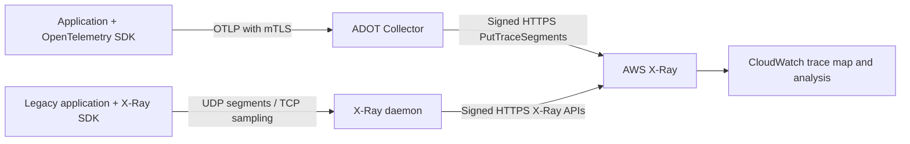
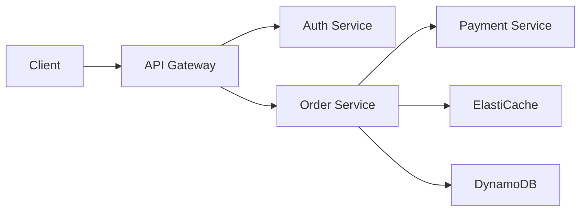

# AWS X-Ray

> **Última actualización**: 13 de septiembre de 2026

## Introducción

AWS X-Ray es un servicio nativo de AWS para rastrear y analizar solicitudes en aplicaciones distribuidas. Usar X-Ray en entornos EKS permite visualizar el flujo de solicitudes entre microservicios, identificar cuellos de botella de rendimiento y determinar las causas raíz de los errores.

Los **SDK y el daemon de X-Ray están en modo de mantenimiento desde el 25 de febrero de 2026**: solo reciben correcciones de seguridad y no tienen una fecha de fin de soporte anunciada en el [cronograma de soporte](https://docs.aws.amazon.com/xray/latest/devguide/xray-sdk-daemon-timeline.html) actual. Esto corresponde al ciclo de vida de la instrumentación, no a la retirada del servicio X-Ray. AWS recomienda OpenTelemetry para la instrumentación nueva y las migraciones. El ejemplo del daemon que aparece más abajo ofrece compatibilidad con aplicaciones que todavía usan la instrumentación antigua.

## Características principales

| Característica | Descripción |
|---------|-------------|
| **Mapa de servicios** | Visualización automática de las dependencias entre servicios |
| **Seguimiento de solicitudes** | Seguimiento de la ruta de las solicitudes de extremo a extremo |
| **Herramientas de análisis** | Distribución de tiempos de respuesta y análisis de la tasa de errores |
| **Integración con AWS** | Compatibilidad nativa con Lambda, API Gateway, ECS y EKS |
| **Reglas de muestreo** | Configuración centralizada del muestreo |
| **Grupos y alertas** | Agrupación mediante filtros y alertas de CloudWatch |

## Arquitectura

El siguiente diagrama muestra las dos alternativas de recopilación descritas aquí. El daemon envía solicitudes HTTPS firmadas a AWS; UDP y TCP en el puerto 2000 son sus protocolos antiguos de comunicación con la aplicación. El exportador awsxray de ADOT configurado usa PutTraceSegments, no el endpoint OTLP nativo de CloudWatch.



EKS no instrumenta automáticamente todas las aplicaciones. Lambda, API Gateway y las demás integraciones de servicios requieren su propia configuración compatible de seguimiento y propagación. La ingesta OTLP nativa de CloudWatch utiliza una ruta independiente con los requisitos previos de Transaction Search y SigV4 que se describen más adelante.

## Despliegue del daemon de X-Ray

### Desplegar como DaemonSet

```yaml
# xray-daemon.yaml
apiVersion: v1
kind: ServiceAccount
metadata:
  name: xray-daemon
  namespace: amazon-cloudwatch
  annotations:
    eks.amazonaws.com/role-arn: arn:aws:iam::123456789012:role/xray-daemon-role
---
apiVersion: apps/v1
kind: DaemonSet
metadata:
  name: xray-daemon
  namespace: amazon-cloudwatch
spec:
  selector:
    matchLabels:
      app: xray-daemon
  updateStrategy:
    type: RollingUpdate
  template:
    metadata:
      labels:
        app: xray-daemon
    spec:
      serviceAccountName: xray-daemon
      nodeSelector:
        kubernetes.io/os: linux
      containers:
        - name: xray-daemon
          image: amazon/aws-xray-daemon:3.7.0@sha256:a2303d37f9dd7077c93e596689cb1de12f2ef8333c15b088ba223840164f6bc2
          args: ["-o", "-n", "ap-northeast-2"]
          ports:
            - name: xray-udp
              containerPort: 2000
              protocol: UDP
            - name: xray-tcp
              containerPort: 2000
              protocol: TCP
          resources:
            requests:
              cpu: 50m
              memory: 64Mi
            limits:
              cpu: 100m
              memory: 128Mi
          env:
            - name: AWS_REGION
              value: ap-northeast-2
      tolerations:
        - key: node-role.kubernetes.io/master
          effect: NoSchedule
---
apiVersion: v1
kind: Service
metadata:
  name: xray-daemon
  namespace: amazon-cloudwatch
spec:
  selector:
    app: xray-daemon
  ports:
    - name: xray-udp
      port: 2000
      protocol: UDP
    - name: xray-tcp
      port: 2000
      protocol: TCP
  type: ClusterIP
```

Esta imagen de compatibilidad está fijada al manifiesto multiarquitectura oficial 3.7.0 verificado para Linux amd64/arm64. Su punto de entrada es `/xray`, no `/usr/bin/xray`; `-o` desactiva el enriquecimiento con metadatos de EC2 y `-n` indica la región. Los DaemonSets no se ejecutan en EKS Fargate. Este Service de tipo ClusterIP puede seleccionar un daemon de otro nodo, por lo que no garantiza la entrega al nodo local ni la ausencia de pérdidas UDP.

Para un cliente con el SDK antiguo, establece `AWS_XRAY_DAEMON_ADDRESS=xray-daemon.amazon-cloudwatch.svc.cluster.local:2000`. Debe haber conectividad tanto para los segmentos UDP como para el tráfico de muestreo TCP. Restringe esta ruta sin cifrar a las cargas de trabajo de confianza; utiliza la ruta de OpenTelemetry para recopilar datos con TLS autenticado. Elige una sola ruta de recopilación por productor.


### Configuración de IRSA

Crea el namespace `amazon-cloudwatch` a través de quien ya lo administra. La ServiceAccount `xray-daemon` del daemon antiguo debe hacer referencia a su propio rol, preparado previamente. La siguiente política de permisos cubre la exportación de segmentos y telemetría y las llamadas de muestreo centralizado; sustituye la región por la región real de despliegue:

```json
{
  "Version": "2012-10-17",
  "Statement": [
    {
      "Effect": "Allow",
      "Action": [
        "xray:PutTraceSegments",
        "xray:PutTelemetryRecords",
        "xray:GetSamplingRules",
        "xray:GetSamplingTargets",
        "xray:GetSamplingStatisticSummaries"
      ],
      "Resource": "*",
      "Condition": {
        "StringEquals": {
          "aws:RequestedRegion": "ap-northeast-2"
        }
      }
    }
  ]
}
```

Estas acciones de X-Ray usan `Resource: "*"`, restringido aquí mediante `aws:RequestedRegion`. La política del daemon es independiente de la política más restringida de ADOT que aparece a continuación. Ninguna de las dos políticas otorga a un operador permiso para crear grupos o reglas de muestreo.

Para cualquiera de los dos recolectores, prepara un rol de IRSA con el proveedor OIDC registrado del clúster, `aud=sts.amazonaws.com` y el **identificador subject exacto del namespace y la ServiceAccount**. El ejemplo de confianza siguiente corresponde a `adot-collector`; un rol del daemon requiere, en cambio, `system:serviceaccount:amazon-cloudwatch:xray-daemon`. Sustituye de forma coherente la cuenta, la región y el ID de OIDC de ejemplo.

```json
{
  "Version": "2012-10-17",
  "Statement": [
    {
      "Effect": "Allow",
      "Principal": {
        "Federated": "arn:aws:iam::123456789012:oidc-provider/oidc.eks.ap-northeast-2.amazonaws.com/id/EXAMPLE"
      },
      "Action": "sts:AssumeRoleWithWebIdentity",
      "Condition": {
        "StringEquals": {
          "oidc.eks.ap-northeast-2.amazonaws.com/id/EXAMPLE:aud": "sts.amazonaws.com",
          "oidc.eks.ap-northeast-2.amazonaws.com/id/EXAMPLE:sub": "system:serviceaccount:amazon-cloudwatch:adot-collector"
        }
      }
    }
  ]
}
```

Solicita a quien administra IAM e infraestructura que cree o actualice el rol previsto y adjunte la política de permisos correspondiente. Respeta la administración de una ServiceAccount existente; no ejecutes `eksctl --override-existing-serviceaccounts` como paso genérico de configuración. Verifica el token proyectado del Pod generado, el ARN del rol, la resolución de credenciales del SDK y la autorización real en el entorno aprobado. Una anotación en la ServiceAccount por sí sola no demuestra que la autorización funcione.

## Despliegue del ADOT Collector

Esta canalización de trazas usa [ADOT Collector 0.50.0](https://github.com/aws-observability/aws-otel-collector/releases/tag/v0.50.0), basado en Collector/Contrib 0.158.0. La distribución publicada de ADOT tiene su propio inventario de componentes; no supongas que incluye todos los de una versión de Contrib. El binario del recolector fijado se probó localmente con datos sintéticos OTLP/X-Ray y un endpoint simulado de X-Ray en la interfaz de bucle local. No se realizaron pruebas de autorización de AWS, despliegue en Kubernetes ni disponibilidad en producción.

<a id="adot-collector-daemonset"></a>

### Despliegue del Collector y requisitos previos

El ejemplo consta de un único **Deployment** central y un Service de tipo ClusterIP, sin puertos de host. No es una configuración de alta disponibilidad. Las aplicaciones eligen explícitamente su endpoint DNS; instalarlo no las instrumenta. Un DaemonSet utiliza un diseño de ubicación distinto y no es compatible con EKS Fargate. Un Deployment en Fargate también requiere un perfil de Fargate coincidente y una configuración compatible de recursos, almacenamiento y red.

Antes de aplicar estos recursos:

- Prepara el namespace y el rol de IRSA de la sección anterior, con el identificador subject `system:serviceaccount:amazon-cloudwatch:adot-collector`.
- Proporciona el Secret de Kubernetes existente `adot-collector-tls` mediante el proceso de certificados aprobado. Contiene `server.crt`, `server.key` y `ca.crt`. El certificado del servidor debe cubrir el nombre DNS real del Service, por ejemplo `adot-collector.amazon-cloudwatch.svc.cluster.local`; la CA debe confiar en los certificados de cliente previstos.
- Monta en los productores los archivos aprobados de CA, certificado de cliente y clave. Restringe el acceso al Secret y el de las cargas de trabajo a los puertos 4317/4318 y al endpoint de salud; planifica la rotación de certificados. No coloques el contenido de las claves privadas de certificados ni credenciales de AWS en variables de entorno.
- Sustituye los valores del clúster, la cuenta y la región e inspecciona la identidad final de la carga de trabajo. El procesador resource establece explícitamente un único nombre de clúster; no descubre todos los metadatos de Pods y nodos y no debe etiquetar el tráfico de otros clústeres como si procediera de este.

La canalización de ADOT siguiente desactiva la telemetría del exportador y usa únicamente la ruta clásica de exportación `PutTraceSegments` de X-Ray, por lo que su política de permisos de carga de trabajo es:

```json
{
  "Version": "2012-10-17",
  "Statement": [
    {
      "Effect": "Allow",
      "Action": ["xray:PutTraceSegments"],
      "Resource": "*",
      "Condition": {
        "StringEquals": {
          "aws:RequestedRegion": "ap-northeast-2"
        }
      }
    }
  ]
}
```

Utiliza este ConfigMap completo junto con el siguiente manifiesto de la carga de trabajo y el Service:

```yaml
apiVersion: v1
kind: ConfigMap
metadata:
  name: adot-collector-config
  namespace: amazon-cloudwatch
data:
  collector.yaml: |
    receivers:
      otlp:
        protocols:
          grpc:
            endpoint: 0.0.0.0:4317
            tls:
              cert_file: /etc/otel/tls/server.crt
              key_file: /etc/otel/tls/server.key
              client_ca_file: /etc/otel/tls/ca.crt
              min_version: "1.2"
          http:
            endpoint: 0.0.0.0:4318
            tls:
              cert_file: /etc/otel/tls/server.crt
              key_file: /etc/otel/tls/server.key
              client_ca_file: /etc/otel/tls/ca.crt
              min_version: "1.2"
    processors:
      memory_limiter:
        check_interval: 1s
        limit_mib: 400
        spike_limit_mib: 100
      resource:
        attributes:
          - key: cloud.provider
            value: aws
            action: upsert
          - key: k8s.cluster.name
            value: ${env:CLUSTER_NAME}
            action: upsert
      batch:
        timeout: 5s
        send_batch_size: 256
        send_batch_max_size: 512
    exporters:
      awsxray:
        region: ap-northeast-2
        local_mode: true
        index_all_attributes: false
        indexed_attributes:
          - deployment.environment.name
          - app.operation
        telemetry:
          enabled: false
    extensions:
      health_check:
        endpoint: 0.0.0.0:13133
    service:
      extensions: [health_check]
      pipelines:
        traces:
          receivers: [otlp]
          processors: [memory_limiter, resource, batch]
          exporters: [awsxray]
```

```yaml
apiVersion: v1
kind: ServiceAccount
metadata:
  name: adot-collector
  namespace: amazon-cloudwatch
  annotations:
    eks.amazonaws.com/role-arn: arn:aws:iam::123456789012:role/adot-xray-role
automountServiceAccountToken: false
---
apiVersion: apps/v1
kind: Deployment
metadata:
  name: adot-collector
  namespace: amazon-cloudwatch
spec:
  replicas: 1
  selector:
    matchLabels:
      app: adot-collector
  template:
    metadata:
      labels:
        app: adot-collector
    spec:
      serviceAccountName: adot-collector
      nodeSelector:
        kubernetes.io/os: linux
      automountServiceAccountToken: false
      terminationGracePeriodSeconds: 30
      securityContext:
        runAsNonRoot: true
        runAsUser: 4317
        runAsGroup: 4317
        fsGroup: 4317
        seccompProfile:
          type: RuntimeDefault
      containers:
        - name: collector
          image: public.ecr.aws/aws-observability/aws-otel-collector:v0.50.0
          args: ["--config=/conf/collector.yaml"]
          env:
            - name: CLUSTER_NAME
              value: replace-with-cluster-name
            - name: AWS_REGION
              value: ap-northeast-2
            - name: AWS_EC2_METADATA_DISABLED
              value: "true"
            - name: GOMEMLIMIT
              value: 400MiB
          resources:
            requests:
              cpu: 100m
              memory: 256Mi
            limits:
              cpu: 500m
              memory: 512Mi
          securityContext:
            allowPrivilegeEscalation: false
            readOnlyRootFilesystem: true
            capabilities:
              drop: [ALL]
          ports:
            - name: otlp-grpc
              containerPort: 4317
            - name: otlp-http
              containerPort: 4318
            - name: health
              containerPort: 13133
          volumeMounts:
            - name: config
              mountPath: /conf
              readOnly: true
            - name: tls
              mountPath: /etc/otel/tls
              readOnly: true
          readinessProbe:
            httpGet:
              path: /
              port: health
            initialDelaySeconds: 5
          livenessProbe:
            httpGet:
              path: /
              port: health
            initialDelaySeconds: 15
      volumes:
        - name: config
          configMap:
            name: adot-collector-config
        - name: tls
          secret:
            secretName: adot-collector-tls
            defaultMode: 0440
---
apiVersion: v1
kind: Service
metadata:
  name: adot-collector
  namespace: amazon-cloudwatch
spec:
  type: ClusterIP
  selector:
    app: adot-collector
  ports:
    - name: otlp-grpc
      port: 4317
      targetPort: otlp-grpc
    - name: otlp-http
      port: 4318
      targetPort: otlp-http
```

La imagen del contenedor proporciona `RUN_IN_CONTAINER=True`; esta variable es necesaria en una prueba independiente del binario nativo del recolector para evitar que los registros de su CLI personalizada se escriban en `/opt`. Su CLI no es intercambiable con todos los comandos de `otelcol` del proyecto original. La prueba local utilizó el binario de AWS de la versión indicada, certificados de prueba y únicamente destinos de bucle local.

La configuración propuesta superó cinco comprobaciones locales de mTLS, incluidos el rechazo de clientes sin certificado y la aceptación de uno de confianza. Los tres recursos de Kubernetes superaron la validación local del esquema OpenAPI. Esto no verifica el Secret real, las modificaciones de IRSA, la política de CNI, la planificación de Pods ni los permisos de AWS. El endpoint de salud informa del estado del proceso del recolector, no de la entrega correcta a X-Ray. Las colas, los reintentos, la presión de memoria, la terminación y los fallos del backend pueden causar pérdida de telemetría; planifica la capacidad y supervisa los datos rechazados, descartados o cuya exportación falla.

### Receptor heredado de X-Ray y canalizaciones de telemetría independientes

ADOT 0.50.0 también incluye el receptor `awsxray`. Su configuración UDP admitida es:

```yaml
# Receiver fragment only; requires an explicitly connected trace pipeline.
receivers:
  awsxray:
    endpoint: 0.0.0.0:2000
    transport: udp
```

Este receptor antiguo es una alternativa al envío de segmentos del SDK a través del daemon; evita duplicar la ruta de trazas de un mismo productor. También inicia por defecto un proxy TCP de muestreo. Si utilizas muestreo centralizado, configura y restringe la ruta necesaria del Service y el proxy TCP en el puerto 2000 y los permisos de muestreo, además de UDP en el puerto 2000. La configuración mTLS del receptor OTLP no protege este protocolo antiguo. La auditoría nativa confirmó la recepción tanto de OTLP como de UDP de X-Ray; no ejecutó muestreo remoto de AWS.

Las métricas, los registros de aplicaciones y las trazas requieren sus propias canalizaciones conectadas y configuraciones de backend. Declarar un exportador `awscloudwatchlogs` no convierte las trazas en registros ni las escribe en un grupo de registros inventado `/aws/xray/traces`. Un endpoint de escritura remota de métricas también necesita un receptor real, autenticación y configuración TLS; no es un requisito previo de X-Ray.

## Integración de OpenTelemetry con X-Ray

Estos ejemplos usan el Service autenticado del recolector anterior. Los productores necesitan acceso a ese Service y a sus archivos TLS de cliente montados; no necesitan las credenciales de AWS del recolector. Los ejemplos crean spans sintéticos y no realizan pagos, operaciones de base de datos ni operaciones de negocio en AWS.

Las versiones exactas utilizadas para la validación son el SDK y el exportador de Python 1.44.0 con Flask 3.1.3, el SDK y el exportador de Go 1.44.0 con Go 1.26.8 y el código fuente de la API de Java 1.66.0. Estas versiones fijadas no constituyen una matriz universal de compatibilidad de AWS ni implican que todos los lenguajes tengan la misma versión más reciente. Python y Go se probaron localmente; la API y la configuración de Java se comprobaron en el código fuente de la versión etiquetada, pero esta auditoría no dispuso de compilación con JDK/Maven.

Utiliza estos ajustes para el proceso limitado de demostración. El endpoint incluye `/v1/traces` para OTLP/HTTP. Mantén la clave privada del cliente en un archivo montado y protegido. Esta demostración muestrea los spans raíz y respeta las decisiones del padre remoto; elige un muestreador de producción basándote en mediciones, en lugar de copiar el ajuste que muestrea todas las raíces en tráfico de producción sin restricciones. Los muestreadores genéricos del SDK no obtienen automáticamente las reglas centralizadas de X-Ray.

```bash
# Application-process configuration; mounted file paths are not secret contents.
export OTEL_SDK_DISABLED=false
export OTEL_SERVICE_NAME=inventory-demo
export OTEL_TRACES_EXPORTER=otlp
export OTEL_METRICS_EXPORTER=none
export OTEL_LOGS_EXPORTER=none
export OTEL_EXPORTER_OTLP_TRACES_PROTOCOL=http/protobuf
export OTEL_EXPORTER_OTLP_TRACES_ENDPOINT=https://adot-collector.amazon-cloudwatch.svc.cluster.local:4318/v1/traces
export OTEL_EXPORTER_OTLP_TRACES_CERTIFICATE=/etc/otel/client/ca.crt
export OTEL_EXPORTER_OTLP_TRACES_CLIENT_CERTIFICATE=/etc/otel/client/client.crt
export OTEL_EXPORTER_OTLP_TRACES_CLIENT_KEY=/etc/otel/client/client.key
export OTEL_PROPAGATORS=tracecontext
export OTEL_TRACES_SAMPLER=parentbased_always_on
```

### Configuración de la aplicación (Java)

Guarda `InventoryDemo.java` en el proyecto Java existente. La autoconfiguración lee los ajustes estándar del endpoint OTLP, el protocolo y los archivos de CA, clave y certificado de cliente. No instrumenta automáticamente una aplicación completa. No inicialices otro SDK si un agente o framework ya lo administra. `OpenTelemetrySdk` implementa Closeable; cerrarlo coordina el cierre de los proveedores, pero que finalice una llamada a un método no demuestra la entrega al backend.

```xml
<!-- Dependency fragment for an existing Java17+ Maven project. -->
<dependencies>
  <dependency>
    <groupId>io.opentelemetry</groupId>
    <artifactId>opentelemetry-sdk-extension-autoconfigure</artifactId>
    <version>1.66.0</version>
  </dependency>
  <dependency>
    <groupId>io.opentelemetry</groupId>
    <artifactId>opentelemetry-exporter-otlp</artifactId>
    <version>1.66.0</version>
  </dependency>
</dependencies>
```

```java
import io.opentelemetry.api.trace.Span;
import io.opentelemetry.api.trace.Tracer;
import io.opentelemetry.context.Scope;
import io.opentelemetry.sdk.OpenTelemetrySdk;
import io.opentelemetry.sdk.autoconfigure.AutoConfiguredOpenTelemetrySdk;

// Standalone finite demo; do not create a second SDK when an agent/framework owns it.
public final class InventoryDemo {
    public static void main(String[] args) {
        try (OpenTelemetrySdk sdk = AutoConfiguredOpenTelemetrySdk.builder()
                .build().getOpenTelemetrySdk()) {
            Tracer tracer = sdk.getTracer("inventory-demo");
            Span root = tracer.spanBuilder("inventory.demo").startSpan();
            try (Scope ignored = root.makeCurrent()) {
                root.setAttribute("app.operation", "inventory.demo");
                root.setAttribute("deployment.environment.name", "demo");
                Span child = tracer.spanBuilder("inventory.lookup").startSpan();
                try {
                    child.setAttribute("lookup.result", "demo");
                    // No AWS or database call is performed by this example.
                } finally {
                    child.end();
                }
            } finally {
                root.end();
            }
        } // SDK close shuts down providers/exporters; delivery must still be monitored.
    }
}
```

### Configuración de la aplicación (Python)

Utiliza un entorno de aplicación aislado con `opentelemetry-api==1.44.0`, `opentelemetry-sdk==1.44.0`, `opentelemetry-exporter-otlp-proto-http==1.44.0` y `Flask==3.1.3`. Guarda el siguiente código como `payment_demo.py`. Su endpoint `/api/payment` solo devuelve una respuesta sintética; no cobra ni valida un pago real. El servidor local de desarrollo de Flask no es un despliegue WSGI de producción.

```python
"""Synthetic Flask instrumentation example: no payment is processed."""
import os
from pathlib import Path
from urllib.parse import urlparse

from flask import Flask, jsonify, request
from opentelemetry.exporter.otlp.proto.http.trace_exporter import OTLPSpanExporter
from opentelemetry.sdk.resources import Resource
from opentelemetry.sdk.trace import TracerProvider
from opentelemetry.sdk.trace.export import BatchSpanProcessor
from opentelemetry.sdk.trace.sampling import ParentBased, ALWAYS_ON
from opentelemetry.trace import SpanKind
from opentelemetry.trace.propagation.tracecontext import TraceContextTextMapPropagator


def configure_provider():
    endpoint = os.environ["OTEL_EXPORTER_OTLP_TRACES_ENDPOINT"]
    url = urlparse(endpoint)
    if url.scheme != "https" or not url.hostname or url.username or url.password:
        raise ValueError("Configure an HTTPS collector endpoint without URL credentials")
    certs = {
        "certificate_file": os.environ["OTEL_EXPORTER_OTLP_TRACES_CERTIFICATE"],
        "client_certificate_file": os.environ["OTEL_EXPORTER_OTLP_TRACES_CLIENT_CERTIFICATE"],
        "client_key_file": os.environ["OTEL_EXPORTER_OTLP_TRACES_CLIENT_KEY"],
    }
    for path in certs.values():
        if not Path(path).is_file():
            raise ValueError("A required mounted TLS file is missing")
    provider = TracerProvider(
        resource=Resource.create({"service.name": "payment-demo"}),
        # Finite demo traffic only. Select a measured production sampling policy.
        sampler=ParentBased(ALWAYS_ON),
    )
    provider.add_span_processor(BatchSpanProcessor(
        OTLPSpanExporter(endpoint=endpoint, timeout=5, **certs),
        max_queue_size=256, max_export_batch_size=64,
    ))
    return provider


def create_app(provider):
    app = Flask(__name__)
    tracer = provider.get_tracer("payment-demo")
    propagator = TraceContextTextMapPropagator()

    @app.post("/api/payment")
    def payment_demo():
        carrier = {name.lower(): value for name, value in request.headers.items()}
        parent = propagator.extract(carrier)
        with tracer.start_as_current_span(
            "POST /api/payment", context=parent, kind=SpanKind.SERVER
        ) as span:
            span.set_attribute("app.operation", "payment.demo")
            span.set_attribute("deployment.environment.name", "demo")
            span.set_attribute("http.request.method", "POST")
            span.set_attribute("http.route", "/api/payment")
            with tracer.start_as_current_span("validation.demo") as child:
                child.set_attribute("validation.result", "accepted")
            span.set_attribute("http.response.status_code", 202)
            # No request payload/Authorization/user ID is added to telemetry.
            return jsonify(status="demo-only-no-payment-processed"), 202

    return app


if __name__ == "__main__":
    provider = configure_provider()
    try:
        # Local development server only; not a production WSGI deployment.
        create_app(provider).run(host="127.0.0.1", port=8080)
    finally:
        provider.shutdown()
```

### Configuración de la aplicación (Go)

Guarda los siguientes `go.mod` y `main.go` en un directorio de ejemplo independiente, resuelve las dependencias fijadas con `go mod tidy` y ejecútalo únicamente con el entorno previsto del recolector y TLS. El ejemplo emite dos spans en una ejecución limitada. `DEMO_TRACEPARENT` es un portador opcional para la demostración; los manejadores HTTP reales deben extraer el contexto de los encabezados de la solicitud e inyectarlo en las solicitudes salientes. Crear el SDK por sí solo no instrumenta todas las bibliotecas HTTP o de bases de datos.

```text
module example.invalid/xray-otel-demo

go 1.25.0

require (
    go.opentelemetry.io/otel v1.44.0
    go.opentelemetry.io/otel/exporters/otlp/otlptrace/otlptracehttp v1.44.0
    go.opentelemetry.io/otel/sdk v1.44.0
    go.opentelemetry.io/otel/trace v1.44.0
)
```

```go
package main

import (
	"context"
	"fmt"
	"log"
	"net/url"
	"os"
	"time"

	"go.opentelemetry.io/otel/attribute"
	"go.opentelemetry.io/otel/exporters/otlp/otlptrace/otlptracehttp"
	"go.opentelemetry.io/otel/propagation"
	"go.opentelemetry.io/otel/sdk/resource"
	sdktrace "go.opentelemetry.io/otel/sdk/trace"
	"go.opentelemetry.io/otel/trace"
)

func configureProvider(ctx context.Context) (*sdktrace.TracerProvider, error) {
	endpoint := os.Getenv("OTEL_EXPORTER_OTLP_TRACES_ENDPOINT")
	u, err := url.Parse(endpoint)
	if err != nil || u.Scheme != "https" || u.Hostname() == "" || u.User != nil {
		return nil, fmt.Errorf("configure an HTTPS collector endpoint without URL credentials")
	}
	for _, name := range []string{
		"OTEL_EXPORTER_OTLP_TRACES_CERTIFICATE",
		"OTEL_EXPORTER_OTLP_TRACES_CLIENT_CERTIFICATE",
		"OTEL_EXPORTER_OTLP_TRACES_CLIENT_KEY",
	} {
		info, err := os.Stat(os.Getenv(name))
		if err != nil || !info.Mode().IsRegular() {
			return nil, fmt.Errorf("required mounted TLS file is missing: %s", name)
		}
	}
	// This exporter reads the standard signal-specific TLS file environment settings.
	exporter, err := otlptracehttp.New(ctx,
		otlptracehttp.WithEndpointURL(endpoint),
		otlptracehttp.WithTimeout(5*time.Second))
	if err != nil {
		return nil, err
	}
	return sdktrace.NewTracerProvider(
		sdktrace.WithResource(resource.NewSchemaless(
			attribute.String("service.name", "inventory-demo"))),
		// Finite demo only; honors a remote parent's unsampled decision.
		sdktrace.WithSampler(sdktrace.ParentBased(sdktrace.AlwaysSample())),
		sdktrace.WithBatcher(exporter),
	), nil
}

func emitDemo(ctx context.Context, tracer trace.Tracer) {
	ctx, parent := tracer.Start(ctx, "inventory.demo")
	defer parent.End()
	parent.SetAttributes(
		attribute.String("app.operation", "inventory.demo"),
		attribute.String("deployment.environment.name", "demo"))
	_, child := tracer.Start(ctx, "inventory.lookup")
	child.SetAttributes(attribute.String("lookup.result", "demo"))
	child.End()
}

func run() error {
	ctx := context.Background()
	provider, err := configureProvider(ctx)
	if err != nil {
		return err
	}
	// Optional CLI demonstration carrier, not automatic HTTP instrumentation.
	parent := propagation.TraceContext{}.Extract(ctx,
		propagation.MapCarrier{"traceparent": os.Getenv("DEMO_TRACEPARENT")})
	emitDemo(parent, provider.Tracer("inventory-demo"))
	shutdown, cancel := context.WithTimeout(ctx, 10*time.Second)
	defer cancel()
	return provider.Shutdown(shutdown)
}

func main() {
	if err := run(); err != nil {
		log.Fatal(err)
	}
}
```

El ejemplo de Python superó 13 comprobaciones de encabezados entrantes con combinaciones de mayúsculas y minúsculas, identidad padre/hijo, padres no muestreados, exclusión de datos sensibles y un POST OTLP real con mTLS en la interfaz de bucle local. Go superó 4 pruebas nativas de exportación mTLS/protobuf, identidad W3C, padres no muestreados, rechazo del tráfico sin cifrar y ausencia de archivos TLS. Ninguna prueba contactó con AWS ni demostró el rendimiento de una aplicación en producción. Las importaciones, el ciclo de vida y la autoconfiguración TLS de Java solo se verificaron en el código fuente.

Elige la propagación de forma deliberada: aquí se usa W3C Trace Context. La interoperabilidad con X-Amzn-Trace-Id puede requerir el propagador de AWS adecuado para el lenguaje o la integración, pero las trazas W3C no siempre necesitan un generador de ID específico de X-Ray. Si aceptas varios formatos, define su precedencia y los límites de confianza, en lugar de combinar propagadores sin revisar su comportamiento. El trabajo asíncrono debe transportar explícitamente su contexto padre.

## Reglas de muestreo

### Configuración de muestreo centralizado

Las reglas centralizadas de X-Ray solo se aplican a los productores que usan un muestreador remoto de X-Ray compatible. Un muestreador genérico de OpenTelemetry `parentbased_traceidratio` no obtiene estas reglas, y crear una regla no habilita el muestreo remoto en un SDK. El exportador `awsxray` del recolector exporta spans que ya han sido seleccionados; no selecciona solicitudes de forma retroactiva.

El muestreo al inicio de la traza decide antes de conocer la respuesta final. Una condición sobre un futuro HTTP 500 o la duración final no puede garantizar la captura de todas las solicitudes fallidas o lentas. Los SDK clásicos de X-Ray ignoran las reglas que contienen `Attributes` y admiten `ResourceARN: "*"`; la regla anterior basada en atributos de error no capturaba todos los errores. Una regla «lenta» con coincidencia amplia tampoco evalúa la latencia final.

Las reglas se evalúan en orden numérico ascendente de prioridad. Los objetivos de reserva y las tasas fijas se aplican sin garantías estrictas de muestreo: no garantizan diez trazas por segundo cuando llegan menos solicitudes. También influyen las decisiones del padre, las implementaciones de muestreador compatibles y las cuotas distribuidas.

Los siguientes son tres archivos de solicitud independientes. La estructura de sus solicitudes a la API de AWS se validó localmente; no se aplicaron a AWS.

**`sampling-production.json` — una política general para solicitudes de API:**

```json
{
  "SamplingRule": {
    "RuleName": "docs-production-api",
    "ResourceARN": "*",
    "Priority": 1000,
    "FixedRate": 0.05,
    "ReservoirSize": 10,
    "ServiceName": "*",
    "ServiceType": "*",
    "Host": "*",
    "HTTPMethod": "*",
    "URLPath": "/api/*",
    "Version": 1,
    "Attributes": {}
  }
}
```

**`sampling-health.json` — una exclusión de comprobaciones de salud GET con mayor prioridad:**

```json
{
  "SamplingRule": {
    "RuleName": "docs-health-checks",
    "ResourceARN": "*",
    "Priority": 100,
    "FixedRate": 0,
    "ReservoirSize": 0,
    "ServiceName": "*",
    "ServiceType": "*",
    "Host": "*",
    "HTTPMethod": "GET",
    "URLPath": "/health*",
    "Version": 1,
    "Attributes": {}
  }
}
```

**`sampling-adaptive.json` — un ejemplo adaptativo opcional limitado a las solicitudes seleccionadas:**

La función actual [SamplingRateBoost](https://docs.aws.amazon.com/xray/latest/api/API_SamplingRateBoost.html) permite aumentos temporales por anomalías, con una tasa máxima y un periodo de espera. `MaxRate: 0.5` es un límite absoluto de la tasa de muestreo, no un aumento relativo del 50 %. Esto no es muestreo retroactivo al final de la traza ni garantiza la captura de todas las solicitudes fallidas. Confirma que el productor admita muestreo adaptativo antes de utilizarlo.

```json
{
  "SamplingRule": {
    "RuleName": "docs-adaptive-checkout",
    "ResourceARN": "*",
    "Priority": 200,
    "FixedRate": 0.05,
    "ReservoirSize": 1,
    "ServiceName": "*",
    "ServiceType": "*",
    "Host": "*",
    "HTTPMethod": "POST",
    "URLPath": "/api/checkout*",
    "Version": 1,
    "Attributes": {},
    "SamplingRateBoost": {
      "MaxRate": 0.5,
      "CooldownWindowMinutes": 10
    }
  }
}
```

### Gestión de reglas de muestreo

Inspecciona los nombres y las prioridades de las reglas existentes en la cuenta y la región previstas antes de crear, actualizar o eliminar cualquiera. Utiliza un rol de operador con los permisos necesarios para gestionar las reglas; los permisos de escritura del recolector no bastan.

```bash
set -euo pipefail
: "${AWS_REGION:?Set the reviewed Region}"
aws xray get-sampling-rules --region "$AWS_REGION"
aws xray get-sampling-statistic-summaries --region "$AWS_REGION"
# AWS mutation: apply only a reviewed new rule with no conflicting owner.
aws xray create-sampling-rule --region "$AWS_REGION"   --cli-input-json file://sampling-production.json
```

Utiliza `update-sampling-rule` para una regla existente que administres y conserva su configuración anterior. Elimina con `delete-sampling-rule` solo una regla propia cuya retirada esté explícitamente decidida; ni un fallo de búsqueda ni un nombre supuesto demuestran que sea seguro eliminarla.

Para conservar trazas completas según sus errores o latencia, evalúa una canalización de muestreo al final de la traza diseñada por separado. Debe recibir los spans pertinentes antes de que un muestreo inicial los descarte, mantener cada traza en el muestreador adecuado y manejar spans tardíos con memoria limitada. No puede recuperar spans ya descartados ni garantizar la captura sin pérdidas de todos los errores.

### Ejemplos de expresiones de filtro

Estas son expresiones de filtro de X-Ray para su interfaz o API de consulta, no comandos de shell ni consultas de Logs Insights. Las duraciones se expresan en segundos; `> 2` significa estrictamente más de dos segundos. Elige anotaciones que tus productores realmente emitan y que se indexen.

```text
service("order-service")
http.status >= 400
responsetime > 2
annotation[environment] = "demo"
service("api-gateway") AND responsetime > 1 AND !fault
edge("api-gateway", "order-service")
```

## Mapa de servicios

### Uso del mapa de trazas

El mapa de trazas de CloudWatch reúne el mapa de X-Ray y el antiguo mapa de ServiceLens. Los colores del tráfico distinguen categorías: rojo para fallos del servidor (HTTP 5xx), amarillo para errores del cliente (HTTP 4xx), morado para limitación de solicitudes (HTTP 429) y verde para tráfico correcto. No son umbrales arbitrarios de advertencia de latencia.

La ilustración original en coreano usaba la siguiente topología. Sus valores se conservan como **promedios agregados ilustrativos**, no como mediciones reales, tiempos que se puedan sumar dentro de una misma traza ni una clasificación de QPS. Tener más conexiones salientes no demuestra que Order Service reciba más solicitudes.



| Componente | Promedio ilustrativo original |
|---|---:|
| Cliente |250 ms|
| API Gateway |50 ms|
| Servicio de autenticación |30 ms|
| Servicio de pedidos |100 ms|
| Servicio de pagos |150 ms; tasa de error ilustrativa del 2 %|
| ElastiCache |5 ms|
| DynamoDB |20 ms|

### Leer el grafo de servicios

```bash
# Read-only AWS API example; requires the approved operator role.
set -euo pipefail
: "${AWS_REGION:?Set the reviewed Region}"
END_TIME=$(date -u +%s)
START_TIME=$((END_TIME - 3600))
aws xray get-service-graph --region "$AWS_REGION"   --start-time "$START_TIME" --end-time "$END_TIME"
# Add --group-name only for a verified existing group.
```

## Integración con CloudWatch ServiceLens

### Configurar la ruta de recolección real

CloudWatch puede correlacionar trazas, métricas y registros, pero deben recopilarse realmente y compartir los identificadores de servicio y traza adecuados. Un ConfigMap que no se haya montado no configura un agente. Utiliza el [complemento de CloudWatch Observability para EKS](https://docs.aws.amazon.com/AmazonCloudWatch/latest/monitoring/install-CloudWatch-Observability-EKS-addon.html) o la configuración aprobada del agente u operador existente; respeta su administración, identidad de IAM, ajustes de Secret y CA y comportamiento compatible de la plataforma. No inicies otro receptor en un puerto de host que ya utilice otro recolector. El ConfigMap anterior por sí solo no establecía esta integración.

La ingesta nativa de trazas OTLP usa el endpoint HTTPS `https://xray.REGION.amazonaws.com/v1/traces`, **HTTP con SigV4**, y requiere [Transaction Search](https://docs.aws.amazon.com/AmazonCloudWatch/latest/monitoring/CloudWatch-Transaction-Search.html). Un exportador OTLP genérico que envíe solicitudes sin firmar a esa URL no basta. Esta ruta difiere del exportador awsxray de ADOT anterior, que traduce los spans OTLP a documentos clásicos de segmentos de X-Ray.

Transaction Search almacena spans estructurados en el grupo de registros `aws/spans` de CloudWatch. Sus controles de muestreo del índice son independientes del muestreo inicial del productor y de la ingesta de spans. X-Ray admite IDs de traza W3C de 128 bits; la representación clásica de segmentos utiliza `1-8hex-24hex`, pero no siempre hace falta un generador de ID del SDK específico de X-Ray. Elige la propagación X-Amzn-Trace-Id solo cuando la integración real con los componentes anteriores o siguientes la necesite, y define la precedencia si aceptas varios formatos de propagación.

### Consultas de análisis de spans

Las siguientes son **consultas independientes de Logs Insights QL** para `aws/spans`, basadas en los [campos de span documentados](https://docs.aws.amazon.com/AmazonCloudWatch/latest/monitoring/CloudWatch-Transaction-Search-search-analyze-spans.html). Inspecciona primero los campos reales de tu ruta de ingesta; no todos los spans personalizados tienen atributos de servicio local de AWS o de HTTP. No se proporciona una tabla SQL llamada `xray.traces`. Estos ejemplos se comprobaron frente a los contratos documentados de consultas y campos; no se ejecutaron en una cuenta administrada de CloudWatch.

```text
fields @timestamp, durationNano, attributes.aws.local.service
| filter ispresent(durationNano)
| limit 20

# Separate query: sampled span durations in milliseconds, not request-level SLOs.
filter ispresent(durationNano) and ispresent(attributes.aws.local.service)
| stats count(*) as sampled_spans,
        avg(durationNano) / 1000000 as avg_ms,
        pct(durationNano, 99) / 1000000 as p99_ms
  by attributes.aws.local.service
| sort p99_ms desc

# Separate query: largest sampled HTTP 5xx span counts.
filter attributes.http.response.status_code >= 500
| stats count(*) as sampled_5xx_spans by attributes.aws.local.service
| sort sampled_5xx_spans desc
```

Selecciona el intervalo de tiempo y el alcance de spans y servicios previstos en la interfaz de consulta. Varios spans pueden pertenecer a una misma solicitud; los recuentos de spans muestreados y los percentiles de duración de spans no representan una tasa de error de aplicación sin sesgo ni un SLO de latencia de solicitudes. Para calcular tasas por solicitud, utiliza métricas de solicitudes con un alcance coherente y considera el tráfico correcto sin errores, los datos ausentes y el sesgo del muestreo. El orden descendente selecciona los valores más altos.

## Grupos y filtros

### Crear grupos de X-Ray

Utiliza un rol de operador autorizado y la región prevista. Revisa los grupos existentes antes de crear uno; utiliza la operación de actualización para un grupo existente que administres. El filtro de demostración siguiente coincide con el atributo de entorno indexado explícitamente que emiten los ejemplos del SDK. Sustitúyelo por el campo y valor reales de producción cuando corresponda.

```bash
set -euo pipefail
: "${AWS_REGION:?Set the reviewed Region}"
aws xray get-groups --region "$AWS_REGION"
# AWS mutations: create only reviewed new groups whose names are not already owned.
aws xray create-group --region "$AWS_REGION" --group-name docs-demo \
  --filter-expression 'annotation[deployment.environment.name] = "demo"'
aws xray create-group --region "$AWS_REGION" --group-name docs-errors \
  --filter-expression 'fault = true OR error = true'
aws xray create-group --region "$AWS_REGION" --group-name docs-slow \
  --filter-expression 'responsetime > 1'
aws xray create-group --region "$AWS_REGION" --group-name docs-payment \
  --filter-expression 'service("payment-demo")'
```

Los grupos filtran las trazas recopiladas y exponen métricas relacionadas; no definen el aislamiento de IAM, la retención ni el muestreo del productor. Configura y prueba las alarmas de CloudWatch por separado. Los resultados vacíos pueden indicar atributos que no coinciden, muestreo, datos ausentes o un intervalo de tiempo incorrecto; no demuestran que la aplicación esté sana.

## Buenas prácticas

### 1. Diseño de segmentos y subsegmentos

Utiliza nombres con un conjunto limitado de valores para operaciones significativas y conserva el contexto padre. El siguiente fragmento del SDK antiguo de Java ilustra trabajo síncrono anidado, no una aplicación completa ni una operación de AWS ejecutada. Segment/Subsegment de X-Ray Java 2.21.1 implementan AutoCloseable, por lo que try-with-resources es válido; reutiliza un segmento creado por middleware en lugar de añadir una segunda raíz. Las transiciones asíncronas o entre hilos requieren propagación explícita y compatible del contexto. Prefiere OpenTelemetry para código nuevo.

```java
// Legacy X-Ray SDK structure fragment; no database/payment/queue call is executed.
// AWSXRay, Segment and Subsegment are from the reviewed X-Ray Java SDK.
try (Segment segment = AWSXRay.beginSegment("ProcessOrder")) {
    segment.putAnnotation("operation", "checkout");
    segment.putAnnotation("environment", "demo");
    try (Subsegment lookup = AWSXRay.beginSubsegment("inventory.lookup")) {
        lookup.putMetadata("operation", "GetItem");
        // Invoke the application's reviewed client here, without recording secrets.
    }
    try (Subsegment payment = AWSXRay.beginSubsegment("payment.authorize")) {
        payment.putAnnotation("payment_method", "card");
    }
    try (Subsegment notification = AWSXRay.beginSubsegment("notification.publish")) {
        notification.putMetadata("operation", "SendMessage");
    }
}
```

### 2. Uso de anotaciones y metadatos

X-Ray indexa hasta **50 anotaciones por traza**, no 50 por cada segmento de forma independiente. Elige cuidadosamente campos de baja cardinalidad. Los metadatos no se indexan como anotaciones, pero siguen almacenados y accesibles; no eliminan datos sensibles ni establecen un límite de privacidad. Retira los tokens de acceso, las cookies, las claves privadas, los cuerpos sin procesar de solicitudes y respuestas, los identificadores de usuario y los parámetros SQL antes de recopilar datos. También deben revisarse el acceso y la retención de spans y registros de Transaction Search. El ajuste index_all_attributes=false del recolector no elimina los atributos no indexados.

```java
// Synthetic, bounded examples. Never attach complete request/response bodies.
segment.putAnnotation("environment", "demo");
segment.putAnnotation("operation", "checkout");
segment.putMetadata("diagnostics", Map.of(
    "operation", "GetItem",
    "result_category", "success"
));
```

### 3. Optimización de costes

Utiliza la configuración real del SDK, el muestreador remoto o el recolector para la ruta elegida; un bloque YAML genérico sampling.default/errors no es una API de X-Ray ni una configuración de ADOT. Mantén las exclusiones de comprobaciones de salud por delante de las reglas de API más amplias y mide el efecto. El muestreo inicial no puede garantizar la captura del 100 % de los errores que se produzcan después. Evalúa por separado el registro, la recuperación y el análisis, la ingesta y la indexación de Transaction Search, la retención de CloudWatch y la capacidad del recolector según los precios actuales. El muestreo del índice y el del productor son controles distintos; reducir uno no reduce necesariamente todos los spans almacenados ni todos los cargos.

## Cuestionario

Pon a prueba tus conocimientos con el [Cuestionario de X-Ray](../../quizzes/observability/tracing/02-xray-quiz.md).
