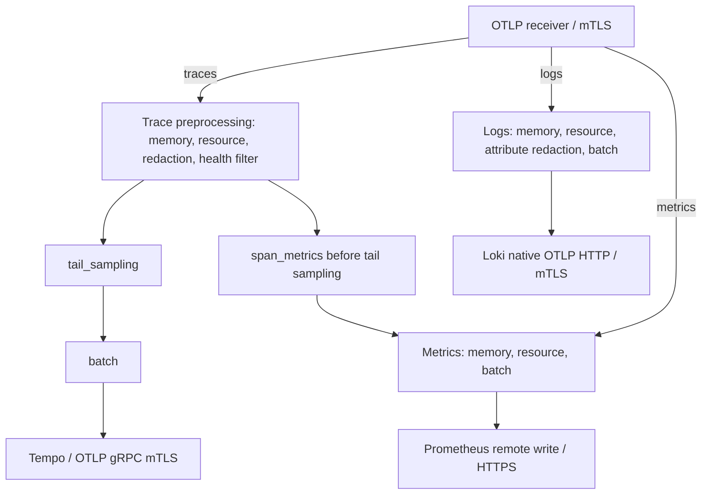

# OpenTelemetry

> **Base de revisión**: Collector Contrib 0.160.0; Operator 0.158.0; versiones de los lenguajes indicadas más abajo  
> **Última actualización**: 19 de octubre de 2026

## Introducción

OpenTelemetry (OTel) es un marco de observabilidad para software nativo de la nube. Proporciona estándares independientes de los proveedores para generar, recopilar y gestionar tres señales: trazas, métricas y registros. La retrospectiva de la CNCF fechada el 24 de julio de 2026 lo describió como el segundo proyecto, después de Kubernetes, en velocidad de contribución. La madurez del proyecto y la estabilidad de cada SDK o componente son aspectos distintos.

### Actualización de julio de 2026: graduación de la CNCF

OpenTelemetry alcanzó el estado de **graduado** de la CNCF en **mayo de 2026**; el artículo del 24 de julio es una retrospectiva. Este es el máximo nivel de madurez de la fundación, que también tienen proyectos como Kubernetes y Prometheus. La graduación indica que se han evaluado la gobernanza, las prácticas de seguridad y la adopción del proyecto para su uso en producción. La retrospectiva analiza las convenciones semánticas de GenAI, la observabilidad de navegadores y dispositivos móviles, la gobernanza de Schema y las herramientas de implementación gradual. Consulta la publicación del blog de la CNCF ["OpenTelemetry has graduated… Now what?"](https://www.cncf.io/blog/2026/07/24/opentelemetry-has-graduated-now-what/) para conocer los antecedentes y la hoja de ruta.

## ¿Qué es OpenTelemetry?

OpenTelemetry nació de la fusión de los proyectos OpenTracing y OpenCensus:


[🔍 Ver diagrama interactivo](https://www.atomai.click/kubernetes-docs/archmaps/en-observability-tracing-03-opentelemetry-0.html)

## Conceptos básicos

### Tres señales

Este capítulo se centra en las trazas, las métricas y los registros. La creación de perfiles es otra señal en evolución; la compatibilidad y la estabilidad varían según la implementación. Los ID de traza/registro y los ejemplares de métricas requieren la instrumentación y la configuración del backend adecuadas.

| Señal | Descripción | Casos de uso |
|--------|-------------|-----------|
| **Trazas** | Seguimiento de solicitudes distribuidas | Análisis de latencia, asignación de dependencias |
| **Métricas** | Mediciones numéricas | Uso de recursos, SLI/SLO |
| **Registros** | Registros de eventos | Depuración, auditoría |

### Componentes básicos


[🔍 Ver diagrama interactivo](https://www.atomai.click/kubernetes-docs/archmaps/en-observability-tracing-03-opentelemetry-2.html)

La figura enumera las opciones de backend por señal. Solo están activos los exportadores configurados; el ejemplo base de más abajo no habilita automáticamente todos los proveedores.


## SDK de OpenTelemetry

Collector, Operator, Java agent y los SDK de los lenguajes tienen números de versión independientes. Estas plantillas de cargas de trabajo de Linux se han comprobado con los esquemas de Kubernetes 1.35: sus propietarios deben preparar las imágenes de aplicación, los espacios de nombres, los certificados y los Service de destino. La matriz más amplia de Operator no elimina requisitos específicos de cada receta, como los sidecars nativos. Las comprobaciones locales no demuestran que se haya desplegado una aplicación en EKS.

| Componente | Base y límites |
|---|---|
| Collector Contrib independiente | 0.160.0; componentes y esquemas comprobados con su binario real |
| Operator | 0.158.0; su tabla de compatibilidad incluye Kubernetes 1.25–1.36 y cert-manager v1 |
| Java agent | 2.31.1, dirigido a SDK 1.65.0; no tiene la misma versión que la imagen Java predeterminada de Operator |
| Python | SDK/exporter 1.44.0 e instrumentation/distro 0.65b0; Python ≥3.10 |
| Ejemplo CommonJS de Node.js | SDK-node 0.220.0, auto-instrumentations-node 0.78.0, resources 2.9.0, API 1.9.1 |

Operator usa Collector 0.158.0 de forma predeterminada. Las cargas de trabajo independientes 0.160.0 que aparecen más abajo no son una actualización de Collector gestionada por Operator. Comprueba la intersección con las versiones de EKS compatibles; la versión más reciente de Kubernetes no está necesariamente incluida en la matriz de Operator.

### Instrumentación automática

A fecha del 12 de octubre de 2026, la compatibilidad estándar de EKS incluye las versiones 1.34–1.37. La base de esquema 1.35 está dentro de esta lista y de la matriz de Operator; aun así, esto no sustituye las comprobaciones de aceptación de la plataforma y de los complementos en funcionamiento.

La instrumentación sin código se conecta a las bibliotecas compatibles; no descubre operaciones empresariales arbitrarias. Para cada proceso, elige un agente/launcher preparado directamente o la inyección de Operator. No inicialices un segundo SDK sobre un proveedor ya configurado. Las siguientes imágenes de aplicación son marcadores de posición para tus propias compilaciones, incluidos sus comandos de inicio y dependencias.

Prepara un espacio de nombres `ecommerce` y crea allí un Secret `otel-client-tls` que contenga `ca.crt`, `tls.crt` y `tls.key`. Collector debe aceptar el certificado de cliente, y el certificado de Collector debe coincidir con `otel-collector.otel.svc.cluster.local`. Los archivos del Secret se montan como de solo lectura; adapta el acceso UID/GID a tu imagen. En las variables de entorno solo aparecen **rutas** a certificados, no el contenido de las claves ni tokens bearer. Estas plantillas usan OTLP HTTP/protobuf por el puerto TLS 4318.

#### Instrumentación automática de Java

Descarga el agente fijado en la compilación de tu aplicación y verifica la suma de comprobación del artefacto de la versión. El JAR 2.31.1 ocupa 25.107.554 bytes, por encima del límite de 1 MiB de los ConfigMap de Kubernetes. Inclúyelo en la imagen o usa la inyección de Operator; un ConfigMap no es un mecanismo para distribuir binarios de agentes.


```bash
curl --fail --location --output opentelemetry-javaagent.jar \
  https://github.com/open-telemetry/opentelemetry-java-instrumentation/releases/download/v2.31.1/opentelemetry-javaagent.jar
printf '%s  %s\n' \
  bbf83c151b6400709e2f225bdd07a04f839d9d13b8b93464241333fd25d3e3ba \
  opentelemetry-javaagent.jar | sha256sum --check -
```

```dockerfile
# Add to the application's existing Dockerfile; not a complete image build.
COPY opentelemetry-javaagent.jar /opt/otel/opentelemetry-javaagent.jar
```
Combina la opción del agente con cualquier `JAVA_TOOL_OPTIONS` existente; no descartes las opciones de la JVM de la aplicación. El selector del Deployment y las etiquetas del Pod deben coincidir.


```yaml
apiVersion: apps/v1
kind: Deployment
metadata:
  name: order-service
  namespace: ecommerce
spec:
  replicas: 1
  selector:
    matchLabels:
      app: order-service
  template:
    metadata:
      labels:
        app: order-service
    spec:
      automountServiceAccountToken: false
      securityContext:
        fsGroup: 10001
      containers:
      - name: app
        image: registry.example.com/order-service:otel-demo
        env:
        - name: OTEL_SERVICE_NAME
          value: order-service
        - name: OTEL_RESOURCE_ATTRIBUTES
          value: service.namespace=ecommerce,deployment.environment.name=demo
        - name: OTEL_EXPORTER_OTLP_ENDPOINT
          value: https://otel-collector.otel.svc.cluster.local:4318
        - name: OTEL_EXPORTER_OTLP_PROTOCOL
          value: http/protobuf
        - name: OTEL_EXPORTER_OTLP_CERTIFICATE
          value: /var/run/otel-client/ca.crt
        - name: OTEL_EXPORTER_OTLP_CLIENT_CERTIFICATE
          value: /var/run/otel-client/tls.crt
        - name: OTEL_EXPORTER_OTLP_CLIENT_KEY
          value: /var/run/otel-client/tls.key
        - name: OTEL_TRACES_EXPORTER
          value: otlp
        - name: OTEL_METRICS_EXPORTER
          value: otlp
        - name: OTEL_LOGS_EXPORTER
          value: none
        - name: OTEL_TRACES_SAMPLER
          value: parentbased_always_on
        - name: OTEL_METRIC_EXPORT_INTERVAL
          value: '60000'
        - name: JAVA_TOOL_OPTIONS
          value: -javaagent:/opt/otel/opentelemetry-javaagent.jar
        volumeMounts:
        - name: otel-client-tls
          mountPath: /var/run/otel-client
          readOnly: true
      volumes:
      - name: otel-client-tls
        secret:
          secretName: otel-client-tls
          defaultMode: 288
```
#### Instrumentación automática de Python

Para una aplicación Flask, instala paquetes compatibles en su entorno de compilación y fija las dependencias de la aplicación una vez resueltas. Otros frameworks necesitan su paquete de instrumentación correspondiente. En este ejemplo se selecciona explícitamente el exporter HTTP, en lugar de enviar el valor predeterminado HTTP de Python al puerto gRPC 4317.


```bash
python -m pip install \
  opentelemetry-api==1.44.0 opentelemetry-sdk==1.44.0 \
  opentelemetry-distro==0.65b0 \
  opentelemetry-instrumentation-flask==0.65b0 \
  opentelemetry-exporter-otlp-proto-http==1.44.0
```

```yaml
apiVersion: apps/v1
kind: Deployment
metadata:
  name: payment-service
  namespace: ecommerce
spec:
  replicas: 1
  selector:
    matchLabels:
      app: payment-service
  template:
    metadata:
      labels:
        app: payment-service
    spec:
      automountServiceAccountToken: false
      securityContext:
        fsGroup: 10001
      containers:
      - name: app
        image: registry.example.com/payment-service:otel-demo
        env:
        - name: OTEL_SERVICE_NAME
          value: payment-service
        - name: OTEL_RESOURCE_ATTRIBUTES
          value: service.namespace=ecommerce,deployment.environment.name=demo
        - name: OTEL_EXPORTER_OTLP_ENDPOINT
          value: https://otel-collector.otel.svc.cluster.local:4318
        - name: OTEL_EXPORTER_OTLP_PROTOCOL
          value: http/protobuf
        - name: OTEL_EXPORTER_OTLP_CERTIFICATE
          value: /var/run/otel-client/ca.crt
        - name: OTEL_EXPORTER_OTLP_CLIENT_CERTIFICATE
          value: /var/run/otel-client/tls.crt
        - name: OTEL_EXPORTER_OTLP_CLIENT_KEY
          value: /var/run/otel-client/tls.key
        - name: OTEL_TRACES_EXPORTER
          value: otlp
        - name: OTEL_METRICS_EXPORTER
          value: otlp
        - name: OTEL_LOGS_EXPORTER
          value: none
        - name: OTEL_TRACES_SAMPLER
          value: parentbased_always_on
        - name: OTEL_METRIC_EXPORT_INTERVAL
          value: '60000'
        volumeMounts:
        - name: otel-client-tls
          mountPath: /var/run/otel-client
          readOnly: true
        command:
        - opentelemetry-instrument
        - python
        - app.py
      volumes:
      - name: otel-client-tls
        secret:
          secretName: otel-client-tls
          defaultMode: 288
```
#### Instrumentación automática de Node.js


```bash
npm install --save-exact \
  @opentelemetry/api@1.9.1 @opentelemetry/resources@2.9.0 \
  @opentelemetry/sdk-node@0.220.0 \
  @opentelemetry/auto-instrumentations-node@0.78.0
# Commit package-lock.json and use npm ci for subsequent application builds.
```
Guarda este archivo como `tracing.cjs` y cárgalo antes de los módulos de la aplicación/framework. Este es un ejemplo CommonJS; la carga de ESM requiere la configuración independiente de la guía del lenguaje. El SDK lee las variables explícitas de entorno OTEL para el exporter/TLS que aparecen más abajo. Para los lectores de métricas configurados mediante código, la configuración actual usa `metricReaders`, que sustituye a la opción singular obsoleta. Integra `shutdownTelemetry()` después del paso de drenaje de solicitudes de la propia aplicación.


```javascript
// Load before application/framework modules in a CommonJS application.
const { NodeSDK } = require('@opentelemetry/sdk-node');
const { envDetector } = require('@opentelemetry/resources');
const { getNodeAutoInstrumentations } = require('@opentelemetry/auto-instrumentations-node');

const sdk = new NodeSDK({
  resourceDetectors: [envDetector],
  instrumentations: [
    getNodeAutoInstrumentations({
      '@opentelemetry/instrumentation-fs': { enabled: false },
      '@opentelemetry/instrumentation-http': {
        ignoreIncomingRequestHook: (request) =>
          String(request.url || '').split('?')[0] === '/health',
      },
    }),
  ],
});

// OTEL_* variables configure exporters, protocol, TLS and metric interval.
sdk.start();

// Call after the application's own request-draining step on shutdown.
module.exports = { shutdownTelemetry: () => sdk.shutdown() };
```

```yaml
apiVersion: apps/v1
kind: Deployment
metadata:
  name: notification-service
  namespace: ecommerce
spec:
  replicas: 1
  selector:
    matchLabels:
      app: notification-service
  template:
    metadata:
      labels:
        app: notification-service
    spec:
      automountServiceAccountToken: false
      securityContext:
        fsGroup: 10001
      containers:
      - name: app
        image: registry.example.com/notification-service:otel-demo
        env:
        - name: OTEL_SERVICE_NAME
          value: notification-service
        - name: OTEL_RESOURCE_ATTRIBUTES
          value: service.namespace=ecommerce,deployment.environment.name=demo
        - name: OTEL_EXPORTER_OTLP_ENDPOINT
          value: https://otel-collector.otel.svc.cluster.local:4318
        - name: OTEL_EXPORTER_OTLP_PROTOCOL
          value: http/protobuf
        - name: OTEL_EXPORTER_OTLP_CERTIFICATE
          value: /var/run/otel-client/ca.crt
        - name: OTEL_EXPORTER_OTLP_CLIENT_CERTIFICATE
          value: /var/run/otel-client/tls.crt
        - name: OTEL_EXPORTER_OTLP_CLIENT_KEY
          value: /var/run/otel-client/tls.key
        - name: OTEL_TRACES_EXPORTER
          value: otlp
        - name: OTEL_METRICS_EXPORTER
          value: otlp
        - name: OTEL_LOGS_EXPORTER
          value: none
        - name: OTEL_TRACES_SAMPLER
          value: parentbased_always_on
        - name: OTEL_METRIC_EXPORT_INTERVAL
          value: '60000'
        volumeMounts:
        - name: otel-client-tls
          mountPath: /var/run/otel-client
          readOnly: true
        command:
        - node
        - --require
        - ./tracing.cjs
        - app.cjs
      volumes:
      - name: otel-client-tls
        secret:
          secretName: otel-client-tls
          defaultMode: 288
```
Estos ejemplos establecen deliberadamente `OTEL_LOGS_EXPORTER=none`. Habilitar un exporter de registros no supervisa la salida estándar de la aplicación: instala el puente/manejador de registros adecuado o un recopilador de registros, y revisa primero la exposición del contenido. El sampler `parentbased_always_on` sigue respetando un elemento padre no muestreado. Si en su lugar eliges un muestreo de cabecera del 10 %, el Collector de cola no puede recuperar las trazas descartadas.

### Instrumentación manual

Reutiliza la instancia/proveedor de OpenTelemetry que inicialice el agente o la aplicación. Sin un proveedor SDK, las llamadas a la API pueden no hacer nada. Estos spans de flujos de trabajo empresariales son INTERNAL: los clientes HTTP/de base de datos instrumentados crean sus propios spans CLIENT y propagan el contexto. Crear manualmente un span CLIENT por sí solo no envía una solicitud ni inyecta el contexto de traza.

#### Instrumentación manual de Java

La aplicación proporciona las funciones de devolución de llamada de inventario/pago. No se registran ID de pedidos/clientes, importes, ID de transacciones ni mensajes de excepción sin procesar. Estas son operaciones de la aplicación, no una implementación de un servicio de pago ni un despliegue de Spring probado.


```java
import io.opentelemetry.api.OpenTelemetry;
import io.opentelemetry.api.trace.Span;
import io.opentelemetry.api.trace.SpanKind;
import io.opentelemetry.api.trace.StatusCode;
import io.opentelemetry.api.trace.Tracer;
import io.opentelemetry.context.Scope;

public final class OrderTelemetry {
    private final Tracer tracer;

    public OrderTelemetry(OpenTelemetry telemetry) {
        this.tracer = telemetry.getTracer("example.order-workflow", "1.0.0");
    }

    public void processOrder(Runnable validateInventory, Runnable processPayment) {
        Span parent = tracer.spanBuilder("processOrder")
                .setSpanKind(SpanKind.INTERNAL).startSpan();
        try (Scope ignored = parent.makeCurrent()) {
            parent.addEvent("validation.started");
            child("checkInventory", validateInventory);
            child("processPayment", processPayment);
            parent.addEvent("processing.completed");
        } catch (RuntimeException error) {
            parent.setStatus(StatusCode.ERROR);
            parent.setAttribute("error.type", error.getClass().getName());
            throw error;
        } finally {
            parent.end();
        }
    }

    private void child(String name, Runnable operation) {
        Span span = tracer.spanBuilder(name).setSpanKind(SpanKind.INTERNAL).startSpan();
        try (Scope ignored = span.makeCurrent()) {
            operation.run();
        } catch (RuntimeException error) {
            span.setStatus(StatusCode.ERROR);
            span.setAttribute("error.type", error.getClass().getName());
            throw error;
        } finally {
            span.end();
        }
    }
}
```
#### Instrumentación manual de Python

El decorador síncrono conserva los resultados y los errores mientras finaliza los spans anidados. Solo registra el tipo de error, para evitar eventos duplicados con excepciones sin procesar. Una función asíncrona requiere un contenedor compatible con async. Proporciona tus propias funciones de devolución de llamada parametrizadas para consultas a bases de datos, validación, persistencia y publicación de eventos; la validación local usó funciones sintéticas y un exporter en memoria.


```python
"""Manual spans for synchronous application callbacks; no database is created."""
from functools import wraps
from contextlib import contextmanager
from opentelemetry import trace
from opentelemetry.trace import SpanKind, Status, StatusCode

# Reuse the SDK provider initialized by auto-instrumentation or the application.
tracer = trace.get_tracer("example.user-workflow", "1.0.0")

@contextmanager
def operation(name):
    with tracer.start_as_current_span(
        name, kind=SpanKind.INTERNAL,
        record_exception=False, set_status_on_exception=False,
    ) as span:
        try:
            yield span
        except Exception as error:
            span.set_status(Status(StatusCode.ERROR))
            span.set_attribute("error.type", type(error).__name__)
            raise

def traced(name):
    def decorate(function):
        @wraps(function)
        def wrapped(*args, **kwargs):
            with operation(name):
                return function(*args, **kwargs)
        return wrapped
    return decorate

@traced("get_user")
def get_user(user_id, lookup):
    # lookup is supplied by the application, with parameterized queries.
    # The ID and SQL text are not added to telemetry.
    with operation("lookup_user"):
        result = lookup(user_id)
    trace.get_current_span().set_attribute("app.user.found", result is not None)
    return result

@traced("create_user")
def create_user(user_data, validate, save, publish):
    # These callbacks are the application's own implementations.
    with operation("validate_user_data"):
        validate(user_data)
    with operation("save_user"):
        result = save(user_data)
    with operation("publish_user_event"):
        publish(result)
    return result
```
Para instrumentar bases de datos/mensajes reales, sigue la versión de las convenciones implementada, como `db.system.name`, `db.operation.name` y `messaging.destination.name`. No copies ID de usuario en cadenas de telemetría SQL ni uses consultas sin procesar como etiquetas de métricas. Las funciones empresariales de devolución de llamada anteriores no demuestran la ejecución de PostgreSQL o Kafka.

## Collector de OTEL

### Arquitectura




Rutas de señales para la configuración que aparece más abajo. El recuadro de preprocesamiento de trazas resume el procesamiento equivalente de dos canalizaciones de trazas independientes. Las métricas de spans se derivan antes del muestreo de cola; las métricas y los registros entrantes usan sus propias canalizaciones.

### Configuración de Collector

Guárdala como `otel-collector-config.yaml`. Es una única instancia activa de muestreo/agregación con estado para un laboratorio, no una garantía de alta disponibilidad/capacidad. Una canalización de trazas independiente deriva métricas **antes del muestreo de cola**. Los spans muestreados en cabecera o filtrados tampoco estarán presentes en esas métricas. Estos contadores cuentan spans observados, no solicitudes únicas de usuarios finales; selecciona tipos de span y dimensiones acotadas adecuadas para los SLI de solicitudes. Los contadores acumulativos de métricas de spans se exportan inicialmente como cero en 0.160.0; evalúa los siguientes envíos antes de interpretar el primer valor como ausencia de tráfico.

Prepara Tempo con OTLP habilitado, un receptor de escritura remota compatible con Prometheus y la ingesta OTLP nativa de Loki, con gateways TLS/autenticación proporcionados por los operadores. Los nombres de gateway de ejemplo que aparecen más abajo no son Service creados por esta guía. Prometheus necesita que su receptor de escritura remota esté habilitado (`--web.enable-remote-write-receiver` si se usa Prometheus). La URL base del exporter de Loki termina en `/otlp`; el exporter HTTP añade `/v1/logs`. Configura los metadatos estructurados de Loki y la asignación de tenant de confianza según sea necesario; una cabecera de tenant no es autenticación.

Las variables de entorno identifican certificados y endpoints existentes. Todos los receptores configurados usan TLS mutuo; no se habilitan CORS comodín para navegadores ni endpoints públicos de creación de perfiles. Las eliminaciones de atributos indicadas son controles limitados, no un enmascaramiento completo de los cuerpos de registros, eventos de spans, atributos de recursos ni contenido arbitrario. Minimiza también los datos en el SDK.


```yaml
# otel-collector-config.yaml
receivers:
  otlp:
    protocols:
      grpc:
        endpoint: 0.0.0.0:4317
        max_recv_msg_size_mib: 16
        tls:
          cert_file: ${env:OTEL_SERVER_CERT}
          key_file: ${env:OTEL_SERVER_KEY}
          client_ca_file: ${env:OTEL_CLIENT_CA}
      http:
        endpoint: 0.0.0.0:4318
        tls:
          cert_file: ${env:OTEL_SERVER_CERT}
          key_file: ${env:OTEL_SERVER_KEY}
          client_ca_file: ${env:OTEL_CLIENT_CA}

processors:
  memory_limiter:
    check_interval: 1s
    limit_mib: 384
    spike_limit_mib: 96
  resource/cluster:
    attributes:
      - key: k8s.cluster.name
        value: ${env:K8S_CLUSTER_NAME}
        action: insert
  attributes/redact:
    actions:
      - key: http.request.header.authorization
        action: delete
      - key: user.email
        action: delete
      - key: user.id
        action: delete
      - key: customer.id
        action: delete
      - key: db.statement
        action: delete
      - key: db.query.text
        action: delete
  filter/health:
    error_mode: propagate
    traces:
      span:
        - 'attributes["http.route"] == "/health"'
        - 'attributes["http.route"] == "/ready"'
        - 'attributes["http.route"] == "/metrics"'
  tail_sampling:
    decision_wait: 10s
    num_traces: 10000
    expected_new_traces_per_sec: 100
    policies:
      - name: errors
        type: status_code
        status_code:
          status_codes: [ERROR]
      - name: slow
        type: latency
        latency:
          threshold_ms: 1000
      - name: selected-services
        type: string_attribute
        string_attribute:
          key: service.name
          values: [payment-service, order-service]
      - name: baseline
        type: probabilistic
        probabilistic:
          sampling_percentage: 10
  batch:
    timeout: 5s
    send_batch_size: 512
    send_batch_max_size: 1024

connectors:
  span_metrics:
    histogram:
      unit: s
      explicit:
        buckets: [5ms, 10ms, 25ms, 50ms, 100ms, 250ms, 500ms, 1s, 2s, 5s]
    dimensions:
      - name: http.request.method
      - name: http.response.status_code
    aggregation_cardinality_limit: 1000
    metrics_flush_interval: 15s

exporters:
  otlp_grpc/tempo:
    endpoint: ${env:TEMPO_OTLP_GRPC_ENDPOINT}
    tls:
      ca_file: ${env:BACKEND_CA}
      cert_file: ${env:BACKEND_CLIENT_CERT}
      key_file: ${env:BACKEND_CLIENT_KEY}
  prometheus_remote_write:
    endpoint: ${env:PROMETHEUS_REMOTE_WRITE_ENDPOINT}
    tls:
      ca_file: ${env:BACKEND_CA}
      cert_file: ${env:BACKEND_CLIENT_CERT}
      key_file: ${env:BACKEND_CLIENT_KEY}
  otlp_http/loki:
    endpoint: ${env:LOKI_OTLP_HTTP_ENDPOINT}
    tls:
      ca_file: ${env:BACKEND_CA}
      cert_file: ${env:BACKEND_CLIENT_CERT}
      key_file: ${env:BACKEND_CLIENT_KEY}

extensions:
  health_check:
    endpoint: 0.0.0.0:13133
    path: /health

service:
  extensions: [health_check]
  pipelines:
    traces:
      receivers: [otlp]
      processors: [memory_limiter, resource/cluster, attributes/redact, filter/health, tail_sampling, batch]
      exporters: [otlp_grpc/tempo]
    traces/span-metrics:
      receivers: [otlp]
      processors: [memory_limiter, resource/cluster, attributes/redact, filter/health]
      exporters: [span_metrics]
    metrics:
      receivers: [otlp, span_metrics]
      processors: [memory_limiter, resource/cluster, batch]
      exporters: [prometheus_remote_write]
    logs:
      receivers: [otlp]
      processors: [memory_limiter, resource/cluster, attributes/redact, batch]
      exporters: [otlp_http/loki]
  telemetry:
    logs:
      level: info
      encoding: json
    metrics:
      readers:
        - pull:
            exporter:
              prometheus:
                host: 127.0.0.1
                port: 8888
```
Las políticas de muestreo positivas son condiciones OR, no una escala de prioridades ordenada. Los servicios seleccionados pueden conservarse independientemente de la probabilidad de referencia. La latencia usa una comparación estricta `>1000 ms`. Las decisiones basadas en temporizadores no demuestran que una traza haya finalizado, y el filtro de estado deliberadamente elimina los spans coincidentes aunque tengan errores; filtrar spans individuales puede dejar trazas parciales.

El límite de memoria estricto es de 384 MiB y el límite flexible es de 288 MiB, con margen por debajo del límite de 512 MiB del contenedor de la plantilla. Aun así, hay que medir los rechazos, los reintentos, las colas y los picos. Los límites de lotes/trazas/cardinalidad de este ejemplo son valores demostrativos, no resultados de pruebas comparativas.

### Carga de trabajo y configuración de una sola instancia

Prepara el espacio de nombres `otel` y los Secrets `otel-ingest-tls` / `otel-backend-tls` con `tls.crt`, `tls.key`, `ca.crt`. Usa SAN de certificados que coincidan con los nombres correspondientes de Service/gateway, un paquete de confianza adecuado y certificados con los usos de servidor/cliente correctos. Adapta el acceso a los archivos para UID/GID 10001. El ConfigMap contiene configuración de texto, no claves privadas. `Recreate` evita la superposición habitual de réplicas durante las actualizaciones graduales en esta instancia única de muestreo, a costa de tiempo de inactividad; no conserva las trazas en memoria durante los reinicios.


```bash
: "${KUBE_CONTEXT:?Set the reviewed cluster context}"
kubectl --context "$KUBE_CONTEXT" -n otel create configmap otel-collector-config \
  --from-file=otel-collector-config.yaml --dry-run=client -o yaml > otel-collector-configmap.yaml
# Inspect the namespace, Secrets, endpoints and workloads before any real apply.
```

```yaml
apiVersion: v1
kind: ServiceAccount
metadata:
  name: otel-collector
  namespace: otel
automountServiceAccountToken: false
---
apiVersion: apps/v1
kind: Deployment
metadata:
  name: otel-collector
  namespace: otel
spec:
  selector:
    matchLabels:
      app: otel-collector
  template:
    metadata:
      labels:
        app: otel-collector
    spec:
      serviceAccountName: otel-collector
      automountServiceAccountToken: false
      nodeSelector:
        kubernetes.io/os: linux
      securityContext:
        runAsNonRoot: true
        runAsUser: 10001
        fsGroup: 10001
        seccompProfile:
          type: RuntimeDefault
      containers:
      - name: collector
        image: otel/opentelemetry-collector-contrib:0.160.0
        args:
        - --config=/conf/otel-collector-config.yaml
        env:
        - name: GOMEMLIMIT
          value: 384MiB
        - name: OTEL_SERVER_CERT
          value: /var/run/otel/ingest/tls.crt
        - name: OTEL_SERVER_KEY
          value: /var/run/otel/ingest/tls.key
        - name: OTEL_CLIENT_CA
          value: /var/run/otel/ingest/ca.crt
        - name: BACKEND_CA
          value: /var/run/otel/backend/ca.crt
        - name: BACKEND_CLIENT_CERT
          value: /var/run/otel/backend/tls.crt
        - name: BACKEND_CLIENT_KEY
          value: /var/run/otel/backend/tls.key
        - name: OTEL_UPSTREAM_ENDPOINT
          value: otel-collector.otel.svc.cluster.local:4317
        - name: K8S_CLUSTER_NAME
          value: REPLACE_WITH_CLUSTER_NAME
        - name: TEMPO_OTLP_GRPC_ENDPOINT
          value: tempo-gateway.tempo.svc.cluster.local:4317
        - name: PROMETHEUS_REMOTE_WRITE_ENDPOINT
          value: https://prometheus-gateway.monitoring.svc.cluster.local/api/v1/write
        - name: LOKI_OTLP_HTTP_ENDPOINT
          value: https://loki-gateway.loki.svc.cluster.local/otlp
        ports:
        - name: otlp-grpc
          containerPort: 4317
        - name: otlp-http
          containerPort: 4318
        resources:
          requests:
            cpu: 100m
            memory: 256Mi
          limits:
            cpu: 500m
            memory: 512Mi
        securityContext:
          allowPrivilegeEscalation: false
          readOnlyRootFilesystem: true
          capabilities:
            drop:
            - ALL
        volumeMounts:
        - name: config
          mountPath: /conf
          readOnly: true
        - name: ingest-tls
          mountPath: /var/run/otel/ingest
          readOnly: true
        - name: backend-tls
          mountPath: /var/run/otel/backend
          readOnly: true
        readinessProbe:
          httpGet:
            path: /health
            port: 13133
        livenessProbe:
          httpGet:
            path: /health
            port: 13133
          initialDelaySeconds: 15
      volumes:
      - name: config
        configMap:
          name: otel-collector-config
      - name: ingest-tls
        secret:
          secretName: otel-ingest-tls
          defaultMode: 288
      - name: backend-tls
        secret:
          secretName: otel-backend-tls
          defaultMode: 288
  replicas: 1
  strategy:
    type: Recreate
---
apiVersion: v1
kind: Service
metadata:
  name: otel-collector
  namespace: otel
spec:
  type: ClusterIP
  selector:
    app: otel-collector
  ports:
  - name: otlp-grpc
    port: 4317
    targetPort: otlp-grpc
  - name: otlp-http
    port: 4318
    targetPort: otlp-http
```
### Recopilación y enriquecimiento opcionales

| Requisito | Configuración independiente necesaria |
|---|---|
| Clientes Jaeger/Zipkin heredados | Sus componentes receptores siguen disponibles; habilita solo los protocolos/puertos necesarios y haz coincidir los ID de receptor en una canalización. Exporta a Jaeger mediante OTLP, no con el exporter de Jaeger eliminado. |
| Métricas propias de Collector | `service.telemetry.metrics.readers` configura el lector Prometheus actual. Se ha eliminado el campo antiguo `address`. Recopila métricas del endpoint de loopback mediante una ruta de monitorización diseñada deliberadamente. |
| Métricas del clúster de Kubernetes | Ejecuta un único receptor `k8s_cluster` activo o configura su extensión de elección de líder. Proporciona credenciales de API y RBAC revisado, y luego conéctalo a una canalización de métricas. Las cargas de trabajo predeterminadas sin token de más arriba no proporcionan esos requisitos previos. |
| Registros de nodo/contenedor o métricas del host | Añade el receptor, los montajes y los permisos adecuados; un DaemonSet por sí solo no los recopila. |
| Detección de recursos de EC2/EKS | Configura deliberadamente el detector deseado y su acceso a metadatos/API; no sustituyas la identidad de la carga de trabajo por la identidad del host de Collector. |
| Métricas derivadas de spans | Usa el conector `span_metrics`, con una unidad de duración explícita y dimensiones acotadas. Se ha eliminado el procesador spanmetrics anterior. |

Consulta la [guía de Collector](../logging/05-collectors.md) y el [receptor de clúster de Kubernetes](https://github.com/open-telemetry/opentelemetry-collector-contrib/tree/v0.160.0/receiver/k8sclusterreceiver). No declares un receptor/procesador sin usar suponiendo que está activo.

## Patrones de despliegue en EKS

Son patrones de despliegue alternativos, no una pila que se deba aplicar indiscriminadamente. Un relay sin estado reenvía las tres señales al nivel único de muestreo indicado arriba. Mantén el muestreo de cola y la agregación de spans fuera de un nivel de nodos/sidecars/HPA distribuido arbitrariamente. Varias instancias de muestreo requieren enrutamiento que tenga en cuenta el ID de traza y un plan para los cambios de endpoint, las trazas en curso, los reinicios y el almacenamiento; un Service o un HPA por sí solos no aportan nada de eso.

Guarda el archivo como `otel-relay-config.yaml` y crea `otel-relay-config` mediante el mismo procedimiento de generación de ConfigMap del lado del cliente. `OTEL_UPSTREAM_ENDPOINT` y el certificado de cliente identifican el Collector ascendente preparado por separado. El relay no mantiene estado respecto a las decisiones de muestreo; sus colas en memoria para el procesamiento por lotes y la exportación siguen sujetas a límites ante fallos y durante el apagado.


```yaml
receivers:
  otlp:
    protocols:
      grpc:
        endpoint: 0.0.0.0:4317
        max_recv_msg_size_mib: 16
        tls:
          cert_file: ${env:OTEL_SERVER_CERT}
          key_file: ${env:OTEL_SERVER_KEY}
          client_ca_file: ${env:OTEL_CLIENT_CA}
      http:
        endpoint: 0.0.0.0:4318
        tls:
          cert_file: ${env:OTEL_SERVER_CERT}
          key_file: ${env:OTEL_SERVER_KEY}
          client_ca_file: ${env:OTEL_CLIENT_CA}
processors:
  memory_limiter:
    check_interval: 1s
    limit_mib: 384
    spike_limit_mib: 96
  batch:
    timeout: 5s
    send_batch_size: 512
    send_batch_max_size: 1024
exporters:
  otlp_grpc/upstream:
    endpoint: ${env:OTEL_UPSTREAM_ENDPOINT}
    tls:
      ca_file: ${env:BACKEND_CA}
      cert_file: ${env:BACKEND_CLIENT_CERT}
      key_file: ${env:BACKEND_CLIENT_KEY}
extensions:
  health_check:
    endpoint: 0.0.0.0:13133
    path: /health
service:
  extensions:
  - health_check
  pipelines:
    traces:
      receivers:
      - otlp
      processors:
      - memory_limiter
      - batch
      exporters:
      - otlp_grpc/upstream
    metrics:
      receivers:
      - otlp
      processors:
      - memory_limiter
      - batch
      exporters:
      - otlp_grpc/upstream
    logs:
      receivers:
      - otlp
      processors:
      - memory_limiter
      - batch
      exporters:
      - otlp_grpc/upstream
  telemetry:
    logs:
      level: info
      encoding: json
    metrics:
      readers:
      - pull:
          exporter:
            prometheus:
              host: 127.0.0.1
              port: 8888
```
### Patrón DaemonSet

Un DaemonSet se ejecuta en nodos Linux aptos, no en EKS Fargate. Configura selectores/tolerancias para los nodos aprobados; aquí no se establece ninguna tolerancia general ni reserva de hostPort. `internalTrafficPolicy: Local` enruta este Service únicamente a un endpoint preparado del nodo del solicitante y descarta el tráfico si no hay ninguno. No es un mecanismo de respaldo para clientes de Fargate. Las aplicaciones deben enviar telemetría explícitamente a este endpoint.


```yaml
apiVersion: apps/v1
kind: DaemonSet
metadata:
  name: otel-agent
  namespace: otel
spec:
  selector:
    matchLabels:
      app: otel-agent
  template:
    metadata:
      labels:
        app: otel-agent
    spec:
      serviceAccountName: otel-collector
      automountServiceAccountToken: false
      nodeSelector:
        kubernetes.io/os: linux
      securityContext:
        runAsNonRoot: true
        runAsUser: 10001
        fsGroup: 10001
        seccompProfile:
          type: RuntimeDefault
      containers:
      - name: collector
        image: otel/opentelemetry-collector-contrib:0.160.0
        args:
        - --config=/conf/otel-relay-config.yaml
        env:
        - name: GOMEMLIMIT
          value: 384MiB
        - name: OTEL_SERVER_CERT
          value: /var/run/otel/ingest/tls.crt
        - name: OTEL_SERVER_KEY
          value: /var/run/otel/ingest/tls.key
        - name: OTEL_CLIENT_CA
          value: /var/run/otel/ingest/ca.crt
        - name: BACKEND_CA
          value: /var/run/otel/backend/ca.crt
        - name: BACKEND_CLIENT_CERT
          value: /var/run/otel/backend/tls.crt
        - name: BACKEND_CLIENT_KEY
          value: /var/run/otel/backend/tls.key
        - name: OTEL_UPSTREAM_ENDPOINT
          value: otel-collector.otel.svc.cluster.local:4317
        ports:
        - name: otlp-grpc
          containerPort: 4317
        - name: otlp-http
          containerPort: 4318
        resources:
          requests:
            cpu: 100m
            memory: 256Mi
          limits:
            cpu: 500m
            memory: 512Mi
        securityContext:
          allowPrivilegeEscalation: false
          readOnlyRootFilesystem: true
          capabilities:
            drop:
            - ALL
        volumeMounts:
        - name: config
          mountPath: /conf
          readOnly: true
        - name: ingest-tls
          mountPath: /var/run/otel/ingest
          readOnly: true
        - name: backend-tls
          mountPath: /var/run/otel/backend
          readOnly: true
        readinessProbe:
          httpGet:
            path: /health
            port: 13133
        livenessProbe:
          httpGet:
            path: /health
            port: 13133
          initialDelaySeconds: 15
      volumes:
      - name: config
        configMap:
          name: otel-relay-config
      - name: ingest-tls
        secret:
          secretName: otel-ingest-tls
          defaultMode: 288
      - name: backend-tls
        secret:
          secretName: otel-backend-tls
          defaultMode: 288
---
apiVersion: v1
kind: Service
metadata:
  name: otel-agent
  namespace: otel
spec:
  type: ClusterIP
  selector:
    app: otel-agent
  ports:
  - name: otlp-grpc
    port: 4317
    targetPort: otlp-grpc
  - name: otlp-http
    port: 4318
    targetPort: otlp-http
  internalTrafficPolicy: Local
```
### Patrón Sidecar

Usa un ConfigMap `otel-sidecar-config` independiente con la configuración que aparece más abajo. Solo el mismo Pod usa su receptor OTLP de loopback sin cifrar; el tráfico ascendente usa TLS mutuo. Este perfil tiene un límite estricto de 192 MiB y uno flexible de 144 MiB para un sidecar de 256 MiB. La imagen de la aplicación debe incluir el SDK/agente que elijas; una variable de endpoint no añade instrumentación por sí sola. Este ejemplo de esquema de Kubernetes 1.35 usa un sidecar nativo (`initContainers` con `restartPolicy: Always`, GA en 1.33). Su startup probe se ejecuta antes de iniciar la aplicación, y durante un apagado normal los contenedores de la aplicación se detienen antes que el sidecar. La entrega al backend y la recuperación ante fallos abruptos siguen siendo comprobaciones independientes.


```yaml
receivers:
  otlp:
    protocols:
      grpc:
        endpoint: 127.0.0.1:4317
      http:
        endpoint: 127.0.0.1:4318
processors:
  memory_limiter:
    check_interval: 1s
    limit_mib: 192
    spike_limit_mib: 48
  batch:
    timeout: 5s
    send_batch_size: 512
    send_batch_max_size: 1024
exporters:
  otlp_grpc/upstream:
    endpoint: ${env:OTEL_UPSTREAM_ENDPOINT}
    tls:
      ca_file: ${env:BACKEND_CA}
      cert_file: ${env:BACKEND_CLIENT_CERT}
      key_file: ${env:BACKEND_CLIENT_KEY}
extensions:
  health_check:
    endpoint: 0.0.0.0:13133
    path: /health
service:
  extensions:
  - health_check
  pipelines:
    traces:
      receivers:
      - otlp
      processors:
      - memory_limiter
      - batch
      exporters:
      - otlp_grpc/upstream
    metrics:
      receivers:
      - otlp
      processors:
      - memory_limiter
      - batch
      exporters:
      - otlp_grpc/upstream
    logs:
      receivers:
      - otlp
      processors:
      - memory_limiter
      - batch
      exporters:
      - otlp_grpc/upstream
  telemetry:
    logs:
      level: info
      encoding: json
    metrics:
      readers:
      - pull:
          exporter:
            prometheus:
              host: 127.0.0.1
              port: 8888
```

```yaml
apiVersion: apps/v1
kind: Deployment
metadata:
  name: order-with-sidecar
  namespace: otel
spec:
  selector:
    matchLabels:
      app: order-with-sidecar
  template:
    metadata:
      labels:
        app: order-with-sidecar
    spec:
      serviceAccountName: otel-collector
      automountServiceAccountToken: false
      nodeSelector:
        kubernetes.io/os: linux
      securityContext:
        runAsNonRoot: true
        runAsUser: 10001
        fsGroup: 10001
        seccompProfile:
          type: RuntimeDefault
      containers:
      - name: app
        image: registry.example.com/order-service:otel-demo
        env:
        - name: OTEL_SERVICE_NAME
          value: order-service
        - name: OTEL_EXPORTER_OTLP_ENDPOINT
          value: http://127.0.0.1:4318
        - name: OTEL_EXPORTER_OTLP_PROTOCOL
          value: http/protobuf
      volumes:
      - name: config
        configMap:
          name: otel-sidecar-config
      - name: backend-tls
        secret:
          secretName: otel-backend-tls
          defaultMode: 288
      initContainers:
      - name: collector
        image: otel/opentelemetry-collector-contrib:0.160.0
        args:
        - --config=/conf/otel-sidecar-config.yaml
        env:
        - name: GOMEMLIMIT
          value: 192MiB
        - name: BACKEND_CA
          value: /var/run/otel/backend/ca.crt
        - name: BACKEND_CLIENT_CERT
          value: /var/run/otel/backend/tls.crt
        - name: BACKEND_CLIENT_KEY
          value: /var/run/otel/backend/tls.key
        - name: OTEL_UPSTREAM_ENDPOINT
          value: otel-collector.otel.svc.cluster.local:4317
        ports:
        - name: otlp-grpc
          containerPort: 4317
        - name: otlp-http
          containerPort: 4318
        resources:
          requests:
            cpu: 100m
            memory: 64Mi
          limits:
            cpu: 500m
            memory: 256Mi
        securityContext:
          allowPrivilegeEscalation: false
          readOnlyRootFilesystem: true
          capabilities:
            drop:
            - ALL
        volumeMounts:
        - name: config
          mountPath: /conf
          readOnly: true
        - name: backend-tls
          mountPath: /var/run/otel/backend
          readOnly: true
        readinessProbe:
          httpGet:
            path: /health
            port: 13133
        livenessProbe:
          httpGet:
            path: /health
            port: 13133
          initialDelaySeconds: 15
        restartPolicy: Always
        startupProbe:
          httpGet:
            path: /health
            port: 13133
          periodSeconds: 2
          failureThreshold: 30
  replicas: 1
```
### Patrón Gateway

Este HPA escala el **relay** sin estado, no el sampler con estado. Metrics Server y solicitudes/capacidad adecuadas son requisitos previos. Tres réplicas, la anti-afinidad preferida y el intervalo de 3–10 son opciones ilustrativas, no una demostración de alta disponibilidad o rendimiento. Se puede considerar el uso de Collector basado en Deployment para Fargate o Auto Mode solo después de comprobar sus requisitos de ejecución, almacenamiento, red y recepción.


```yaml
apiVersion: apps/v1
kind: Deployment
metadata:
  name: otel-relay
  namespace: otel
spec:
  selector:
    matchLabels:
      app: otel-relay
  template:
    metadata:
      labels:
        app: otel-relay
    spec:
      serviceAccountName: otel-collector
      automountServiceAccountToken: false
      nodeSelector:
        kubernetes.io/os: linux
      securityContext:
        runAsNonRoot: true
        runAsUser: 10001
        fsGroup: 10001
        seccompProfile:
          type: RuntimeDefault
      containers:
      - name: collector
        image: otel/opentelemetry-collector-contrib:0.160.0
        args:
        - --config=/conf/otel-relay-config.yaml
        env:
        - name: GOMEMLIMIT
          value: 384MiB
        - name: OTEL_SERVER_CERT
          value: /var/run/otel/ingest/tls.crt
        - name: OTEL_SERVER_KEY
          value: /var/run/otel/ingest/tls.key
        - name: OTEL_CLIENT_CA
          value: /var/run/otel/ingest/ca.crt
        - name: BACKEND_CA
          value: /var/run/otel/backend/ca.crt
        - name: BACKEND_CLIENT_CERT
          value: /var/run/otel/backend/tls.crt
        - name: BACKEND_CLIENT_KEY
          value: /var/run/otel/backend/tls.key
        - name: OTEL_UPSTREAM_ENDPOINT
          value: otel-collector.otel.svc.cluster.local:4317
        ports:
        - name: otlp-grpc
          containerPort: 4317
        - name: otlp-http
          containerPort: 4318
        resources:
          requests:
            cpu: 100m
            memory: 256Mi
          limits:
            cpu: 500m
            memory: 512Mi
        securityContext:
          allowPrivilegeEscalation: false
          readOnlyRootFilesystem: true
          capabilities:
            drop:
            - ALL
        volumeMounts:
        - name: config
          mountPath: /conf
          readOnly: true
        - name: ingest-tls
          mountPath: /var/run/otel/ingest
          readOnly: true
        - name: backend-tls
          mountPath: /var/run/otel/backend
          readOnly: true
        readinessProbe:
          httpGet:
            path: /health
            port: 13133
        livenessProbe:
          httpGet:
            path: /health
            port: 13133
          initialDelaySeconds: 15
      volumes:
      - name: config
        configMap:
          name: otel-relay-config
      - name: ingest-tls
        secret:
          secretName: otel-ingest-tls
          defaultMode: 288
      - name: backend-tls
        secret:
          secretName: otel-backend-tls
          defaultMode: 288
      affinity:
        podAntiAffinity:
          preferredDuringSchedulingIgnoredDuringExecution:
          - weight: 100
            podAffinityTerm:
              labelSelector:
                matchLabels:
                  app: otel-relay
              topologyKey: kubernetes.io/hostname
  replicas: 3
---
apiVersion: v1
kind: Service
metadata:
  name: otel-relay
  namespace: otel
spec:
  type: ClusterIP
  selector:
    app: otel-relay
  ports:
  - name: otlp-grpc
    port: 4317
    targetPort: otlp-grpc
  - name: otlp-http
    port: 4318
    targetPort: otlp-http
---
apiVersion: autoscaling/v2
kind: HorizontalPodAutoscaler
metadata:
  name: otel-relay
  namespace: otel
spec:
  scaleTargetRef:
    apiVersion: apps/v1
    kind: Deployment
    name: otel-relay
  minReplicas: 3
  maxReplicas: 10
  metrics:
  - type: Resource
    resource:
      name: cpu
      target:
        type: Utilization
        averageUtilization: 70
  - type: Resource
    resource:
      name: memory
      target:
        type: Utilization
        averageUtilization: 80
```

## Kubernetes Operator

Operator 0.158.0 tiene una matriz de compatibilidad independiente. Su manifiesto de versión presupone que ya se ha preparado una instalación de cert-manager v1; usa una versión compatible con mantenimiento de la [guía de cert-manager](../../security/10-cert-manager.md), en lugar del ejemplo obsoleto 1.13.3. Antes de actualizar una instalación existente gestionada por su propietario, revisa los cambios de CRD y las políticas de red predeterminadas de 0.158.0.

### Instalación de Operator


```bash
curl --fail --location --output opentelemetry-operator.yaml \
  https://github.com/open-telemetry/opentelemetry-operator/releases/download/v0.158.0/opentelemetry-operator.yaml
printf '%s  %s\n' \
  3c258efb3d64834a857ce4ed5256af2883dc9c77a300eee465df833ab2354c8e \
  opentelemetry-operator.yaml | sha256sum --check -
# After prerequisites and ownership/upgrade review; this changes the cluster:
: "${KUBE_CONTEXT:?Set the reviewed cluster context}"
kubectl --context "$KUBE_CONTEXT" apply -f opentelemetry-operator.yaml
```
### CR de Instrumentation

El recurso y la aplicación de ejemplo están ambos en `ecommerce`. El Operator fijado proporciona sus imágenes de instrumentación predeterminadas con versiones; inspecciona las imágenes inyectadas y no las sustituyas todas por `latest`. Los valores predeterminados de Java/Python no son las versiones instaladas directamente más arriba. Usa una sola vía de instrumentación por proceso. Los montajes de Secret TLS siguen siendo responsabilidad de la aplicación.


```yaml
apiVersion: opentelemetry.io/v1alpha1
kind: Instrumentation
metadata:
  name: otel-instrumentation
  namespace: ecommerce
spec:
  exporter:
    endpoint: https://otel-collector.otel.svc.cluster.local:4318
  propagators:
  - tracecontext
  - baggage
  sampler:
    type: parentbased_always_on
  env:
  - name: OTEL_RESOURCE_ATTRIBUTES
    value: service.namespace=ecommerce,deployment.environment.name=demo
  - name: OTEL_EXPORTER_OTLP_PROTOCOL
    value: http/protobuf
  - name: OTEL_EXPORTER_OTLP_CERTIFICATE
    value: /var/run/otel-client/ca.crt
  - name: OTEL_EXPORTER_OTLP_CLIENT_CERTIFICATE
    value: /var/run/otel-client/tls.crt
  - name: OTEL_EXPORTER_OTLP_CLIENT_KEY
    value: /var/run/otel-client/tls.key
  - name: OTEL_TRACES_EXPORTER
    value: otlp
  - name: OTEL_METRICS_EXPORTER
    value: otlp
  - name: OTEL_LOGS_EXPORTER
    value: none
  - name: OTEL_METRIC_EXPORT_INTERVAL
    value: '60000'
```
Aquí se seleccionan W3C Trace Context y baggage. B3 es una opción de interoperabilidad cuando el paquete propagator del lenguaje y los sistemas pares lo admiten. No incluyas credenciales ni datos personales en baggage; la propagación puede cruzar límites de servicio y confianza.

### Inyección de instrumentación automática

La anotación debe estar en la plantilla del Pod, no solo en los metadatos del Deployment. `otel-instrumentation` selecciona el recurso con ese nombre en el espacio de nombres del Pod; `namespace/name` puede seleccionar explícitamente otro espacio de nombres. Existen anotaciones para todo el espacio de nombres, pero no habilites Java, Python y Node.js indiscriminadamente para todos los Pod. La inyección se produce cuando se admiten nuevos Pod, no de forma retroactiva en los que ya están en ejecución.


```yaml
apiVersion: apps/v1
kind: Deployment
metadata:
  name: order-injected
  namespace: ecommerce
spec:
  replicas: 1
  selector:
    matchLabels:
      app: order-injected
  template:
    metadata:
      labels:
        app: order-injected
      annotations:
        instrumentation.opentelemetry.io/inject-java: otel-instrumentation
    spec:
      automountServiceAccountToken: false
      securityContext:
        fsGroup: 10001
      containers:
      - name: app
        image: registry.example.com/order-injected:otel-demo
        env:
        - name: OTEL_SERVICE_NAME
          value: order-injected
        - name: OTEL_RESOURCE_ATTRIBUTES
          value: service.namespace=ecommerce,deployment.environment.name=demo
        - name: OTEL_EXPORTER_OTLP_ENDPOINT
          value: https://otel-collector.otel.svc.cluster.local:4318
        - name: OTEL_EXPORTER_OTLP_PROTOCOL
          value: http/protobuf
        - name: OTEL_EXPORTER_OTLP_CERTIFICATE
          value: /var/run/otel-client/ca.crt
        - name: OTEL_EXPORTER_OTLP_CLIENT_CERTIFICATE
          value: /var/run/otel-client/tls.crt
        - name: OTEL_EXPORTER_OTLP_CLIENT_KEY
          value: /var/run/otel-client/tls.key
        - name: OTEL_TRACES_EXPORTER
          value: otlp
        - name: OTEL_METRICS_EXPORTER
          value: otlp
        - name: OTEL_LOGS_EXPORTER
          value: none
        - name: OTEL_TRACES_SAMPLER
          value: parentbased_always_on
        - name: OTEL_METRIC_EXPORT_INTERVAL
          value: '60000'
        volumeMounts:
        - name: otel-client-tls
          mountPath: /var/run/otel-client
          readOnly: true
      volumes:
      - name: otel-client-tls
        secret:
          secretName: otel-client-tls
          defaultMode: 288
```
Java, Python, Node.js, .NET, Go, Apache HTTPD y Nginx tienen requisitos previos distintos. En esta versión, la instrumentación automática de Go necesita la ruta del ejecutable de destino e inyecta un componente privilegiado con UID 0; no es una receta general para Restricted-PSS/Fargate. Verifica la configuración de funciones de Operator y la guía de cada lenguaje. Los valores predeterminados HTTP de Python/.NET/Go no deben apuntar a un endpoint gRPC sin la configuración de protocolo correspondiente.

## Configuración de varios backends

Combina este fragmento con la configuración base revisada; no es independiente. Cada backend necesita su propio endpoint, confianza y autorización. AWS X-Ray usa la región y la identidad de la carga de trabajo configuradas; consulta la [guía de X-Ray](./02-xray.md) para conocer la confianza/permisos exactos de IAM. Deshabilitar la indexación de atributos no equivale a enmascararlos. El objeto `api` de Datadog procede de un archivo `api.yaml` gestionado por Secret que contiene `key` (una cadena entre comillas) y `site`. Añade su montaje de Secret de solo lectura a la carga de trabajo; la carga base no lo monta. No se coloca ninguna clave en variables de entorno. En esta auditoría no se ejecutó ninguna llamada a un servicio de AWS/Datadog/Jaeger.


```yaml
exporters:
  awsxray:
    region: ap-northeast-2
    index_all_attributes: false
    telemetry:
      enabled: false
  datadog:
    api: ${file:/var/run/secrets/datadog/api.yaml}
  otlp_grpc/jaeger:
    endpoint: ${env:JAEGER_OTLP_GRPC_ENDPOINT}
    tls:
      ca_file: ${env:BACKEND_CA}
      cert_file: ${env:BACKEND_CLIENT_CERT}
      key_file: ${env:BACKEND_CLIENT_KEY}
service:
  pipelines:
    traces:
      exporters:
      - otlp_grpc/tempo
      - awsxray
      - datadog
      - otlp_grpc/jaeger
```
La distribución a varios backends no garantiza una entrega atómica ni una retención idéntica en todos ellos.

### Actualización de julio de 2026: observación de un límite de red para el tráfico de agentes de IA

El [artículo de la CNCF del 8 de julio](https://www.cncf.io/blog/2026/07/08/network-boundary-for-ai-agents-using-nginx-and-opentelemetry/) describe un prototipo de un solo nodo que utiliza NGINX y OTel. Su límite depende de reglas de red que bloquean las rutas de salida alternativas, no solo de establecer una variable de proxy. Los spans describen el tráfico visible para el proxy configurado; siguen siendo importantes la gestión de TLS, el muestreo, la retención de Collector y la seguridad del proxy. Esta es una capa de control de red y no demuestra que las decisiones de un agente sean correctas o seguras.

### Actualización de agosto de 2026: convertir consultas SQL lentas en métricas de fiabilidad

El [artículo de la CNCF del 21 de agosto](https://www.cncf.io/blog/2026/08/21/how-to-turn-slow-queries-into-actionable-reliability-metrics-with-opentelemetry/) y su [laboratorio](https://github.com/causely-oss/slow-query-lab) comparan la duración de las consultas, el impacto ponderado por tráfico y las métricas derivadas de spans con líneas de base de anomalías. Conserva los ejemplos históricos del artículo como ejemplos, no como mediciones de capacidad de tu clúster. El propio artículo advierte sobre el uso de SQL sin procesar en etiquetas de métricas, los parámetros sensibles, la cardinalidad y el calentamiento de la línea de base. Sanitiza y acota las dimensiones antes de adoptar una configuración de laboratorio; una anomalía de latencia es un síntoma, no una prueba de la causa raíz.

### Actualización de octubre de 2026: Software Carbon Intensity (SCI) como señal de OTel

En una [publicación de la CNCF del 15 de octubre](https://www.cncf.io/blog/2026/10/15/carbon-as-a-first-class-signal-bringing-software-carbon-intensity-to-opentelemetry/), Diana Todea —mantenedora de Kepler y embajadora de la CNCF— desarrolla las ideas de su ponencia principal en Observability Summit Europe 2026 para proponer que el estándar Software Carbon Intensity (SCI) de Green Software Foundation se trate como convenciones semánticas de OpenTelemetry, conectando las emisiones de carbono con las cargas de trabajo y los servicios como una señal observable. Se trata de una propuesta que marca el rumbo y que aún se debate en el proceso de estandarización, no de una función incluida en una versión concreta de OTel ni de una convención semántica terminada; comprueba el avance en upstream antes de planificar su adopción.

### Actualización de octubre de 2026: reconstrucción de la detección de incidentes sobre flujos de OTel

En la [publicación de la CNCF del 30 de septiembre](https://www.cncf.io/blog/2026/09/30/from-40-seconds-to-under-10-rebuilding-incident-detection-on-opentelemetry-apache-kafka-and-apache-flink-on-kubernetes/), Atlassian describe los dieciocho meses que pasó reconstruyendo su plataforma automatizada de creación de incidentes con OpenTelemetry, Apache Kafka y Apache Flink en Kubernetes, y reduciendo la latencia de evento a métrica de más de 40 segundos a menos de 10. Tal como señala la propia publicación, la exhaustividad dentro del alcance subió de aproximadamente el 60 % al 86 %, pero volvió a bajar al 64 % en un mal mes, y la precisión sigue por debajo del objetivo. Considera estas cifras mediciones de esa organización, no resultados garantizados por la arquitectura; la publicación resulta más útil por su análisis de compensaciones, como el aislamiento de vecinos ruidosos en colas compartidas y el costo.

## Prácticas recomendadas

### 1. Estandarizar los atributos de recursos

| Atributo | Ejemplo / origen |
|---|---|
| `service.name`, `service.version`, `service.namespace` | `order-service`, `1.2.3`, `ecommerce`; configuración de la aplicación |
| `deployment.environment.name` | `demo`; sustituye a `deployment.environment`, que está obsoleto |
| `cloud.provider`, `cloud.region`, `cloud.availability_zone` | Metadatos de despliegue verificados, no conjeturas basadas en el host de Collector |
| `k8s.cluster.name`, `k8s.namespace.name`, `k8s.pod.name`, `k8s.deployment.name` | Enriquecimiento de Kubernetes o metadatos de carga de trabajo configurados correctamente |

Este es un inventario de atributos, no YAML de procesador de Collector. Un Resource identifica al productor. Evita copiar todos los atributos de recursos en etiquetas de métricas; los nombres de Pod, los ID de usuario y el texto de consultas sin procesar pueden generar una cardinalidad elevada. Los perfiles son otra señal en evolución; esta guía se centra en trazas, métricas y registros, sin afirmar que la estabilidad de los SDK sea uniforme.

### 2. Estrategia de muestreo

Para un ejemplo avanzado (errores, latencia >2 segundos, una condición del 50 % para servicios críticos y una línea de base del 5 %), considera cada regla positiva como una condición OR, no como una prioridad de primera coincidencia ni como una cuota reservada. Otra regla puede conservar una traza. Si necesitas clases exclusivas o un presupuesto de tasa de spans, diseña y prueba explícitamente esa política. El muestreo de cabecera, los spans descartados, los cambios de fragmento y las llegadas tardías siguen siendo límites independientes.


```yaml
# Replace the base policies list; positive rules are OR conditions, not priorities.
processors:
  tail_sampling:
    policies:
    - name: errors
      type: status_code
      status_code:
        status_codes:
        - ERROR
    - name: slow
      type: latency
      latency:
        threshold_ms: 2000
    - name: critical-services
      type: and
      and:
        and_sub_policy:
        - name: service-name
          type: string_attribute
          string_attribute:
            key: service.name
            values:
            - payment-service
            - order-service
        - name: probabilistic
          type: probabilistic
          probabilistic:
            sampling_percentage: 50
    - name: default
      type: probabilistic
      probabilistic:
        sampling_percentage: 5
```
### 3. Consideraciones de seguridad

TLS de servidor sin `client_ca_file` no equivale a exigir certificados de cliente. Protege ambas direcciones, valida los nombres y el ciclo de vida de los certificados, y restringe el acceso a Service/red/backend. El texto sin cifrar de loopback en el mismo Pod del ejemplo de sidecar representa un límite de confianza independiente. La telemetría de navegador necesita un diseño propio de origen/autenticación/límite de tasa, no CORS comodín.

La acción `hash` del procesador de atributos utiliza SHA-1. Aplicar hash a ID predecibles o a texto SQL no es anonimización; siguen siendo posibles la recuperación mediante diccionario y la vinculación de datos. Es preferible no recopilar valores sensibles y luego eliminar explícitamente los campos identificados antes de exportar. Revisa por separado los cuerpos de registros, los eventos de spans y los atributos de recursos. Los exporters de depuración detallados o los endpoints de creación de perfiles pueden exponer datos y deben usarse como diagnósticos temporales y controlados.

### Validación y límites

La validación local utilizó Collector 0.160.0 real con tráfico OTLP sintético y endpoints mTLS de loopback, incluido el procesamiento de trazas/registros y métricas de spans anteriores al muestreo de cola. La comprobación de escritura remota confirmó la entrega HTTPS a un receptor de prueba, no un resultado de ingesta en un Prometheus activo. Los spans manuales de Python usaron SDK 1.44.0 y un exporter en memoria. Se comprobaron los esquemas de Kubernetes/Instrumentation y la sintaxis de Node.js; no se ejecutaron el inicio de aplicaciones Java/Node, la inyección sin código, productos de backend reales, EKS, IAM ni el escalado automático.

### Referencias oficiales

- [Componentes de Collector 0.160.0](https://github.com/open-telemetry/opentelemetry-collector-releases/blob/v0.160.0/distributions/otelcol-contrib/manifest.yaml)
- [Compatibilidad de Operator 0.158.0](https://github.com/open-telemetry/opentelemetry-operator/blob/v0.158.0/docs/getting-started/compatibility.md)
- [Instrumentación automática de Operator](https://github.com/open-telemetry/opentelemetry-operator/blob/v0.158.0/docs/auto-instrumentation/README.md)
- [Java agent 2.31.1](https://github.com/open-telemetry/opentelemetry-java-instrumentation/releases/tag/v2.31.1)
- [Configuración del exporter OTLP](https://opentelemetry.io/docs/languages/sdk-configuration/otlp-exporter/)
- [Escalado de Collector](https://opentelemetry.io/docs/collector/scaling/)
- [Muestreo de cola](https://github.com/open-telemetry/opentelemetry-collector-contrib/tree/v0.160.0/processor/tailsamplingprocessor)
- [Conector de métricas de spans](https://github.com/open-telemetry/opentelemetry-collector-contrib/tree/v0.160.0/connector/spanmetricsconnector)
- [Limitador de memoria](https://github.com/open-telemetry/opentelemetry-collector/tree/v0.160.0/processor/memorylimiterprocessor)
- [OTLP nativo de Loki](https://grafana.com/docs/loki/latest/send-data/otel/)
- [W3C Trace Context](https://www.w3.org/TR/trace-context/)
- [Sidecars nativos de Kubernetes](https://kubernetes.io/docs/concepts/workloads/pods/sidecar-containers/)
- [Ciclo de vida de Kubernetes en EKS](https://docs.aws.amazon.com/eks/latest/userguide/kubernetes-versions.html)
- [Hitos de OpenTracing en la CNCF](https://www.cncf.io/projects/opentracing/)
- [Repositorio de OpenCensus Go](https://github.com/census-instrumentation/opencensus-go)

## Cuestionario

Pon a prueba tus conocimientos con el [cuestionario de OpenTelemetry](../../quizzes/observability/tracing/03-opentelemetry-quiz.md).
