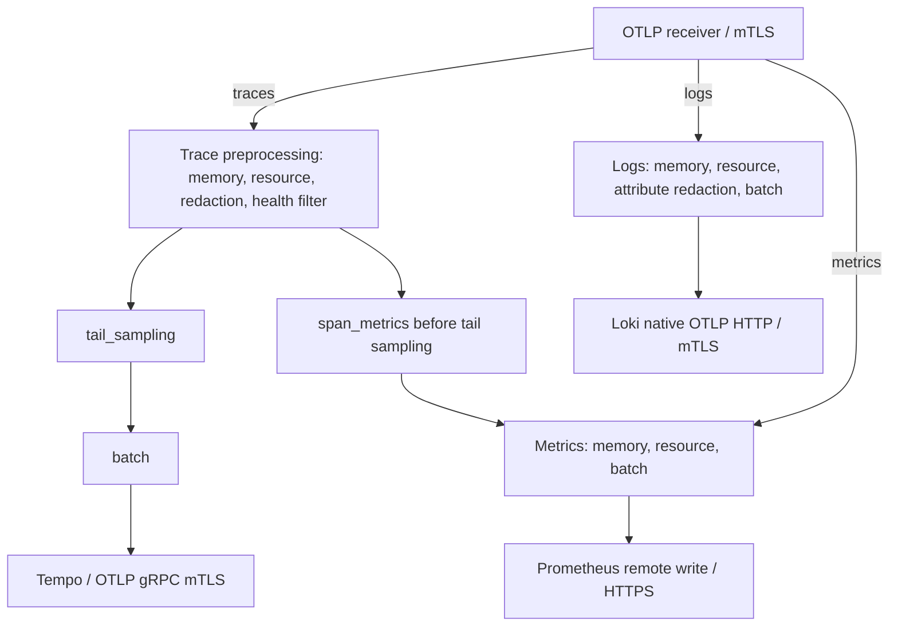

# OpenTelemetry

> **Base de revisión**: Collector Contrib 0.160.0; Operator 0.158.0; versiones de lenguajes a continuación
> **Última actualización**: October 12, 2026

## Introducción

OpenTelemetry (OTel) es un marco de observabilidad para software cloud-native. Proporciona estándares independientes de proveedores para generar, recopilar y administrar tres señales: Traces, Metrics y Logs. La retrospectiva de la CNCF del 24 de julio de 2026 lo describió como el segundo tras Kubernetes en velocidad de contribución. La madurez del proyecto y la estabilidad de SDK/componentes individuales son aspectos separados.

### Actualización de julio de 2026: graduación de la CNCF

OpenTelemetry alcanzó el estado **graduated** de la CNCF en **mayo de 2026**; el artículo del 24 de julio es una retrospectiva. Este es el nivel de madurez más alto de la fundación, que también tienen proyectos como Kubernetes y Prometheus. La graduación indica que la gobernanza, las prácticas de seguridad y la adopción del proyecto han sido evaluadas para uso en producción. La retrospectiva trata las convenciones semánticas de GenAI, la observabilidad de navegador/móvil, la gobernanza de esquemas y las herramientas de despliegue. Consulta la publicación del blog de la CNCF ["OpenTelemetry has graduated… Now what?"](https://www.cncf.io/blog/2026/07/24/opentelemetry-has-graduated-now-what/) para conocer el contexto y la hoja de ruta.

## ¿Qué es OpenTelemetry?

OpenTelemetry nació de la fusión de los proyectos OpenTracing y OpenCensus:


[🔍 Ver diagrama interactivo](https://www.atomai.click/kubernetes-docs/archmaps/en-observability-tracing-03-opentelemetry-0.html)

## Conceptos fundamentales

### Tres señales

Este capítulo se centra en traces, metrics y logs. El profiling es otra señal en evolución; la compatibilidad y la estabilidad varían según la implementación. Los ID de trace/log y los ejemplares de métricas requieren la instrumentación y la configuración de backend adecuadas.

| Señal | Descripción | Casos de uso |
|--------|-------------|-----------|
| **Traces** | Trazado distribuido de solicitudes | Análisis de latencia, mapeo de dependencias |
| **Metrics** | Mediciones numéricas | Uso de recursos, SLI/SLO |
| **Logs** | Registros de eventos | Depuración, auditoría |

### Componentes fundamentales


[🔍 Ver diagrama interactivo](https://www.atomai.click/kubernetes-docs/archmaps/en-observability-tracing-03-opentelemetry-2.html)

La figura enumera las opciones de backend por señal. Solo están activos los exporters configurados; el ejemplo base siguiente no habilita automáticamente todos los proveedores.


## SDK de OpenTelemetry

Collector, Operator, Java agent y los SDK de lenguaje tienen números de versión independientes. Estas plantillas de cargas de trabajo Linux se comprueban con los esquemas de Kubernetes 1.35: los propietarios deben preparar las imágenes de aplicación, namespaces, certificados y Services de destino. La matriz más amplia de Operator no elimina requisitos específicos de la receta, como los sidecars nativos. Las comprobaciones locales no establecen una aplicación EKS desplegada.

| Componente | Base y límite |
|---|---|
| Standalone Collector Contrib | 0.160.0; componentes y esquemas comprobados con su binario real |
| Operator | 0.158.0; su tabla de compatibilidad enumera Kubernetes 1.25–1.36 y cert-manager v1 |
| Java agent | 2.31.1, orientado al SDK 1.65.0; no es la misma versión que la imagen Java predeterminada de Operator |
| Python | SDK/exporter 1.44.0 e instrumentation/distro 0.65b0; Python ≥3.10 |
| Ejemplo Node.js CommonJS | SDK-node 0.220.0, auto-instrumentations-node 0.78.0, resources 2.9.0, API 1.9.1 |

Operator usa Collector 0.158.0 de forma predeterminada. Las cargas de trabajo standalone 0.160.0 siguientes no son una actualización de Collector administrada por Operator. Comprueba la intersección con las versiones compatibles de EKS; la versión más reciente de Kubernetes no está automáticamente dentro de la matriz de Operator.

### Instrumentación automática

A fecha de 12 de octubre de 2026, la compatibilidad estándar de EKS incluye 1.34–1.37. La base de esquema 1.35 se encuentra dentro de esta lista y de la matriz de Operator; esto aún no reemplaza las comprobaciones de aceptación reales de la plataforma/add-on.

La instrumentación sin código conecta bibliotecas compatibles; no descubre operaciones de negocio arbitrarias. Elige un agent/launcher preparado directamente o la inyección mediante Operator para un proceso. No inicialices un segundo SDK sobre un provider ya configurado. Las siguientes imágenes de aplicación son marcadores de posición para tus propias compilaciones, incluidos sus comandos de inicio y dependencias.

Prepara un namespace `ecommerce` y un Secret `otel-client-tls` allí que contenga `ca.crt`, `tls.crt` y `tls.key`. El certificado de cliente debe ser aceptado por el Collector, cuyo certificado debe coincidir con `otel-collector.otel.svc.cluster.local`. Los archivos de Secret se montan como de solo lectura; adapta el acceso de UID/GID a tu imagen. En las variables de entorno solo aparecen las **rutas** de certificados, no el contenido de claves ni tokens bearer. Estas plantillas usan OTLP HTTP/protobuf en el puerto TLS 4318.

#### Instrumentación automática de Java

Descarga el agent fijado en la compilación de tu aplicación y verifica la suma de comprobación del recurso de lanzamiento. El JAR 2.31.1 tiene 25,107,554 bytes, por encima del límite de 1 MiB de ConfigMap de Kubernetes. Inclúyelo en la imagen o usa la inyección de Operator; un ConfigMap no es un mecanismo de distribución de binarios de agent.


```bash
curl --fail --location --output opentelemetry-javaagent.jar \
  https://github.com/open-telemetry/opentelemetry-java-instrumentation/releases/download/v2.31.1/opentelemetry-javaagent.jar
printf '%s  %s\n' \
  bbf83c151b6400709e2f225bdd07a04f839d9d13b8b93464241333fd25d3e3ba \
  opentelemetry-javaagent.jar | sha256sum --check -
```

```dockerfile
# Add to the application's existing Dockerfile; not a complete image build.
COPY opentelemetry-javaagent.jar /opt/otel/opentelemetry-javaagent.jar
```
Combina la opción de agent con cualquier `JAVA_TOOL_OPTIONS` existente; no descartes las opciones JVM de la aplicación. El selector de Deployment y las etiquetas de Pod deben coincidir.


```yaml
apiVersion: apps/v1
kind: Deployment
metadata:
  name: order-service
  namespace: ecommerce
spec:
  replicas: 1
  selector:
    matchLabels:
      app: order-service
  template:
    metadata:
      labels:
        app: order-service
    spec:
      automountServiceAccountToken: false
      securityContext:
        fsGroup: 10001
      containers:
      - name: app
        image: registry.example.com/order-service:otel-demo
        env:
        - name: OTEL_SERVICE_NAME
          value: order-service
        - name: OTEL_RESOURCE_ATTRIBUTES
          value: service.namespace=ecommerce,deployment.environment.name=demo
        - name: OTEL_EXPORTER_OTLP_ENDPOINT
          value: https://otel-collector.otel.svc.cluster.local:4318
        - name: OTEL_EXPORTER_OTLP_PROTOCOL
          value: http/protobuf
        - name: OTEL_EXPORTER_OTLP_CERTIFICATE
          value: /var/run/otel-client/ca.crt
        - name: OTEL_EXPORTER_OTLP_CLIENT_CERTIFICATE
          value: /var/run/otel-client/tls.crt
        - name: OTEL_EXPORTER_OTLP_CLIENT_KEY
          value: /var/run/otel-client/tls.key
        - name: OTEL_TRACES_EXPORTER
          value: otlp
        - name: OTEL_METRICS_EXPORTER
          value: otlp
        - name: OTEL_LOGS_EXPORTER
          value: none
        - name: OTEL_TRACES_SAMPLER
          value: parentbased_always_on
        - name: OTEL_METRIC_EXPORT_INTERVAL
          value: '60000'
        - name: JAVA_TOOL_OPTIONS
          value: -javaagent:/opt/otel/opentelemetry-javaagent.jar
        volumeMounts:
        - name: otel-client-tls
          mountPath: /var/run/otel-client
          readOnly: true
      volumes:
      - name: otel-client-tls
        secret:
          secretName: otel-client-tls
          defaultMode: 288
```
#### Instrumentación automática de Python

Para una aplicación Flask, instala paquetes coincidentes en su entorno de compilación y bloquea las dependencias resueltas de la aplicación. Otros frameworks necesitan su paquete de instrumentación correspondiente. Este ejemplo selecciona explícitamente el exporter HTTP, en lugar de enviar el valor predeterminado HTTP de Python al puerto gRPC 4317.


```bash
python -m pip install \
  opentelemetry-api==1.44.0 opentelemetry-sdk==1.44.0 \
  opentelemetry-distro==0.65b0 \
  opentelemetry-instrumentation-flask==0.65b0 \
  opentelemetry-exporter-otlp-proto-http==1.44.0
```

```yaml
apiVersion: apps/v1
kind: Deployment
metadata:
  name: payment-service
  namespace: ecommerce
spec:
  replicas: 1
  selector:
    matchLabels:
      app: payment-service
  template:
    metadata:
      labels:
        app: payment-service
    spec:
      automountServiceAccountToken: false
      securityContext:
        fsGroup: 10001
      containers:
      - name: app
        image: registry.example.com/payment-service:otel-demo
        env:
        - name: OTEL_SERVICE_NAME
          value: payment-service
        - name: OTEL_RESOURCE_ATTRIBUTES
          value: service.namespace=ecommerce,deployment.environment.name=demo
        - name: OTEL_EXPORTER_OTLP_ENDPOINT
          value: https://otel-collector.otel.svc.cluster.local:4318
        - name: OTEL_EXPORTER_OTLP_PROTOCOL
          value: http/protobuf
        - name: OTEL_EXPORTER_OTLP_CERTIFICATE
          value: /var/run/otel-client/ca.crt
        - name: OTEL_EXPORTER_OTLP_CLIENT_CERTIFICATE
          value: /var/run/otel-client/tls.crt
        - name: OTEL_EXPORTER_OTLP_CLIENT_KEY
          value: /var/run/otel-client/tls.key
        - name: OTEL_TRACES_EXPORTER
          value: otlp
        - name: OTEL_METRICS_EXPORTER
          value: otlp
        - name: OTEL_LOGS_EXPORTER
          value: none
        - name: OTEL_TRACES_SAMPLER
          value: parentbased_always_on
        - name: OTEL_METRIC_EXPORT_INTERVAL
          value: '60000'
        volumeMounts:
        - name: otel-client-tls
          mountPath: /var/run/otel-client
          readOnly: true
        command:
        - opentelemetry-instrument
        - python
        - app.py
      volumes:
      - name: otel-client-tls
        secret:
          secretName: otel-client-tls
          defaultMode: 288
```
#### Instrumentación automática de Node.js


```bash
npm install --save-exact \
  @opentelemetry/api@1.9.1 @opentelemetry/resources@2.9.0 \
  @opentelemetry/sdk-node@0.220.0 \
  @opentelemetry/auto-instrumentations-node@0.78.0
# Commit package-lock.json and use npm ci for subsequent application builds.
```
Guarda como `tracing.cjs`, cargado antes de los módulos de aplicación/framework. Este es un ejemplo CommonJS; la carga ESM necesita la configuración independiente de la guía de lenguaje. El SDK lee las variables de entorno explícitas de exporter/TLS siguientes. Para lectores de métricas programáticos, la configuración actual usa `metricReaders`, que reemplaza la opción singular obsoleta. Integra `shutdownTelemetry()` después del paso propio de la aplicación de drenaje de solicitudes.


```javascript
// Load before application/framework modules in a CommonJS application.
const { NodeSDK } = require('@opentelemetry/sdk-node');
const { envDetector } = require('@opentelemetry/resources');
const { getNodeAutoInstrumentations } = require('@opentelemetry/auto-instrumentations-node');

const sdk = new NodeSDK({
  resourceDetectors: [envDetector],
  instrumentations: [
    getNodeAutoInstrumentations({
      '@opentelemetry/instrumentation-fs': { enabled: false },
      '@opentelemetry/instrumentation-http': {
        ignoreIncomingRequestHook: (request) =>
          String(request.url || '').split('?')[0] === '/health',
      },
    }),
  ],
});

// OTEL_* variables configure exporters, protocol, TLS and metric interval.
sdk.start();

// Call after the application's own request-draining step on shutdown.
module.exports = { shutdownTelemetry: () => sdk.shutdown() };
```

```yaml
apiVersion: apps/v1
kind: Deployment
metadata:
  name: notification-service
  namespace: ecommerce
spec:
  replicas: 1
  selector:
    matchLabels:
      app: notification-service
  template:
    metadata:
      labels:
        app: notification-service
    spec:
      automountServiceAccountToken: false
      securityContext:
        fsGroup: 10001
      containers:
      - name: app
        image: registry.example.com/notification-service:otel-demo
        env:
        - name: OTEL_SERVICE_NAME
          value: notification-service
        - name: OTEL_RESOURCE_ATTRIBUTES
          value: service.namespace=ecommerce,deployment.environment.name=demo
        - name: OTEL_EXPORTER_OTLP_ENDPOINT
          value: https://otel-collector.otel.svc.cluster.local:4318
        - name: OTEL_EXPORTER_OTLP_PROTOCOL
          value: http/protobuf
        - name: OTEL_EXPORTER_OTLP_CERTIFICATE
          value: /var/run/otel-client/ca.crt
        - name: OTEL_EXPORTER_OTLP_CLIENT_CERTIFICATE
          value: /var/run/otel-client/tls.crt
        - name: OTEL_EXPORTER_OTLP_CLIENT_KEY
          value: /var/run/otel-client/tls.key
        - name: OTEL_TRACES_EXPORTER
          value: otlp
        - name: OTEL_METRICS_EXPORTER
          value: otlp
        - name: OTEL_LOGS_EXPORTER
          value: none
        - name: OTEL_TRACES_SAMPLER
          value: parentbased_always_on
        - name: OTEL_METRIC_EXPORT_INTERVAL
          value: '60000'
        volumeMounts:
        - name: otel-client-tls
          mountPath: /var/run/otel-client
          readOnly: true
        command:
        - node
        - --require
        - ./tracing.cjs
        - app.cjs
      volumes:
      - name: otel-client-tls
        secret:
          secretName: otel-client-tls
          defaultMode: 288
```
Estos ejemplos establecen `OTEL_LOGS_EXPORTER=none` deliberadamente. Habilitar un exporter de logs no sigue la salida estándar de la aplicación: instala el bridge/handler de logging apropiado o un recopilador de logs, y revisa primero la exposición de la carga útil. El sampler `parentbased_always_on` aún respeta un padre sin muestreo. Si en cambio eliges un head sampling del 10 %, el Collector tail no puede recuperar los spans descartados.

### Instrumentación manual

Reutiliza la instancia/provider de OpenTelemetry inicializada por el agent o la aplicación. Sin un provider de SDK, las llamadas a la API pueden no realizar ninguna operación. Estos spans de flujo de trabajo de negocio son INTERNAL: los clientes HTTP/base de datos instrumentados crean sus propios spans CLIENT y propagan el contexto. Crear manualmente solo un span CLIENT no envía una solicitud ni inyecta el contexto de trace.

#### Instrumentación manual de Java

La aplicación proporciona los callbacks de inventario/pago. No se registran ID de pedido/cliente, importes, ID de transacción ni mensajes de excepción sin procesar. Estas son operaciones de aplicación, no una implementación de payment-service ni un despliegue Spring probado.


```java
import io.opentelemetry.api.OpenTelemetry;
import io.opentelemetry.api.trace.Span;
import io.opentelemetry.api.trace.SpanKind;
import io.opentelemetry.api.trace.StatusCode;
import io.opentelemetry.api.trace.Tracer;
import io.opentelemetry.context.Scope;

public final class OrderTelemetry {
    private final Tracer tracer;

    public OrderTelemetry(OpenTelemetry telemetry) {
        this.tracer = telemetry.getTracer("example.order-workflow", "1.0.0");
    }

    public void processOrder(Runnable validateInventory, Runnable processPayment) {
        Span parent = tracer.spanBuilder("processOrder")
                .setSpanKind(SpanKind.INTERNAL).startSpan();
        try (Scope ignored = parent.makeCurrent()) {
            parent.addEvent("validation.started");
            child("checkInventory", validateInventory);
            child("processPayment", processPayment);
            parent.addEvent("processing.completed");
        } catch (RuntimeException error) {
            parent.setStatus(StatusCode.ERROR);
            parent.setAttribute("error.type", error.getClass().getName());
            throw error;
        } finally {
            parent.end();
        }
    }

    private void child(String name, Runnable operation) {
        Span span = tracer.spanBuilder(name).setSpanKind(SpanKind.INTERNAL).startSpan();
        try (Scope ignored = span.makeCurrent()) {
            operation.run();
        } catch (RuntimeException error) {
            span.setStatus(StatusCode.ERROR);
            span.setAttribute("error.type", error.getClass().getName());
            throw error;
        } finally {
            span.end();
        }
    }
}
```
#### Instrumentación manual de Python

El decorador síncrono preserva resultados y errores mientras finaliza spans anidados. Registra solo el tipo de error, evitando eventos de excepción sin procesar duplicados. Una función async requiere un wrapper compatible con async. Proporciona tus propios callbacks de búsqueda en base de datos parametrizada, validación, persistencia y publicación de eventos; la validación local usó callbacks sintéticos y un exporter en memoria.


```python
"""Manual spans for synchronous application callbacks; no database is created."""
from functools import wraps
from contextlib import contextmanager
from opentelemetry import trace
from opentelemetry.trace import SpanKind, Status, StatusCode

# Reuse the SDK provider initialized by auto-instrumentation or the application.
tracer = trace.get_tracer("example.user-workflow", "1.0.0")

@contextmanager
def operation(name):
    with tracer.start_as_current_span(
        name, kind=SpanKind.INTERNAL,
        record_exception=False, set_status_on_exception=False,
    ) as span:
        try:
            yield span
        except Exception as error:
            span.set_status(Status(StatusCode.ERROR))
            span.set_attribute("error.type", type(error).__name__)
            raise

def traced(name):
    def decorate(function):
        @wraps(function)
        def wrapped(*args, **kwargs):
            with operation(name):
                return function(*args, **kwargs)
        return wrapped
    return decorate

@traced("get_user")
def get_user(user_id, lookup):
    # lookup is supplied by the application, with parameterized queries.
    # The ID and SQL text are not added to telemetry.
    with operation("lookup_user"):
        result = lookup(user_id)
    trace.get_current_span().set_attribute("app.user.found", result is not None)
    return result

@traced("create_user")
def create_user(user_data, validate, save, publish):
    # These callbacks are the application's own implementations.
    with operation("validate_user_data"):
        validate(user_data)
    with operation("save_user"):
        result = save(user_data)
    with operation("publish_user_event"):
        publish(result)
    return result
```
Para la instrumentación real de base de datos/mensajería, sigue la versión de convención implementada, como `db.system.name`, `db.operation.name` y `messaging.destination.name`. No copies ID de usuario en cadenas de telemetría SQL ni uses consultas sin procesar como etiquetas de métricas. Los callbacks de negocio anteriores no prueban la ejecución de PostgreSQL ni Kafka.

## OTEL Collector

### Arquitectura




Rutas de señal para la configuración siguiente. El cuadro de preprocesamiento de traces resume el procesamiento equivalente en dos pipelines de traces separados. Las métricas de spans se ramifican antes del tail sampling; las métricas y logs entrantes usan sus propios pipelines.

### Configuración de Collector

Guarda como `otel-collector-config.yaml`. Esta es una instancia única activa de muestreo/agregación con estado para un laboratorio, no una garantía de HA/capacidad. Un pipeline de traces independiente deriva métricas **antes del tail sampling**. Los spans muestreados en origen o filtrados siguen ausentes de esas métricas. Estos contadores cuentan spans observados, no solicitudes únicas de usuarios finales; selecciona tipos de span y dimensiones acotadas adecuados para los SLI de solicitudes. Los contadores acumulativos de métricas de spans exportan inicialmente cero en 0.160.0; evalúa los vaciados posteriores antes de interpretar el primer valor como ausencia de tráfico.

Prepara Tempo con OTLP habilitado, un receptor compatible con remote-write de Prometheus y la ingesta OTLP nativa de Loki, con gateways TLS/autenticación proporcionados por el operador. Los nombres de gateway de ejemplo siguientes no son Services creados por esta guía. Prometheus necesita tener habilitado su receptor remote-write (`--web.enable-remote-write-receiver` al usar Prometheus directamente). La base del exporter de Loki termina en `/otlp`; el exporter HTTP agrega `/v1/logs`. Configura los metadatos estructurados de Loki y el mapeo de tenant de confianza según sea necesario; un encabezado de tenant no es autenticación.

Las variables de entorno identifican certificados y endpoints existentes. Todos los receivers configurados usan TLS mutuo; no se habilita CORS de navegador con comodín ni un endpoint público de profiling. Las eliminaciones de atributos nombradas son controles limitados, no un enmascaramiento completo de cuerpos de logs, eventos de span, atributos de recursos o cargas útiles arbitrarias. Minimiza también los datos en el SDK.


```yaml
# otel-collector-config.yaml
receivers:
  otlp:
    protocols:
      grpc:
        endpoint: 0.0.0.0:4317
        max_recv_msg_size_mib: 16
        tls:
          cert_file: ${env:OTEL_SERVER_CERT}
          key_file: ${env:OTEL_SERVER_KEY}
          client_ca_file: ${env:OTEL_CLIENT_CA}
      http:
        endpoint: 0.0.0.0:4318
        tls:
          cert_file: ${env:OTEL_SERVER_CERT}
          key_file: ${env:OTEL_SERVER_KEY}
          client_ca_file: ${env:OTEL_CLIENT_CA}

processors:
  memory_limiter:
    check_interval: 1s
    limit_mib: 384
    spike_limit_mib: 96
  resource/cluster:
    attributes:
      - key: k8s.cluster.name
        value: ${env:K8S_CLUSTER_NAME}
        action: insert
  attributes/redact:
    actions:
      - key: http.request.header.authorization
        action: delete
      - key: user.email
        action: delete
      - key: user.id
        action: delete
      - key: customer.id
        action: delete
      - key: db.statement
        action: delete
      - key: db.query.text
        action: delete
  filter/health:
    error_mode: propagate
    traces:
      span:
        - 'attributes["http.route"] == "/health"'
        - 'attributes["http.route"] == "/ready"'
        - 'attributes["http.route"] == "/metrics"'
  tail_sampling:
    decision_wait: 10s
    num_traces: 10000
    expected_new_traces_per_sec: 100
    policies:
      - name: errors
        type: status_code
        status_code:
          status_codes: [ERROR]
      - name: slow
        type: latency
        latency:
          threshold_ms: 1000
      - name: selected-services
        type: string_attribute
        string_attribute:
          key: service.name
          values: [payment-service, order-service]
      - name: baseline
        type: probabilistic
        probabilistic:
          sampling_percentage: 10
  batch:
    timeout: 5s
    send_batch_size: 512
    send_batch_max_size: 1024

connectors:
  span_metrics:
    histogram:
      unit: s
      explicit:
        buckets: [5ms, 10ms, 25ms, 50ms, 100ms, 250ms, 500ms, 1s, 2s, 5s]
    dimensions:
      - name: http.request.method
      - name: http.response.status_code
    aggregation_cardinality_limit: 1000
    metrics_flush_interval: 15s

exporters:
  otlp_grpc/tempo:
    endpoint: ${env:TEMPO_OTLP_GRPC_ENDPOINT}
    tls:
      ca_file: ${env:BACKEND_CA}
      cert_file: ${env:BACKEND_CLIENT_CERT}
      key_file: ${env:BACKEND_CLIENT_KEY}
  prometheus_remote_write:
    endpoint: ${env:PROMETHEUS_REMOTE_WRITE_ENDPOINT}
    tls:
      ca_file: ${env:BACKEND_CA}
      cert_file: ${env:BACKEND_CLIENT_CERT}
      key_file: ${env:BACKEND_CLIENT_KEY}
  otlp_http/loki:
    endpoint: ${env:LOKI_OTLP_HTTP_ENDPOINT}
    tls:
      ca_file: ${env:BACKEND_CA}
      cert_file: ${env:BACKEND_CLIENT_CERT}
      key_file: ${env:BACKEND_CLIENT_KEY}

extensions:
  health_check:
    endpoint: 0.0.0.0:13133
    path: /health

service:
  extensions: [health_check]
  pipelines:
    traces:
      receivers: [otlp]
      processors: [memory_limiter, resource/cluster, attributes/redact, filter/health, tail_sampling, batch]
      exporters: [otlp_grpc/tempo]
    traces/span-metrics:
      receivers: [otlp]
      processors: [memory_limiter, resource/cluster, attributes/redact, filter/health]
      exporters: [span_metrics]
    metrics:
      receivers: [otlp, span_metrics]
      processors: [memory_limiter, resource/cluster, batch]
      exporters: [prometheus_remote_write]
    logs:
      receivers: [otlp]
      processors: [memory_limiter, resource/cluster, attributes/redact, batch]
      exporters: [otlp_http/loki]
  telemetry:
    logs:
      level: info
      encoding: json
    metrics:
      readers:
        - pull:
            exporter:
              prometheus:
                host: 127.0.0.1
                port: 8888
```
Las políticas de muestreo positivas son condiciones OR, no una escalera de prioridad ordenada. Los servicios seleccionados se pueden retener independientemente de la probabilidad de referencia. La latencia usa una comparación estricta `>1000 ms`. Las decisiones basadas en temporizador no prueban la finalización del trace, y el filtro de salud elimina deliberadamente los spans coincidentes aunque tengan errores; filtrar spans individuales puede dejar traces parciales.

El límite duro de memoria es 384 MiB y el límite suave es 288 MiB, dejando margen por debajo del límite de contenedor de 512 MiB de la plantilla. El rechazo, reintentos, colas y ráfagas aún necesitan medición. Los límites de batch/trace/cardinalidad aquí son configuraciones de demostración, no resultados de benchmark.

### Carga de trabajo y configuración de instancia única

Prepara el namespace `otel` y los Secrets `otel-ingest-tls` / `otel-backend-tls` con `tls.crt`, `tls.key`, `ca.crt`. Usa SAN de certificado que coincidan con los nombres relevantes de Service/gateway, un paquete de confianza apropiado y certificados con los usos correctos de servidor/cliente. Adapta el acceso a archivos de UID/GID 10001. El mapa de configuración contiene configuración de texto, no claves privadas. `Recreate` evita la superposición normal de rolling-surge para este sampler de instancia única, a costa de tiempo de inactividad; no conserva los traces en memoria entre reinicios.


```bash
: "${KUBE_CONTEXT:?Set the reviewed cluster context}"
kubectl --context "$KUBE_CONTEXT" -n otel create configmap otel-collector-config \
  --from-file=otel-collector-config.yaml --dry-run=client -o yaml > otel-collector-configmap.yaml
# Inspect the namespace, Secrets, endpoints and workloads before any real apply.
```

```yaml
apiVersion: v1
kind: ServiceAccount
metadata:
  name: otel-collector
  namespace: otel
automountServiceAccountToken: false
---
apiVersion: apps/v1
kind: Deployment
metadata:
  name: otel-collector
  namespace: otel
spec:
  selector:
    matchLabels:
      app: otel-collector
  template:
    metadata:
      labels:
        app: otel-collector
    spec:
      serviceAccountName: otel-collector
      automountServiceAccountToken: false
      nodeSelector:
        kubernetes.io/os: linux
      securityContext:
        runAsNonRoot: true
        runAsUser: 10001
        fsGroup: 10001
        seccompProfile:
          type: RuntimeDefault
      containers:
      - name: collector
        image: otel/opentelemetry-collector-contrib:0.160.0
        args:
        - --config=/conf/otel-collector-config.yaml
        env:
        - name: GOMEMLIMIT
          value: 384MiB
        - name: OTEL_SERVER_CERT
          value: /var/run/otel/ingest/tls.crt
        - name: OTEL_SERVER_KEY
          value: /var/run/otel/ingest/tls.key
        - name: OTEL_CLIENT_CA
          value: /var/run/otel/ingest/ca.crt
        - name: BACKEND_CA
          value: /var/run/otel/backend/ca.crt
        - name: BACKEND_CLIENT_CERT
          value: /var/run/otel/backend/tls.crt
        - name: BACKEND_CLIENT_KEY
          value: /var/run/otel/backend/tls.key
        - name: OTEL_UPSTREAM_ENDPOINT
          value: otel-collector.otel.svc.cluster.local:4317
        - name: K8S_CLUSTER_NAME
          value: REPLACE_WITH_CLUSTER_NAME
        - name: TEMPO_OTLP_GRPC_ENDPOINT
          value: tempo-gateway.tempo.svc.cluster.local:4317
        - name: PROMETHEUS_REMOTE_WRITE_ENDPOINT
          value: https://prometheus-gateway.monitoring.svc.cluster.local/api/v1/write
        - name: LOKI_OTLP_HTTP_ENDPOINT
          value: https://loki-gateway.loki.svc.cluster.local/otlp
        ports:
        - name: otlp-grpc
          containerPort: 4317
        - name: otlp-http
          containerPort: 4318
        resources:
          requests:
            cpu: 100m
            memory: 256Mi
          limits:
            cpu: 500m
            memory: 512Mi
        securityContext:
          allowPrivilegeEscalation: false
          readOnlyRootFilesystem: true
          capabilities:
            drop:
            - ALL
        volumeMounts:
        - name: config
          mountPath: /conf
          readOnly: true
        - name: ingest-tls
          mountPath: /var/run/otel/ingest
          readOnly: true
        - name: backend-tls
          mountPath: /var/run/otel/backend
          readOnly: true
        readinessProbe:
          httpGet:
            path: /health
            port: 13133
        livenessProbe:
          httpGet:
            path: /health
            port: 13133
          initialDelaySeconds: 15
      volumes:
      - name: config
        configMap:
          name: otel-collector-config
      - name: ingest-tls
        secret:
          secretName: otel-ingest-tls
          defaultMode: 288
      - name: backend-tls
        secret:
          secretName: otel-backend-tls
          defaultMode: 288
  replicas: 1
  strategy:
    type: Recreate
---
apiVersion: v1
kind: Service
metadata:
  name: otel-collector
  namespace: otel
spec:
  type: ClusterIP
  selector:
    app: otel-collector
  ports:
  - name: otlp-grpc
    port: 4317
    targetPort: otlp-grpc
  - name: otlp-http
    port: 4318
    targetPort: otlp-http
```
### Recopilación y enriquecimiento opcionales

| Requisito | Configuración independiente necesaria |
|---|---|
| Clientes Jaeger/Zipkin heredados | Sus componentes receiver siguen disponibles; habilita solo los protocolos/puertos necesarios y haz coincidir los ID de receiver en un pipeline. Exporta a Jaeger mediante OTLP, no mediante el exporter Jaeger eliminado. |
| Métricas propias de Collector | `service.telemetry.metrics.readers` configura el lector Prometheus actual. El campo antiguo `address` se eliminó. Obtén métricas del endpoint de loopback mediante una ruta de monitor diseñada deliberadamente. |
| Métricas de clúster de Kubernetes | Ejecuta un receiver `k8s_cluster` activo, o configura su extensión de elección de líder. Proporciona credenciales de API y RBAC revisado, y luego conéctalo a un pipeline de métricas. Las cargas de trabajo sin token predeterminadas anteriores no proporcionan esos requisitos previos. |
| Logs de nodo/contenedor o métricas de host | Agrega el receiver, los montajes y los permisos adecuados; un DaemonSet por sí solo no los recopila. |
| Detección de recursos EC2/EKS | Configura deliberadamente el detector deseado y su acceso a metadatos/API; no sustituyas la identidad de carga de trabajo por la identidad del host de Collector. |
| Métricas derivadas de spans | Usa el conector `span_metrics`, con una unidad de duración explícita y dimensiones acotadas. El processor spanmetrics antiguo se eliminó. |

Consulta la [guía de collector](../logging/05-collectors.md) y el [receiver de clúster de Kubernetes](https://github.com/open-telemetry/opentelemetry-collector-contrib/tree/v0.160.0/receiver/k8sclusterreceiver). No declares un receiver/processor sin usar y supongas que está activo.

## Patrones de despliegue de EKS

Estos son patrones de despliegue alternativos, no una pila que aplicar indiscriminadamente. Un relay sin estado reenvía las tres señales al nivel de muestreo único anterior. Mantén el tail sampling y la agregación de spans fuera de un nivel de node/sidecar/HPA con equilibrio de carga arbitrario. Varias instancias de muestreo requieren enrutamiento consciente del ID de trace y un plan para cambios de endpoint, traces en curso, reinicios y almacenamiento; un Service o HPA por sí solo no proporciona nada de ello.

Guarda `otel-relay-config.yaml` y crea `otel-relay-config` mediante el mismo procedimiento de generación de ConfigMap en el cliente. `OTEL_UPSTREAM_ENDPOINT` y el certificado de cliente identifican el Collector ascendente preparado por separado. El relay no tiene estado con respecto a las decisiones de muestreo; sus colas de exportación/batching en memoria siguen teniendo límites de fallos y apagado.


```yaml
receivers:
  otlp:
    protocols:
      grpc:
        endpoint: 0.0.0.0:4317
        max_recv_msg_size_mib: 16
        tls:
          cert_file: ${env:OTEL_SERVER_CERT}
          key_file: ${env:OTEL_SERVER_KEY}
          client_ca_file: ${env:OTEL_CLIENT_CA}
      http:
        endpoint: 0.0.0.0:4318
        tls:
          cert_file: ${env:OTEL_SERVER_CERT}
          key_file: ${env:OTEL_SERVER_KEY}
          client_ca_file: ${env:OTEL_CLIENT_CA}
processors:
  memory_limiter:
    check_interval: 1s
    limit_mib: 384
    spike_limit_mib: 96
  batch:
    timeout: 5s
    send_batch_size: 512
    send_batch_max_size: 1024
exporters:
  otlp_grpc/upstream:
    endpoint: ${env:OTEL_UPSTREAM_ENDPOINT}
    tls:
      ca_file: ${env:BACKEND_CA}
      cert_file: ${env:BACKEND_CLIENT_CERT}
      key_file: ${env:BACKEND_CLIENT_KEY}
extensions:
  health_check:
    endpoint: 0.0.0.0:13133
    path: /health
service:
  extensions:
  - health_check
  pipelines:
    traces:
      receivers:
      - otlp
      processors:
      - memory_limiter
      - batch
      exporters:
      - otlp_grpc/upstream
    metrics:
      receivers:
      - otlp
      processors:
      - memory_limiter
      - batch
      exporters:
      - otlp_grpc/upstream
    logs:
      receivers:
      - otlp
      processors:
      - memory_limiter
      - batch
      exporters:
      - otlp_grpc/upstream
  telemetry:
    logs:
      level: info
      encoding: json
    metrics:
      readers:
      - pull:
          exporter:
            prometheus:
              host: 127.0.0.1
              port: 8888
```
### Patrón DaemonSet

Un DaemonSet se ejecuta en nodos Linux aptos, no en EKS Fargate. Configura selectores/tolerations para nodos aprobados; aquí no hay una toleration general ni reserva de hostPort. `internalTrafficPolicy: Local` enruta este Service solo a un endpoint listo en el nodo del llamador y descarta el tráfico si no existe ninguno. No es un mecanismo de respaldo para clientes Fargate. Las aplicaciones deben enviar explícitamente la telemetría a este endpoint.


```yaml
apiVersion: apps/v1
kind: DaemonSet
metadata:
  name: otel-agent
  namespace: otel
spec:
  selector:
    matchLabels:
      app: otel-agent
  template:
    metadata:
      labels:
        app: otel-agent
    spec:
      serviceAccountName: otel-collector
      automountServiceAccountToken: false
      nodeSelector:
        kubernetes.io/os: linux
      securityContext:
        runAsNonRoot: true
        runAsUser: 10001
        fsGroup: 10001
        seccompProfile:
          type: RuntimeDefault
      containers:
      - name: collector
        image: otel/opentelemetry-collector-contrib:0.160.0
        args:
        - --config=/conf/otel-relay-config.yaml
        env:
        - name: GOMEMLIMIT
          value: 384MiB
        - name: OTEL_SERVER_CERT
          value: /var/run/otel/ingest/tls.crt
        - name: OTEL_SERVER_KEY
          value: /var/run/otel/ingest/tls.key
        - name: OTEL_CLIENT_CA
          value: /var/run/otel/ingest/ca.crt
        - name: BACKEND_CA
          value: /var/run/otel/backend/ca.crt
        - name: BACKEND_CLIENT_CERT
          value: /var/run/otel/backend/tls.crt
        - name: BACKEND_CLIENT_KEY
          value: /var/run/otel/backend/tls.key
        - name: OTEL_UPSTREAM_ENDPOINT
          value: otel-collector.otel.svc.cluster.local:4317
        ports:
        - name: otlp-grpc
          containerPort: 4317
        - name: otlp-http
          containerPort: 4318
        resources:
          requests:
            cpu: 100m
            memory: 256Mi
          limits:
            cpu: 500m
            memory: 512Mi
        securityContext:
          allowPrivilegeEscalation: false
          readOnlyRootFilesystem: true
          capabilities:
            drop:
            - ALL
        volumeMounts:
        - name: config
          mountPath: /conf
          readOnly: true
        - name: ingest-tls
          mountPath: /var/run/otel/ingest
          readOnly: true
        - name: backend-tls
          mountPath: /var/run/otel/backend
          readOnly: true
        readinessProbe:
          httpGet:
            path: /health
            port: 13133
        livenessProbe:
          httpGet:
            path: /health
            port: 13133
          initialDelaySeconds: 15
      volumes:
      - name: config
        configMap:
          name: otel-relay-config
      - name: ingest-tls
        secret:
          secretName: otel-ingest-tls
          defaultMode: 288
      - name: backend-tls
        secret:
          secretName: otel-backend-tls
          defaultMode: 288
---
apiVersion: v1
kind: Service
metadata:
  name: otel-agent
  namespace: otel
spec:
  type: ClusterIP
  selector:
    app: otel-agent
  ports:
  - name: otlp-grpc
    port: 4317
    targetPort: otlp-grpc
  - name: otlp-http
    port: 4318
    targetPort: otlp-http
  internalTrafficPolicy: Local
```
### Patrón Sidecar

Usa un ConfigMap `otel-sidecar-config` independiente con la configuración siguiente. Solo el mismo Pod usa su receiver OTLP de texto sin cifrar en loopback; el tráfico ascendente usa TLS mutuo. Este perfil tiene un límite duro de 192 MiB / suave de 144 MiB para un sidecar de 256 MiB. La imagen de la aplicación debe incluir el SDK/agent elegido; una variable de endpoint no agrega instrumentación por sí misma. Este ejemplo de esquema de Kubernetes 1.35 usa un sidecar nativo (`initContainers` con `restartPolicy: Always`, GA en 1.33). Su startup probe precede al inicio de la aplicación, y el apagado normal detiene los contenedores de aplicación antes que el sidecar. La entrega al backend y la recuperación ante fallos abruptos siguen siendo comprobaciones independientes.


```yaml
receivers:
  otlp:
    protocols:
      grpc:
        endpoint: 127.0.0.1:4317
      http:
        endpoint: 127.0.0.1:4318
processors:
  memory_limiter:
    check_interval: 1s
    limit_mib: 192
    spike_limit_mib: 48
  batch:
    timeout: 5s
    send_batch_size: 512
    send_batch_max_size: 1024
exporters:
  otlp_grpc/upstream:
    endpoint: ${env:OTEL_UPSTREAM_ENDPOINT}
    tls:
      ca_file: ${env:BACKEND_CA}
      cert_file: ${env:BACKEND_CLIENT_CERT}
      key_file: ${env:BACKEND_CLIENT_KEY}
extensions:
  health_check:
    endpoint: 0.0.0.0:13133
    path: /health
service:
  extensions:
  - health_check
  pipelines:
    traces:
      receivers:
      - otlp
      processors:
      - memory_limiter
      - batch
      exporters:
      - otlp_grpc/upstream
    metrics:
      receivers:
      - otlp
      processors:
      - memory_limiter
      - batch
      exporters:
      - otlp_grpc/upstream
    logs:
      receivers:
      - otlp
      processors:
      - memory_limiter
      - batch
      exporters:
      - otlp_grpc/upstream
  telemetry:
    logs:
      level: info
      encoding: json
    metrics:
      readers:
      - pull:
          exporter:
            prometheus:
              host: 127.0.0.1
              port: 8888
```

```yaml
apiVersion: apps/v1
kind: Deployment
metadata:
  name: order-with-sidecar
  namespace: otel
spec:
  selector:
    matchLabels:
      app: order-with-sidecar
  template:
    metadata:
      labels:
        app: order-with-sidecar
    spec:
      serviceAccountName: otel-collector
      automountServiceAccountToken: false
      nodeSelector:
        kubernetes.io/os: linux
      securityContext:
        runAsNonRoot: true
        runAsUser: 10001
        fsGroup: 10001
        seccompProfile:
          type: RuntimeDefault
      containers:
      - name: app
        image: registry.example.com/order-service:otel-demo
        env:
        - name: OTEL_SERVICE_NAME
          value: order-service
        - name: OTEL_EXPORTER_OTLP_ENDPOINT
          value: http://127.0.0.1:4318
        - name: OTEL_EXPORTER_OTLP_PROTOCOL
          value: http/protobuf
      volumes:
      - name: config
        configMap:
          name: otel-sidecar-config
      - name: backend-tls
        secret:
          secretName: otel-backend-tls
          defaultMode: 288
      initContainers:
      - name: collector
        image: otel/opentelemetry-collector-contrib:0.160.0
        args:
        - --config=/conf/otel-sidecar-config.yaml
        env:
        - name: GOMEMLIMIT
          value: 192MiB
        - name: BACKEND_CA
          value: /var/run/otel/backend/ca.crt
        - name: BACKEND_CLIENT_CERT
          value: /var/run/otel/backend/tls.crt
        - name: BACKEND_CLIENT_KEY
          value: /var/run/otel/backend/tls.key
        - name: OTEL_UPSTREAM_ENDPOINT
          value: otel-collector.otel.svc.cluster.local:4317
        ports:
        - name: otlp-grpc
          containerPort: 4317
        - name: otlp-http
          containerPort: 4318
        resources:
          requests:
            cpu: 100m
            memory: 64Mi
          limits:
            cpu: 500m
            memory: 256Mi
        securityContext:
          allowPrivilegeEscalation: false
          readOnlyRootFilesystem: true
          capabilities:
            drop:
            - ALL
        volumeMounts:
        - name: config
          mountPath: /conf
          readOnly: true
        - name: backend-tls
          mountPath: /var/run/otel/backend
          readOnly: true
        readinessProbe:
          httpGet:
            path: /health
            port: 13133
        livenessProbe:
          httpGet:
            path: /health
            port: 13133
          initialDelaySeconds: 15
        restartPolicy: Always
        startupProbe:
          httpGet:
            path: /health
            port: 13133
          periodSeconds: 2
          failureThreshold: 30
  replicas: 1
```
### Patrón Gateway

Este HPA escala el **relay** sin estado, no el sampler con estado. Metrics Server y solicitudes/capacidad adecuadas son requisitos previos. Tres réplicas, anti-affinity preferida y el rango 3–10 son opciones ilustrativas, no una prueba de HA ni rendimiento. Los collectors basados en Deployment pueden considerarse para Fargate o Auto Mode solo después de comprobar sus requisitos de ejecución, almacenamiento, redes y receiver.


```yaml
apiVersion: apps/v1
kind: Deployment
metadata:
  name: otel-relay
  namespace: otel
spec:
  selector:
    matchLabels:
      app: otel-relay
  template:
    metadata:
      labels:
        app: otel-relay
    spec:
      serviceAccountName: otel-collector
      automountServiceAccountToken: false
      nodeSelector:
        kubernetes.io/os: linux
      securityContext:
        runAsNonRoot: true
        runAsUser: 10001
        fsGroup: 10001
        seccompProfile:
          type: RuntimeDefault
      containers:
      - name: collector
        image: otel/opentelemetry-collector-contrib:0.160.0
        args:
        - --config=/conf/otel-relay-config.yaml
        env:
        - name: GOMEMLIMIT
          value: 384MiB
        - name: OTEL_SERVER_CERT
          value: /var/run/otel/ingest/tls.crt
        - name: OTEL_SERVER_KEY
          value: /var/run/otel/ingest/tls.key
        - name: OTEL_CLIENT_CA
          value: /var/run/otel/ingest/ca.crt
        - name: BACKEND_CA
          value: /var/run/otel/backend/ca.crt
        - name: BACKEND_CLIENT_CERT
          value: /var/run/otel/backend/tls.crt
        - name: BACKEND_CLIENT_KEY
          value: /var/run/otel/backend/tls.key
        - name: OTEL_UPSTREAM_ENDPOINT
          value: otel-collector.otel.svc.cluster.local:4317
        ports:
        - name: otlp-grpc
          containerPort: 4317
        - name: otlp-http
          containerPort: 4318
        resources:
          requests:
            cpu: 100m
            memory: 256Mi
          limits:
            cpu: 500m
            memory: 512Mi
        securityContext:
          allowPrivilegeEscalation: false
          readOnlyRootFilesystem: true
          capabilities:
            drop:
            - ALL
        volumeMounts:
        - name: config
          mountPath: /conf
          readOnly: true
        - name: ingest-tls
          mountPath: /var/run/otel/ingest
          readOnly: true
        - name: backend-tls
          mountPath: /var/run/otel/backend
          readOnly: true
        readinessProbe:
          httpGet:
            path: /health
            port: 13133
        livenessProbe:
          httpGet:
            path: /health
            port: 13133
          initialDelaySeconds: 15
      volumes:
      - name: config
        configMap:
          name: otel-relay-config
      - name: ingest-tls
        secret:
          secretName: otel-ingest-tls
          defaultMode: 288
      - name: backend-tls
        secret:
          secretName: otel-backend-tls
          defaultMode: 288
      affinity:
        podAntiAffinity:
          preferredDuringSchedulingIgnoredDuringExecution:
          - weight: 100
            podAffinityTerm:
              labelSelector:
                matchLabels:
                  app: otel-relay
              topologyKey: kubernetes.io/hostname
  replicas: 3
---
apiVersion: v1
kind: Service
metadata:
  name: otel-relay
  namespace: otel
spec:
  type: ClusterIP
  selector:
    app: otel-relay
  ports:
  - name: otlp-grpc
    port: 4317
    targetPort: otlp-grpc
  - name: otlp-http
    port: 4318
    targetPort: otlp-http
---
apiVersion: autoscaling/v2
kind: HorizontalPodAutoscaler
metadata:
  name: otel-relay
  namespace: otel
spec:
  scaleTargetRef:
    apiVersion: apps/v1
    kind: Deployment
    name: otel-relay
  minReplicas: 3
  maxReplicas: 10
  metrics:
  - type: Resource
    resource:
      name: cpu
      target:
        type: Utilization
        averageUtilization: 70
  - type: Resource
    resource:
      name: memory
      target:
        type: Utilization
        averageUtilization: 80
```

## Kubernetes Operator

Operator 0.158.0 tiene una matriz de compatibilidad independiente. Su manifiesto de lanzamiento presupone una instalación preparada de cert-manager v1; usa una versión compatible mantenida de la [guía de cert-manager](../../security/10-cert-manager.md), en lugar de instalar el ejemplo obsoleto 1.13.3. Revisa los cambios de CRD y las políticas de red predeterminadas de 0.158.0 antes de actualizar una instalación existente administrada por el propietario.

### Instalación de Operator


```bash
curl --fail --location --output opentelemetry-operator.yaml \
  https://github.com/open-telemetry/opentelemetry-operator/releases/download/v0.158.0/opentelemetry-operator.yaml
printf '%s  %s\n' \
  3c258efb3d64834a857ce4ed5256af2883dc9c77a300eee465df833ab2354c8e \
  opentelemetry-operator.yaml | sha256sum --check -
# After prerequisites and ownership/upgrade review; this changes the cluster:
: "${KUBE_CONTEXT:?Set the reviewed cluster context}"
kubectl --context "$KUBE_CONTEXT" apply -f opentelemetry-operator.yaml
```
### CR de Instrumentation

El recurso y la aplicación de ejemplo están ambos en `ecommerce`. El Operator fijado proporciona sus imágenes de instrumentación predeterminadas versionadas; inspecciona las imágenes inyectadas y no las sustituyas todas por `latest`. Sus valores predeterminados de Java/Python no son las versiones instaladas directamente anteriores. Usa una ruta de instrumentación por proceso. Los montajes TLS de Secret siguen siendo responsabilidad de la aplicación.


```yaml
apiVersion: opentelemetry.io/v1alpha1
kind: Instrumentation
metadata:
  name: otel-instrumentation
  namespace: ecommerce
spec:
  exporter:
    endpoint: https://otel-collector.otel.svc.cluster.local:4318
  propagators:
  - tracecontext
  - baggage
  sampler:
    type: parentbased_always_on
  env:
  - name: OTEL_RESOURCE_ATTRIBUTES
    value: service.namespace=ecommerce,deployment.environment.name=demo
  - name: OTEL_EXPORTER_OTLP_PROTOCOL
    value: http/protobuf
  - name: OTEL_EXPORTER_OTLP_CERTIFICATE
    value: /var/run/otel-client/ca.crt
  - name: OTEL_EXPORTER_OTLP_CLIENT_CERTIFICATE
    value: /var/run/otel-client/tls.crt
  - name: OTEL_EXPORTER_OTLP_CLIENT_KEY
    value: /var/run/otel-client/tls.key
  - name: OTEL_TRACES_EXPORTER
    value: otlp
  - name: OTEL_METRICS_EXPORTER
    value: otlp
  - name: OTEL_LOGS_EXPORTER
    value: none
  - name: OTEL_METRIC_EXPORT_INTERVAL
    value: '60000'
```
Aquí se seleccionan W3C Trace Context y baggage. B3 es una opción de interoperabilidad opcional solo cuando el paquete de propagator del lenguaje y los pares lo admiten. No coloques credenciales ni datos personales en baggage; la propagación puede cruzar límites de Service y de confianza.

### Inyección de instrumentación automática

La anotación pertenece a la plantilla de Pod, no solo a los metadatos de Deployment. `otel-instrumentation` selecciona el recurso nombrado en el namespace del Pod; `namespace/name` puede seleccionar explícitamente otro namespace. Existen anotaciones para todo el namespace, pero no habilites Java, Python y Node.js indiscriminadamente para cada Pod. La inyección se produce cuando se admiten Pods nuevos, no de forma retroactiva en Pods en ejecución.


```yaml
apiVersion: apps/v1
kind: Deployment
metadata:
  name: order-injected
  namespace: ecommerce
spec:
  replicas: 1
  selector:
    matchLabels:
      app: order-injected
  template:
    metadata:
      labels:
        app: order-injected
      annotations:
        instrumentation.opentelemetry.io/inject-java: otel-instrumentation
    spec:
      automountServiceAccountToken: false
      securityContext:
        fsGroup: 10001
      containers:
      - name: app
        image: registry.example.com/order-injected:otel-demo
        env:
        - name: OTEL_SERVICE_NAME
          value: order-injected
        - name: OTEL_RESOURCE_ATTRIBUTES
          value: service.namespace=ecommerce,deployment.environment.name=demo
        - name: OTEL_EXPORTER_OTLP_ENDPOINT
          value: https://otel-collector.otel.svc.cluster.local:4318
        - name: OTEL_EXPORTER_OTLP_PROTOCOL
          value: http/protobuf
        - name: OTEL_EXPORTER_OTLP_CERTIFICATE
          value: /var/run/otel-client/ca.crt
        - name: OTEL_EXPORTER_OTLP_CLIENT_CERTIFICATE
          value: /var/run/otel-client/tls.crt
        - name: OTEL_EXPORTER_OTLP_CLIENT_KEY
          value: /var/run/otel-client/tls.key
        - name: OTEL_TRACES_EXPORTER
          value: otlp
        - name: OTEL_METRICS_EXPORTER
          value: otlp
        - name: OTEL_LOGS_EXPORTER
          value: none
        - name: OTEL_TRACES_SAMPLER
          value: parentbased_always_on
        - name: OTEL_METRIC_EXPORT_INTERVAL
          value: '60000'
        volumeMounts:
        - name: otel-client-tls
          mountPath: /var/run/otel-client
          readOnly: true
      volumes:
      - name: otel-client-tls
        secret:
          secretName: otel-client-tls
          defaultMode: 288
```
Java, Python, Node.js, .NET, Go, Apache HTTPD y Nginx tienen requisitos previos distintos. En esta versión, la instrumentación automática de Go necesita la ruta del ejecutable de destino e inyecta un componente privilegiado UID-0; no es una receta general para Restricted-PSS/Fargate. Verifica los ajustes de características de Operator y la guía por lenguaje. Los valores predeterminados HTTP de Python/.NET/Go no deben apuntar a un endpoint gRPC sin una configuración de protocolo coincidente.

## Configuración multi-backend

Fusiona este fragmento en la configuración base revisada; no es autónomo. Cada backend necesita su propio endpoint, confianza y autorización. AWS X-Ray usa la Region configurada y la identidad de carga de trabajo; sigue la [guía de X-Ray](./02-xray.md) para conocer la confianza/permisos IAM exactos. Deshabilitar la indexación de atributos no es enmascaramiento. El objeto api de Datadog procede de un api.yaml administrado por Secret que contiene key (una cadena entre comillas) y site. Agrega su montaje de Secret de solo lectura a la carga de trabajo; la carga de trabajo base no lo monta. No se coloca ninguna clave en variables de entorno. No se ejecutó ninguna llamada de servicio AWS/Datadog/Jaeger en esta auditoría.


```yaml
exporters:
  awsxray:
    region: ap-northeast-2
    index_all_attributes: false
    telemetry:
      enabled: false
  datadog:
    api: ${file:/var/run/secrets/datadog/api.yaml}
  otlp_grpc/jaeger:
    endpoint: ${env:JAEGER_OTLP_GRPC_ENDPOINT}
    tls:
      ca_file: ${env:BACKEND_CA}
      cert_file: ${env:BACKEND_CLIENT_CERT}
      key_file: ${env:BACKEND_CLIENT_KEY}
service:
  pipelines:
    traces:
      exporters:
      - otlp_grpc/tempo
      - awsxray
      - datadog
      - otlp_grpc/jaeger
```
La distribución no proporciona entrega atómica ni retención idéntica entre backends.

### Actualización de julio de 2026: observación de un límite de red para tráfico de AI Agent

El [artículo de la CNCF del 8 de julio](https://www.cncf.io/blog/2026/07/08/network-boundary-for-ai-agents-using-nginx-and-opentelemetry/) informa de un prototipo de un solo nodo que usa NGINX y OTel. Su límite depende de reglas de red que bloquean rutas de salida alternativas, no solo de configurar una variable de proxy. Los spans describen el tráfico visible para el proxy configurado; la gestión de TLS, el muestreo, la retención del collector y la seguridad del proxy aún son importantes. Esta es una capa de control de red y no establece que las decisiones de un agent sean correctas o seguras.

### Actualización de agosto de 2026: convertir consultas SQL lentas en métricas de fiabilidad

El [artículo de la CNCF del 21 de agosto](https://www.cncf.io/blog/2026/08/21/how-to-turn-slow-queries-into-actionable-reliability-metrics-with-opentelemetry/) y su [laboratorio](https://github.com/causely-oss/slow-query-lab) comparan la duración de consultas, el impacto ponderado por tráfico y las métricas derivadas de spans con líneas base de anomalías. Conserva los ejemplos históricos del artículo como ejemplos, no como mediciones de capacidad para tu clúster. El propio artículo advierte sobre SQL sin procesar en etiquetas de métricas, parámetros sensibles, cardinalidad y calentamiento de la línea base. Sanitiza y acota las dimensiones antes de adoptar una configuración de laboratorio; una anomalía de latencia es un síntoma, no una prueba de causa raíz.

## Prácticas recomendadas

### 1. Estandariza los atributos de recursos

| Atributo | Ejemplo / origen |
|---|---|
| `service.name`, `service.version`, `service.namespace` | `order-service`, `1.2.3`, `ecommerce`; configuración de la aplicación |
| `deployment.environment.name` | `demo`; reemplaza el obsoleto `deployment.environment` |
| `cloud.provider`, `cloud.region`, `cloud.availability_zone` | Metadatos de despliegue verificados, no suposiciones del host de Collector |
| `k8s.cluster.name`, `k8s.namespace.name`, `k8s.pod.name`, `k8s.deployment.name` | Enriquecimiento de Kubernetes o metadatos de carga de trabajo correctamente configurados |

Este es un inventario de atributos, no YAML de processor de Collector. Un Resource identifica al productor. Evita copiar cada atributo de recurso en etiquetas de métricas; los nombres de Pod, los ID de usuario y el texto de consultas sin procesar pueden causar cardinalidad alta. Los perfiles son una señal adicional en evolución; esta guía se centra en traces, metrics y logs, sin afirmar estabilidad uniforme de SDK.

### 2. Estrategia de muestreo

Para un ejemplo avanzado —errores, latencia >2 segundos, una condición del 50 % para servicios críticos y una referencia del 5 %— trata cada regla positiva como una condición OR, no como prioridad de primera coincidencia o cuota reservada. Otra regla puede retener un trace. Si se requieren clases exclusivas o un presupuesto de tasa de spans, diseña y prueba esa política explícitamente. El head sampling, los spans descartados, los cambios de shard y la llegada tardía siguen siendo límites independientes.


```yaml
# Replace the base policies list; positive rules are OR conditions, not priorities.
processors:
  tail_sampling:
    policies:
    - name: errors
      type: status_code
      status_code:
        status_codes:
        - ERROR
    - name: slow
      type: latency
      latency:
        threshold_ms: 2000
    - name: critical-services
      type: and
      and:
        and_sub_policy:
        - name: service-name
          type: string_attribute
          string_attribute:
            key: service.name
            values:
            - payment-service
            - order-service
        - name: probabilistic
          type: probabilistic
          probabilistic:
            sampling_percentage: 50
    - name: default
      type: probabilistic
      probabilistic:
        sampling_percentage: 5
```
### 3. Consideraciones de seguridad

El TLS de servidor sin `client_ca_file` no es lo mismo que exigir certificados de cliente. Protege ambas direcciones, valida los nombres y el ciclo de vida de los certificados, y restringe el acceso a Service/red/backend. El texto sin cifrar en loopback del mismo Pod del ejemplo de sidecar es un límite de confianza separado. La telemetría de navegador necesita su propio diseño de origen/autenticación/límite de tasa, no CORS con comodín.

La acción `hash` del processor de atributos usa SHA-1. Aplicar hash a ID predecibles o texto SQL no es anonimización; la recuperación mediante diccionario y la vinculabilidad siguen siendo posibles. Es preferible no recopilar valores sensibles y luego eliminar campos identificados explícitamente antes de exportar. Revisa por separado los cuerpos de logs, eventos de span y atributos de recursos. Los exporters de depuración detallada o endpoints de profiling pueden exponer datos y deben ser diagnósticos temporales y controlados.

### Validación y límites

La validación local usó el Collector real 0.160.0 con tráfico OTLP sintético y endpoints de loopback mTLS, incluidos el manejo de trace/log y las métricas de spans previas al tail. La comprobación de remote-write estableció entrega HTTPS a un destino de prueba, no un resultado de ingesta de Prometheus en vivo. Los spans manuales de Python usaron SDK 1.44.0 y un exporter en memoria. Se comprobaron los esquemas de Kubernetes/Instrumentation y la sintaxis de Node.js; no se ejecutaron el inicio de aplicación Java/Node, la inyección sin código, productos backend reales, EKS, IAM ni el escalado automático.

### Referencias oficiales

- [Componentes de Collector 0.160.0](https://github.com/open-telemetry/opentelemetry-collector-releases/blob/v0.160.0/distributions/otelcol-contrib/manifest.yaml)
- [Compatibilidad de Operator 0.158.0](https://github.com/open-telemetry/opentelemetry-operator/blob/v0.158.0/docs/getting-started/compatibility.md)
- [Instrumentación automática de Operator](https://github.com/open-telemetry/opentelemetry-operator/blob/v0.158.0/docs/auto-instrumentation/README.md)
- [Java agent 2.31.1](https://github.com/open-telemetry/opentelemetry-java-instrumentation/releases/tag/v2.31.1)
- [Configuración de exporter OTLP](https://opentelemetry.io/docs/languages/sdk-configuration/otlp-exporter/)
- [Escalado de Collector](https://opentelemetry.io/docs/collector/scaling/)
- [Tail sampling](https://github.com/open-telemetry/opentelemetry-collector-contrib/tree/v0.160.0/processor/tailsamplingprocessor)
- [Conector de métricas de spans](https://github.com/open-telemetry/opentelemetry-collector-contrib/tree/v0.160.0/connector/spanmetricsconnector)
- [Limitador de memoria](https://github.com/open-telemetry/opentelemetry-collector/tree/v0.160.0/processor/memorylimiterprocessor)
- [OTLP nativo de Loki](https://grafana.com/docs/loki/latest/send-data/otel/)
- [W3C Trace Context](https://www.w3.org/TR/trace-context/)
- [Sidecars nativos de Kubernetes](https://kubernetes.io/docs/concepts/workloads/pods/sidecar-containers/)
- [Ciclo de vida de Kubernetes de EKS](https://docs.aws.amazon.com/eks/latest/userguide/kubernetes-versions.html)
- [Hitos de OpenTracing de la CNCF](https://www.cncf.io/projects/opentracing/)
- [Repositorio Go de OpenCensus](https://github.com/census-instrumentation/opencensus-go)

## Cuestionario

Pon a prueba tus conocimientos con el [Cuestionario de OpenTelemetry](../../quizzes/observability/tracing/03-opentelemetry-quiz.md).
