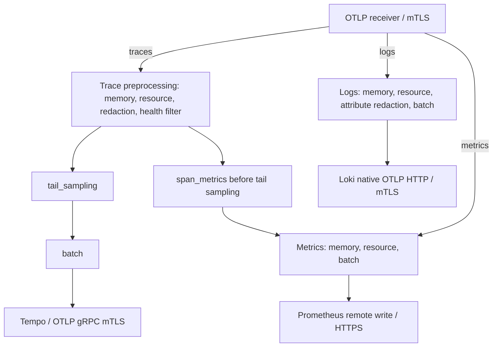

# OpenTelemetry

> **Versiones de referencia de la revisión**: Collector Contrib 0.160.0; Operator 0.158.0; versiones de los lenguajes indicadas más abajo
> **Última actualización**: 12 de octubre de 2026

## Introducción

OpenTelemetry (OTel) es un marco de observabilidad para software nativo de la nube. Define estándares independientes del proveedor para generar, recopilar y gestionar tres señales: trazas, métricas y registros. La retrospectiva de la CNCF del 24 de julio de 2026 lo situó después de Kubernetes por ritmo de contribuciones. La madurez del proyecto y la estabilidad de cada SDK o componente son aspectos distintos.

### Actualización de julio de 2026: graduación de la CNCF

OpenTelemetry alcanzó el nivel **graduated** de la CNCF en **mayo de 2026**; el artículo del 24 de julio repasa ese hito. Es el nivel de madurez más alto de la fundación, compartido por proyectos como Kubernetes y Prometheus. Indica que se han evaluado la gobernanza, las prácticas de seguridad y la adopción del proyecto para su uso en producción. El artículo aborda convenciones semánticas de IA generativa, observabilidad en navegadores y dispositivos móviles, gobernanza de esquemas y herramientas de despliegue. Consulte la publicación de la CNCF ["OpenTelemetry has graduated… Now what?"](https://www.cncf.io/blog/2026/07/24/opentelemetry-has-graduated-now-what/) para conocer el contexto y la hoja de ruta.

## ¿Qué es OpenTelemetry?

OpenTelemetry nació de la fusión de los proyectos OpenTracing y OpenCensus:


[🔍 Ver diagrama interactivo](https://www.atomai.click/kubernetes-docs/archmaps/en-observability-tracing-03-opentelemetry-0.html)

## Conceptos fundamentales

### Tres señales

Este capítulo se centra en trazas, métricas y registros. Los perfiles de rendimiento son otra señal en evolución; su compatibilidad y estabilidad dependen de la implementación. Para correlacionar los identificadores de trazas y registros o utilizar ejemplares de métricas, configure la instrumentación y el sistema de destino adecuados.

| Señal | Descripción | Casos de uso |
|--------|-------------|-----------|
| **Trazas** | Seguimiento distribuido de solicitudes | Análisis de latencia y mapa de dependencias |
| **Métricas** | Mediciones numéricas | Uso de recursos y SLI/SLO |
| **Registros** | Registros de eventos | Depuración y auditoría |

### Componentes fundamentales


[🔍 Ver diagrama interactivo](https://www.atomai.click/kubernetes-docs/archmaps/en-observability-tracing-03-opentelemetry-2.html)

La figura muestra los sistemas de destino disponibles para cada señal. Solo están activos los exportadores configurados; el ejemplo siguiente no habilita automáticamente todos los proveedores.


## SDK de OpenTelemetry

Collector, Operator, el agente de Java y los SDK de cada lenguaje tienen numeraciones de versión independientes. Estas plantillas de cargas de trabajo Linux se comprobaron con los esquemas de Kubernetes 1.35. Los equipos responsables deben preparar las imágenes de aplicación, los Namespace, los certificados y los Service de destino. La matriz general de Operator no elimina los requisitos específicos de cada ejemplo, como los sidecars nativos. Las comprobaciones locales no demuestran que la aplicación se haya desplegado en EKS.

| Componente | Versión de referencia y alcance |
|---|---|
| Collector Contrib independiente | 0.160.0; componentes y esquemas comprobados con su binario real |
| Operator | 0.158.0; su tabla de compatibilidad incluye Kubernetes 1.25–1.36 y cert-manager v1 |
| Agente de Java | 2.31.1, destinado al SDK 1.65.0; su versión difiere de la imagen Java predeterminada de Operator |
| Python | SDK/exportador 1.44.0 e instrumentation/distro 0.65b0; Python ≥3.10 |
| Ejemplo CommonJS de Node.js | SDK-node 0.220.0, auto-instrumentations-node 0.78.0, resources 2.9.0, API 1.9.1 |

Operator utiliza Collector 0.158.0 de forma predeterminada. Los ejemplos independientes con 0.160.0 no actualizan un Collector gestionado por Operator. Compruebe qué versiones admite tanto Operator como EKS; la versión más reciente de Kubernetes puede quedar fuera de la matriz de Operator.

### Instrumentación automática

El 12 de octubre de 2026, el soporte estándar de EKS incluye las versiones 1.34–1.37. La referencia de esquemas 1.35 está dentro de ese intervalo y de la matriz de Operator. Aun así, compruebe la aceptación real de la plataforma y sus complementos.

La instrumentación sin cambios de código se integra con bibliotecas compatibles; no descubre por sí sola cualquier operación de negocio. Para cada proceso, elija entre un agente o lanzador preparado directamente y la inyección mediante Operator. No inicialice otro SDK sobre un proveedor ya configurado. Las imágenes siguientes son marcadores de posición para sus propias compilaciones, incluidos los comandos de inicio y las dependencias.

Prepare el Namespace `ecommerce` y, dentro de él, el Secret `otel-client-tls` con `ca.crt`, `tls.crt` y `tls.key`. Collector debe aceptar el certificado del cliente, y su propio certificado debe corresponder a `otel-collector.otel.svc.cluster.local`. Los archivos del Secret se montan en modo de solo lectura; adapte los permisos de UID/GID a la imagen. Las variables de entorno contienen únicamente las **rutas** de los certificados, no las claves ni los tokens de acceso. Las plantillas utilizan OTLP HTTP/protobuf mediante TLS en el puerto 4318.

#### Instrumentación automática de Java

Descargue la versión fijada del agente durante la compilación de la aplicación y verifique la suma de comprobación del archivo publicado. El JAR 2.31.1 ocupa 25,107,554 bytes y supera el límite de 1 MiB de ConfigMap. Inclúyalo en la imagen o utilice la inyección de Operator; ConfigMap no sirve para distribuir ese binario.


```bash
curl --fail --location --output opentelemetry-javaagent.jar \
  https://github.com/open-telemetry/opentelemetry-java-instrumentation/releases/download/v2.31.1/opentelemetry-javaagent.jar
printf '%s  %s\n' \
  bbf83c151b6400709e2f225bdd07a04f839d9d13b8b93464241333fd25d3e3ba \
  opentelemetry-javaagent.jar | sha256sum --check -
```

```dockerfile
# Add to the application's existing Dockerfile; not a complete image build.
COPY opentelemetry-javaagent.jar /opt/otel/opentelemetry-javaagent.jar
```
Añada la opción del agente a los valores existentes de `JAVA_TOOL_OPTIONS`, conservando las opciones de JVM de la aplicación. El selector de Deployment debe coincidir con las etiquetas de los Pod.


```yaml
apiVersion: apps/v1
kind: Deployment
metadata:
  name: order-service
  namespace: ecommerce
spec:
  replicas: 1
  selector:
    matchLabels:
      app: order-service
  template:
    metadata:
      labels:
        app: order-service
    spec:
      automountServiceAccountToken: false
      securityContext:
        fsGroup: 10001
      containers:
      - name: app
        image: registry.example.com/order-service:otel-demo
        env:
        - name: OTEL_SERVICE_NAME
          value: order-service
        - name: OTEL_RESOURCE_ATTRIBUTES
          value: service.namespace=ecommerce,deployment.environment.name=demo
        - name: OTEL_EXPORTER_OTLP_ENDPOINT
          value: https://otel-collector.otel.svc.cluster.local:4318
        - name: OTEL_EXPORTER_OTLP_PROTOCOL
          value: http/protobuf
        - name: OTEL_EXPORTER_OTLP_CERTIFICATE
          value: /var/run/otel-client/ca.crt
        - name: OTEL_EXPORTER_OTLP_CLIENT_CERTIFICATE
          value: /var/run/otel-client/tls.crt
        - name: OTEL_EXPORTER_OTLP_CLIENT_KEY
          value: /var/run/otel-client/tls.key
        - name: OTEL_TRACES_EXPORTER
          value: otlp
        - name: OTEL_METRICS_EXPORTER
          value: otlp
        - name: OTEL_LOGS_EXPORTER
          value: none
        - name: OTEL_TRACES_SAMPLER
          value: parentbased_always_on
        - name: OTEL_METRIC_EXPORT_INTERVAL
          value: '60000'
        - name: JAVA_TOOL_OPTIONS
          value: -javaagent:/opt/otel/opentelemetry-javaagent.jar
        volumeMounts:
        - name: otel-client-tls
          mountPath: /var/run/otel-client
          readOnly: true
      volumes:
      - name: otel-client-tls
        secret:
          secretName: otel-client-tls
          defaultMode: 288
```
#### Instrumentación automática de Python

Para Flask, instale versiones compatibles de los paquetes en el entorno de compilación y fije las dependencias resueltas de la aplicación. Otros frameworks requieren su propio paquete de instrumentación. Este ejemplo selecciona el exportador HTTP explícitamente para evitar enviar el tráfico HTTP predeterminado de Python al puerto gRPC 4317.


```bash
python -m pip install \
  opentelemetry-api==1.44.0 opentelemetry-sdk==1.44.0 \
  opentelemetry-distro==0.65b0 \
  opentelemetry-instrumentation-flask==0.65b0 \
  opentelemetry-exporter-otlp-proto-http==1.44.0
```

```yaml
apiVersion: apps/v1
kind: Deployment
metadata:
  name: payment-service
  namespace: ecommerce
spec:
  replicas: 1
  selector:
    matchLabels:
      app: payment-service
  template:
    metadata:
      labels:
        app: payment-service
    spec:
      automountServiceAccountToken: false
      securityContext:
        fsGroup: 10001
      containers:
      - name: app
        image: registry.example.com/payment-service:otel-demo
        env:
        - name: OTEL_SERVICE_NAME
          value: payment-service
        - name: OTEL_RESOURCE_ATTRIBUTES
          value: service.namespace=ecommerce,deployment.environment.name=demo
        - name: OTEL_EXPORTER_OTLP_ENDPOINT
          value: https://otel-collector.otel.svc.cluster.local:4318
        - name: OTEL_EXPORTER_OTLP_PROTOCOL
          value: http/protobuf
        - name: OTEL_EXPORTER_OTLP_CERTIFICATE
          value: /var/run/otel-client/ca.crt
        - name: OTEL_EXPORTER_OTLP_CLIENT_CERTIFICATE
          value: /var/run/otel-client/tls.crt
        - name: OTEL_EXPORTER_OTLP_CLIENT_KEY
          value: /var/run/otel-client/tls.key
        - name: OTEL_TRACES_EXPORTER
          value: otlp
        - name: OTEL_METRICS_EXPORTER
          value: otlp
        - name: OTEL_LOGS_EXPORTER
          value: none
        - name: OTEL_TRACES_SAMPLER
          value: parentbased_always_on
        - name: OTEL_METRIC_EXPORT_INTERVAL
          value: '60000'
        volumeMounts:
        - name: otel-client-tls
          mountPath: /var/run/otel-client
          readOnly: true
        command:
        - opentelemetry-instrument
        - python
        - app.py
      volumes:
      - name: otel-client-tls
        secret:
          secretName: otel-client-tls
          defaultMode: 288
```
#### Instrumentación automática de Node.js


```bash
npm install --save-exact \
  @opentelemetry/api@1.9.1 @opentelemetry/resources@2.9.0 \
  @opentelemetry/sdk-node@0.220.0 \
  @opentelemetry/auto-instrumentations-node@0.78.0
# Commit package-lock.json and use npm ci for subsequent application builds.
```
Guarde el archivo como `tracing.cjs` y cárguelo antes de los módulos de la aplicación y del framework. El ejemplo utiliza CommonJS; para ESM, siga la configuración específica de la guía del lenguaje. El SDK lee las variables OTEL de exportación y TLS indicadas a continuación. La configuración actual de lectores de métricas creados mediante código utiliza `metricReaders`, en lugar de la opción singular obsoleta. Integre `shutdownTelemetry()` después de que la aplicación haya terminado de atender las solicitudes pendientes.


```javascript
// Load before application/framework modules in a CommonJS application.
const { NodeSDK } = require('@opentelemetry/sdk-node');
const { envDetector } = require('@opentelemetry/resources');
const { getNodeAutoInstrumentations } = require('@opentelemetry/auto-instrumentations-node');

const sdk = new NodeSDK({
  resourceDetectors: [envDetector],
  instrumentations: [
    getNodeAutoInstrumentations({
      '@opentelemetry/instrumentation-fs': { enabled: false },
      '@opentelemetry/instrumentation-http': {
        ignoreIncomingRequestHook: (request) =>
          String(request.url || '').split('?')[0] === '/health',
      },
    }),
  ],
});

// OTEL_* variables configure exporters, protocol, TLS and metric interval.
sdk.start();

// Call after the application's own request-draining step on shutdown.
module.exports = { shutdownTelemetry: () => sdk.shutdown() };
```

```yaml
apiVersion: apps/v1
kind: Deployment
metadata:
  name: notification-service
  namespace: ecommerce
spec:
  replicas: 1
  selector:
    matchLabels:
      app: notification-service
  template:
    metadata:
      labels:
        app: notification-service
    spec:
      automountServiceAccountToken: false
      securityContext:
        fsGroup: 10001
      containers:
      - name: app
        image: registry.example.com/notification-service:otel-demo
        env:
        - name: OTEL_SERVICE_NAME
          value: notification-service
        - name: OTEL_RESOURCE_ATTRIBUTES
          value: service.namespace=ecommerce,deployment.environment.name=demo
        - name: OTEL_EXPORTER_OTLP_ENDPOINT
          value: https://otel-collector.otel.svc.cluster.local:4318
        - name: OTEL_EXPORTER_OTLP_PROTOCOL
          value: http/protobuf
        - name: OTEL_EXPORTER_OTLP_CERTIFICATE
          value: /var/run/otel-client/ca.crt
        - name: OTEL_EXPORTER_OTLP_CLIENT_CERTIFICATE
          value: /var/run/otel-client/tls.crt
        - name: OTEL_EXPORTER_OTLP_CLIENT_KEY
          value: /var/run/otel-client/tls.key
        - name: OTEL_TRACES_EXPORTER
          value: otlp
        - name: OTEL_METRICS_EXPORTER
          value: otlp
        - name: OTEL_LOGS_EXPORTER
          value: none
        - name: OTEL_TRACES_SAMPLER
          value: parentbased_always_on
        - name: OTEL_METRIC_EXPORT_INTERVAL
          value: '60000'
        volumeMounts:
        - name: otel-client-tls
          mountPath: /var/run/otel-client
          readOnly: true
        command:
        - node
        - --require
        - ./tracing.cjs
        - app.cjs
      volumes:
      - name: otel-client-tls
        secret:
          secretName: otel-client-tls
          defaultMode: 288
```
Estos ejemplos configuran `OTEL_LOGS_EXPORTER=none` de forma deliberada. Habilitar un exportador de registros no recopila automáticamente stdout de la aplicación. Instale la integración de registro correspondiente o un recopilador y revise antes qué datos se expondrán. El muestreador `parentbased_always_on` respeta la decisión de no muestrear del tramo padre. Si opta por un muestreo inicial del 10 %, el Collector que aplica muestreo al final no podrá recuperar los tramos descartados.

### Instrumentación manual

Reutilice la instancia o el proveedor de OpenTelemetry inicializado por el agente o la aplicación. Sin un proveedor de SDK, las llamadas a la API pueden no tener efecto. Los tramos de estas operaciones de negocio son INTERNAL. Los clientes HTTP y de bases de datos instrumentados crean sus propios tramos CLIENT y propagan el contexto. Crear manualmente un tramo CLIENT no envía una solicitud ni inyecta el contexto de la traza.

#### Instrumentación manual de Java

La aplicación proporciona las funciones de inventario y pago. No se registran identificadores de pedidos, clientes o transacciones, importes ni mensajes de excepción completos. El ejemplo instrumenta operaciones de la aplicación; no implementa un servicio de pagos ni demuestra un despliegue probado de Spring.


```java
import io.opentelemetry.api.OpenTelemetry;
import io.opentelemetry.api.trace.Span;
import io.opentelemetry.api.trace.SpanKind;
import io.opentelemetry.api.trace.StatusCode;
import io.opentelemetry.api.trace.Tracer;
import io.opentelemetry.context.Scope;

public final class OrderTelemetry {
    private final Tracer tracer;

    public OrderTelemetry(OpenTelemetry telemetry) {
        this.tracer = telemetry.getTracer("example.order-workflow", "1.0.0");
    }

    public void processOrder(Runnable validateInventory, Runnable processPayment) {
        Span parent = tracer.spanBuilder("processOrder")
                .setSpanKind(SpanKind.INTERNAL).startSpan();
        try (Scope ignored = parent.makeCurrent()) {
            parent.addEvent("validation.started");
            child("checkInventory", validateInventory);
            child("processPayment", processPayment);
            parent.addEvent("processing.completed");
        } catch (RuntimeException error) {
            parent.setStatus(StatusCode.ERROR);
            parent.setAttribute("error.type", error.getClass().getName());
            throw error;
        } finally {
            parent.end();
        }
    }

    private void child(String name, Runnable operation) {
        Span span = tracer.spanBuilder(name).setSpanKind(SpanKind.INTERNAL).startSpan();
        try (Scope ignored = span.makeCurrent()) {
            operation.run();
        } catch (RuntimeException error) {
            span.setStatus(StatusCode.ERROR);
            span.setAttribute("error.type", error.getClass().getName());
            throw error;
        } finally {
            span.end();
        }
    }
}
```
#### Instrumentación manual de Python

El decorador síncrono conserva los resultados y errores y cierra los tramos anidados. Registra únicamente el tipo de error para evitar duplicar eventos con excepciones completas. Una función asíncrona requiere un envoltorio que admita ese comportamiento. Proporcione sus propias funciones de consulta parametrizada de base de datos, validación, persistencia y publicación de eventos. La validación local utilizó funciones sintéticas y un exportador en memoria.


```python
"""Manual spans for synchronous application callbacks; no database is created."""
from functools import wraps
from contextlib import contextmanager
from opentelemetry import trace
from opentelemetry.trace import SpanKind, Status, StatusCode

# Reuse the SDK provider initialized by auto-instrumentation or the application.
tracer = trace.get_tracer("example.user-workflow", "1.0.0")

@contextmanager
def operation(name):
    with tracer.start_as_current_span(
        name, kind=SpanKind.INTERNAL,
        record_exception=False, set_status_on_exception=False,
    ) as span:
        try:
            yield span
        except Exception as error:
            span.set_status(Status(StatusCode.ERROR))
            span.set_attribute("error.type", type(error).__name__)
            raise

def traced(name):
    def decorate(function):
        @wraps(function)
        def wrapped(*args, **kwargs):
            with operation(name):
                return function(*args, **kwargs)
        return wrapped
    return decorate

@traced("get_user")
def get_user(user_id, lookup):
    # lookup is supplied by the application, with parameterized queries.
    # The ID and SQL text are not added to telemetry.
    with operation("lookup_user"):
        result = lookup(user_id)
    trace.get_current_span().set_attribute("app.user.found", result is not None)
    return result

@traced("create_user")
def create_user(user_data, validate, save, publish):
    # These callbacks are the application's own implementations.
    with operation("validate_user_data"):
        validate(user_data)
    with operation("save_user"):
        result = save(user_data)
    with operation("publish_user_event"):
        publish(result)
    return result
```
Para instrumentar bases de datos y mensajería reales, siga la versión de convenciones que implemente, incluidos atributos como `db.system.name`, `db.operation.name` y `messaging.destination.name`. No copie identificadores de usuario a las cadenas de telemetría SQL ni utilice consultas completas como etiquetas de métricas. Las funciones de negocio anteriores no prueban que se hayan ejecutado operaciones en PostgreSQL o Kafka.

## OTEL Collector

### Arquitectura




Rutas de las señales en la configuración siguiente. El bloque de preprocesamiento de trazas resume operaciones equivalentes en dos canalizaciones independientes. La generación de métricas a partir de tramos se separa antes del muestreo final. Las métricas y los registros entrantes siguen sus propias canalizaciones.

### Configuración de Collector

Guarde la configuración como `otel-collector-config.yaml`. El laboratorio utiliza una sola instancia activa para el muestreo y la agregación con estado; no demuestra alta disponibilidad ni capacidad suficiente. Otra canalización de trazas genera métricas **antes del muestreo final**. Los tramos descartados por el muestreo inicial o por filtros tampoco llegan a esas métricas. Los contadores miden tramos observados, no solicitudes únicas de usuarios. Para los SLI de solicitudes, elija tipos de tramo adecuados y dimensiones acotadas. En 0.160.0, los contadores acumulativos derivados de tramos exportan inicialmente cero. Revise los envíos posteriores antes de interpretar ese primer valor como ausencia de tráfico.

Prepare Tempo con OTLP habilitado, un receptor de remote-write compatible con Prometheus y la ingesta OTLP nativa de Loki. El equipo responsable debe proporcionar las puertas de enlace con TLS y autenticación. Los nombres del ejemplo no corresponden a Service creados por esta guía. Si utiliza Prometheus directamente, habilite su receptor de remote-write con `--web.enable-remote-write-receiver`. La URL base del exportador de Loki termina en `/otlp`; el exportador HTTP añade `/v1/logs`. Configure los metadatos estructurados de Loki y la asignación de inquilinos de confianza que necesite. Una cabecera de inquilino no autentica al cliente.

Las variables de entorno indican certificados y puntos de conexión ya existentes. Todos los receptores configurados utilizan TLS mutuo. No se habilitan orígenes CORS indiscriminados ni un punto público de acceso a perfiles. Eliminar los atributos indicados solo cubre esos campos; no suprime todos los datos sensibles de los registros, eventos de tramo, atributos de recursos o contenido arbitrario. Reduzca también los datos que recoge el SDK.


```yaml
# otel-collector-config.yaml
receivers:
  otlp:
    protocols:
      grpc:
        endpoint: 0.0.0.0:4317
        max_recv_msg_size_mib: 16
        tls:
          cert_file: ${env:OTEL_SERVER_CERT}
          key_file: ${env:OTEL_SERVER_KEY}
          client_ca_file: ${env:OTEL_CLIENT_CA}
      http:
        endpoint: 0.0.0.0:4318
        tls:
          cert_file: ${env:OTEL_SERVER_CERT}
          key_file: ${env:OTEL_SERVER_KEY}
          client_ca_file: ${env:OTEL_CLIENT_CA}

processors:
  memory_limiter:
    check_interval: 1s
    limit_mib: 384
    spike_limit_mib: 96
  resource/cluster:
    attributes:
      - key: k8s.cluster.name
        value: ${env:K8S_CLUSTER_NAME}
        action: insert
  attributes/redact:
    actions:
      - key: http.request.header.authorization
        action: delete
      - key: user.email
        action: delete
      - key: user.id
        action: delete
      - key: customer.id
        action: delete
      - key: db.statement
        action: delete
      - key: db.query.text
        action: delete
  filter/health:
    error_mode: propagate
    traces:
      span:
        - 'attributes["http.route"] == "/health"'
        - 'attributes["http.route"] == "/ready"'
        - 'attributes["http.route"] == "/metrics"'
  tail_sampling:
    decision_wait: 10s
    num_traces: 10000
    expected_new_traces_per_sec: 100
    policies:
      - name: errors
        type: status_code
        status_code:
          status_codes: [ERROR]
      - name: slow
        type: latency
        latency:
          threshold_ms: 1000
      - name: selected-services
        type: string_attribute
        string_attribute:
          key: service.name
          values: [payment-service, order-service]
      - name: baseline
        type: probabilistic
        probabilistic:
          sampling_percentage: 10
  batch:
    timeout: 5s
    send_batch_size: 512
    send_batch_max_size: 1024

connectors:
  span_metrics:
    histogram:
      unit: s
      explicit:
        buckets: [5ms, 10ms, 25ms, 50ms, 100ms, 250ms, 500ms, 1s, 2s, 5s]
    dimensions:
      - name: http.request.method
      - name: http.response.status_code
    aggregation_cardinality_limit: 1000
    metrics_flush_interval: 15s

exporters:
  otlp_grpc/tempo:
    endpoint: ${env:TEMPO_OTLP_GRPC_ENDPOINT}
    tls:
      ca_file: ${env:BACKEND_CA}
      cert_file: ${env:BACKEND_CLIENT_CERT}
      key_file: ${env:BACKEND_CLIENT_KEY}
  prometheus_remote_write:
    endpoint: ${env:PROMETHEUS_REMOTE_WRITE_ENDPOINT}
    tls:
      ca_file: ${env:BACKEND_CA}
      cert_file: ${env:BACKEND_CLIENT_CERT}
      key_file: ${env:BACKEND_CLIENT_KEY}
  otlp_http/loki:
    endpoint: ${env:LOKI_OTLP_HTTP_ENDPOINT}
    tls:
      ca_file: ${env:BACKEND_CA}
      cert_file: ${env:BACKEND_CLIENT_CERT}
      key_file: ${env:BACKEND_CLIENT_KEY}

extensions:
  health_check:
    endpoint: 0.0.0.0:13133
    path: /health

service:
  extensions: [health_check]
  pipelines:
    traces:
      receivers: [otlp]
      processors: [memory_limiter, resource/cluster, attributes/redact, filter/health, tail_sampling, batch]
      exporters: [otlp_grpc/tempo]
    traces/span-metrics:
      receivers: [otlp]
      processors: [memory_limiter, resource/cluster, attributes/redact, filter/health]
      exporters: [span_metrics]
    metrics:
      receivers: [otlp, span_metrics]
      processors: [memory_limiter, resource/cluster, batch]
      exporters: [prometheus_remote_write]
    logs:
      receivers: [otlp]
      processors: [memory_limiter, resource/cluster, attributes/redact, batch]
      exporters: [otlp_http/loki]
  telemetry:
    logs:
      level: info
      encoding: json
    metrics:
      readers:
        - pull:
            exporter:
              prometheus:
                host: 127.0.0.1
                port: 8888
```
Las reglas positivas de muestreo se combinan mediante OR; no forman una lista de prioridades. Los servicios seleccionados pueden conservarse independientemente de la probabilidad de referencia. La regla de latencia compara estrictamente `>1000 ms`. Decidir tras un temporizador no demuestra que la traza esté completa. El filtro de salud elimina los tramos coincidentes incluso si contienen errores; filtrar tramos individuales puede dejar trazas parciales.

El límite de memoria máximo es 384 MiB y el umbral de rechazo preventivo es 288 MiB, con margen respecto al límite de 512 MiB del contenedor. Mida todavía el rechazo de datos, los reintentos, las colas y las ráfagas. Los límites de lotes, trazas y cardinalidad son ajustes de demostración, no resultados de pruebas de rendimiento.

### Carga de trabajo y configuración de instancia única

Prepare el Namespace `otel` y los Secret `otel-ingest-tls` / `otel-backend-tls` con `tls.crt`, `tls.key` y `ca.crt`. Los SAN de los certificados deben coincidir con los nombres de los Service o las puertas de enlace correspondientes. Utilice un conjunto adecuado de certificados de confianza y los usos de servidor o cliente correctos. Adapte los permisos de acceso a UID/GID 10001. ConfigMap contiene texto de configuración, no claves privadas. `Recreate` evita que coincidan dos instancias durante una actualización normal de este muestreador, a costa de una interrupción. No conserva las trazas en memoria tras reinicios.


```bash
: "${KUBE_CONTEXT:?Set the reviewed cluster context}"
kubectl --context "$KUBE_CONTEXT" -n otel create configmap otel-collector-config \
  --from-file=otel-collector-config.yaml --dry-run=client -o yaml > otel-collector-configmap.yaml
# Inspect the namespace, Secrets, endpoints and workloads before any real apply.
```

```yaml
apiVersion: v1
kind: ServiceAccount
metadata:
  name: otel-collector
  namespace: otel
automountServiceAccountToken: false
---
apiVersion: apps/v1
kind: Deployment
metadata:
  name: otel-collector
  namespace: otel
spec:
  selector:
    matchLabels:
      app: otel-collector
  template:
    metadata:
      labels:
        app: otel-collector
    spec:
      serviceAccountName: otel-collector
      automountServiceAccountToken: false
      nodeSelector:
        kubernetes.io/os: linux
      securityContext:
        runAsNonRoot: true
        runAsUser: 10001
        fsGroup: 10001
        seccompProfile:
          type: RuntimeDefault
      containers:
      - name: collector
        image: otel/opentelemetry-collector-contrib:0.160.0
        args:
        - --config=/conf/otel-collector-config.yaml
        env:
        - name: GOMEMLIMIT
          value: 384MiB
        - name: OTEL_SERVER_CERT
          value: /var/run/otel/ingest/tls.crt
        - name: OTEL_SERVER_KEY
          value: /var/run/otel/ingest/tls.key
        - name: OTEL_CLIENT_CA
          value: /var/run/otel/ingest/ca.crt
        - name: BACKEND_CA
          value: /var/run/otel/backend/ca.crt
        - name: BACKEND_CLIENT_CERT
          value: /var/run/otel/backend/tls.crt
        - name: BACKEND_CLIENT_KEY
          value: /var/run/otel/backend/tls.key
        - name: OTEL_UPSTREAM_ENDPOINT
          value: otel-collector.otel.svc.cluster.local:4317
        - name: K8S_CLUSTER_NAME
          value: REPLACE_WITH_CLUSTER_NAME
        - name: TEMPO_OTLP_GRPC_ENDPOINT
          value: tempo-gateway.tempo.svc.cluster.local:4317
        - name: PROMETHEUS_REMOTE_WRITE_ENDPOINT
          value: https://prometheus-gateway.monitoring.svc.cluster.local/api/v1/write
        - name: LOKI_OTLP_HTTP_ENDPOINT
          value: https://loki-gateway.loki.svc.cluster.local/otlp
        ports:
        - name: otlp-grpc
          containerPort: 4317
        - name: otlp-http
          containerPort: 4318
        resources:
          requests:
            cpu: 100m
            memory: 256Mi
          limits:
            cpu: 500m
            memory: 512Mi
        securityContext:
          allowPrivilegeEscalation: false
          readOnlyRootFilesystem: true
          capabilities:
            drop:
            - ALL
        volumeMounts:
        - name: config
          mountPath: /conf
          readOnly: true
        - name: ingest-tls
          mountPath: /var/run/otel/ingest
          readOnly: true
        - name: backend-tls
          mountPath: /var/run/otel/backend
          readOnly: true
        readinessProbe:
          httpGet:
            path: /health
            port: 13133
        livenessProbe:
          httpGet:
            path: /health
            port: 13133
          initialDelaySeconds: 15
      volumes:
      - name: config
        configMap:
          name: otel-collector-config
      - name: ingest-tls
        secret:
          secretName: otel-ingest-tls
          defaultMode: 288
      - name: backend-tls
        secret:
          secretName: otel-backend-tls
          defaultMode: 288
  replicas: 1
  strategy:
    type: Recreate
---
apiVersion: v1
kind: Service
metadata:
  name: otel-collector
  namespace: otel
spec:
  type: ClusterIP
  selector:
    app: otel-collector
  ports:
  - name: otlp-grpc
    port: 4317
    targetPort: otlp-grpc
  - name: otlp-http
    port: 4318
    targetPort: otlp-http
```
### Recopilación y enriquecimiento opcionales

| Requisito | Configuración adicional necesaria |
|---|---|
| Clientes Jaeger/Zipkin heredados | Sus receptores siguen disponibles. Habilite solo los protocolos y puertos necesarios y conecte los ID de receptor a una canalización. Exporte a Jaeger mediante OTLP; el exportador Jaeger se eliminó. |
| Métricas propias de Collector | `service.telemetry.metrics.readers` configura el lector Prometheus actual. El antiguo campo `address` se eliminó. Recopile las métricas del punto de conexión local mediante una ruta de supervisión diseñada para ello. |
| Métricas del clúster de Kubernetes | Ejecute un solo receptor `k8s_cluster` activo o configure su extensión de elección de líder. Proporcione credenciales de API y permisos RBAC revisados, y conecte el receptor a una canalización de métricas. Las cargas anteriores, que no montan tokens, no proporcionan esos requisitos. |
| Registros de nodos o contenedores y métricas del host | Añada el receptor, los montajes y los permisos adecuados. Un DaemonSet por sí solo no recopila esos datos. |
| Detección de recursos EC2/EKS | Configure el detector deseado y su acceso a metadatos o API de forma explícita. No sustituya la identidad de la carga por la del host de Collector. |
| Métricas derivadas de tramos | Utilice el conector `span_metrics`, con una unidad de duración explícita y dimensiones acotadas. El antiguo procesador spanmetrics se eliminó. |

Consulte la [guía de recopiladores](../logging/05-collectors.md) y el [receptor de métricas del clúster de Kubernetes](https://github.com/open-telemetry/opentelemetry-collector-contrib/tree/v0.160.0/receiver/k8sclusterreceiver). Declarar un receptor o procesador sin conectarlo a una canalización no lo activa.

## Patrones de despliegue de EKS

Estos patrones de despliegue son alternativas que debe elegir según el entorno. Un retransmisor sin estado envía las tres señales a la instancia de muestreo anterior. No coloque el muestreo final ni la agregación de tramos en una capa de nodos, sidecars o HPA que reparta el tráfico arbitrariamente. Varias instancias de muestreo requieren enrutamiento por ID de traza y un plan para los cambios de puntos de conexión, las trazas en curso, los reinicios y el almacenamiento. Un Service o HPA por sí solo no resuelve esas condiciones.

Guarde `otel-relay-config.yaml` y genere `otel-relay-config` mediante el mismo procedimiento de ConfigMap en el cliente. `OTEL_UPSTREAM_ENDPOINT` y el certificado del cliente identifican el Collector de destino que debe preparar por separado. El retransmisor no mantiene decisiones de muestreo, pero sus lotes y colas de exportación en memoria siguen sujetos a pérdidas por fallos y a límites durante el apagado.


```yaml
receivers:
  otlp:
    protocols:
      grpc:
        endpoint: 0.0.0.0:4317
        max_recv_msg_size_mib: 16
        tls:
          cert_file: ${env:OTEL_SERVER_CERT}
          key_file: ${env:OTEL_SERVER_KEY}
          client_ca_file: ${env:OTEL_CLIENT_CA}
      http:
        endpoint: 0.0.0.0:4318
        tls:
          cert_file: ${env:OTEL_SERVER_CERT}
          key_file: ${env:OTEL_SERVER_KEY}
          client_ca_file: ${env:OTEL_CLIENT_CA}
processors:
  memory_limiter:
    check_interval: 1s
    limit_mib: 384
    spike_limit_mib: 96
  batch:
    timeout: 5s
    send_batch_size: 512
    send_batch_max_size: 1024
exporters:
  otlp_grpc/upstream:
    endpoint: ${env:OTEL_UPSTREAM_ENDPOINT}
    tls:
      ca_file: ${env:BACKEND_CA}
      cert_file: ${env:BACKEND_CLIENT_CERT}
      key_file: ${env:BACKEND_CLIENT_KEY}
extensions:
  health_check:
    endpoint: 0.0.0.0:13133
    path: /health
service:
  extensions:
  - health_check
  pipelines:
    traces:
      receivers:
      - otlp
      processors:
      - memory_limiter
      - batch
      exporters:
      - otlp_grpc/upstream
    metrics:
      receivers:
      - otlp
      processors:
      - memory_limiter
      - batch
      exporters:
      - otlp_grpc/upstream
    logs:
      receivers:
      - otlp
      processors:
      - memory_limiter
      - batch
      exporters:
      - otlp_grpc/upstream
  telemetry:
    logs:
      level: info
      encoding: json
    metrics:
      readers:
      - pull:
          exporter:
            prometheus:
              host: 127.0.0.1
              port: 8888
```
### Patrón DaemonSet

Un DaemonSet se ejecuta en nodos Linux aptos; no puede ejecutarse en EKS Fargate. Configure selectores y tolerancias para los nodos autorizados. El ejemplo no tolera todas las taints ni reserva hostPort. Con `internalTrafficPolicy: Local`, el Service dirige el tráfico únicamente a un destino listo en el mismo nodo que el cliente; si no lo hay, descarta el tráfico. No ofrece una ruta alternativa para clientes Fargate. Las aplicaciones deben enviar la telemetría explícitamente a este punto de conexión.


```yaml
apiVersion: apps/v1
kind: DaemonSet
metadata:
  name: otel-agent
  namespace: otel
spec:
  selector:
    matchLabels:
      app: otel-agent
  template:
    metadata:
      labels:
        app: otel-agent
    spec:
      serviceAccountName: otel-collector
      automountServiceAccountToken: false
      nodeSelector:
        kubernetes.io/os: linux
      securityContext:
        runAsNonRoot: true
        runAsUser: 10001
        fsGroup: 10001
        seccompProfile:
          type: RuntimeDefault
      containers:
      - name: collector
        image: otel/opentelemetry-collector-contrib:0.160.0
        args:
        - --config=/conf/otel-relay-config.yaml
        env:
        - name: GOMEMLIMIT
          value: 384MiB
        - name: OTEL_SERVER_CERT
          value: /var/run/otel/ingest/tls.crt
        - name: OTEL_SERVER_KEY
          value: /var/run/otel/ingest/tls.key
        - name: OTEL_CLIENT_CA
          value: /var/run/otel/ingest/ca.crt
        - name: BACKEND_CA
          value: /var/run/otel/backend/ca.crt
        - name: BACKEND_CLIENT_CERT
          value: /var/run/otel/backend/tls.crt
        - name: BACKEND_CLIENT_KEY
          value: /var/run/otel/backend/tls.key
        - name: OTEL_UPSTREAM_ENDPOINT
          value: otel-collector.otel.svc.cluster.local:4317
        ports:
        - name: otlp-grpc
          containerPort: 4317
        - name: otlp-http
          containerPort: 4318
        resources:
          requests:
            cpu: 100m
            memory: 256Mi
          limits:
            cpu: 500m
            memory: 512Mi
        securityContext:
          allowPrivilegeEscalation: false
          readOnlyRootFilesystem: true
          capabilities:
            drop:
            - ALL
        volumeMounts:
        - name: config
          mountPath: /conf
          readOnly: true
        - name: ingest-tls
          mountPath: /var/run/otel/ingest
          readOnly: true
        - name: backend-tls
          mountPath: /var/run/otel/backend
          readOnly: true
        readinessProbe:
          httpGet:
            path: /health
            port: 13133
        livenessProbe:
          httpGet:
            path: /health
            port: 13133
          initialDelaySeconds: 15
      volumes:
      - name: config
        configMap:
          name: otel-relay-config
      - name: ingest-tls
        secret:
          secretName: otel-ingest-tls
          defaultMode: 288
      - name: backend-tls
        secret:
          secretName: otel-backend-tls
          defaultMode: 288
---
apiVersion: v1
kind: Service
metadata:
  name: otel-agent
  namespace: otel
spec:
  type: ClusterIP
  selector:
    app: otel-agent
  ports:
  - name: otlp-grpc
    port: 4317
    targetPort: otlp-grpc
  - name: otlp-http
    port: 4318
    targetPort: otlp-http
  internalTrafficPolicy: Local
```
### Patrón Sidecar

Prepare un ConfigMap `otel-sidecar-config` independiente con la configuración siguiente. El receptor OTLP sin cifrar en loopback solo lo utiliza el mismo Pod; la conexión con el Collector de destino utiliza TLS mutuo. El sidecar tiene 256 MiB disponibles, con un límite máximo de 192 MiB y un umbral preventivo de 144 MiB. La imagen de la aplicación debe incluir el SDK o agente elegido; definir un punto de conexión no añade instrumentación. El ejemplo, comprobado con esquemas de Kubernetes 1.35, utiliza un sidecar nativo mediante `initContainers` con `restartPolicy: Always`, disponible de forma general desde 1.33. Su comprobación de inicio precede al arranque de la aplicación. Durante un apagado normal, los contenedores de aplicación se detienen antes que el sidecar. Compruebe por separado la entrega al sistema de destino y la recuperación tras fallos abruptos.


```yaml
receivers:
  otlp:
    protocols:
      grpc:
        endpoint: 127.0.0.1:4317
      http:
        endpoint: 127.0.0.1:4318
processors:
  memory_limiter:
    check_interval: 1s
    limit_mib: 192
    spike_limit_mib: 48
  batch:
    timeout: 5s
    send_batch_size: 512
    send_batch_max_size: 1024
exporters:
  otlp_grpc/upstream:
    endpoint: ${env:OTEL_UPSTREAM_ENDPOINT}
    tls:
      ca_file: ${env:BACKEND_CA}
      cert_file: ${env:BACKEND_CLIENT_CERT}
      key_file: ${env:BACKEND_CLIENT_KEY}
extensions:
  health_check:
    endpoint: 0.0.0.0:13133
    path: /health
service:
  extensions:
  - health_check
  pipelines:
    traces:
      receivers:
      - otlp
      processors:
      - memory_limiter
      - batch
      exporters:
      - otlp_grpc/upstream
    metrics:
      receivers:
      - otlp
      processors:
      - memory_limiter
      - batch
      exporters:
      - otlp_grpc/upstream
    logs:
      receivers:
      - otlp
      processors:
      - memory_limiter
      - batch
      exporters:
      - otlp_grpc/upstream
  telemetry:
    logs:
      level: info
      encoding: json
    metrics:
      readers:
      - pull:
          exporter:
            prometheus:
              host: 127.0.0.1
              port: 8888
```

```yaml
apiVersion: apps/v1
kind: Deployment
metadata:
  name: order-with-sidecar
  namespace: otel
spec:
  selector:
    matchLabels:
      app: order-with-sidecar
  template:
    metadata:
      labels:
        app: order-with-sidecar
    spec:
      serviceAccountName: otel-collector
      automountServiceAccountToken: false
      nodeSelector:
        kubernetes.io/os: linux
      securityContext:
        runAsNonRoot: true
        runAsUser: 10001
        fsGroup: 10001
        seccompProfile:
          type: RuntimeDefault
      containers:
      - name: app
        image: registry.example.com/order-service:otel-demo
        env:
        - name: OTEL_SERVICE_NAME
          value: order-service
        - name: OTEL_EXPORTER_OTLP_ENDPOINT
          value: http://127.0.0.1:4318
        - name: OTEL_EXPORTER_OTLP_PROTOCOL
          value: http/protobuf
      volumes:
      - name: config
        configMap:
          name: otel-sidecar-config
      - name: backend-tls
        secret:
          secretName: otel-backend-tls
          defaultMode: 288
      initContainers:
      - name: collector
        image: otel/opentelemetry-collector-contrib:0.160.0
        args:
        - --config=/conf/otel-sidecar-config.yaml
        env:
        - name: GOMEMLIMIT
          value: 192MiB
        - name: BACKEND_CA
          value: /var/run/otel/backend/ca.crt
        - name: BACKEND_CLIENT_CERT
          value: /var/run/otel/backend/tls.crt
        - name: BACKEND_CLIENT_KEY
          value: /var/run/otel/backend/tls.key
        - name: OTEL_UPSTREAM_ENDPOINT
          value: otel-collector.otel.svc.cluster.local:4317
        ports:
        - name: otlp-grpc
          containerPort: 4317
        - name: otlp-http
          containerPort: 4318
        resources:
          requests:
            cpu: 100m
            memory: 64Mi
          limits:
            cpu: 500m
            memory: 256Mi
        securityContext:
          allowPrivilegeEscalation: false
          readOnlyRootFilesystem: true
          capabilities:
            drop:
            - ALL
        volumeMounts:
        - name: config
          mountPath: /conf
          readOnly: true
        - name: backend-tls
          mountPath: /var/run/otel/backend
          readOnly: true
        readinessProbe:
          httpGet:
            path: /health
            port: 13133
        livenessProbe:
          httpGet:
            path: /health
            port: 13133
          initialDelaySeconds: 15
        restartPolicy: Always
        startupProbe:
          httpGet:
            path: /health
            port: 13133
          periodSeconds: 2
          failureThreshold: 30
  replicas: 1
```
### Patrón Gateway

Este HPA escala el **retransmisor** sin estado, no el muestreador con estado. Prepare Metrics Server, solicitudes de recursos y capacidad suficiente. Las tres réplicas, la antiafinidad preferida y el intervalo 3–10 son decisiones ilustrativas; no demuestran alta disponibilidad ni capacidad de procesamiento. Antes de utilizar recopiladores basados en Deployment en Fargate o Auto Mode, compruebe sus requisitos de ejecución, almacenamiento, red y receptores.


```yaml
apiVersion: apps/v1
kind: Deployment
metadata:
  name: otel-relay
  namespace: otel
spec:
  selector:
    matchLabels:
      app: otel-relay
  template:
    metadata:
      labels:
        app: otel-relay
    spec:
      serviceAccountName: otel-collector
      automountServiceAccountToken: false
      nodeSelector:
        kubernetes.io/os: linux
      securityContext:
        runAsNonRoot: true
        runAsUser: 10001
        fsGroup: 10001
        seccompProfile:
          type: RuntimeDefault
      containers:
      - name: collector
        image: otel/opentelemetry-collector-contrib:0.160.0
        args:
        - --config=/conf/otel-relay-config.yaml
        env:
        - name: GOMEMLIMIT
          value: 384MiB
        - name: OTEL_SERVER_CERT
          value: /var/run/otel/ingest/tls.crt
        - name: OTEL_SERVER_KEY
          value: /var/run/otel/ingest/tls.key
        - name: OTEL_CLIENT_CA
          value: /var/run/otel/ingest/ca.crt
        - name: BACKEND_CA
          value: /var/run/otel/backend/ca.crt
        - name: BACKEND_CLIENT_CERT
          value: /var/run/otel/backend/tls.crt
        - name: BACKEND_CLIENT_KEY
          value: /var/run/otel/backend/tls.key
        - name: OTEL_UPSTREAM_ENDPOINT
          value: otel-collector.otel.svc.cluster.local:4317
        ports:
        - name: otlp-grpc
          containerPort: 4317
        - name: otlp-http
          containerPort: 4318
        resources:
          requests:
            cpu: 100m
            memory: 256Mi
          limits:
            cpu: 500m
            memory: 512Mi
        securityContext:
          allowPrivilegeEscalation: false
          readOnlyRootFilesystem: true
          capabilities:
            drop:
            - ALL
        volumeMounts:
        - name: config
          mountPath: /conf
          readOnly: true
        - name: ingest-tls
          mountPath: /var/run/otel/ingest
          readOnly: true
        - name: backend-tls
          mountPath: /var/run/otel/backend
          readOnly: true
        readinessProbe:
          httpGet:
            path: /health
            port: 13133
        livenessProbe:
          httpGet:
            path: /health
            port: 13133
          initialDelaySeconds: 15
      volumes:
      - name: config
        configMap:
          name: otel-relay-config
      - name: ingest-tls
        secret:
          secretName: otel-ingest-tls
          defaultMode: 288
      - name: backend-tls
        secret:
          secretName: otel-backend-tls
          defaultMode: 288
      affinity:
        podAntiAffinity:
          preferredDuringSchedulingIgnoredDuringExecution:
          - weight: 100
            podAffinityTerm:
              labelSelector:
                matchLabels:
                  app: otel-relay
              topologyKey: kubernetes.io/hostname
  replicas: 3
---
apiVersion: v1
kind: Service
metadata:
  name: otel-relay
  namespace: otel
spec:
  type: ClusterIP
  selector:
    app: otel-relay
  ports:
  - name: otlp-grpc
    port: 4317
    targetPort: otlp-grpc
  - name: otlp-http
    port: 4318
    targetPort: otlp-http
---
apiVersion: autoscaling/v2
kind: HorizontalPodAutoscaler
metadata:
  name: otel-relay
  namespace: otel
spec:
  scaleTargetRef:
    apiVersion: apps/v1
    kind: Deployment
    name: otel-relay
  minReplicas: 3
  maxReplicas: 10
  metrics:
  - type: Resource
    resource:
      name: cpu
      target:
        type: Utilization
        averageUtilization: 70
  - type: Resource
    resource:
      name: memory
      target:
        type: Utilization
        averageUtilization: 80
```

## Kubernetes Operator

Operator 0.158.0 tiene su propia matriz de compatibilidad. El manifiesto de la versión requiere una instalación previa de cert-manager v1. Utilice una versión compatible con mantenimiento activo siguiendo la [guía de cert-manager](../../security/10-cert-manager.md); no instale la antigua versión 1.13.3 del ejemplo. Antes de actualizar una instalación existente, coordine el cambio con su responsable y revise las modificaciones de CRD y las políticas de red predeterminadas de 0.158.0.

### Instalación de Operator


```bash
curl --fail --location --output opentelemetry-operator.yaml \
  https://github.com/open-telemetry/opentelemetry-operator/releases/download/v0.158.0/opentelemetry-operator.yaml
printf '%s  %s\n' \
  3c258efb3d64834a857ce4ed5256af2883dc9c77a300eee465df833ab2354c8e \
  opentelemetry-operator.yaml | sha256sum --check -
# After prerequisites and ownership/upgrade review; this changes the cluster:
: "${KUBE_CONTEXT:?Set the reviewed cluster context}"
kubectl --context "$KUBE_CONTEXT" apply -f opentelemetry-operator.yaml
```
### CR de Instrumentation

Tanto el recurso como la aplicación de ejemplo están en `ecommerce`. La versión fijada de Operator proporciona imágenes de instrumentación predeterminadas con sus propias versiones. Inspeccione las imágenes inyectadas y no las sustituya todas por `latest`. Las versiones predeterminadas de Java y Python difieren de las instalaciones directas anteriores. Utilice una sola vía de instrumentación por proceso. La aplicación sigue siendo responsable de montar los Secret de TLS.


```yaml
apiVersion: opentelemetry.io/v1alpha1
kind: Instrumentation
metadata:
  name: otel-instrumentation
  namespace: ecommerce
spec:
  exporter:
    endpoint: https://otel-collector.otel.svc.cluster.local:4318
  propagators:
  - tracecontext
  - baggage
  sampler:
    type: parentbased_always_on
  env:
  - name: OTEL_RESOURCE_ATTRIBUTES
    value: service.namespace=ecommerce,deployment.environment.name=demo
  - name: OTEL_EXPORTER_OTLP_PROTOCOL
    value: http/protobuf
  - name: OTEL_EXPORTER_OTLP_CERTIFICATE
    value: /var/run/otel-client/ca.crt
  - name: OTEL_EXPORTER_OTLP_CLIENT_CERTIFICATE
    value: /var/run/otel-client/tls.crt
  - name: OTEL_EXPORTER_OTLP_CLIENT_KEY
    value: /var/run/otel-client/tls.key
  - name: OTEL_TRACES_EXPORTER
    value: otlp
  - name: OTEL_METRICS_EXPORTER
    value: otlp
  - name: OTEL_LOGS_EXPORTER
    value: none
  - name: OTEL_METRIC_EXPORT_INTERVAL
    value: '60000'
```
El ejemplo selecciona W3C Trace Context y baggage. B3 es una alternativa opcional de interoperabilidad cuando lo admiten tanto el paquete de propagación del lenguaje como los servicios que participan. No incluya credenciales ni datos personales en baggage: su propagación puede cruzar servicios y límites de confianza.

### Inyección de instrumentación automática

Coloque la anotación en la plantilla de Pod, no únicamente en los metadatos de Deployment. `otel-instrumentation` selecciona el recurso con ese nombre en el Namespace del Pod. Con `namespace/name`, puede seleccionar otro Namespace explícitamente. Existen anotaciones de ámbito de Namespace, pero no habilite Java, Python y Node.js para todos los Pod indiscriminadamente. La inyección ocurre al admitir nuevos Pod; no modifica retroactivamente los que ya se ejecutan.


```yaml
apiVersion: apps/v1
kind: Deployment
metadata:
  name: order-injected
  namespace: ecommerce
spec:
  replicas: 1
  selector:
    matchLabels:
      app: order-injected
  template:
    metadata:
      labels:
        app: order-injected
      annotations:
        instrumentation.opentelemetry.io/inject-java: otel-instrumentation
    spec:
      automountServiceAccountToken: false
      securityContext:
        fsGroup: 10001
      containers:
      - name: app
        image: registry.example.com/order-injected:otel-demo
        env:
        - name: OTEL_SERVICE_NAME
          value: order-injected
        - name: OTEL_RESOURCE_ATTRIBUTES
          value: service.namespace=ecommerce,deployment.environment.name=demo
        - name: OTEL_EXPORTER_OTLP_ENDPOINT
          value: https://otel-collector.otel.svc.cluster.local:4318
        - name: OTEL_EXPORTER_OTLP_PROTOCOL
          value: http/protobuf
        - name: OTEL_EXPORTER_OTLP_CERTIFICATE
          value: /var/run/otel-client/ca.crt
        - name: OTEL_EXPORTER_OTLP_CLIENT_CERTIFICATE
          value: /var/run/otel-client/tls.crt
        - name: OTEL_EXPORTER_OTLP_CLIENT_KEY
          value: /var/run/otel-client/tls.key
        - name: OTEL_TRACES_EXPORTER
          value: otlp
        - name: OTEL_METRICS_EXPORTER
          value: otlp
        - name: OTEL_LOGS_EXPORTER
          value: none
        - name: OTEL_TRACES_SAMPLER
          value: parentbased_always_on
        - name: OTEL_METRIC_EXPORT_INTERVAL
          value: '60000'
        volumeMounts:
        - name: otel-client-tls
          mountPath: /var/run/otel-client
          readOnly: true
      volumes:
      - name: otel-client-tls
        secret:
          secretName: otel-client-tls
          defaultMode: 288
```
Java, Python, Node.js, .NET, Go, Apache HTTPD y Nginx tienen requisitos diferentes. En esta versión, la instrumentación automática de Go necesita la ruta del ejecutable de destino e inyecta un componente privilegiado con UID 0. No es una configuración general compatible con PSS Restricted o Fargate. Compruebe los ajustes de funciones de Operator y la guía de cada lenguaje. No envíe el tráfico HTTP predeterminado de Python, .NET o Go a un punto gRPC sin configurar el protocolo correspondiente.

## Configuración de varios sistemas de destino

Integre este fragmento en la configuración base revisada; no funciona de forma independiente. Cada sistema de destino necesita su punto de conexión, certificados de confianza y autorización. AWS X-Ray utiliza la Región configurada y la identidad de la carga. Siga la [guía de X-Ray](./02-xray.md) para configurar las relaciones de confianza y los permisos IAM exactos. Desactivar la indexación de atributos no elimina datos sensibles. El objeto api de Datadog procede del archivo api.yaml gestionado por Secret, que contiene key como cadena entre comillas y site. Añada su montaje de solo lectura a la carga: la configuración base no lo incluye. No se guardan claves en variables de entorno. Durante esta auditoría no se ejecutaron llamadas a AWS, Datadog ni Jaeger.


```yaml
exporters:
  awsxray:
    region: ap-northeast-2
    index_all_attributes: false
    telemetry:
      enabled: false
  datadog:
    api: ${file:/var/run/secrets/datadog/api.yaml}
  otlp_grpc/jaeger:
    endpoint: ${env:JAEGER_OTLP_GRPC_ENDPOINT}
    tls:
      ca_file: ${env:BACKEND_CA}
      cert_file: ${env:BACKEND_CLIENT_CERT}
      key_file: ${env:BACKEND_CLIENT_KEY}
service:
  pipelines:
    traces:
      exporters:
      - otlp_grpc/tempo
      - awsxray
      - datadog
      - otlp_grpc/jaeger
```
Enviar los mismos datos a varios sistemas no garantiza una entrega atómica ni la misma retención en todos ellos.

### Actualización de julio de 2026: observar el tráfico de agentes de IA en un límite de red

El [artículo de la CNCF del 8 de julio](https://www.cncf.io/blog/2026/07/08/network-boundary-for-ai-agents-using-nginx-and-opentelemetry/) presenta un prototipo de un solo nodo con NGINX y OTel. El límite depende de reglas de red que bloqueen las rutas alternativas de salida; configurar una variable de proxy no basta. Los tramos describen el tráfico visible para ese proxy. La gestión de TLS, el muestreo, la retención de Collector y la seguridad del proxy siguen siendo relevantes. Esta capa de control de red no demuestra que las decisiones del agente sean correctas o seguras.

### Actualización de agosto de 2026: convertir consultas SQL lentas en métricas de fiabilidad

El [artículo de la CNCF del 21 de agosto](https://www.cncf.io/blog/2026/08/21/how-to-turn-slow-queries-into-actionable-reliability-metrics-with-opentelemetry/) y su [laboratorio](https://github.com/causely-oss/slow-query-lab) comparan la duración de consultas, su impacto ponderado por tráfico y las métricas derivadas de tramos con referencias para detectar anomalías. Los ejemplos históricos del artículo no miden la capacidad de su clúster. El artículo advierte sobre consultas SQL completas en etiquetas de métricas, parámetros sensibles, cardinalidad y el tiempo necesario para establecer la referencia. Elimine datos sensibles y acote las dimensiones antes de utilizar esa configuración. Una anomalía de latencia es un síntoma, no una prueba de la causa.

### Actualización de octubre de 2026: reconstruir la detección de incidentes con flujos de OTel

En la [publicación de la CNCF del 30 de septiembre](https://www.cncf.io/blog/2026/09/30/from-40-seconds-to-under-10-rebuilding-incident-detection-on-opentelemetry-apache-kafka-and-apache-flink-on-kubernetes/), Atlassian describe dieciocho meses de trabajo para reconstruir su plataforma automática de creación de incidentes con OpenTelemetry, Apache Kafka y Apache Flink sobre Kubernetes. La latencia entre el evento y la métrica pasó de más de 40 segundos a menos de 10. La exhaustividad (recall) de la detección dentro del alcance aumentó de aproximadamente el 60 % al 86 %, pero bajó al 64 % en un mes problemático; la precisión sigue por debajo del objetivo. Son mediciones de esa organización, no resultados garantizados por la arquitectura. El artículo resulta útil por sus decisiones y compromisos, como aislar productores ruidosos en colas compartidas y controlar el costo.

## Prácticas recomendadas

### 1. Estandarizar los atributos de recursos

| Atributo | Ejemplo / origen |
|---|---|
| `service.name`, `service.version`, `service.namespace` | `order-service`, `1.2.3`, `ecommerce`; configuración de la aplicación |
| `deployment.environment.name` | `demo`; sustituye el obsoleto `deployment.environment` |
| `cloud.provider`, `cloud.region`, `cloud.availability_zone` | Metadatos de despliegue verificados, sin suponer los valores del host de Collector |
| `k8s.cluster.name`, `k8s.namespace.name`, `k8s.pod.name`, `k8s.deployment.name` | Enriquecimiento de Kubernetes o metadatos de la carga configurados correctamente |

Esta tabla enumera atributos; no es una configuración YAML de procesador de Collector. Un Resource identifica al productor. Evite copiar todos sus atributos a etiquetas de métricas. Los nombres de Pod, los identificadores de usuario y las consultas completas pueden generar una cardinalidad elevada. Los perfiles son otra señal en evolución. Esta guía se centra en trazas, métricas y registros, sin atribuir el mismo nivel de estabilidad a todos los SDK.

### 2. Estrategia de muestreo

En el ejemplo avanzado, las reglas para errores, latencia >2 segundos, una condición del 50 % para servicios críticos y una referencia del 5 % se combinan mediante OR. No funcionan por primera coincidencia ni reservan cuotas. Una regla distinta puede conservar la traza. Si necesita clases excluyentes o un límite de tramos por unidad de tiempo, diseñe y pruebe esa política de forma explícita. El muestreo inicial, los tramos descartados, los cambios de partición y la llegada tardía siguen imponiendo límites independientes.


```yaml
# Replace the base policies list; positive rules are OR conditions, not priorities.
processors:
  tail_sampling:
    policies:
    - name: errors
      type: status_code
      status_code:
        status_codes:
        - ERROR
    - name: slow
      type: latency
      latency:
        threshold_ms: 2000
    - name: critical-services
      type: and
      and:
        and_sub_policy:
        - name: service-name
          type: string_attribute
          string_attribute:
            key: service.name
            values:
            - payment-service
            - order-service
        - name: probabilistic
          type: probabilistic
          probabilistic:
            sampling_percentage: 50
    - name: default
      type: probabilistic
      probabilistic:
        sampling_percentage: 5
```
### 3. Consideraciones de seguridad

Configurar TLS de servidor sin `client_ca_file` no exige certificados de cliente. Proteja ambas direcciones, verifique los nombres y el ciclo de vida de los certificados y restrinja el acceso a Service, red y sistemas de destino. La comunicación local sin cifrar dentro del mismo Pod del ejemplo de sidecar tiene su propio límite de confianza. Para telemetría de navegador, diseñe expresamente los orígenes admitidos, la autenticación y los límites de frecuencia; no habilite CORS indiscriminado.

La acción `hash` del procesador de atributos utiliza SHA-1. Aplicar un hash a identificadores predecibles o a consultas SQL no los anonimiza: puede ser posible recuperarlos mediante diccionarios y relacionarlos entre sí. Priorice no recopilar datos sensibles y elimine los campos identificados antes de exportarlos. Revise por separado el contenido de registros, los eventos de tramo y los atributos de recursos. Los exportadores de depuración detallada y los puntos de acceso a perfiles pueden exponer datos; limítelos a diagnósticos temporales y controlados.

### Validación y límites

La validación local utilizó Collector 0.160.0 con tráfico OTLP sintético y puntos de conexión locales con mTLS. Comprobó el tratamiento de trazas y registros y las métricas derivadas de tramos antes del muestreo final. La prueba de remote-write confirmó la entrega HTTPS a un destino de prueba, no la ingesta en un Prometheus real. Los tramos manuales de Python utilizaron SDK 1.44.0 y un exportador en memoria. Se comprobaron los esquemas de Kubernetes/Instrumentation y la sintaxis de Node.js. No se ejecutaron el inicio de aplicaciones Java o Node, la inyección sin cambios de código, sistemas reales de destino, EKS, IAM ni el autoescalado.

### Referencias oficiales

- [Componentes de Collector 0.160.0](https://github.com/open-telemetry/opentelemetry-collector-releases/blob/v0.160.0/distributions/otelcol-contrib/manifest.yaml)
- [Compatibilidad de Operator 0.158.0](https://github.com/open-telemetry/opentelemetry-operator/blob/v0.158.0/docs/getting-started/compatibility.md)
- [Instrumentación automática de Operator](https://github.com/open-telemetry/opentelemetry-operator/blob/v0.158.0/docs/auto-instrumentation/README.md)
- [Java agent 2.31.1](https://github.com/open-telemetry/opentelemetry-java-instrumentation/releases/tag/v2.31.1)
- [Configuración de exporter OTLP](https://opentelemetry.io/docs/languages/sdk-configuration/otlp-exporter/)
- [Escalado de Collector](https://opentelemetry.io/docs/collector/scaling/)
- [Tail sampling](https://github.com/open-telemetry/opentelemetry-collector-contrib/tree/v0.160.0/processor/tailsamplingprocessor)
- [Conector de métricas de spans](https://github.com/open-telemetry/opentelemetry-collector-contrib/tree/v0.160.0/connector/spanmetricsconnector)
- [Limitador de memoria](https://github.com/open-telemetry/opentelemetry-collector/tree/v0.160.0/processor/memorylimiterprocessor)
- [OTLP nativo de Loki](https://grafana.com/docs/loki/latest/send-data/otel/)
- [W3C Trace Context](https://www.w3.org/TR/trace-context/)
- [Sidecars nativos de Kubernetes](https://kubernetes.io/docs/concepts/workloads/pods/sidecar-containers/)
- [Ciclo de vida de Kubernetes de EKS](https://docs.aws.amazon.com/eks/latest/userguide/kubernetes-versions.html)
- [Hitos de OpenTracing de la CNCF](https://www.cncf.io/projects/opentracing/)
- [Repositorio Go de OpenCensus](https://github.com/census-instrumentation/opencensus-go)

## Cuestionario

Compruebe lo que ha aprendido con el [cuestionario de OpenTelemetry](../../quizzes/observability/tracing/03-opentelemetry-quiz.md).
