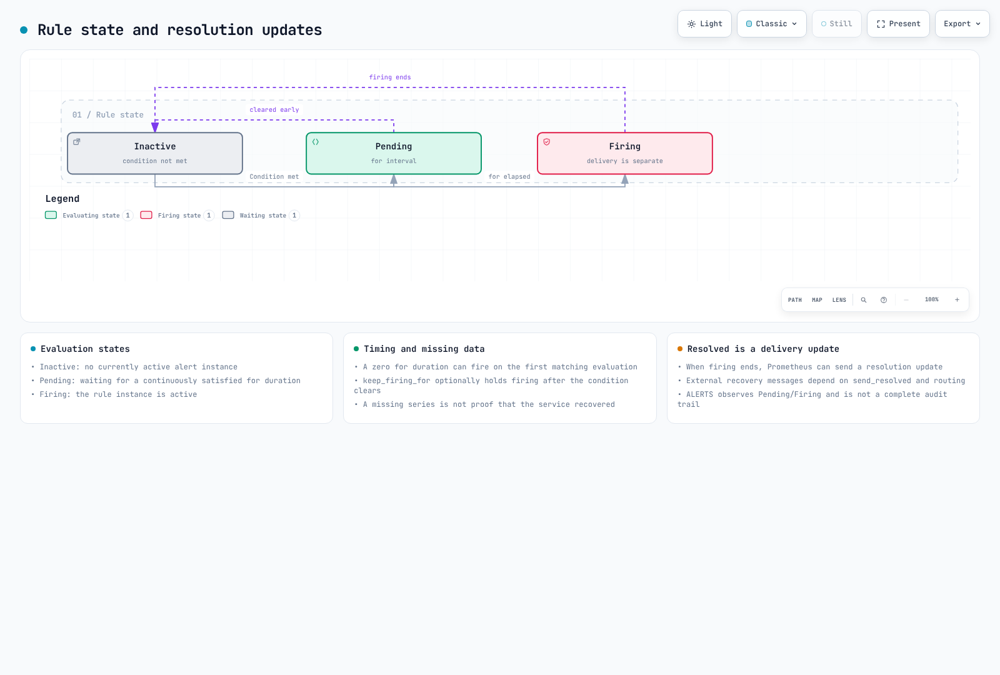

# Configuración de alertas operativas {#operational-alert-configuration}

> **Versiones de referencia revisadas**: Prometheus 3.15.0, Alertmanager 0.34.1, kube-prometheus-stack 92.9.0 / Prometheus Operator 0.94.1\
> **Última revisión**: 16 de octubre de 2026. La evaluación de reglas, las plantillas, el enrutamiento, el alcance de la inhibición y la integración del chart se validaron localmente. No se configuraron alertas en un clúster real ni se enviaron notificaciones a Slack o PagerDuty.

< [Anterior: Escalado](06-scaling-strategies.md) | [Contenido](README.md) | [Siguiente: Análisis de observabilidad](08-observability-analysis.md) >

Configurar alertas requiere algo más que copiar nombres de métricas. Compruebe el recopilador, el tipo de métrica, las etiquetas, las unidades y el comportamiento cuando faltan datos; después, elija los umbrales según el impacto en el servicio y los requisitos de respuesta operativa. Los umbrales siguientes son ejemplos. Seleccione o adapte las reglas que se solapen con las reglas predeterminadas de kube-prometheus-stack.

## Arquitectura de alertas {#alert-architecture}


[Diagrama interactivo](https://www.atomai.click/kubernetes-docs/archmaps/en-ops-07-observability-alerts-0.html)

PrometheusRule es un recurso de Kubernetes. **Prometheus Operator selecciona los recursos mediante selectores de espacios de nombres y etiquetas y genera la configuración de reglas.** Prometheus evalúa las reglas resultantes sobre las series temporales recopiladas.

El ejemplo usa `monitoring` como espacio de nombres y como nombre de la instalación de Helm. La etiqueta `release: monitoring` de la regla coincide así con el selector generado. Cambie ambos valores si la instalación o el selector reales son distintos.

| Campo o concepto | Significado |
|---|---|
| `labels` | Identidad de cada instancia de alerta y datos para la agrupación, el enrutamiento y la inhibición |
| `annotations` | Resumen, descripción y enlaces reales a guías de respuesta |
| `for` | Tiempo durante el que debe mantenerse la condición para un conjunto concreto de etiquetas |
| `keep_firing_for` | Tiempo opcional durante el que la alerta sigue activa después de desaparecer la condición |
| Gravedad | Valores de etiquetas y política de respuesta definidos por la organización |

`critical`, `warning` e `info` son convenciones habituales, no una enumeración fija ni un SLA impuesto por la herramienta. Los intervalos de evaluación, `for`, el transporte, group_wait y el procesamiento del receptor influyen en el momento de la notificación.

### Estado de evaluación y resolución {#evaluation-state-and-resolution}



[Diagrama de estados](https://www.atomai.click/kubernetes-docs/archmaps/en-ops-07-observability-alerts-1.html)

Distinga la evaluación de reglas de la entrega de notificaciones. El estado `Firing` no demuestra que Slack haya recibido un mensaje. Cuando la alerta deja de estar activa, puede enviarse una actualización de resolución; los mensajes externos de recuperación dependen de `send_resolved`, del enrutamiento, del silenciamiento y de la entrega.

Las alertas se activan para los **elementos devueltos por el vector**, incluidos aquellos cuyo valor numérico es cero. `Ready == 0` devuelve esos elementos de forma intencionada. Evite conservar por accidente comparaciones falsas añadiendo `bool` a una expresión de alerta.

Si desaparece una serie, la expresión puede dejar de devolver resultados sin que el servicio se haya recuperado. `ALERTS` permite observar los estados pending y firing, pero no ofrece un historial completo de terminaciones de nodos ni de acciones de los operadores.

## Reglas de referencia validadas {#validated-baseline-rules}

Estos ejemplos requieren la recopilación real de métricas de node-exporter, kubelet/cAdvisor y kube-state-metrics. Compruebe los nombres, los jobs, las etiquetas y el modo de nodo o volumen correspondiente. El ejemplo supone un clúster por Prometheus; las consultas centralizadas necesitan **etiquetas de clúster en las propias series recopiladas** para evitar mezclar clústeres.

```yaml
# prometheusrule.yaml
apiVersion: monitoring.coreos.com/v1
kind: PrometheusRule
metadata:
  name: reviewed-operational-alerts
  namespace: monitoring
  labels:
    release: monitoring
spec:
  groups:
  - name: docs.network
    rules:
    - alert: NodeNetworkReceiveDropsHigh
      expr: rate(node_network_receive_drop_total{device!~"lo|veth.*|docker.*|br-.*|cali.*"}[5m]) > 100
      for: 5m
      labels:
        severity: warning
        alert_family: network_receive_drop
        team: network
      annotations:
        summary: Elevated receive drops on {{ $labels.instance }}
        description: '{{ $labels.device }} reports {{ printf "%.2f" $value }} dropped packets/s. Correlate with
          workload symptoms.'
        runbook_url: https://www.atomai.click/kubernetes-docs/en/ops/16-troubleshooting-playbook
    - alert: NodeNetworkTransmitDropsHigh
      expr: rate(node_network_transmit_drop_total{device!~"lo|veth.*|docker.*|br-.*|cali.*"}[5m]) > 100
      for: 5m
      labels:
        severity: warning
        alert_family: network_transmit_drop
        team: network
      annotations:
        summary: Elevated transmit drops on {{ $labels.instance }}
        description: '{{ $labels.device }} reports {{ printf "%.2f" $value }} dropped packets/s. Check the actual
          interface and path.'
        runbook_url: https://www.atomai.click/kubernetes-docs/en/ops/16-troubleshooting-playbook
  - name: docs.cpu
    rules:
    - alert: NodeCPUUsageHigh
      expr: (1 - avg by (cluster, instance, job) (rate(node_cpu_seconds_total{mode="idle"}[5m]))) > 0.85
      for: 5m
      labels:
        severity: warning
        alert_family: node_cpu
        team: platform
      annotations:
        summary: Elevated CPU utilization on {{ $labels.instance }}
        description: '{{ $value | humanizePercentage }} non-idle CPU time. This alone does not establish CPU pressure
          or customer impact.'
        runbook_url: https://www.atomai.click/kubernetes-docs/en/ops/16-troubleshooting-playbook
    - alert: NodeCPUUsageCritical
      expr: (1 - avg by (cluster, instance, job) (rate(node_cpu_seconds_total{mode="idle"}[5m]))) > 0.95
      for: 5m
      labels:
        severity: critical
        alert_family: node_cpu
        team: platform
      annotations:
        summary: Elevated CPU utilization on {{ $labels.instance }}
        description: '{{ $value | humanizePercentage }} non-idle CPU time. This alone does not establish CPU pressure
          or customer impact.'
        runbook_url: https://www.atomai.click/kubernetes-docs/en/ops/16-troubleshooting-playbook
    - alert: ContainerCPUThrottlingHigh
      expr: (sum by (cluster, namespace, pod, container) (rate(container_cpu_cfs_throttled_periods_total{container!="",container!="POD"}[5m])))
        / ((sum by (cluster, namespace, pod, container) (rate(container_cpu_cfs_periods_total{container!="",container!="POD"}[5m])))
        > 0) > 0.25
      for: 5m
      labels:
        severity: warning
        alert_family: container_cpu_throttling
        team: platform
      annotations:
        summary: CPU throttling on {{ $labels.namespace }}/{{ $labels.pod }}/{{ $labels.container }}
        description: '{{ $value | humanizePercentage }} of observed CFS periods included throttling. Correlate with
          latency and CPU quota before changing limits.'
        runbook_url: https://www.atomai.click/kubernetes-docs/en/ops/16-troubleshooting-playbook
    - alert: ContainerCPUThrottlingCritical
      expr: (sum by (cluster, namespace, pod, container) (rate(container_cpu_cfs_throttled_periods_total{container!="",container!="POD"}[5m])))
        / ((sum by (cluster, namespace, pod, container) (rate(container_cpu_cfs_periods_total{container!="",container!="POD"}[5m])))
        > 0) > 0.5
      for: 5m
      labels:
        severity: critical
        alert_family: container_cpu_throttling
        team: platform
      annotations:
        summary: CPU throttling on {{ $labels.namespace }}/{{ $labels.pod }}/{{ $labels.container }}
        description: '{{ $value | humanizePercentage }} of observed CFS periods included throttling. Correlate with
          latency and CPU quota before changing limits.'
        runbook_url: https://www.atomai.click/kubernetes-docs/en/ops/16-troubleshooting-playbook
    - alert: ContainerCPUAboveRequest
      expr: (sum by (cluster, namespace, pod, container) (rate(container_cpu_usage_seconds_total{container!="",container!="POD"}[5m])))
        / ((max by (cluster, namespace, pod, container) (kube_pod_container_resource_requests{resource="cpu",unit="core",container!=""}))
        > 0) > 1.5
      for: 30m
      labels:
        severity: info
        alert_family: container_cpu_request
        team: platform
      annotations:
        summary: CPU use exceeds request on {{ $labels.namespace }}/{{ $labels.pod }}
        description: '{{ printf "%.2f" $value }} times the request. CPU requests are not a hard usage limit; review
          sustained demand.'
        runbook_url: https://www.atomai.click/kubernetes-docs/en/ops/16-troubleshooting-playbook
  - name: docs.storage
    rules:
    - alert: NodeFilesystemUsageHigh
      expr: ((1 - node_filesystem_avail_bytes{fstype!~"tmpfs|overlay|squashfs|nsfs|tracefs"} / (node_filesystem_size_bytes{fstype!~"tmpfs|overlay|squashfs|nsfs|tracefs"}
        > 0)) > 0.85) and (node_filesystem_readonly{fstype!~"tmpfs|overlay|squashfs|nsfs|tracefs"} == 0)
      for: 5m
      labels:
        severity: warning
        alert_family: node_filesystem
        team: storage
      annotations:
        summary: Filesystem usage on {{ $labels.instance }} {{ $labels.mountpoint }}
        description: '{{ $value | humanizePercentage }} of reported capacity is unavailable. Check actual mount
          layout and workload storage.'
        runbook_url: https://www.atomai.click/kubernetes-docs/en/ops/16-troubleshooting-playbook
    - alert: NodeFilesystemUsageCritical
      expr: ((1 - node_filesystem_avail_bytes{fstype!~"tmpfs|overlay|squashfs|nsfs|tracefs"} / (node_filesystem_size_bytes{fstype!~"tmpfs|overlay|squashfs|nsfs|tracefs"}
        > 0)) > 0.95) and (node_filesystem_readonly{fstype!~"tmpfs|overlay|squashfs|nsfs|tracefs"} == 0)
      for: 5m
      labels:
        severity: critical
        alert_family: node_filesystem
        team: storage
      annotations:
        summary: Filesystem usage on {{ $labels.instance }} {{ $labels.mountpoint }}
        description: '{{ $value | humanizePercentage }} of reported capacity is unavailable. Check actual mount
          layout and workload storage.'
        runbook_url: https://www.atomai.click/kubernetes-docs/en/ops/16-troubleshooting-playbook
    - alert: PVCUsageHigh
      expr: (max by (cluster, namespace, persistentvolumeclaim) (kubelet_volume_stats_used_bytes{persistentvolumeclaim!=""}
        / (kubelet_volume_stats_capacity_bytes{persistentvolumeclaim!=""} > 0))) > 0.85
      for: 5m
      labels:
        severity: warning
        alert_family: pvc_usage
        team: storage
      annotations:
        summary: PVC usage on {{ $labels.namespace }}/{{ $labels.persistentvolumeclaim }}
        description: '{{ $value | humanizePercentage }} filesystem usage. This is not an EBS IOPS/throughput measurement.'
        runbook_url: https://www.atomai.click/kubernetes-docs/en/ops/16-troubleshooting-playbook
    - alert: PVCUsageCritical
      expr: (max by (cluster, namespace, persistentvolumeclaim) (kubelet_volume_stats_used_bytes{persistentvolumeclaim!=""}
        / (kubelet_volume_stats_capacity_bytes{persistentvolumeclaim!=""} > 0))) > 0.95
      for: 5m
      labels:
        severity: critical
        alert_family: pvc_usage
        team: storage
      annotations:
        summary: PVC usage on {{ $labels.namespace }}/{{ $labels.persistentvolumeclaim }}
        description: '{{ $value | humanizePercentage }} filesystem usage. This is not an EBS IOPS/throughput measurement.'
        runbook_url: https://www.atomai.click/kubernetes-docs/en/ops/16-troubleshooting-playbook
    - alert: PVCInodesHigh
      expr: max by (cluster, namespace, persistentvolumeclaim) (kubelet_volume_stats_inodes_used{persistentvolumeclaim!=""}
        / (kubelet_volume_stats_inodes{persistentvolumeclaim!=""} > 0)) > 0.9
      for: 5m
      labels:
        severity: warning
        alert_family: pvc_inodes
        team: storage
      annotations:
        summary: PVC inode usage on {{ $labels.namespace }}/{{ $labels.persistentvolumeclaim }}
        description: '{{ $value | humanizePercentage }} of reported inodes are used. The driver/filesystem must
          support these statistics.'
        runbook_url: https://www.atomai.click/kubernetes-docs/en/ops/16-troubleshooting-playbook
    - alert: PVCGrowthProjectionHigh
      expr: max by (cluster, namespace, persistentvolumeclaim) ((predict_linear(kubelet_volume_stats_used_bytes{persistentvolumeclaim!=""}[6h],
        24*3600) / (kubelet_volume_stats_capacity_bytes{persistentvolumeclaim!=""} > 0)) and (kubelet_volume_stats_used_bytes{persistentvolumeclaim!=""}
        / (kubelet_volume_stats_capacity_bytes{persistentvolumeclaim!=""} > 0) > 0.7)) > 1
      for: 1h
      labels:
        severity: warning
        alert_family: pvc_growth
        team: storage
      annotations:
        summary: PVC growth projection on {{ $labels.namespace }}/{{ $labels.persistentvolumeclaim }}
        description: A linear fit projects usage beyond current capacity within 24h. Check data coverage, resizing
          and nonlinear changes.
        runbook_url: https://www.atomai.click/kubernetes-docs/en/ops/16-troubleshooting-playbook
  - name: docs.nodes
    rules:
    - alert: NodeNotReady
      expr: max by (cluster, node) (kube_node_status_condition{condition="Ready",status="true"}) == 0
      for: 5m
      labels:
        severity: warning
        alert_family: node_ready
        team: platform
      annotations:
        summary: Node {{ $labels.node }} is not Ready
        description: An observed Node has Ready=false or unknown. Inspect conditions and events; this is not proof
          of termination.
        runbook_url: https://www.atomai.click/kubernetes-docs/en/ops/16-troubleshooting-playbook
    - alert: NodeDiskPressure
      expr: max by (cluster, node) (kube_node_status_condition{condition="DiskPressure",status="true"}) == 1
      for: 5m
      labels:
        severity: critical
        alert_family: node_disk_pressure
        team: storage
      annotations:
        summary: Node {{ $labels.node }} reports DiskPressure
        description: Kubelet reports disk pressure. Correlate filesystem space/inodes and eviction events.
        runbook_url: https://www.atomai.click/kubernetes-docs/en/ops/16-troubleshooting-playbook
    - alert: PDBHealthyBelowDesired
      expr: max by (cluster, namespace, poddisruptionbudget) (kube_poddisruptionbudget_status_desired_healthy -
        kube_poddisruptionbudget_status_current_healthy) > 0
      for: 5m
      labels:
        severity: warning
        alert_family: pdb_health
        team: platform
      annotations:
        summary: PDB healthy count below desired in {{ $labels.namespace }}
        description: '{{ printf "%.0f" $value }} fewer healthy Pods than desired for {{ $labels.poddisruptionbudget
          }}. This does not prove a policy was bypassed.'
        runbook_url: https://www.atomai.click/kubernetes-docs/en/ops/16-troubleshooting-playbook
  - name: docs.collection
    rules:
    - alert: KnownScrapeTargetDown
      expr: up == 0
      for: 5m
      labels:
        severity: warning
        alert_family: scrape
        team: platform
      annotations:
        summary: Cannot scrape {{ $labels.job }} at {{ $labels.instance }}
        description: A known target failed scraping. A target removed from discovery needs separate absence/inventory
          monitoring.
        runbook_url: https://www.atomai.click/kubernetes-docs/en/ops/16-troubleshooting-playbook
```

Formatee las proporciones con `humanizePercentage`. Las anotaciones de alertas de Prometheus no admiten funciones arbitrarias de Sprig, como `mul` o `div`. No muestre `0.96` como `0.96%` ni lea un `$labels.used_bytes` inexistente. `$value` contiene el resultado de la expresión; los demás operandos no se convierten automáticamente en etiquetas.

### Red {#network}

Use `rate()` para los contadores de paquetes descartados; la unidad resultante es paquetes/s. No confunda paquetes por segundo con paquetes por minuto. Algunos rechazos de políticas o descartes transitorios son esperables, por lo que debe relacionarlos con su persistencia, el volumen de tráfico y los síntomas del servicio.

Examine el ancho de banda en bits/s:

```promql
rate(node_network_transmit_bytes_total{device!~"lo|veth.*|docker.*|br-.*"}[5m]) * 8
```

Compare el resultado con las especificaciones reales de rendimiento base y de ráfaga de EC2, la ruta y los límites de PPS. Distinga los `10^9` bits de un Gbps de las unidades binarias Gi. `node_network_speed_bytes` puede indicar cero, un valor desconocido o la velocidad anunciada por una NIC virtual. La suma RX+TX no representa en todos los casos una proporción de saturación de un enlace full-duplex. No suponga que todos los nodos tienen un denominador de 10 Gbps.

### CPU {#cpu}

La proporción de períodos CFS con limitación es la **fracción de períodos en los que hubo limitación**, no el tiempo de CPU perdido. Dividir los segundos de limitación entre el uso real de CPU tampoco produce un porcentaje simple del tiempo transcurrido. Use funciones adecuadas para contadores y excluya los denominadores iguales a cero.

Superar la CPU solicitada puede ser un uso legítimo de la capacidad de ráfaga. Una utilización elevada, la limitación, iowait o steal no demuestran por sí solos el impacto en el cliente ni la causa del problema. Evalúe los límites y las solicitudes junto con la latencia del servicio, las cuotas, la planificación y los efectos del HPA.

Una expresión como `process_cpu_seconds_total{job="containerd"}` requiere ese exportador de procesos y ese job reales. No suponga que los servicios gestionados de Auto Mode exponen las mismas métricas de Deployment o DaemonSet que una instalación convencional.

### Sistemas de archivos, PVC e inodos {#filesystems-pvcs-and-inodes}

`kubelet_volume_stats_*` proporciona estadísticas de los controladores y sistemas de archivos compatibles. El uso de un PVC no mide la saturación de IOPS o rendimiento de EBS, y no todos los modos de volumen exponen las mismas estadísticas.

Una capacidad igual a cero o ausente no significa «0 % usado». Excluya los sistemas de archivos virtuales o de solo lectura según el propósito de la regla y examine los montajes reales; `/var/lib/kubelet` no siempre es un punto de montaje independiente.

`container_fs_limit_bytes` no tiene por qué coincidir con `resources.limits.ephemeral-storage` de Kubernetes. Distinga las capas escribibles, los registros, emptyDir y la contabilización del sistema de archivos del nodo.

`predict_linear` extrapola una tendencia ajustada a los datos. Los cambios de tamaño, las eliminaciones, las muestras ausentes y el crecimiento no lineal cambian su interpretación. No garantiza que la capacidad se agote en un momento exacto ni justifica una ampliación automática incondicional.

## Adapte las métricas de CNI, DNS y políticas a la instalación {#match-cni-dns-and-policy-metrics-to-the-installation}

### VPC CNI {#vpc-cni}

El endpoint IPAM del VPC CNI convencional y la agregación en CloudWatch de cni-metrics-helper usan rutas y nombres distintos. Las definiciones siguientes de gauges y contadores están presentes en v1.23.1; compruebe la versión instalada y el endpoint `/metrics` real antes de utilizarlas.

```promql
# Spare addresses in the currently allocated pool
awscni_total_ip_addresses - awscni_assigned_ip_addresses

# IPAM error counter
rate(awscni_ipamd_error_count[5m])

# Failure to obtain an available IP address
rate(awscni_no_available_ip_addresses[5m])
```

Que el pool de reserva no tenga direcciones disponibles no demuestra por sí solo que la subred esté agotada ni que sea imposible crear cualquier Pod nuevo. Compruebe la asignación adicional, la delegación de prefijos, los límites de ENI, los errores reales y la capacidad de la subred.

No añada una etiqueta ausente `status="failed"` a `awscni_add_ip_req_count` ni invente un histograma de latencia de ENI. Distinga los nombres originales de Prometheus de los nombres que cni-metrics-helper asigna a las métricas agregadas de CloudWatch a nivel de clúster.

### DNS {#dns}

`NXDOMAIN` puede ser una respuesta negativa legítima. Defina deliberadamente qué constituye un fallo y qué umbrales de tráfico se requieren. Si se recopilan métricas de CoreDNS, esta expresión de diagnóstico calcula la proporción de respuestas SERVFAIL/REFUSED:

```promql
(
  sum by (cluster) (rate(coredns_dns_responses_total{rcode=~"SERVFAIL|REFUSED"}[5m]))
  or on (cluster)
  (0 * sum by (cluster) (rate(coredns_dns_responses_total[5m])))
)
/
(sum by (cluster) (rate(coredns_dns_responses_total[5m])) > 0)
```

Un fallo de recopilación de métricas y un fallo de consulta DNS son condiciones distintas. `absent(up{job="coredns"} == 1)` por sí solo no demuestra que el DNS del clúster no pueda funcionar. **Una instalación exclusivamente de EKS Auto Mode ejecuta CoreDNS como servicio del sistema del nodo**; no le aplique los supuestos de un Deployment convencional de CoreDNS. Compruebe la arquitectura DNS de las instalaciones con nodos de distintos tipos.

### Descartes por políticas de red {#network-policy-drops}

Con las métricas de descartes habilitadas, Hubble de Cilium 1.20.3 exporta `hubble_drop_total` con las etiquetas de motivo, protocolo y contexto que se hayan configurado.

```promql
sum by (cluster, reason) (
  rate(hubble_drop_total{reason="POLICY_DENIED"}[5m])
)
```

El contexto del espacio de nombres solo está disponible si se configura. Un descarte por política no implica necesariamente una configuración incorrecta. Compruebe la distribución, las funciones y la configuración de métricas de Cilium o Calico realmente instalados, en lugar de inventar una métrica común `denied_packets`. Consulte el [capítulo revisado de observabilidad de Cilium](../service-mesh/cilium-service-mesh/04-observability.md).

## Estado de los nodos de Auto Mode y causas de terminación {#auto-mode-node-state-and-termination-causes}

`NodeNotReady` indica que el estado Ready de un nodo observado es false o unknown. No demuestra por sí solo que el nodo haya terminado, se haya sustituido o no quede capacidad. Distinga también la ausencia de un nodo en el inventario de un fallo de su exportador.

```promql
# Previously observed Nodes missing from current inventory: diagnostic only
max by (cluster, node) (kube_node_info offset 5m)
unless on (cluster, node)
max by (cluster, node) (kube_node_info)

# Currently retained Evicted Pod state, not a historical event counter
sum by (cluster, namespace) (kube_pod_status_reason{reason="Evicted"} == 1)
```

La fase y el motivo del estado de un Pod, así como su marca de tiempo de eliminación, no son contadores de eventos. No use `increase()` para convertirlos en un recuento de expulsiones durante un período ni añada una etiqueta inexistente `reason="NodeDrain"`. Conserve los Events de Kubernetes y los registros de auditoría y operación para disponer de un historial después de que la recolección de basura elimine los Pods.

Que currentHealthy de un PDB sea inferior a desiredHealthy indica un déficit de salud, no que alguien haya vulnerado su política. Investigue por separado los fallos involuntarios, los cambios directos de réplicas y las demás causas.

### Auto Mode gestionado y Karpenter autogestionado {#managed-auto-mode-and-self-managed-karpenter}

No suponga que Auto Mode expone el endpoint de recopilación de métricas de un controlador Karpenter autogestionado. Use las condiciones de nodo admitidas, el estado de NodeClaim y NodePool y los registros de auditoría del plano de control gestionado.

La guía de solución de problemas de Auto Mode de AWS describe eventos como `DisruptionBlocked`, `DisruptionTerminating`, `FailedScheduling` y `FailedDraining` en los registros de auditoría del plano de control. Con la auditoría habilitada, limite la consulta al grupo de registros del clúster real:

```text
fields @timestamp, @message
| filter @logStream like /kube-apiserver-audit/
| filter @message like /DisruptionBlocked|DisruptionTerminating|FailedScheduling|FailedDraining|NodeRepairBlocked/
| sort @timestamp desc
| limit 100
```

Si Karpenter es autogestionado, use el catálogo de métricas de la versión instalada. Los contadores actuales de terminación de NodeClaim son agregados, no un registro de auditoría completo por nodo y motivo. Los contadores de la cola de interrupciones pueden incluir tipos de mensajes distintos de Spot.

`karpenter_nodepools_usage` mide **recursos aprovisionados**, no la utilización efectiva de CPU. Compruebe las etiquetas de recursos, las unidades, la identidad del clúster y los límites ausentes o iguales a cero antes de comparar uso y límites. Tener Pods pendientes y métricas de capacidad disponible no demuestra que puedan planificarse: también influyen la afinidad, los taints, la topología y los volúmenes.

## Configuración de Alertmanager e integración del chart {#alertmanager-configuration-and-chart-wiring}

Lo siguiente es **YAML nativo de Alertmanager**. No lo mezcle con los matchers estructurados ni los campos camelCase del CRD AlertmanagerConfig. Alertmanager nativo no sustituye automáticamente los marcadores de variables de entorno `${NAME}`.

### Prepare los archivos y los Secrets {#prepare-files-and-secrets}

Prepare estos objetos en el espacio de nombres `monitoring`:

| Objeto | Contenido |
|---|---|
| Secret `reviewed-alertmanager-config` | Clave `alertmanager.yaml` |
| ConfigMap `notification-templates` | Clave `notifications.tmpl` |
| Secret `notification-credentials` | `slack-default`, `slack-network`, `slack-storage`, `slack-info`, `pagerduty-routing-key` |

Use el procedimiento aprobado de gestión de secretos para las credenciales. Mantenga las URL y claves reales fuera de Git, de los valores de Helm y de los registros de PR. Los webhooks entrantes actuales de Slack están vinculados al canal elegido en su instalación; cambiar el campo `channel` no convierte una URL en varias destinadas a canales diferentes. Este ejemplo usa archivos de URL independientes.

Aquí PagerDuty usa una clave de enrutamiento de Events API v2. `service_key`/`service_key_file` sigue siendo una vía independiente admitida para integraciones v1; seleccione las credenciales correspondientes al tipo real de integración.

```yaml
# alertmanager.yaml
global:
  resolve_timeout: 5m
route:
  receiver: default-slack
  group_by: [cluster, alertname, namespace, severity]
  group_wait: 30s
  group_interval: 5m
  repeat_interval: 4h
  routes:
    - receiver: oncall
      matchers: ['severity="critical"']
      group_wait: 10s
      repeat_interval: 1h
      continue: true
    - receiver: low-priority
      matchers: ['severity="info"']
      mute_time_intervals: [nightly-maintenance]
    - receiver: network-team
      matchers: ['team="network"']
    - receiver: storage-team
      matchers: ['team="storage"']
    # Explicit sibling fallback: a matched critical route does not fall back
    # to the root receiver merely because its continue flag is true.
    - receiver: default-slack

inhibit_rules:
  - source_matchers: ['severity="critical"', 'cluster!=""', 'alert_family!=""', 'instance!=""']
    target_matchers: ['severity="warning"', 'cluster!=""', 'alert_family!=""', 'instance!=""']
    equal: [cluster, alert_family, instance, job, device, mountpoint, fstype]
  - source_matchers: ['severity="critical"', 'cluster!=""', 'alert_family!=""', 'namespace!=""', 'pod!=""', 'container!=""']
    target_matchers: ['severity="warning"', 'cluster!=""', 'alert_family!=""', 'namespace!=""', 'pod!=""', 'container!=""']
    equal: [cluster, alert_family, namespace, pod, container]
  - source_matchers: ['severity="critical"', 'cluster!=""', 'alert_family!=""', 'namespace!=""', 'persistentvolumeclaim!=""']
    target_matchers: ['severity="warning"', 'cluster!=""', 'alert_family!=""', 'namespace!=""', 'persistentvolumeclaim!=""']
    equal: [cluster, alert_family, namespace, persistentvolumeclaim]

receivers:
  - name: default-slack
    slack_configs:
      - api_url_file: /etc/alertmanager/secrets/notification-credentials/slack-default
        send_resolved: true
        title: '{{ template "docs.title" . }}'
        text: '{{ template "docs.text" . }}'
  - name: network-team
    slack_configs:
      - api_url_file: /etc/alertmanager/secrets/notification-credentials/slack-network
        send_resolved: true
        title: '{{ template "docs.title" . }}'
        text: '{{ template "docs.text" . }}'
  - name: storage-team
    slack_configs:
      - api_url_file: /etc/alertmanager/secrets/notification-credentials/slack-storage
        send_resolved: true
        title: '{{ template "docs.title" . }}'
        text: '{{ template "docs.text" . }}'
  - name: low-priority
    slack_configs:
      - api_url_file: /etc/alertmanager/secrets/notification-credentials/slack-info
        send_resolved: true
        title: '{{ template "docs.title" . }}'
        text: '{{ template "docs.text" . }}'
  - name: oncall
    pagerduty_configs:
      - routing_key_file: /etc/alertmanager/secrets/notification-credentials/pagerduty-routing-key
        send_resolved: true
        severity: critical
        description: '{{ template "docs.title" . }}'
        details:
          alerts: '{{ template "docs.text" . }}'

templates:
  - /etc/alertmanager/configmaps/notification-templates/*.tmpl

time_intervals:
  - name: nightly-maintenance
    time_intervals:
      - location: Asia/Seoul
        times:
          - start_time: "02:00"
            end_time: "04:00"
```

Las alertas críticas llegan al equipo de guardia y después continúan por la ruta de Slack del equipo correspondiente. La última ruta hermana de respaldo, definida explícitamente, también envía a Slack las alertas críticas sin equipo. Una vez que coincide una ruta hija, `continue: true` por sí solo no hace que se use el receptor de la ruta raíz como respaldo.

Las alertas info usan una ruta independiente, silenciada todos los días de **02:00 a 04:00 en Asia/Seoul**. Esto no acumula un resumen diario. Los intervalos de repetición y los retrasos de agrupación no sustituyen un proceso de resúmenes programado por calendario.

La inhibición requiere identificadores reales de clúster y entidad. Los nombres de las alertas warning y critical pueden ser distintos, pero deben compartir `alert_family` y el alcance previsto de nodo, contenedor o PVC. Las etiquetas ausentes pueden compararse como valores vacíos iguales; un `equal: [node]` sin restricciones adicionales puede suprimir alertas no relacionadas.

`resolve_timeout` no modifica `for` ni el retraso de resolución de las alertas de Prometheus que incluyen EndsAt. Compruebe por separado el comportamiento real del receptor, incluido `send_resolved`.

### Plantilla de notificación {#notification-template}

`notifications.tmpl`:

```text
{{ define "docs.title" -}}
[{{ .Status | toUpper }}] {{ .GroupLabels.alertname }} — {{ .CommonLabels.cluster }}
{{- end }}

{{ define "docs.text" -}}
{{ range .Alerts -}}
[{{ .Status | toUpper }}] {{ .Annotations.summary }}
{{ .Annotations.description }}
{{ if .Labels.namespace }}Namespace: {{ .Labels.namespace }}
{{ end -}}
{{ if .Annotations.runbook_url }}Runbook: {{ .Annotations.runbook_url }}
{{ end -}}
{{ end -}}
{{ if .ExternalURL }}Alertmanager: {{ .ExternalURL }}
{{ end -}}
{{- end }}
```

La plantilla muestra el estado de cada alerta incluso cuando un grupo contiene alertas activas y resueltas. Evite los botones de guía de respuesta vacíos y los enlaces de silenciamiento construidos manualmente con valores de etiquetas sin escapar. Use la interfaz autenticada de Alertmanager para seleccionar y silenciar alertas concretas.

Por ejemplo, los objetos siguientes de Kubernetes proporcionan la configuración y la plantilla. No crean el Secret de credenciales:

```bash
kubectl --context "$TARGET_CONTEXT" -n monitoring create secret generic \
  reviewed-alertmanager-config --from-file=alertmanager.yaml \
  --dry-run=client -o yaml |
  kubectl --context "$TARGET_CONTEXT" -n monitoring apply -f -

kubectl --context "$TARGET_CONTEXT" -n monitoring create configmap \
  notification-templates --from-file=notifications.tmpl \
  --dry-run=client -o yaml |
  kubectl --context "$TARGET_CONTEXT" -n monitoring apply -f -
```

### Valores de kube-prometheus-stack {#kube-prometheus-stack-values}

```yaml
# alerting-values.yaml
# Merge into the reviewed full values for the actual release named "monitoring".
alertmanager:
  enabled: true
  alertmanagerSpec:
    useExistingSecret: true
    configSecret: reviewed-alertmanager-config
    secrets: [notification-credentials]
    configMaps: [notification-templates]
    externalUrl: https://alertmanager.example.com
    # No AlertmanagerConfig object is supplied in this example.
    # Adding one with this label is an explicit, separately reviewed choice.
    alertmanagerConfigSelector:
      matchLabels:
        alertmanager-config: platform-approved
    alertmanagerConfigNamespaceSelector:
      matchLabels:
        kubernetes.io/metadata.name: monitoring
prometheus:
  prometheusSpec:
    externalLabels:
      cluster: REPLACE_CLUSTER_NAME
    additionalAlertRelabelConfigs:
      - action: labeldrop
        regex: prometheus_replica
```

Integre este fragmento en los **valores completos y revisados de la instalación**, sustituyendo el nombre del clúster y la URL de acceso. No sobrescriba una instalación existente usando solo este fragmento. El chart 92.9.0 genera la configuración adicional de reetiquetado de alertas en un Secret al que hace referencia Prometheus.

```bash
helm template monitoring prometheus-community/kube-prometheus-stack \
  --version 92.9.0 --namespace monitoring \
  --values monitoring-values.yaml --values alerting-values.yaml \
  > rendered-monitoring.yaml
```

Prepare el repositorio de Helm y revise primero las actualizaciones del CRD y del chart. Compruebe las reglas predeterminadas duplicadas y los supuestos sobre jobs no disponibles del plano de control gestionado o de Auto Mode antes de aplicar los cambios mediante el procedimiento de despliegue operativo.

Las etiquetas externas identifican las alertas salientes; no etiquetan automáticamente cada muestra de las consultas locales. Elimine la identidad de cada réplica cuando sea necesario para la deduplicación en HA y conserve la identidad real del clúster.

El ejemplo selecciona su Secret de configuración base y los recursos adicionales AlertmanagerConfig con las etiquetas explícitas correspondientes. Añadir un CRD coincidente supone otra combinación de configuraciones que requiere una revisión deliberada.

## Validación y mantenimiento {#validation-and-maintenance}

Con PyYAML disponible, extraiga la especificación de PrometheusRule como archivo nativo de reglas:

```bash
python3 - <<'PY'
from pathlib import Path
import yaml
resource = yaml.safe_load(Path("prometheusrule.yaml").read_text())
Path("rules.yaml").write_text(yaml.safe_dump(resource["spec"], sort_keys=False))
PY
promtool check rules rules.yaml
```

Compruebe Alertmanager con una copia de validación que tenga preparadas las rutas de plantillas y credenciales:

```bash
amtool check-config alertmanager.yaml --enable-feature=utf8-strict-mode
amtool config routes test --config.file=alertmanager.yaml \
  --verify.receivers=oncall,network-team severity=critical team=network
```

Para las comprobaciones locales, las credenciales reales pueden sustituirse por archivos de prueba. Este capítulo validó 17 reglas, 18 escenarios de evaluación, diez casos de enrutamiento, dos plantillas nativas y dieciséis casos de inhibición en un Alertmanager local sin ninguna integración saliente. Los datos reales de los exportadores, la autenticación del canal y la entrega requieren una validación aparte después de conectar el entorno.

Crear o hacer caducar un silencio cambia la política de notificaciones. Confirme la URL de Alertmanager, los matchers de clúster, espacio de nombres y entidad, el responsable, el motivo y la duración. Los silencios no detienen la evaluación de Prometheus, y una alerta silenciada durante mucho tiempo no equivale a un incidente resuelto.

Un gauge de la última terminación con motivo OOMKilled puede conservar un estado histórico. Relacione los recuentos de reinicios, las horas de terminación y los Events, en lugar de aumentar siempre los límites o declarar una fuga de memoria.

## Referencias {#references}

- [Reglas de alertas de Prometheus](https://prometheus.io/docs/prometheus/latest/configuration/alerting_rules/)
- [Configuración de Alertmanager](https://prometheus.io/docs/alerting/latest/configuration/)
- [Definiciones de métricas de VPC CNI v1.23.1](https://github.com/aws/amazon-vpc-cni-k8s/blob/v1.23.1/utils/prometheusmetrics/prometheusmetrics.go)
- [Solución de problemas de Auto Mode](https://docs.aws.amazon.com/eks/latest/userguide/auto-troubleshoot.html)
- [Métricas de Karpenter](https://karpenter.sh/docs/reference/metrics/)
- [Webhooks entrantes de Slack](https://docs.slack.dev/messaging/sending-messages-using-incoming-webhooks/)
- [Cuestionario del capítulo](../quizzes/ops/07-observability-alerts-quiz.md)

< [Anterior: Escalado](06-scaling-strategies.md) | [Contenido](README.md) | [Siguiente: Análisis de observabilidad](08-observability-analysis.md) >
